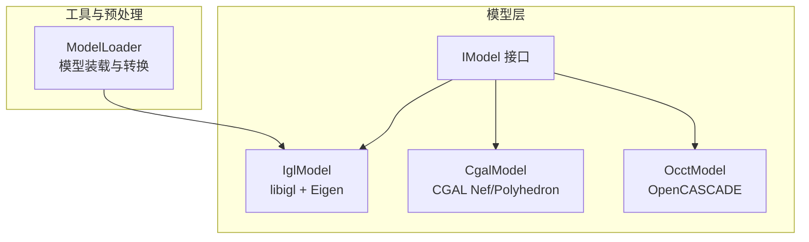
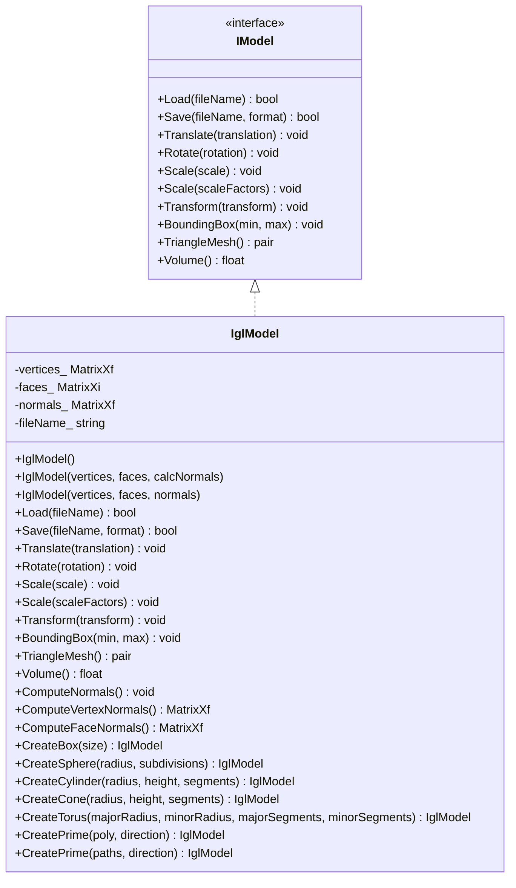
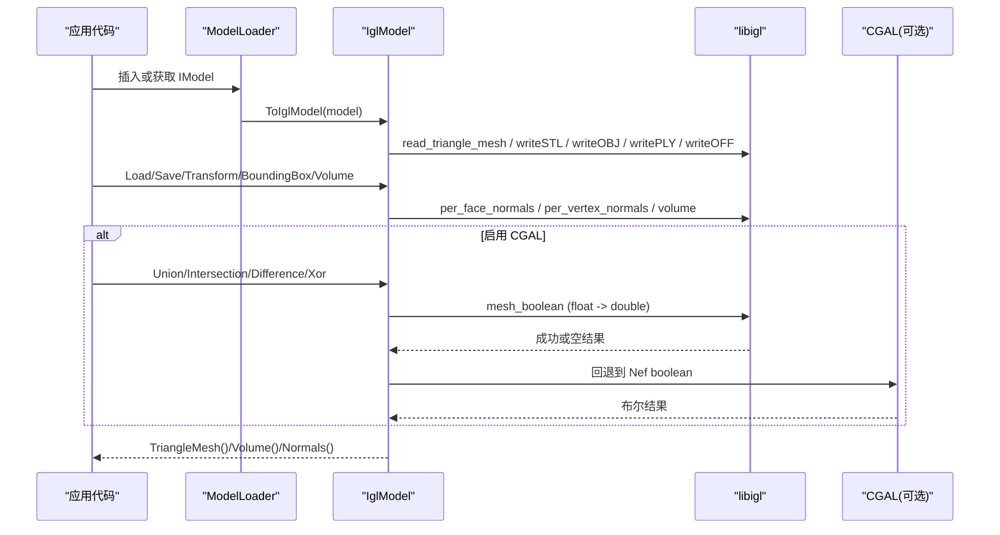
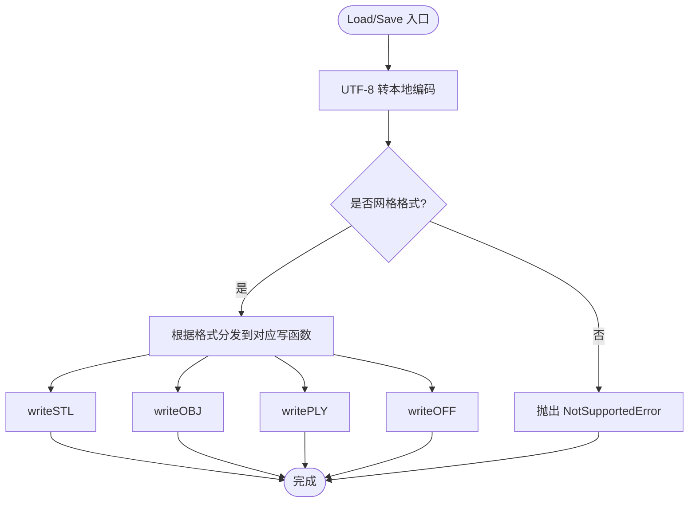
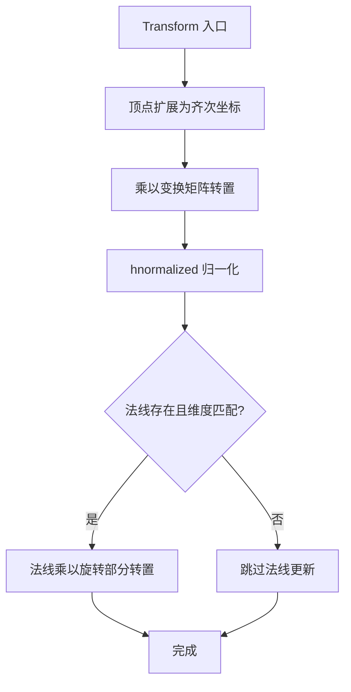
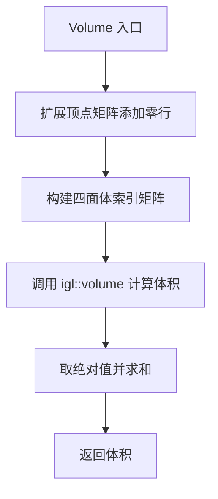
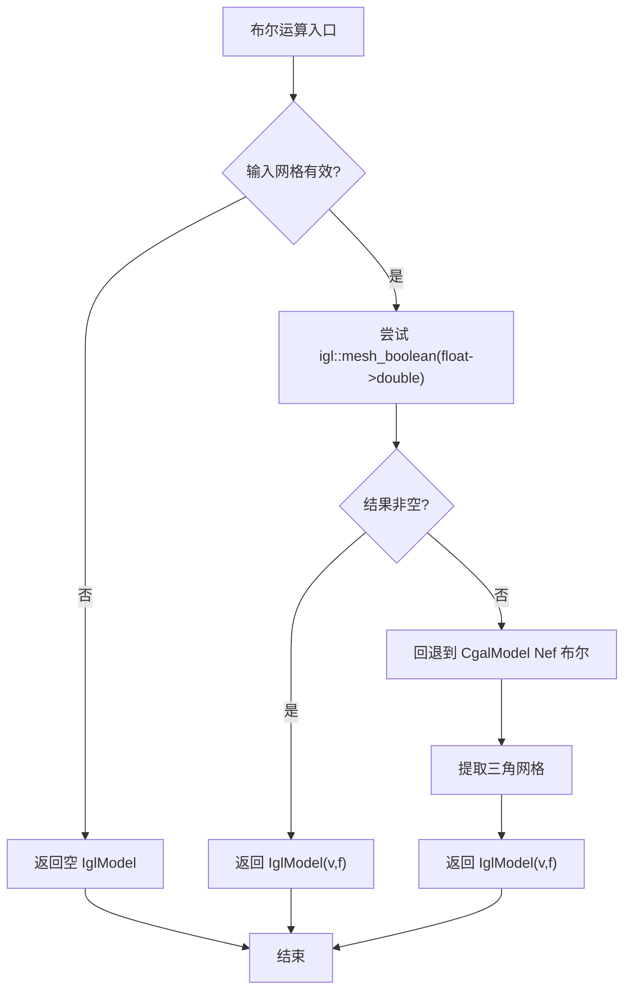
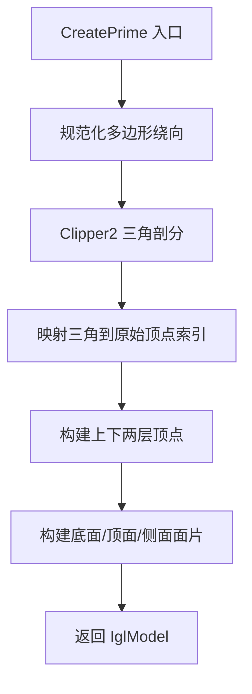
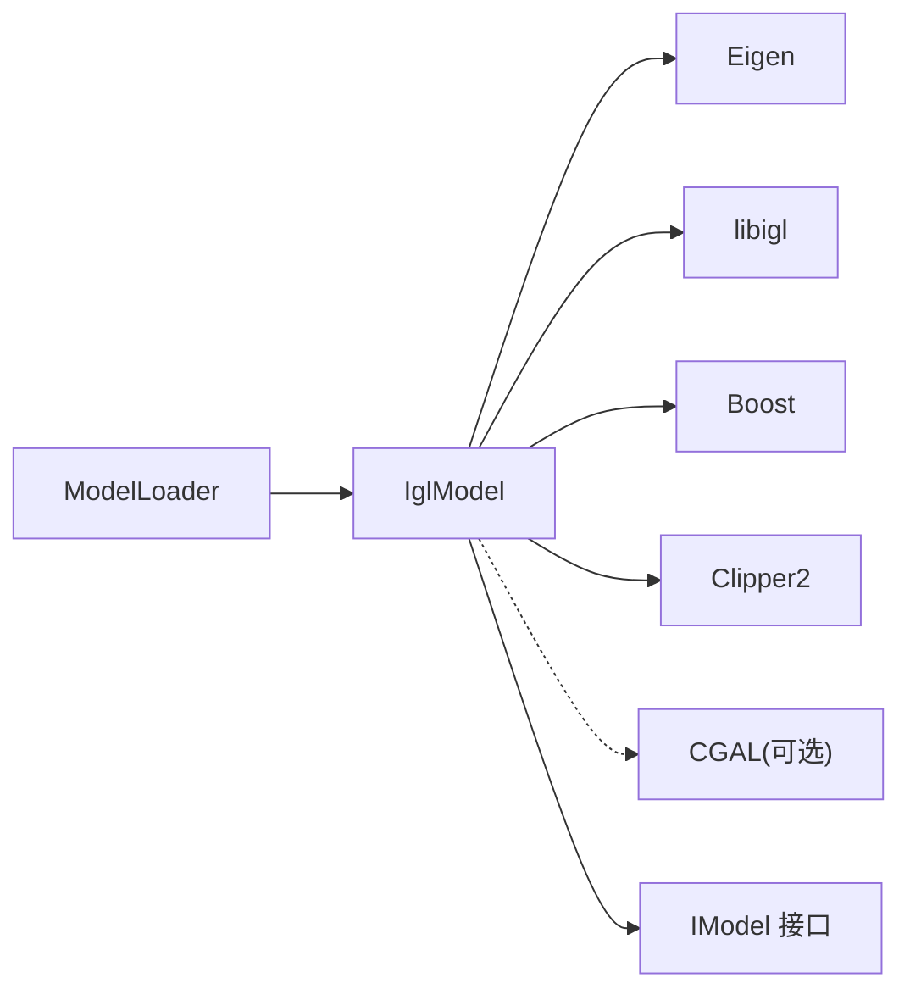

# IglModel - IGL轻量级网格模型

<cite>
**本文引用的文件**   
- [meshmodel/IglModel.hpp](file://meshmodel/IglModel.hpp)
- [meshmodel/IglModel.cpp](file://meshmodel/IglModel.cpp)
- [meshmodel/CgalModel.hpp](file://meshmodel/CgalModel.hpp)
- [meshmodel/CgalModel.cpp](file://meshmodel/CgalModel.cpp)
- [tests/Models/igl_model_test.cpp](file://tests/Models/igl_model_test.cpp)
- [preprocess/ModelLoader.cpp](file://preprocess/ModelLoader.cpp)
- [base/IModel.hpp](file://base/IModel.hpp)
</cite>

## 目录
1. [简介](#简介)
2. [项目结构定位](#项目结构定位)
3. [核心组件概览](#核心组件概览)
4. [架构总览](#架构总览)
5. [详细组件分析](#详细组件分析)
6. [依赖关系分析](#依赖关系分析)
7. [性能与内存优化建议](#性能与内存优化建议)
8. [使用示例与可视化建议](#使用示例与可视化建议)
9. [故障排查指南](#故障排查指南)
10. [结论](#结论)

## 简介
IglModel 是基于 libigl 的轻量级三角形网格模型实现，继承自统一接口 IModel。它使用 Eigen 矩阵存储顶点、面片索引和可选的法向量，提供加载/保存、几何变换、边界框计算、体积计算、法线计算、布尔运算以及多种基本体素和拉伸建模工厂方法。其设计目标是简洁、快速原型开发，适合在不需要复杂拓扑或高精度 CAD 内核的场景中高效处理三角网格。

该实现强调：
- 数据布局简洁：顶点为 N×3 行主序矩阵，面片为 M×3 的三角形索引矩阵。
- 与 Eigen 深度集成：所有几何变换、法线更新、齐次坐标变换均通过 Eigen 高效完成。
- 可选 CGAL 布尔运算：当启用 USE_CGAL 时，优先使用 igl::copyleft::cgal::mesh_boolean；失败时回退到 CgalModel 的 Nef 布尔运算。
- 丰富的基础几何与拉伸建模：支持立方体、球体、圆柱、圆锥、圆环以及二维多边形沿方向拉伸成实体。

## 项目结构定位
IglModel 位于 meshmodel 模块，作为 IModel 接口的一个具体实现，与 CgalModel、OcctModel 等并列。测试用例位于 tests/Models，覆盖基础几何、体积、变换、布尔运算和多边形拉伸等功能。预处理模块中的 ModelLoader 会将任意 IModel 转换为 IglModel，以便后续基于 libigl 的快速处理流程。

**图表来源**
- [meshmodel/IglModel.hpp:18-26](file://meshmodel/IglModel.hpp#L18-L26)
- [meshmodel/CgalModel.hpp:26-34](file://meshmodel/CgalModel.hpp#L26-L34)
- [preprocess/ModelLoader.cpp:136-146](file://preprocess/ModelLoader.cpp#L136-L146)

**章节来源**
- [meshmodel/IglModel.hpp:1-26](file://meshmodel/IglModel.hpp#L1-L26)
- [meshmodel/CgalModel.hpp:1-34](file://meshmodel/CgalModel.hpp#L1-L34)
- [preprocess/ModelLoader.cpp:136-146](file://preprocess/ModelLoader.cpp#L136-L146)

## 核心组件概览
IglModel 的核心职责包括：
- 数据管理：顶点矩阵 vertices_（N×3）、面片索引 faces_（M×3）、可选法向量 normals_。
- 文件 I/O：Load/Save 支持 STL、OBJ、PLY、OFF 等常见网格格式。
- 几何变换：Translate/Rotate/Scale/Transform 支持平移、旋转、缩放、仿射变换，并同步更新法向量。
- 查询能力：BoundingBox 返回轴对齐包围盒，Volume 计算有符号体积绝对值。
- 法线计算：ComputeNormals、ComputeVertexNormals、ComputeFaceNormals。
- 布尔运算：Union/Intersection/Difference/Xor，依赖 CGAL（可选）。
- 基础几何与拉伸：CreateBox/Sphere/Cylinder/Cone/Torus/CreatePrime。

**图表来源**
- [meshmodel/IglModel.hpp:18-121](file://meshmodel/IglModel.hpp#L18-L121)
- [base/IModel.hpp](file://base/IModel.hpp)

**章节来源**
- [meshmodel/IglModel.hpp:18-121](file://meshmodel/IglModel.hpp#L18-L121)

## 架构总览
IglModel 在系统中的作用是“轻量网格中间表示”，常用于：
- 快速读取/写入常见网格格式。
- 对网格进行简单几何操作（平移、旋转、缩放、仿射变换）。
- 计算包围盒、体积、法线。
- 在启用 CGAL 时执行布尔运算。
- 从二维多边形生成三维拉伸实体。

**图表来源**
- [preprocess/ModelLoader.cpp:136-146](file://preprocess/ModelLoader.cpp#L136-L146)
- [meshmodel/IglModel.cpp:64-99](file://meshmodel/IglModel.cpp#L64-L99)
- [meshmodel/IglModel.cpp:170-185](file://meshmodel/IglModel.cpp#L170-L185)
- [meshmodel/IglModel.cpp:195-246](file://meshmodel/IglModel.cpp#L195-L246)

## 详细组件分析

### 数据结构与复杂度
- 顶点矩阵 vertices_：N×3 浮点矩阵，按行存储，便于 rowwise 广播操作。
- 面片索引 faces_：M×3 整型矩阵，表示三角形顶点索引。
- 法向量 normals_：可选，维度与 faces_ 列数一致时为面法线，否则可忽略。
- 时间复杂度：
  - BoundingBox：O(N)，遍历顶点列最小/最大值。
  - Volume：调用 igl::volume，内部基于四面体分解求和，近似 O(M)。
  - ComputeFaceNormals/ComputeVertexNormals：O(M+N)，基于邻接与加权平均。
  - Transform：O(N)，齐次坐标变换与法线旋转。
- 空间复杂度：O(N+M)，仅存储顶点和面片索引，法向量可选。

**章节来源**
- [meshmodel/IglModel.hpp:115-121](file://meshmodel/IglModel.hpp#L115-L121)
- [meshmodel/IglModel.cpp:152-168](file://meshmodel/IglModel.cpp#L152-L168)
- [meshmodel/IglModel.cpp:170-185](file://meshmodel/IglModel.cpp#L170-L185)

### 文件加载与保存
- Load：将文件名转换为本地编码后调用 igl::read_triangle_mesh，填充 vertices_ 和 faces_。
- Save：根据 ModelFormat 枚举选择 igl::writeSTL/OBJ/PLY/OFF，支持二进制/ASCII。
- 错误处理：不支持的格式抛出 NotSupportedError。

**图表来源**
- [meshmodel/IglModel.cpp:64-99](file://meshmodel/IglModel.cpp#L64-L99)

**章节来源**
- [meshmodel/IglModel.cpp:64-99](file://meshmodel/IglModel.cpp#L64-L99)

### 几何变换与法线更新
- Translate：对每行顶点加平移向量，使用 rowwise 广播避免尺寸不匹配。
- Rotate：将四元数转为旋转矩阵，顶点右乘 R^T；若 normals_ 有效则同步旋转法线。
- Scale：均匀或非均匀缩放，非均匀使用 array().rowwise() 逐元素乘法。
- Transform：支持 Isometry3f、Matrix4f、Affine 三种变换，使用齐次坐标 hnormalized 保持数值稳定；法线仅用旋转部分更新。
- 法线更新策略：仅在 normals_ 列数与 faces_ 列数一致时更新，避免非法状态。

**图表来源**
- [meshmodel/IglModel.cpp:101-150](file://meshmodel/IglModel.cpp#L101-L150)

**章节来源**
- [meshmodel/IglModel.cpp:101-150](file://meshmodel/IglModel.cpp#L101-L150)

### 边界框与体积
- BoundingBox：对顶点矩阵按列取 min/max，得到 AABB。
- Volume：构造带零行的扩展顶点与带额外顶点的四面体索引，调用 igl::volume 并对结果取绝对值。

**图表来源**
- [meshmodel/IglModel.cpp:157-168](file://meshmodel/IglModel.cpp#L157-L168)

**章节来源**
- [meshmodel/IglModel.cpp:152-168](file://meshmodel/IglModel.cpp#L152-L168)

### 法线计算
- ComputeNormals：计算面法线并存入 normals_。
- ComputeVertexNormals：返回逐顶点法线。
- ComputeFaceNormals：返回逐面面法线。

**章节来源**
- [meshmodel/IglModel.cpp:170-185](file://meshmodel/IglModel.cpp#L170-L185)

### 布尔运算与 CGAL 回退
- 启用 USE_CGAL：
  - 优先使用 igl::copyleft::cgal::mesh_boolean，先将 float 提升为 double 以避免不一致的 winding-number 场。
  - 若返回空结果，回退到 CgalModel 的 Nef 布尔运算（Union/Intersection/Difference/Xor），再提取三角网格。
- 未启用 USE_CGAL：
  - 布尔运算函数抛出 NotSupportedError。

**图表来源**
- [meshmodel/IglModel.cpp:195-246](file://meshmodel/IglModel.cpp#L195-L246)
- [meshmodel/CgalModel.cpp:238-276](file://meshmodel/CgalModel.cpp#L238-L276)

**章节来源**
- [meshmodel/IglModel.cpp:195-409](file://meshmodel/IglModel.cpp#L195-L409)
- [meshmodel/CgalModel.cpp:238-276](file://meshmodel/CgalModel.cpp#L238-L276)

### 基础几何与拉伸建模
- CreateBox：生成中心在原点的轴对齐立方体，确保外法向朝外。
- CreateSphere：UV 球体，stacks/slices 随 subdivisions 自适应。
- CreateCylinder/Cone/Torus：参数化曲面离散化为三角网格。
- CreatePrime：
  - 单多边形：使用 Clipper2 三角剖分，构建底面、顶面和侧面，保证法向一致性。
  - 多路径：识别孔洞（基于嵌套深度与面积符号），统一顶点集合并构建侧壁。

**图表来源**
- [meshmodel/IglModel.cpp:598-713](file://meshmodel/IglModel.cpp#L598-L713)
- [meshmodel/IglModel.cpp:715-930](file://meshmodel/IglModel.cpp#L715-L930)

**章节来源**
- [meshmodel/IglModel.cpp:411-596](file://meshmodel/IglModel.cpp#L411-L596)
- [meshmodel/IglModel.cpp:598-930](file://meshmodel/IglModel.cpp#L598-L930)

## 依赖关系分析
- 直接依赖：
  - Eigen：矩阵与几何变换。
  - libigl：网格读写、法线计算、体积计算、可选布尔运算。
  - Boost：哈希支持。
  - Clipper2：二维多边形三角剖分与面积计算。
  - CGAL（可选）：Nef 布尔运算与几何内核。
- 间接依赖：
  - base/IModel：统一接口。
  - preprocess/ModelLoader：模型转换与布尔运算封装。

**图表来源**
- [meshmodel/IglModel.cpp:12-31](file://meshmodel/IglModel.cpp#L12-L31)
- [meshmodel/IglModel.hpp:9-14](file://meshmodel/IglModel.hpp#L9-L14)
- [preprocess/ModelLoader.cpp:136-146](file://preprocess/ModelLoader.cpp#L136-L146)

**章节来源**
- [meshmodel/IglModel.cpp:12-31](file://meshmodel/IglModel.cpp#L12-L31)
- [meshmodel/IglModel.hpp:9-14](file://meshmodel/IglModel.hpp#L9-L14)
- [preprocess/ModelLoader.cpp:136-146](file://preprocess/ModelLoader.cpp#L136-L146)

## 性能与内存优化建议
- 内存效率：
  - 使用 move 语义构造 IglModel，避免复制大型顶点/面片矩阵。
  - 仅在需要时计算 normals_，减少额外存储与计算开销。
  - 批量操作顶点时使用 rowwise 广播，避免显式循环。
- 计算性能：
  - 变换操作尽量使用齐次坐标一次变换，减少多次矩阵乘法。
  - 布尔运算前校验网格有效性，避免无效输入导致回退到 CGAL 带来的额外开销。
  - 对于大规模网格，优先考虑只读查询（如 BoundingBox）以减少临时对象分配。
- 兼容性：
  - 在未启用 USE_CGAL 时，布尔运算不可用，需提前检查编译宏或捕获 NotSupportedError。
  - 与 CgalModel 互转时注意三角化与法向一致性，必要时强制三角化并校正面法向。

[本节为通用指导，不直接分析具体文件]

## 使用示例与可视化建议
以下示例展示如何使用 IglModel 进行简单的网格处理与可视化准备：

- 创建基础几何并计算体积与法线：
  - 参考测试用例：单位立方体体积为 1.0，面法线为单位向量。
  - 参考路径：[tests/Models/igl_model_test.cpp:11-26](file://tests/Models/igl_model_test.cpp#L11-L26)

- 变换与包围盒：
  - 创建圆柱体，验证体积与包围盒范围。
  - 参考路径：[tests/Models/igl_model_test.cpp:28-42](file://tests/Models/igl_model_test.cpp#L28-L42)

- 布尔运算（需启用 CGAL）：
  - 两个立方体相交/并集/差集/异或，验证体积误差在容差范围内。
  - 参考路径：[tests/Models/igl_model_test.cpp:44-72](file://tests/Models/igl_model_test.cpp#L44-L72)

- 多边形拉伸建模：
  - 单三角形拉伸为棱柱，验证顶点数、面片数与体积。
  - 带孔正方形拉伸，验证体积与包围盒。
  - L 形多边形拉伸，验证体积与包围盒。
  - 斜方向拉伸，验证体积与包围盒。
  - 参考路径：[tests/Models/igl_model_test.cpp:74-203](file://tests/Models/igl_model_test.cpp#L74-L203)

可视化建议：
- 使用 OpenGL/GLFW 或 Qt 渲染引擎显示顶点与三角面片。
- 利用 ComputeFaceNormals 或 ComputeVertexNormals 进行光照着色。
- 导出 STL/OBJ/PLY/OFF 到第三方查看器（如 MeshLab、Blender）进行离线检查。

**章节来源**
- [tests/Models/igl_model_test.cpp:11-203](file://tests/Models/igl_model_test.cpp#L11-L203)

## 故障排查指南
- 文件格式不支持：
  - Save 时传入不支持的 ModelFormat 会抛出 NotSupportedError。
  - 解决：确认格式枚举值属于网格格式集合。
  - 参考路径：[meshmodel/IglModel.cpp:72-99](file://meshmodel/IglModel.cpp#L72-L99)

- 布尔运算不可用：
  - 未启用 USE_CGAL 时，Union/Intersection/Difference/Xor 抛出 NotSupportedError。
  - 解决：启用 CGAL 编译选项或使用 CgalModel。
  - 参考路径：[meshmodel/IglModel.cpp:392-409](file://meshmodel/IglModel.cpp#L392-L409)

- 布尔运算结果为空：
  - igl::mesh_boolean 可能因共面或 winding 不一致返回空网格。
  - 解决：调整输入位置避免共面，或回退到 CgalModel Nef 布尔。
  - 参考路径：[meshmodel/IglModel.cpp:195-246](file://meshmodel/IglModel.cpp#L195-L246)

- 拉伸建模异常：
  - 多边形点数不足或三角剖分失败会抛出 InvalidArgumentError/RuntimeError。
  - 解决：确保多边形至少三个点，且 Clipper2 三角剖分成功。
  - 参考路径：[meshmodel/IglModel.cpp:598-713](file://meshmodel/IglModel.cpp#L598-L713)

**章节来源**
- [meshmodel/IglModel.cpp:72-99](file://meshmodel/IglModel.cpp#L72-L99)
- [meshmodel/IglModel.cpp:392-409](file://meshmodel/IglModel.cpp#L392-L409)
- [meshmodel/IglModel.cpp:195-246](file://meshmodel/IglModel.cpp#L195-L246)
- [meshmodel/IglModel.cpp:598-713](file://meshmodel/IglModel.cpp#L598-L713)

## 结论
IglModel 提供了轻量、高效的三角网格处理能力，适合快速原型开发与中等规模网格处理任务。其与 Eigen 的深度集成使得几何变换与法线更新简洁高效；可选的 CGAL 布尔运算增强了建模能力，但在未启用时会受限。相比 CgalModel，IglModel 更偏向于数据驱动与快速操作，而 CgalModel 提供更强的拓扑与几何内核能力，适用于需要精确布尔运算与高级几何算法的场景。在实际工程中，可根据需求选择合适的模型类型，并通过 ModelLoader 进行统一管理与转换。

[本节为总结性内容，不直接分析具体文件]