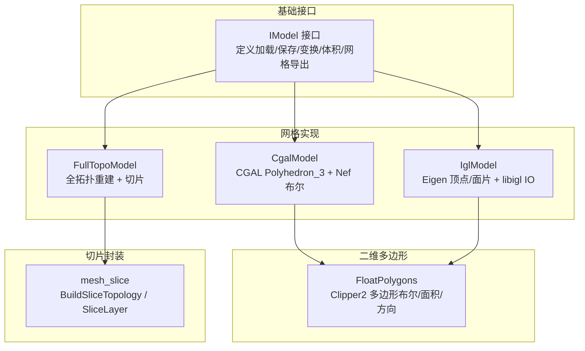
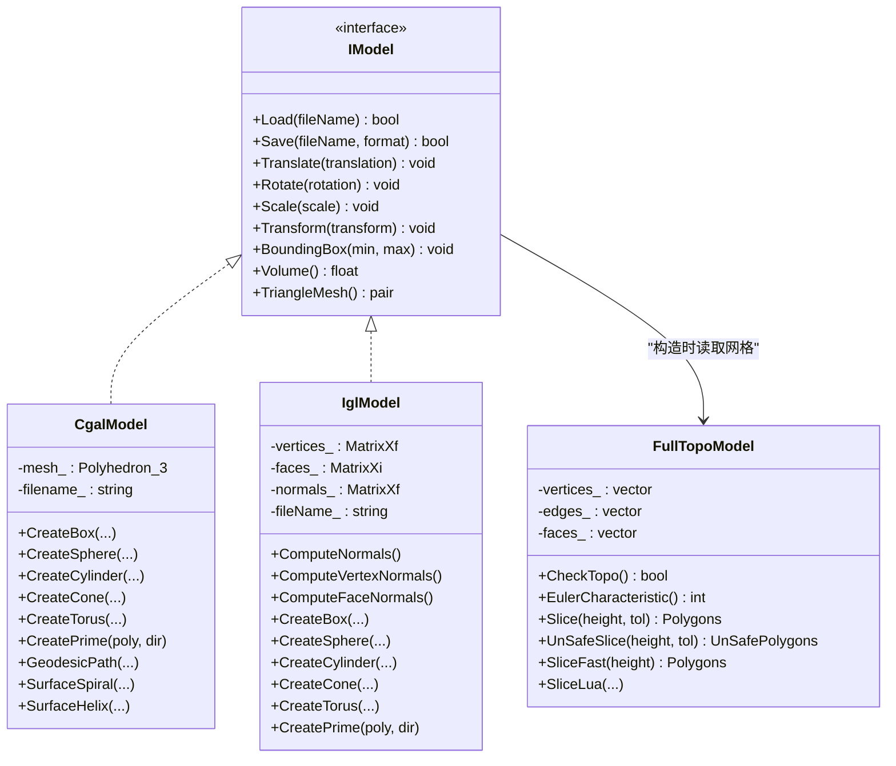
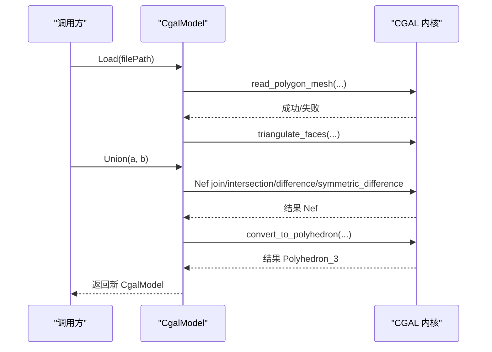
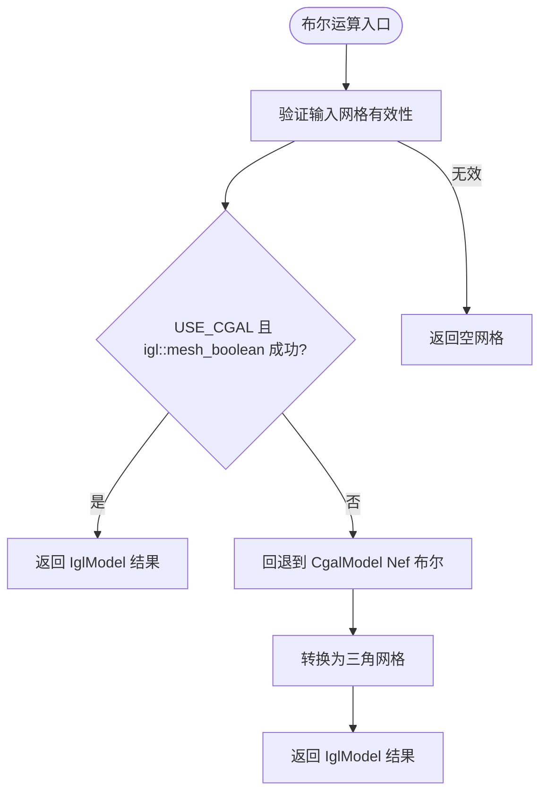
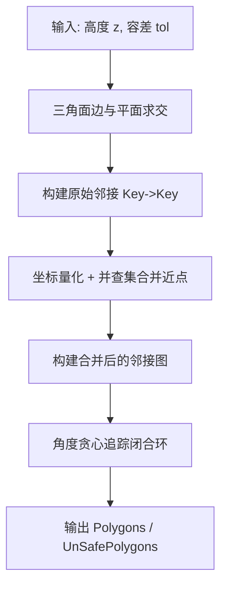
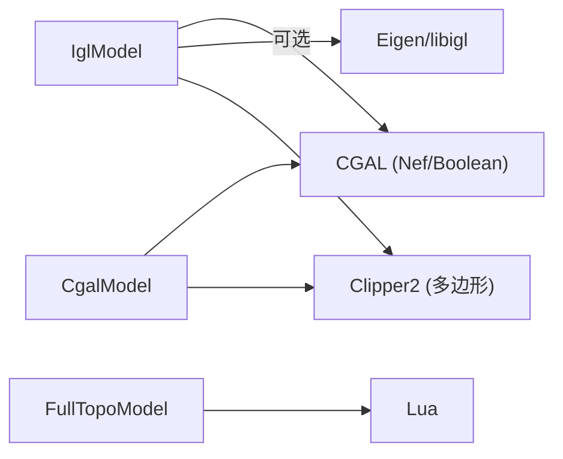

# 网格模型实现

<cite>
**本文引用的文件**   
- [IModel.hpp](file://base/IModel.hpp)
- [CgalModel.hpp](file://meshmodel/CgalModel.hpp)
- [CgalModel.cpp](file://meshmodel/CgalModel.cpp)
- [IglModel.hpp](file://meshmodel/IglModel.hpp)
- [IglModel.cpp](file://meshmodel/IglModel.cpp)
- [FullTopoModel.hpp](file://meshmodel/FullTopoModel.hpp)
- [FullTopoModel.cpp](file://meshmodel/FullTopoModel.cpp)
- [FloatPolygons.hpp](file://2D/FloatPolygons.hpp)
- [mesh_slice.hpp](file://LibHsBaSlicer/Slice/mesh_slice.hpp)
- [mesh_slice.cpp](file://LibHsBaSlicer/Slice/mesh_slice.cpp)
- [CMakeLists.txt](file://CMakeLists.txt)
- [cgal_model_test.cpp](file://tests/Models/cgal_model_test.cpp)
- [igl_model_test.cpp](file://tests/Models/igl_model_test.cpp)
</cite>

## 目录
1. [引言](#引言)
2. [项目结构](#项目结构)
3. [核心组件](#核心组件)
4. [架构总览](#架构总览)
5. [详细组件分析](#详细组件分析)
6. [依赖关系分析](#依赖关系分析)
7. [性能与内存优化建议](#性能与内存优化建议)
8. [故障排查指南](#故障排查指南)
9. [结论](#结论)
10. [附录：使用示例与最佳实践](#附录使用示例与最佳实践)

## 引言
本文件面向 HsBaSlicer 中的网格模型子系统，系统性梳理三类网格实现：
- CgalModel：基于 CGAL 的严格拓扑与布尔运算能力，适合高精度几何处理。
- IglModel：基于 libigl/Eigen 的轻量三角网格，适合快速原型开发与常规网格操作。
- FullTopoModel：面向切片的全拓扑重建模型，提供高效、可复用的层切片能力。

文档将解释它们的职责边界、数据结构、关键算法（布尔运算、拉伸、测地线、切片）、调用流程、性能特征与内存管理策略，并给出面向不同场景的选择建议与代码路径引用。

## 项目结构
网格模型相关代码主要位于 meshmodel 目录，统一通过 base/IModel.hpp 暴露接口；二维多边形工具在 2D/FloatPolygons.hpp；切片高层封装在 LibHsBaSlicer/Slice/mesh_slice.*；布尔运算开关与依赖由根 CMakeLists.txt 控制。

图表来源
- [IModel.hpp:110-139](file://base/IModel.hpp#L110-L139)
- [CgalModel.hpp:34-155](file://meshmodel/CgalModel.hpp#L34-L155)
- [IglModel.hpp:26-121](file://meshmodel/IglModel.hpp#L26-L121)
- [FullTopoModel.hpp:53-142](file://meshmodel/FullTopoModel.hpp#L53-L142)
- [FloatPolygons.hpp:72-106](file://2D/FloatPolygons.hpp#L72-L106)
- [mesh_slice.hpp:69-99](file://LibHsBaSlicer/Slice/mesh_slice.hpp#L69-L99)

章节来源
- [IModel.hpp:110-139](file://base/IModel.hpp#L110-L139)
- [CgalModel.hpp:34-155](file://meshmodel/CgalModel.hpp#L34-L155)
- [IglModel.hpp:26-121](file://meshmodel/IglModel.hpp#L26-L121)
- [FullTopoModel.hpp:53-142](file://meshmodel/FullTopoModel.hpp#L53-L142)
- [FloatPolygons.hpp:72-106](file://2D/FloatPolygons.hpp#L72-L106)
- [mesh_slice.hpp:69-99](file://LibHsBaSlicer/Slice/mesh_slice.hpp#L69-L99)

## 核心组件
- IModel：统一的三维模型抽象，定义 Load/Save、平移/旋转/缩放/仿射变换、包围盒、体积、三角形网格导出等接口。
- CgalModel：以 CGAL::Polyhedron_3 为内核，支持 STL/OBJ/OFF/PLY 读写、仿射变换、体积计算、Nef 布尔运算、基本体生成、拉伸、表面测地线与螺旋/螺旋线构造。
- IglModel：以 Eigen 矩阵存储顶点/面片/法线，支持常见网格格式读写、法线计算、体积计算、布尔运算（可选 CGAL 后端）和基本体生成、拉伸。
- FullTopoModel：从任意 IModel 构建顶点/边/面的完整拓扑，提供 CheckTopo、EulerCharacteristic、Safe/Unsafe/Lua/Fast 切片，以及 Lua 脚本扩展。

章节来源
- [IModel.hpp:110-139](file://base/IModel.hpp#L110-L139)
- [CgalModel.hpp:34-155](file://meshmodel/CgalModel.hpp#L34-L155)
- [IglModel.hpp:26-121](file://meshmodel/IglModel.hpp#L26-L121)
- [FullTopoModel.hpp:53-142](file://meshmodel/FullTopoModel.hpp#L53-L142)

## 架构总览
下图展示三种网格模型的继承关系与关键外部依赖。

图表来源
- [IModel.hpp:110-139](file://base/IModel.hpp#L110-L139)
- [CgalModel.hpp:34-155](file://meshmodel/CgalModel.hpp#L34-L155)
- [IglModel.hpp:26-121](file://meshmodel/IglModel.hpp#L26-L121)
- [FullTopoModel.hpp:53-142](file://meshmodel/FullTopoModel.hpp#L53-L142)

## 详细组件分析

### CgalModel：基于 CGAL 的高精度网格
- 数据表示：内部维护 CGAL::Polyhedron_3 与文件名；对外暴露 IModel 接口。
- 加载/保存：支持 STL/OBJ/OFF/PLY，加载后强制三角化以保证下游一致性。
- 变换：统一通过 CGAL::Polygon_mesh_processing::transform 应用平移/旋转/缩放/仿射/齐次变换。
- 几何查询：AABB 包围盒遍历点集；体积通过 CGAL 计算。
- 布尔运算：通过 CGAL::Nef_polyhedron_3 实现 Union/Intersection/Difference/Xor。
- 基本体与拉伸：提供 Box/Sphere/Cylinder/Cone/Torus 工厂；CreatePrime 对单环或多环多边形进行三角剖分与拉伸，保证底面/顶面/侧面法向一致。
- 高级几何：提供 GeodesicPath/GeodesicDistance/ProjectPointOnSurface/SurfaceSpiral/SurfaceHelix 等表面几何方法。

图表来源
- [CgalModel.cpp:121-131](file://meshmodel/CgalModel.cpp#L121-L131)
- [CgalModel.cpp:238-276](file://meshmodel/CgalModel.cpp#L238-L276)

章节来源
- [CgalModel.hpp:34-155](file://meshmodel/CgalModel.hpp#L34-L155)
- [CgalModel.cpp:42-119](file://meshmodel/CgalModel.cpp#L42-L119)
- [CgalModel.cpp:121-237](file://meshmodel/CgalModel.cpp#L121-L237)
- [CgalModel.cpp:238-276](file://meshmodel/CgalModel.cpp#L238-L276)
- [CgalModel.cpp:278-445](file://meshmodel/CgalModel.cpp#L278-L445)
- [CgalModel.cpp:625-733](file://meshmodel/CgalModel.cpp#L625-L733)

### IglModel：基于 libigl 的轻量网格
- 数据表示：Eigen 矩阵存储顶点/面片/法线；支持移动语义构造。
- 加载/保存：STL/OBJ/OFF/PLY 读写；路径编码转换。
- 变换：行主序矩阵下正确应用平移/旋转/缩放/仿射/齐次变换，同步更新法线。
- 几何查询：AABB 通过列最小/最大值；体积通过 igl::volume。
- 法线：支持逐面/逐顶点法线计算。
- 布尔运算：优先尝试 igl::copyleft::cgal::mesh_boolean（double 提升），失败则回退到 CgalModel 的 Nef 布尔；未启用 USE_CGAL 时抛出“不支持”异常。
- 基本体与拉伸：Box/Sphere/Cylinder/Cone/Torus 工厂；CreatePrime 对单环/多环多边形进行三角剖分与拉伸，确保外轮廓 CCW、孔 CW，避免法向错误。

图表来源
- [IglModel.cpp:195-245](file://meshmodel/IglModel.cpp#L195-L245)
- [IglModel.cpp:248-391](file://meshmodel/IglModel.cpp#L248-L391)

章节来源
- [IglModel.hpp:26-121](file://meshmodel/IglModel.hpp#L26-L121)
- [IglModel.cpp:37-62](file://meshmodel/IglModel.cpp#L37-L62)
- [IglModel.cpp:64-99](file://meshmodel/IglModel.cpp#L64-L99)
- [IglModel.cpp:101-150](file://meshmodel/IglModel.cpp#L101-L150)
- [IglModel.cpp:152-193](file://meshmodel/IglModel.cpp#L152-L193)
- [IglModel.cpp:195-391](file://meshmodel/IglModel.cpp#L195-L391)
- [IglModel.cpp:411-596](file://meshmodel/IglModel.cpp#L411-L596)
- [IglModel.cpp:598-713](file://meshmodel/IglModel.cpp#L598-L713)
- [IglModel.cpp:715-800](file://meshmodel/IglModel.cpp#L715-L800)

### FullTopoModel：面向切片的全拓扑模型
- 拓扑重建：从 IModel 或顶点/面片数组构建 Vertex/Edge/Face 三元组，建立 v-e-f 邻接关系，可选计算面法线。
- 完整性检查：CheckTopo 校验所有索引有效且集合覆盖完整；EulerCharacteristic 用于拓扑流形性启发式判断。
- 切片算法：
  - Safe/Unsafe：扫描每条边与水平面相交，构建整数键邻接图，合并近点（并查集+网格哈希），按角度贪心追踪闭合环。
  - Fast：先 CheckTopo，再直接利用预建边表加速。
  - Lua：将 V/E/F 与 height 注入 Lua 环境，允许用户脚本自定义切片逻辑。
- 切片封装：mesh_slice 提供 BuildSliceTopology 复用拓扑，SliceLayer 复用 UnSafeSlice 并标准化输出。

图表来源
- [FullTopoModel.cpp:50-158](file://meshmodel/FullTopoModel.cpp#L50-L158)
- [FullTopoModel.cpp:328-600](file://meshmodel/FullTopoModel.cpp#L328-L600)
- [FullTopoModel.cpp:604-873](file://meshmodel/FullTopoModel.cpp#L604-L873)
- [FullTopoModel.cpp:875-907](file://meshmodel/FullTopoModel.cpp#L875-L907)
- [mesh_slice.cpp:105-115](file://LibHsBaSlicer/Slice/mesh_slice.cpp#L105-L115)

章节来源
- [FullTopoModel.hpp:53-142](file://meshmodel/FullTopoModel.hpp#L53-L142)
- [FullTopoModel.cpp:27-48](file://meshmodel/FullTopoModel.cpp#L27-L48)
- [FullTopoModel.cpp:50-158](file://meshmodel/FullTopoModel.cpp#L50-L158)
- [FullTopoModel.cpp:160-244](file://meshmodel/FullTopoModel.cpp#L160-L244)
- [FullTopoModel.cpp:246-324](file://meshmodel/FullTopoModel.cpp#L246-L324)
- [FullTopoModel.cpp:328-600](file://meshmodel/FullTopoModel.cpp#L328-L600)
- [FullTopoModel.cpp:604-873](file://meshmodel/FullTopoModel.cpp#L604-L873)
- [FullTopoModel.cpp:875-907](file://meshmodel/FullTopoModel.cpp#L875-L907)
- [mesh_slice.hpp:69-99](file://LibHsBaSlicer/Slice/mesh_slice.hpp#L69-L99)
- [mesh_slice.cpp:105-115](file://LibHsBaSlicer/Slice/mesh_slice.cpp#L105-L115)

## 依赖关系分析
- 编译期开关：
  - USE_CGAL：控制 IglModel 是否启用布尔运算；若未启用，布尔函数抛出“不支持”。
  - HSBA_COPL：影响模型池大小与 CAD/布尔相关特性。
- 外部库：
  - CGAL：CgalModel 的核心几何与布尔运算；IglModel 可选回退路径。
  - libigl/Eigen：IglModel 的数据结构与 IO/几何工具。
  - Clipper2：多边形三角剖分与方向/面积判定，被 CreatePrime 使用。
  - Lua：FullTopoModel 的脚本化切片。

图表来源
- [CMakeLists.txt:297-306](file://CMakeLists.txt#L297-L306)
- [IglModel.cpp:24-27](file://meshmodel/IglModel.cpp#L24-L27)
- [CgalModel.cpp:12-25](file://meshmodel/CgalModel.cpp#L12-L25)
- [FullTopoModel.cpp:17-19](file://meshmodel/FullTopoModel.cpp#L17-L19)

章节来源
- [CMakeLists.txt:297-306](file://CMakeLists.txt#L297-L306)
- [IglModel.cpp:24-27](file://meshmodel/IglModel.cpp#L24-L27)
- [CgalModel.cpp:12-25](file://meshmodel/CgalModel.cpp#L12-L25)
- [FullTopoModel.cpp:17-19](file://meshmodel/FullTopoModel.cpp#L17-L19)

## 性能与内存优化建议
- 布尔运算
  - IglModel 优先使用 igl::mesh_boolean（double 提升），失败回退到 CgalModel Nef 布尔；Debug 模式可能较慢且内存占用高。
  - 避免共面输入导致 igl::mesh_boolean 返回空结果；测试中通过沿对角线平移立方体规避。
- 拓扑重建
  - FullTopoModel 构造开销较大，但可复用；多层切片应使用 BuildSliceTopology 一次构建，多次 SliceLayer。
- 网格尺寸
  - 大量小对象场景建议使用对象池（HSBA_MODEL_POOL_SIZE 受 HSBA_COPL 影响）。
- 数据布局
  - IglModel 使用行主序 Eigen 矩阵，注意变换时的转置与广播用法，避免越界或未定义行为。
- 数值稳定性
  - 切片采用整数化坐标与并查集合并近点，合理设置 tolerance 以避免过密邻接或误合并。

章节来源
- [CMakeLists.txt:297-306](file://CMakeLists.txt#L297-L306)
- [IglModel.cpp:195-245](file://meshmodel/IglModel.cpp#L195-L245)
- [igl_model_test.cpp:44-67](file://tests/Models/igl_model_test.cpp#L44-L67)
- [mesh_slice.hpp:69-99](file://LibHsBaSlicer/Slice/mesh_slice.hpp#L69-L99)
- [mesh_slice.cpp:105-115](file://LibHsBaSlicer/Slice/mesh_slice.cpp#L105-L115)

## 故障排查指南
- 布尔运算结果为空
  - 检查输入网格是否包含非有限值或非法索引；IglModel 的布尔入口会做有效性校验。
  - 避免共面输入；必要时对其中一个模型施加微小位移。
- 体积为负或方向错误
  - CgalModel 在拉伸后强制三角化并校正面方向；若仍异常，检查输入多边形方向与孔洞识别是否正确。
- 切片结果异常
  - 调整 tolerance；确认 CheckTopo 通过后使用 SliceFast；或使用 NormalizeUnSafePolygons 清理开放折线与非简单多边形。
- 平台/编译问题
  - 未启用 USE_CGAL 时，IglModel 布尔函数抛“不支持”；需开启 CGAL 相关编译选项。

章节来源
- [IglModel.cpp:248-391](file://meshmodel/IglModel.cpp#L248-L391)
- [CgalModel.cpp:625-733](file://meshmodel/CgalModel.cpp#L625-L733)
- [FullTopoModel.cpp:875-907](file://meshmodel/FullTopoModel.cpp#L875-L907)
- [mesh_slice.cpp:85-103](file://LibHsBaSlicer/Slice/mesh_slice.cpp#L85-L103)

## 结论
- CgalModel 提供严格的几何与布尔能力，适合高精度建模与复杂布尔运算。
- IglModel 轻量高效，适合快速原型与常规网格处理；布尔运算需要 CGAL 支持。
- FullTopoModel 专为切片优化，通过一次性拓扑重建显著降低多层切片成本。
- 选择建议：
  - 高精度布尔/几何：优先 CgalModel。
  - 快速迭代/轻量网格：优先 IglModel。
  - 多层切片流水线：使用 FullTopoModel + BuildSliceTopology。

## 附录：使用示例与最佳实践

- 加载与保存
  - CgalModel：Load/Save 支持 STL/OBJ/OFF/PLY；加载后自动三角化。
  - IglModel：Load/Save 支持 STL/OBJ/OFF/PLY；保持顶点/面片/法线一致性。
  - 参考路径：[CgalModel.cpp:121-157](file://meshmodel/CgalModel.cpp#L121-L157)、[IglModel.cpp:64-99](file://meshmodel/IglModel.cpp#L64-L99)

- 基本体创建
  - 两者均提供 Box/Sphere/Cylinder/Cone/Torus 工厂。
  - 参考路径：[CgalModel.cpp:278-445](file://meshmodel/CgalModel.cpp#L278-L445)、[IglModel.cpp:411-596](file://meshmodel/IglModel.cpp#L411-L596)

- 拉伸（CreatePrime）
  - 单环/多环多边形均可；内部使用 Clipper2 三角剖分，确保外轮廓 CCW、孔 CW。
  - 参考路径：[CgalModel.cpp:625-733](file://meshmodel/CgalModel.cpp#L625-L733)、[IglModel.cpp:598-713](file://meshmodel/IglModel.cpp#L598-L713)、[IglModel.cpp:715-800](file://meshmodel/IglModel.cpp#L715-L800)

- 布尔运算
  - CgalModel：Union/Intersection/Difference/Xor 基于 Nef。
  - IglModel：优先 igl::mesh_boolean，失败回退 CgalModel；未启用 CGAL 抛“不支持”。
  - 参考路径：[CgalModel.cpp:238-276](file://meshmodel/CgalModel.cpp#L238-L276)、[IglModel.cpp:195-391](file://meshmodel/IglModel.cpp#L195-L391)

- 切片
  - 单次切片：直接使用 FullTopoModel::Slice/UnSafeSlice。
  - 多层切片：BuildSliceTopology 一次构建，SliceLayer 多次调用。
  - 参考路径：[FullTopoModel.cpp:328-600](file://meshmodel/FullTopoModel.cpp#L328-L600)、[mesh_slice.hpp:69-99](file://LibHsBaSlicer/Slice/mesh_slice.hpp#L69-L99)、[mesh_slice.cpp:105-115](file://LibHsBaSlicer/Slice/mesh_slice.cpp#L105-L115)

- 测试用例参考
  - CgalModel 布尔与拉伸测试：[cgal_model_test.cpp:40-70](file://tests/Models/cgal_model_test.cpp#L40-L70)
  - IglModel 布尔测试（需 USE_CGAL）：[igl_model_test.cpp:44-67](file://tests/Models/igl_model_test.cpp#L44-L67)