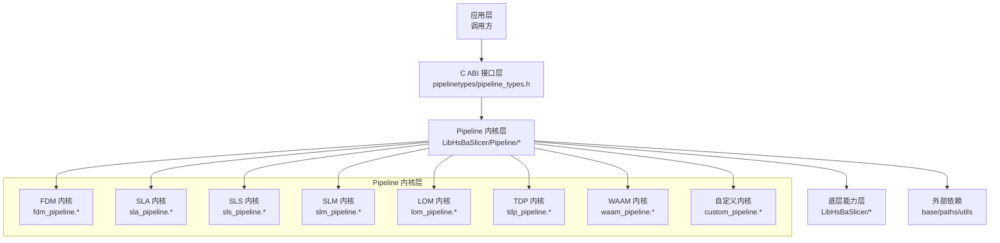
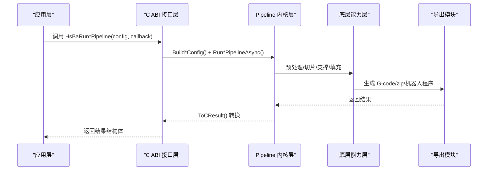
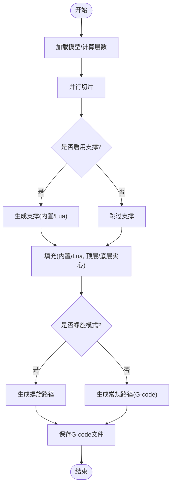
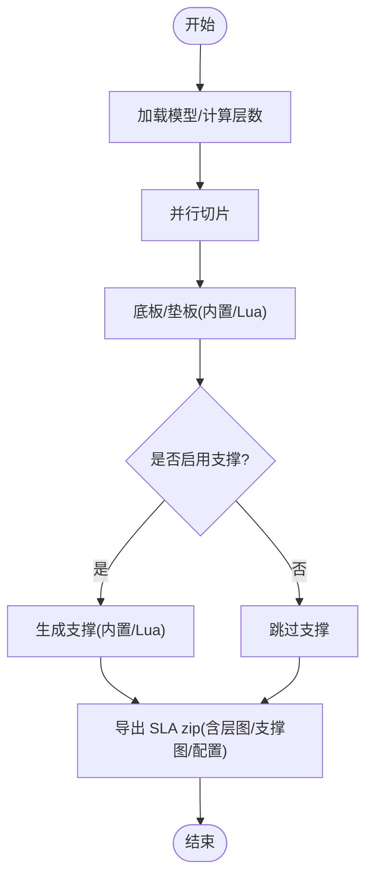
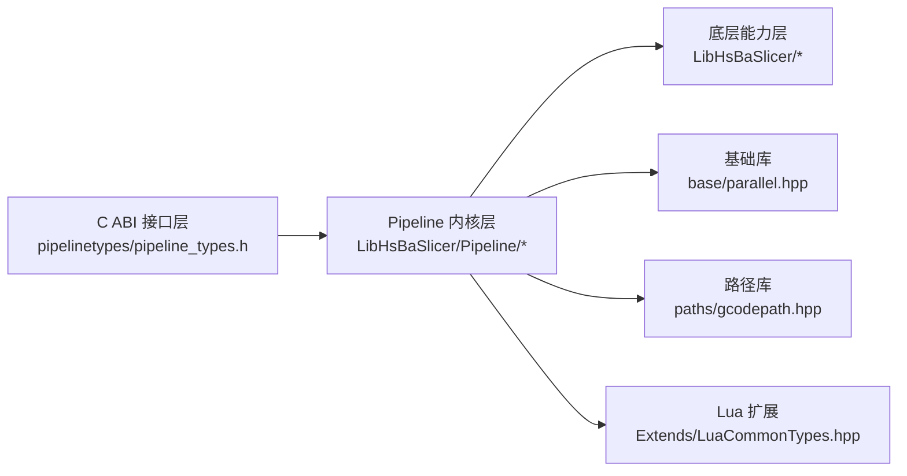

# 流水线架构

<cite>
**本文引用的文件**   
- [pipeline_types.h](file://pipelinetypes/pipeline_types.h)
- [kernel_types.hpp](file://LibHsBaSlicer/Pipeline/kernel_types.hpp)
- [fdm_pipeline.hpp](file://LibHsBaSlicer/Pipeline/fdm_pipeline.hpp)
- [fdm_pipeline.cpp](file://LibHsBaSlicer/Pipeline/fdm_pipeline.cpp)
- [sla_pipeline.hpp](file://LibHsBaSlicer/Pipeline/sla_pipeline.hpp)
- [sla_pipeline.cpp](file://LibHsBaSlicer/Pipeline/sla_pipeline.cpp)
- [sls_pipeline.hpp](file://LibHsBaSlicer/Pipeline/sls_pipeline.hpp)
- [sls_pipeline.cpp](file://LibHsBaSlicer/Pipeline/sls_pipeline.cpp)
- [slm_pipeline.hpp](file://LibHsBaSlicer/Pipeline/slm_pipeline.hpp)
- [slm_pipeline.cpp](file://LibHsBaSlicer/Pipeline/slm_pipeline.cpp)
- [lom_pipeline.hpp](file://LibHsBaSlicer/Pipeline/lom_pipeline.hpp)
- [lom_pipeline.cpp](file://LibHsBaSlicer/Pipeline/lom_pipeline.cpp)
- [tdp_pipeline.hpp](file://LibHsBaSlicer/Pipeline/tdp_pipeline.hpp)
- [tdp_pipeline.cpp](file://LibHsBaSlicer/Pipeline/tdp_pipeline.cpp)
- [waam_pipeline.hpp](file://LibHsBaSlicer/Pipeline/waam_pipeline.hpp)
- [waam_pipeline.cpp](file://LibHsBaSlicer/Pipeline/waam_pipeline.cpp)
- [custom_pipeline.hpp](file://LibHsBaSlicer/Pipeline/custom_pipeline.hpp)
- [custom_pipeline.cpp](file://LibHsBaSlicer/Pipeline/custom_pipeline.cpp)
</cite>

## 更新摘要
**所做更改**   
- 新增 LibHsBaSlicer/Pipeline 层架构说明，包含核心内核类型与各技术栈的独立实现
- 更新架构总览图以反映新的分层设计：C ABI -> Pipeline 内核 -> 具体工艺逻辑
- 详细说明新架构如何保持 C ABI 向后兼容性
- 新增内核类型（GeometryCapture、Hooks）与统一输出结构体的文档
- 更新各技术栈流水线的调用关系与执行流程

## 目录
1. [引言](#引言)
2. [项目结构](#项目结构)
3. [核心概念](#核心概念)
4. [核心组件](#核心组件)
5. [架构总览](#架构总览)
6. [详细组件分析](#详细组件分析)
7. [依赖关系分析](#依赖关系分析)
8. [性能与并发特性](#性能与并发特性)
9. [错误处理与资源管理](#错误处理与资源管理)
10. [扩展点与自定义阶段](#扩展点与自定义阶段)
11. [调用示例与最佳实践](#调用示例与最佳实践)
12. [故障排除指南](#故障排除指南)
13. [结论](#结论)

## 引言
本文档面向 HsBaSlicer 的流水线架构，系统性解释其在多种 3D 打印技术栈中的设计模式、执行流程、参数传递机制和错误处理策略。随着代码库的重构，现在引入了新的 LibHsBaSlicer/Pipeline 层，为 FDM、SLA、SLS、SLM、LOM、TDP、WAAM 以及 Lua 自定义流水线提供独立的内核实现，同时保持 C ABI 接口的向后兼容性。文档覆盖所有技术栈的核心数据类型、配置结构、执行流程和扩展点，为初学者提供友好概览，同时为高级用户提供足够的技术深度。

## 项目结构
HsBaSlicer 的流水线相关代码现在采用三层架构：
- **C ABI 接口层**：pipelinetypes/pipeline_types.h 定义统一的 C 语言接口
- **Pipeline 内核层**：LibHsBaSlicer/Pipeline/* 提供各技术栈的具体实现
- **底层能力层**：LibHsBaSlicer/* 提供切片、填充、支撑、路径生成等基础功能

**图表来源**
- [kernel_types.hpp:1-67](file://LibHsBaSlicer/Pipeline/kernel_types.hpp#L1-L67)
- [fdm_pipeline.hpp:1-54](file://LibHsBaSlicer/Pipeline/fdm_pipeline.hpp#L1-L54)
- [sla_pipeline.hpp:1-54](file://LibHsBaSlicer/Pipeline/sla_pipeline.hpp#L1-L54)

**章节来源**
- [pipeline_types.h:1-1050](file://pipelinetypes/pipeline_types.h#L1-L1050)
- [kernel_types.hpp:1-67](file://LibHsBaSlicer/Pipeline/kernel_types.hpp#L1-L67)

## 核心概念
- **分层架构**：C ABI 接口层提供稳定的外部接口，Pipeline 内核层封装具体工艺逻辑，底层能力层提供通用功能。
- **统一内核**：每个技术栈都有对应的 RunXxx() 函数作为单一事实来源，确保 C ABI 和 C++20 模块行为一致。
- **配置驱动**：通过 pipeline_types.h 中的 POD 结构体传入工艺参数，支持默认初始化和字段验证。
- **进度回调**：所有流水线支持 Hooks.progress 回调，便于 UI 更新与任务监控。
- **协作取消**：通过 Hooks.cancel_flag 实现可中断的流水线执行。
- **几何捕获**：可选的 GeometryCapture 功能用于模型预览和调试。

**章节来源**
- [kernel_types.hpp:33-62](file://LibHsBaSlicer/Pipeline/kernel_types.hpp#L33-L62)
- [fdm_pipeline.hpp:24-49](file://LibHsBaSlicer/Pipeline/fdm_pipeline.hpp#L24-L49)
- [sla_pipeline.hpp:23-49](file://LibHsBaSlicer/Pipeline/sla_pipeline.hpp#L23-L49)

## 核心组件

### 内核类型系统
- **GeometryCapture**：每层几何数据捕获结构，包含轮廓、填充、支撑和路径信息。
- **Hooks**：内核回调接口，包含进度回调和取消标志。
- **统一输出结构**：每种技术栈都有对应的 Output 结构体，包含 success、total_layers、error、elapsed_seconds 等标准字段。

### 配置系统
- **枚举类型**：填充模式、支撑图案、固件目标、材料、光源、保护气体等工艺参数。
- **配置结构体**：FDM、SLA、SLS、SLM、LOM、TDP、WAAM、Lua 自定义流水线的完整配置。
- **默认初始化器**：HsBaXxxConfigDefault() 为各配置提供合理的默认值。

### 结果系统
- **成功标志**：success 字段表示流水线是否成功完成。
- **层数统计**：total_layers 记录处理的层数。
- **错误信息**：error_message 或 error 字段提供详细的错误描述。
- **性能指标**：elapsed_seconds 记录执行时间。
- **取消状态**：cancelled 字段指示是否因用户取消而终止。

**章节来源**
- [kernel_types.hpp:33-62](file://LibHsBaSlicer/Pipeline/kernel_types.hpp#L33-L62)
- [pipeline_types.h:19-732](file://pipelinetypes/pipeline_types.h#L19-L732)
- [fdm_pipeline.hpp:32-41](file://LibHsBaSlicer/Pipeline/fdm_pipeline.hpp#L32-L41)

## 架构总览
新的三层架构确保了代码的可维护性和可扩展性。C ABI 层保持稳定，Pipeline 内核层实现具体逻辑，底层能力层提供通用功能。

**图表来源**
- [fdm_pipeline.cpp:650-653](file://LibHsBaSlicer/Pipeline/fdm_pipeline.cpp#L650-L653)
- [sla_pipeline.cpp:491-494](file://LibHsBaSlicer/Pipeline/sla_pipeline.cpp#L491-L494)
- [sls_pipeline.cpp:286-289](file://LibHsBaSlicer/Pipeline/sls_pipeline.cpp#L286-L289)

## 详细组件分析

### FDM 流水线内核
FDM 流水线实现了完整的熔融沉积建模工艺流程，包括预处理、切片、支撑生成、填充计算和 G-code 路径生成。

**关键特性**：
- 支持螺旋模式（花瓶模式）：跳过支撑与填充，外层轮廓合并为连续上升路径
- 填充支持内置算法与 Lua 自定义脚本
- 顶层/底层使用实心填充保证表面质量
- 路径生成根据打印机配置与固件目标输出 G-code

**图表来源**
- [fdm_pipeline.cpp:600-656](file://LibHsBaSlicer/Pipeline/fdm_pipeline.cpp#L600-L656)

**章节来源**
- [fdm_pipeline.hpp:1-54](file://LibHsBaSlicer/Pipeline/fdm_pipeline.hpp#L1-L54)
- [fdm_pipeline.cpp:1-200](file://LibHsBaSlicer/Pipeline/fdm_pipeline.cpp#L1-L200)
- [fdm_pipeline.cpp:600-656](file://LibHsBaSlicer/Pipeline/fdm_pipeline.cpp#L600-L656)

### SLA 流水线内核
SLA 流水线专注于光固化成型工艺，包括切片、底板生成、支撑构建和包打包导出。

**关键特性**：
- 底板生成支持 Lua 自定义脚本
- 支撑支持内置 SLA 算法与 Lua 自定义脚本
- 导出阶段打包层图像、支撑图像与配置文件
- 支持 PNG/JPG/SVG 多种图像格式

**图表来源**
- [sla_pipeline.cpp:491-532](file://LibHsBaSlicer/Pipeline/sla_pipeline.cpp#L491-L532)

**章节来源**
- [sla_pipeline.hpp:1-54](file://LibHsBaSlicer/Pipeline/sla_pipeline.hpp#L1-L54)
- [sla_pipeline.cpp:491-532](file://LibHsBaSlicer/Pipeline/sla_pipeline.cpp#L491-L532)

### SLS/SLM 流水线内核
SLS（选择性激光烧结）和 SLM（选择性激光熔化）流水线共享相似的架构，都基于切片和 Lua 脚本导出。

**关键特性**：
- 无标准输出格式，必须提供 export_lua_script
- 激光功率、扫描速度、栅格间距等参数通过 JSON 传递给 Lua
- SLM 额外支持金属材料和保护气体参数
- 复用 SLS 风格的 Lua 打包机制

**章节来源**
- [sls_pipeline.hpp:1-50](file://LibHsBaSlicer/Pipeline/sls_pipeline.hpp#L1-L50)
- [slm_pipeline.hpp:1-50](file://LibHsBaSlicer/Pipeline/slm_pipeline.hpp#L1-L50)

### LOM/TDP 流水线内核
LOM（分层实体制造）和 TDP（三维打印）流水线都基于切片和 Lua 脚本导出，但针对不同的制造工艺。

**关键特性**：
- LOM：每层为一张片材，轮廓线交给 Lua 脚本进行切割/粘接控制
- TDP：粘结剂喷射工艺，喷头数量、滴间距、饱和度等参数通过 JSON 传递
- 都支持螺旋模式和接缝错位优化

**章节来源**
- [lom_pipeline.hpp:1-50](file://LibHsBaSlicer/Pipeline/lom_pipeline.hpp#L1-L50)
- [tdp_pipeline.hpp:1-51](file://LibHsBaSlicer/Pipeline/tdp_pipeline.hpp#L1-L51)

### WAAM 流水线内核
WAAM（电弧增材制造）流水线专注于机器人路径生成，输出为机器人语言程序。

**关键特性**：
- 输出为机器人语言程序（ABB/KUKA/FANUC）
- 可选 Lua 路径生成脚本
- 支持螺旋模式（外层轮廓作为连续上升焊道）
- 焊接参数包括电流/电压、气体流量、层间温度等

**章节来源**
- [waam_pipeline.hpp:1-51](file://LibHsBaSlicer/Pipeline/waam_pipeline.hpp#L1-L51)

### 自定义流水线内核
完全由 Lua 驱动的自定义流水线，提供最灵活的扩展能力。

**关键特性**：
- 通过 pipeline_lua_script/pipeline_lua_source/entry_func/config_json 完全定义流水线
- 支持协作取消和进度回调
- 不生成层几何快照，专注于业务逻辑定制

**章节来源**
- [custom_pipeline.hpp:1-50](file://LibHsBaSlicer/Pipeline/custom_pipeline.hpp#L1-L50)

## 依赖关系分析
新的架构清晰地分离了关注点，降低了模块间的耦合度。

**图表来源**
- [fdm_pipeline.cpp:28-41](file://LibHsBaSlicer/Pipeline/fdm_pipeline.cpp#L28-L41)
- [sla_pipeline.cpp:28-41](file://LibHsBaSlicer/Pipeline/sla_pipeline.cpp#L28-L41)

**章节来源**
- [fdm_pipeline.cpp:28-41](file://LibHsBaSlicer/Pipeline/fdm_pipeline.cpp#L28-L41)
- [kernel_types.hpp:28-29](file://LibHsBaSlicer/Pipeline/kernel_types.hpp#L28-L29)

## 性能与并发特性
- **并行切片**：所有流水线在切片阶段使用 ParallelForLayers 对层进行并行处理，提升吞吐。
- **串行限制**：Lua 自定义填充/支撑因解释器状态不可跨线程共享，采用串行执行以保证正确性。
- **协作取消**：通过 cancel_flag 实现可中断的流水线执行，避免长时间阻塞。
- **几何捕获优化**：仅在需要时捕获层几何数据，减少内存占用。

**章节来源**
- [kernel_types.hpp:56-62](file://LibHsBaSlicer/Pipeline/kernel_types.hpp#L56-L62)
- [fdm_pipeline.cpp:83-94](file://LibHsBaSlicer/Pipeline/fdm_pipeline.cpp#L83-L94)

## 错误处理与资源管理
- **异常捕获**：所有流水线协程使用 try/catch 捕获 RuntimeError 和 CancelledError。
- **早期失败**：模型加载失败、层数为无效值、缺少必需 Lua 导出脚本等情况会提前返回错误。
- **内存释放**：C ABI 返回的字符串内存由调用方负责释放，对应 Free*PipelineResult 函数。
- **进度回调**：ReportProgress 在关键阶段上报百分比与阶段描述。

**章节来源**
- [fdm_pipeline.cpp:629-645](file://LibHsBaSlicer/Pipeline/fdm_pipeline.cpp#L629-L645)

## 扩展点与自定义阶段
- **Lua 自定义支撑/填充（FDM）**：support_lua_script/support_lua_func 和 infill_lua_script/infill_lua_func。
- **Lua 自定义底板（SLA）**：floor_lua_script/floor_lua_func。
- **Lua 自定义导出（SLS/SLM/LOM/TDP）**：export_lua_script/export_lua_func。
- **Lua 自定义机器人路径（WAAM）**：path_lua_script/path_lua_func。
- **完全自定义流水线**：HsBaCustomPipelineConfig_t 支持完全自定义流水线阶段顺序与内容。

**章节来源**
- [pipeline_types.h:53-113](file://pipelinetypes/pipeline_types.h#L53-L113)
- [pipeline_types.h:165-218](file://pipelinetypes/pipeline_types.h#L165-L218)

## 调用示例与最佳实践
- **同步调用**：构造配置后调用 HsBaRun*Pipeline(config, callback, user_data)，然后调用 HsBaFree*PipelineResult(result)。
- **异步调用**：构造配置后调用 HsBaRun*PipelineAsync(...)，并提供 result_callback 接收结果。
- **进度回调**：在 progress_callback 中更新 UI 或记录日志，stage 字段描述当前阶段。
- **最佳实践**：始终检查 success 与 error_message；对于 SLS/SLM/LOM/TDP，务必提供有效的 export_lua_script。

**章节来源**
- [pipeline_types.h:17-61](file://pipelinetypes/pipeline_types.h#L17-L61)

## 故障排除指南
- **模型加载失败**：检查 model_name/model_path 是否正确，确认模型文件存在且可读取。
- **层数为无效值**：检查 layer_height/first_layer_height 是否合理，模型高度是否为正。
- **缺少 Lua 导出脚本**：对于 SLS/SLM/LOM/TDP，确保 export_lua_script 非空且路径有效。
- **导出失败**：检查输出路径权限与磁盘空间；查看 error_message 中的 Lua 错误信息。
- **内存泄漏**：确保调用 HsBaFree*PipelineResult 释放结果中的字符串字段。

**章节来源**
- [fdm_pipeline.cpp:231-257](file://LibHsBaSlicer/Pipeline/fdm_pipeline.cpp#L231-L257)

## 结论
HsBaSlicer 的新版流水线架构通过引入 LibHsBaSlicer/Pipeline 层，实现了更好的代码组织和可维护性。新的三层架构（C ABI 接口层、Pipeline 内核层、底层能力层）确保了向后兼容性的同时，提供了更清晰的职责分离。每个技术栈都有对应的内核实现，通过统一的 RunXxx() 接口暴露，既保持了 API 的一致性，又允许针对不同工艺进行专门优化。这种设计使得开发者可以更容易地添加新的技术栈支持，同时也为现有功能提供了更好的测试和维护基础。