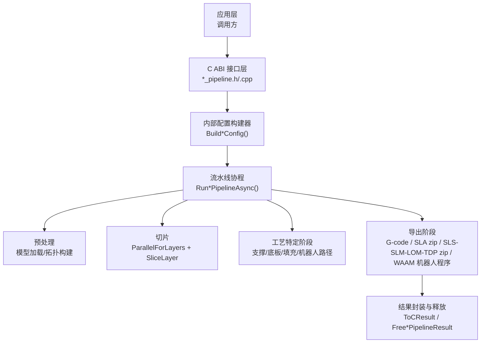
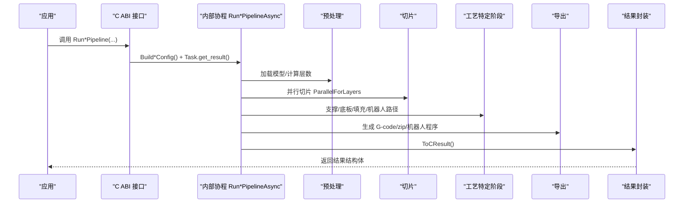
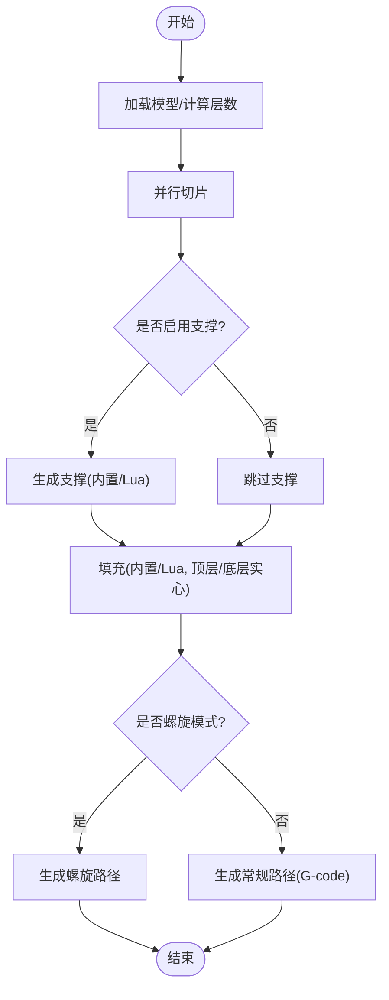
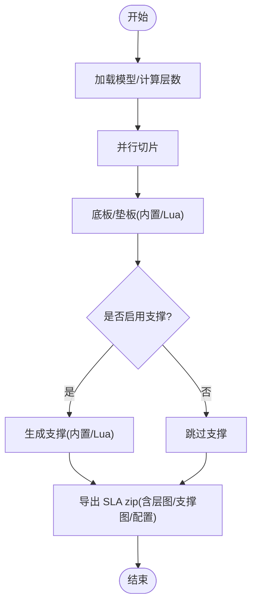
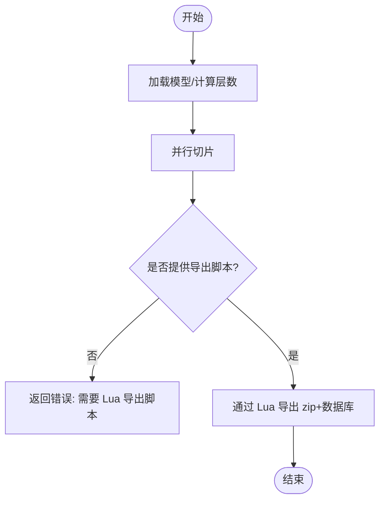
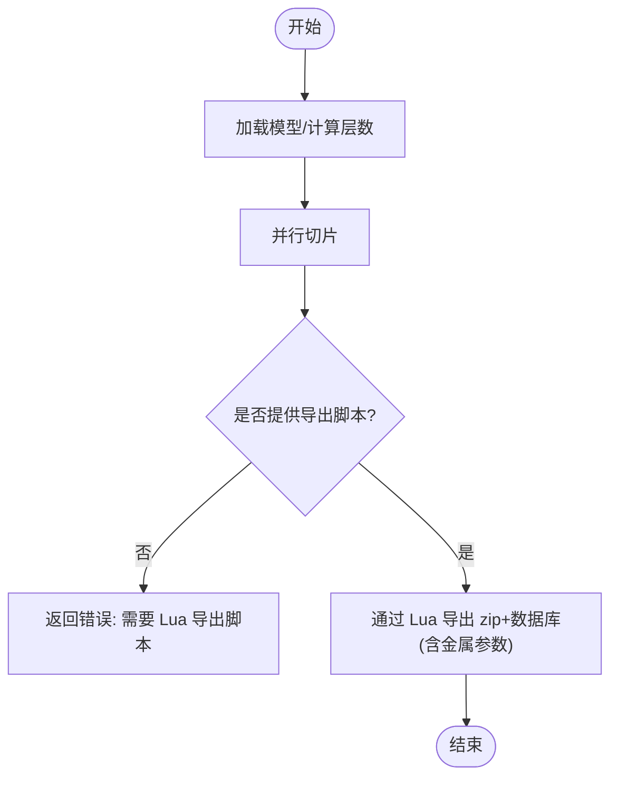
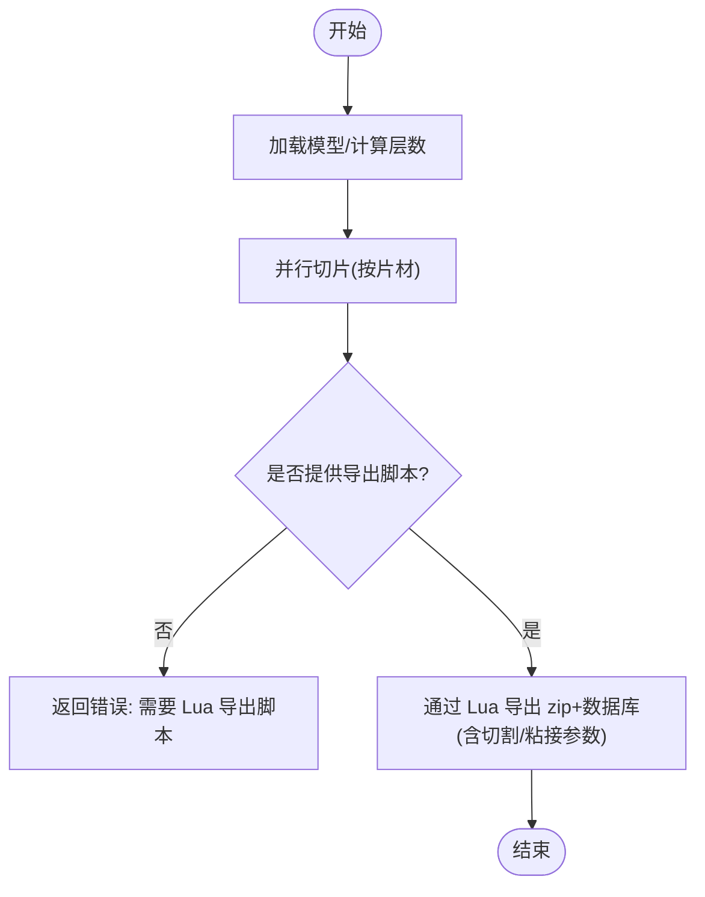
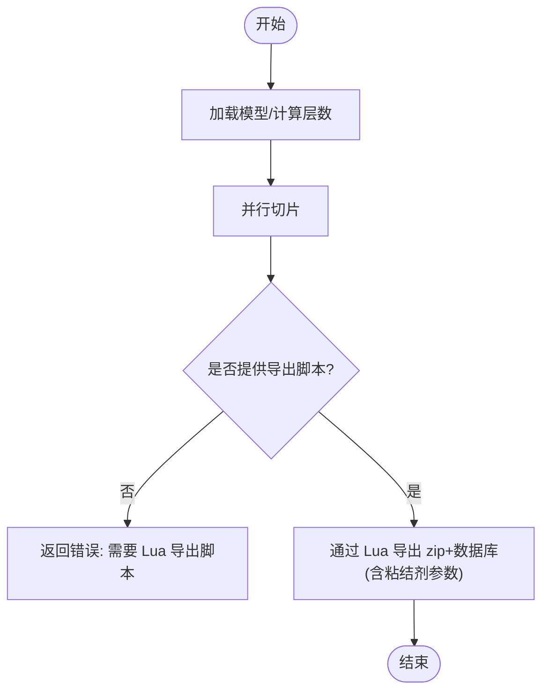
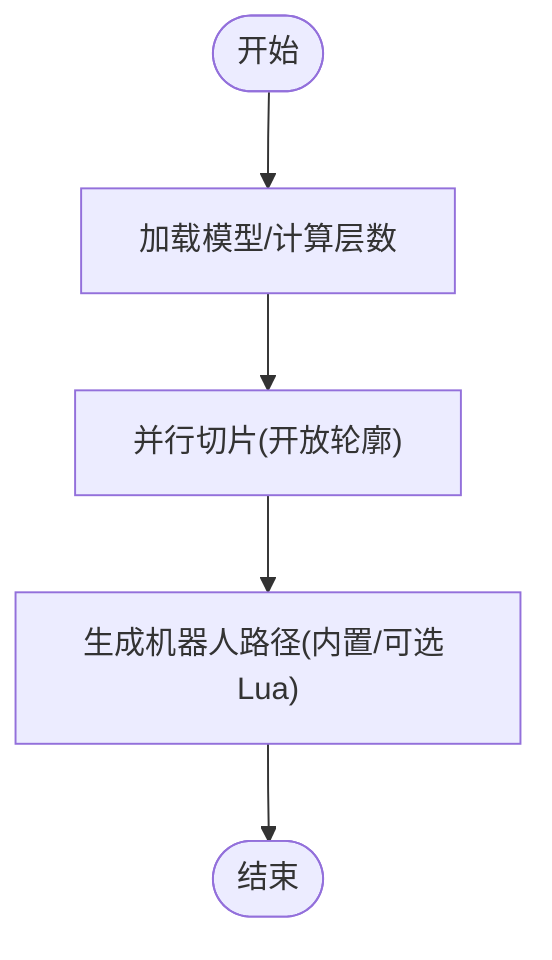
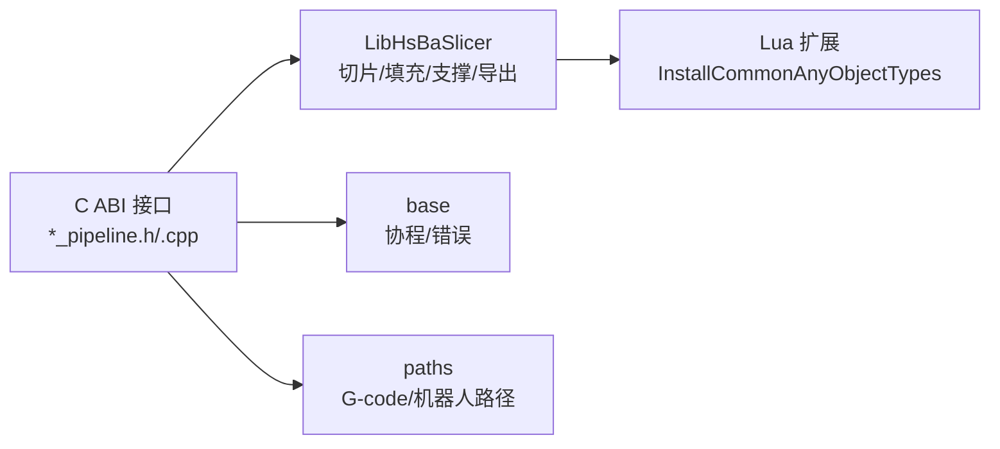

# 流水线架构

<cite>
**本文引用的文件**   
- [pipeline_types.h](file://pipelinetypes/pipeline_types.h)
- [fdm_pipeline.h](file://DllHsBaSlicer/fdm_pipeline.h)
- [fdm_pipeline.cpp](file://DllHsBaSlicer/fdm_pipeline.cpp)
- [sla_pipeline.h](file://DllHsBaSlicer/sla_pipeline.h)
- [sla_pipeline.cpp](file://DllHsBaSlicer/sla_pipeline.cpp)
- [sls_pipeline.h](file://DllHsBaSlicer/sls_pipeline.h)
- [sls_pipeline.cpp](file://DllHsBaSlicer/sls_pipeline.cpp)
- [slm_pipeline.h](file://DllHsBaSlicer/slm_pipeline.h)
- [slm_pipeline.cpp](file://DllHsBaSlicer/slm_pipeline.cpp)
- [lom_pipeline.h](file://DllHsBaSlicer/lom_pipeline.h)
- [lom_pipeline.cpp](file://DllHsBaSlicer/lom_pipeline.cpp)
- [tdp_pipeline.h](file://DllHsBaSlicer/tdp_pipeline.h)
- [tdp_pipeline.cpp](file://DllHsBaSlicer/tdp_pipeline.cpp)
- [waam_pipeline.h](file://DllHsBaSlicer/waam_pipeline.h)
- [waam_pipeline.cpp](file://DllHsBaSlicer/waam_pipeline.cpp)
</cite>

## 目录
1. [引言](#引言)
2. [项目结构](#项目结构)
3. [核心概念](#核心概念)
4. [核心组件](#核心组件)
5. [架构总览](#架构总览)
6. [详细组件分析](#详细组件分析)
7. [依赖关系分析](#依赖关系分析)
8. [性能与并发特性](#性能与并发特性)
9. [错误处理与资源管理](#错误处理与资源管理)
10. [扩展点与自定义阶段](#扩展点与自定义阶段)
11. [调用示例与最佳实践](#调用示例与最佳实践)
12. [故障排除指南](#故障排除指南)
13. [结论](#结论)

## 引言
本文件面向 HsBaSlicer 的流水线架构，系统性解释其在多种 3D 打印技术栈中的设计模式、执行流程、参数传递机制和错误处理策略。文档覆盖 FDM、SLA、SLS、SLM、LOM、TDP（3DP）、WAAM 以及通用 Lua 自定义流水线，并重点说明 pipelinetypes/pipeline_types.h 中定义的核心数据类型与配置结构。读者可从初学者友好的概览入手，逐步深入到实现细节、扩展点和性能优化建议。

## 项目结构
HsBaSlicer 的流水线相关代码主要分布在以下位置：
- C ABI 类型定义：pipelinetypes/pipeline_types.h
- 各技术栈的 C ABI 头文件与实现：DllHsBaSlicer/*_pipeline.{h,cpp}
- 公共库能力（切片、填充、支撑、路径生成、Lua 扩展等）：LibHsBaSlicer/*
- 并行工具与协程：base/coroutine.hpp、pipeline_parallel.hpp（由实现文件包含）

图表来源
- [fdm_pipeline.cpp:219-447](file://DllHsBaSlicer/fdm_pipeline.cpp#L219-L447)
- [sla_pipeline.cpp:299-483](file://DllHsBaSlicer/sla_pipeline.cpp#L299-L483)
- [sls_pipeline.cpp:182-296](file://DllHsBaSlicer/sls_pipeline.cpp#L182-L296)
- [slm_pipeline.cpp:236-348](file://DllHsBaSlicer/slm_pipeline.cpp#L236-L348)
- [lom_pipeline.cpp:193-305](file://DllHsBaSlicer/lom_pipeline.cpp#L193-L305)
- [tdp_pipeline.cpp:203-316](file://DllHsBaSlicer/tdp_pipeline.cpp#L203-L316)
- [waam_pipeline.cpp:174-284](file://DllHsBaSlicer/waam_pipeline.cpp#L174-L284)

章节来源
- [fdm_pipeline.h:1-68](file://DllHsBaSlicer/fdm_pipeline.h#L1-L68)
- [sla_pipeline.h:1-63](file://DllHsBaSlicer/sla_pipeline.h#L1-L63)
- [sls_pipeline.h:1-63](file://DllHsBaSlicer/sls_pipeline.h#L1-L63)
- [slm_pipeline.h:1-63](file://DllHsBaSlicer/slm_pipeline.h#L1-L63)
- [lom_pipeline.h:1-63](file://DllHsBaSlicer/lom_pipeline.h#L1-L63)
- [tdp_pipeline.h:1-63](file://DllHsBaSlicer/tdp_pipeline.h#L1-L63)
- [waam_pipeline.h:1-64](file://DllHsBaSlicer/waam_pipeline.h#L1-L64)

## 核心概念
- 流水线模式：将复杂制造过程拆分为可复用的阶段（预处理、切片、支撑、填充、路径生成、导出），每个阶段独立且可替换。
- 统一入口：每种技术栈提供同步与异步两套 API，内部基于协程实现非阻塞执行。
- 配置驱动：通过 pipeline_types.h 中的 POD 结构体传入工艺参数；Lua 脚本用于扩展或完全自定义阶段。
- 进度回调：所有流水线支持进度回调，便于 UI 更新与任务监控。
- 结果所有权：C ABI 返回的字符串内存由调用方负责释放，对应 Free*PipelineResult 函数。

章节来源
- [pipeline_types.h:1-1050](file://pipelinetypes/pipeline_types.h#L1-L1050)
- [fdm_pipeline.h:17-61](file://DllHsBaSlicer/fdm_pipeline.h#L17-L61)
- [sla_pipeline.h:17-56](file://DllHsBaSlicer/sla_pipeline.h#L17-L56)

## 核心组件
- 类型与配置：
  - 枚举：填充模式、支撑图案、固件目标、材料、光源、保护气体、切割模式、粘合剂模式、机器人控制器类型等。
  - 配置结构体：FDM、SLA、SLS、SLM、LOM、TDP、WAAM、文件传输、Lua 自定义流水线。
  - 默认初始化器：HsBaXxxConfigDefault() 为各配置提供默认值。
- 结果结构体：success、total_layers、输出内容/路径、error_message、elapsed_seconds。
- 回调类型：ProgressCallback 与 ResultCallback，用于进度与异步结果通知。

章节来源
- [pipeline_types.h:19-732](file://pipelinetypes/pipeline_types.h#L19-L732)
- [pipeline_types.h:735-983](file://pipelinetypes/pipeline_types.h#L735-L983)
- [pipeline_types.h:985-1043](file://pipelinetypes/pipeline_types.h#L985-L1043)

## 架构总览
下图展示从 C ABI 到内部协程再到各阶段的调用序列。不同技术栈共享相同模式：构建内部配置 -> 运行协程 -> 阶段执行 -> 导出 -> 结果转换。

图表来源
- [fdm_pipeline.cpp:455-497](file://DllHsBaSlicer/fdm_pipeline.cpp#L455-L497)
- [sla_pipeline.cpp:491-532](file://DllHsBaSlicer/sla_pipeline.cpp#L491-L532)
- [sls_pipeline.cpp:304-345](file://DllHsBaSlicer/sls_pipeline.cpp#L304-L345)
- [slm_pipeline.cpp:356-397](file://DllHsBaSlicer/slm_pipeline.cpp#L356-L397)
- [lom_pipeline.cpp:313-354](file://DllHsBaSlicer/lom_pipeline.cpp#L313-L354)
- [tdp_pipeline.cpp:324-365](file://DllHsBaSlicer/tdp_pipeline.cpp#L324-L365)
- [waam_pipeline.cpp:292-333](file://DllHsBaSlicer/waam_pipeline.cpp#L292-L333)

## 详细组件分析

### FDM 流水线
- 阶段顺序：预处理 -> 切片 -> 支撑 -> 填充 -> 路径生成（G-code）。
- 关键特性：
  - 支持螺旋模式（花瓶模式）：跳过支撑与填充，外层轮廓合并为连续上升路径。
  - 填充支持内置算法与 Lua 自定义脚本；顶层/底层使用实心填充。
  - 路径生成根据打印机配置与固件目标输出 G-code。
- 配置要点：层厚、壁厚、填充密度/角度/模式、支撑参数、挤出参数、喷嘴/床温、回抽、固件类型、输出路径。
- 结果：gcode_content、total_layers、elapsed_seconds。

图表来源
- [fdm_pipeline.cpp:219-447](file://DllHsBaSlicer/fdm_pipeline.cpp#L219-L447)

章节来源
- [fdm_pipeline.h:17-61](file://DllHsBaSlicer/fdm_pipeline.h#L17-L61)
- [fdm_pipeline.cpp:142-197](file://DllHsBaSlicer/fdm_pipeline.cpp#L142-L197)
- [fdm_pipeline.cpp:219-447](file://DllHsBaSlicer/fdm_pipeline.cpp#L219-L447)
- [pipeline_types.h:23-140](file://pipelinetypes/pipeline_types.h#L23-L140)

### SLA 流水线
- 阶段顺序：预处理 -> 切片 -> 底板/垫板 -> 支撑 -> 导出（zip）。
- 关键特性：
  - 底板生成支持 Lua 自定义脚本。
  - 支撑支持内置 SLA 算法与 Lua 自定义脚本。
  - 导出阶段打包层图像、支撑图像与配置文件，支持 PNG/JPG/SVG。
- 配置要点：曝光时间、提升距离/速度、底板偏移/边框/填充、支撑参数、图像格式/尺寸、输出路径。
- 结果：export_path、total_layers、elapsed_seconds。

图表来源
- [sla_pipeline.cpp:299-483](file://DllHsBaSlicer/sla_pipeline.cpp#L299-L483)

章节来源
- [sla_pipeline.h:17-56](file://DllHsBaSlicer/sla_pipeline.h#L17-L56)
- [sla_pipeline.cpp:244-282](file://DllHsBaSlicer/sla_pipeline.cpp#L244-L282)
- [sla_pipeline.cpp:299-483](file://DllHsBaSlicer/sla_pipeline.cpp#L299-L483)
- [pipeline_types.h:146-245](file://pipelinetypes/pipeline_types.h#L146-L245)

### SLS 流水线
- 阶段顺序：预处理 -> 切片 -> 导出（Lua 脚本：zip + 数据库注册）。
- 关键特性：无标准输出格式，必须提供 export_lua_script；激光功率、扫描速度、栅格间距/旋转、床温等参数通过 JSON 传递给 Lua。
- 配置要点：层厚、激光参数、栅格参数、床温、导出脚本/函数、输出路径。
- 结果：export_path、total_layers、elapsed_seconds。

图表来源
- [sls_pipeline.cpp:182-296](file://DllHsBaSlicer/sls_pipeline.cpp#L182-L296)

章节来源
- [sls_pipeline.h:17-56](file://DllHsBaSlicer/sls_pipeline.h#L17-L56)
- [sls_pipeline.cpp:147-165](file://DllHsBaSlicer/sls_pipeline.cpp#L147-L165)
- [sls_pipeline.cpp:182-296](file://DllHsBaSlicer/sls_pipeline.cpp#L182-L296)
- [pipeline_types.h:247-310](file://pipelinetypes/pipeline_types.h#L247-L310)

### SLM 流水线
- 阶段顺序：预处理 -> 切片 -> 导出（Lua 脚本：zip + 数据库注册）。
- 关键特性：金属粉末床工艺，材料与能量源、保护气体等参数折叠进配置 JSON；复用 SLS 风格的 Lua 打包。
- 配置要点：层厚、激光/电子束参数、栅格参数、床温、材料、光源、保护气体、导出脚本/函数、输出路径。
- 结果：export_path、total_layers、elapsed_seconds。

图表来源
- [slm_pipeline.cpp:236-348](file://DllHsBaSlicer/slm_pipeline.cpp#L236-L348)

章节来源
- [slm_pipeline.h:17-56](file://DllHsBaSlicer/slm_pipeline.h#L17-L56)
- [slm_pipeline.cpp:198-219](file://DllHsBaSlicer/slm_pipeline.cpp#L198-L219)
- [slm_pipeline.cpp:236-348](file://DllHsBaSlicer/slm_pipeline.cpp#L236-L348)
- [pipeline_types.h:312-401](file://pipelinetypes/pipeline_types.h#L312-L401)

### LOM 流水线
- 阶段顺序：预处理 -> 切片（按片材厚度）-> 导出（Lua 脚本：zip + 数据库注册）。
- 关键特性：每层为一张片材，轮廓线交给 Lua 脚本进行切割/粘接控制。
- 配置要点：层厚、切割速度/余量/功率、粘接温度/压力/时间、封边、切割模式、导出脚本/函数、输出路径。
- 结果：export_path、total_layers、elapsed_seconds。

图表来源
- [lom_pipeline.cpp:193-305](file://DllHsBaSlicer/lom_pipeline.cpp#L193-L305)

章节来源
- [lom_pipeline.h:17-56](file://DllHsBaSlicer/lom_pipeline.h#L17-L56)
- [lom_pipeline.cpp:155-176](file://DllHsBaSlicer/lom_pipeline.cpp#L155-L176)
- [lom_pipeline.cpp:193-305](file://DllHsBaSlicer/lom_pipeline.cpp#L193-L305)
- [pipeline_types.h:403-461](file://pipelinetypes/pipeline_types.h#L403-L461)

### TDP（3DP）流水线
- 阶段顺序：预处理 -> 切片 -> 导出（Lua 脚本：zip + 数据库注册）。
- 关键特性：粘结剂喷射工艺，喷头数量、滴间距、饱和度和固化时间等参数通过 JSON 传递给 Lua。
- 配置要点：层厚、喷头数量、滴间距、饱和度、固化时间、床温、粘结剂模式、导出脚本/函数、输出路径、螺旋模式。
- 结果：export_path、total_layers、elapsed_seconds。

图表来源
- [tdp_pipeline.cpp:203-316](file://DllHsBaSlicer/tdp_pipeline.cpp#L203-L316)

章节来源
- [tdp_pipeline.h:17-56](file://DllHsBaSlicer/tdp_pipeline.h#L17-L56)
- [tdp_pipeline.cpp:166-186](file://DllHsBaSlicer/tdp_pipeline.cpp#L166-L186)
- [tdp_pipeline.cpp:203-316](file://DllHsBaSlicer/tdp_pipeline.cpp#L203-L316)
- [pipeline_types.h:463-521](file://pipelinetypes/pipeline_types.h#L463-L521)

### WAAM 流水线
- 阶段顺序：预处理 -> 切片（保持开放轮廓）-> 机器人路径导出。
- 关键特性：输出为机器人语言程序（ABB/KUKA/FANUC），可选 Lua 路径生成脚本；支持螺旋模式（外层轮廓作为连续上升焊道）。
- 配置要点：层厚、焊道宽度、行走速度、送丝速度、电流/电压、气体流量、材料、焊接工艺、保护方式、保护气体、层间温度、机器人类型、路径脚本/函数、输出路径、螺旋模式。
- 结果：output_path（机器人程序）、total_layers、elapsed_seconds。

图表来源
- [waam_pipeline.cpp:174-284](file://DllHsBaSlicer/waam_pipeline.cpp#L174-L284)

章节来源
- [waam_pipeline.h:17-57](file://DllHsBaSlicer/waam_pipeline.h#L17-L57)
- [waam_pipeline.cpp:131-157](file://DllHsBaSlicer/waam_pipeline.cpp#L131-L157)
- [waam_pipeline.cpp:174-284](file://DllHsBaSlicer/waam_pipeline.cpp#L174-L284)
- [pipeline_types.h:523-625](file://pipelinetypes/pipeline_types.h#L523-L625)

## 依赖关系分析
- 外部依赖：
  - LibHsBaSlicer：模型预处理、切片、填充、支撑、路径生成、SLA/SLS/WAAM 导出。
  - base：协程、错误类型、线程池等基础能力。
  - paths：G-code、机器人路径等具体路径数据结构。
- 模块耦合：
  - 各 *_pipeline.cpp 高度内聚于自身工艺逻辑，通过统一的 Build*Config/Run*PipelineAsync/ToCResult 模式组织。
  - Lua 扩展通过 InstallCommonAnyObjectTypes 注入公共类型，避免跨模块强耦合。

图表来源
- [fdm_pipeline.cpp:17-26](file://DllHsBaSlicer/fdm_pipeline.cpp#L17-L26)
- [sla_pipeline.cpp:19-26](file://DllHsBaSlicer/sla_pipeline.cpp#L19-L26)
- [sls_pipeline.cpp:17-23](file://DllHsBaSlicer/sls_pipeline.cpp#L17-L23)
- [slm_pipeline.cpp:17-23](file://DllHsBaSlicer/slm_pipeline.cpp#L17-L23)
- [lom_pipeline.cpp:17-23](file://DllHsBaSlicer/lom_pipeline.cpp#L17-L23)
- [tdp_pipeline.cpp:17-23](file://DllHsBaSlicer/tdp_pipeline.cpp#L17-L23)
- [waam_pipeline.cpp:16-21](file://DllHsBaSlicer/waam_pipeline.cpp#L16-L21)

章节来源
- [fdm_pipeline.cpp:17-26](file://DllHsBaSlicer/fdm_pipeline.cpp#L17-L26)
- [sla_pipeline.cpp:19-26](file://DllHsBaSlicer/sla_pipeline.cpp#L19-L26)
- [sls_pipeline.cpp:17-23](file://DllHsBaSlicer/sls_pipeline.cpp#L17-L23)
- [slm_pipeline.cpp:17-23](file://DllHsBaSlicer/slm_pipeline.cpp#L17-L23)
- [lom_pipeline.cpp:17-23](file://DllHsBaSlicer/lom_pipeline.cpp#L17-L23)
- [tdp_pipeline.cpp:17-23](file://DllHsBaSlicer/tdp_pipeline.cpp#L17-L23)
- [waam_pipeline.cpp:16-21](file://DllHsBaSlicer/waam_pipeline.cpp#L16-L21)

## 性能与并发特性
- 并行切片：所有流水线在切片阶段使用 ParallelForLayers 对层进行并行处理，提升吞吐。
- 串行限制：Lua 自定义填充/支撑因解释器状态不可跨线程共享，采用串行执行以保证正确性。
- 螺旋模式：FDM/WAAM/TDP 支持螺旋模式，减少路径切换与支撑/填充开销，提高打印效率。
- 资源管理：OwnedCString RAII 包装确保异常路径下 C 字符串正确释放，避免内存泄漏。

章节来源
- [fdm_pipeline.cpp:311-383](file://DllHsBaSlicer/fdm_pipeline.cpp#L311-L383)
- [fdm_pipeline.cpp:72-108](file://DllHsBaSlicer/fdm_pipeline.cpp#L72-L108)
- [sla_pipeline.cpp:373-419](file://DllHsBaSlicer/sla_pipeline.cpp#L373-L419)
- [sls_pipeline.cpp:229-242](file://DllHsBaSlicer/sls_pipeline.cpp#L229-L242)
- [slm_pipeline.cpp:281-294](file://DllHsBaSlicer/slm_pipeline.cpp#L281-L294)
- [lom_pipeline.cpp:238-251](file://DllHsBaSlicer/lom_pipeline.cpp#L238-L251)
- [tdp_pipeline.cpp:248-261](file://DllHsBaSlicer/tdp_pipeline.cpp#L248-L261)
- [waam_pipeline.cpp:217-230](file://DllHsBaSlicer/waam_pipeline.cpp#L217-L230)

## 错误处理与资源管理
- 错误捕获：所有流水线协程使用 try/catch 捕获 RuntimeError，并将错误信息写入 error_message。
- 早期失败：模型加载失败、层数为无效值、缺少必需 Lua 导出脚本等情况会提前返回错误。
- 内存释放：
  - FDM：HsBaFreePipelineResult 释放 gcode_content 与 error_message。
  - SLA/SLM/LOM/TDP/WAAM：各自 Free*PipelineResult 释放 export_path/output_path 与 error_message。
- 进度回调：ReportProgress 在关键阶段上报百分比与阶段描述，便于上层 UI 与日志记录。

章节来源
- [fdm_pipeline.cpp:437-447](file://DllHsBaSlicer/fdm_pipeline.cpp#L437-L447)
- [fdm_pipeline.cpp:488-497](file://DllHsBaSlicer/fdm_pipeline.cpp#L488-L497)
- [sla_pipeline.cpp:473-483](file://DllHsBaSlicer/sla_pipeline.cpp#L473-L483)
- [sla_pipeline.cpp:523-532](file://DllHsBaSlicer/sla_pipeline.cpp#L523-L532)
- [sls_pipeline.cpp:286-296](file://DllHsBaSlicer/sls_pipeline.cpp#L286-L296)
- [sls_pipeline.cpp:336-345](file://DllHsBaSlicer/sls_pipeline.cpp#L336-L345)
- [slm_pipeline.cpp:338-348](file://DllHsBaSlicer/slm_pipeline.cpp#L338-L348)
- [slm_pipeline.cpp:388-397](file://DllHsBaSlicer/slm_pipeline.cpp#L388-L397)
- [lom_pipeline.cpp:295-305](file://DllHsBaSlicer/lom_pipeline.cpp#L295-L305)
- [lom_pipeline.cpp:345-354](file://DllHsBaSlicer/lom_pipeline.cpp#L345-L354)
- [tdp_pipeline.cpp:306-316](file://DllHsBaSlicer/tdp_pipeline.cpp#L306-L316)
- [tdp_pipeline.cpp:356-365](file://DllHsBaSlicer/tdp_pipeline.cpp#L356-L365)
- [waam_pipeline.cpp:274-284](file://DllHsBaSlicer/waam_pipeline.cpp#L274-L284)
- [waam_pipeline.cpp:324-333](file://DllHsBaSlicer/waam_pipeline.cpp#L324-L333)

## 扩展点与自定义阶段
- Lua 自定义支撑/填充（FDM）：
  - support_lua_script/support_lua_func：自定义支撑生成。
  - infill_lua_script/infill_lua_func：自定义填充生成。
- Lua 自定义底板（SLA）：
  - floor_lua_script/floor_lua_func：自定义底板/垫板生成。
- Lua 自定义导出（SLS/SLM/LOM/TDP）：
  - export_lua_script/export_lua_func：负责 zip 打包与数据库注册，工艺参数通过 JSON 传递。
- Lua 自定义机器人路径（WAAM）：
  - path_lua_script/path_lua_func：可选自定义机器人代码生成器。
- 完全自定义流水线：
  - HsBaCustomPipelineConfig_t：通过 pipeline_lua_script/pipeline_lua_source/entry_func/config_json 完全定义流水线阶段顺序与内容。

章节来源
- [pipeline_types.h:53-113](file://pipelinetypes/pipeline_types.h#L53-L113)
- [pipeline_types.h:165-218](file://pipelinetypes/pipeline_types.h#L165-L218)
- [pipeline_types.h:259-283](file://pipelinetypes/pipeline_types.h#L259-L283)
- [pipeline_types.h:359-376](file://pipelinetypes/pipeline_types.h#L359-L376)
- [pipeline_types.h:419-436](file://pipelinetypes/pipeline_types.h#L419-L436)
- [pipeline_types.h:480-496](file://pipelinetypes/pipeline_types.h#L480-L496)
- [pipeline_types.h:578-600](file://pipelinetypes/pipeline_types.h#L578-L600)
- [pipeline_types.h:689-704](file://pipelinetypes/pipeline_types.h#L689-L704)

## 调用示例与最佳实践
- 同步调用：
  - 构造配置：使用 HsBaCreateDefault*Config() 获取默认配置，再设置必要字段。
  - 执行流水线：调用 HsBaRun*Pipeline(config, callback, user_data)。
  - 释放结果：调用对应的 HsBaFree*PipelineResult(result)。
- 异步调用：
  - 构造配置后调用 HsBaRun*PipelineAsync(...)，并提供 result_callback 接收结果。
- 进度回调：
  - 在 progress_callback 中更新 UI 或记录日志，stage 字段描述当前阶段。
- 最佳实践：
  - 始终检查 success 与 error_message。
  - 对于 SLS/SLM/LOM/TDP，务必提供有效的 export_lua_script。
  - 合理设置层厚与填充密度以平衡质量与耗时。
  - 使用螺旋模式减少路径切换与支撑开销（适用于 FDM/WAAM/TDP）。

章节来源
- [fdm_pipeline.h:17-61](file://DllHsBaSlicer/fdm_pipeline.h#L17-L61)
- [sla_pipeline.h:17-56](file://DllHsBaSlicer/sla_pipeline.h#L17-L56)
- [sls_pipeline.h:17-56](file://DllHsBaSlicer/sls_pipeline.h#L17-L56)
- [slm_pipeline.h:17-56](file://DllHsBaSlicer/slm_pipeline.h#L17-L56)
- [lom_pipeline.h:17-56](file://DllHsBaSlicer/lom_pipeline.h#L17-L56)
- [tdp_pipeline.h:17-56](file://DllHsBaSlicer/tdp_pipeline.h#L17-L56)
- [waam_pipeline.h:17-57](file://DllHsBaSlicer/waam_pipeline.h#L17-L57)

## 故障排除指南
- 模型加载失败：
  - 检查 model_name/model_path 是否正确，确认模型文件存在且可读取。
- 层数为无效值：
  - 检查 layer_height/first_layer_height 是否合理，模型高度是否为正。
- 缺少 Lua 导出脚本：
  - 对于 SLS/SLM/LOM/TDP，确保 export_lua_script 非空且路径有效。
- 导出失败：
  - 检查输出路径权限与磁盘空间；查看 error_message 中的 Lua 错误信息。
- 内存泄漏：
  - 确保调用 HsBaFree*PipelineResult 释放结果中的字符串字段。

章节来源
- [fdm_pipeline.cpp:231-257](file://DllHsBaSlicer/fdm_pipeline.cpp#L231-L257)
- [sla_pipeline.cpp:310-336](file://DllHsBaSlicer/sla_pipeline.cpp#L310-L336)
- [sls_pipeline.cpp:193-218](file://DllHsBaSlicer/sls_pipeline.cpp#L193-L218)
- [slm_pipeline.cpp:245-270](file://DllHsBaSlicer/slm_pipeline.cpp#L245-L270)
- [lom_pipeline.cpp:202-227](file://DllHsBaSlicer/lom_pipeline.cpp#L202-L227)
- [tdp_pipeline.cpp:212-237](file://DllHsBaSlicer/tdp_pipeline.cpp#L212-L237)
- [waam_pipeline.cpp:181-206](file://DllHsBaSlicer/waam_pipeline.cpp#L181-L206)

## 结论
HsBaSlicer 的流水线架构通过统一的 C ABI、协程驱动的流水线执行、可扩展的 Lua 定制点与清晰的错误处理机制，为多种 3D 打印技术提供了稳定高效的解决方案。FDM 侧重路径生成与 G-code 输出，SLA 强调底板与支撑的可视化导出，SLS/SLM/LOM/TDP 通过 Lua 脚本灵活适配不同设备需求，WAAM 则专注于机器人路径生成。开发者可根据业务场景选择合适的技术栈，并通过扩展点实现个性化阶段与导出逻辑。