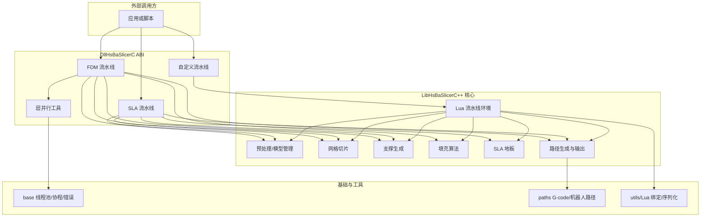
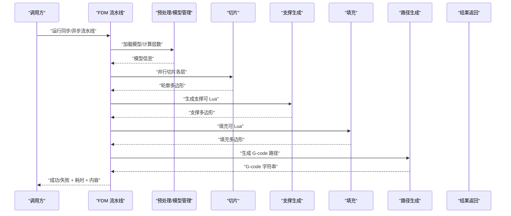
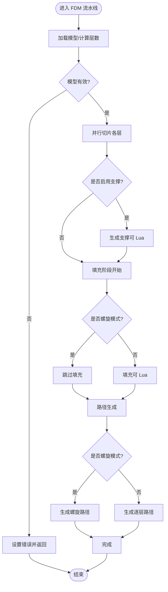
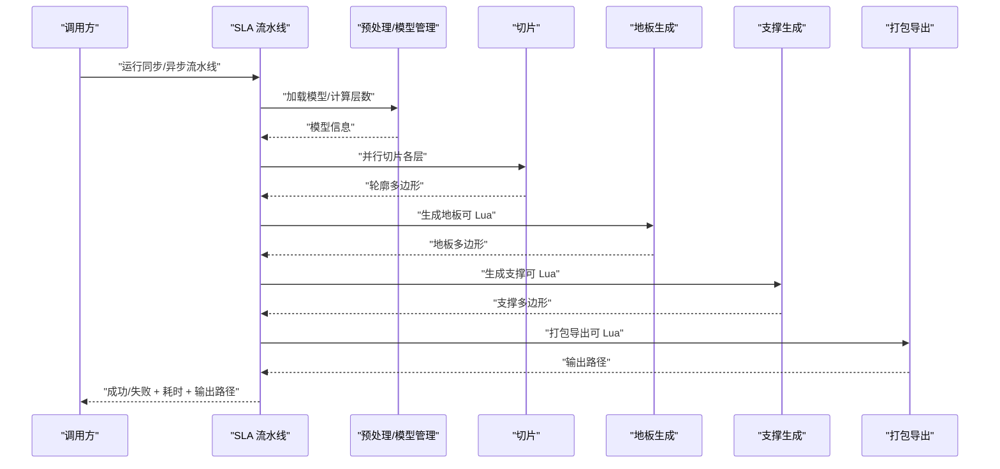
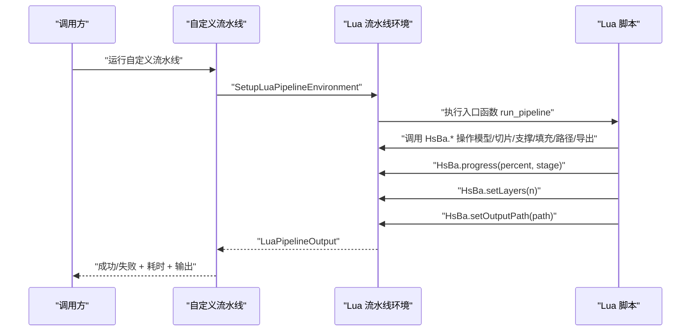
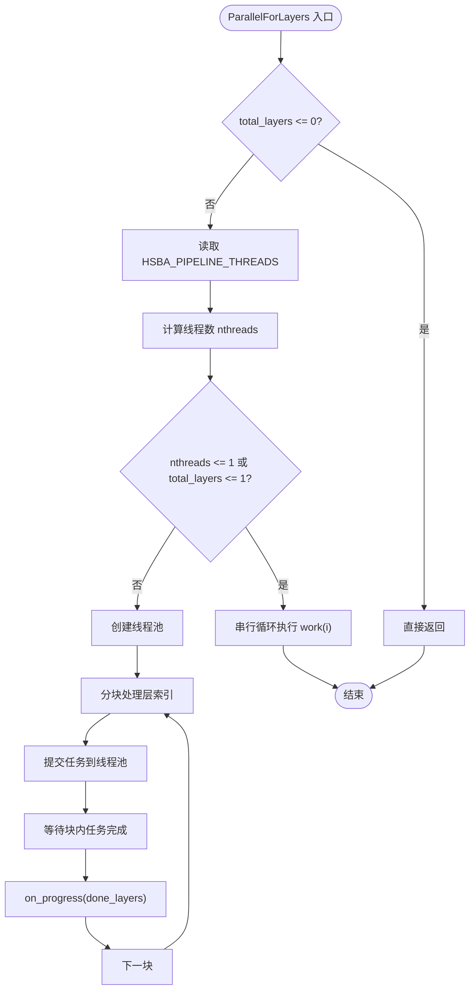
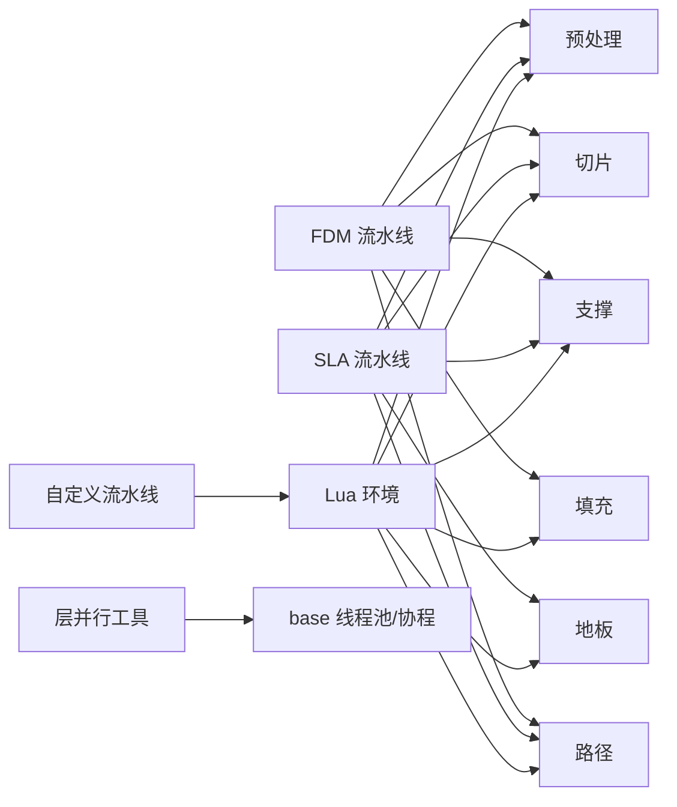

# 流水线架构模式

<cite>
**本文引用的文件**   
- [README.md](file://README.md)
- [pipeline_types.h](file://pipelinetypes/pipeline_types.h)
- [fdm_pipeline.h](file://DllHsBaSlicer/fdm_pipeline.h)
- [fdm_pipeline.cpp](file://DllHsBaSlicer/fdm_pipeline.cpp)
- [sla_pipeline.h](file://DllHsBaSlicer/sla_pipeline.h)
- [sla_pipeline.cpp](file://DllHsBaSlicer/sla_pipeline.cpp)
- [custom_pipeline.h](file://DllHsBaSlicer/custom_pipeline.h)
- [custom_pipeline.cpp](file://DllHsBaSlicer/custom_pipeline.cpp)
- [lua_pipeline.hpp](file://LibHsBaSlicer/Extends/lua_pipeline.hpp)
- [lua_pipeline.cpp](file://LibHsBaSlicer/Extends/lua_pipeline.cpp)
- [pipeline_parallel.hpp](file://DllHsBaSlicer/pipeline_parallel.hpp)
- [hsba_slicer.cppm](file://ModuleHsBaSlicer/hsba_slicer.cppm)
</cite>

## 目录
1. [引言](#引言)
2. [项目结构](#项目结构)
3. [核心组件](#核心组件)
4. [架构总览](#架构总览)
5. [详细组件分析](#详细组件分析)
6. [依赖关系分析](#依赖关系分析)
7. [性能与并行执行](#性能与并行执行)
8. [配置与自定义流水线指南](#配置与自定义流水线指南)
9. [错误处理与进度监控](#错误处理与进度监控)
10. [结论](#结论)

## 引言
本文件面向 HsBaSlicer 的“切片流水线”架构，系统性解释其设计模式、阶段职责、数据流转、扩展机制、异步与并行策略，以及配置与自定义流水线的实践方法。HsBaSlicer 是一个面向 3D 打印的高性能 C++ 框架，提供模块化、跨平台的切片核心能力，适用于研发与生产级别的切片流水线。

从架构视角看，系统通过统一的 C ABI 暴露多种工艺流水线（FDM、SLA、LOM、SLM、SLS、TDP、WAAM），并提供完全由 Lua 驱动的“自定义流水线”，允许用户自行编排加载模型、切片、支撑、填充、路径生成与导出等阶段。

**章节来源**
- [README.md:21-39](file://README.md#L21-L39)

## 项目结构
围绕流水线架构，关键代码分布在以下模块：
- DllHsBaSlicer：对外导出的 C ABI 流水线接口，包含 FDM、SLA、自定义流水线等实现。
- LibHsBaSlicer：C++ 全流程切片能力封装，包括预处理、切片、支撑、填充、路径、地板等算法库。
- pipelinetypes：各工艺流水线的 C 兼容配置与结果类型定义。
- ModuleHsBaSlicer：C++ module 层，对上层应用暴露更高层的类式 API。
- base、paths、support、utils 等：基础类型、线程池、日志、序列化、Lua 绑定等通用能力。

**图表来源**
- [fdm_pipeline.cpp:214-434](file://DllHsBaSlicer/fdm_pipeline.cpp#L214-L434)
- [sla_pipeline.cpp:281-463](file://DllHsBaSlicer/sla_pipeline.cpp#L281-L463)
- [custom_pipeline.cpp:116-158](file://DllHsBaSlicer/custom_pipeline.cpp#L116-L158)
- [lua_pipeline.cpp:40-39](file://LibHsBaSlicer/Extends/lua_pipeline.cpp#L40-L39)
- [pipeline_parallel.hpp:19-117](file://DllHsBaSlicer/pipeline_parallel.hpp#L19-L117)

**章节来源**
- [README.md:25-39](file://README.md#L25-L39)

## 核心组件
- FDM 流水线：负责 FDM 工艺的完整流程，包括预处理、切片、支撑、填充、路径生成，并支持螺旋花瓶模式。
- SLA 流水线：负责 SLA 工艺的完整流程，包括预处理、切片、地板、支撑、打包导出。
- 自定义流水线：完全由 Lua 脚本决定阶段顺序和内容，C++ 侧仅提供构建块（模型、切片、支撑、填充、路径、打包）。
- 层并行工具：为切片和填充等热路径提供按层并行执行的能力，同时保证进度回调在主线程串行上报。
- Lua 流水线环境：在 Lua 中暴露全局 `HsBa` 表，提供模型、切片、填充、支撑、路径、图像渲染、打包等函数。

**章节来源**
- [fdm_pipeline.h:17-61](file://DllHsBaSlicer/fdm_pipeline.h#L17-L61)
- [sla_pipeline.h:17-56](file://DllHsBaSlicer/sla_pipeline.h#L17-L56)
- [custom_pipeline.h:17-62](file://DllHsBaSlicer/custom_pipeline.h#L17-L62)
- [pipeline_parallel.hpp:22-40](file://DllHsBaSlicer/pipeline_parallel.hpp#L22-L40)
- [lua_pipeline.hpp:19-83](file://LibHsBaSlicer/Extends/lua_pipeline.hpp#L19-L83)

## 架构总览
HsBaSlicer 的流水线采用“固定阶段 + 可替换算法 + 可选 Lua 钩子”的设计：
- 固定阶段：每个工艺（如 FDM、SLA）有明确的阶段顺序，例如 FDM 为“预处理 → 切片 → 支撑 → 填充 → 路径生成”。
- 可替换算法：每个阶段可通过 Lua 脚本替换算法，例如支撑生成、填充、SLA 地板、导出打包。
- 可选 Lua 钩子：内置流水线在特定阶段加载 Lua 脚本并调用约定函数；自定义流水线则完全由 Lua 编排阶段。

**图表来源**
- [fdm_pipeline.cpp:214-434](file://DllHsBaSlicer/fdm_pipeline.cpp#L214-L434)

**章节来源**
- [fdm_pipeline.cpp:214-434](file://DllHsBaSlicer/fdm_pipeline.cpp#L214-L434)

## 详细组件分析

### FDM 流水线
FDM 流水线是典型的“五阶段”流水线：
1. 预处理：加载模型、获取包围盒与体积、计算层数。
2. 切片：构建切片拓扑，并行切片每层得到轮廓多边形。
3. 支撑：根据配置生成支撑，支持 Lua 自定义支撑算法。
4. 填充：对顶层/底层进行实心填充，中间层使用间距控制密度，支持 Lua 自定义填充。
5. 路径生成：普通模式生成逐层路径；螺旋模式合并外层轮廓为连续上升路径。

**图表来源**
- [fdm_pipeline.cpp:214-434](file://DllHsBaSlicer/fdm_pipeline.cpp#L214-L434)

**章节来源**
- [fdm_pipeline.cpp:137-192](file://DllHsBaSlicer/fdm_pipeline.cpp#L137-L192)
- [fdm_pipeline.cpp:214-434](file://DllHsBaSlicer/fdm_pipeline.cpp#L214-L434)

### SLA 流水线
SLA 流水线包含“预处理 → 切片 → 地板 → 支撑 → 导出”的阶段：
- 预处理与切片与 FDM 类似。
- 地板阶段：基于首层轮廓生成底板，支持 Lua 自定义地板算法。
- 支撑阶段：SLA 专用支撑参数，支持 Lua 自定义支撑。
- 导出阶段：将层轮廓、支撑、地板、曝光参数等打包为 ZIP，支持 Lua 自定义导出。

**图表来源**
- [sla_pipeline.cpp:281-463](file://DllHsBaSlicer/sla_pipeline.cpp#L281-L463)

**章节来源**
- [sla_pipeline.cpp:227-265](file://DllHsBaSlicer/sla_pipeline.cpp#L227-L265)
- [sla_pipeline.cpp:281-463](file://DllHsBaSlicer/sla_pipeline.cpp#L281-L463)

### 自定义流水线
自定义流水线是完全由 Lua 驱动的工作流：
- C++ 侧仅负责创建 Lua 环境、注册 `HsBa` 操作表、执行入口函数。
- Lua 脚本可以任意编排阶段顺序，例如先加载模型、再切片、再生成支撑、填充、路径、最后导出。
- 进度回调通过 `HsBa.progress()` 上报，结果通过 `HsBa.setLayers()` 与 `HsBa.setOutputPath()` 回传。

**图表来源**
- [custom_pipeline.cpp:116-158](file://DllHsBaSlicer/custom_pipeline.cpp#L116-L158)
- [lua_pipeline.cpp:212-238](file://LibHsBaSlicer/Extends/lua_pipeline.cpp#L212-L238)

**章节来源**
- [custom_pipeline.h:17-62](file://DllHsBaSlicer/custom_pipeline.h#L17-L62)
- [custom_pipeline.cpp:85-158](file://DllHsBaSlicer/custom_pipeline.cpp#L85-L158)
- [lua_pipeline.hpp:19-83](file://LibHsBaSlicer/Extends/lua_pipeline.hpp#L19-L83)
- [lua_pipeline.cpp:212-238](file://LibHsBaSlicer/Extends/lua_pipeline.cpp#L212-L238)

### 层并行工具
层并行工具为切片和填充等热路径提供按层并行执行能力：
- 根据硬件并发数和环境变量 `HSBA_PIPELINE_THREADS` 决定线程数。
- 将层索引分块提交到线程池，每块完成后触发进度回调。
- 单核或单层时自动退化为串行执行，保证行为一致性。

**图表来源**
- [pipeline_parallel.hpp:41-117](file://DllHsBaSlicer/pipeline_parallel.hpp#L41-L117)

**章节来源**
- [pipeline_parallel.hpp:22-40](file://DllHsBaSlicer/pipeline_parallel.hpp#L22-L40)
- [pipeline_parallel.hpp:41-117](file://DllHsBaSlicer/pipeline_parallel.hpp#L41-L117)

## 依赖关系分析
- FDM/SLA 流水线依赖 LibHsBaSlicer 的预处理、切片、支撑、填充、路径等算法库。
- 自定义流水线依赖 Lua 流水线环境，后者又依赖 2D 多边形、填充、支撑、路径、打包等库。
- 层并行工具依赖 base 线程池与协程。
- 所有流水线通过 C ABI 暴露给外部语言（Java/C#/Python 等）。

**图表来源**
- [fdm_pipeline.cpp:17-26](file://DllHsBaSlicer/fdm_pipeline.cpp#L17-L26)
- [sla_pipeline.cpp:18-25](file://DllHsBaSlicer/sla_pipeline.cpp#L18-L25)
- [lua_pipeline.cpp:16-38](file://LibHsBaSlicer/Extends/lua_pipeline.cpp#L16-L38)
- [pipeline_parallel.hpp:17-17](file://DllHsBaSlicer/pipeline_parallel.hpp#L17-L17)

**章节来源**
- [fdm_pipeline.cpp:17-26](file://DllHsBaSlicer/fdm_pipeline.cpp#L17-L26)
- [sla_pipeline.cpp:18-25](file://DllHsBaSlicer/sla_pipeline.cpp#L18-L25)
- [lua_pipeline.cpp:16-38](file://LibHsBaSlicer/Extends/lua_pipeline.cpp#L16-L38)
- [pipeline_parallel.hpp:17-17](file://DllHsBaSlicer/pipeline_parallel.hpp#L17-L17)

## 性能与并行执行
- 切片阶段：构建一次切片拓扑，然后并行切片各层，提升整体吞吐。
- 填充阶段：纯 C++ 填充算法可并行执行；Lua 填充因解释器状态共享限制需串行。
- 层并行工具：通过环境变量 `HSBA_PIPELINE_THREADS` 控制线程数，便于性能对比验证。
- 异步执行：FDM/SLA/自定义流水线均提供同步与异步接口，内部使用协程与任务链。

**章节来源**
- [fdm_pipeline.cpp:257-271](file://DllHsBaSlicer/fdm_pipeline.cpp#L257-L271)
- [fdm_pipeline.cpp:321-371](file://DllHsBaSlicer/fdm_pipeline.cpp#L321-L371)
- [pipeline_parallel.hpp:49-72](file://DllHsBaSlicer/pipeline_parallel.hpp#L49-L72)
- [fdm_pipeline.cpp:445-471](file://DllHsBaSlicer/fdm_pipeline.cpp#L445-L471)
- [sla_pipeline.cpp:474-499](file://DllHsBaSlicer/sla_pipeline.cpp#L474-L499)
- [custom_pipeline.cpp:169-194](file://DllHsBaSlicer/custom_pipeline.cpp#L169-L194)

## 配置与自定义流水线指南

### 配置类型与默认值
各工艺流水线提供 C 兼容的配置结构体与默认值构造函数，例如：
- FDM：`HsBaFdmPipelineConfig_t`，默认值通过 `HsBaFdmConfigDefault()` 初始化。
- SLA：`HsBaSlaPipelineConfig_t`，默认值通过 `HsBaSlaConfigDefault()` 初始化。
- 自定义：`HsBaCustomPipelineConfig_t`，默认值通过 `HsBaCustomConfigDefault()` 初始化。

这些配置包含模型路径、层高、填充参数、支撑参数、路径参数、输出路径等。

**章节来源**
- [pipeline_types.h:448-942](file://pipelinetypes/pipeline_types.h#L448-L942)
- [fdm_pipeline.h:17-35](file://DllHsBaSlicer/fdm_pipeline.h#L17-L35)
- [sla_pipeline.h:17-34](file://DllHsBaSlicer/sla_pipeline.h#L17-L34)
- [custom_pipeline.h:17-39](file://DllHsBaSlicer/custom_pipeline.h#L17-L39)

### 自定义流水线开发步骤
1. 准备 Lua 脚本：定义入口函数（默认 `run_pipeline`），在其中调用 `HsBa.*` 操作。
2. 设置配置：指定 `pipeline_lua_script` 或 `pipeline_lua_source`，可选 `entry_func`、`config_json`、`model_name`、`model_path`、`output_path`。
3. 运行流水线：调用 `HsBaRunCustomPipeline` 或 `HsBaRunCustomPipelineAsync`。
4. 处理结果：检查 `success`、`total_layers`、`output_path`、`result_string`、`error_message`。

**章节来源**
- [custom_pipeline.h:23-55](file://DllHsBaSlicer/custom_pipeline.h#L23-L55)
- [custom_pipeline.cpp:85-158](file://DllHsBaSlicer/custom_pipeline.cpp#L85-L158)
- [lua_pipeline.hpp:29-51](file://LibHsBaSlicer/Extends/lua_pipeline.hpp#L29-L51)

### Lua 流水线 API 概览
Lua 环境中全局 `HsBa` 表提供以下主要操作：
- 进度与状态：`progress(percent, stage)`、`setLayers(n)`、`setOutputPath(path)`。
- 模型管理：`loadModel(name, path)`、`modelInfo(name)`、`translateModel/rotateModel/scaleModel`、`removeModel`、`modelNames()`。
- 切片：`layerCount(name, layerHeight, firstLayerHeight)`、`layerZ(index, layerHeight, firstLayerHeight)`、`slice(name, z)`、`sliceUnsafe(name, z)`。
- 坐标转换：`toInt(polygons)`、`toDouble(intPolygons)`。
- 填充：`fill(polygons[, cfg])`。
- 支撑：`fdmSupport(layers, cfg)`、`slaSupport(layers, cfg)`。
- 地板：`floor(bottomPolygons, cfg)`。
- 路径：`spiralize(sections[, cfg])`、`toGcode(layers, cfg)`。
- 打包导出：`saveSlsPackage(pkg)`、`saveWaamPackage(pkg)`、`saveSlaPackage(pkg)`、`renderImage(polygons, width, height, path)`。

**章节来源**
- [lua_pipeline.cpp:212-238](file://LibHsBaSlicer/Extends/lua_pipeline.cpp#L212-L238)
- [lua_pipeline.cpp:270-446](file://LibHsBaSlicer/Extends/lua_pipeline.cpp#L270-L446)
- [lua_pipeline.cpp:448-518](file://LibHsBaSlicer/Extends/lua_pipeline.cpp#L448-L518)
- [lua_pipeline.cpp:520-654](file://LibHsBaSlicer/Extends/lua_pipeline.cpp#L520-L654)
- [lua_pipeline.cpp:656-783](file://LibHsBaSlicer/Extends/lua_pipeline.cpp#L656-L783)

## 错误处理与进度监控

### 错误处理
- 各流水线内部捕获 `RuntimeError`，将异常转换为结构化错误消息。
- 资源释放通过 RAII 包装（如 `OwnedCString`）确保内存安全。
- 异步流水线通过任务链传递结果，失败时仍会调用结果回调。

**章节来源**
- [fdm_pipeline.cpp:424-433](file://DllHsBaSlicer/fdm_pipeline.cpp#L424-L433)
- [sla_pipeline.cpp:453-462](file://DllHsBaSlicer/sla_pipeline.cpp#L453-L462)
- [fdm_pipeline.cpp:73-107](file://DllHsBaSlicer/fdm_pipeline.cpp#L73-L107)
- [sla_pipeline.cpp:87-119](file://DllHsBaSlicer/sla_pipeline.cpp#L87-L119)

### 进度监控
- 同步流水线通过 `HsBaProgressCallback` 回调上报进度百分比与阶段描述。
- 自定义流水线通过 Lua 中的 `HsBa.progress(percent, stage)` 上报进度。
- 层并行工具在每个块完成后触发进度回调，避免频繁回调开销。

**章节来源**
- [fdm_pipeline.h:23-35](file://DllHsBaSlicer/fdm_pipeline.h#L23-L35)
- [sla_pipeline.h:23-34](file://DllHsBaSlicer/sla_pipeline.h#L23-L34)
- [custom_pipeline.h:23-40](file://DllHsBaSlicer/custom_pipeline.h#L23-L40)
- [pipeline_parallel.hpp:37-40](file://DllHsBaSlicer/pipeline_parallel.hpp#L37-L40)
- [lua_pipeline.cpp:212-221](file://LibHsBaSlicer/Extends/lua_pipeline.cpp#L212-L221)

## 结论
HsBaSlicer 的流水线架构以“固定阶段 + 可替换算法 + 可选 Lua 钩子”为核心，既保证了 FDM/SLA 等主流工艺的稳定流程，又提供了高度灵活的自定义流水线能力。通过层并行工具与协程异步执行，系统在多线程环境下实现了高效处理。配置体系与 Lua API 使得用户能够轻松扩展新阶段或替换现有算法，满足多样化制造需求。