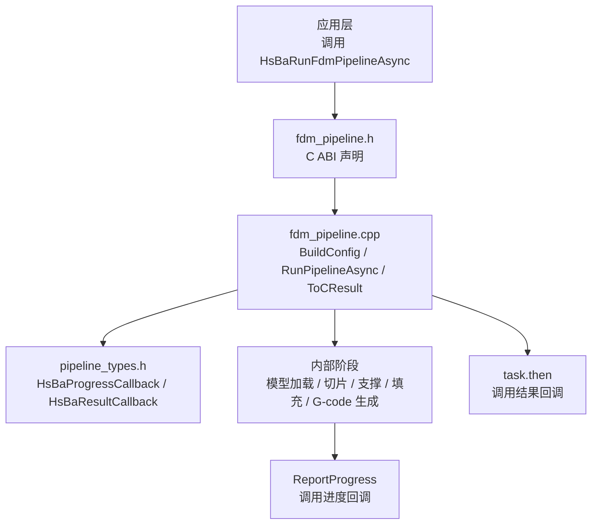
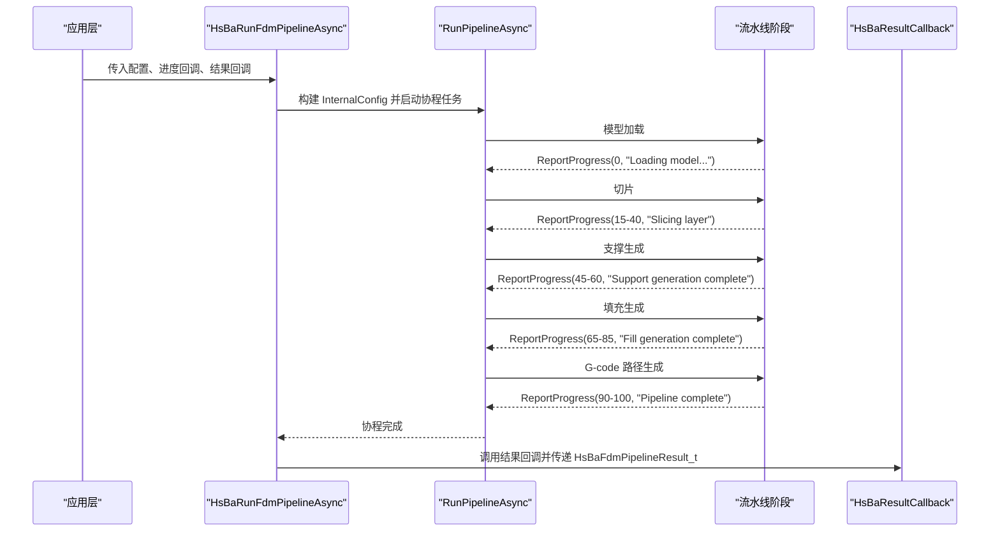
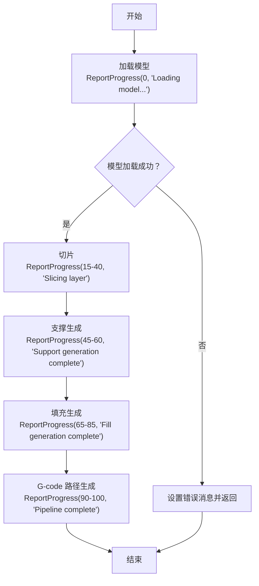
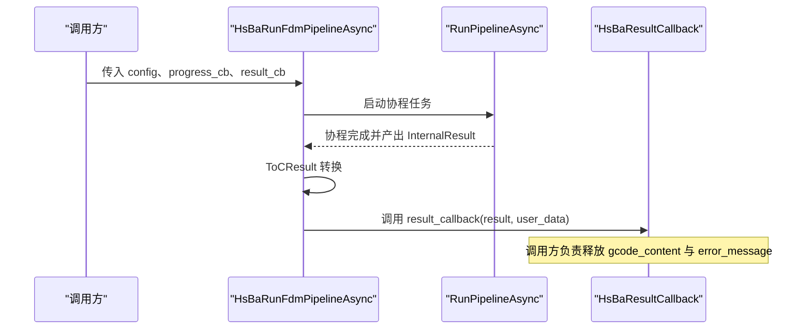
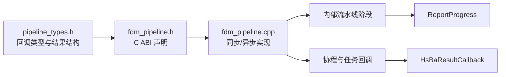
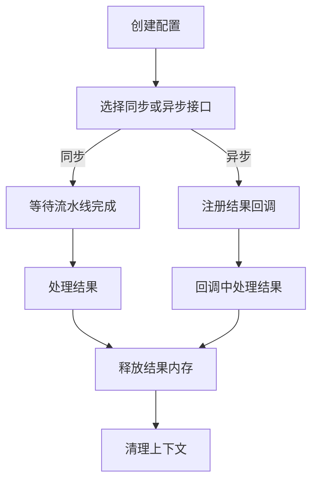

# FDM 回调系统与进度监控

<cite>
**本文引用的文件**   
- [pipeline_types.h](file://pipelinetypes/pipeline_types.h)
- [fdm_pipeline.h](file://DllHsBaSlicer/fdm_pipeline.h)
- [fdm_pipeline.cpp](file://DllHsBaSlicer/fdm_pipeline.cpp)
- [qt_wxwidgets_integration.md](file://docs/en/DllHsBaSlicer/qt_wxwidgets_integration.md)
</cite>

## 目录
1. [引言](#引言)
2. [项目结构定位](#项目结构定位)
3. [核心概念：回调类型与结果对象](#核心概念回调类型与结果对象)
4. [架构总览：FDM 流水线与回调的关系](#架构总览fdm-流水线与回调的关系)
5. [详细组件分析](#详细组件分析)
6. [依赖关系分析](#依赖关系分析)
7. [性能与线程安全特性](#性能与线程安全特性)
8. [完整回调实现指南](#完整回调实现指南)
9. [故障排除与常见问题](#故障排除与常见问题)
10. [结论](#结论)

## 引言
本文聚焦 FDM 流水线的回调系统，目标是帮助读者理解并正确使用 `HsBaProgressCallback` 与 `HsBaResultCallback`。文档会说明：
- 进度回调的触发时机、参数含义与调用语义；
- 异步执行模式下结果回调的工作机制；
- 回调中的线程安全注意事项；
- UI 进度条更新、日志记录与错误处理的实践方式；
- 在多线程环境中安全使用回调的最佳实践。

## 项目结构定位
FDM 回调系统由两部分组成：
- **C ABI 类型定义**：位于 `pipelinetypes/pipeline_types.h`，提供所有流水线配置、结果结构与回调函数指针类型；
- **FDM 流水线 C API 实现**：位于 `DllHsBaSlicer/fdm_pipeline.h` 与 `fdm_pipeline.cpp`，负责把内部协程任务包装成同步或异步接口，并在关键阶段调用进度回调。

**图表来源**
- [fdm_pipeline.h:23-51](file://DllHsBaSlicer/fdm_pipeline.h#L23-L51)
- [fdm_pipeline.cpp:134-140](file://DllHsBaSlicer/fdm_pipeline.cpp#L134-L140)
- [fdm_pipeline.cpp:219-447](file://DllHsBaSlicer/fdm_pipeline.cpp#L219-L447)
- [fdm_pipeline.cpp:469-486](file://DllHsBaSlicer/fdm_pipeline.cpp#L469-L486)
- [pipeline_types.h:129-140](file://pipelinetypes/pipeline_types.h#L129-L140)

**章节来源**
- [fdm_pipeline.h:1-68](file://DllHsBaSlicer/fdm_pipeline.h#L1-L68)
- [pipeline_types.h:1-140](file://pipelinetypes/pipeline_types.h#L1-L140)

## 核心概念：回调类型与结果对象
### HsBaProgressCallback
`HsBaProgressCallback` 是进度回调函数指针类型，用于在流水线执行过程中报告当前进度。其语义如下：
- `percent`：进度百分比，范围通常为 0 到 100；
- `stage`：当前阶段的 UTF-8 描述字符串；
- `user_data`：用户自定义数据指针，由调用方传入，便于回调中访问上下文。

该类型定义位于 `pipeline_types.h`，是所有 FDM、SLA、SLS、SLM、LOM、3DP、WAAM、文件传输与自定义 Lua 流水线共享的进度回调约定。

**章节来源**
- [pipeline_types.h:129-135](file://pipelinetypes/pipeline_types.h#L129-L135)

### HsBaResultCallback
`HsBaResultCallback` 是异步 FDM 流水线完成后的结果回调函数指针类型。它接收一个 `HsBaFdmPipelineResult_t` 结果对象和一个用户数据指针。

`HsBaFdmPipelineResult_t` 包含：
- `success`：是否成功；
- `total_layers`：总层数；
- `gcode_content`：生成的 G-code 内容（UTF-8，调用方需释放）；
- `error_message`：错误信息（UTF-8，调用方需释放）；
- `elapsed_seconds`：流水线耗时秒数。

**章节来源**
- [pipeline_types.h:115-140](file://pipelinetypes/pipeline_types.h#L115-L140)

### 同步与异步接口的区别
- `HsBaRunFdmPipeline`：同步接口，阻塞直到流水线完成，期间可能多次调用进度回调；
- `HsBaRunFdmPipelineAsync`：异步接口，立即返回，流水线在内部线程执行，完成后通过 `HsBaResultCallback` 通知结果。

**章节来源**
- [fdm_pipeline.h:23-51](file://DllHsBaSlicer/fdm_pipeline.h#L23-L51)

## 架构总览：FDM 流水线与回调的关系
FDM 流水线内部被划分为多个阶段，每个阶段都会通过统一的进度上报逻辑调用进度回调。异步模式下，最终结果通过协程的 `then` 回调交给 `HsBaResultCallback`。

**图表来源**
- [fdm_pipeline.cpp:219-447](file://DllHsBaSlicer/fdm_pipeline.cpp#L219-L447)
- [fdm_pipeline.cpp:469-486](file://DllHsBaSlicer/fdm_pipeline.cpp#L469-L486)

## 详细组件分析

### 进度回调触发时机与阶段语义
FDM 流水线内部通过 `ReportProgress` 统一上报进度。主要触发点包括：
- 模型加载前与加载后；
- 切片开始与各层切片完成；
- 支撑生成开始与完成；
- 填充生成开始与各层填充完成；
- G-code 路径生成开始与完成；
- 流水线整体完成。

这些阶段对应不同的百分比区间，例如：
- 0%：开始加载模型；
- 10%：模型加载完成；
- 15%-40%：切片阶段；
- 45%-60%：支撑阶段；
- 65%-85%：填充阶段；
- 90%-100%：G-code 生成与完成。

**图表来源**
- [fdm_pipeline.cpp:231-435](file://DllHsBaSlicer/fdm_pipeline.cpp#L231-L435)

**章节来源**
- [fdm_pipeline.cpp:134-140](file://DllHsBaSlicer/fdm_pipeline.cpp#L134-L140)
- [fdm_pipeline.cpp:231-435](file://DllHsBaSlicer/fdm_pipeline.cpp#L231-L435)

### 异步结果回调工作机制
异步接口 `HsBaRunFdmPipelineAsync` 的核心流程如下：
1. 将 C 配置转换为内部 `InternalConfig`；
2. 使用协程运行 `RunPipelineAsync`；
3. 协程完成后，通过 `task.then` 将内部结果转换为 C 结果；
4. 如果提供了 `HsBaResultCallback`，则调用该回调并传递结果对象；
5. 结果对象中的字符串内存由调用方负责释放。

**图表来源**
- [fdm_pipeline.cpp:469-486](file://DllHsBaSlicer/fdm_pipeline.cpp#L469-L486)
- [fdm_pipeline.cpp:199-211](file://DllHsBaSlicer/fdm_pipeline.cpp#L199-L211)

**章节来源**
- [fdm_pipeline.cpp:469-486](file://DllHsBaSlicer/fdm_pipeline.cpp#L469-L486)

### 异常处理与错误传播
FDM 流水线内部捕获 `RuntimeError`，并将错误信息写入结果对象的 `error_message`。同步接口直接返回结果对象；异步接口则在结果回调中传递错误结果。

关键点：
- 正常流程中 `success` 为真；
- 出现错误时 `success` 为假，且 `error_message` 包含错误描述；
- 调用方应根据 `success` 判断是否读取 `gcode_content`；
- 无论成功或失败，都应调用释放函数释放结果对象中的字符串。

**章节来源**
- [fdm_pipeline.cpp:437-446](file://DllHsBaSlicer/fdm_pipeline.cpp#L437-L446)
- [fdm_pipeline.h:53-61](file://DllHsBaSlicer/fdm_pipeline.h#L53-L61)

## 依赖关系分析
FDM 回调系统的依赖关系可以概括为：
- `fdm_pipeline.h` 暴露 C ABI；
- `fdm_pipeline.cpp` 实现同步与异步接口；
- `pipeline_types.h` 提供回调类型与结果结构；
- 内部阶段模块（模型预处理、切片、支撑、填充、路径生成）通过 `ReportProgress` 与回调系统交互；
- 异步模式依赖协程与任务链式回调。

**图表来源**
- [pipeline_types.h:115-140](file://pipelinetypes/pipeline_types.h#L115-L140)
- [fdm_pipeline.h:23-61](file://DllHsBaSlicer/fdm_pipeline.h#L23-L61)
- [fdm_pipeline.cpp:219-486](file://DllHsBaSlicer/fdm_pipeline.cpp#L219-L486)

**章节来源**
- [pipeline_types.h:115-140](file://pipelinetypes/pipeline_types.h#L115-L140)
- [fdm_pipeline.h:23-61](file://DllHsBaSlicer/fdm_pipeline.h#L23-L61)
- [fdm_pipeline.cpp:219-486](file://DllHsBaSlicer/fdm_pipeline.cpp#L219-L486)

## 性能与线程安全特性
### 进度回调的性能影响
- 进度回调在每个流水线阶段都可能被调用；
- 回调本身不应执行重计算或长时间阻塞操作；
- UI 更新应轻量，必要时通过事件队列或信号槽转发到 UI 线程。

### 异步模式的线程安全
- 进度回调可能在库内部线程中被调用；
- 结果回调也在协程完成后的回调上下文中执行；
- 回调中访问 UI 控件或其他非线程安全资源时，必须切换到主线程或 UI 线程；
- 不要在回调中直接修改共享状态而不加锁。

### 内存所有权
- `HsBaFdmPipelineResult_t` 中的 `gcode_content` 和 `error_message` 由库分配；
- 调用方必须在不再需要时调用释放函数；
- 异步模式下，结果回调收到结果后，调用方仍需负责释放字符串。

**章节来源**
- [fdm_pipeline.cpp:488-496](file://DllHsBaSlicer/fdm_pipeline.cpp#L488-L496)
- [fdm_pipeline.h:53-61](file://DllHsBaSlicer/fdm_pipeline.h#L53-L61)

## 完整回调实现指南

### 进度回调实现要点
一个安全的进度回调应做到：
- 不阻塞；
- 将 UTF-8 字符串转换为 UI 框架可用的字符串；
- 将 UI 更新操作发送到 UI 线程；
- 支持用户数据指针以访问上下文对象；
- 对空指针进行防御性检查。

示例思路（基于 Qt/WxWidgets 集成文档的模式）：
- 在 worker 线程中调用 FDM 流水线；
- 进度回调只负责发出信号或通过 `CallAfter` 等机制转发到 UI 线程；
- UI 线程更新进度条与状态文本。

**章节来源**
- [qt_wxwidgets_integration.md:47-105](file://docs/en/DllHsBaSlicer/qt_wxwidgets_integration.md#L47-L105)
- [qt_wxwidgets_integration.md:216-262](file://docs/en/DllHsBaSlicer/qt_wxwidgets_integration.md#L216-L262)

### 结果回调实现要点
一个安全的结果回调应做到：
- 检查 `success`；
- 若成功，复制 `gcode_content` 后再释放；
- 若失败，读取 `error_message` 并记录日志；
- 始终调用释放函数释放结果对象中的字符串；
- 不在回调中执行耗时操作，避免阻塞回调线程。

### 多线程环境下的最佳实践
- 使用独立工作线程执行 FDM 流水线；
- 进度回调仅做轻量转发；
- UI 更新在主线程或 UI 线程执行；
- 避免在回调中持有长生命周期引用；
- 确保回调关闭 lambda 或函数对象的生命周期覆盖回调执行时间。

[本图为概念流程图，不直接映射具体源码文件]

## 故障排除与常见问题

### 进度回调未触发
可能原因：
- 传入的进度回调为 `nullptr`；
- 流水线阶段未到达预期进度点；
- 回调中发生异常导致后续阶段中断。

排查建议：
- 确认回调指针非空；
- 检查 `stage` 字段以确定当前阶段；
- 查看 `error_message` 是否包含错误信息。

**章节来源**
- [fdm_pipeline.cpp:134-140](file://DllHsBaSlicer/fdm_pipeline.cpp#L134-L140)
- [fdm_pipeline.cpp:437-446](file://DllHsBaSlicer/fdm_pipeline.cpp#L437-L446)

### 结果回调未触发
可能原因：
- 传入的 `HsBaResultCallback` 为 `nullptr`；
- 协程尚未完成；
- 调用方过早销毁了相关上下文。

排查建议：
- 确认异步接口已正确调用；
- 确保结果回调指针非空；
- 保持上下文对象生命周期足够长。

**章节来源**
- [fdm_pipeline.cpp:469-486](file://DllHsBaSlicer/fdm_pipeline.cpp#L469-L486)

### 内存泄漏或重复释放
可能原因：
- 忘记调用释放函数；
- 重复释放同一结果对象；
- 在回调中直接释放但未复制所需数据。

排查建议：
- 每次使用 `HsBaFdmPipelineResult_t` 后调用释放函数；
- 先复制 `gcode_content` 或 `error_message`，再释放；
- 避免对同一结果对象多次释放。

**章节来源**
- [fdm_pipeline.cpp:488-496](file://DllHsBaSlicer/fdm_pipeline.cpp#L488-L496)
- [fdm_pipeline.h:53-61](file://DllHsBaSlicer/fdm_pipeline.h#L53-L61)

### UI 卡顿或界面无响应
可能原因：
- 进度回调中执行了重计算；
- 直接在回调中更新 UI 控件；
- 回调中执行网络或磁盘 I/O。

排查建议：
- 将 UI 更新发送到 UI 线程；
- 回调中只做轻量转发；
- 使用事件队列或信号槽机制解耦。

**章节来源**
- [qt_wxwidgets_integration.md:47-105](file://docs/en/DllHsBaSlicer/qt_wxwidgets_integration.md#L47-L105)
- [qt_wxwidgets_integration.md:216-262](file://docs/en/DllHsBaSlicer/qt_wxwidgets_integration.md#L216-L262)

## 结论
FDM 回调系统通过 `HsBaProgressCallback` 和 `HsBaResultCallback` 提供了清晰的进度与结果通知机制。进度回调在流水线各阶段触发，适合用于 UI 进度条与日志记录；结果回调在异步模式下安全地传递最终结果。使用时需注意：
- 回调应在非 UI 线程中保持轻量；
- UI 更新应切换到 UI 线程；
- 结果对象中的字符串必须由调用方释放；
- 在多线程环境中避免共享状态竞争；
- 结合错误处理与日志记录提升可观测性。