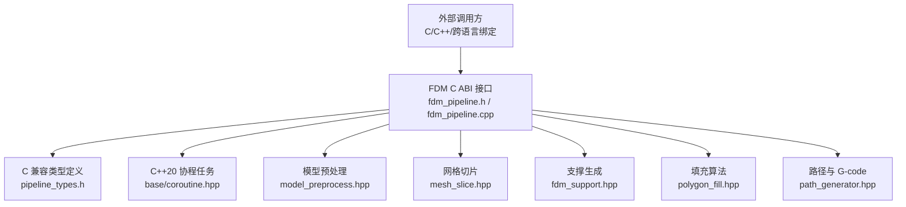
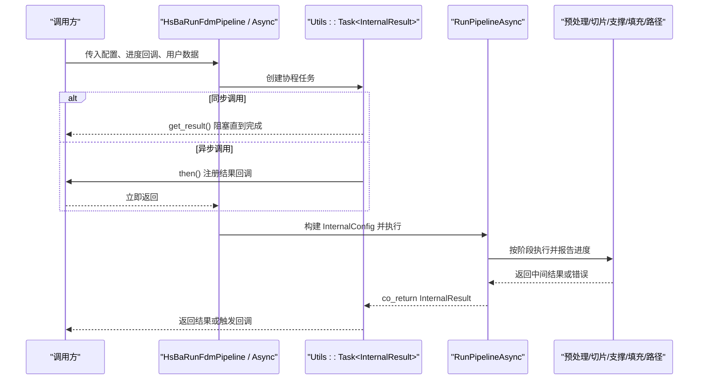
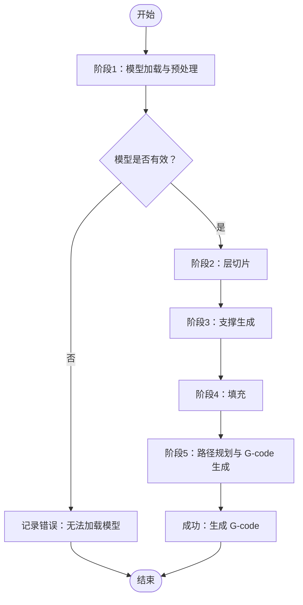
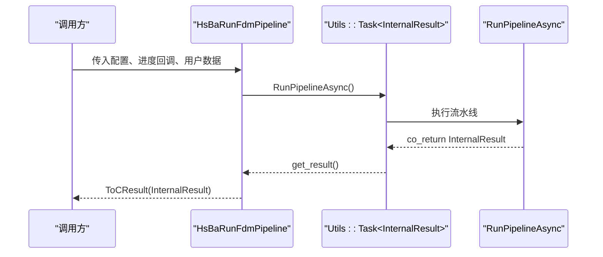
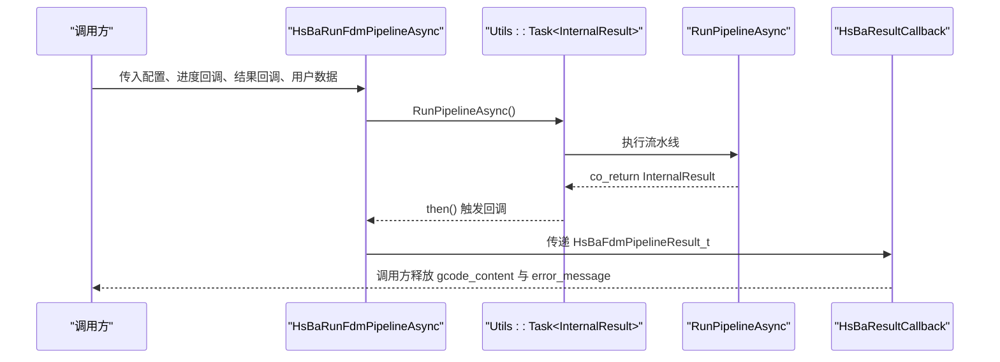
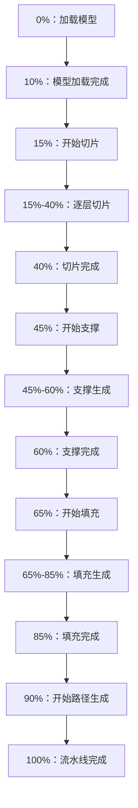
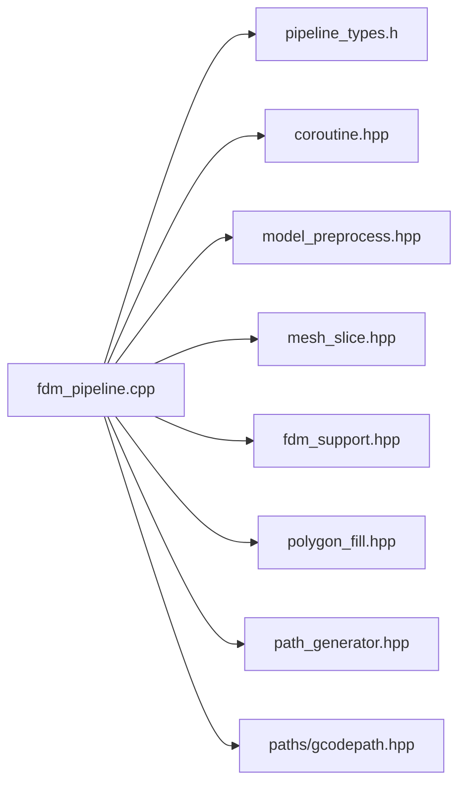

# FDM 执行流程与生命周期

<cite>
**本文引用的文件**   
- [fdm_pipeline.h](file://DllHsBaSlicer/fdm_pipeline.h)
- [fdm_pipeline.cpp](file://DllHsBaSlicer/fdm_pipeline.cpp)
- [pipeline_types.h](file://pipelinetypes/pipeline_types.h)
- [coroutine.hpp](file://base/coroutine.hpp)
- [model_preprocess.hpp](file://LibHsBaSlicer/Preprocess/model_preprocess.hpp)
- [mesh_slice.hpp](file://LibHsBaSlicer/Slice/mesh_slice.hpp)
- [fdm_support.hpp](file://LibHsBaSlicer/Support/fdm_support.hpp)
- [polygon_fill.hpp](file://LibHsBaSlicer/Fill/polygon_fill.hpp)
- [path_generator.hpp](file://LibHsBaSlicer/Path/path_generator.hpp)
- [main.cpp](file://samples/FDM/main.cpp)
</cite>

## 目录
1. [引言](#引言)
2. [项目结构定位](#项目结构定位)
3. [核心概念](#核心概念)
4. [架构总览](#架构总览)
5. [FDM 流水线完整执行流程](#fdm-流水线完整执行流程)
6. [同步执行与异步执行机制](#同步执行与异步执行机制)
7. [进度回调系统](#进度回调系统)
8. [详细组件分析](#详细组件分析)
9. [依赖关系分析](#依赖关系分析)
10. [性能与并行特性](#性能与并行特性)
11. [错误处理策略](#错误处理策略)
12. [资源管理与最佳实践](#资源管理与最佳实践)
13. [故障排除指南](#故障排除指南)
14. [结论](#结论)

## 引言
本文面向需要深入理解 HsBaSlicer 中 FDM（熔融沉积制造）切片流水线实现的技术读者，目标是完整解释从模型加载到 G-code 输出的每个阶段，并重点说明以下能力：
- 模型预处理：模型加载、边界框与体积查询、平移/旋转/缩放变换接口。
- 层切片生成：拓扑构建、逐层切片、Z 坐标计算。
- 支撑算法：内置 FDM 支撑、SLA 支撑、Lua 自定义支撑。
- 填充模式：平行线、简单 zigzag、高级 zigzag，以及 Lua 自定义填充。
- 路径规划与 G-code 输出：普通多层路径、螺旋花瓶模式、多固件目标。
- 同步执行 `HsBaRunFdmPipeline` 与异步执行 `HsBaRunFdmPipelineAsync` 的实现差异。
- C++20 协程任务模型 `Utils::Task` 的使用方式。
- 进度回调的调用时机、数据格式和线程语义。
- 错误处理、内存所有权与资源释放最佳实践。

## 项目结构定位
FDM 流水线的对外入口位于动态库导出层，内部通过静态库封装各阶段能力：
- 动态库导出层：`DllHsBaSlicer/fdm_pipeline.h`、`DllHsBaSlicer/fdm_pipeline.cpp`。
- 类型定义层：`pipelinetypes/pipeline_types.h`，提供 C ABI 配置与结果结构体。
- 协程基础设施：`base/coroutine.hpp`，提供 `Utils::Task`、`IExecutor`、`AsyncExecutor` 等。
- 核心能力层：`LibHsBaSlicer` 下的模型预处理、切片、支撑、填充、路径生成。
- 示例层：`samples/FDM/main.cpp` 演示默认配置、参数设置、同步/异步调用与结果处理。

**图示来源**
- [fdm_pipeline.h:1-67](file://DllHsBaSlicer/fdm_pipeline.h#L1-L67)
- [fdm_pipeline.cpp:1-497](file://DllHsBaSlicer/fdm_pipeline.cpp#L1-L497)
- [pipeline_types.h:53-140](file://pipelinetypes/pipeline_types.h#L53-L140)
- [coroutine.hpp:41-382](file://base/coroutine.hpp#L41-L382)
- [model_preprocess.hpp:22-88](file://LibHsBaSlicer/Preprocess/model_preprocess.hpp#L22-L88)
- [mesh_slice.hpp:22-103](file://LibHsBaSlicer/Slice/mesh_slice.hpp#L22-L103)
- [fdm_support.hpp:19-67](file://LibHsBaSlicer/Support/fdm_support.hpp#L19-L67)
- [polygon_fill.hpp:17-53](file://LibHsBaSlicer/Fill/polygon_fill.hpp#L17-L53)
- [path_generator.hpp:20-80](file://LibHsBaSlicer/Path/path_generator.hpp#L20-L80)

**章节来源**
- [fdm_pipeline.h:1-67](file://DllHsBaSlicer/fdm_pipeline.h#L1-L67)
- [pipeline_types.h:53-140](file://pipelinetypes/pipeline_types.h#L53-L140)

## 核心概念
- **FDM 流水线阶段**：模型预处理 → 层切片 → 支撑生成 → 填充 → 路径规划 → G-code 输出。
- **配置对象**：`HsBaFdmPipelineConfig_t`，包含模型、切片、填充、支撑、路径、G-code 固件、Lua 脚本等字段。
- **结果对象**：`HsBaFdmPipelineResult_t`，包含成功标志、总层数、G-code 内容、错误信息、耗时。
- **进度回调**：`HsBaProgressCallback(percent, stage, user_data)`，用于 UI 或日志更新。
- **异步结果回调**：`HsBaResultCallback(result, user_data)`，在异步流水线完成后被调用。
- **协程任务**：`Utils::Task<T>`，封装 C++20 coroutine 的执行状态、结果获取、完成回调、异常传播。

**章节来源**
- [pipeline_types.h:53-140](file://pipelinetypes/pipeline_types.h#L53-L140)
- [coroutine.hpp:200-382](file://base/coroutine.hpp#L200-L382)

## 架构总览
FDM 流水线的对外 API 是 C ABI，内部使用 C++ 实现。同步调用会阻塞等待协程完成；异步调用立即返回，并通过回调通知结果。

**图示来源**
- [fdm_pipeline.cpp:460-486](file://DllHsBaSlicer/fdm_pipeline.cpp#L460-L486)
- [coroutine.hpp:200-382](file://base/coroutine.hpp#L200-L382)

**章节来源**
- [fdm_pipeline.cpp:460-486](file://DllHsBaSlicer/fdm_pipeline.cpp#L460-L486)

## FDM 流水线完整执行流程
FDM 流水线在 `RunPipelineAsync` 中按顺序执行五个主要阶段，并在每个阶段前后调用进度回调。

**图示来源**
- [fdm_pipeline.cpp:219-447](file://DllHsBaSlicer/fdm_pipeline.cpp#L219-L447)

### 阶段一：模型预处理
- 通过 `GetModel` 尝试从内部模型池获取模型；若不存在则调用 `LoadModel` 加载。
- 通过 `GetModelInfo` 获取边界框与体积，用于计算总层数。
- 支持平移、旋转、均匀与非均匀缩放等变换接口，但当前 FDM 流水线未直接调用这些变换函数；它们属于模型预处理能力的一部分。

关键行为：
- 如果模型为空或高度无效，流水线提前失败并返回错误消息。
- 总层数由首层层高与普通层高决定。

**章节来源**
- [fdm_pipeline.cpp:231-257](file://DllHsBaSlicer/fdm_pipeline.cpp#L231-L257)
- [model_preprocess.hpp:32-88](file://LibHsBaSlicer/Preprocess/model_preprocess.hpp#L32-L88)

### 阶段二：层切片生成
- 先调用 `BuildSliceTopology` 构建可复用的切片拓扑，避免每层重复重建。
- 使用 `ParallelForLayers` 对每层调用 `SliceLayer`，将 Z 坐标转换为绝对高度后切片。
- 输出为每层的 `PolygonsD` 轮廓集合。

关键行为：
- 切片阶段进度范围约为 15% 到 40%。
- 每层切片是只读拓扑 + 独立输出容器的安全并行操作。

**章节来源**
- [fdm_pipeline.cpp:259-279](file://DllHsBaSlicer/fdm_pipeline.cpp#L259-L279)
- [mesh_slice.hpp:79-103](file://LibHsBaSlicer/Slice/mesh_slice.hpp#L79-L103)

### 阶段三：支撑算法执行
- 若启用螺旋模式，则跳过支撑。
- 若启用支撑且提供了 Lua 脚本，则调用 `GenerateAllLuaSupport`。
- 否则调用内置 `GenerateAllFdmSupport`。

关键行为：
- 支撑阶段进度范围约为 45% 到 60%。
- Lua 支撑脚本通过全局环境注入层数据与配置。

**章节来源**
- [fdm_pipeline.cpp:281-310](file://DllHsBaSlicer/fdm_pipeline.cpp#L281-L310)
- [fdm_support.hpp:19-67](file://LibHsBaSlicer/Support/fdm_support.hpp#L19-L67)

### 阶段四：填充模式应用
- 顶层与底层按实心层处理，中间层根据密度调整填充间距。
- 若启用 Lua 自定义填充，则串行调用 `LuaCustomFillByFile`。
- 否则使用 `FillWithBorder` 进行 C++ 填充，并可并行执行。

关键行为：
- 填充阶段进度范围约为 65% 到 85%。
- Lua 填充必须串行，因为 Lua 解释器状态不跨线程共享。

**章节来源**
- [fdm_pipeline.cpp:312-383](file://DllHsBaSlicer/fdm_pipeline.cpp#L312-L383)
- [polygon_fill.hpp:17-53](file://LibHsBaSlicer/Fill/polygon_fill.hpp#L17-L53)

### 阶段五：路径规划与 G-code 生成
- 螺旋模式：调用 `GenerateGCodePathSpiral`，将每层外轮廓合并为连续上升路径。
- 普通模式：构造 `LayerPathData`，调用 `GenerateGCodePathV2`，再调用 `ToGCode` 输出字符串。

关键行为：
- 路径阶段进度范围约为 90% 到 100%。
- G-code 内容以 UTF-8 字符串形式返回，并由调用方负责释放。

**章节来源**
- [fdm_pipeline.cpp:385-433](file://DllHsBaSlicer/fdm_pipeline.cpp#L385-L433)
- [path_generator.hpp:44-80](file://LibHsBaSlicer/Path/path_generator.hpp#L44-L80)

## 同步执行与异步执行机制

### 同步执行：`HsBaRunFdmPipeline`
- 将 C 配置转换为内部 `InternalConfig`。
- 创建协程任务 `RunPipelineAsync`。
- 调用 `task.get_result()` 阻塞等待结果。
- 将内部结果转换为 C 结果结构体返回。

**图示来源**
- [fdm_pipeline.cpp:460-467](file://DllHsBaSlicer/fdm_pipeline.cpp#L460-L467)
- [coroutine.hpp:277-320](file://base/coroutine.hpp#L277-L320)

**章节来源**
- [fdm_pipeline.cpp:460-467](file://DllHsBaSlicer/fdm_pipeline.cpp#L460-L467)

### 异步执行：`HsBaRunFdmPipelineAsync`
- 将配置复制到堆上 `shared_ptr<InternalConfig>`，确保协程执行期间配置存活。
- 创建协程任务并注册 `then` 回调。
- 回调中将内部结果转换为 C 结果，并调用 `HsBaResultCallback`。
- 调用方在回调中负责释放结果中的字符串内存。

**图示来源**
- [fdm_pipeline.cpp:469-486](file://DllHsBaSlicer/fdm_pipeline.cpp#L469-L486)
- [coroutine.hpp:322-336](file://base/coroutine.hpp#L322-L336)

**章节来源**
- [fdm_pipeline.cpp:469-486](file://DllHsBaSlicer/fdm_pipeline.cpp#L469-L486)

### C++20 协程任务模型
`Utils::Task<T>` 提供：
- `get_result()`：阻塞获取结果或抛出异常。
- `then(func)`：注册完成回调。
- `catching(func)`：捕获异常回调。
- `finally(func)`：无论成功失败都执行的清理回调。
- `on_completed`：内部实现，用于管理回调队列。

该模型使 FDM 流水线可以统一使用协程表达异步阶段，同时保留同步调用的简洁性。

**章节来源**
- [coroutine.hpp:200-382](file://base/coroutine.hpp#L200-L382)

## 进度回调系统
进度回调 `HsBaProgressCallback` 的签名是：
- `percent`：0 到 100 的百分比。
- `stage`：当前阶段描述字符串。
- `user_data`：调用方传入的用户数据指针。

FDM 流水线中的典型进度节点：
- 0%：开始加载模型。
- 10%：模型已加载。
- 15%-40%：切片阶段，随层数递增。
- 45%-60%：支撑阶段。
- 65%-85%：填充阶段。
- 90%-100%：路径生成与完成。

**图示来源**
- [fdm_pipeline.cpp:231-435](file://DllHsBaSlicer/fdm_pipeline.cpp#L231-L435)

**章节来源**
- [pipeline_types.h:129-140](file://pipelinetypes/pipeline_types.h#L129-L140)
- [fdm_pipeline.cpp:134-140](file://DllHsBaSlicer/fdm_pipeline.cpp#L134-L140)

## 详细组件分析

### FDM 配置与结果类型
`HsBaFdmPipelineConfig_t` 覆盖模型、切片、填充、支撑、路径、G-code 固件、Lua 脚本、输出路径等配置项。`HsBaFdmPipelineResult_t` 包含成功标志、总层数、G-code 内容、错误信息和耗时。

| 类别 | 关键字段 | 含义 |
|------|----------|------|
| 模型 | `model_name`、`model_path` | 模型名称与文件路径 |
| 切片 | `layer_height`、`first_layer_height` | 普通层高与首层层高 |
| 填充 | `fill_spacing`、`fill_mode`、`fill_angle`、`wall_count`、`infill_density` | 填充间距、模式、角度、壁厚、密度 |
| 支撑 | `enable_support`、`overhang_angle`、`support_pattern` | 是否启用支撑、悬垂角度、支撑图案 |
| 路径 | `line_width`、`print_speed`、`travel_speed`、`extrusion_multiplier` | 线宽、打印速度、移动速度、挤出倍率 |
| G-code | `gcode_firmware`、`nozzle_diameter`、`filament_diameter` | 固件目标、喷嘴直径、耗材直径 |
| Lua | `support_lua_script`、`infill_lua_script` | 自定义支撑与填充脚本路径 |
| 输出 | `output_path` | 可选的输出文件路径 |

**章节来源**
- [pipeline_types.h:53-113](file://pipelinetypes/pipeline_types.h#L53-L113)
- [pipeline_types.h:120-140](file://pipelinetypes/pipeline_types.h#L120-L140)

### 模型预处理接口
模型预处理模块提供：
- 模型加载与缓存：`LoadModel`、`GetModel`、`InsertModel`、`RemoveModel`。
- 模型信息查询：`GetModelInfo`。
- 几何变换：`TranslateModel`、`RotateModel`、`ScaleModel`。
- 高级布尔与厚实体操作（需 CGAL）。

当前 FDM 流水线主要使用 `GetModel`、`LoadModel`、`GetModelInfo`。

**章节来源**
- [model_preprocess.hpp:32-88](file://LibHsBaSlicer/Preprocess/model_preprocess.hpp#L32-L88)

### 切片接口
切片模块提供：
- 安全切片：`Slice`，返回闭合多边形。
- 不安全切片：`UnSafeSlice`，可能包含开放轮廓。
- Lua 驱动切片：`SliceLua`、`UnSafeSliceLua`。
- 拓扑复用：`BuildSliceTopology`、`SliceLayer`。

FDM 流水线优先使用 `BuildSliceTopology` + `SliceLayer`，以提升多层切片的性能。

**章节来源**
- [mesh_slice.hpp:22-103](file://LibHsBaSlicer/Slice/mesh_slice.hpp#L22-L103)

### 支撑接口
支撑模块提供：
- 单层层支撑：`GenerateFdmSupport`。
- 全层层支撑：`GenerateAllFdmSupport`。
- SLA 支撑：`GenerateAllSlaSupport`。
- Lua 自定义支撑：`GenerateAllLuaSupport`。

FDM 流水线根据配置选择内置支撑或 Lua 支撑。

**章节来源**
- [fdm_support.hpp:19-67](file://LibHsBaSlicer/Support/fdm_support.hpp#L19-L67)

### 填充接口
填充模块提供：
- 基础填充：`FillPolygon`。
- 带边框填充：`FillWithBorder`。
- Lua 自定义填充：`LuaCustomFillByFile`。

FDM 流水线对顶层/底层使用实心填充，对中间层根据密度调整间距，并可选择 Lua 填充。

**章节来源**
- [polygon_fill.hpp:17-53](file://LibHsBaSlicer/Fill/polygon_fill.hpp#L17-L53)

### 路径生成接口
路径模块提供：
- 普通路径：`GenerateGCodePath`。
- 多固件路径：`GenerateGCodePathV2`。
- 螺旋路径：`GenerateGCodePathSpiral`。
- 多边形转 G-point：`PolygonsToGPoints`。

FDM 流水线在普通模式下使用 `GenerateGCodePathV2`，在螺旋模式下使用 `GenerateGCodePathSpiral`。

**章节来源**
- [path_generator.hpp:44-80](file://LibHsBaSlicer/Path/path_generator.hpp#L44-L80)

## 依赖关系分析
FDM 流水线对外暴露 C ABI，对内依赖多个静态库模块。其依赖关系如下：

**图示来源**
- [fdm_pipeline.cpp:1-27](file://DllHsBaSlicer/fdm_pipeline.cpp#L1-L27)

**章节来源**
- [fdm_pipeline.cpp:1-27](file://DllHsBaSlicer/fdm_pipeline.cpp#L1-L27)

## 性能与并行特性
- **切片并行**：`ParallelForLayers` 对每层切片进行并行处理，前提是拓扑只读且每层写入独立容器。
- **填充并行**：C++ 填充可使用 `ParallelForLayers`；Lua 填充必须串行。
- **拓扑复用**：`BuildSliceTopology` 避免每层重建拓扑，降低 O(total_faces) 的重复开销。
- **协程调度**：`Utils::Task` 默认使用 `AsyncExecutor`，通过 `std::async` 提交任务；`DispatchAwaiter` 控制初始挂起与恢复。

优化建议：
- 对于超大模型，优先使用 `BuildSliceTopology` + `SliceLayer`。
- 避免在 Lua 填充中使用全局可变状态。
- 合理设置层数与填充密度，避免过多层导致内存与时间压力。

**章节来源**
- [fdm_pipeline.cpp:264-278](file://DllHsBaSlicer/fdm_pipeline.cpp#L264-L278)
- [fdm_pipeline.cpp:329-382](file://DllHsBaSlicer/fdm_pipeline.cpp#L329-L382)
- [coroutine.hpp:47-70](file://base/coroutine.hpp#L47-L70)

## 错误处理策略
FDM 流水线使用 `RuntimeError` 作为核心异常类型，并在协程中捕获：
- 模型加载失败：返回错误消息。
- 模型高度无效：返回错误消息。
- 螺旋路径生成失败：返回错误消息。
- 普通路径生成失败：返回错误消息。
- 其他阶段异常：统一包装为“流水线错误”。

同步调用时，异常会被 `get_result()` 重新抛出；异步调用时，异常会被存入 `exception_ptr`，并通过 `then` 回调的 `get_or_throw()` 暴露给调用方。

**章节来源**
- [fdm_pipeline.cpp:437-446](file://DllHsBaSlicer/fdm_pipeline.cpp#L437-L446)
- [coroutine.hpp:242-255](file://base/coroutine.hpp#L242-L255)

## 资源管理与最佳实践
- **C 字符串所有权**：`OwnedCString` 在协程内分配 `malloc` 字符串，转换到 C 结果时释放所有权；调用方必须调用 `HsBaFreePipelineResult` 释放 `gcode_content` 与 `error_message`。
- **配置生命周期**：异步调用时将 `InternalConfig` 放入 `shared_ptr`，确保协程执行期间配置不被销毁。
- **模型池管理**：可通过 `RemoveModel`、`CleanupModels` 清理不再使用的模型。
- **结果释放**：无论成功或失败，都必须调用 `HsBaFreePipelineResult`。

最佳实践清单：
1. 始终使用 `HsBaCreateDefaultConfig` 初始化配置。
2. 设置必填字段：`model_name`、`model_path`。
3. 在异步回调中检查 `success` 后再读取 `gcode_content`。
4. 在回调结束后调用 `HsBaFreePipelineResult`。
5. 避免在进度回调中进行耗时操作。

**章节来源**
- [fdm_pipeline.cpp:72-108](file://DllHsBaSlicer/fdm_pipeline.cpp#L72-L108)
- [fdm_pipeline.cpp:199-211](file://DllHsBaSlicer/fdm_pipeline.cpp#L199-L211)
- [fdm_pipeline.cpp:488-496](file://DllHsBaSlicer/fdm_pipeline.cpp#L488-L496)
- [model_preprocess.hpp:84-120](file://LibHsBaSlicer/Preprocess/model_preprocess.hpp#L84-L120)

## 故障排除指南
常见问题与排查方向：
- **模型加载失败**：检查 `model_path` 是否存在、文件格式是否受支持。
- **层数为零或负数**：检查 `layer_height`、`first_layer_height` 与模型高度。
- **支撑未生成**：确认 `enable_support` 与 `spiral_mode`；螺旋模式会禁用支撑。
- **填充结果为空**：检查 `fill_spacing`、`infill_density`、`wall_count` 与输入轮廓是否为空。
- **G-code 生成失败**：检查路径配置、打印机配置与固件目标。
- **异步回调未触发**：检查是否注册了 `result_callback`，并确保事件循环或主线程保持运行。

参考示例：
- `samples/FDM/main.cpp` 展示了默认配置、参数设置、进度回调与结果处理的基本用法。

**章节来源**
- [fdm_pipeline.cpp:231-433](file://DllHsBaSlicer/fdm_pipeline.cpp#L231-L433)
- [main.cpp:50-83](file://samples/FDM/main.cpp#L50-L83)

## 结论
HsBaSlicer 的 FDM 流水线通过清晰的阶段划分、C ABI 导出、C++20 协程任务模型与模块化核心能力，实现了从模型预处理到 G-code 输出的完整执行流程。同步调用适合简单场景，异步调用适合 UI 或后台任务；进度回调贯穿所有阶段，便于可视化与日志记录。正确理解配置结构、结果所有权、错误传播与资源释放，是使用该流水线的关键。