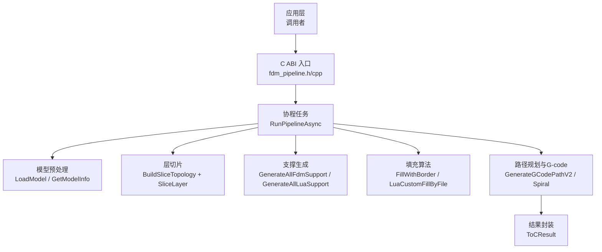
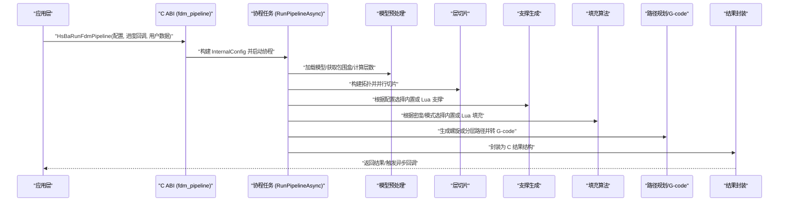
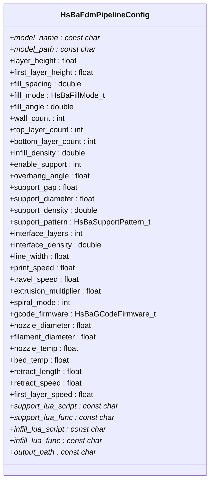
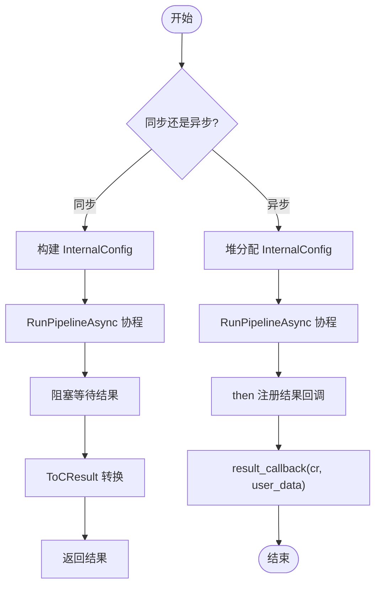
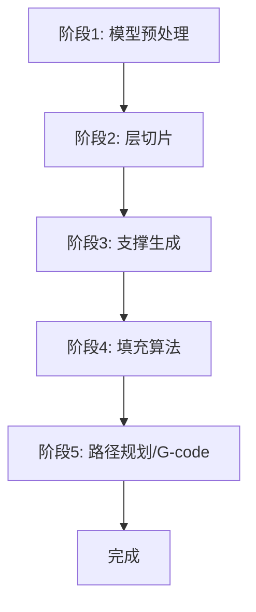
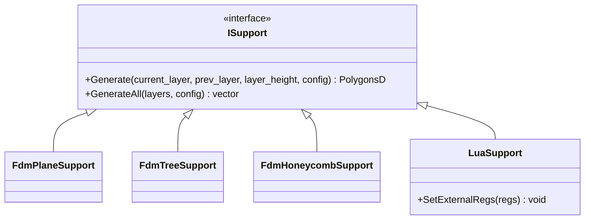
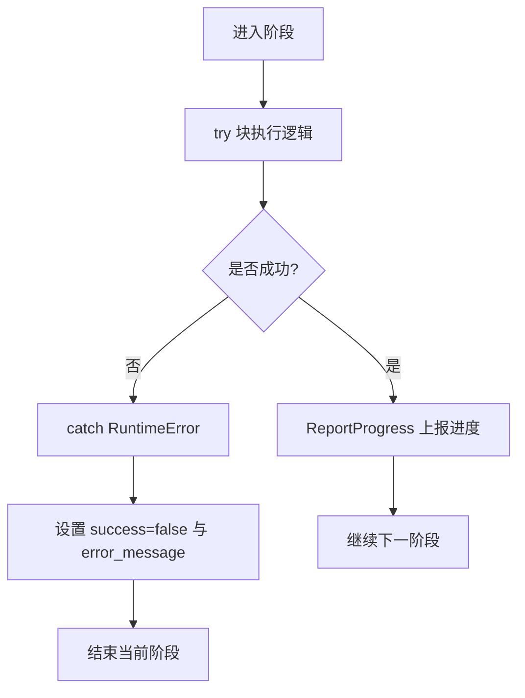
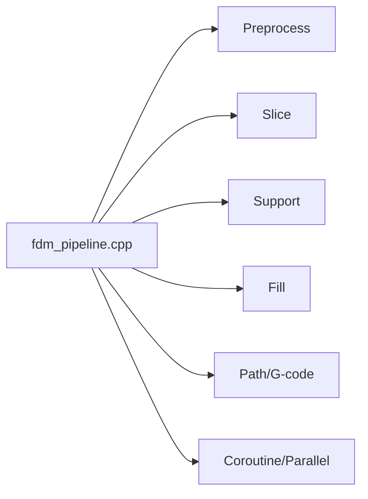

# FDM 流水线实现

<cite>
**本文引用的文件**   
- [pipeline_types.h](file://pipelinetypes/pipeline_types.h)
- [fdm_pipeline.h](file://DllHsBaSlicer/fdm_pipeline.h)
- [fdm_pipeline.cpp](file://DllHsBaSlicer/fdm_pipeline.cpp)
- [fdm_support.hpp](file://LibHsBaSlicer/Support/fdm_support.hpp)
- [fdm_support.cpp](file://LibHsBaSlicer/Support/fdm_support.cpp)
- [LuaSupport.hpp](file://support/LuaSupport.hpp)
</cite>

## 目录
1. [简介](#简介)
2. [项目结构](#项目结构)
3. [核心组件](#核心组件)
4. [架构总览](#架构总览)
5. [详细组件分析](#详细组件分析)
6. [依赖关系分析](#依赖关系分析)
7. [性能与并发特性](#性能与并发特性)
8. [故障排除指南](#故障排除指南)
9. [结论](#结论)
10. [附录：配置字段与默认值](#附录配置字段与默认值)

## 简介
本文件面向 FDM（熔融沉积建模）切片与路径生成流水线的实现，覆盖从模型预处理、层切片、支撑生成、填充算法、路径规划到 G-code 输出的完整执行流程。文档重点说明：
- HsBaFdmPipelineConfig_t 配置结构的所有字段及其默认值；
- 同步与异步执行模式的差异，以及 C++20 协程的使用方式；
- 进度回调与错误处理机制；
- 通过 Lua 脚本扩展自定义填充与支撑算法的方法；
- 典型调用示例的“代码片段路径”，便于读者在源码中定位具体实现。

## 项目结构
FDM 流水线由 DllHsBaSlicer 暴露 C ABI，内部调用 LibHsBaSlicer 提供的模型加载、切片、支撑、填充与路径生成能力，并通过 base/coroutine 提供协程任务调度。关键文件职责如下：
- pipelinetypes/pipeline_types.h：定义所有流水线的 C 兼容配置与结果类型，包括 FDM 枚举、结构与默认初始化函数；
- DllHsBaSlicer/fdm_pipeline.{h,cpp}：对外 C ABI，封装同步/异步执行入口，协调各阶段并输出 G-code；
- LibHsBaSlicer/Support/fdm_support.{hpp,cpp}：支撑生成的统一接口，支持内置算法与 Lua 脚本替换；
- support/LuaSupport.hpp：Lua 驱动的自定义支撑生成器，允许用户完全替换内置算法。

**图示来源**
- [fdm_pipeline.cpp:220-447](file://DllHsBaSlicer/fdm_pipeline.cpp#L220-L447)
- [fdm_support.cpp:14-74](file://LibHsBaSlicer/Support/fdm_support.cpp#L14-L74)

**章节来源**
- [fdm_pipeline.h:17-61](file://DllHsBaSlicer/fdm_pipeline.h#L17-L61)
- [fdm_pipeline.cpp:220-447](file://DllHsBaSlicer/fdm_pipeline.cpp#L220-L447)

## 核心组件
- 配置与结果类型：
  - HsBaFdmPipelineConfig_t：包含模型、切片、填充、支撑、路径、G-code 输出与 Lua 扩展等全部参数；
  - HsBaFdmPipelineResult_t：包含成功标志、层数、G-code 内容、错误信息与耗时；
  - HsBaProgressCallback/HsBaResultCallback：进度与结果回调类型。
- 对外 API：
  - HsBaCreateDefaultConfig：创建带默认值的配置；
  - HsBaRunFdmPipeline：同步执行，内部使用协程阻塞等待结果；
  - HsBaRunFdmPipelineAsync：异步执行，通过回调返回结果；
  - HsBaFreePipelineResult：释放结果中的字符串内存。

**章节来源**
- [pipeline_types.h:23-140](file://pipelinetypes/pipeline_types.h#L23-L140)
- [fdm_pipeline.h:17-61](file://DllHsBaSlicer/fdm_pipeline.h#L17-L61)

## 架构总览
FDM 流水线以协程为核心编排五个阶段，并在每个阶段报告进度。整体数据流如下：

**图示来源**
- [fdm_pipeline.cpp:220-447](file://DllHsBaSlicer/fdm_pipeline.cpp#L220-L447)

## 详细组件分析

### 配置结构 HsBaFdmPipelineConfig_t 与默认值
该结构集中管理 FDM 流水线的全部参数，涵盖：
- 模型配置：模型名称与路径；
- 切片配置：层高与首层层高；
- 填充配置：线间距、填充模式、角度、壁厚、顶底面层数、填充密度；
- 支撑配置：开关、悬垂角度阈值、间隙、柱直径、密度、图案、界面层数与密度；
- 路径配置：线宽、打印速度、移动速度、挤出倍率、花瓶模式；
- G-code 输出：固件目标、喷嘴直径、耗材直径、温度、回抽参数、首层速度；
- Lua 扩展：支撑与填充脚本路径及函数名；
- 输出路径：可选的 G-code 输出文件路径。

默认值由静态内联函数 HsBaFdmConfigDefault 提供，确保未显式设置的字段具有合理初始值。

**图示来源**
- [pipeline_types.h:56-113](file://pipelinetypes/pipeline_types.h#L56-L113)

**章节来源**
- [pipeline_types.h:56-113](file://pipelinetypes/pipeline_types.h#L56-L113)
- [pipeline_types.h:742-783](file://pipelinetypes/pipeline_types.h#L742-L783)

### 同步与异步执行模式
- 同步模式 HsBaRunFdmPipeline：
  - 将外部配置转换为内部 InternalConfig；
  - 启动协程任务 RunPipelineAsync；
  - 阻塞等待协程完成并返回 C 结果结构。
- 异步模式 HsBaRunFdmPipelineAsync：
  - 将配置拷贝到堆上共享对象，避免协程生命周期问题；
  - 启动协程任务并使用 then 链式回调；
  - 完成后通过 HsBaResultCallback 返回结果，调用方负责释放字符串内存。

**图示来源**
- [fdm_pipeline.cpp:460-486](file://DllHsBaSlicer/fdm_pipeline.cpp#L460-L486)

**章节来源**
- [fdm_pipeline.cpp:460-486](file://DllHsBaSlicer/fdm_pipeline.cpp#L460-L486)

### 五阶段执行流程与数据处理
- 阶段一：模型预处理
  - 通过 GetModel/LoadModel 加载模型；
  - 通过 GetModelInfo 获取包围盒与体积；
  - 计算总层数，校验模型高度有效性。
- 阶段二：层切片
  - 构建切片拓扑 BuildSliceTopology；
  - 对每层调用 SliceLayer，使用 ParallelForLayers 并行切片；
  - 记录每层轮廓 PolygonsD。
- 阶段三：支撑生成
  - 若启用花瓶模式则跳过支撑；
  - 否则根据配置选择内置支撑 GenerateAllFdmSupport 或 Lua 支撑 GenerateAllLuaSupport；
  - 输出每层支撑多边形。
- 阶段四：填充算法
  - 区分顶/底实心层与中间层；
  - 根据填充密度调整线间距；
  - 内置填充 FillWithBorder 可并行；Lua 填充需串行；
  - 输出每层填充多边形。
- 阶段五：路径规划与 G-code 输出
  - 花瓶模式：合并外层轮廓为连续上升螺旋路径；
  - 常规模式：组装 LayerPathData 并调用 GenerateGCodePathV2；
  - 最终转换为 G-code 字符串。

**图示来源**
- [fdm_pipeline.cpp:231-435](file://DllHsBaSlicer/fdm_pipeline.cpp#L231-L435)

**章节来源**
- [fdm_pipeline.cpp:231-435](file://DllHsBaSlicer/fdm_pipeline.cpp#L231-L435)

### 支撑系统：内置与 Lua 扩展
- 内置支撑：
  - 根据 Support::FdmSupportConfig.support_pattern 选择平面、树形或蜂窝支撑；
  - 提供单层与全层接口。
- Lua 支撑：
  - 通过 GenerateAllLuaSupport 加载脚本与函数名；
  - 注入 2D/3D 辅助函数供脚本操作多边形；
  - 脚本可完全替代内置算法。

**图示来源**
- [fdm_support.cpp:14-74](file://LibHsBaSlicer/Support/fdm_support.cpp#L14-L74)
- [LuaSupport.hpp:40-81](file://support/LuaSupport.hpp#L40-L81)

**章节来源**
- [fdm_support.hpp:19-67](file://LibHsBaSlicer/Support/fdm_support.hpp#L19-L67)
- [fdm_support.cpp:14-74](file://LibHsBaSlicer/Support/fdm_support.cpp#L14-L74)
- [LuaSupport.hpp:21-81](file://support/LuaSupport.hpp#L21-L81)

### 进度回调与错误处理
- 进度回调：
  - ReportProgress 在每个阶段更新百分比与阶段描述；
  - 回调签名 HsBaProgressCallback(percent, stage, user_data)。
- 错误处理：
  - 捕获 RuntimeError 并封装为错误消息；
  - 结果结构中 success 标志与 error_message 指示失败原因；
  - 异步模式下错误同样通过 result_callback 返回。

**图示来源**
- [fdm_pipeline.cpp:134-140](file://DllHsBaSlicer/fdm_pipeline.cpp#L134-L140)
- [fdm_pipeline.cpp:437-446](file://DllHsBaSlicer/fdm_pipeline.cpp#L437-L446)

**章节来源**
- [fdm_pipeline.cpp:134-140](file://DllHsBaSlicer/fdm_pipeline.cpp#L134-L140)
- [fdm_pipeline.cpp:437-446](file://DllHsBaSlicer/fdm_pipeline.cpp#L437-L446)

### 代码示例与用法指引
以下为“代码片段路径”形式的示例，帮助快速定位实现位置：
- 创建默认配置：
  - [HsBaCreateDefaultConfig 调用点:455-458](file://DllHsBaSlicer/fdm_pipeline.cpp#L455-L458)
  - [默认值初始化函数:742-783](file://pipelinetypes/pipeline_types.h#L742-L783)
- 同步执行流水线：
  - [同步入口 HsBaRunFdmPipeline:460-467](file://DllHsBaSlicer/fdm_pipeline.cpp#L460-L467)
- 异步执行流水线：
  - [异步入口 HsBaRunFdmPipelineAsync:469-486](file://DllHsBaSlicer/fdm_pipeline.cpp#L469-L486)
- 释放结果内存：
  - [HsBaFreePipelineResult:488-496](file://DllHsBaSlicer/fdm_pipeline.cpp#L488-L496)
- 自定义支撑脚本：
  - [Lua 支撑接口:52-67](file://LibHsBaSlicer/Support/fdm_support.hpp#L52-L67)
  - [Lua 支撑实现:61-74](file://LibHsBaSlicer/Support/fdm_support.cpp#L61-L74)
- 自定义填充脚本：
  - [填充阶段 Lua 调用路径:350-373](file://DllHsBaSlicer/fdm_pipeline.cpp#L350-L373)

注意：以上示例不直接展示代码内容，仅给出源码路径以便查阅。

**章节来源**
- [fdm_pipeline.cpp:455-496](file://DllHsBaSlicer/fdm_pipeline.cpp#L455-L496)
- [pipeline_types.h:742-783](file://pipelinetypes/pipeline_types.h#L742-L783)
- [fdm_support.hpp:52-67](file://LibHsBaSlicer/Support/fdm_support.hpp#L52-L67)
- [fdm_support.cpp:61-74](file://LibHsBaSlicer/Support/fdm_support.cpp#L61-L74)
- [fdm_pipeline.cpp:350-373](file://DllHsBaSlicer/fdm_pipeline.cpp#L350-L373)

## 依赖关系分析
FDM 流水线对外暴露 C ABI，内部依赖以下模块：
- 模型与切片：LibHsBaSlicer/Preprocess/model_preprocess.hpp、LibHsBaSlicer/Slice/mesh_slice.hpp；
- 支撑：LibHsBaSlicer/Support/fdm_support.hpp/.cpp；
- 填充：LibHsBaSlicer/Fill/polygon_fill.hpp；
- 路径与 G-code：LibHsBaSlicer/Path/path_generator.hpp、paths/gcodepath.hpp；
- 协程与线程池：base/coroutine.hpp、pipeline_parallel.hpp。

**图示来源**
- [fdm_pipeline.cpp:17-26](file://DllHsBaSlicer/fdm_pipeline.cpp#L17-L26)

**章节来源**
- [fdm_pipeline.cpp:17-26](file://DllHsBaSlicer/fdm_pipeline.cpp#L17-L26)

## 性能与并发特性
- 切片阶段：
  - 使用 ParallelForLayers 并行切片，每层独立且只读共享拓扑，提升吞吐；
- 填充阶段：
  - 内置填充 FillWithBorder 可并行；
  - Lua 填充因解释器状态不可跨线程共享，采用串行逐层执行；
- 支撑阶段：
  - 内置支撑按层顺序生成；
  - Lua 支撑通过统一接口批量生成；
- 总体策略：
  - 尽可能并行化纯几何计算；
  - 对需要全局状态的步骤（如 Lua 环境）保持串行，保证正确性。

[本节为通用性能讨论，不直接分析具体文件]

## 故障排除指南
常见问题与排查要点：
- 模型加载失败：
  - 检查 model_path 是否正确；
  - 查看 error_message 中“Failed to load model”提示；
- 模型高度无效：
  - 当 bbox_max.z - bbox_min.z <= 0 时返回错误；
  - 确认模型单位与坐标系；
- 切片为空层：
  - 检查层高与首层层高设置；
  - 确认模型几何有效；
- 支撑或填充失败：
  - 若使用 Lua 脚本，检查脚本路径与函数名；
  - 查看错误信息中的 Lua 相关提示；
- G-code 生成失败：
  - 检查路径配置与打印机配置是否一致；
  - 确认固件目标与参数匹配。

**章节来源**
- [fdm_pipeline.cpp:231-257](file://DllHsBaSlicer/fdm_pipeline.cpp#L231-L257)
- [fdm_pipeline.cpp:437-446](file://DllHsBaSlicer/fdm_pipeline.cpp#L437-L446)

## 结论
FDM 流水线通过清晰的五阶段设计与 C++20 协程编排，实现了高效、可扩展的切片与路径生成流程。配置结构 HsBaFdmPipelineConfig_t 提供了全面的参数控制，Lua 脚本扩展机制允许用户灵活替换支撑与填充算法。同步与异步两种执行模式满足不同集成场景，配合进度回调与完善的错误处理，使系统在易用性与健壮性之间取得良好平衡。

[本节为总结性内容，不直接分析具体文件]

## 附录：配置字段与默认值
下表汇总 HsBaFdmPipelineConfig_t 的关键字段与默认值（来源于静态内联初始化函数）：

- 模型配置：
  - model_name：空指针（NULL）
  - model_path：空指针（NULL）
- 切片配置：
  - layer_height：0.2 mm
  - first_layer_height：0.25 mm
- 填充配置：
  - fill_spacing：0.4 mm
  - fill_mode：HSBA_FILL_ZIGZAG
  - fill_angle：45.0°
  - wall_count：3
  - top_layer_count：3
  - bottom_layer_count：3
  - infill_density：0.2
- 支撑配置：
  - enable_support：1（启用）
  - overhang_angle：45.0°
  - support_gap：0.5 mm
  - support_diameter：2.0 mm
  - support_density：0.3
  - support_pattern：HSBA_SUPPORT_PLANE
  - interface_layers：2
  - interface_density：0.5
- 路径配置：
  - line_width：0.4 mm
  - print_speed：50.0 mm/s
  - travel_speed：100.0 mm/s
  - extrusion_multiplier：1.0
  - spiral_mode：0（关闭）
- G-code 输出配置：
  - gcode_firmware：HSBA_GCODE_MARLIN
  - nozzle_diameter：0.4 mm
  - filament_diameter：1.75 mm
  - nozzle_temp：200.0°C
  - bed_temp：60.0°C
  - retract_length：1.0 mm
  - retract_speed：40.0 mm/s
  - first_layer_speed：20.0 mm/s
- Lua 扩展配置：
  - support_lua_script：空指针（NULL）
  - support_lua_func：空指针（NULL）
  - infill_lua_script：空指针（NULL）
  - infill_lua_func：空指针（NULL）
- 输出配置：
  - output_path：空指针（NULL）

**章节来源**
- [pipeline_types.h:56-113](file://pipelinetypes/pipeline_types.h#L56-L113)
- [pipeline_types.h:742-783](file://pipelinetypes/pipeline_types.h#L742-L783)