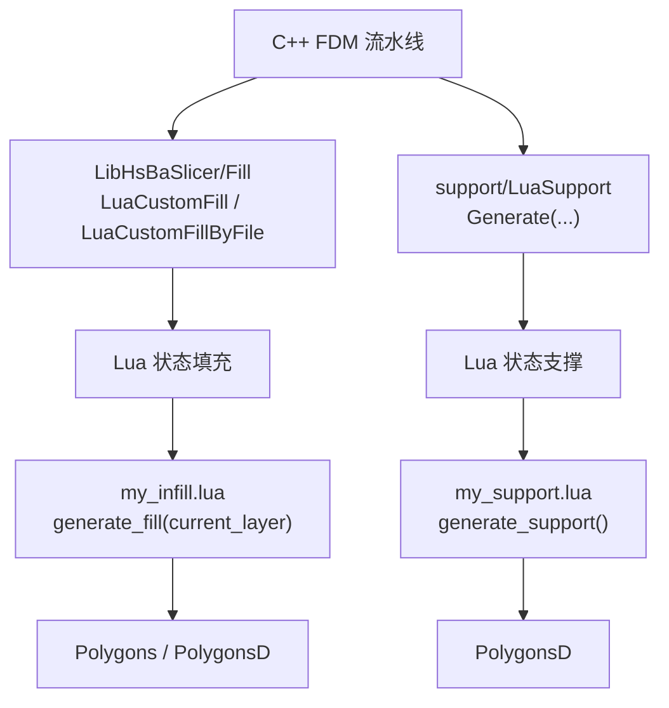
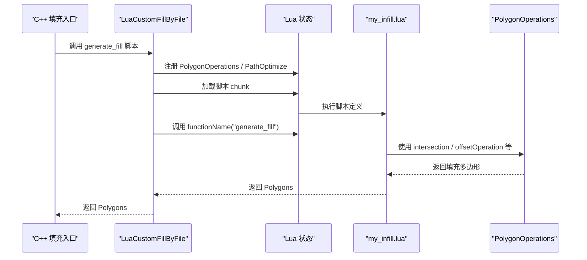
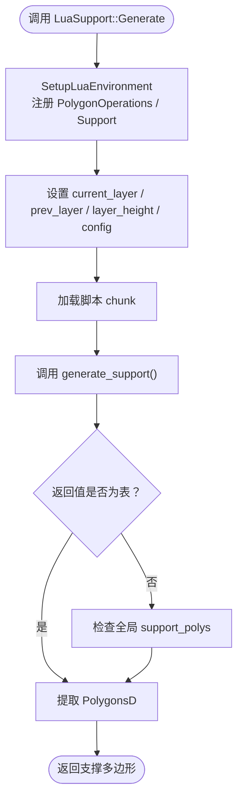
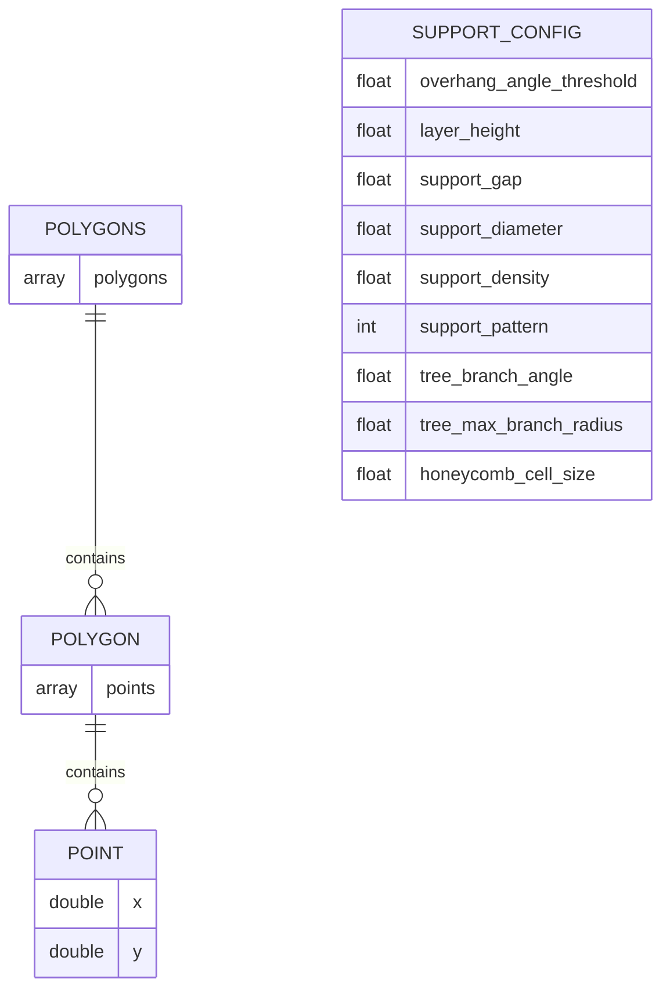
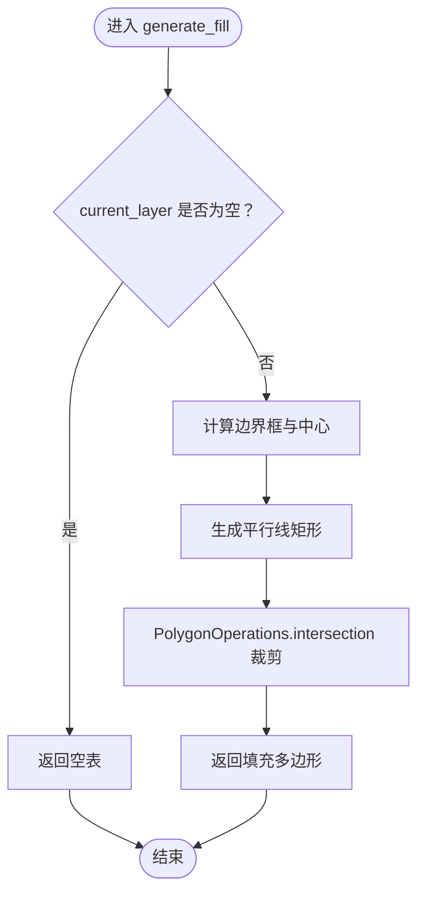

# FDM 自定义算法扩展

<cite>
**本文引用的文件**   
- [my_infill.lua](file://samples/FDM/scripts/my_infill.lua)
- [my_support.lua](file://samples/FDM/scripts/my_support.lua)
- [LuaAdapter.cpp](file://2D/LuaAdapter.cpp)
- [LuaAdapter.hpp](file://2D/LuaAdapter.hpp)
- [LuaSupport.cpp](file://support/LuaSupport.cpp)
- [LuaSupport.hpp](file://support/LuaSupport.hpp)
- [polygon_fill.cpp](file://LibHsBaSlicer/Fill/polygon_fill.cpp)
- [lua_pipeline.cpp](file://LibHsBaSlicer/Extends/lua_pipeline.cpp)
- [pipeline_types.h](file://pipelinetypes/pipeline_types.h)
- [hsba_slicer.cppm](file://ModuleHsBaSlicer/hsba_slicer.cppm)
- [polygon_fill_test.cpp](file://tests/PolygonFill/polygon_fill_test.cpp)
- [custom_fill.lua](file://tests/PolygonFill/custom_fill.lua)
- [lua_pipeline_api.md](file://docs/zh/lua_pipeline_api.md)
</cite>

## 目录
1. [项目概述与快速开始](#项目概述与快速开始)
2. [架构总览](#架构总览)
3. [核心概念](#核心概念)
4. [核心模块详解](#核心模块详解)
5. [高级主题](#高级主题)
6. [Lua 脚本系统](#lua-脚本系统)
7. [API 参考文档](#api-参考文档)
8. [集成指南](#集成指南)
9. [开发·测试与贡献](#开发·测试与贡献)
10. [扩展开发指南](#扩展开发指南)
11. [示例与教程](#示例与教程)
12. [部署·故障排除与FAQ](#部署·故障排除与faq)
13. [附录](#附录)

## 项目概述与快速开始
本页面聚焦 FDM 流水线的自定义算法扩展，目标是说明如何通过 Lua 脚本替换默认的填充算法和支撑算法，并给出完整的 API 约定、数据结构、注册机制、调试方法、性能优化建议以及常见问题解决方案。

FDM 流水线在 C++ 侧提供两类扩展点：
- **填充阶段**：通过 `LuaCustomFill` / `LuaCustomFillByFile` 加载用户脚本，调用约定的 `generate_fill(current_layer)` 函数返回填充路径。
- **支撑阶段**：通过 `LuaSupport` 类加载用户脚本，注入当前层、上一层、层高和配置，调用约定的 `generate_support()` 函数返回支撑截面多边形。

快速开始步骤：
1. 编写一个填充脚本，实现 `generate_fill(current_layer)`，返回由 `{ {x=..,y=..}, ... }` 组成的路径表。
2. 编写一个支撑脚本，实现 `generate_support()`，返回与 `current_layer` 同格式的支撑多边形表。
3. 在 FDM 流水线配置中指定 `infill_lua_func` 等字段，或通过 C++ 接口传入脚本路径与函数名。
4. 使用单元测试或内置测试用例验证脚本行为。

**章节来源**
- [lua_pipeline_api.md:215-239](file://docs/zh/lua_pipeline_api.md#L215-L239)
- [polygon_fill.cpp:35-49](file://LibHsBaSlicer/Fill/polygon_fill.cpp#L35-L49)
- [LuaSupport.hpp:21-39](file://support/LuaSupport.hpp#L21-L39)

## 架构总览
下图展示 FDM 自定义算法扩展的整体数据流：C++ 流水线调用 Lua 胶水层，胶水层加载脚本、设置全局变量、调用约定函数，并将结果转回 C++ 多边形类型。

**图表来源**
- [polygon_fill.cpp:35-49](file://LibHsBaSlicer/Fill/polygon_fill.cpp#L35-L49)
- [LuaSupport.cpp:113-178](file://support/LuaSupport.cpp#L113-L178)
- [my_infill.lua:20-87](file://samples/FDM/scripts/my_infill.lua#L20-L87)
- [my_support.lua:32-79](file://samples/FDM/scripts/my_support.lua#L32-L79)

**章节来源**
- [hsba_slicer.cppm:485-498](file://ModuleHsBaSlicer/hsba_slicer.cppm#L485-L498)
- [lua_pipeline.cpp:480-508](file://LibHsBaSlicer/Extends/lua_pipeline.cpp#L480-L508)

## 核心概念
- **多边形与点**：所有几何数据以 Lua table 表示，点为 `{ x = number, y = number }`，多边形为点的有序数组，孔洞作为独立多边形存在。
- **整数化与浮点精度**：布尔运算与填充内部使用整数精度；`HsBa.toInt` / `HsBa.toDouble` 用于转换；`PolygonOperations` 接收整型多边形，`HsBa.fill` 返回浮点多边形。
- **填充阶段契约**：脚本定义 `generate_fill(current_layer)`，参数是当前层多边形（已扣除壁厚），返回值是填充路径表。
- **支撑阶段契约**：脚本定义 `generate_support()`，全局变量包括 `current_layer`、`prev_layer`、`layer_height`、`config`，返回值是支撑截面多边形表。
- **动态加载**：C++ 侧创建 Lua 状态，注册 PolygonOperations、Support、PathOptimize 等库，加载脚本 chunk，再调用约定函数。

**章节来源**
- [lua_pipeline_api.md:32-45](file://docs/zh/lua_pipeline_api.md#L32-L45)
- [lua_pipeline_api.md:219-239](file://docs/zh/lua_pipeline_api.md#L219-L239)
- [LuaSupport.cpp:67-90](file://support/LuaSupport.cpp#L67-L90)

## 核心模块详解

### 填充阶段：LuaCustomFill 与 PolygonOperations
填充阶段通过 `LuaCustomFill` 或 `LuaCustomFillByFile` 加载脚本，并在脚本环境中注册 `PolygonOperations`、`PolygonFill`、`PathOptimize`。脚本必须返回填充路径表。

关键流程：
1. C++ 调用 `LuaCustomFillByFile(poly, scriptPath, functionName, lineThickness)`。
2. 胶水层注册外部 2D 函数与路径优化函数。
3. 加载脚本 chunk，执行后调用 `functionName`。
4. 将返回值转换为 `Polygons` 返回给 C++。

**图表来源**
- [polygon_fill.cpp:35-49](file://LibHsBaSlicer/Fill/polygon_fill.cpp#L35-L49)
- [LuaAdapter.cpp:311-329](file://2D/LuaAdapter.cpp#L311-L329)
- [my_infill.lua:20-87](file://samples/FDM/scripts/my_infill.lua#L20-L87)

**章节来源**
- [polygon_fill.cpp:13-33](file://LibHsBaSlicer/Fill/polygon_fill.cpp#L13-L33)
- [lua_pipeline_api.md:234-239](file://docs/zh/lua_pipeline_api.md#L234-L239)

### 支撑阶段：LuaSupport 与 Support 模块
支撑阶段通过 `LuaSupport::Generate` 加载脚本，注入 `current_layer`、`prev_layer`、`layer_height`、`config`，并注册 `Support` 模块。脚本可调用 `Support.detect_overhang`、`Support.generate` 等生成支撑。

关键流程：
1. 构造 `LuaSupport`，传入脚本内容或脚本文件路径。
2. 初始化 Lua 环境，注册 `PolygonOperations` 与 `Support`。
3. 设置全局变量 `current_layer`、`prev_layer`、`layer_height`、`config`。
4. 加载脚本 chunk，执行后调用 `generate_support()`。
5. 从返回值或全局 `support_polys` 提取支撑多边形。

**图表来源**
- [LuaSupport.cpp:113-178](file://support/LuaSupport.cpp#L113-L178)
- [LuaSupport.cpp:67-90](file://support/LuaSupport.cpp#L67-L90)
- [my_support.lua:32-79](file://samples/FDM/scripts/my_support.lua#L32-L79)

**章节来源**
- [LuaSupport.hpp:21-39](file://support/LuaSupport.hpp#L21-L39)
- [lua_pipeline_api.md:219-232](file://docs/zh/lua_pipeline_api.md#L219-L232)

### 多边形操作 API：PolygonOperations
`PolygonOperations` 提供 2D 几何操作，供填充与支撑脚本使用。主要函数包括：
- `booleanOperation(a, b, op)`：通用布尔运算，op ∈ {union, intersection, difference, xor}。
- `union(a, b)`、`intersection(a, b)`、`difference(a, b)`、`xor(a, b)`：四则布尔运算。
- `offsetOperation(polys, delta)`：偏移，正值为外扩。
- `convexHullOperation(polys)`、`concaveHullOperation(polys[, additionalPoints])`：凸包与凹包。
- `area(polygon)`：计算面积。
- `makeRectangle(x, y, width, height)`、`makeCircle(cx, cy, r[, segments])`、`makeEllipse(...)`、`makeRegularPolygon(...)`：几何构造。
- `textToPolygons(text, font_file, font_size[, x, y, curve_segments])`：文本转轮廓。

这些函数在 `RegisterLuaPolygonOperations` 中注册到全局 `PolygonOperations` 表。

**章节来源**
- [LuaAdapter.cpp:22-329](file://2D/LuaAdapter.cpp#L22-L329)
- [LuaAdapter.cpp:487-491](file://2D/LuaAdapter.cpp#L487-L491)
- [lua_pipeline_api.md:140-155](file://docs/zh/lua_pipeline_api.md#L140-L155)

## 高级主题

### 路径优化：PathOptimize
在填充阶段，脚本可通过 `PathOptimize` 对填充路径或多边形集合进行顺序优化，减少打印头移动距离。常用接口：
- `PathOptimize.new()`：创建优化器对象。
- `addRegion(id, paths)`：添加路径区域。
- `addPolygons(id, polys)`：添加多边形区域。
- `optimizeOrder()`：求解区域访问顺序。
- `buildPaths()` / `buildPolygons()`：输出优化后的路径或多边形集合。

测试用例展示了如何在脚本中嵌入优化逻辑，并确保输出路径按区域连续分块。

**章节来源**
- [lua_pipeline_api.md:161-167](file://docs/zh/lua_pipeline_api.md#L161-L167)
- [polygon_fill_test.cpp:390-419](file://tests/PolygonFill/polygon_fill_test.cpp#L390-L419)
- [polygon_fill_test.cpp:485-514](file://tests/PolygonFill/polygon_fill_test.cpp#L485-L514)

### 配置结构：HsBaFdmPipelineConfig_t
FDM 流水线配置包含 `infill_lua_func` 字段，用于指定填充 Lua 函数名。默认值为 `"generate_fill"`。该结构体还包含输出路径、成功标志、层数、G-code 内容与耗时等信息。

**章节来源**
- [pipeline_types.h:108-127](file://pipelinetypes/pipeline_types.h#L108-L127)

## Lua 脚本系统

### 填充脚本：my_infill.lua
示例脚本 `my_infill.lua` 实现了基于平行线扫描的填充算法：
1. 输入 `current_layer`，若为空则返回空表。
2. 计算边界框中心与范围。
3. 沿指定角度生成平行线矩形。
4. 使用 `PolygonOperations.intersection` 裁剪到有效区域。
5. 返回填充多边形表。

该脚本未接收配置参数，因此间距与角度在脚本内硬编码。

**章节来源**
- [my_infill.lua:1-89](file://samples/FDM/scripts/my_infill.lua#L1-L89)

### 支撑脚本：my_support.lua
示例脚本 `my_support.lua` 演示了如何结合内置支撑生成器：
1. 首层跳过支撑。
2. 使用 `Support.detect_overhang` 检测悬垂区域。
3. 根据 `config.support_pattern` 选择平面、树状或蜂窝支撑生成器。
4. 调用 `Support.generate` 生成支撑。
5. 可选地对结果做 `offsetOperation` 微调接触点。

**章节来源**
- [my_support.lua:1-83](file://samples/FDM/scripts/my_support.lua#L1-L83)

### 自定义流水线环境：HsBa 算子表
自定义流水线环境提供完整的 `HsBa` 算子表，包括进度上报、模型管理、切片、填充、支撑、路径生成与 G-code 导出等。该环境与内置阶段脚本不同，后者仅注入少量全局变量与阶段专用库。

**章节来源**
- [lua_pipeline_api.md:48-133](file://docs/zh/lua_pipeline_api.md#L48-L133)
- [lua_pipeline_api.md:264-279](file://docs/zh/lua_pipeline_api.md#L264-L279)

## API 参考文档

### 填充阶段 API
- **C++ 入口**：`LuaCustomFill(poly, script_path, func_name, line_thickness)`、`LuaCustomFillByFile(poly, script_path, function_name, line_thickness)`。
- **Lua 约定**：`generate_fill(current_layer)`，返回填充路径表。
- **可用库**：`PolygonOperations`、`PolygonFill`、`PathOptimize`。

**章节来源**
- [hsba_slicer.cppm:485-498](file://ModuleHsBaSlicer/hsba_slicer.cppm#L485-L498)
- [polygon_fill.cpp:35-49](file://LibHsBaSlicer/Fill/polygon_fill.cpp#L35-L49)
- [lua_pipeline_api.md:234-239](file://docs/zh/lua_pipeline_api.md#L234-L239)

### 支撑阶段 API
- **C++ 入口**：`LuaSupport::Generate(current_layer, prev_layer, layer_height, config)`。
- **Lua 约定**：`generate_support()`，返回支撑截面多边形表。
- **可用库**：`PolygonOperations`、`Support`。

**章节来源**
- [LuaSupport.hpp:63-67](file://support/LuaSupport.hpp#L63-L67)
- [lua_pipeline_api.md:219-232](file://docs/zh/lua_pipeline_api.md#L219-L232)

### 多边形操作 API
见「核心模块详解」中的 PolygonOperations 小节。

**章节来源**
- [LuaAdapter.cpp:22-329](file://2D/LuaAdapter.cpp#L22-L329)
- [lua_pipeline_api.md:140-155](file://docs/zh/lua_pipeline_api.md#L140-L155)

### 路径优化 API
见「高级主题」中的 PathOptimize 小节。

**章节来源**
- [lua_pipeline_api.md:161-167](file://docs/zh/lua_pipeline_api.md#L161-L167)

## 集成指南

### 在 FDM 流水线中启用自定义填充
1. 准备脚本文件 `my_infill.lua`。
2. 调用 `LuaCustomFillByFile(poly, script_path, "generate_fill", line_thickness)`。
3. 确保脚本返回合法的多边形路径表。

### 在 FDM 流水线中启用自定义支撑
1. 准备脚本文件 `my_support.lua`。
2. 构造 `LuaSupport(script_file, "generate_support")`。
3. 调用 `Generate(current_layer, prev_layer, layer_height, config)`。
4. 处理返回值作为支撑截面。

**章节来源**
- [polygon_fill.cpp:35-49](file://LibHsBaSlicer/Fill/polygon_fill.cpp#L35-L49)
- [LuaSupport.cpp:103-178](file://support/LuaSupport.cpp#L103-L178)

## 开发·测试与贡献

### 单元测试
测试用例覆盖以下场景：
- 基础填充算法（Line、Zigzag、SimpleZigzag）。
- 自交多边形归一化。
- 自定义填充脚本返回对角线路径。
- 路径优化器区域顺序与路径反转。
- 填充阶段暴露 PathOptimize。

**章节来源**
- [polygon_fill_test.cpp:26-84](file://tests/PolygonFill/polygon_fill_test.cpp#L26-L84)
- [polygon_fill_test.cpp:108-175](file://tests/PolygonFill/polygon_fill_test.cpp#L108-L175)
- [polygon_fill_test.cpp:390-419](file://tests/PolygonFill/polygon_fill_test.cpp#L390-L419)
- [polygon_fill_test.cpp:516-540](file://tests/PolygonFill/polygon_fill_test.cpp#L516-L540)

### 性能基准测试建议
- 使用大尺寸多边形集合测试填充脚本性能。
- 对比不同 `spacing`、`angle` 下的路径数量与长度。
- 使用 `PathOptimize.optimizeRegions` 评估优化前后打印头移动距离。
- 记录 Lua 脚本执行时间与 C++ 转换时间。

[本节为通用指导，不直接分析具体文件]

## 扩展开发指南

### 设计模式与最佳实践
- **脚本职责单一**：填充脚本只负责生成填充路径，支撑脚本只负责生成支撑截面。
- **避免全局状态污染**：尽量使用局部变量，避免修改全局表。
- **参数本地化**：填充脚本未接收配置时，应在脚本内定义默认值。
- **错误处理**：脚本应检查输入是否为空，避免无效计算。
- **性能优化**：优先使用 `PolygonOperations` 的批量操作，减少 Lua/C++ 切换开销。

**章节来源**
- [my_infill.lua:20-87](file://samples/FDM/scripts/my_infill.lua#L20-L87)
- [my_support.lua:32-79](file://samples/FDM/scripts/my_support.lua#L32-L79)

### 动态加载与注册机制
- `RegisterLuaPolygonOperations` 将 2D 几何函数注册到全局 `PolygonOperations`。
- `LuaSupport::Generate` 在初始化时注册 `PolygonOperations` 与 `Support`。
- `LuaCustomFillByFile` 额外注册 `PathOptimize`，供填充脚本优化路径。

**章节来源**
- [LuaAdapter.cpp:487-491](file://2D/LuaAdapter.cpp#L487-L491)
- [LuaSupport.cpp:67-90](file://support/LuaSupport.cpp#L67-L90)
- [polygon_fill.cpp:35-49](file://LibHsBaSlicer/Fill/polygon_fill.cpp#L35-L49)

## 示例与教程

### 完整填充脚本示例
参考 `my_infill.lua`，实现平行线扫描填充，并使用 `PolygonOperations.intersection` 裁剪到有效区域。

**章节来源**
- [my_infill.lua:1-89](file://samples/FDM/scripts/my_infill.lua#L1-L89)

### 完整支撑脚本示例
参考 `my_support.lua`，结合 `Support.detect_overhang` 与 `Support.generate` 生成支撑，并进行可选的微调。

**章节来源**
- [my_support.lua:1-83](file://samples/FDM/scripts/my_support.lua#L1-L83)

### 测试脚本示例
参考 `custom_fill.lua`，返回两条对角线路径，用于验证 `LuaCustomFill` 的返回值格式与坐标精度。

**章节来源**
- [custom_fill.lua:1-16](file://tests/PolygonFill/custom_fill.lua#L1-L16)

## 部署·故障排除与FAQ

### 常见问题
- **脚本返回非表**：C++ 侧会抛出运行时错误。确保 `generate_fill` 或 `generate_support` 返回多边形表。
- **函数名不匹配**：确认 C++ 调用时传入的函数名与脚本中定义的函数名一致。
- **全局变量缺失**：支撑脚本依赖 `current_layer`、`prev_layer`、`layer_height`、`config`，请确保这些变量存在。
- **性能问题**：避免在脚本中进行大量逐点循环，优先使用 `PolygonOperations` 的批量操作。

**章节来源**
- [LuaSupport.cpp:141-178](file://support/LuaSupport.cpp#L141-L178)
- [polygon_fill_test.cpp:255-258](file://tests/PolygonFill/polygon_fill_test.cpp#L255-L258)

### 调试技巧
- 使用 `dumpPolygon` / `dumpPolygons`（需启用 `HSBA_POLYGON_DUMP`）输出中间多边形。
- 在脚本中添加日志或使用 `HsBa.progress` 上报进度。
- 通过单元测试逐步验证脚本返回值。

**章节来源**
- [LuaAdapter.cpp:275-309](file://2D/LuaAdapter.cpp#L275-L309)
- [lua_pipeline_api.md:67-75](file://docs/zh/lua_pipeline_api.md#L67-L75)

## 附录

### 数据结构图

**图表来源**
- [lua_pipeline_api.md:32-45](file://docs/zh/lua_pipeline_api.md#L32-L45)
- [LuaSupport.cpp:19-49](file://support/LuaSupport.cpp#L19-L49)

### 流程图：自定义填充算法

**图表来源**
- [my_infill.lua:20-87](file://samples/FDM/scripts/my_infill.lua#L20-L87)