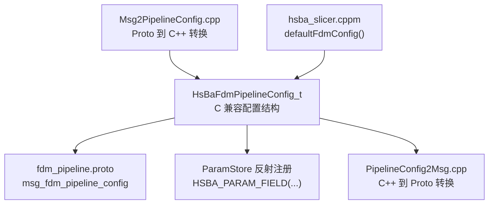
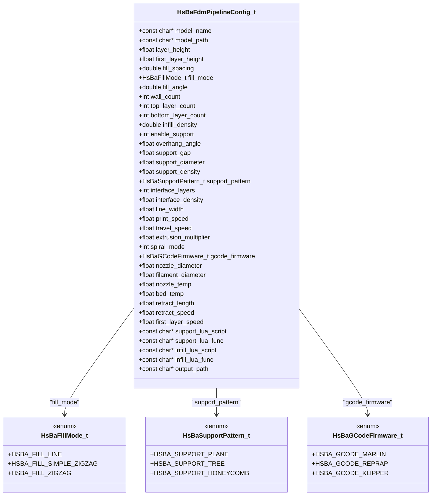
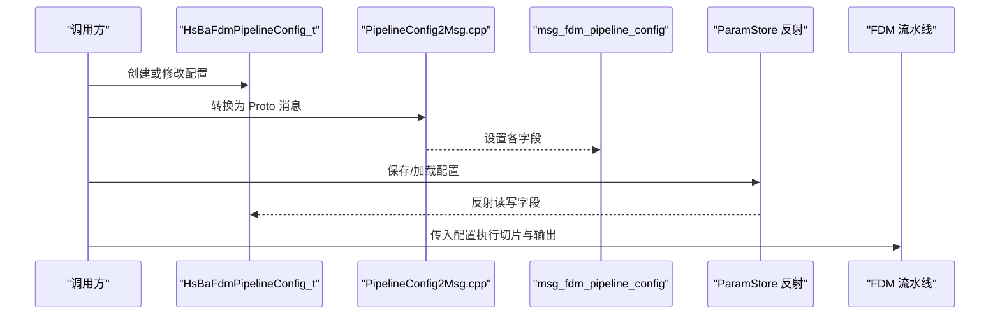
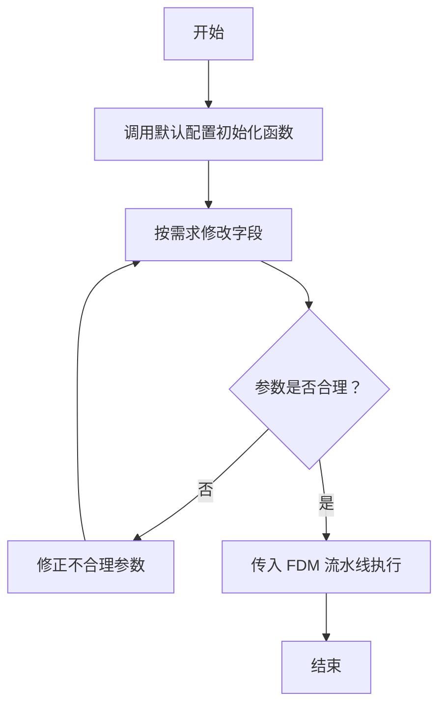
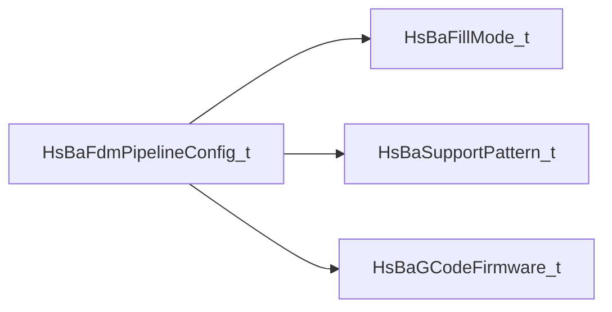
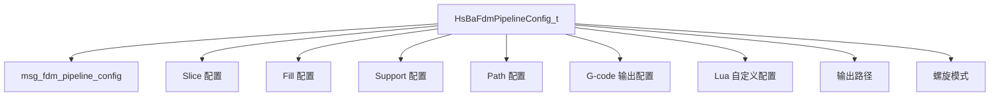

# FDM 配置参数详解

<cite>
**本文引用的文件**   
- [pipeline_types.h](file://pipelinetypes/pipeline_types.h)
- [fdm_pipeline.proto](file://proto/fdm_pipeline.proto)
- [slice_config.proto](file://proto/slice_config.proto)
- [param_reflect.hpp](file://fileoperator/param_reflect.hpp)
- [PipelineConfig2Msg.cpp](file://convert/PipelineConfig2Msg.cpp)
- [Msg2PipelineConfig.cpp](file://convert/Msg2PipelineConfig.cpp)
- [hsba_slicer.cppm](file://ModuleHsBaSlicer/hsba_slicer.cppm)
</cite>

## 目录
1. [引言](#引言)
2. [项目结构定位](#项目结构定位)
3. [核心数据结构总览](#核心数据结构总览)
4. [架构与数据流概览](#架构与数据流概览)
5. [字段分类详解](#字段分类详解)
6. [完整配置示例与创建修改流程](#完整配置示例与创建修改流程)
7. [参数对切片质量与打印效果的影响](#参数对切片质量与打印效果的影响)
8. [性能优化建议](#性能优化建议)
9. [常见配置陷阱](#常见配置陷阱)
10. [依赖关系分析](#依赖关系分析)
11. [故障排查要点](#故障排查要点)
12. [结论](#结论)

## 引言
本文面向需要精确控制 FDM 切片、填充、支撑、路径与 G-code 输出的开发者，围绕 `HsBaFdmPipelineConfig_t` 结构体给出逐字段说明。文档基于源码中的 C 兼容类型定义、Proto 协议定义、反射注册表以及配置转换代码，确保所有默认值、枚举取值和字段语义均有源码依据。

## 项目结构定位
FDM 流水线配置的核心定义位于管道类型头文件中；Proto 定义用于跨进程或跨语言序列化；反射注册表将结构体字段暴露给参数存储系统；转换模块负责在 C++ 配置对象与 Proto 消息之间双向映射；C++ 模块导出层提供默认配置工厂函数。

**图表来源**
- [pipeline_types.h:53-113](file://pipelinetypes/pipeline_types.h#L53-L113)
- [fdm_pipeline.proto:26-72](file://proto/fdm_pipeline.proto#L26-L72)
- [param_reflect.hpp:67-99](file://fileoperator/param_reflect.hpp#L67-L99)
- [PipelineConfig2Msg.cpp:33-55](file://convert/PipelineConfig2Msg.cpp#L33-L55)
- [Msg2PipelineConfig.cpp:46-67](file://convert/Msg2PipelineConfig.cpp#L46-L67)
- [hsba_slicer.cppm:129-130](file://ModuleHsBaSlicer/hsba_slicer.cppm#L129-L130)

**章节来源**
- [pipeline_types.h:53-113](file://pipelinetypes/pipeline_types.h#L53-L113)
- [fdm_pipeline.proto:26-72](file://proto/fdm_pipeline.proto#L26-L72)
- [param_reflect.hpp:67-99](file://fileoperator/param_reflect.hpp#L67-L99)
- [PipelineConfig2Msg.cpp:33-55](file://convert/PipelineConfig2Msg.cpp#L33-L55)
- [Msg2PipelineConfig.cpp:46-67](file://convert/Msg2PipelineConfig.cpp#L46-L67)
- [hsba_slicer.cppm:129-130](file://ModuleHsBaSlicer/hsba_slicer.cppm#L129-L130)

## 核心数据结构总览
`HsBaFdmPipelineConfig_t` 是 FDM 流水线的核心配置对象，包含模型信息、切片参数、填充参数、支撑参数、路径参数、G-code 输出参数、Lua 自定义脚本路径以及输出路径。与之配套的三个枚举分别定义填充模式、支撑模式和目标固件。

**图表来源**
- [pipeline_types.h:23-51](file://pipelinetypes/pipeline_types.h#L23-L51)
- [pipeline_types.h:53-113](file://pipelinetypes/pipeline_types.h#L53-L113)

**章节来源**
- [pipeline_types.h:23-51](file://pipelinetypes/pipeline_types.h#L23-L51)
- [pipeline_types.h:53-113](file://pipelinetypes/pipeline_types.h#L53-L113)

## 架构与数据流概览
FDM 配置在系统中存在三条主要路径：
1. 应用或上层逻辑通过 `HsBaFdmPipelineConfig_t` 直接构造并调用 FDM 流水线。
2. 配置被转换为 `msg_fdm_pipeline_config`，用于序列化、传输或跨语言使用。
3. 参数存储系统通过反射机制读取/写入结构体字段，实现配置的持久化与 UI 绑定。

**图表来源**
- [PipelineConfig2Msg.cpp:33-55](file://convert/PipelineConfig2Msg.cpp#L33-L55)
- [Msg2PipelineConfig.cpp:46-67](file://convert/Msg2PipelineConfig.cpp#L46-L67)
- [param_reflect.hpp:67-99](file://fileoperator/param_reflect.hpp#L67-L99)

**章节来源**
- [PipelineConfig2Msg.cpp:33-55](file://convert/PipelineConfig2Msg.cpp#L33-L55)
- [Msg2PipelineConfig.cpp:46-67](file://convert/Msg2PipelineConfig.cpp#L46-L67)
- [param_reflect.hpp:67-99](file://fileoperator/param_reflect.hpp#L67-L99)

## 字段分类详解

### 模型配置
| 字段 | 数据类型 | 默认值 | 取值范围与说明 |
|---|---|---:|---|
| `model_name` | `const char*` | `NULL` | 模型名称，可为空。 |
| `model_path` | `const char*` | `NULL` | 模型文件路径，可为空。 |

**章节来源**
- [pipeline_types.h:58-60](file://pipelinetypes/pipeline_types.h#L58-L60)

### 切片配置
| 字段 | 数据类型 | 默认值 | 取值范围与说明 |
|---|---|---:|---|
| `layer_height` | `float` | `0.2` | 层高，单位毫米。通常建议不超过喷嘴直径的 80%。 |
| `first_layer_height` | `float` | `0.25` | 首层层高，单位毫米。一般略大于普通层高以增强附着力。 |

**章节来源**
- [pipeline_types.h:62-64](file://pipelinetypes/pipeline_types.h#L62-L64)
- [pipeline_types.h:747-748](file://pipelinetypes/pipeline_types.h#L747-L748)

### 填充配置
| 字段 | 数据类型 | 默认值 | 取值范围与说明 |
|---|---|---:|---|
| `fill_spacing` | `double` | `0.4` | 填充线间距，单位毫米。与线宽共同决定实际密度。 |
| `fill_mode` | `HsBaFillMode_t` | `HSBA_FILL_ZIGZAG` | 填充模式：平行线、简单之字形、高级之字形。 |
| `fill_angle` | `double` | `45.0` | 填充角度，单位度。不同层旋转可改善层间结合。 |
| `wall_count` | `int` | `3` | 外壁轮廓圈数。增加可提高表面质量和尺寸精度。 |
| `top_layer_count` | `int` | `3` | 顶部实心层数。影响顶面平整度和强度。 |
| `bottom_layer_count` | `int` | `3` | 底部实心层数。影响底面质量和床面附着。 |
| `infill_density` | `double` | `0.2` | 内部填充密度，范围 `[0,1]`。数值越大材料用量越多、强度越高。 |

**章节来源**
- [pipeline_types.h:66-73](file://pipelinetypes/pipeline_types.h#L66-L73)
- [pipeline_types.h:749-755](file://pipelinetypes/pipeline_types.h#L749-L755)
- [pipeline_types.h:26-31](file://pipelinetypes/pipeline_types.h#L26-L31)

### 支撑配置
| 字段 | 数据类型 | 默认值 | 取值范围与说明 |
|---|---|---:|---|
| `enable_support` | `int` | `1` | 是否启用支撑，`0` 关闭，`1` 开启。 |
| `overhang_angle` | `float` | `45.0` | 悬垂角度阈值，单位度。超过该角度的区域会生成支撑。 |
| `support_gap` | `float` | `0.5` | 支撑与模型间隙，单位毫米。影响支撑拆除难度和表面质量。 |
| `support_diameter` | `float` | `2.0` | 支撑柱直径，单位毫米。影响支撑强度和材料消耗。 |
| `support_density` | `double` | `0.3` | 支撑填充密度，范围 `[0,1]`。密度越高支撑越稳固但更难移除。 |
| `support_pattern` | `HsBaSupportPattern_t` | `HSBA_SUPPORT_PLANE` | 支撑模式：平面柱状、树形、蜂窝。 |
| `interface_layers` | `int` | `2` | 界面层数量。界面层位于支撑与模型之间，影响附着与拆除。 |
| `interface_density` | `double` | `0.5` | 界面层密度，范围 `[0,1]`。提高界面密度可增强附着但可能更难拆除。 |

**章节来源**
- [pipeline_types.h:75-83](file://pipelinetypes/pipeline_types.h#L75-L83)
- [pipeline_types.h:756-763](file://pipelinetypes/pipeline_types.h#L756-L763)
- [pipeline_types.h:33-41](file://pipelinetypes/pipeline_types.h#L33-L41)

### 路径与挤出配置
| 字段 | 数据类型 | 默认值 | 取值范围与说明 |
|---|---|---:|---|
| `line_width` | `float` | `0.4` | 线宽，单位毫米。通常等于或略小于喷嘴直径。 |
| `print_speed` | `float` | `50.0` | 打印速度，单位毫米每秒。速度过高易导致拉丝、欠挤。 |
| `travel_speed` | `float` | `100.0` | 空跑移动速度，单位毫米每秒。提高可减少非挤出时间。 |
| `extrusion_multiplier` | `float` | `1.0` | 挤出倍率。大于 1 会增加出丝量，小于 1 会减少出丝量。 |
| `spiral_mode` | `int` | `0` | 螺旋模式：`0` 关闭，`1` 开启。开启后外壁被卷成连续上升路径，跳过每层填充与支撑。 |

**章节来源**
- [pipeline_types.h:85-92](file://pipelinetypes/pipeline_types.h#L85-L92)
- [pipeline_types.h:764-768](file://pipelinetypes/pipeline_types.h#L764-L768)

### G-code 输出配置
| 字段 | 数据类型 | 默认值 | 取值范围与说明 |
|---|---|---:|---|
| `gcode_firmware` | `HsBaGCodeFirmware_t` | `HSBA_GCODE_MARLIN` | 目标固件：Marlin、RepRap/RRF、Klipper。 |
| `nozzle_diameter` | `float` | `0.4` | 喷嘴直径，单位毫米。影响最小线宽、层高上限和体积流量限制。 |
| `filament_diameter` | `float` | `1.75` | 耗材直径，单位毫米。必须与实际耗材一致，否则体积计算错误。 |
| `nozzle_temp` | `float` | `200.0` | 喷嘴温度，单位摄氏度。需匹配材料推荐温度区间。 |
| `bed_temp` | `float` | `60.0` | 热床温度，单位摄氏度。影响首层附着和翘曲。 |
| `retract_length` | `float` | `1.0` | 回抽长度，单位毫米。过长易断丝，过短易拉丝。 |
| `retract_speed` | `float` | `40.0` | 回抽速度，单位毫米每秒。影响回抽响应和拉丝控制。 |
| `first_layer_speed` | `float` | `20.0` | 首层速度，单位毫米每秒。较低速度有助于提升首层质量。 |

**章节来源**
- [pipeline_types.h:94-102](file://pipelinetypes/pipeline_types.h#L94-L102)
- [pipeline_types.h:769-776](file://pipelinetypes/pipeline_types.h#L769-L776)
- [pipeline_types.h:43-51](file://pipelinetypes/pipeline_types.h#L43-L51)

### Lua 自定义配置
| 字段 | 数据类型 | 默认值 | 取值范围与说明 |
|---|---|---|---|
| `support_lua_script` | `const char*` | `NULL` | 自定义支撑脚本路径。为空时使用内置算法。 |
| `support_lua_func` | `const char*` | `NULL` | 自定义支撑函数名。为空时默认值为 `"generate_support"`。 |
| `infill_lua_script` | `const char*` | `NULL` | 自定义填充脚本路径。为空时使用内置算法。 |
| `infill_lua_func` | `const char*` | `NULL` | 自定义填充函数名。为空时默认值为 `"generate_fill"`。 |

**章节来源**
- [pipeline_types.h:104-108](file://pipelinetypes/pipeline_types.h#L104-L108)

### 输出配置
| 字段 | 数据类型 | 默认值 | 取值范围与说明 |
|---|---|---|---|
| `output_path` | `const char*` | `NULL` | 输出 G-code 文件路径。可为空，表示不强制指定输出文件。 |

**章节来源**
- [pipeline_types.h:110-111](file://pipelinetypes/pipeline_types.h#L110-L111)

## 完整配置示例与创建修改流程

### 使用默认配置创建对象
推荐使用默认初始化函数创建配置对象，再按需修改关键字段。默认值由内联函数统一赋值，避免遗漏字段。

**图表来源**
- [pipeline_types.h:742-783](file://pipelinetypes/pipeline_types.h#L742-L783)
- [hsba_slicer.cppm:129-130](file://ModuleHsBaSlicer/hsba_slicer.cppm#L129-L130)

**章节来源**
- [pipeline_types.h:742-783](file://pipelinetypes/pipeline_types.h#L742-L783)
- [hsba_slicer.cppm:129-130](file://ModuleHsBaSlicer/hsba_slicer.cppm#L129-L130)

### 修改几何与切片参数
典型修改包括层高、首层层高、线宽、壁厚、填充密度、填充角度和填充模式。这些参数直接影响切片层数、路径长度、材料用量和表面质量。

- 降低层高可提高细节但增加切片时间和打印时间。
- 增大线宽会减少路径数量，但可能降低边缘精度。
- 增加壁厚圈数可显著提升尺寸精度和强度，但增加打印时间。
- 提高填充密度会增加强度与材料消耗，同时可能延长填充阶段耗时。

**章节来源**
- [pipeline_types.h:62-73](file://pipelinetypes/pipeline_types.h#L62-L73)
- [pipeline_types.h:747-755](file://pipelinetypes/pipeline_types.h#L747-L755)

### 修改支撑参数
典型修改包括是否启用支撑、悬垂角度阈值、支撑间隙、支撑直径、支撑密度、支撑模式和界面层参数。

- 悬垂角度阈值越小，生成的支撑越多。
- 支撑间隙过小会导致支撑难以拆除且可能损伤模型表面。
- 树形支撑适合复杂悬垂，平面支撑适合大面积悬垂。
- 界面层密度过高会使支撑与模型粘得太紧。

**章节来源**
- [pipeline_types.h:75-83](file://pipelinetypes/pipeline_types.h#L75-L83)
- [pipeline_types.h:756-763](file://pipelinetypes/pipeline_types.h#L756-L763)

### 修改材料与打印参数
典型修改包括喷嘴温度、热床温度、打印速度、回抽长度、回抽速度和首层速度。

- 喷嘴温度过低会导致欠挤，过高会导致拉丝或烧焦。
- 热床温度不足容易导致翘曲，尤其打印 ABS 等收缩率高的材料时。
- 回抽参数需要根据直驱或 Bowden 挤出机调整。
- 首层速度应低于常规打印速度以提升附着力。

**章节来源**
- [pipeline_types.h:94-102](file://pipelinetypes/pipeline_types.h#L94-L102)
- [pipeline_types.h:769-776](file://pipelinetypes/pipeline_types.h#L769-L776)

### 修改输出与固件参数
典型修改包括目标固件、喷嘴直径、耗材直径、输出路径和螺旋模式。

- 目标固件必须与实际打印机固件匹配，否则 G-code 指令可能不被识别。
- 耗材直径设置错误会导致挤出体积计算偏差。
- 螺旋模式适用于花瓶类模型，会跳过填充和支撑。

**章节来源**
- [pipeline_types.h:85-92](file://pipelinetypes/pipeline_types.h#L85-L92)
- [pipeline_types.h:94-102](file://pipelinetypes/pipeline_types.h#L94-L102)
- [pipeline_types.h:764-776](file://pipelinetypes/pipeline_types.h#L764-L776)

## 参数对切片质量与打印效果的影响

### 几何参数影响
- **层高**：层高越小，Z 轴阶梯效应越弱，曲面更平滑，但切片层数增多，打印时间显著增加。
- **线宽**：线宽接近喷嘴直径可获得较饱满线条；线宽过大可能导致多道线无法正确拼接。
- **壁厚**：壁厚圈数越多，模型侧壁越致密，尺寸精度越高，但填充路径会被更多外壁包围。
- **填充密度**：低密度适合快速原型，高密度适合受力件；密度过高可能使填充路径过于密集，挤出压力增大。

**章节来源**
- [pipeline_types.h:62-73](file://pipelinetypes/pipeline_types.h#L62-L73)

### 支撑参数影响
- **支撑类型**：平面支撑适合大悬垂面；树形支撑适合分散悬垂点；蜂窝支撑适合中等密度支撑需求。
- **悬垂角度阈值**：阈值越低，支撑覆盖越广；阈值过高可能导致悬垂部分无支撑而塌陷。
- **支撑间隙**：间隙太小会粘连模型，间隙太大则支撑稳定性下降。
- **界面层**：界面层数量和密度影响支撑与模型的结合强度，进而影响拆除难度和表面残留。

**章节来源**
- [pipeline_types.h:75-83](file://pipelinetypes/pipeline_types.h#L75-L83)

### 材料与打印参数影响
- **喷嘴温度**：温度过低导致层间结合差，过高导致拉丝、溢料或材料降解。
- **热床温度**：热床温度不足容易翘曲，尤其在大面积首层或高收缩率材料上。
- **打印速度**：高速打印可能牺牲表面质量和尺寸精度；低速打印可提高质量但增加时间。
- **回抽**：回抽长度和速度需要平衡拉丝与断丝风险，Bowden 挤出机通常需要更长回抽距离。

**章节来源**
- [pipeline_types.h:94-102](file://pipelinetypes/pipeline_types.h#L94-L102)

## 性能优化建议
1. **优先调整层高与线宽**：在保持强度的前提下，适当增大层高和线宽可显著减少路径数量。
2. **合理设置填充密度**：非受力件使用较低密度，受力件局部加强而非整体提高密度。
3. **减少不必要的支撑**：通过模型方向优化或降低悬垂角度阈值来减少支撑生成。
4. **提高空跑速度**：在不影响稳定性的前提下提高 `travel_speed`，缩短非挤出移动时间。
5. **避免过度壁厚**：一般 2-3 圈外壁已足够，过多外壁会增加路径复杂度。
6. **谨慎使用螺旋模式**：仅对花瓶类或连续外壁模型启用，否则会跳过填充和支撑。
7. **匹配固件与硬件参数**：确保 `gcode_firmware`、`nozzle_diameter`、`filament_diameter` 与实际设备一致。

[本节为通用优化建议，不直接分析具体源码文件]

## 常见配置陷阱
1. **层高超过喷嘴直径的合理比例**：层高过大导致层间结合变差，表面阶梯明显。
2. **线宽大于喷嘴直径**：会导致挤出路径重叠异常，出现鼓包或堵头风险。
3. **耗材直径设置错误**：体积流量计算错误，表现为欠挤或过挤。
4. **回抽参数与挤出机类型不匹配**：直驱与 Bowden 的回抽行为差异很大。
5. **支撑间隙过小**：支撑拆除困难，可能撕裂模型表面。
6. **界面层密度过高**：支撑与模型粘得太紧，拆除后留下较多残留。
7. **螺旋模式误用**：对需要填充和支撑的模型启用螺旋模式会导致结构缺失。
8. **固件类型不匹配**：G-code 指令不被目标固件识别，导致打印异常。

**章节来源**
- [pipeline_types.h:62-102](file://pipelinetypes/pipeline_types.h#L62-L102)
- [pipeline_types.h:747-776](file://pipelinetypes/pipeline_types.h#L747-L776)

## 依赖关系分析

### 配置结构与枚举依赖
`HsBaFdmPipelineConfig_t` 依赖三个枚举：
- `HsBaFillMode_t`：控制填充路径生成方式。
- `HsBaSupportPattern_t`：控制支撑结构形态。
- `HsBaGCodeFirmware_t`：控制 G-code 输出风格。

**图表来源**
- [pipeline_types.h:23-51](file://pipelinetypes/pipeline_types.h#L23-L51)
- [pipeline_types.h:53-113](file://pipelinetypes/pipeline_types.h#L53-L113)

### 配置与 Proto 字段映射
C++ 配置对象与 Proto 消息字段一一对应，关键映射包括：
- 几何与切片：层高、首层层高、填充间距、填充角度、壁厚、顶层/底层数、填充密度。
- 支撑：是否启用、悬垂角度、支撑间隙、支撑直径、支撑密度、支撑模式、界面层数、界面密度。
- 路径与挤出：线宽、打印速度、空跑速度、挤出倍率。
- G-code 输出：固件、喷嘴直径、耗材直径、喷嘴温度、热床温度、回抽长度、回抽速度、首层速度。
- 其他：Lua 脚本路径、函数名、输出路径、螺旋模式。

**图表来源**
- [fdm_pipeline.proto:26-72](file://proto/fdm_pipeline.proto#L26-L72)
- [PipelineConfig2Msg.cpp:33-55](file://convert/PipelineConfig2Msg.cpp#L33-L55)
- [Msg2PipelineConfig.cpp:46-67](file://convert/Msg2PipelineConfig.cpp#L46-L67)

**章节来源**
- [fdm_pipeline.proto:26-72](file://proto/fdm_pipeline.proto#L26-L72)
- [PipelineConfig2Msg.cpp:33-55](file://convert/PipelineConfig2Msg.cpp#L33-L55)
- [Msg2PipelineConfig.cpp:46-67](file://convert/Msg2PipelineConfig.cpp#L46-L67)

## 故障排查要点
1. **检查默认配置是否正确初始化**：若手动构造结构体而未调用默认初始化函数，字符串指针可能未置空，导致后续处理异常。
2. **确认枚举值合法**：填充模式、支撑模式、固件类型必须取自对应枚举，避免非法值进入流水线。
3. **验证数值范围**：密度类字段应在 `[0,1]`，层高、线宽、温度、速度等物理参数应与设备能力匹配。
4. **核对 Proto 映射**：如果通过 Proto 传递配置，需确认字段编号与类型一致，避免字段错位。
5. **关注结果结构体内存管理**：FDM 流水线结果包含动态分配的字符串字段，使用后需释放，避免内存泄漏。

**章节来源**
- [pipeline_types.h:120-127](file://pipelinetypes/pipeline_types.h#L120-L127)
- [pipeline_types.h:742-783](file://pipelinetypes/pipeline_types.h#L742-L783)
- [fdm_pipeline.proto:74-81](file://proto/fdm_pipeline.proto#L74-L81)

## 结论
`HsBaFdmPipelineConfig_t` 是 FDM 切片与 G-code 输出的核心配置入口。理解其字段含义、默认值和相互影响，是获得高质量切片和稳定打印效果的基础。建议始终从默认配置出发，逐步调整几何、支撑、材料与路径参数，并结合设备能力进行验证。对于跨语言或远程调用场景，应重视 Proto 映射与反射注册的一致性，避免因字段错位或类型不一致导致的配置失效。

[本节为总结性内容，不直接分析具体源码文件]