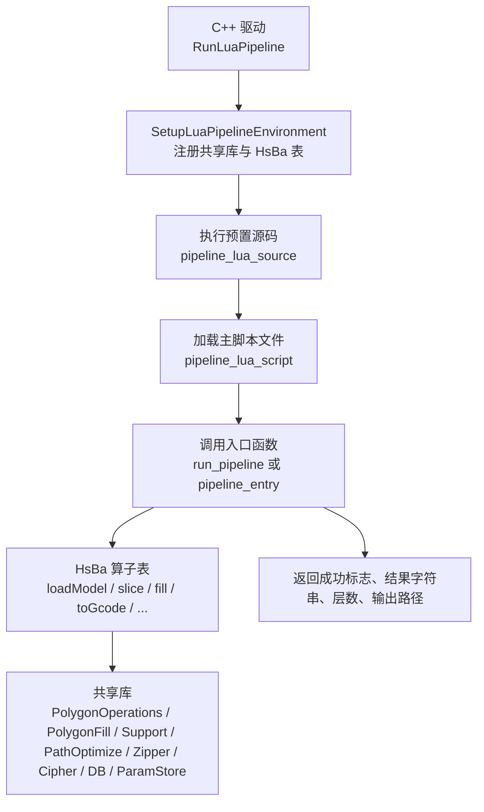
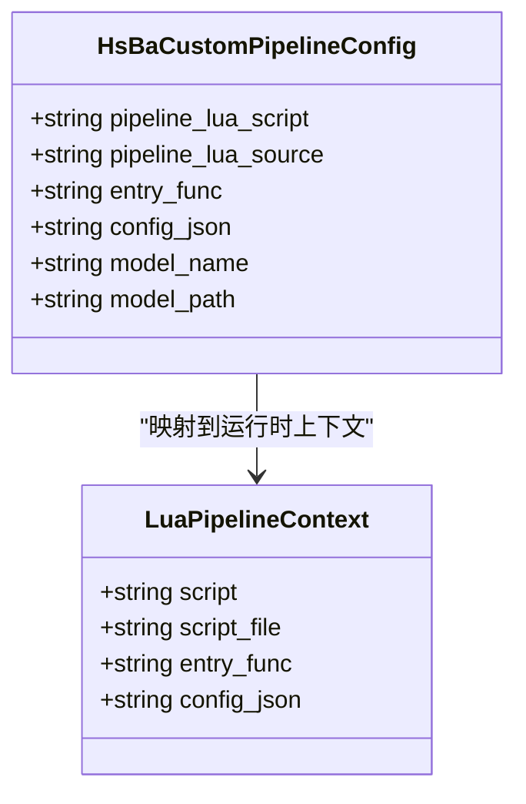
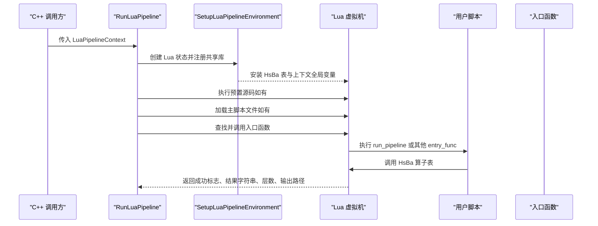
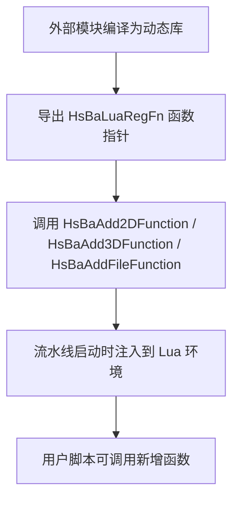
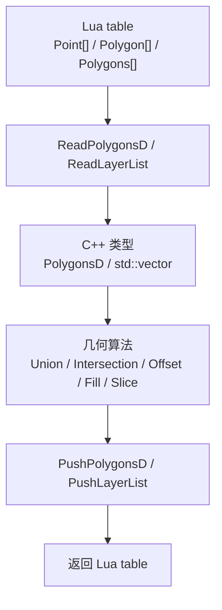
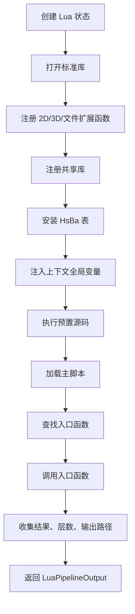
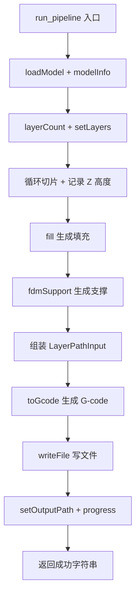
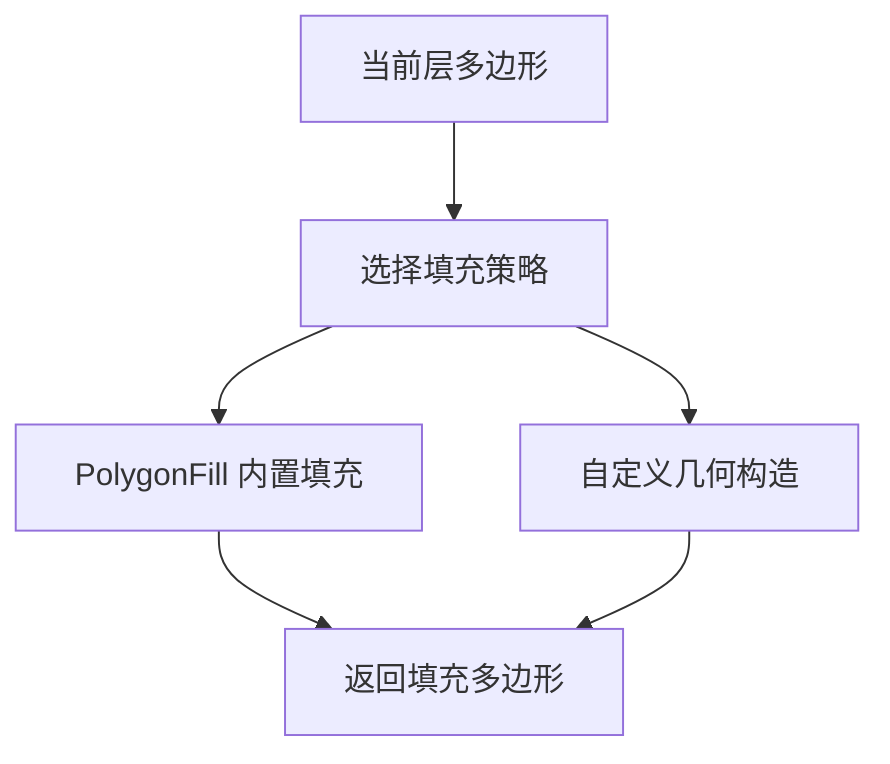
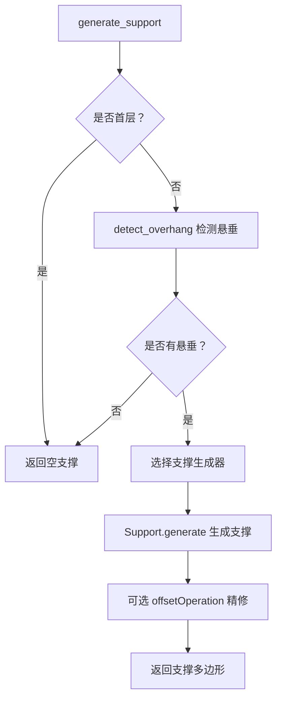

# Lua 脚本扩展机制

<cite>
**本文引用的文件**   
- [hsba_pipeline.d.lua](file://types/hsba_pipeline.d.lua)
- [lua_pipeline.cpp](file://LibHsBaSlicer/Extends/lua_pipeline.cpp)
- [lua_pipeline.hpp](file://LibHsBaSlicer/Extends/lua_pipeline.hpp)
- [pipeline_types.h](file://pipelinetypes/pipeline_types.h)
- [LuaAdapter.cpp](file://2D/LuaAdapter.cpp)
- [LuaSupport.cpp](file://support/LuaSupport.cpp)
- [my_fdm_pipeline.lua](file://samples/Custom/scripts/my_fdm_pipeline.lua)
- [my_sla_pipeline.lua](file://samples/Custom/scripts/my_sla_pipeline.lua)
- [my_sls_pipeline.lua](file://samples/Custom/scripts/my_sls_pipeline.lua)
- [my_infill.lua](file://samples/FDM/scripts/my_infill.lua)
- [my_support.lua](file://samples/FDM/scripts/my_support.lua)
- [my_sla_floor.lua](file://samples/SLA/scripts/my_sla_floor.lua)
- [my_sla_support.lua](file://samples/SLA/scripts/my_sla_support.lua)
- [optimize_paths.lua](file://tests/PolygonFill/optimize_paths.lua)
- [custom_fill.lua](file://tests/PolygonFill/custom_fill.lua)
- [lua_register.h](file://DllHsBaSlicer/lua_register.h)
- [lua_pipeline_api.md](file://docs/zh/lua_pipeline_api.md)
</cite>

## 目录
1. [项目概述与快速开始](#项目概述与快速开始)
2. [架构总览](#架构总览)
3. [核心概念](#核心概念)
4. [核心模块详解](#核心模块详解)
5. [高级主题](#高级主题)
6. [Lua 脚本系统](#lua-脚本系统)
7. [API 参考文档](#api-参考文档)
8. [集成指南](#集成指南)
9. [开发·测试与贡献](#开发测试与贡献)
10. [扩展开发指南](#扩展开发指南)
11. [示例与教程](#示例与教程)
12. [部署·故障排除与FAQ](#部署故障排除与faq)
13. [附录](#附录)

## 项目概述与快速开始
HsBaSlicer 的 Lua 脚本扩展机制提供两种使用方式：
- **自定义流水线（Custom Pipeline）**：C++ 只负责创建 Lua 运行环境、注入 `HsBa` 算子表与上下文全局变量，并调用脚本入口函数；整个“加载模型 → 切片 → 支撑 → 填充 → 路径输出 → 打包导出”的顺序和逻辑完全由 Lua 决定。
- **内置流水线阶段替换（Stage Hook）**：FDM、SLA、SLS、SLM、LOM、TDP、WAAM 等内置流水线的阶段顺序由 C++ 固定，但用户可以在支撑、填充、地板、导出等阶段注入 Lua 脚本，替换默认算法。

对于初学者，建议先阅读仓库中的完整示例脚本：
- 自定义 FDM 流水线：[my_fdm_pipeline.lua](file://samples/Custom/scripts/my_fdm_pipeline.lua)
- 自定义 SLA 流水线：[my_sla_pipeline.lua](file://samples/Custom/scripts/my_sla_pipeline.lua)
- 自定义 SLS 流水线：[my_sls_pipeline.lua](file://samples/Custom/scripts/my_sls_pipeline.lua)
- FDM 自定义填充：[my_infill.lua](file://samples/FDM/scripts/my_infill.lua)
- FDM 自定义支撑：[my_support.lua](file://samples/FDM/scripts/my_support.lua)
- SLA 自定义地板：[my_sla_floor.lua](file://samples/SLA/scripts/my_sla_floor.lua)
- SLA 自定义支撑：[my_sla_support.lua](file://samples/SLA/scripts/my_sla_support.lua)
- 路径优化示例：[optimize_paths.lua](file://tests/PolygonFill/optimize_paths.lua)

**章节来源**
- [lua_pipeline_api.md:19-28](file://docs/zh/lua_pipeline_api.md#L19-L28)
- [my_fdm_pipeline.lua:1-22](file://samples/Custom/scripts/my_fdm_pipeline.lua#L1-L22)
- [my_sla_pipeline.lua:1-18](file://samples/Custom/scripts/my_sla_pipeline.lua#L1-L18)
- [my_sls_pipeline.lua:1-20](file://samples/Custom/scripts/my_sls_pipeline.lua#L1-L20)

## 架构总览
Lua 扩展机制的核心是“C++ 控制生命周期 + Lua 实现业务逻辑”。C++ 侧负责：
- 创建 Lua 虚拟机状态；
- 注册几何、填充、支撑、路径、压缩、数据库、参数存储等共享库；
- 注入 `HsBa` 算子表和上下文全局变量；
- 执行预置源码、主脚本、入口函数；
- 读取脚本上报的层数、输出路径、结果字符串。

**图表来源**
- [lua_pipeline.cpp:903-958](file://LibHsBaSlicer/Extends/lua_pipeline.cpp#L903-L958)
- [lua_pipeline.cpp:960-1043](file://LibHsBaSlicer/Extends/lua_pipeline.cpp#L960-L1043)

**章节来源**
- [lua_pipeline.cpp:903-1043](file://LibHsBaSlicer/Extends/lua_pipeline.cpp#L903-L1043)
- [lua_pipeline.hpp:19-34](file://LibHsBaSlicer/Extends/lua_pipeline.hpp#L19-L34)
- [pipeline_types.h:675-698](file://pipelinetypes/pipeline_types.h#L675-L698)

## 核心概念
### 两种 Lua 运行环境
| 环境 | 用途 | 触发方式 | 关键特征 |
|---|---|---|---|
| 自定义流水线 | 完全由 Lua 编排工艺步骤 | C++ 调用 `run_pipeline` 或 `pipeline_entry` 指定的入口函数 | 拥有全局 `HsBa` 算子表与上下文全局变量 |
| 内置流水线阶段替换 | 仅替换某个阶段的算法 | 对应内置流水线在阶段处加载脚本并调用约定函数 | 无 `HsBa` 表，只有该阶段可用的全局变量与共享库 |

### 通用几何数据类型
所有 API 使用 Lua table 表示几何数据：
- 点：`{ x = number, y = number }`
- 3D 点：`{ x = number, y = number, z = number }`
- 多边形：点的有序数组，表示闭合轮廓
- 多边形集合：多个多边形的数组，孔洞作为独立多边形存在
- 层列表：逐层的多边形集合数组
- 路径：例如螺旋化后返回 `{x,y,z}` 点数组

内部布尔运算和填充通常按整数精度处理；`HsBa.toInt` / `HsBa.toDouble` 用于在整型多边形与浮点多边形之间转换。`PolygonOperations` 与 `PolygonFill` 接收并返回整型化数据，而 `HsBa.slice` / `HsBa.fill` 返回浮点多边形表。

**章节来源**
- [lua_pipeline_api.md:32-45](file://docs/zh/lua_pipeline_api.md#L32-L45)
- [hsba_pipeline.d.lua:24-30](file://types/hsba_pipeline.d.lua#L24-L30)

## 核心模块详解
### 自定义流水线配置结构
C++ 通过 `HsBaCustomPipelineConfig` 向 Lua 流水线传入配置：
- `pipeline_lua_script`：Lua 脚本文件路径
- `pipeline_lua_source`：在主脚本之前执行的预置源码
- `entry_func`：入口函数名，未设置时默认为 `run_pipeline`
- `config_json`：以 `pipeline_config` 暴露给 Lua 的自由 JSON 字符串
- `model_name` / `model_path`：可选模型信息，暴露为 `model_name` / `model_path`

**图表来源**
- [pipeline_types.h:675-698](file://pipelinetypes/pipeline_types.h#L675-L698)
- [lua_pipeline.hpp:19-34](file://LibHsBaSlicer/Extends/lua_pipeline.hpp#L19-L34)

**章节来源**
- [pipeline_types.h:675-698](file://pipelinetypes/pipeline_types.h#L675-L698)
- [lua_pipeline.hpp:19-34](file://LibHsBaSlicer/Extends/lua_pipeline.hpp#L19-L34)

### 自定义流水线生命周期

**图表来源**
- [lua_pipeline.cpp:960-1043](file://LibHsBaSlicer/Extends/lua_pipeline.cpp#L960-L1043)

**章节来源**
- [lua_pipeline.cpp:960-1043](file://LibHsBaSlicer/Extends/lua_pipeline.cpp#L960-L1043)

## 高级主题
### 外部 Lua 扩展函数注册
HsBaSlicer 提供 C ABI，允许外部模块向流水线运行时注入新的 Lua 函数：
- `HsBaAdd2DFunction`：注册 2D 函数，适用于支撑、填充、SLA 输出等阶段
- `HsBaAdd3DFunction`：注册 3D 函数，适用于切片、支撑等阶段
- `HsBaAddFileFunction`：注册文件相关函数，适用于 SLS 输出、SLA 输出等阶段
- `HsBaAddEventCallback`：按事件名注册回调，例如 `zipper.on_add`、`db.on_query`

**图表来源**
- [lua_register.h:1-37](file://DllHsBaSlicer/lua_register.h#L1-L37)

**章节来源**
- [lua_register.h:1-37](file://DllHsBaSlicer/lua_register.h#L1-L37)

### 性能与精度注意事项
- 几何布尔运算、偏移、填充通常在整数精度下执行，避免浮点累积误差。
- 大量层切片时，应合理分批上报进度，避免 UI 卡顿。
- 导出阶段若生成大量图像或压缩包，建议使用 `Zipper` / `Bit7zZipper` 批量写入，而不是反复拼接大字符串。
- 自定义填充算法应避免生成过多极小多边形，否则后续路径优化和 G-code 生成可能变慢。

[本节为通用指导，不直接分析具体文件]

## Lua 脚本系统
### 类型定义与 IDE 提示
`types/hsba_pipeline.d.lua` 是 LuaLS / EmmyLua 的类型定义文件，提供：
- 基础几何类型别名：`Point2D`、`Point3D`、`Quaternion`、`Polygon`、`Polygons`、`LayerList`
- 共享库类型：`PolygonOperations`、`PolygonFill`、`PathOptimize`、`Support`、`Zipper`、`Bit7zZipper`、`Cipher`、`SQLiteAdapter`、`MySQLAdapter`、`PostgreSQLAdapter`、`ParamStore`
- `HsBa` 算子表的完整函数签名
- 各阶段全局变量与入口函数的类型注解

这使 samples 下的 Lua 脚本可以获得自动补全、参数提示和错误检查。

**章节来源**
- [hsba_pipeline.d.lua:1-18](file://types/hsba_pipeline.d.lua#L1-L18)
- [hsba_pipeline.d.lua:24-187](file://types/hsba_pipeline.d.lua#L24-L187)
- [hsba_pipeline.d.lua:290-463](file://types/hsba_pipeline.d.lua#L290-L463)
- [hsba_pipeline.d.lua:466-663](file://types/hsba_pipeline.d.lua#L466-L663)

### 数据绑定与复杂类型处理
C++ 与 Lua 之间的核心数据结构包括：
- `PolygonsD`：浮点多边形集合
- `Polygons`：整点多边形集合
- `LayerList`：多层多边形集合
- `LayerPathInput`：每层路径输入，包含轮廓、填充、支撑、Z 高度
- `SupportConfig` / `FloorConfig` / `GcodeOptions` / `WaamWeldParams` 等配置表

C++ 侧通过辅助函数完成转换：
- `ReadPolygonsD` / `PushPolygonsD`：Lua table ↔ `PolygonsD`
- `ReadLayerList` / `PushLayerList`：Lua table ↔ `std::vector<PolygonsD>`
- `GetNumberField` / `GetIntField` / `GetBoolField` / `GetStringField` / `GetVector3Field`：Lua table 字段解析
- `ParseFillMode` / `ParseFirmware`：字符串枚举解析

**图表来源**
- [lua_pipeline.cpp:76-132](file://LibHsBaSlicer/Extends/lua_pipeline.cpp#L76-L132)
- [lua_pipeline.cpp:185-222](file://LibHsBaSlicer/Extends/lua_pipeline.cpp#L185-L222)
- [LuaAdapter.cpp:18-53](file://2D/LuaAdapter.cpp#L18-L53)

**章节来源**
- [lua_pipeline.cpp:76-222](file://LibHsBaSlicer/Extends/lua_pipeline.cpp#L76-L222)
- [LuaAdapter.cpp:18-53](file://2D/LuaAdapter.cpp#L18-L53)

### 脚本加载、编译与执行生命周期
自定义流水线生命周期如下：
1. 创建 Lua 状态；
2. 注册标准库、2D/3D/文件扩展函数、共享库；
3. 安装 `HsBa` 表；
4. 注入上下文全局变量；
5. 执行预置源码；
6. 加载主脚本文件；
7. 查找入口函数；
8. 调用入口函数并捕获返回值；
9. 从 Lua registry 读取脚本上报的层数和输出路径；
10. 组装 `LuaPipelineOutput` 返回给 C++。

**图表来源**
- [lua_pipeline.cpp:903-958](file://LibHsBaSlicer/Extends/lua_pipeline.cpp#L903-L958)
- [lua_pipeline.cpp:960-1043](file://LibHsBaSlicer/Extends/lua_pipeline.cpp#L960-L1043)

**章节来源**
- [lua_pipeline.cpp:903-1043](file://LibHsBaSlicer/Extends/lua_pipeline.cpp#L903-L1043)

## API 参考文档
### HsBa 算子表概览
`HsBa` 是自定义流水线环境的唯一全局算子表，提供：
- 进度与输出控制：`progress`、`setLayers`、`setOutputPath`、`readFile`、`writeFile`
- 模型管理：`loadModel`、`modelInfo`、`translateModel`、`rotateModel`、`scaleModel`、`removeModel`、`modelNames`
- 切片：`layerCount`、`layerZ`、`slice`、`sliceUnsafe`
- 坐标转换与填充：`toInt`、`toDouble`、`fill`
- 支撑与地板：`fdmSupport`、`slaSupport`、`floor`
- 路径与 G-code：`spiralize`、`toGcode`
- 打包与导出：`saveSlsPackage`、`saveWaamPackage`、`saveSlaPackage`、`renderImage`

类型定义集中在 [hsba_pipeline.d.lua](file://types/hsba_pipeline.d.lua)，API 行为说明集中在 [lua_pipeline_api.md](file://docs/zh/lua_pipeline_api.md)。

**章节来源**
- [hsba_pipeline.d.lua:290-463](file://types/hsba_pipeline.d.lua#L290-L463)
- [lua_pipeline_api.md:48-133](file://docs/zh/lua_pipeline_api.md#L48-L133)

### 几何操作与多边形工具
`PolygonOperations` 提供 2D 布尔运算与几何构造：
- 布尔运算：`booleanOperation`、`union`、`intersection`、`difference`、`xor`
- 几何变换：`offsetOperation`、`convexHullOperation`、`concaveHullOperation`
- 面积计算：`area`
- 图形构造：`makeRectangle`、`makeCircle`、`makeEllipse`、`makeRegularPolygon`、`textToPolygons`

底层实现将 Lua table 转换为 `PolygonsD` 或 `Polygons`，再调用 Clipper2 或内部几何算法。

**章节来源**
- [hsba_pipeline.d.lua:35-51](file://types/hsba_pipeline.d.lua#L35-L51)
- [LuaAdapter.cpp:22-165](file://2D/LuaAdapter.cpp#L22-L165)

### 填充算法与路径优化
`PolygonFill` 提供多种填充模式：
- `offsetFill`
- `lineFill`
- `simpleZigzagFill`
- `zigzagFill`
- `compositeOffsetFill`
- `hybridFill`
- `offsetOnly`

`PathOptimize` 提供路径顺序优化：
- 实例方法：`addRegion`、`addPolygons`、`addRoute`、`optimizeOrder`、`buildPaths`、`buildPolygons`
- 静态方法：`optimizeRegions`、`optimizePolygons`

测试脚本展示了两种优化模式：填充后优化路径、填充前优化多边形访问顺序。

**章节来源**
- [hsba_pipeline.d.lua:53-77](file://types/hsba_pipeline.d.lua#L53-L77)
- [optimize_paths.lua:1-34](file://tests/PolygonFill/optimize_paths.lua#L1-L34)

### 支撑生成器
`Support` 提供内置支撑生成器与悬垂检测：
- 生成器工厂：`new_plane`、`new_tree`、`new_honeycomb`、`new_sla`、`new_lua`、`new_lua_file`
- 生成接口：`generate(obj, current, prev, height, cfg)`
- 悬垂检测：`detect_overhang(current, prev, height, angle)`
- 默认配置：`default_config()`

内置支撑阶段脚本会注入 `current_layer`、`prev_layer`、`layer_height`、`config`，并约定入口函数 `generate_support()`。

**章节来源**
- [hsba_pipeline.d.lua:79-105](file://types/hsba_pipeline.d.lua#L79-L105)
- [LuaSupport.cpp:19-90](file://support/LuaSupport.cpp#L19-L90)
- [LuaSupport.cpp:113-178](file://support/LuaSupport.cpp#L113-L178)

### 压缩、加密与数据库
- `Zipper`：基础 zip 打包
- `Bit7zZipper`：7z 系列格式，需启用 `HSBA_USE_BIT7Z`
- `Cipher`：base64、hex 编解码
- `SQLiteAdapter`：SQLite 数据库适配器
- `MySQLAdapter`：MySQL 适配器，需启用 `HSBA_USE_MYSQL`
- `PostgreSQLAdapter`：PostgreSQL 适配器，需启用 `HSBA_USE_PGSQL`
- `ParamStore`：基于反射的参数持久化存储

这些工具主要在导出阶段和自定义流水线中使用。

**章节来源**
- [hsba_pipeline.d.lua:107-187](file://types/hsba_pipeline.d.lua#L107-L187)
- [lua_pipeline.cpp:924-941](file://LibHsBaSlicer/Extends/lua_pipeline.cpp#L924-L941)

### 内置阶段脚本环境
| 阶段 | 入口函数 | 可用全局变量 | 可用库 |
|---|---|---|---|
| FDM/SLA 支撑 | `generate_support()` | `current_layer`、`prev_layer`、`layer_height`、`config` | `PolygonOperations`、`Support` |
| FDM 填充 | `generate_fill(polys)` | 无全局变量，参数传入当前层多边形 | `PolygonOperations`、`PolygonFill`、`PathOptimize` |
| SLA 地板 | `generate_floor(bottomLayer, floorCfg)` | 无全局变量，参数传入底层多边形与配置 | `PolygonOperations`、`PolygonFill` |
| SLS/SLM/LOM/TDP 导出 | `export_sls()` / `export_slm()` / `export_lom()` / `export_tdp()` | `config`、`images`、`output_path`、`funcName` | `Zipper`、`Bit7zZipper`、`Cipher`、数据库适配器、`ParamStore` |
| SLA 导出 | `export_sla()` | 同 SLS 导出环境 | 同上 |
| WAAM 机器人路径 | `export_waam()` | `header`、`startProgramFunc`、`endProgramFunc`、`points` | 由脚本自行生成机器人程序文本 |

**章节来源**
- [hsba_pipeline.d.lua:489-623](file://types/hsba_pipeline.d.lua#L489-L623)
- [lua_pipeline_api.md:215-260](file://docs/zh/lua_pipeline_api.md#L215-L260)

## 集成指南
### 如何编写自定义 FDM 流水线
推荐参考 [my_fdm_pipeline.lua](file://samples/Custom/scripts/my_fdm_pipeline.lua)：
1. 从 `model_name` / `model_path` / `output_path` / `pipeline_config` 获取上下文；
2. 使用 `HsBa.loadModel` 加载模型；
3. 使用 `HsBa.layerCount` / `layerZ` / `slice` 逐层切片；
4. 使用 `HsBa.fill` 生成填充；
5. 使用 `HsBa.fdmSupport` 生成支撑；
6. 组装 `LayerPathInput` 数组；
7. 使用 `HsBa.toGcode` 生成 G-code；
8. 使用 `HsBa.writeFile` 写文件；
9. 使用 `HsBa.setOutputPath` 上报输出路径；
10. 返回成功字符串。

**图表来源**
- [my_fdm_pipeline.lua:52-170](file://samples/Custom/scripts/my_fdm_pipeline.lua#L52-L170)

**章节来源**
- [my_fdm_pipeline.lua:1-172](file://samples/Custom/scripts/my_fdm_pipeline.lua#L1-L172)

### 如何编写自定义 SLA 流水线
参考 [my_sla_pipeline.lua](file://samples/Custom/scripts/my_sla_pipeline.lua)：
1. 加载模型并计算层数；
2. 逐层切片；
3. 使用 `HsBa.slaSupport` 生成支撑；
4. 使用 `HsBa.floor` 生成地板；
5. 使用 `HsBa.saveSlaPackage` 渲染层图并打包 zip；
6. 上报输出路径并返回成功字符串。

**章节来源**
- [my_sla_pipeline.lua:1-105](file://samples/Custom/scripts/my_sla_pipeline.lua#L1-L105)

### 如何编写自定义 SLS 流水线
参考 [my_sls_pipeline.lua](file://samples/Custom/scripts/my_sls_pipeline.lua)：
1. 加载模型并计算层数；
2. 逐层切片并记录 Z 高度；
3. 构造工艺配置 JSON；
4. 使用 `HsBa.saveSlsPackage` 打包导出，并指定导出脚本与函数名；
5. 上报输出路径并返回成功字符串。

**章节来源**
- [my_sls_pipeline.lua:1-102](file://samples/Custom/scripts/my_sls_pipeline.lua#L1-L102)

## 开发·测试与贡献
### 测试脚本与验证方式
仓库中包含多个用于验证 Lua 扩展能力的测试脚本：
- [custom_fill.lua](file://tests/PolygonFill/custom_fill.lua)：最小自定义填充脚本
- [optimize_paths.lua](file://tests/PolygonFill/optimize_paths.lua)：路径优化策略示例
- [my_infill.lua](file://samples/FDM/scripts/my_infill.lua)：FDM 自定义填充
- [my_support.lua](file://samples/FDM/scripts/my_support.lua)：FDM 自定义支撑
- [my_sla_floor.lua](file://samples/SLA/scripts/my_sla_floor.lua)：SLA 自定义地板
- [my_sla_support.lua](file://samples/SLA/scripts/my_sla_support.lua)：SLA 自定义支撑

建议开发者：
- 先用内置填充和支撑脚本验证几何数据是否正确；
- 再用自定义脚本替换默认算法；
- 最后用 Custom 流水线脚本验证完整流程。

**章节来源**
- [custom_fill.lua:1-16](file://tests/PolygonFill/custom_fill.lua#L1-L16)
- [optimize_paths.lua:1-34](file://tests/PolygonFill/optimize_paths.lua#L1-L34)
- [my_infill.lua:1-89](file://samples/FDM/scripts/my_infill.lua#L1-L89)
- [my_support.lua:1-83](file://samples/FDM/scripts/my_support.lua#L1-L83)
- [my_sla_floor.lua:1-64](file://samples/SLA/scripts/my_sla_floor.lua#L1-L64)
- [my_sla_support.lua:1-76](file://samples/SLA/scripts/my_sla_support.lua#L1-L76)

## 扩展开发指南
### 自定义填充算法
自定义填充脚本应遵循以下约定：
- 入口函数名为 `generate_fill`；
- 参数为当前层多边形（已扣除壁厚区域）；
- 返回填充多边形；
- 不使用全局变量，参数不足时使用脚本内默认值；
- 可使用 `PolygonOperations` 做布尔运算，使用 `PolygonFill` 调用内置填充，或使用 `PathOptimize` 做路径优化。

**图表来源**
- [my_infill.lua:18-88](file://samples/FDM/scripts/my_infill.lua#L18-L88)
- [hsba_pipeline.d.lua:516-525](file://types/hsba_pipeline.d.lua#L516-L525)

**章节来源**
- [my_infill.lua:1-89](file://samples/FDM/scripts/my_infill.lua#L1-L89)
- [hsba_pipeline.d.lua:516-525](file://types/hsba_pipeline.d.lua#L516-L525)

### 自定义支撑生成器
自定义支撑脚本应遵循以下约定：
- 入口函数名为 `generate_support()`；
- 使用 `current_layer`、`prev_layer`、`layer_height`、`config`；
- 使用 `Support.detect_overhang` 检测悬垂区域；
- 使用 `Support.new_plane` / `new_tree` / `new_honeycomb` / `new_sla` 选择生成器；
- 使用 `Support.generate` 生成支撑；
- 可通过 `PolygonOperations.offsetOperation` 进一步调整支撑接触面。

**图表来源**
- [my_support.lua:32-79](file://samples/FDM/scripts/my_support.lua#L32-L79)
- [LuaSupport.cpp:67-90](file://support/LuaSupport.cpp#L67-L90)

**章节来源**
- [my_support.lua:1-83](file://samples/FDM/scripts/my_support.lua#L1-L83)
- [LuaSupport.cpp:67-90](file://support/LuaSupport.cpp#L67-L90)

### 自定义 SLA 地板
SLA 地板脚本应遵循以下约定：
- 入口函数名为 `generate_floor(bottomLayer, config)`；
- 使用 `PolygonOperations` 生成 raft 外边界、边框环；
- 使用 `PolygonFill` 生成内部填充；
- 合并边框与填充后返回地板多边形。

**章节来源**
- [my_sla_floor.lua:1-64](file://samples/SLA/scripts/my_sla_floor.lua#L1-L64)
- [hsba_pipeline.d.lua:527-538](file://types/hsba_pipeline.d.lua#L527-L538)

### 自定义导出脚本
导出脚本运行在打包阶段，常见职责：
- 读取 `config`、`images`、`output_path`；
- 使用 `Zipper` / `Bit7zZipper` 打包 zip；
- 使用 `Cipher` 对敏感数据进行编码；
- 使用数据库适配器或 `ParamStore` 注册工件；
- 返回 `{ success = true/false, export_path = "..." }`。

注意：导出脚本返回值类型必须正确，否则会覆盖 zip 文件或写出空内容。

**章节来源**
- [hsba_pipeline.d.lua:540-591](file://types/hsba_pipeline.d.lua#L540-L591)
- [lua_pipeline_api.md:246-260](file://docs/zh/lua_pipeline_api.md#L246-L260)

## 示例与教程
### 完整自定义流水线示例
仓库提供了三种典型工艺栈的完整示例：
- FDM：[my_fdm_pipeline.lua](file://samples/Custom/scripts/my_fdm_pipeline.lua)
- SLA：[my_sla_pipeline.lua](file://samples/Custom/scripts/my_sla_pipeline.lua)
- SLS：[my_sls_pipeline.lua](file://samples/Custom/scripts/my_sls_pipeline.lua)

它们共同展示了：
- 上下文参数读取；
- 模型加载与信息查询；
- 层数计算与逐层切片；
- 支撑、填充、地板、路径生成；
- 文件写入与打包；
- 进度上报与结果返回。

**章节来源**
- [my_fdm_pipeline.lua:1-172](file://samples/Custom/scripts/my_fdm_pipeline.lua#L1-L172)
- [my_sla_pipeline.lua:1-105](file://samples/Custom/scripts/my_sla_pipeline.lua#L1-L105)
- [my_sls_pipeline.lua:1-102](file://samples/Custom/scripts/my_sls_pipeline.lua#L1-L102)

### 路径优化示例
[optimize_paths.lua](file://tests/PolygonFill/optimize_paths.lua) 展示了：
- 使用 `PathOptimize.optimizeRegions` 一键优化填充路径；
- 手动构建优化器并设置区域间代价；
- 使用 `PathOptimize.optimizePolygons` 在填充前优化多边形访问顺序。

**章节来源**
- [optimize_paths.lua:1-34](file://tests/PolygonFill/optimize_paths.lua#L1-L34)
- [hsba_pipeline.d.lua:64-77](file://types/hsba_pipeline.d.lua#L64-L77)

## 部署·故障排除与FAQ
### 常见问题
| 问题 | 原因 | 解决方法 |
|---|---|---|
| 找不到入口函数 | 脚本未定义 `run_pipeline` 或未设置正确的 `entry_func` | 检查脚本是否定义入口函数，或 C++ 传入的 `entry_func` 是否与脚本一致 |
| 导出脚本写出的 zip 为空 | 导出脚本返回了错误类型或覆盖了 zip 文件 | 严格返回 `{ success=..., export_path=... }`，不要返回字符串 |
| 几何结果为空 | 输入多边形为空、布尔运算区域不相交、偏移过大 | 检查输入层数据、调试 `PolygonOperations` 中间结果 |
| 自定义填充性能差 | 生成过多极小多边形或路径段 | 简化几何构造，合并相邻线段，减少碎片 |
| 数据库连接失败 | 未启用对应编译宏或连接参数错误 | 确认启用 `HSBA_USE_MYSQL` / `HSBA_USE_PGSQL`，检查连接字符串 |

**章节来源**
- [lua_pipeline.cpp:998-1010](file://LibHsBaSlicer/Extends/lua_pipeline.cpp#L998-L1010)
- [lua_pipeline_api.md:256-260](file://docs/zh/lua_pipeline_api.md#L256-L260)

### 调试建议
- 使用 `HsBa.progress` 分段上报进度，定位卡住阶段；
- 在导出阶段打印 `config` 与 `images` 长度，确认数据是否到达；
- 对几何结果使用 `PolygonOperations.area` 或临时渲染图片验证；
- 对自定义支撑脚本，先返回 `current_layer` 或 `prev_layer`，再逐步加入支撑逻辑；
- 对自定义填充脚本，先返回空数组，再逐步增加线条或多边形。

[本节为通用指导，不直接分析具体文件]

## 附录
### Lua 与 C++ 类型对照速查
| Lua 类型 | C++ 类型 | 说明 |
|---|---|---|
| `{ x, y }` | `Point2D` / `Point` | 二维点 |
| `{ x, y, z }` | `Point3D` / `Eigen::Vector3f` | 三维点 |
| `Polygon` | `PolygonD` / `IntPolygon` | 单个多边形 |
| `Polygons` | `PolygonsD` / `Polygons` | 多边形集合 |
| `LayerList` | `std::vector<PolygonsD>` | 多层多边形集合 |
| `table` | `SupportConfig` / `FloorConfig` / `GcodeOptions` | 配置表 |
| `string` | `std::string` | 文本、JSON、路径 |

**章节来源**
- [lua_pipeline.cpp:76-132](file://LibHsBaSlicer/Extends/lua_pipeline.cpp#L76-L132)
- [hsba_pipeline.d.lua:24-30](file://types/hsba_pipeline.d.lua#L24-L30)

### 流水线可用性矩阵
| API | 自定义流水线 | 内置阶段脚本 |
|---|---:|---:|
| `HsBa` 算子表 | ✅ | ❌ |
| 上下文全局变量 | ✅ | ❌ |
| `PolygonOperations` | ✅ | ✅ |
| `Support` | ✅ | ✅ |
| `PolygonFill` | ✅ | ✅ |
| `PathOptimize` | ✅ | ✅ |
| `Cipher` | ✅ | ✅ |
| `Zipper` / `Bit7zZipper` | ✅ | ✅ |
| 数据库适配器 | ✅ | ✅ |
| `ParamStore` | ✅ | ✅ |

**章节来源**
- [lua_pipeline_api.md:264-279](file://docs/zh/lua_pipeline_api.md#L264-L279)