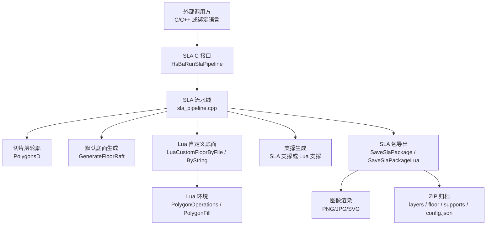
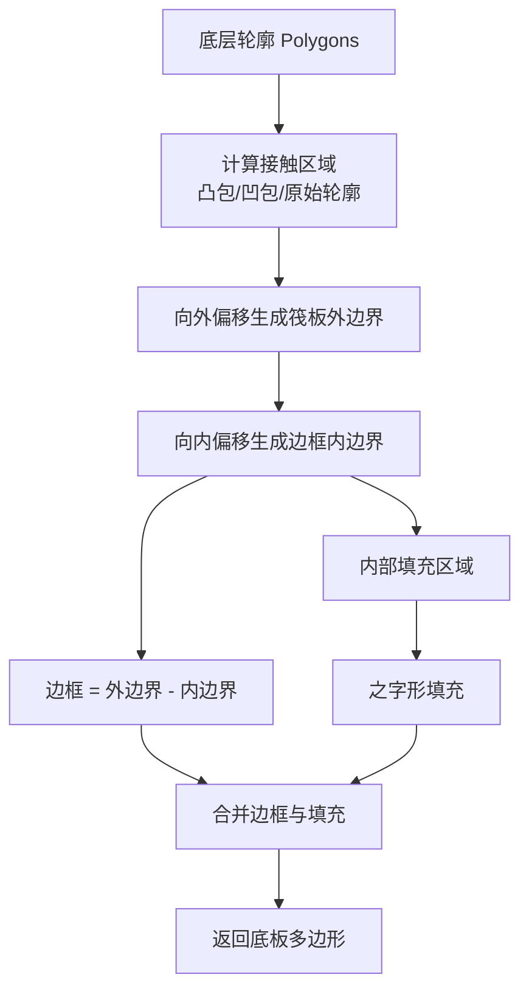
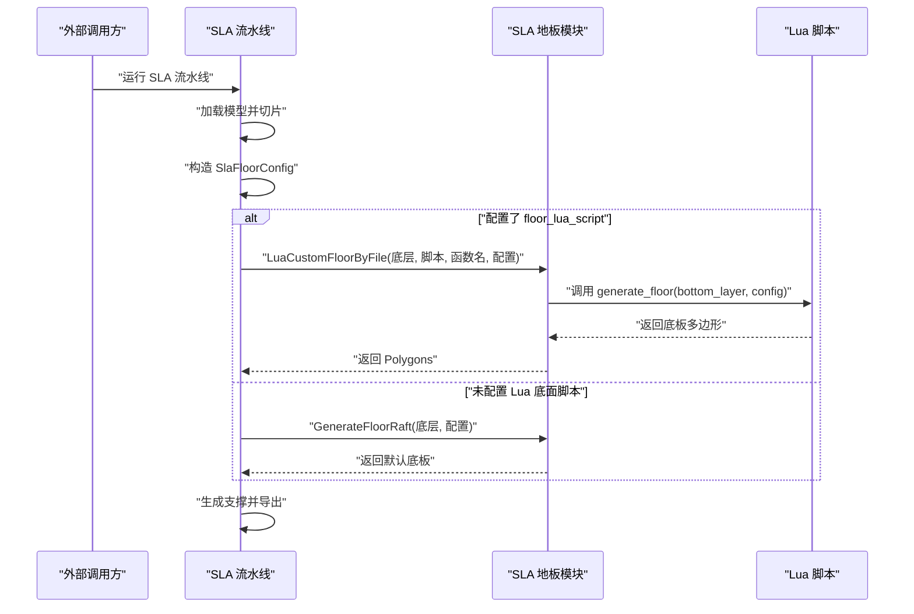
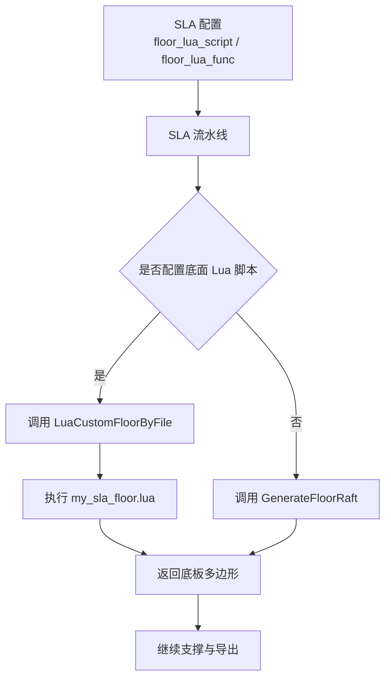
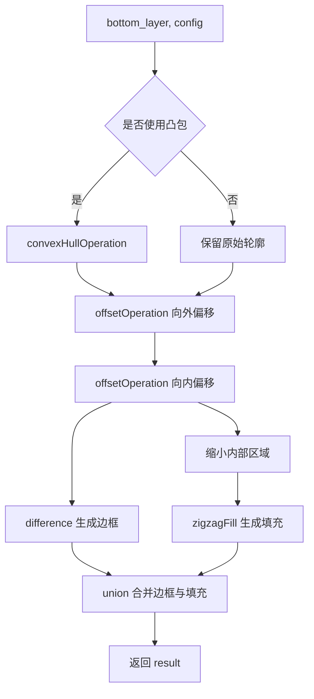

# SLA 流水线 Lua 扩展

<cite>
**本文引用的文件**   
- [sla_floor.hpp](file://LibHsBaSlicer/Floor/sla_floor.hpp)
- [sla_floor.cpp](file://LibHsBaSlicer/Floor/sla_floor.cpp)
- [sla_pipeline.cpp](file://DllHsBaSlicer/sla_pipeline.cpp)
- [lua_pipeline.cpp](file://LibHsBaSlicer/Extends/lua_pipeline.cpp)
- [my_sla_floor.lua](file://samples/SLA/scripts/my_sla_floor.lua)
- [hsba_pipeline.d.lua](file://types/hsba_pipeline.d.lua)
- [sla_pipeline.proto](file://proto/sla_pipeline.proto)
</cite>

## 目录
1. [项目概述与快速开始](#项目概述与快速开始)
2. [架构总览](#架构总览)
3. [核心概念](#核心概念)
4. [核心模块详解](#核心模块详解)
5. [高级主题](#高级主题)
6. [Lua 脚本系统](#lua-脚本系统)
7. [API 参考文档](#api-参考文档)
8. [集成指南](#集成指南)
9. [开发·测试与贡献](#开发测试与贡献)
10. [扩展开发指南](#扩展开发指南)
11. [示例与教程](#示例与教程)
12. [部署·故障排除与FAQ](#部署故障排除与faq)
13. [附录](#附录)

## 项目概述与快速开始
本页面聚焦 HsBaSlicer 中 **SLA 流水线的 Lua 扩展能力**，尤其是如何通过 Lua 脚本替换底面生成算法。SLA 流水线在 C++ 侧完成模型加载、切片、支撑生成和打包导出；在“底面生成”和“导出阶段”，它允许通过 Lua 脚本注入自定义逻辑。

你可以把 SLA Lua 扩展理解为三层：
- **C++ 流水线入口**：`DllHsBaSlicer/sla_pipeline.cpp` 负责构建配置、执行切片、调用底面生成、支撑生成和打包。
- **SLA 地板 API**：`LibHsBaSlicer/Floor/sla_floor.{hpp,cpp}` 提供默认底面生成、Lua 自定义底面、图像渲染和 SLA 包导出。
- **通用 Lua 环境**：`LibHsBaSlicer/Extends/lua_pipeline.cpp` 暴露 `HsBa` 操作表，并在多个流水线阶段共享 Polygon 操作、填充、支持、路径等能力。

如果你只想替换底面生成，最直接的起点是：
1. 编写一个 Lua 函数 `generate_floor(bottom_layer, config)`。
2. 将脚本路径填入 SLA 配置的 `floor_lua_script`。
3. 可选地设置 `floor_lua_func`，默认值为 `generate_floor`。
4. 运行 SLA 流水线，底层会自动调用你的 Lua 函数并接收返回的多边形结果。

**章节来源**
- [sla_pipeline.cpp:49-85](file://DllHsBaSlicer/sla_pipeline.cpp#L49-L85)
- [sla_pipeline.cpp:360-384](file://DllHsBaSlicer/sla_pipeline.cpp#L360-L384)
- [sla_floor.hpp:24-116](file://LibHsBaSlicer/Floor/sla_floor.hpp#L24-L116)

## 架构总览
下图展示 SLA 流水线中与 Lua 扩展相关的关键组件关系。

**图表来源**
- [sla_pipeline.cpp:298-483](file://DllHsBaSlicer/sla_pipeline.cpp#L298-L483)
- [sla_floor.cpp:49-117](file://LibHsBaSlicer/Floor/sla_floor.cpp#L49-L117)
- [sla_floor.cpp:148-314](file://LibHsBaSlicer/Floor/sla_floor.cpp#L148-L314)
- [sla_floor.cpp:468-606](file://LibHsBaSlicer/Floor/sla_floor.cpp#L468-L606)

**章节来源**
- [sla_pipeline.cpp:298-483](file://DllHsBaSlicer/sla_pipeline.cpp#L298-L483)
- [sla_floor.cpp:49-117](file://LibHsBaSlicer/Floor/sla_floor.cpp#L49-L117)
- [sla_floor.cpp:148-314](file://LibHsBaSlicer/Floor/sla_floor.cpp#L148-L314)
- [sla_floor.cpp:468-606](file://LibHsBaSlicer/Floor/sla_floor.cpp#L468-L606)

## 核心概念
### SLA 流水线阶段
SLA 流水线按阶段组织：
1. **预处理**：加载模型、计算层数。
2. **切片**：并行生成每层轮廓。
3. **底面生成**：使用默认算法或 Lua 脚本生成底板/筏板。
4. **支撑生成**：使用内置 SLA 支撑或 Lua 自定义支撑。
5. **导出**：渲染层图、底板图、支撑图，并打包为 ZIP。

其中第 3 和第 5 阶段是 Lua 扩展的主要切入点。

### 底面生成数据流
底面生成的输入是**第一层（底层）的整数多边形集合**，输出是**底板接触区域或多边形集合**。C++ 默认实现会：
- 根据配置选择凸包、凹包或直接使用底层轮廓。
- 向外偏移生成筏板外边界。
- 向内偏移生成边框环。
- 对内部区域进行之字形填充。

当启用 Lua 自定义时，C++ 会把底层多边形和配置表传给 Lua 函数，再由 Lua 返回新的多边形集合。

**图表来源**
- [sla_floor.cpp:33-46](file://LibHsBaSlicer/Floor/sla_floor.cpp#L33-L46)
- [sla_floor.cpp:54-88](file://LibHsBaSlicer/Floor/sla_floor.cpp#L54-L88)
- [sla_floor.cpp:90-117](file://LibHsBaSlicer/Floor/sla_floor.cpp#L90-L117)

**章节来源**
- [sla_pipeline.cpp:338-384](file://DllHsBaSlicer/sla_pipeline.cpp#L338-L384)
- [sla_floor.cpp:33-117](file://LibHsBaSlicer/Floor/sla_floor.cpp#L33-L117)

## 核心模块详解
### SLA 地板模块
SLA 地板模块位于 `LibHsBaSlicer/Floor`，主要职责包括：
- 定义 `SlaFloorConfig` 配置结构。
- 提供默认底面生成函数。
- 提供 Lua 自定义底面入口。
- 提供 SLA 图像渲染和包导出。

#### SlaFloorConfig 字段
| 字段 | 类型 | 含义 | 默认值 |
|---|---|---|---|
| `raft_offset` | double | 筏板向外偏移量（毫米） | 2.0 |
| `border_width` | double | 边框环宽度（毫米） | 1.0 |
| `fill_spacing` | double | 内部填充线间距（毫米） | 0.5 |
| `fill_angle_deg` | double | 填充角度（度） | 0.0 |
| `border_count` | int | 边框环数量 | 2 |
| `use_convex_hull` | bool | 是否使用凸包替代直接轮廓 | false |
| `concave_hull_points` | int | 凹包简化点数，0 表示禁用 | 0 |

**章节来源**
- [sla_floor.hpp:24-33](file://LibHsBaSlicer/Floor/sla_floor.hpp#L24-L33)

#### 默认底面生成函数
| 函数 | 行为 |
|---|---|
| `GenerateFloorContact` | 计算底板接触区域 |
| `GenerateFloorBorder` | 仅生成边框环 |
| `GenerateFloorFill` | 仅生成内部填充 |
| `GenerateFloorRaft` | 生成完整筏板（边框 + 填充） |

这些函数都基于 `SlaFloorConfig`，并通过偏移、差集、之字形填充组合出最终多边形。

**章节来源**
- [sla_floor.hpp:45-78](file://LibHsBaSlicer/Floor/sla_floor.hpp#L45-L78)
- [sla_floor.cpp:49-117](file://LibHsBaSlicer/Floor/sla_floor.cpp#L49-L117)

#### Lua 自定义底面函数
| 函数 | 说明 |
|---|---|
| `LuaCustomFloorByFile` | 从 Lua 脚本文件加载并调用指定函数 |
| `LuaCustomFloorByString` | 从内联 Lua 源码加载并调用指定函数 |

两个函数都会：
1. 创建独立 Lua 状态。
2. 注册 Polygon 操作和 PolygonFill 函数。
3. 加载脚本。
4. 获取目标函数。
5. 传入底层多边形和配置表。
6. 解析返回的多边形表。

**章节来源**
- [sla_floor.hpp:80-116](file://LibHsBaSlicer/Floor/sla_floor.hpp#L80-L116)
- [sla_floor.cpp:148-314](file://LibHsBaSlicer/Floor/sla_floor.cpp#L148-L314)

#### SLA 图像渲染与包导出
| 函数 | 行为 |
|---|---|
| `RenderPolygonsToImage` | 将多边形渲染到图片文件 |
| `RenderPolygonsToImageBuffer` | 将多边形编码为内存缓冲区 |
| `SaveSlaPackage` | 将层轮廓、支撑、底板和配置打包为 ZIP |
| `SaveSlaPackageLua` | 使用 Lua 脚本自定义导出逻辑 |

`SaveSlaPackage` 会为每层轮廓、底板和支撑生成图像，并写入 ZIP；`SaveSlaPackageLua` 则额外注册 2D 和文件操作函数，让导出脚本可以访问更多能力。

**章节来源**
- [sla_floor.hpp:122-195](file://LibHsBaSlicer/Floor/sla_floor.hpp#L122-L195)
- [sla_floor.cpp:357-381](file://LibHsBaSlicer/Floor/sla_floor.cpp#L357-L381)
- [sla_floor.cpp:468-606](file://LibHsBaSlicer/Floor/sla_floor.cpp#L468-L606)

### SLA 流水线入口
`DllHsBaSlicer/sla_pipeline.cpp` 是 SLA 流水线的 C++ 实现。它把外部配置转换为内部配置，然后执行异步流水线任务。

关键行为：
- 读取 `floor_lua_script` 和 `floor_lua_func`。
- 如果存在 Lua 底面脚本，调用 `LuaCustomFloorByFile`。
- 否则调用 `GenerateFloorRaft`。
- 将结果转为浮点多边形后进入后续支撑和导出阶段。

**图表来源**
- [sla_pipeline.cpp:360-384](file://DllHsBaSlicer/sla_pipeline.cpp#L360-L384)
- [sla_floor.cpp:148-227](file://LibHsBaSlicer/Floor/sla_floor.cpp#L148-L227)

**章节来源**
- [sla_pipeline.cpp:244-282](file://DllHsBaSlicer/sla_pipeline.cpp#L244-L282)
- [sla_pipeline.cpp:298-483](file://DllHsBaSlicer/sla_pipeline.cpp#L298-L483)

## 高级主题
### 并行导出与线程控制
SLA 包导出阶段会对层图像和支撑图像进行并行渲染。代码通过环境变量 `HSBA_PIPELINE_THREADS` 控制工作线程数；如果没有设置或硬件并发数为 0，则回退到较小线程数或串行执行。

这意味着：
- 自定义导出脚本应避免全局可变状态竞争。
- 调试导出问题时，可先限制线程数以便复现问题。
- 大规模层数下，导出性能受图像编码和磁盘 I/O 影响较大。

**章节来源**
- [sla_floor.cpp:400-465](file://LibHsBaSlicer/Floor/sla_floor.cpp#L400-L465)
- [sla_floor.cpp:468-529](file://LibHsBaSlicer/Floor/sla_floor.cpp#L468-L529)

### 配置 JSON 与导出元数据
SLA 流水线会生成一个包含切片参数、曝光参数、抬升参数、底面参数、支撑参数、图像参数和层列表的 JSON 配置。该配置会被写入 ZIP 中的 `config.json`，供下游设备或软件消费。

**章节来源**
- [sla_pipeline.cpp:181-242](file://DllHsBaSlicer/sla_pipeline.cpp#L181-L242)
- [sla_pipeline.cpp:436-447](file://DllHsBaSlicer/sla_pipeline.cpp#L436-L447)

## Lua 脚本系统
### 两种 Lua 扩展方式
SLA 流水线支持两类 Lua 扩展：
1. **底面生成 Lua**：通过 `floor_lua_script` 和 `floor_lua_func` 替换底面生成算法。
2. **导出阶段 Lua**：通过 `export_lua_script` 和 `export_lua_func` 替换 SLA 包导出逻辑。

此外，通用 `HsBa` Lua 环境还提供模型管理、切片、填充、支撑、路径生成等能力，适合更复杂的自定义流水线。

**章节来源**
- [sla_pipeline.cpp:73-83](file://DllHsBaSlicer/sla_pipeline.cpp#L73-L83)
- [lua_pipeline.cpp:46-54](file://LibHsBaSlicer/Extends/lua_pipeline.cpp#L46-L54)

### HsBa Lua 操作表
`HsBa` 是通用 Lua 流水线环境的核心操作表，包含：
- 进度回调：`HsBa.progress`
- 层数和输出路径设置：`HsBa.setLayers`、`HsBa.setOutputPath`
- 文件读写：`HsBa.readFile`、`HsBa.writeFile`
- 模型管理：`HsBa.loadModel`、`HsBa.modelInfo`、`HsBa.translateModel`、`HsBa.rotateModel`、`HsBa.scaleModel`、`HsBa.removeModel`、`HsBa.modelNames`
- 切片：`HsBa.slice`、`HsBa.sliceUnsafe`
- 坐标转换：`HsBa.toInt`、`HsBa.toDouble`
- 填充：`HsBa.fill`
- 支撑：`HsBa.fdmSupport`、`HsBa.slaSupport`
- SLA 底面：`HsBa.floor`
- 路径与导出：`HsBa.spiralize`、`HsBa.toGcode`、`HsBa.saveSlsPackage`、`HsBa.saveWaamPackage`、`HsBa.saveSlaPackage`

**章节来源**
- [lua_pipeline.cpp:228-556](file://LibHsBaSlicer/Extends/lua_pipeline.cpp#L228-L556)
- [lua_pipeline.cpp:577-800](file://LibHsBaSlicer/Extends/lua_pipeline.cpp#L577-L800)

### SLA 专用 Lua 导出接口
`HsBa.saveSlaPackage` 接受一个表格，包含：
- `outlines`：各层轮廓
- `supports`：各层支撑
- `floor`：底板多边形
- `config`：JSON 配置
- `output`：输出 ZIP 路径
- `imageWidth`、`imageHeight`、`imageExtension`：图像尺寸和格式

该接口封装了 `SaveSlaPackage`，适合在通用 Lua 流水线中使用。

**章节来源**
- [lua_pipeline.cpp:789-800](file://LibHsBaSlicer/Extends/lua_pipeline.cpp#L789-L800)
- [sla_floor.hpp:157-195](file://LibHsBaSlicer/Floor/sla_floor.hpp#L157-L195)

## API 参考文档
### SLA 地板 C++ API
| API | 输入 | 输出 | 用途 |
|---|---|---|---|
| `GenerateFloorContact` | 底层多边形、`SlaFloorConfig` | 底板接触区域多边形 | 计算接触面积 |
| `GenerateFloorBorder` | 底层多边形、`SlaFloorConfig` | 边框环多边形 | 仅生成边框 |
| `GenerateFloorFill` | 底层多边形、`SlaFloorConfig` | 内部填充多边形 | 仅生成填充 |
| `GenerateFloorRaft` | 底层多边形、`SlaFloorConfig` | 完整筏板多边形 | 默认底面生成 |
| `LuaCustomFloorByFile` | 底层多边形、脚本路径、函数名、配置、可选注册回调 | 自定义底板多边形 | 从文件加载 Lua 底面 |
| `LuaCustomFloorByString` | 底层多边形、Lua 源码、函数名、配置、可选注册回调 | 自定义底板多边形 | 从字符串加载 Lua 底面 |
| `RenderPolygonsToImage` | 浮点多边形、宽高、输出路径 | 布尔值 | 渲染到图片文件 |
| `RenderPolygonsToImageBuffer` | 浮点多边形、宽高、扩展名、缓冲区 | 布尔值 | 渲染到内存缓冲区 |
| `SaveSlaPackage` | `SlaPackage`、ZIP 路径 | 布尔值 | 打包 SLA 输出 |
| `SaveSlaPackageLua` | `SlaPackage`、ZIP 路径、Lua 源码、函数名 | 布尔值 | Lua 自定义导出 |

**章节来源**
- [sla_floor.hpp:45-195](file://LibHsBaSlicer/Floor/sla_floor.hpp#L45-L195)

### SLA 流水线配置字段
| 字段 | 类型 | 含义 |
|---|---|---|
| `model_name` | string | 模型名称 |
| `model_path` | string | 模型路径 |
| `layer_height` | float | 常规层厚 |
| `first_layer_height` | float | 首层层厚 |
| `bottom_exposure_time` | float | 底层曝光时间 |
| `normal_exposure_time` | float | 常规曝光时间 |
| `bottom_lift_distance` | float | 底层抬升距离 |
| `lift_distance` | float | 常规抬升距离 |
| `lift_speed` | float | 抬升速度 |
| `retract_speed` | float | 回抽速度 |
| `floor_raft_offset` | float | 底面筏板偏移 |
| `floor_border_width` | float | 底面边框宽度 |
| `floor_fill_spacing` | float | 底面填充间距 |
| `floor_fill_angle` | float | 底面填充角度 |
| `floor_border_count` | int | 底面边框环数量 |
| `floor_use_convex_hull` | bool | 底面是否使用凸包 |
| `enable_support` | bool | 是否启用支撑 |
| `overhang_angle` | float | 悬垂角度阈值 |
| `support_gap` | float | 支撑间隙 |
| `support_diameter` | float | 支撑直径 |
| `support_density` | float | 支撑密度 |
| `support_pattern` | int | 支撑图案 |
| `support_lua_script` | string | 支撑 Lua 脚本路径 |
| `support_lua_func` | string | 支撑 Lua 函数名 |
| `floor_lua_script` | string | 底面 Lua 脚本路径 |
| `floor_lua_func` | string | 底面 Lua 函数名 |
| `export_lua_script` | string | 导出 Lua 脚本路径 |
| `export_lua_func` | string | 导出 Lua 函数名 |
| `output_path` | string | 输出 ZIP 路径 |
| `image_type` | enum | 图像格式 PNG/JPG/SVG |
| `image_width` | int | 图像宽度 |
| `image_height` | int | 图像高度 |

**章节来源**
- [sla_pipeline.cpp:49-85](file://DllHsBaSlicer/sla_pipeline.cpp#L49-L85)
- [sla_pipeline.proto:49-50](file://proto/sla_pipeline.proto#L49-L50)

## 集成指南
### 如何将自定义 Lua 底面脚本集成到 SLA 流水线
1. 准备 Lua 脚本文件，例如 `scripts/my_sla_floor.lua`。
2. 确保脚本定义了 `generate_floor(bottom_layer, config)`。
3. 在 SLA 配置中设置：
   - `floor_lua_script` 指向脚本路径。
   - `floor_lua_func` 可选，默认为 `generate_floor`。
4. 调用 SLA 流水线接口。
5. 流水线会在底面阶段调用你的 Lua 函数，并使用返回值作为底板多边形。

**图表来源**
- [sla_pipeline.cpp:360-384](file://DllHsBaSlicer/sla_pipeline.cpp#L360-L384)
- [sla_floor.cpp:148-227](file://LibHsBaSlicer/Floor/sla_floor.cpp#L148-L227)

**章节来源**
- [sla_pipeline.cpp:360-384](file://DllHsBaSlicer/sla_pipeline.cpp#L360-L384)
- [sla_floor.cpp:148-227](file://LibHsBaSlicer/Floor/sla_floor.cpp#L148-L227)

### 如何启用 Lua 自定义导出
如果希望完全控制 SLA 包的导出逻辑，可以设置：
- `export_lua_script`：导出脚本路径。
- `export_lua_func`：导出函数名，默认 `export_sla`。

流水线会调用 `SaveSlaPackageLua`，并在导出环境中注册 2D 和文件操作函数，使脚本能够访问更多能力。

**章节来源**
- [sla_pipeline.cpp:449-458](file://DllHsBaSlicer/sla_pipeline.cpp#L449-L458)
- [sla_floor.cpp:531-606](file://LibHsBaSlicer/Floor/sla_floor.cpp#L531-L606)

## 开发·测试与贡献
### 调试 Lua 底面脚本
推荐调试步骤：
1. 先用默认底面生成确认模型切片正常。
2. 启用最小化 Lua 底面脚本，只返回输入底层的副本。
3. 逐步加入偏移、差集、填充逻辑。
4. 使用 `HSBA_PIPELINE_THREADS=1` 降低并行干扰。
5. 检查错误信息，Lua 底面加载失败、函数不存在、返回值不是表都会抛出运行时错误。

常见错误位置：
- 脚本路径无效。
- 脚本语法错误。
- 函数名不匹配。
- 返回值结构不符合预期。
- Lua 函数内部调用 Polygon 操作失败。

**章节来源**
- [sla_floor.cpp:152-190](file://LibHsBaSlicer/Floor/sla_floor.cpp#L152-L190)
- [sla_floor.cpp:234-282](file://LibHsBaSlicer/Floor/sla_floor.cpp#L234-L282)

### 测试建议
- 单元测试：针对单个模型的底层轮廓，对比默认底面和自定义底面。
- 回归测试：修改填充策略后，验证导出 ZIP 结构和图像内容。
- 性能测试：比较不同 `fill_spacing`、`border_count`、`use_convex_hull` 下的生成时间和导出时间。
- 边界测试：空底层、单点底层、极小模型、极大模型。

[本节为通用指导，不直接分析具体源码文件]

## 扩展开发指南
### 自定义底面生成器接口定义
Lua 自定义底面生成器的约定如下：

| 项目 | 说明 |
|---|---|
| 函数名 | 默认 `generate_floor`，可通过 `floor_lua_func` 覆盖 |
| 第一个参数 | `bottom_layer`：底层多边形，类型为“多边形数组”，每个多边形是“点数组”，每个点是 `{x, y}` |
| 第二个参数 | `config`：配置表，字段与 `SlaFloorConfig` 对应 |
| 返回值 | 多边形数组，结构与 `bottom_layer` 相同 |
| 可用库 | `PolygonOperations`、`PolygonFill` |
| 扩展点 | 可通过 `lua_reg` 回调注册额外 Lua 函数 |

注意：C++ 侧会将 `bottom_layer` 转换为浮点多边形再传给 Lua，并将 Lua 返回的多边形重新整型化。因此 Lua 脚本应返回浮点坐标，不要依赖整数精度。

**章节来源**
- [sla_floor.cpp:179-227](file://LibHsBaSlicer/Floor/sla_floor.cpp#L179-L227)
- [sla_floor.cpp:265-314](file://LibHsBaSlicer/Floor/sla_floor.cpp#L265-L314)

### 参数传递规则
Lua 底面函数的 `config` 表字段：
- `raft_offset`：筏板偏移
- `border_width`：边框宽度
- `fill_spacing`：填充间距
- `fill_angle_deg`：填充角度
- `border_count`：边框环数量
- `use_convex_hull`：是否使用凸包
- `concave_hull_points`：凹包点数

这些字段由 C++ 的 `PushFloorConfigToLua` 推入 Lua 表，并由 `ReadSlaFloorConfig` 在通用 Lua 环境中反向读取。

**章节来源**
- [sla_floor.cpp:121-145](file://LibHsBaSlicer/Floor/sla_floor.cpp#L121-L145)
- [lua_pipeline.cpp:174-183](file://LibHsBaSlicer/Extends/lua_pipeline.cpp#L174-L183)

### 结果返回规则
Lua 必须返回一个表，表中每个元素是一个多边形，多边形本身是一个点表，点表包含 `x` 和 `y` 字段。C++ 会遍历该表，逐个解析点坐标，并忽略空多边形。

如果返回值不是表，C++ 会抛出运行时错误。

**章节来源**
- [sla_floor.cpp:192-227](file://LibHsBaSlicer/Floor/sla_floor.cpp#L192-L227)
- [sla_floor.cpp:278-314](file://LibHsBaSlicer/Floor/sla_floor.cpp#L278-L314)

### 扩展点与注册机制
`LuaCustomFloorByFile` 和 `LuaCustomFloorByString` 都接受可选的 `lua_reg` 回调。你可以在 C++ 侧通过这个回调向 Lua 环境注册额外的 2D 或文件操作函数。

对于导出阶段，`SaveSlaPackageLua` 会注册 2D 和文件函数，使导出脚本能访问更丰富的能力。

**章节来源**
- [sla_floor.hpp:98-116](file://LibHsBaSlicer/Floor/sla_floor.hpp#L98-L116)
- [sla_floor.cpp:586-599](file://LibHsBaSlicer/Floor/sla_floor.cpp#L586-L599)

## 示例与教程
### my_sla_floor.lua 实现原理
示例脚本 `my_sla_floor.lua` 展示了典型的自定义底面生成流程：
1. 根据 `config.use_convex_hull` 决定是否使用凸包。
2. 使用 `offsetOperation` 向外偏移生成筏板外边界。
3. 向内偏移生成内边界。
4. 用 `difference` 生成边框。
5. 对内部区域使用 `zigzagFill` 生成填充。
6. 用 `union` 合并边框和填充。

这个实现与 C++ 默认实现思路一致，但完全由 Lua 表达，便于用户理解和修改。

**图表来源**
- [my_sla_floor.lua:33-63](file://samples/SLA/scripts/my_sla_floor.lua#L33-L63)

**章节来源**
- [my_sla_floor.lua:1-64](file://samples/SLA/scripts/my_sla_floor.lua#L1-L64)

### 如何基于示例扩展
你可以从以下方向扩展：
- 改变填充模式：改用平行线填充或偏移填充。
- 增加多层边框：调整 `border_count` 和 `border_width`。
- 添加孔洞处理：使用差集移除不需要区域。
- 结合支撑信息：在导出阶段根据支撑分布调整底板形状。

[本节为通用指导，不直接分析具体源码文件]

## 部署·故障排除与FAQ
### 常见问题
| 问题 | 可能原因 | 解决方法 |
|---|---|---|
| 找不到 Lua 底面函数 | 函数名不匹配或未定义 | 检查 `floor_lua_func` 和脚本中的函数名 |
| 脚本加载失败 | 路径错误或语法错误 | 检查脚本路径和 Lua 语法 |
| 返回值不是表 | Lua 函数没有返回多边形表 | 确保返回符合结构的表 |
| 底板为空 | 配置导致填充区域被收缩为空 | 调整 `raft_offset`、`border_width`、`border_count` |
| 导出速度慢 | 层数多、图像分辨率高、线程过多 | 调整 `image_width`、`image_height`、`HSBA_PIPELINE_THREADS` |
| 导出结果不一致 | 并行导出时的全局状态竞争 | 避免脚本中使用全局可变状态 |

**章节来源**
- [sla_floor.cpp:166-190](file://LibHsBaSlicer/Floor/sla_floor.cpp#L166-L190)
- [sla_floor.cpp:248-282](file://LibHsBaSlicer/Floor/sla_floor.cpp#L248-L282)
- [sla_floor.cpp:400-465](file://LibHsBaSlicer/Floor/sla_floor.cpp#L400-L465)

### FAQ
**问：Lua 底面脚本能否访问模型信息？**  
答：SLA 底面阶段主要通过 `LuaCustomFloorByFile` 或 `LuaCustomFloorByString` 调用，输入是底层多边形和配置。若需要模型信息，可在上层流水线中读取并传入，或使用通用 `HsBa` Lua 环境。

**问：能否同时使用 Lua 底面和 Lua 导出？**  
答：可以。底面 Lua 控制底板生成，导出 Lua 控制 ZIP 打包逻辑，两者互不影响。

**问：Lua 底面脚本的性能瓶颈在哪里？**  
答：主要取决于多边形运算复杂度、填充密度和返回多边形数量。建议先在少量层上验证算法，再扩展到全模型。

[本节为通用指导，不直接分析具体源码文件]

## 附录
### Lua 类型与数据结构约定
| 名称 | Lua 结构 | C++ 类型 | 说明 |
|---|---|---|---|
| 点 | `{x=number, y=number}` | `Point2D` | 二维坐标 |
| 多边形 | `{ {x,y}, ... }` | `Polygon` / `PolygonD` | 闭合轮廓 |
| 多边形集合 | `{ { {x,y}, ... }, ... }` | `Polygons` / `PolygonsD` | 一层或多个轮廓 |
| 配置表 | `{ raft_offset, border_width, ... }` | `SlaFloorConfig` | 底面生成配置 |
| SLA 包 | `{ outlines, supports, floor, config, output, ... }` | `SlaPackage` | SLA 导出数据 |

**章节来源**
- [sla_floor.cpp:192-227](file://LibHsBaSlicer/Floor/sla_floor.cpp#L192-L227)
- [sla_floor.hpp:157-195](file://LibHsBaSlicer/Floor/sla_floor.hpp#L157-L195)
- [lua_pipeline.cpp:185-222](file://LibHsBaSlicer/Extends/lua_pipeline.cpp#L185-L222)

### 相关文件索引
- SLA 地板 API：`LibHsBaSlicer/Floor/sla_floor.hpp`、`LibHsBaSlicer/Floor/sla_floor.cpp`
- SLA 流水线入口：`DllHsBaSlicer/sla_pipeline.cpp`
- 通用 Lua 流水线环境：`LibHsBaSlicer/Extends/lua_pipeline.cpp`
- SLA 示例脚本：`samples/SLA/scripts/my_sla_floor.lua`
- Lua 类型声明：`types/hsba_pipeline.d.lua`
- SLA 协议字段：`proto/sla_pipeline.proto`

[本节为索引信息，不直接分析具体源码文件]