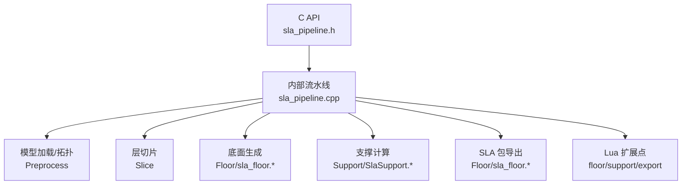
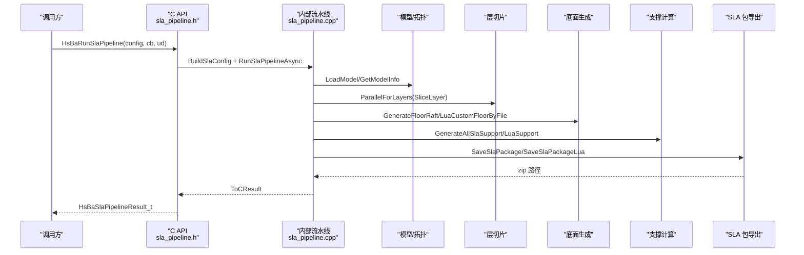
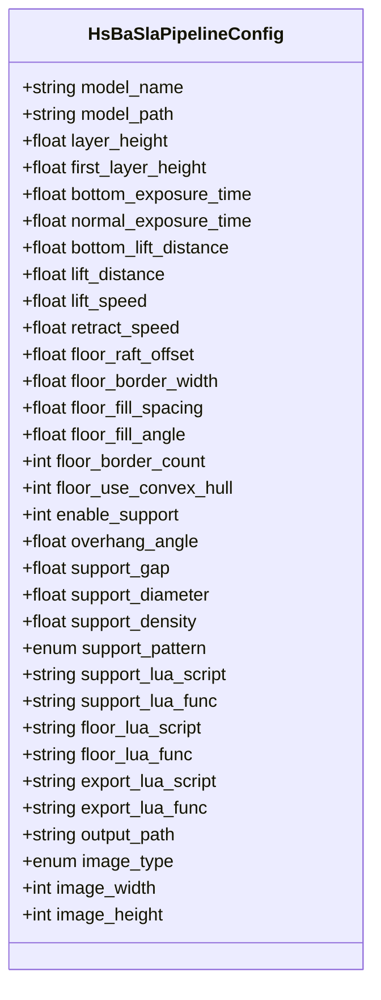
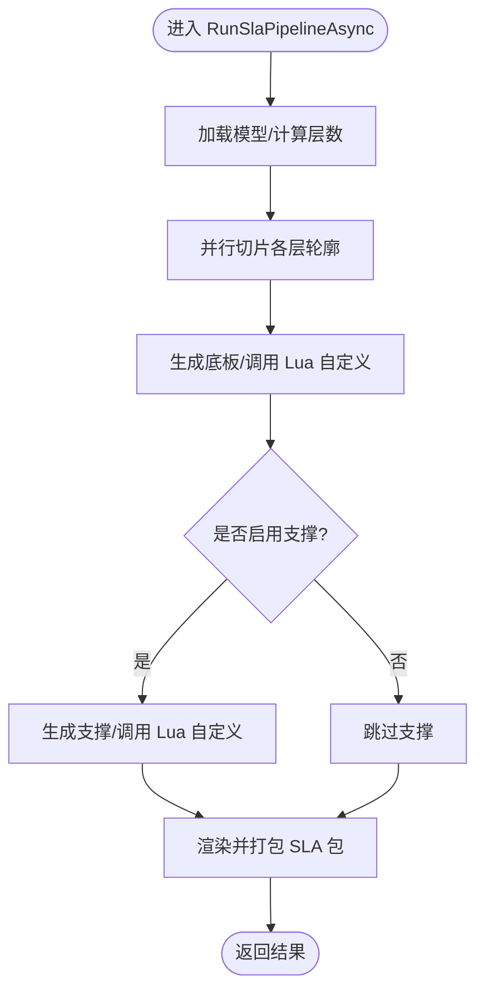
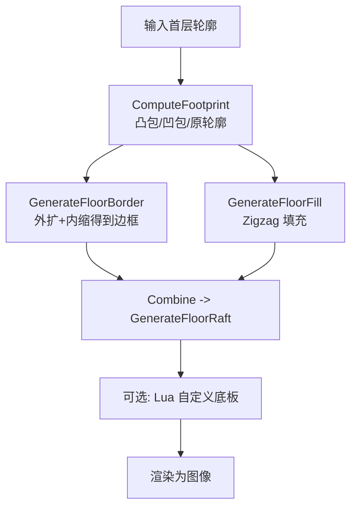
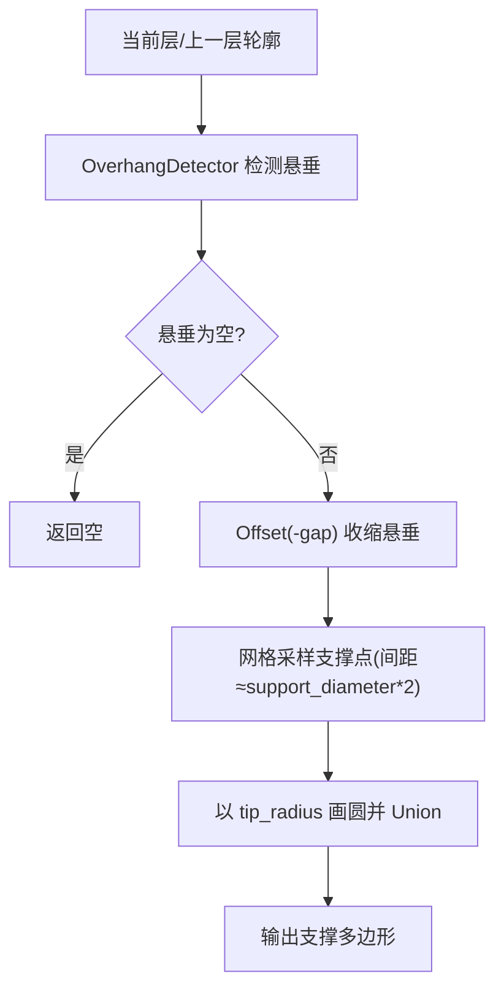
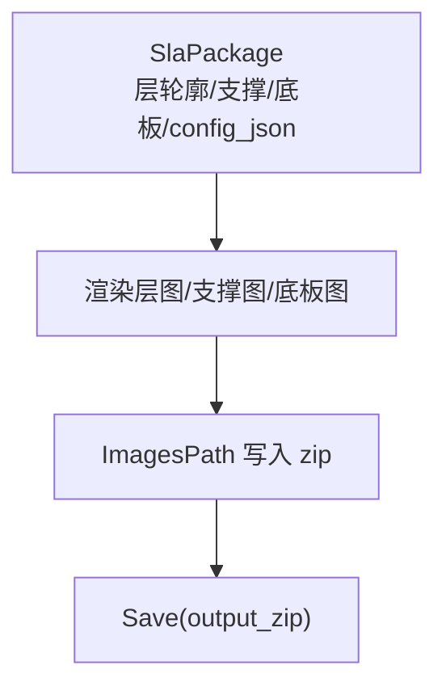
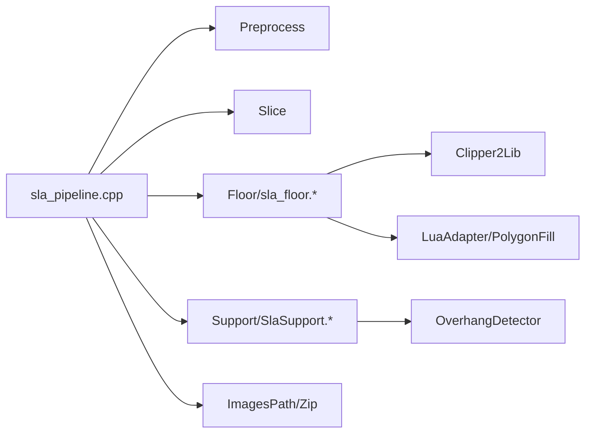

# SLA 流水线实现

<cite>
**本文引用的文件**   
- [sla_pipeline.h](file://DllHsBaSlicer/sla_pipeline.h)
- [sla_pipeline.cpp](file://DllHsBaSlicer/sla_pipeline.cpp)
- [pipeline_types.h](file://pipelinetypes/pipeline_types.h)
- [sla_floor.hpp](file://LibHsBaSlicer/Floor/sla_floor.hpp)
- [sla_floor.cpp](file://LibHsBaSlicer/Floor/sla_floor.cpp)
- [SlaSupport.hpp](file://support/SlaSupport.hpp)
- [SlaSupport.cpp](file://support/SlaSupport.cpp)
- [sla_pipeline.proto](file://proto/sla_pipeline.proto)
</cite>

## 目录
1. [简介](#简介)
2. [项目结构](#项目结构)
3. [核心组件](#核心组件)
4. [架构总览](#架构总览)
5. [详细组件分析](#详细组件分析)
6. [依赖关系分析](#依赖关系分析)
7. [性能与优化](#性能与优化)
8. [故障排除指南](#故障排除指南)
9. [结论](#结论)
10. [附录](#附录)

## 简介
本文面向立体光刻（SLA）切片与导出流水线，系统性说明从模型预处理、层切片、底面生成、支撑计算、曝光参数优化到层文件输出的完整流程。重点解释 HsBaSlaPipelineConfig_t 配置结构及其默认值，对比 FDM 流水线的差异，给出调用示例与 Lua 脚本扩展方法，并总结 SLA 特有的文件格式输出与参数优化策略。

## 项目结构
SLA 流水线由 C ABI 入口、C++ 内部实现、底层几何/填充/支撑算法以及打包导出模块组成：
- DllHsBaSlicer/sla_pipeline.{h,cpp}：对外 C API、同步/异步执行、进度回调、结果释放；内部构建 InternalSlaConfig、RunSlaPipelineAsync 五阶段流水线。
- pipelinetypes/pipeline_types.h：HsBaSlaPipelineConfig_t、HsBaSlaPipelineResult_t、枚举与默认初始化器。
- LibHsBaSlicer/Floor/sla_floor.{hpp,cpp}：SLA 底面/底板生成、图像渲染、SLA 包导出。
- support/SlaSupport.{hpp,cpp}：SLA 牺牲型支撑生成。
- proto/sla_pipeline.proto：SLA 配置的 protobuf 定义，用于跨语言序列化。

图示来源
- [sla_pipeline.h:17-56](file://DllHsBaSlicer/sla_pipeline.h#L17-L56)
- [sla_pipeline.cpp:299-483](file://DllHsBaSlicer/sla_pipeline.cpp#L299-L483)
- [sla_floor.hpp:21-195](file://LibHsBaSlicer/Floor/sla_floor.hpp#L21-L195)
- [SlaSupport.hpp:13-42](file://support/SlaSupport.hpp#L13-L42)

章节来源
- [sla_pipeline.h:1-63](file://DllHsBaSlicer/sla_pipeline.h#L1-L63)
- [sla_pipeline.cpp:1-532](file://DllHsBaSlicer/sla_pipeline.cpp#L1-L532)
- [pipeline_types.h:146-245](file://pipelinetypes/pipeline_types.h#L146-L245)

## 核心组件
- C ABI 接口
  - HsBaCreateDefaultSlaConfig：返回默认 HsBaSlaPipelineConfig_t。
  - HsBaRunSlaPipeline / HsBaRunSlaPipelineAsync：同步/异步执行 SLA 流水线。
  - HsBaFreeSlaPipelineResult：释放结果字符串内存。
- 配置结构 HsBaSlaPipelineConfig_t
  - 模型：model_name、model_path。
  - 切片：layer_height、first_layer_height。
  - 曝光/升降：bottom_exposure_time、normal_exposure_time、bottom_lift_distance、lift_distance、lift_speed、retract_speed。
  - 底面/底板：floor_raft_offset、floor_border_width、floor_fill_spacing、floor_fill_angle、floor_border_count、floor_use_convex_hull。
  - 支撑：enable_support、overhang_angle、support_gap、support_diameter、support_density、support_pattern。
  - Lua 扩展：support_lua_script/func、floor_lua_script/func、export_lua_script/func。
  - 输出：output_path、image_type、image_width、image_height。
- 结果结构 HsBaSlaPipelineResult_t
  - success、total_layers、export_path、error_message、elapsed_seconds。

章节来源
- [sla_pipeline.h:17-56](file://DllHsBaSlicer/sla_pipeline.h#L17-L56)
- [pipeline_types.h:146-245](file://pipelinetypes/pipeline_types.h#L146-L245)
- [pipeline_types.h:789-824](file://pipelinetypes/pipeline_types.h#L789-L824)

## 架构总览
SLA 流水线在 RunSlaPipelineAsync 中按顺序执行五个阶段，并通过协程与并行任务提升吞吐：
1. 模型预处理：加载模型、获取包围盒、计算总层数。
2. 层切片：构建切片拓扑，并行 SliceLayer 各层轮廓。
3. 底面生成：基于首层轮廓生成底板（可选凸包/凹包简化），支持 Lua 自定义。
4. 支撑计算：检测悬垂区域，生成牺牲型支撑，支持 Lua 自定义。
5. 导出：将层轮廓、支撑、底板渲染为图片，写入 zip 包，并附带 config.json。

图示来源
- [sla_pipeline.cpp:299-483](file://DllHsBaSlicer/sla_pipeline.cpp#L299-L483)
- [sla_floor.hpp:157-195](file://LibHsBaSlicer/Floor/sla_floor.hpp#L157-L195)
- [SlaSupport.hpp:20-42](file://support/SlaSupport.hpp#L20-L42)

## 详细组件分析

### 配置结构 HsBaSlaPipelineConfig_t 详解
- 字段分组与默认值
  - 模型：model_name、model_path（NULL）。
  - 切片：layer_height=0.05，first_layer_height=0.1。
  - 曝光/升降：bottom_exposure_time=60.0，normal_exposure_time=2.5，bottom_lift_distance=5.0，lift_distance=3.0，lift_speed=60.0，retract_speed=150.0。
  - 底面：floor_raft_offset=2.0，floor_border_width=1.0，floor_fill_spacing=0.5，floor_fill_angle=0.0，floor_border_count=2，floor_use_convex_hull=0。
  - 支撑：enable_support=1，overhang_angle=45.0，support_gap=0.5，support_diameter=2.0，support_density=0.3，support_pattern=HSBA_SLA_SUPPORT_SACRIFICIAL。
  - Lua：support_lua_script/func、floor_lua_script/func、export_lua_script/func（NULL 表示使用内置算法）。
  - 输出：output_path=NULL，image_type=HSBA_SLA_IMAGE_PNG，image_width=0，image_height=0。
- 与 protobuf 的映射
  - sla_pipe_config 字段与上述配置一一对应，便于跨语言传递。

图示来源
- [pipeline_types.h:170-218](file://pipelinetypes/pipeline_types.h#L170-L218)
- [pipeline_types.h:789-824](file://pipelinetypes/pipeline_types.h#L789-L824)
- [sla_pipeline.proto:18-58](file://proto/sla_pipeline.proto#L18-L58)

章节来源
- [pipeline_types.h:146-245](file://pipelinetypes/pipeline_types.h#L146-L245)
- [pipeline_types.h:789-824](file://pipelinetypes/pipeline_types.h#L789-L824)
- [sla_pipeline.proto:1-67](file://proto/sla_pipeline.proto#L1-L67)

### 流水线主流程 RunSlaPipelineAsync
- 阶段划分与进度上报
  - 预处理（0-10%）：加载模型、计算总层数。
  - 切片（15-35%）：构建拓扑，并行切片。
  - 底面（40-50%）：生成底板或调用 Lua 自定义。
  - 支撑（55-70%）：生成支撑或调用 Lua 自定义。
  - 导出（75-100%）：渲染层图、底板图、支撑图，打包 zip。
- 关键数据结构
  - InternalSlaConfig：封装 C ABI 配置到内部类型，含图像类型、尺寸、Lua 脚本路径等。
  - InternalSlaResult：success、total_layers、export_path、error_message、elapsed_seconds。
- 错误处理
  - 捕获 RuntimeError，统一转换为 error_message。
  - 资源释放通过 OwnedCString 与 HsBaFreeSlaPipelineResult。

图示来源
- [sla_pipeline.cpp:299-483](file://DllHsBaSlicer/sla_pipeline.cpp#L299-L483)

章节来源
- [sla_pipeline.cpp:49-85](file://DllHsBaSlicer/sla_pipeline.cpp#L49-L85)
- [sla_pipeline.cpp:123-145](file://DllHsBaSlicer/sla_pipeline.cpp#L123-L145)
- [sla_pipeline.cpp:181-242](file://DllHsBaSlicer/sla_pipeline.cpp#L181-L242)
- [sla_pipeline.cpp:244-282](file://DllHsBaSlicer/sla_pipeline.cpp#L244-L282)
- [sla_pipeline.cpp:284-296](file://DllHsBaSlicer/sla_pipeline.cpp#L284-L296)
- [sla_pipeline.cpp:299-483](file://DllHsBaSlicer/sla_pipeline.cpp#L299-L483)

### 底面生成（Floor/Raft）
- 内置算法
  - ComputeFootprint：根据 use_convex_hull 或 concave_hull_points 选择接触面。
  - GenerateFloorBorder：外扩 raft 边界后内缩 border_count 圈，得到边框环。
  - GenerateFloorFill：在边框内部进行 Zigzag 填充。
  - GenerateFloorRaft：组合边框与内部填充，形成完整底板。
- Lua 自定义
  - LuaCustomFloorByFile/LuaCustomFloorByString：传入底部轮廓与 SlaFloorConfig，返回多边形表。
- 图像渲染
  - RenderPolygonsToImage/RenderPolygonsToImageBuffer：自动适配像素尺寸，输出 png/jpg/svg。

图示来源
- [sla_floor.cpp:33-117](file://LibHsBaSlicer/Floor/sla_floor.cpp#L33-L117)
- [sla_floor.cpp:148-314](file://LibHsBaSlicer/Floor/sla_floor.cpp#L148-L314)
- [sla_floor.cpp:357-381](file://LibHsBaSlicer/Floor/sla_floor.cpp#L357-L381)

章节来源
- [sla_floor.hpp:21-116](file://LibHsBaSlicer/Floor/sla_floor.hpp#L21-L116)
- [sla_floor.cpp:33-117](file://LibHsBaSlicer/Floor/sla_floor.cpp#L33-L117)
- [sla_floor.cpp:148-314](file://LibHsBaSlicer/Floor/sla_floor.cpp#L148-L314)
- [sla_floor.cpp:357-381](file://LibHsBaSlicer/Floor/sla_floor.cpp#L357-L381)

### 支撑计算（Support）
- SLA 牺牲型支撑
  - OverhangDetector 检测悬垂区域。
  - 对悬垂区域应用 gap 偏移，采样支撑点（间距≈support_diameter*2），以 tip_diameter 为半径生成圆，合并为支撑截面。
- 配置
  - SlaSupportConfig：继承 SupportConfig，增加 tip_diameter 等 SLA 特有字段。
- Lua 自定义
  - 通过 GenerateAllLuaSupport 支持用户脚本替换支撑逻辑。

图示来源
- [SlaSupport.cpp:38-124](file://support/SlaSupport.cpp#L38-L124)
- [SlaSupport.hpp:20-42](file://support/SlaSupport.hpp#L20-L42)

章节来源
- [SlaSupport.hpp:1-46](file://support/SlaSupport.hpp#L1-L46)
- [SlaSupport.cpp:1-135](file://support/SlaSupport.cpp#L1-L135)

### 导出与 SLA 包格式
- 包内容
  - config.json：包含 slice/exposure/lift/floor/support/image/layers 等键。
  - layers/layer_i.ext：每层轮廓图像。
  - floor/floor_raft.ext：底板图像。
  - supports/layer_i.ext：每层支撑图像（可选）。
- 导出函数
  - SaveSlaPackage：内置导出。
  - SaveSlaPackageLua：允许 Lua 自定义导出逻辑，注册 2D 与文件操作函数。
- 图像渲染
  - 使用 ForLayersParallel 并行渲染层图与支撑图，避免临时文件开销。

图示来源
- [sla_floor.hpp:157-195](file://LibHsBaSlicer/Floor/sla_floor.hpp#L157-L195)
- [sla_floor.cpp:468-606](file://LibHsBaSlicer/Floor/sla_floor.cpp#L468-L606)

章节来源
- [sla_floor.hpp:157-195](file://LibHsBaSlicer/Floor/sla_floor.hpp#L157-L195)
- [sla_floor.cpp:468-606](file://LibHsBaSlicer/Floor/sla_floor.cpp#L468-L606)

### 与 FDM 流水线的差异
- 输出目标
  - FDM：G-code 路径指令，关注挤出、速度、温度、喷嘴直径等。
  - SLA：层图像 + 配置 JSON，关注曝光时间、升降距离/速度、底板与牺牲型支撑。
- 底面生成
  - FDM：通常无底板需求（可生成 brim/raft 但非必需）。
  - SLA：底板用于增强附着力，需考虑 offset、border、fill 角度与密度。
- 支撑计算
  - FDM：平面/树形/蜂窝支撑，强调支撑柱直径、密度、界面层。
  - SLA：牺牲型细柱支撑，强调 tip_diameter、spacing、gap，易于去除。
- 参数优化
  - FDM：路径规划、挤出速率、温度曲线。
  - SLA：曝光时间（首层与普通层）、提升距离/速度、回抽速度、图像分辨率。

章节来源
- [pipeline_types.h:23-127](file://pipelinetypes/pipeline_types.h#L23-L127)
- [pipeline_types.h:146-245](file://pipelinetypes/pipeline_types.h#L146-L245)

### 调用示例与 Lua 扩展指南
- C API 调用
  - 创建默认配置：HsBaCreateDefaultSlaConfig。
  - 设置必要字段：model_name/model_path、layer_height/first_layer_height、output_path、image_type 等。
  - 同步执行：HsBaRunSlaPipeline，检查 result.success 与 result.export_path。
  - 异步执行：HsBaRunSlaPipelineAsync，配合 HsBaSlaProgressCallback 与 HsBaSlaResultCallback。
  - 释放结果：HsBaFreeSlaPipelineResult。
- Lua 扩展点
  - 底板：floor_lua_script/floor_lua_func，接收底部轮廓与 SlaFloorConfig，返回多边形表。
  - 支撑：support_lua_script/support_lua_func，接收层轮廓与支持配置，返回支撑多边形。
  - 导出：export_lua_script/export_lua_func，接收 SlaPackage，自定义 zip 结构与内容。

章节来源
- [sla_pipeline.h:17-56](file://DllHsBaSlicer/sla_pipeline.h#L17-L56)
- [sla_pipeline.cpp:491-531](file://DllHsBaSlicer/sla_pipeline.cpp#L491-L531)
- [sla_floor.hpp:81-116](file://LibHsBaSlicer/Floor/sla_floor.hpp#L81-L116)
- [sla_floor.cpp:148-314](file://LibHsBaSlicer/Floor/sla_floor.cpp#L148-L314)
- [sla_floor.hpp:185-195](file://LibHsBaSlicer/Floor/sla_floor.hpp#L185-L195)
- [sla_floor.cpp:531-606](file://LibHsBaSlicer/Floor/sla_floor.cpp#L531-L606)

## 依赖关系分析
- 模块耦合
  - sla_pipeline.cpp 依赖：Preprocess、Slice、Floor、Support、ImagesPath、ThreadPool、coroutine。
  - sla_floor.cpp 依赖：Clipper2Lib、PolygonFill、LuaAdapter、EventSourceFunction、ImagesPath。
  - SlaSupport.cpp 依赖：OverhangDetector、Clipper2Lib。
- 外部依赖
  - Clipper2Lib：多边形布尔运算与偏移。
  - Lua：脚本扩展与数据交换。
  - Zip/IO：打包与图像编码。

图示来源
- [sla_pipeline.cpp:19-27](file://DllHsBaSlicer/sla_pipeline.cpp#L19-L27)
- [sla_floor.cpp:16-27](file://LibHsBaSlicer/Floor/sla_floor.cpp#L16-L27)
- [SlaSupport.cpp:7-11](file://support/SlaSupport.cpp#L7-L11)

章节来源
- [sla_pipeline.cpp:1-532](file://DllHsBaSlicer/sla_pipeline.cpp#L1-L532)
- [sla_floor.cpp:1-609](file://LibHsBaSlicer/Floor/sla_floor.cpp#L1-L609)
- [SlaSupport.cpp:1-135](file://support/SlaSupport.cpp#L1-L135)

## 性能与优化
- 并行切片
  - ParallelForLayers 并行 SliceLayer，共享拓扑只读，降低重复构建成本。
- 并行渲染
  - ForLayersParallel 并行渲染层图与支撑图，按 HSBA_PIPELINE_THREADS 环境变量控制线程数。
- 内存与 IO
  - RenderPolygonsToImageBuffer 直接输出到内存缓冲，避免中间文件。
  - ImagesPath.AddImage 批量写入 zip，减少磁盘抖动。
- 建议
  - 合理设置 image_width/image_height，平衡精度与体积。
  - 调整 support_diameter 与 support_gap 控制支撑密度与打印成功率。
  - 使用 Lua 自定义导出时，尽量复用已渲染图像，避免重复计算。

章节来源
- [sla_pipeline.cpp:346-357](file://DllHsBaSlicer/sla_pipeline.cpp#L346-L357)
- [sla_floor.cpp:400-465](file://LibHsBaSlicer/Floor/sla_floor.cpp#L400-L465)
- [sla_floor.cpp:370-381](file://LibHsBaSlicer/Floor/sla_floor.cpp#L370-L381)

## 故障排除指南
- 常见错误
  - 模型加载失败：检查 model_path 是否存在且可读。
  - 无效模型高度：确保模型 Z 方向有正高度，否则 total_layers<=0。
  - Lua 脚本错误：确认脚本路径正确、函数名存在、返回值类型为多边形表。
  - 导出失败：检查输出路径权限、磁盘空间、图像编码库可用性。
- 调试建议
  - 启用 progress_cb 观察阶段进度。
  - 使用 HsBaFreeSlaPipelineResult 释放结果字符串，避免内存泄漏。
  - 对 Lua 自定义脚本，先单独测试 LuaCustomFloorByFile/LuaCustomFloorByString。

章节来源
- [sla_pipeline.cpp:310-336](file://DllHsBaSlicer/sla_pipeline.cpp#L310-L336)
- [sla_pipeline.cpp:400-419](file://DllHsBaSlicer/sla_pipeline.cpp#L400-L419)
- [sla_pipeline.cpp:449-469](file://DllHsBaSlicer/sla_pipeline.cpp#L449-L469)
- [sla_pipeline.cpp:523-531](file://DllHsBaSlicer/sla_pipeline.cpp#L523-L531)

## 结论
SLA 流水线围绕“层图像 + 配置 JSON”的核心产物，提供从模型预处理到最终打包的完整自动化流程。其独特性体现在底面生成与牺牲型支撑计算，以及对曝光/升降参数的精细控制。通过 Lua 扩展点，用户可以灵活定制底板、支撑与导出逻辑，满足多样化设备与工艺需求。

## 附录
- 配置默认值速查
  - layer_height=0.05，first_layer_height=0.1。
  - bottom_exposure_time=60.0，normal_exposure_time=2.5。
  - bottom_lift_distance=5.0，lift_distance=3.0，lift_speed=60.0，retract_speed=150.0。
  - floor_raft_offset=2.0，floor_border_width=1.0，floor_fill_spacing=0.5，floor_fill_angle=0.0，floor_border_count=2，floor_use_convex_hull=0。
  - enable_support=1，overhang_angle=45.0，support_gap=0.5，support_diameter=2.0，support_density=0.3，support_pattern=HSBA_SLA_SUPPORT_SACRIFICIAL。
  - image_type=HSBA_SLA_IMAGE_PNG，image_width=0，image_height=0。

章节来源
- [pipeline_types.h:789-824](file://pipelinetypes/pipeline_types.h#L789-L824)