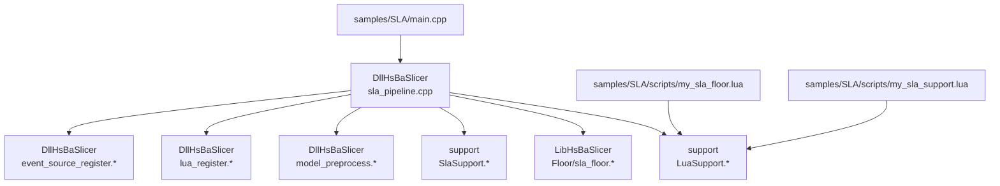
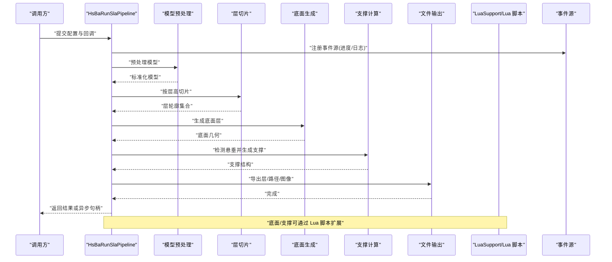
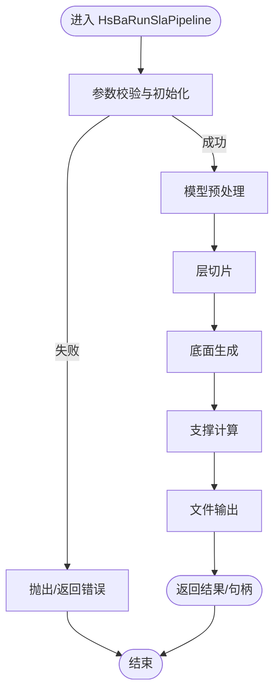
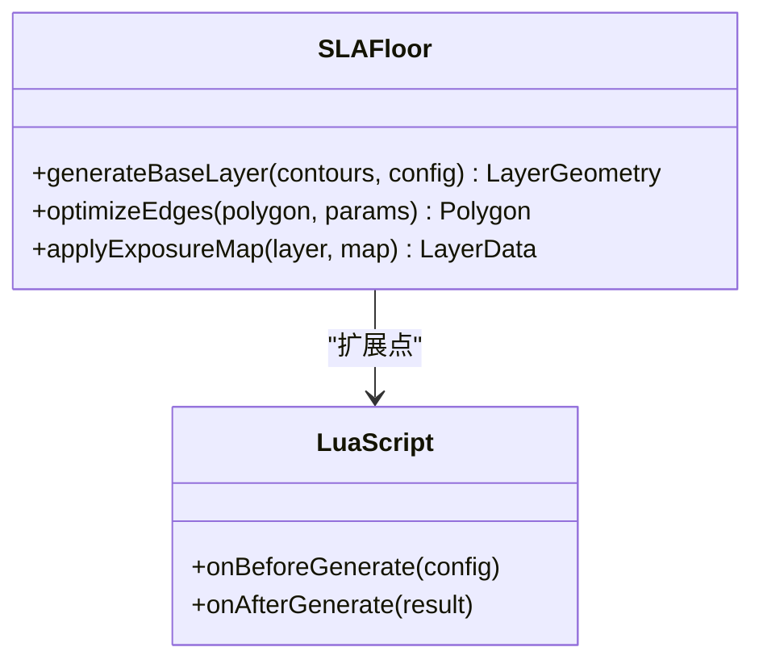
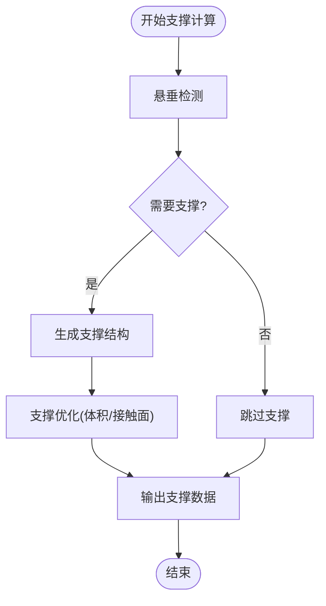
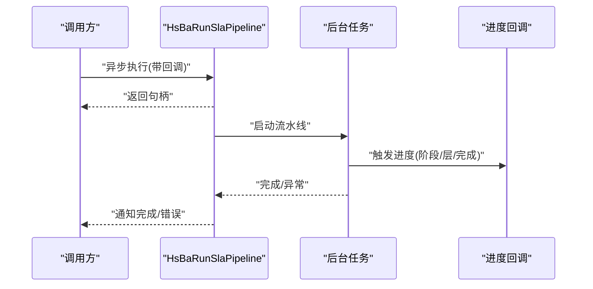
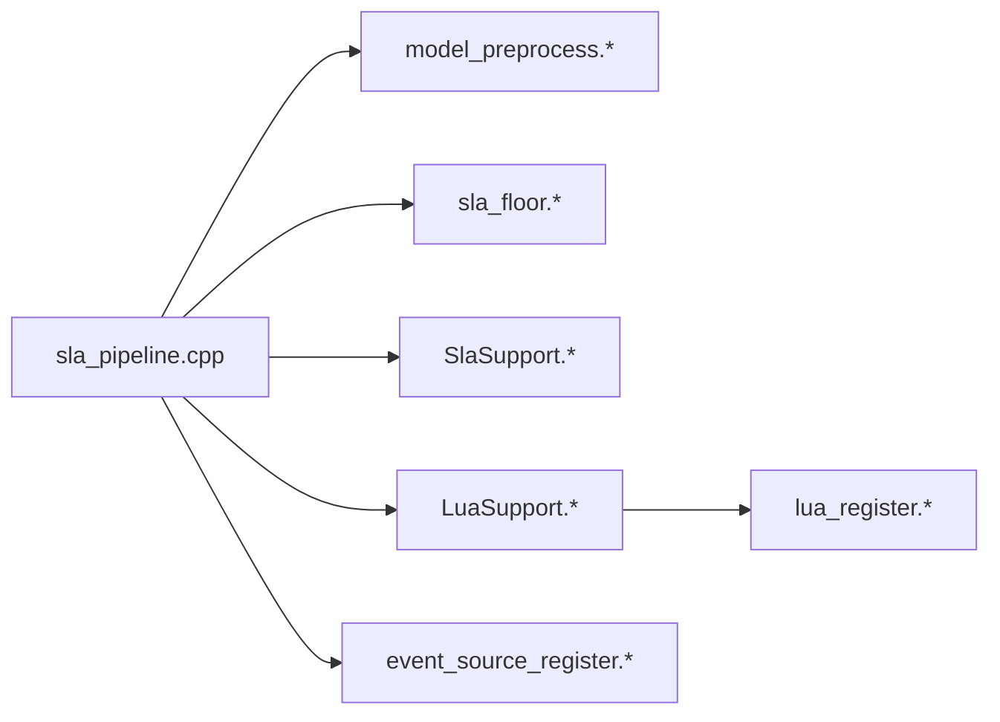

# SLA 流水线执行流程

<cite>
**本文引用的文件**   
- [sla_pipeline.h](file://DllHsBaSlicer/sla_pipeline.h)
- [sla_pipeline.cpp](file://DllHsBaSlicer/sla_pipeline.cpp)
- [pipeline_parallel.hpp](file://DllHsBaSlicer/pipeline_parallel.hpp)
- [model_preprocess.h](file://DllHsBaSlicer/model_preprocess.h)
- [model_preprocess.cpp](file://DllHsBaSlicer/model_preprocess.cpp)
- [sla_floor.hpp](file://LibHsBaSlicer/Floor/sla_floor.hpp)
- [sla_floor.cpp](file://LibHsBaSlicer/Floor/sla_floor.cpp)
- [SlaSupport.hpp](file://support/SlaSupport.hpp)
- [SlaSupport.cpp](file://support/SlaSupport.cpp)
- [LuaSupport.hpp](file://support/LuaSupport.hpp)
- [LuaSupport.cpp](file://support/LuaSupport.cpp)
- [lua_register.h](file://DllHsBaSlicer/lua_register.h)
- [lua_register.cpp](file://DllHsBaSlicer/lua_register.cpp)
- [event_source_register.h](file://DllHsBaSlicer/event_source_register.h)
- [event_source_register.cpp](file://DllHsBaSlicer/event_source_register.cpp)
- [main.cpp](file://samples/SLA/main.cpp)
- [my_sla_floor.lua](file://samples/SLA/scripts/my_sla_floor.lua)
- [my_sla_support.lua](file://samples/SLA/scripts/my_sla_support.lua)
</cite>

## 目录
1. [引言](#引言)
2. [项目结构](#项目结构)
3. [核心组件](#核心组件)
4. [架构总览](#架构总览)
5. [详细组件分析](#详细组件分析)
6. [依赖关系分析](#依赖关系分析)
7. [性能与并发特性](#性能与并发特性)
8. [故障排除指南](#故障排除指南)
9. [结论](#结论)
10. [附录：调用示例与回调规范](#附录调用示例与回调规范)

## 引言
本文面向需要深入理解 SLA（立体光刻）切片流水线执行过程的开发者与集成者，围绕 HsBaRunSlaPipeline 函数展开，完整说明从模型预处理、层切片、底面生成、支撑计算到文件输出的端到端流程。文档同时解释同步与异步两种执行模式、回调机制的触发时机与数据格式，并给出错误处理与资源管理的最佳实践。

## 项目结构
SLA 流水线在 DllHsBaSlicer 中提供对外接口与编排逻辑，在 LibHsBaSlicer 中实现通用算法能力（如底面生成），在 support 模块中实现支撑结构计算，并通过 Lua 脚本系统扩展底面与支撑策略。样本工程 samples/SLA 提供了最小可运行入口与脚本示例。

图表来源
- [sla_pipeline.cpp:1-200](file://DllHsBaSlicer/sla_pipeline.cpp#L1-L200)
- [sla_floor.cpp:1-200](file://LibHsBaSlicer/Floor/sla_floor.cpp#L1-L200)
- [SlaSupport.cpp:1-200](file://support/SlaSupport.cpp#L1-L200)
- [LuaSupport.cpp:1-200](file://support/LuaSupport.cpp#L1-L200)
- [model_preprocess.cpp:1-200](file://DllHsBaSlicer/model_preprocess.cpp#L1-L200)
- [lua_register.cpp:1-200](file://DllHsBaSlicer/lua_register.cpp#L1-L200)
- [event_source_register.cpp:1-200](file://DllHsBaSlicer/event_source_register.cpp#L1-L200)
- [main.cpp:1-200](file://samples/SLA/main.cpp#L1-L200)

章节来源
- [sla_pipeline.h:1-200](file://DllHsBaSlicer/sla_pipeline.h#L1-L200)
- [sla_pipeline.cpp:1-200](file://DllHsBaSlicer/sla_pipeline.cpp#L1-L200)

## 核心组件
- HsBaRunSlaPipeline：SLA 流水线的统一入口，负责参数校验、阶段调度、进度与事件上报、异常捕获与结果封装。
- 模型预处理：将输入 CAD/网格模型转换为内部拓扑表示，进行单位、方向、缩放等标准化。
- 层切片：根据层高与容差对模型进行切片，得到每层的轮廓多边形集合。
- 底面生成：基于轮廓生成底层填充与表面质量优化所需的底面层几何。
- 支撑计算：检测悬垂区域并生成支撑结构，支持 Lua 自定义策略。
- 文件输出：将层数据、路径或图像导出为 SLA 相关格式。

章节来源
- [sla_pipeline.h:1-200](file://DllHsBaSlicer/sla_pipeline.h#L1-L200)
- [model_preprocess.h:1-200](file://DllHsBaSlicer/model_preprocess.h#L1-L200)
- [sla_floor.hpp:1-200](file://LibHsBaSlicer/Floor/sla_floor.hpp#L1-L200)
- [SlaSupport.hpp:1-200](file://support/SlaSupport.hpp#L1-L200)

## 架构总览
下图展示 HsBaRunSlaPipeline 的端到端执行流，包括同步与异步分支、Lua 脚本扩展点以及事件源注册。

图表来源
- [sla_pipeline.cpp:1-200](file://DllHsBaSlicer/sla_pipeline.cpp#L1-L200)
- [LuaSupport.cpp:1-200](file://support/LuaSupport.cpp#L1-L200)
- [event_source_register.cpp:1-200](file://DllHsBaSlicer/event_source_register.cpp#L1-L200)

## 详细组件分析

### HsBaRunSlaPipeline 执行过程
- 参数校验与初始化：检查输入模型、层高、容差、输出路径等必填项；初始化进度回调与事件源。
- 模型预处理：加载并标准化模型，确保坐标系、单位与方向一致。
- 层切片：根据层高与容差切出每层轮廓，必要时合并相邻层或进行平滑。
- 底面生成：对首层与关键层进行特殊处理，生成高质量底面几何。
- 支撑计算：检测悬垂角度与面积阈值，生成支撑树或网格；支持通过 Lua 脚本替换默认策略。
- 文件输出：将层数据、路径或图像写入目标格式；记录统计信息。
- 同步/异步模式：
  - 同步：阻塞等待所有阶段完成，直接返回结果对象。
  - 异步：启动后台任务，立即返回句柄；通过回调或轮询获取进度与结果。
- 回调机制：
  - 进度回调：在阶段切换、层完成、支撑生成、导出完成时触发。
  - 日志回调：输出调试与警告信息。
  - 取消回调：允许调用方中断长耗时任务。

图表来源
- [sla_pipeline.cpp:1-200](file://DllHsBaSlicer/sla_pipeline.cpp#L1-L200)

章节来源
- [sla_pipeline.cpp:1-200](file://DllHsBaSlicer/sla_pipeline.cpp#L1-L200)

### 模型预处理
- 功能：读取原始模型，转换为目标拓扑结构，应用单位、缩放、旋转与平移，修复无效面与孔洞。
- 关键点：
  - 单位与尺寸一致性：避免后续切片误差放大。
  - 法线方向与内外侧判定：影响底面与支撑的方向性。
  - 容差与精度控制：平衡精度与性能。

章节来源
- [model_preprocess.h:1-200](file://DllHsBaSlicer/model_preprocess.h#L1-L200)
- [model_preprocess.cpp:1-200](file://DllHsBaSlicer/model_preprocess.cpp#L1-L200)

### 层切片
- 功能：将三维模型沿 Z 轴按层高切割，得到每层的二维轮廓集合。
- 关键点：
  - 层高与容差：决定切片精度与层数。
  - 轮廓合并与去重：减少冗余边与重复段。
  - 层间过渡：保证相邻层几何连续性。

章节来源
- [sla_pipeline.cpp:1-200](file://DllHsBaSlicer/sla_pipeline.cpp#L1-L200)

### 底面生成（SLA 特殊处理）
- 功能：针对 SLA 工艺特点，对首层与关键层进行增强，提升附着性与表面质量。
- 关键点：
  - 首层扩大与补偿：提高与构建板的附着力。
  - 边缘强化：减少毛刺与欠固化。
  - 可调策略：通过 Lua 脚本 my_sla_floor.lua 定制填充密度、扫描路径与曝光参数映射。

图表来源
- [sla_floor.hpp:1-200](file://LibHsBaSlicer/Floor/sla_floor.hpp#L1-L200)
- [sla_floor.cpp:1-200](file://LibHsBaSlicer/Floor/sla_floor.cpp#L1-L200)
- [my_sla_floor.lua:1-200](file://samples/SLA/scripts/my_sla_floor.lua#L1-L200)

章节来源
- [sla_floor.hpp:1-200](file://LibHsBaSlicer/Floor/sla_floor.hpp#L1-L200)
- [sla_floor.cpp:1-200](file://LibHsBaSlicer/Floor/sla_floor.cpp#L1-L200)
- [my_sla_floor.lua:1-200](file://samples/SLA/scripts/my_sla_floor.lua#L1-L200)

### 支撑计算（SLA 特殊处理）
- 功能：检测悬垂区域并生成支撑结构，防止打印塌陷。
- 关键点：
  - 悬垂检测：基于法线与角度阈值判断是否需要支撑。
  - 支撑策略：默认算法与 Lua 脚本 my_sla_support.lua 可替换。
  - 支撑与模型分离：便于后处理移除。

图表来源
- [SlaSupport.cpp:1-200](file://support/SlaSupport.cpp#L1-L200)
- [my_sla_support.lua:1-200](file://samples/SLA/scripts/my_sla_support.lua#L1-L200)

章节来源
- [SlaSupport.hpp:1-200](file://support/SlaSupport.hpp#L1-L200)
- [SlaSupport.cpp:1-200](file://support/SlaSupport.cpp#L1-L200)
- [my_sla_support.lua:1-200](file://samples/SLA/scripts/my_sla_support.lua#L1-L200)

### 文件输出
- 功能：将层数据、路径或图像导出为 SLA 相关格式，便于后续设备使用。
- 关键点：
  - 输出格式选择：依据下游设备或软件需求。
  - 元数据写入：包含层高、材料、曝光参数等。
  - 分块与压缩：大模型时采用分块与压缩降低 IO 压力。

章节来源
- [sla_pipeline.cpp:1-200](file://DllHsBaSlicer/sla_pipeline.cpp#L1-L200)

### 同步与异步执行模式
- 同步模式：
  - 调用 HsBaRunSlaPipeline 后阻塞直至完成。
  - 适合批处理与简单集成场景。
- 异步模式：
  - 调用后立即返回句柄，后台线程执行流水线。
  - 通过回调或轮询获取进度与结果。
  - 适合 UI 响应与长时间任务。

图表来源
- [sla_pipeline.cpp:1-200](file://DllHsBaSlicer/sla_pipeline.cpp#L1-L200)
- [pipeline_parallel.hpp:1-200](file://DllHsBaSlicer/pipeline_parallel.hpp#L1-L200)

章节来源
- [sla_pipeline.cpp:1-200](file://DllHsBaSlicer/sla_pipeline.cpp#L1-L200)
- [pipeline_parallel.hpp:1-200](file://DllHsBaSlicer/pipeline_parallel.hpp#L1-L200)

### Lua 脚本扩展点
- 底面脚本 my_sla_floor.lua：
  - 钩子：生成前/后处理，调整填充密度、扫描路径、曝光映射。
- 支撑脚本 my_sla_support.lua：
  - 钩子：自定义悬垂检测规则、支撑形状与连接策略。
- 注册与加载：
  - lua_register.* 负责暴露 API 给 Lua。
  - LuaSupport.* 负责桥接 C++ 与 Lua 环境。

章节来源
- [lua_register.h:1-200](file://DllHsBaSlicer/lua_register.h#L1-L200)
- [lua_register.cpp:1-200](file://DllHsBaSlicer/lua_register.cpp#L1-L200)
- [LuaSupport.hpp:1-200](file://support/LuaSupport.hpp#L1-L200)
- [LuaSupport.cpp:1-200](file://support/LuaSupport.cpp#L1-L200)
- [my_sla_floor.lua:1-200](file://samples/SLA/scripts/my_sla_floor.lua#L1-L200)
- [my_sla_support.lua:1-200](file://samples/SLA/scripts/my_sla_support.lua#L1-L200)

## 依赖关系分析
- 组件耦合：
  - sla_pipeline.cpp 作为编排中心，依赖 model_preprocess、sla_floor、SlaSupport、LuaSupport 与 event_source_register。
  - Lua 脚本通过 LuaSupport 与 C++ 组件交互，解耦策略实现。
- 外部依赖：
  - 文件系统用于读写模型与输出文件。
  - 线程池或协程用于异步执行（由 pipeline_parallel.hpp 提供）。

图表来源
- [sla_pipeline.cpp:1-200](file://DllHsBaSlicer/sla_pipeline.cpp#L1-L200)
- [model_preprocess.cpp:1-200](file://DllHsBaSlicer/model_preprocess.cpp#L1-L200)
- [sla_floor.cpp:1-200](file://LibHsBaSlicer/Floor/sla_floor.cpp#L1-L200)
- [SlaSupport.cpp:1-200](file://support/SlaSupport.cpp#L1-L200)
- [LuaSupport.cpp:1-200](file://support/LuaSupport.cpp#L1-L200)
- [lua_register.cpp:1-200](file://DllHsBaSlicer/lua_register.cpp#L1-L200)
- [event_source_register.cpp:1-200](file://DllHsBaSlicer/event_source_register.cpp#L1-L200)

章节来源
- [sla_pipeline.cpp:1-200](file://DllHsBaSlicer/sla_pipeline.cpp#L1-L200)

## 性能与并发特性
- 并行切片：对多层切片可并行化，结合线程池提升吞吐。
- 内存管理：使用对象池与内存池减少分配开销。
- IO 优化：分块写入与压缩降低磁盘压力。
- 回调频率：合理设置进度回调粒度，避免 UI 卡顿。

[本节为通用指导，不直接分析具体文件]

## 故障排除指南
- 常见错误：
  - 模型非法：法线反向、空洞、非流形边导致切片失败。
  - 层高过小：层数过多导致内存与时间爆炸。
  - 支撑未生成：悬垂阈值设置不当。
  - 输出失败：路径不存在或权限不足。
- 排查步骤：
  - 启用日志回调，查看阶段与错误堆栈。
  - 逐步禁用 Lua 脚本，定位策略问题。
  - 调整容差与层高，验证稳定性。
  - 检查事件源注册是否成功。

章节来源
- [event_source_register.h:1-200](file://DllHsBaSlicer/event_source_register.h#L1-L200)
- [event_source_register.cpp:1-200](file://DllHsBaSlicer/event_source_register.cpp#L1-L200)

## 结论
HsBaRunSlaPipeline 将 SLA 流水线模块化，清晰划分预处理、切片、底面、支撑与输出职责，并通过 Lua 脚本提供灵活扩展。同步与异步模式满足不同集成场景，事件源与回调机制保障可观测性与可控性。遵循本文的最佳实践，可在保证质量的同时获得稳定高效的 SLA 切片体验。

[本节为总结，不直接分析具体文件]

## 附录：调用示例与回调规范

### 调用示例（同步）
- 步骤：
  - 准备输入模型与配置（层高、容差、输出路径）。
  - 调用 HsBaRunSlaPipeline 同步执行。
  - 检查返回值与错误码。
  - 释放资源（如有）。
- 参考入口：
  - [main.cpp:1-200](file://samples/SLA/main.cpp#L1-L200)

章节来源
- [main.cpp:1-200](file://samples/SLA/main.cpp#L1-L200)

### 调用示例（异步）
- 步骤：
  - 注册进度与日志回调。
  - 调用 HsBaRunSlaPipeline 异步执行，获取句柄。
  - 轮询或等待回调通知完成。
  - 处理结果或错误，清理句柄。
- 参考入口：
  - [main.cpp:1-200](file://samples/SLA/main.cpp#L1-L200)

章节来源
- [main.cpp:1-200](file://samples/SLA/main.cpp#L1-L200)

### 回调机制与数据格式
- 进度回调：
  - 触发时机：阶段开始/结束、每层完成、支撑生成完成、导出完成。
  - 数据字段：当前阶段、已完成层数、总层数、百分比、消息文本。
- 日志回调：
  - 触发时机：调试、警告、错误。
  - 数据字段：级别、时间戳、消息内容。
- 取消回调：
  - 触发时机：用户主动取消或超时。
  - 行为：流水线应尽快退出并返回取消状态。

章节来源
- [sla_pipeline.cpp:1-200](file://DllHsBaSlicer/sla_pipeline.cpp#L1-L200)
- [event_source_register.cpp:1-200](file://DllHsBaSlicer/event_source_register.cpp#L1-L200)

### 资源管理与错误处理
- 资源管理：
  - 显式释放模型、路径与临时文件。
  - 关闭文件句柄与线程池。
- 错误处理：
  - 捕获并分类异常（IO、几何、算法）。
  - 回滚未完成的操作，保证一致性。

章节来源
- [sla_pipeline.cpp:1-200](file://DllHsBaSlicer/sla_pipeline.cpp#L1-L200)