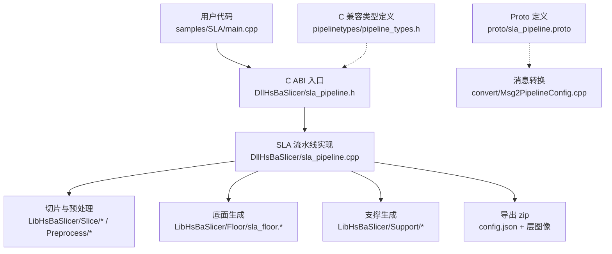
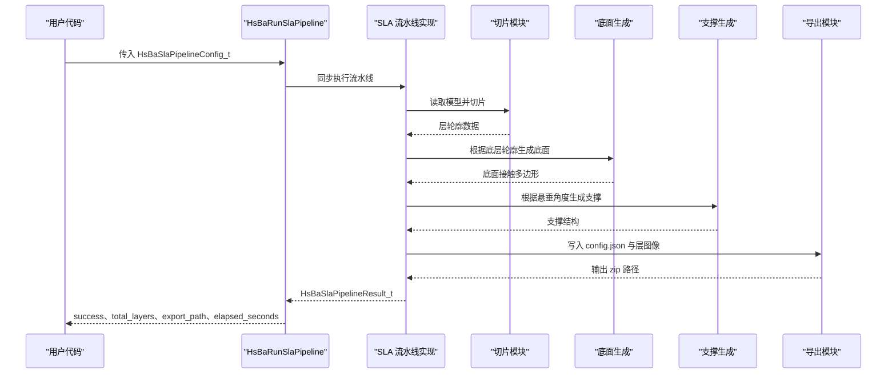
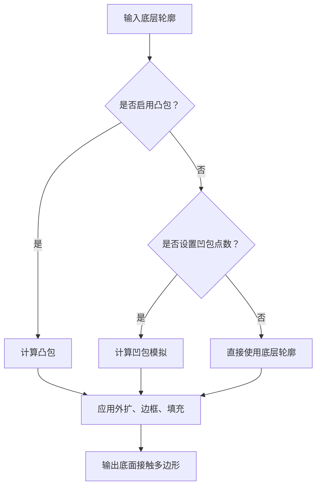

# SLA 流水线配置

<cite>
**本文引用的文件**   
- [pipeline_types.h](file://pipelinetypes/pipeline_types.h)
- [sla_pipeline.proto](file://proto/sla_pipeline.proto)
- [fdm_pipeline.proto](file://proto/fdm_pipeline.proto)
- [sla_pipeline.h](file://DllHsBaSlicer/sla_pipeline.h)
- [sla_pipeline.cpp](file://DllHsBaSlicer/sla_pipeline.cpp)
- [sla_floor.hpp](file://LibHsBaSlicer/Floor/sla_floor.hpp)
- [sla_floor.cpp](file://LibHsBaSlicer/Floor/sla_floor.cpp)
- [Msg2PipelineConfig.cpp](file://convert/Msg2PipelineConfig.cpp)
- [main.cpp](file://samples/SLA/main.cpp)
</cite>

## 目录
1. [引言](#引言)
2. [项目结构定位](#项目结构定位)
3. [核心结构体总览](#核心结构体总览)
4. [架构与数据流](#架构与数据流)
5. [字段详解：层高、曝光、提升与回抽](#字段详解层高曝光提升与回抽)
6. [底面参数详解](#底面参数详解)
7. [支撑、图像输出与 Lua 扩展](#支撑图像输出与-lua-扩展)
8. [与 FDM 配置的区别](#与-fdm-配置的区别)
9. [完整配置示例路径](#完整配置示例路径)
10. [配置验证规则与常见错误](#配置验证规则与常见错误)
11. [性能与调参建议](#性能与调参建议)
12. [结论](#结论)

## 引言
本文面向需要为 SLA（立体光刻）切片流水线编写或调整配置的开发者，围绕 `HsBaSlaPipelineConfig_t` 结构体给出逐字段说明。文档基于源码中的 C 接口定义、Proto 定义、默认值初始化函数、内部实现结构体、底面生成逻辑以及 SLA 示例程序整理而成，重点解释：
- 每个参数的作用域、含义、默认值、单位；
- 哪些是 SLA 特有参数；
- 如何创建、修改并运行 SLA 流水线；
- 与 FDM 配置的关键差异；
- 可推导的配置约束和常见问题处理思路。

## 项目结构定位
SLA 流水线配置的核心定义位于跨模块的 C 兼容类型头文件中，同时通过 Proto 定义对外暴露序列化格式；实际流水线入口在 Dll 层，底层切片、底面生成、支撑生成和导出由 Lib 层实现；示例代码位于 samples 目录。

**图表来源**  
- [sla_pipeline.h:17-56](file://DllHsBaSlicer/sla_pipeline.h#L17-L56)  
- [sla_pipeline.cpp:28-85](file://DllHsBaSlicer/sla_pipeline.cpp#L28-L85)  
- [sla_floor.hpp:21-42](file://LibHsBaSlicer/Floor/sla_floor.hpp#L21-L42)  
- [pipeline_types.h:146-218](file://pipelinetypes/pipeline_types.h#L146-L218)  
- [sla_pipeline.proto:18-58](file://proto/sla_pipeline.proto#L18-L58)  
- [Msg2PipelineConfig.cpp:104-136](file://convert/Msg2PipelineConfig.cpp#L104-L136)

**章节来源**  
- [sla_pipeline.h:17-56](file://DllHsBaSlicer/sla_pipeline.h#L17-L56)  
- [pipeline_types.h:146-218](file://pipelinetypes/pipeline_types.h#L146-L218)  
- [sla_pipeline.proto:18-58](file://proto/sla_pipeline.proto#L18-L58)

## 核心结构体总览
`HsBaSlaPipelineConfig_t` 是 SLA 流水线的 C 兼容配置结构体，覆盖模型输入、切片、曝光、底面、支撑、Lua 自定义、图像输出和结果释放等全部关键信息。其对应 Proto 消息名为 `sla_pipe_config`，用于跨进程或跨语言配置传递。

| 分类 | 关键字段 | 默认值 | 单位 | 作用域 |
|---|---|---:|---:|---|
| 模型 | `model_name`、`model_path` | NULL | 字符串 | 输入模型标识与路径 |
| 切片 | `layer_height`、`first_layer_height` | 0.05、0.1 | mm | 普通层与首层厚度 |
| 曝光 | `bottom_exposure_time`、`normal_exposure_time` | 60.0、2.5 | s | 底面与普通层曝光时间 |
| 提升与回抽 | `bottom_lift_distance`、`lift_distance`、`lift_speed`、`retract_speed` | 5.0、3.0、60.0、150.0 | mm、mm/s | 底面提升、普通提升、提升速度、回抽速度 |
| 底面 | `floor_raft_offset`、`floor_border_width`、`floor_fill_spacing`、`floor_fill_angle`、`floor_border_count`、`floor_use_convex_hull` | 2.0、1.0、0.5、0.0、2、0 | mm、度、数量 | 底面接触区域与填充 |
| 支撑 | `enable_support`、`overhang_angle`、`support_gap`、`support_diameter`、`support_density`、`support_pattern` | 1、45.0、0.5、2.0、0.3、牺牲型 | 度、mm、比例、枚举 | 是否启用支撑及支撑形态 |
| Lua 扩展 | `support_lua_script`、`support_lua_func`、`floor_lua_script`、`floor_lua_func`、`export_lua_script`、`export_lua_func` | NULL | 字符串 | 自定义支撑、底面、导出脚本 |
| 输出 | `output_path`、`image_type`、`image_width`、`image_height` | NULL、PNG、0、0 | 字符串、枚举、像素 | 输出 zip 路径与层图像格式尺寸 |

**章节来源**  
- [pipeline_types.h:146-218](file://pipelinetypes/pipeline_types.h#L146-L218)  
- [pipeline_types.h:789-824](file://pipelinetypes/pipeline_types.h#L789-L824)  
- [sla_pipeline.proto:18-58](file://proto/sla_pipeline.proto#L18-L58)

## 架构与数据流
SLA 流水线从用户传入的 `HsBaSlaPipelineConfig_t` 开始，经过预处理、切片、底面生成、支撑生成、导出打包，最终返回 `HsBaSlaPipelineResult_t`。

**图表来源**  
- [sla_pipeline.h:23-56](file://DllHsBaSlicer/sla_pipeline.h#L23-L56)  
- [sla_pipeline.cpp:28-85](file://DllHsBaSlicer/sla_pipeline.cpp#L28-L85)  
- [sla_floor.hpp:35-42](file://LibHsBaSlicer/Floor/sla_floor.hpp#L35-L42)

**章节来源**  
- [sla_pipeline.h:23-56](file://DllHsBaSlicer/sla_pipeline.h#L23-L56)  
- [sla_pipeline.cpp:28-85](file://DllHsBaSlicer/sla_pipeline.cpp#L28-L85)

## 字段详解：层高、曝光、提升与回抽

### 层高字段
- `layer_height`：普通层高度，默认 0.05 mm。
- `first_layer_height`：首层高度，默认 0.1 mm。

这两个字段控制切片几何精度与首层粘附质量。SLA 默认比普通 FDM 更薄，因为树脂固化依赖投影分辨率与曝光能量。

**章节来源**  
- [pipeline_types.h:176-178](file://pipelinetypes/pipeline_types.h#L176-L178)  
- [pipeline_types.h:794-795](file://pipelinetypes/pipeline_types.h#L794-L795)

### 曝光时间字段
- `bottom_exposure_time`：底面层曝光时间，默认 60.0 s。
- `normal_exposure_time`：普通层曝光时间，默认 2.5 s。

底面曝光显著长于普通层，目的是让第一层充分粘接到构建板上；普通层曝光则影响侧面精度、固化深度和打印速度。

**章节来源**  
- [pipeline_types.h:180-182](file://pipelinetypes/pipeline_types.h#L180-L182)  
- [pipeline_types.h:796-797](file://pipelinetypes/pipeline_types.h#L796-L797)  
- [sla_pipeline.cpp:193-194](file://DllHsBaSlicer/sla_pipeline.cpp#L193-L194)

### 提升距离与速度字段
- `bottom_lift_distance`：底面提升距离，默认 5.0 mm。
- `lift_distance`：普通层提升距离，默认 3.0 mm。
- `lift_speed`：提升速度，默认 60.0 mm/s。
- `retract_speed`：回抽速度，默认 150.0 mm/s。

提升距离决定每层之间树脂膜被拉开的距离；提升速度影响单层周期；回抽速度通常用于降低剥离应力或辅助树脂回流。

**章节来源**  
- [pipeline_types.h:183-186](file://pipelinetypes/pipeline_types.h#L183-L186)  
- [pipeline_types.h:798-801](file://pipelinetypes/pipeline_types.h#L798-L801)  
- [sla_pipeline.cpp:55-60](file://DllHsBaSlicer/sla_pipeline.cpp#L55-L60)

## 底面参数详解
SLA 的底面不是简单复制底层轮廓，而是根据底层轮廓计算“接触构建板的面积”，再向外偏移、加边框、填充，形成 raft 或 floor。

| 字段 | 默认值 | 单位 | 含义 |
|---|---:|---:|---|
| `floor_raft_offset` | 2.0 | mm | 底面相对模型底面外扩距离 |
| `floor_border_width` | 1.0 | mm | 底面边框环宽度 |
| `floor_fill_spacing` | 0.5 | mm | 底面内部填充线间距 |
| `floor_fill_angle` | 0.0 | 度 | 底面填充方向角 |
| `floor_border_count` | 2 | 数量 | 边框偏移环数量 |
| `floor_use_convex_hull` | 0 | 布尔 | 是否使用凸包代替原始底面轮廓 |

内部底面生成还包含一个未直接暴露给 `HsBaSlaPipelineConfig_t` 的参数 `concave_hull_points`，用于凹包简化；当启用凸包时优先使用凸包，否则可选凹包模拟，最后退化为原始底层轮廓。

**图表来源**  
- [sla_floor.cpp:33-52](file://LibHsBaSlicer/Floor/sla_floor.cpp#L33-L52)  
- [sla_floor.hpp:24-33](file://LibHsBaSlicer/Floor/sla_floor.hpp#L24-L33)

**章节来源**  
- [pipeline_types.h:188-194](file://pipelinetypes/pipeline_types.h#L188-L194)  
- [pipeline_types.h:802-807](file://pipelinetypes/pipeline_types.h#L802-L807)  
- [sla_floor.hpp:24-33](file://LibHsBaSlicer/Floor/sla_floor.hpp#L24-L33)  
- [sla_floor.cpp:33-52](file://LibHsBaSlicer/Floor/sla_floor.cpp#L33-L52)

## 支撑、图像输出与 Lua 扩展

### 支撑参数
SLA 支撑与 FDM 支撑共享部分语义，但枚举类型不同：
- `enable_support`：是否启用支撑，默认 1。
- `overhang_angle`：悬垂阈值角度，默认 45.0 度。
- `support_gap`：支撑与模型间隙，默认 0.5 mm。
- `support_diameter`：支撑柱直径，默认 2.0 mm。
- `support_density`：支撑填充密度，默认 0.3。
- `support_pattern`：SLA 支撑模式，默认牺牲型细柱。

SLA 专用枚举包括牺牲型支撑和锥形支撑。

**章节来源**  
- [pipeline_types.h:149-153](file://pipelinetypes/pipeline_types.h#L149-L153)  
- [pipeline_types.h:196-202](file://pipelinetypes/pipeline_types.h#L196-L202)  
- [pipeline_types.h:808-813](file://pipelinetypes/pipeline_types.h#L808-L813)

### 图像输出
- `image_type`：层图像格式，默认 PNG。
- `image_width`：图像宽度像素，默认 0 表示自动。
- `image_height`：图像高度像素，默认 0 表示自动。

Proto 中对应字段为 `sla_image_type`，支持 PNG、JPEG、SVG。

**章节来源**  
- [pipeline_types.h:158-163](file://pipelinetypes/pipeline_types.h#L158-L163)  
- [pipeline_types.h:212-216](file://pipelinetypes/pipeline_types.h#L212-L216)  
- [sla_pipeline.proto:11-16](file://proto/sla_pipeline.proto#L11-L16)  
- [sla_pipeline.proto:54-57](file://proto/sla_pipeline.proto#L54-L57)

### Lua 扩展
SLA 允许替换三个阶段的实现：
- 支撑：`support_lua_script`、`support_lua_func`
- 底面：`floor_lua_script`、`floor_lua_func`
- 导出：`export_lua_script`、`export_lua_func`

若这些字段为 NULL，则使用内置算法或默认导出函数。

**章节来源**  
- [pipeline_types.h:204-210](file://pipelinetypes/pipeline_types.h#L204-L210)  
- [pipeline_types.h:814-819](file://pipelinetypes/pipeline_types.h#L814-L819)

## 与 FDM 配置的区别
SLA 与 FDM 都提供模型、切片、支撑、Lua 扩展和输出路径，但物理过程不同，因此字段差异明显：

| 维度 | SLA | FDM |
|---|---|---|
| 主要工艺 | 光固化树脂 | 熔融挤出 |
| 典型层高默认值 | 0.05 mm | 0.2 mm |
| 首层层高默认值 | 0.1 mm | 0.25 mm |
| 曝光参数 | 有底面与普通层曝光时间 | 无 |
| 提升与回抽 | 有提升距离、提升速度、回抽速度 | 无 |
| 底面 raft | 有底面外扩、边框、填充、凸包 | 无 |
| 填充模式 | 不直接暴露 FDM 填充模式 | 有线性、简单锯齿、高级锯齿 |
| 壁厚与顶底层数 | 无 | 有 wall_count、top_layer_count、bottom_layer_count |
| 挤出相关 | 无 | 有线宽、挤出倍率、喷嘴温度、床温、回抽长度等 |
| GCode 固件 | 无 | 有 Marlin、RepRap、Klipper |
| 输出 | zip 含 config.json 与层图像 | GCode 文本内容 |

**章节来源**  
- [pipeline_types.h:56-113](file://pipelinetypes/pipeline_types.h#L56-L113)  
- [pipeline_types.h:170-218](file://pipelinetypes/pipeline_types.h#L170-L218)  
- [fdm_pipeline.proto:26-72](file://proto/fdm_pipeline.proto#L26-L72)  
- [sla_pipeline.proto:18-58](file://proto/sla_pipeline.proto#L18-L58)

## 完整配置示例路径
仓库提供了完整的 SLA 示例程序，涵盖以下场景：
1. 使用默认配置运行 SLA 流水线。
2. 自定义层高、曝光、提升、底面和支撑参数。
3. 使用 Lua 脚本自定义底面、支撑和导出。
4. 异步运行 SLA 流水线。

推荐参考路径：
- 基本用法：[samples/SLA/main.cpp:52-84](file://samples/SLA/main.cpp#L52-L84)
- 自定义参数：[samples/SLA/main.cpp:89-144](file://samples/SLA/main.cpp#L89-L144)
- Lua 自定义：[samples/SLA/main.cpp:149-191](file://samples/SLA/main.cpp#L149-L191)
- 异步调用：[samples/SLA/main.cpp:217-239](file://samples/SLA/main.cpp#L217-L239)

常用 API：
- 创建默认配置：`HsBaCreateDefaultSlaConfig()`
- 同步运行：`HsBaRunSlaPipeline()`
- 异步运行：`HsBaRunSlaPipelineAsync()`
- 释放结果：`HsBaFreeSlaPipelineResult()`

**章节来源**  
- [samples/SLA/main.cpp:52-84](file://samples/SLA/main.cpp#L52-L84)  
- [samples/SLA/main.cpp:89-144](file://samples/SLA/main.cpp#L89-L144)  
- [samples/SLA/main.cpp:149-191](file://samples/SLA/main.cpp#L149-L191)  
- [samples/SLA/main.cpp:217-239](file://samples/SLA/main.cpp#L217-L239)  
- [sla_pipeline.h:17-56](file://DllHsBaSlicer/sla_pipeline.h#L17-L56)

## 配置验证规则与常见错误
源码中没有集中显式的范围校验函数，但可以从默认值、内部结构体初始化和导出行为推导出合理约束：

| 参数类别 | 推荐约束 | 依据 |
|---|---|---|
| 层高 | `layer_height > 0`，`first_layer_height >= layer_height` | 物理合理性；默认首层大于普通层 |
| 曝光时间 | `bottom_exposure_time > 0`，`normal_exposure_time > 0` | 曝光必须为正；默认底面远大于普通层 |
| 提升距离 | `bottom_lift_distance > 0`，`lift_distance > 0` | 提升必须为正；默认底面提升更大 |
| 提升速度 | `lift_speed > 0`，`retract_speed > 0` | 速度必须为正；默认回抽快于提升 |
| 底面外扩 | `floor_raft_offset >= 0` | 外扩可为零但不应为负 |
| 边框宽度 | `floor_border_width > 0` | 边框需有正宽度 |
| 填充间距 | `floor_fill_spacing > 0` | 填充间距需为正 |
| 边框数量 | `floor_border_count >= 1` | 至少一圈边框 |
| 悬垂角度 | `overhang_angle > 0` 且通常不超过 90 | 支撑检测角度 |
| 支撑直径 | `support_diameter > 0` | 支撑柱必须有正直径 |
| 支撑密度 | `support_density ∈ [0, 1]` | 密度为比例 |
| 图像尺寸 | `image_width ≥ 0`，`image_height ≥ 0` | 0 表示自动 |
| 输出路径 | `output_path` 非空时指向可写目录 | 导出 zip 需要有效路径 |

常见错误与处理建议：
- **底面过大导致打印失败**：检查 `floor_raft_offset` 和 `floor_border_count`，避免底面超出构建板。
- **首层不粘**：提高 `bottom_exposure_time`，适当增大 `bottom_lift_distance`，并确认 `first_layer_height` 合理。
- **层间剥离失败**：降低 `lift_speed`，增大 `lift_distance`，或调整 `retract_speed`。
- **支撑过多或过少**：调整 `overhang_angle`、`support_density`、`support_diameter`，或切换 `support_pattern`。
- **导出 zip 为空或路径无效**：确保 `output_path` 存在且可写，并检查 `image_type` 是否受目标设备支持。
- **Lua 自定义失效**：确认 `*_lua_script` 路径正确，`*_lua_func` 名称与脚本导出函数一致。

**章节来源**  
- [pipeline_types.h:176-218](file://pipelinetypes/pipeline_types.h#L176-L218)  
- [pipeline_types.h:789-824](file://pipelinetypes/pipeline_types.h#L789-L824)  
- [sla_pipeline.cpp:49-85](file://DllHsBaSlicer/sla_pipeline.cpp#L49-L85)  
- [sla_floor.hpp:24-33](file://LibHsBaSlicer/Floor/sla_floor.hpp#L24-L33)

## 性能与调参建议
- **缩短总打印时间**：在保证首层粘附的前提下降低 `bottom_exposure_time`；适当提高 `lift_speed`。
- **提高表面精度**：减小 `layer_height`，降低 `normal_exposure_time`，避免过度固化导致的边缘扩散。
- **减少支撑材料**：合理设置 `overhang_angle` 和 `support_density`，优先使用牺牲型支撑；必要时改用锥形支撑。
- **优化底面稳定性**：对大面积模型适当增加 `floor_raft_offset` 和 `floor_border_count`；对复杂轮廓可启用 `floor_use_convex_hull`。
- **控制输出体积**：选择 JPEG 替代 PNG 可降低层图像体积，但会损失无损质量；SVG 适合矢量后处理但可能增大解析开销。

[本节为通用指导，不直接分析具体源码文件]

## 结论
`HsBaSlaPipelineConfig_t` 将 SLA 流水线的核心参数集中在一个结构中，既便于 C/C++ 调用，也便于通过 Proto 进行序列化传输。理解该结构体的关键在于区分三类参数：
1. 几何切片参数：层高与首层层高；
2. 光固化特有参数：底面与普通层曝光、提升距离、提升与回抽速度；
3. 底面与支撑参数：底面外扩、边框、填充、凸包，以及支撑开关、角度、间隙、直径、密度和模式。

在实际工程中，建议先使用 `HsBaCreateDefaultSlaConfig()` 获得默认配置，再按需修改 SLA 特有字段，并通过 samples/SLA/main.cpp 中的示例验证配置效果。对于生产环境，应结合材料供应商提供的曝光曲线和构建板特性，系统性地调整曝光时间和提升参数，而不是仅凭经验微调。