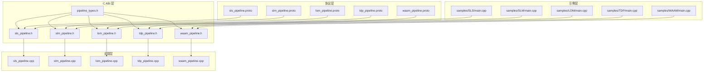
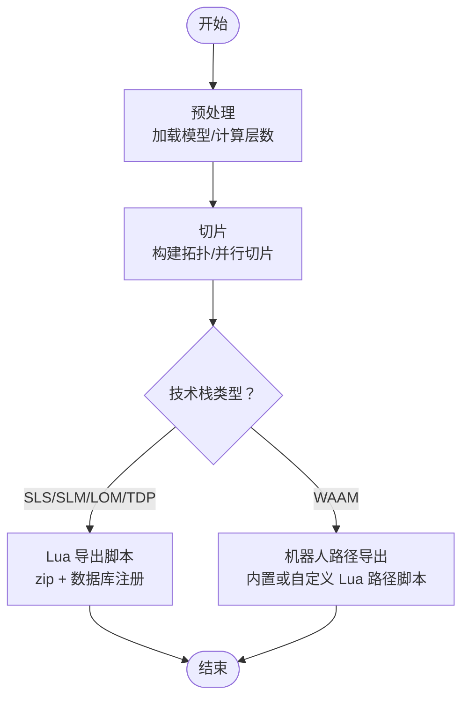
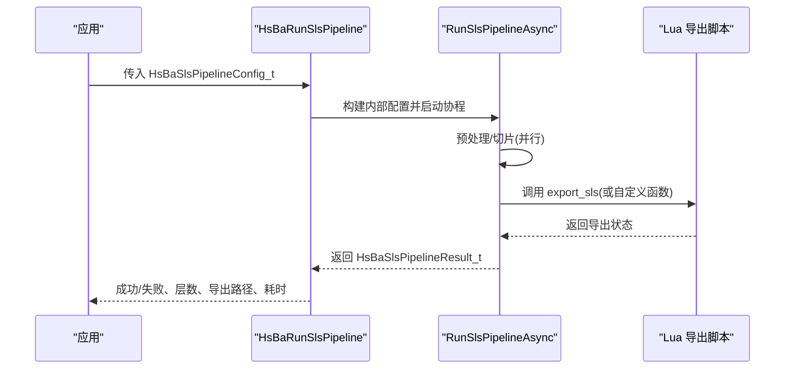
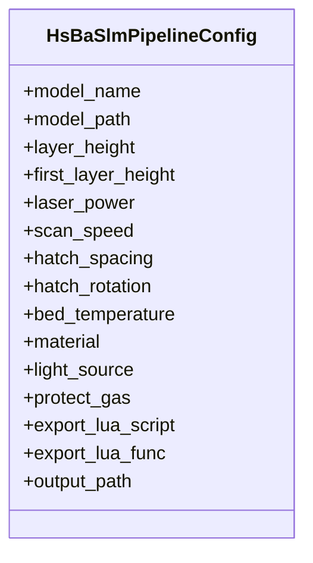
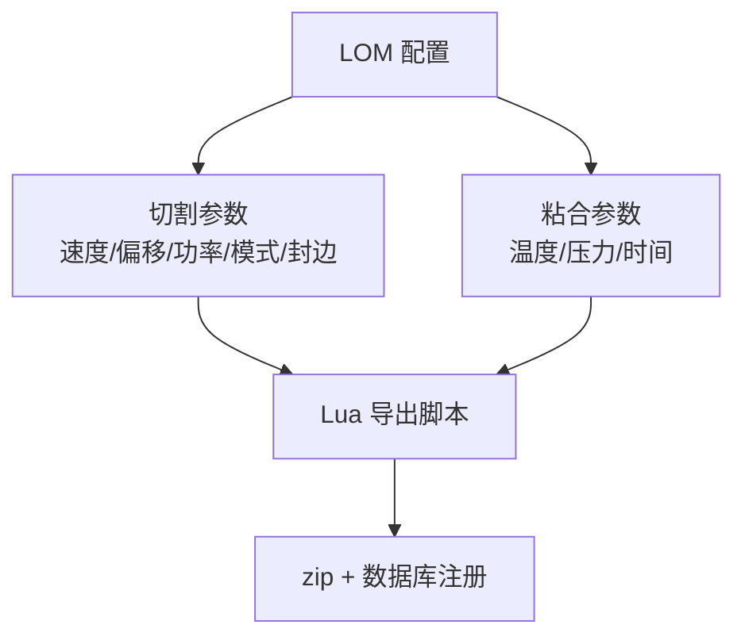
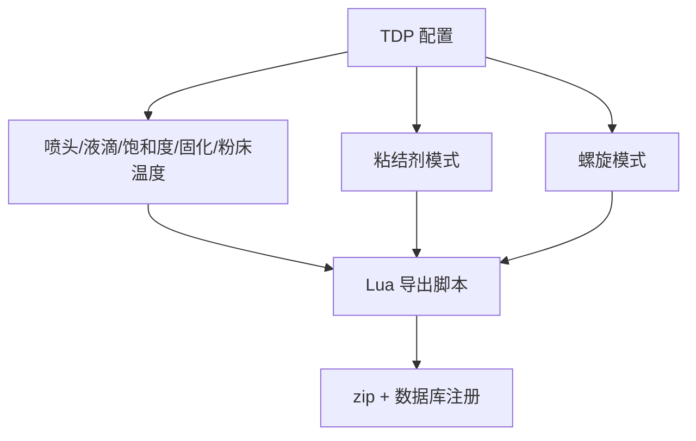
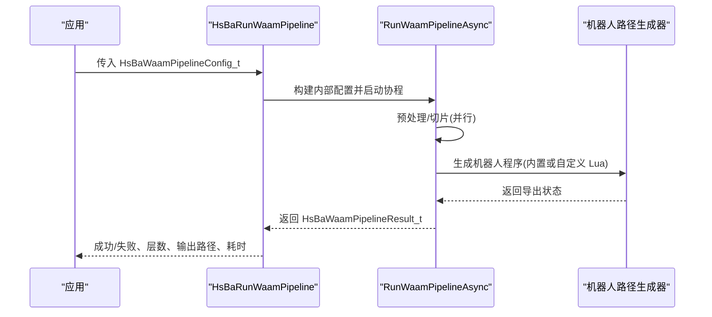
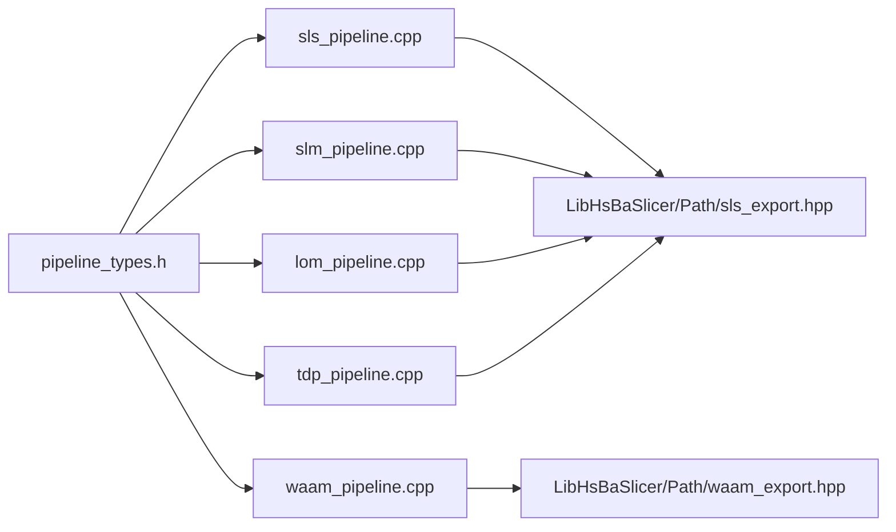
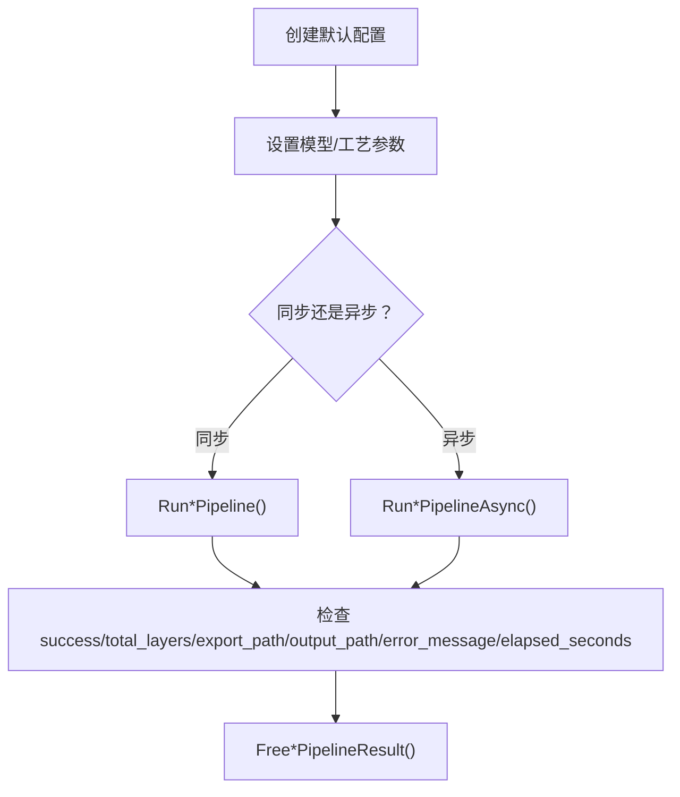

# 其他技术栈流水线

<cite>
**本文引用的文件**   
- [sls_pipeline.h](file://DllHsBaSlicer/sls_pipeline.h)
- [slm_pipeline.h](file://DllHsBaSlicer/slm_pipeline.h)
- [lom_pipeline.h](file://DllHsBaSlicer/lom_pipeline.h)
- [tdp_pipeline.h](file://DllHsBaSlicer/tdp_pipeline.h)
- [waam_pipeline.h](file://DllHsBaSlicer/waam_pipeline.h)
- [pipeline_types.h](file://pipelinetypes/pipeline_types.h)
- [sls_pipeline.cpp](file://DllHsBaSlicer/sls_pipeline.cpp)
- [slm_pipeline.cpp](file://DllHsBaSlicer/slm_pipeline.cpp)
- [lom_pipeline.cpp](file://DllHsBaSlicer/lom_pipeline.cpp)
- [tdp_pipeline.cpp](file://DllHsBaSlicer/tdp_pipeline.cpp)
- [waam_pipeline.cpp](file://DllHsBaSlicer/waam_pipeline.cpp)
- [sls_pipeline.proto](file://proto/sls_pipeline.proto)
- [slm_pipeline.proto](file://proto/slm_pipeline.proto)
- [lom_pipeline.proto](file://proto/lom_pipeline.proto)
- [tdp_pipeline.proto](file://proto/tdp_pipeline.proto)
- [waam_pipeline.proto](file://proto/waam_pipeline.proto)
- [samples/SLS/main.cpp](file://samples/SLS/main.cpp)
- [samples/SLM/main.cpp](file://samples/SLM/main.cpp)
- [samples/LOM/main.cpp](file://samples/LOM/main.cpp)
- [samples/TDP/main.cpp](file://samples/TDP/main.cpp)
- [samples/WAAM/main.cpp](file://samples/WAAM/main.cpp)
</cite>

## 目录
1. [引言](#引言)
2. [项目结构](#项目结构)
3. [核心组件](#核心组件)
4. [架构总览](#架构总览)
5. [详细组件分析](#详细组件分析)
6. [依赖关系分析](#依赖关系分析)
7. [性能与适用场景](#性能与适用场景)
8. [统一调用接口与配置示例](#统一调用接口与配置示例)
9. [故障排除指南](#故障排除指南)
10. [结论](#结论)

## 引言
本文件面向 SLS（选择性激光烧结）、SLM（选择性激光熔化）、LOM（分层实体制造）、TDP（热塑性粉末沉积，即粘结剂喷射）和 WAAM（电弧丝增材制造）等“其他技术栈”的切片与后处理流水线。这些技术栈共享统一的预处理、切片与导出框架，但在工艺参数、输出产物与可定制点方面存在显著差异：
- SLS/SLM/LOM/TDP 采用“模型预处理 → 切片 → Lua 导出脚本（通常为 zip + 数据库注册）”的统一流程；
- WAAM 则不同，其输出是机器人语言程序（ABB/KUKA/FANUC），可通过内置生成器或自定义 Lua 路径脚本生成；
- 所有流水线均提供同步与异步两种调用方式，并支持进度回调与结果释放函数。

## 项目结构
围绕“其他技术栈流水线”，仓库中关键位置如下：
- C ABI 头文件：定义各技术栈的配置结构体、结果结构与 API 入口；
- C++ 实现：封装协程驱动的流水线执行、并行切片、Lua 导出包装；
- Proto 定义：用于跨语言序列化配置与结果；
- 示例程序：演示同步/异步调用、默认配置、自定义工艺参数与螺旋模式。

**图表来源**
- [sls_pipeline.h:1-63](file://DllHsBaSlicer/sls_pipeline.h#L1-L63)
- [slm_pipeline.h:1-63](file://DllHsBaSlicer/slm_pipeline.h#L1-L63)
- [lom_pipeline.h:1-63](file://DllHsBaSlicer/lom_pipeline.h#L1-L63)
- [tdp_pipeline.h:1-63](file://DllHsBaSlicer/tdp_pipeline.h#L1-L63)
- [waam_pipeline.h:1-64](file://DllHsBaSlicer/waam_pipeline.h#L1-L64)
- [pipeline_types.h:247-625](file://pipelinetypes/pipeline_types.h#L247-L625)
- [sls_pipeline.cpp:1-345](file://DllHsBaSlicer/sls_pipeline.cpp#L1-L345)
- [slm_pipeline.cpp:1-397](file://DllHsBaSlicer/slm_pipeline.cpp#L1-L397)
- [lom_pipeline.cpp:1-354](file://DllHsBaSlicer/lom_pipeline.cpp#L1-L354)
- [tdp_pipeline.cpp:1-365](file://DllHsBaSlicer/tdp_pipeline.cpp#L1-L365)
- [waam_pipeline.cpp:1-333](file://DllHsBaSlicer/waam_pipeline.cpp#L1-L333)
- [sls_pipeline.proto:1-33](file://proto/sls_pipeline.proto#L1-L33)
- [slm_pipeline.proto:1-65](file://proto/slm_pipeline.proto#L1-L65)
- [lom_pipeline.proto:1-46](file://proto/lom_pipeline.proto#L1-L46)
- [tdp_pipeline.proto:1-47](file://proto/tdp_pipeline.proto#L1-L47)
- [waam_pipeline.proto:1-89](file://proto/waam_pipeline.proto#L1-L89)
- [samples/SLS/main.cpp:1-209](file://samples/SLS/main.cpp#L1-L209)
- [samples/SLM/main.cpp:1-196](file://samples/SLM/main.cpp#L1-L196)
- [samples/LOM/main.cpp:1-194](file://samples/LOM/main.cpp#L1-L194)
- [samples/TDP/main.cpp:1-225](file://samples/TDP/main.cpp#L1-L225)
- [samples/WAAM/main.cpp:1-237](file://samples/WAAM/main.cpp#L1-L237)

**章节来源**
- [sls_pipeline.h:1-63](file://DllHsBaSlicer/sls_pipeline.h#L1-L63)
- [slm_pipeline.h:1-63](file://DllHsBaSlicer/slm_pipeline.h#L1-L63)
- [lom_pipeline.h:1-63](file://DllHsBaSlicer/lom_pipeline.h#L1-L63)
- [tdp_pipeline.h:1-63](file://DllHsBaSlicer/tdp_pipeline.h#L1-L63)
- [waam_pipeline.h:1-64](file://DllHsBaSlicer/waam_pipeline.h#L1-L64)
- [pipeline_types.h:247-625](file://pipelinetypes/pipeline_types.h#L247-L625)

## 核心组件
本节聚焦五种技术栈在配置、结果与导出行为上的共性差异。

- SLS（选择性激光烧结）
  - 无底托与支撑需求，粉末床同时提供支撑与热稳定性；
  - 输出格式完全由 Lua 导出脚本决定，通常打包为 zip 并注册到数据库；
  - 关键工艺参数包括激光功率、扫描速度、栅格间距、栅格旋转角度与粉床温度。

- SLM（选择性激光熔化）
  - 金属粉末床工艺，流程镜像 SLS；
  - 增加金属材料、能量源类型与保护气体等金属相关参数；
  - 同样通过 Lua 导出脚本生成 zip 包与数据库注册信息。

- LOM（分层实体制造）
  - 按片材厚度切片，轮廓切割后压合；
  - 切割速度与偏移、切割功率、封边开关、切割模式以及粘合温度/压力/时间均为关键参数；
  - 输出仍由 Lua 导出脚本控制。

- TDP（热塑性粉末沉积 / 粘结剂喷射）
  - 逐层喷射粘结剂于粉末床上；
  - 喷头数量、液滴间距、粘结剂饱和度、固化时间与粉床温度是关键参数；
  - 支持“螺旋模式”，向导出脚本暴露连续上升的外壁路径。

- WAAM（电弧丝增材制造）
  - 以焊道逐层沉积金属，输出为机器人语言程序（ABB/KUKA/FANUC），而非 zip；
  - 可选用内置代码生成器或通过 path_lua_script/path_lua_func 指定自定义 Lua 路径生成器；
  - 支持“螺旋模式”，将外壁合并为一条连续上升的焊道。

**章节来源**
- [pipeline_types.h:247-625](file://pipelinetypes/pipeline_types.h#L247-L625)
- [sls_pipeline.cpp:244-284](file://DllHsBaSlicer/sls_pipeline.cpp#L244-L284)
- [slm_pipeline.cpp:296-336](file://DllHsBaSlicer/slm_pipeline.cpp#L296-L336)
- [lom_pipeline.cpp:253-293](file://DllHsBaSlicer/lom_pipeline.cpp#L253-L293)
- [tdp_pipeline.cpp:263-304](file://DllHsBaSlicer/tdp_pipeline.cpp#L263-L304)
- [waam_pipeline.cpp:232-272](file://DllHsBaSlicer/waam_pipeline.cpp#L232-L272)

## 架构总览
所有“其他技术栈流水线”遵循统一阶段划分：
1. 预处理：加载模型、获取包围盒与体积；
2. 切片：构建拓扑并并行切片，得到每层轮廓与 Z 高度；
3. 导出：
   - SLS/SLM/LOM/TDP：通过 Lua 导出脚本生成 zip 包与数据库注册；
   - WAAM：生成机器人语言程序，可使用内置生成器或自定义 Lua 路径脚本。

**图表来源**
- [sls_pipeline.cpp:182-296](file://DllHsBaSlicer/sls_pipeline.cpp#L182-L296)
- [slm_pipeline.cpp:236-348](file://DllHsBaSlicer/slm_pipeline.cpp#L236-L348)
- [lom_pipeline.cpp:193-305](file://DllHsBaSlicer/lom_pipeline.cpp#L193-L305)
- [tdp_pipeline.cpp:203-316](file://DllHsBaSlicer/tdp_pipeline.cpp#L203-L316)
- [waam_pipeline.cpp:174-284](file://DllHsBaSlicer/waam_pipeline.cpp#L174-L284)

## 详细组件分析

### SLS 流水线
- 配置结构体包含模型、切片、激光与粉床温度参数，并要求 export_lua_script；
- 流水线内部构造 JSON 配置，并通过 SaveSlsPackageLua 调用 Lua 导出脚本；
- 默认层厚较小，适合精细粉末床工艺。

**图表来源**
- [sls_pipeline.h:21-56](file://DllHsBaSlicer/sls_pipeline.h#L21-L56)
- [sls_pipeline.cpp:304-345](file://DllHsBaSlicer/sls_pipeline.cpp#L304-L345)
- [sls_pipeline.cpp:182-296](file://DllHsBaSlicer/sls_pipeline.cpp#L182-L296)

**章节来源**
- [sls_pipeline.h:1-63](file://DllHsBaSlicer/sls_pipeline.h#L1-L63)
- [sls_pipeline.cpp:1-345](file://DllHsBaSlicer/sls_pipeline.cpp#L1-L345)
- [samples/SLS/main.cpp:1-209](file://samples/SLS/main.cpp#L1-L209)

### SLM 流水线
- 在 SLS 基础上增加材料、光源与保护气体枚举；
- 导出 JSON 中包含 material/light_source/protect_gas；
- 默认钛合金、激光、氩气，体现金属加工特性。

**图表来源**
- [pipeline_types.h:319-376](file://pipelinetypes/pipeline_types.h#L319-L376)

**章节来源**
- [slm_pipeline.h:1-63](file://DllHsBaSlicer/slm_pipeline.h#L1-L63)
- [slm_pipeline.cpp:1-397](file://DllHsBaSlicer/slm_pipeline.cpp#L1-L397)
- [samples/SLM/main.cpp:1-196](file://samples/SLM/main.cpp#L1-L196)

### LOM 流水线
- 切片对应“片材”，导出时传递切割与粘合参数；
- 支持封边与半色调切割模式；
- 输出仍由 Lua 导出脚本控制。

**图表来源**
- [lom_pipeline.cpp:128-153](file://DllHsBaSlicer/lom_pipeline.cpp#L128-L153)
- [lom_pipeline.cpp:253-293](file://DllHsBaSlicer/lom_pipeline.cpp#L253-L293)

**章节来源**
- [lom_pipeline.h:1-63](file://DllHsBaSlicer/lom_pipeline.h#L1-L63)
- [lom_pipeline.cpp:1-354](file://DllHsBaSlicer/lom_pipeline.cpp#L1-L354)
- [samples/LOM/main.cpp:1-194](file://samples/LOM/main.cpp#L1-L194)

### TDP 流水线
- 粘结剂喷射工艺，支持全彩/单通道/烧结辅助模式；
- 提供螺旋模式，向导出脚本暴露连续上升路径；
- 输出仍由 Lua 导出脚本控制。

**图表来源**
- [tdp_pipeline.cpp:142-164](file://DllHsBaSlicer/tdp_pipeline.cpp#L142-L164)
- [tdp_pipeline.cpp:281-291](file://DllHsBaSlicer/tdp_pipeline.cpp#L281-L291)

**章节来源**
- [tdp_pipeline.h:1-63](file://DllHsBaSlicer/tdp_pipeline.h#L1-L63)
- [tdp_pipeline.cpp:1-365](file://DllHsBaSlicer/tdp_pipeline.cpp#L1-L365)
- [samples/TDP/main.cpp:1-225](file://samples/TDP/main.cpp#L1-L225)

### WAAM 流水线
- 输出为机器人语言程序，非 zip；
- 支持内置 ABB/KUKA/FANUC 生成器，也可通过 path_lua_script/path_lua_func 替换；
- 支持螺旋模式，将外壁合并为一条连续上升焊道。

**图表来源**
- [waam_pipeline.h:17-57](file://DllHsBaSlicer/waam_pipeline.h#L17-L57)
- [waam_pipeline.cpp:292-333](file://DllHsBaSlicer/waam_pipeline.cpp#L292-L333)
- [waam_pipeline.cpp:174-284](file://DllHsBaSlicer/waam_pipeline.cpp#L174-L284)

**章节来源**
- [waam_pipeline.h:1-64](file://DllHsBaSlicer/waam_pipeline.h#L1-L64)
- [waam_pipeline.cpp:1-333](file://DllHsBaSlicer/waam_pipeline.cpp#L1-L333)
- [samples/WAAM/main.cpp:1-237](file://samples/WAAM/main.cpp#L1-L237)

## 依赖关系分析
- 配置与结果类型集中在 pipeline_types.h，供 C ABI 与 proto 转换模块使用；
- 各 *_pipeline.cpp 依赖 LibHsBaSlicer 中的模型预处理、切片与导出模块；
- SLS/SLM/LOM/TDP 共用 SlsPackage 与 SaveSlsPackageLua；
- WAAM 使用 WaamRobotPackage 与 SaveWaamRobotPath。

**图表来源**
- [pipeline_types.h:247-625](file://pipelinetypes/pipeline_types.h#L247-L625)
- [sls_pipeline.cpp:17-23](file://DllHsBaSlicer/sls_pipeline.cpp#L17-L23)
- [slm_pipeline.cpp:17-23](file://DllHsBaSlicer/slm_pipeline.cpp#L17-L23)
- [lom_pipeline.cpp:17-23](file://DllHsBaSlicer/lom_pipeline.cpp#L17-L23)
- [tdp_pipeline.cpp:17-23](file://DllHsBaSlicer/tdp_pipeline.cpp#L17-L23)
- [waam_pipeline.cpp:16-21](file://DllHsBaSlicer/waam_pipeline.cpp#L16-L21)

**章节来源**
- [pipeline_types.h:247-625](file://pipelinetypes/pipeline_types.h#L247-L625)
- [sls_pipeline.cpp:1-345](file://DllHsBaSlicer/sls_pipeline.cpp#L1-L345)
- [slm_pipeline.cpp:1-397](file://DllHsBaSlicer/slm_pipeline.cpp#L1-L397)
- [lom_pipeline.cpp:1-354](file://DllHsBaSlicer/lom_pipeline.cpp#L1-L354)
- [tdp_pipeline.cpp:1-365](file://DllHsBaSlicer/tdp_pipeline.cpp#L1-L365)
- [waam_pipeline.cpp:1-333](file://DllHsBaSlicer/waam_pipeline.cpp#L1-L333)

## 性能与适用场景
- 并行切片：SLS/SLM/LOM/TDP/WAAM 均在切片阶段使用并行循环，提升多核利用率；
- 层数计算：基于模型高度与首层层高/常规层高计算，避免无效层；
- 适用场景建议：
  - SLS：塑料粉末零件快速原型与小批量生产；
  - SLM：金属高性能零件、航空航天与医疗植入件；
  - LOM：纸/复合材料层压模型与低成本原型；
  - TDP：彩色砂型/陶瓷原型与铸造母模；
  - WAAM：大型金属构件修复与增材制造，结合机器人系统。

[本节为通用指导，不直接分析具体源码文件]

## 统一调用接口与配置示例
以下接口在所有“其他技术栈流水线”中保持一致：
- 创建默认配置：HsBaCreateDefault[Sls/Slm/Lom/Tdp/Waam]Config；
- 同步运行：HsBaRun[Sls/Slm/Lom/Tdp/Waam]Pipeline(config, progress_cb, user_data)；
- 异步运行：HsBaRun[Sls/Slm/Lom/Tdp/Waam]PipelineAsync(config, progress_cb, user_data, result_callback, result_user_data)；
- 释放结果：HsBaFree[Sls/Slm/Lom/Tdp/Waam]PipelineResult(result)。

**图表来源**
- [sls_pipeline.h:21-56](file://DllHsBaSlicer/sls_pipeline.h#L21-L56)
- [slm_pipeline.h:17-56](file://DllHsBaSlicer/slm_pipeline.h#L17-L56)
- [lom_pipeline.h:17-56](file://DllHsBaSlicer/lom_pipeline.h#L17-L56)
- [tdp_pipeline.h:17-56](file://DllHsBaSlicer/tdp_pipeline.h#L17-L56)
- [waam_pipeline.h:17-57](file://DllHsBaSlicer/waam_pipeline.h#L17-L57)

配置要点对比表（节选）：
- SLS：laser_power、scan_speed、hatch_spacing、hatch_rotation、bed_temperature；
- SLM：material、light_source、protect_gas；
- LOM：cut_speed、cut_margin、cut_power、seal_contour、cut_mode、bond_temperature、bond_pressure、bond_time；
- TDP：head_count、drop_spacing、binder_saturation、ink_curing_time、bed_temperature、binder_mode、spiral_mode；
- WAAM：bead_width、travel_speed、wire_feed_speed、arc_current、arc_voltage、gas_flow_rate、material、welding_process、protection、protect_gas、interpass_temperature、robot_type、path_lua_script、path_lua_func、spiral_mode。

**章节来源**
- [pipeline_types.h:247-625](file://pipelinetypes/pipeline_types.h#L247-L625)
- [samples/SLS/main.cpp:56-190](file://samples/SLS/main.cpp#L56-L190)
- [samples/SLM/main.cpp:56-177](file://samples/SLM/main.cpp#L56-L177)
- [samples/LOM/main.cpp:55-175](file://samples/LOM/main.cpp#L55-L175)
- [samples/TDP/main.cpp:55-220](file://samples/TDP/main.cpp#L55-L220)
- [samples/WAAM/main.cpp:54-232](file://samples/WAAM/main.cpp#L54-L232)

## 故障排除指南
常见问题与定位建议：
- 未提供 Lua 导出脚本：SLS/SLM/LOM/TDP 要求 export_lua_script 非空，否则流水线会返回错误；
- 模型高度无效：当模型高度 ≤ 0 或首层层高不合理时，层数为 0，流水线提前失败；
- 几何异常：通过模型漏斗访问包围盒/体积时，第三方几何异常会被转换为 RuntimeError；
- 资源释放：务必调用对应的 Free*PipelineResult 释放 export_path/output_path 与 error_message。

**章节来源**
- [sls_pipeline.cpp:247-252](file://DllHsBaSlicer/sls_pipeline.cpp#L247-L252)
- [slm_pipeline.cpp:299-304](file://DllHsBaSlicer/slm_pipeline.cpp#L299-L304)
- [lom_pipeline.cpp:256-261](file://DllHsBaSlicer/lom_pipeline.cpp#L256-L261)
- [tdp_pipeline.cpp:266-271](file://DllHsBaSlicer/tdp_pipeline.cpp#L266-L271)
- [sls_pipeline.cpp:286-290](file://DllHsBaSlicer/sls_pipeline.cpp#L286-L290)
- [slm_pipeline.cpp:338-342](file://DllHsBaSlicer/slm_pipeline.cpp#L338-L342)
- [lom_pipeline.cpp:295-299](file://DllHsBaSlicer/lom_pipeline.cpp#L295-L299)
- [tdp_pipeline.cpp:306-310](file://DllHsBaSlicer/tdp_pipeline.cpp#L306-L310)
- [waam_pipeline.cpp:274-278](file://DllHsBaSlicer/waam_pipeline.cpp#L274-L278)

## 结论
SLS、SLM、LOM、TDP 与 WAAM 在 HsBaSlicer 中共享统一的预处理与切片基础设施，但根据各自工艺特点提供差异化配置与导出机制：
- SLS/SLM/LOM/TDP 通过 Lua 导出脚本灵活生成 zip 包与数据库注册；
- WAAM 输出机器人语言程序，支持内置生成器与自定义 Lua 路径脚本；
- 所有流水线均提供同步/异步接口、进度回调与结果释放函数，便于集成到上层应用。

在实际工程中，应根据目标设备与材料选择合适的技术栈，并结合示例程序调整工艺参数与导出逻辑，以获得稳定高效的切片与后处理流程。

[本节为总结性内容，不直接分析具体源码文件]