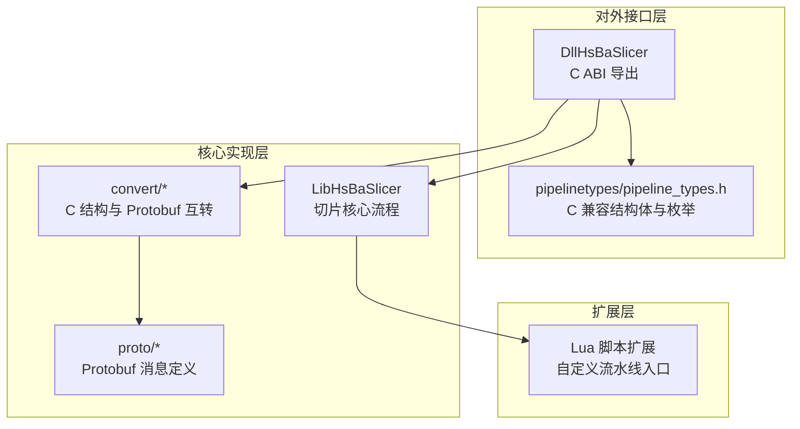
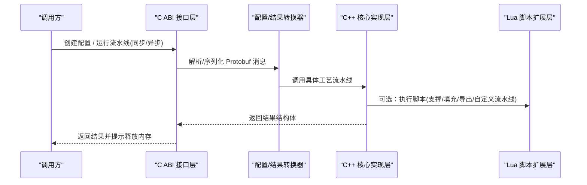
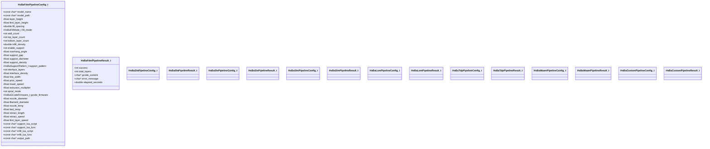
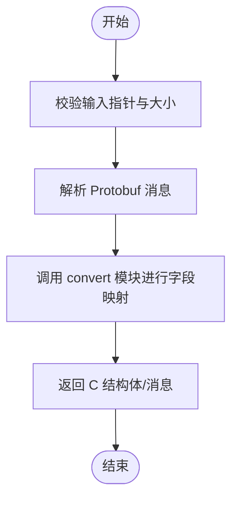
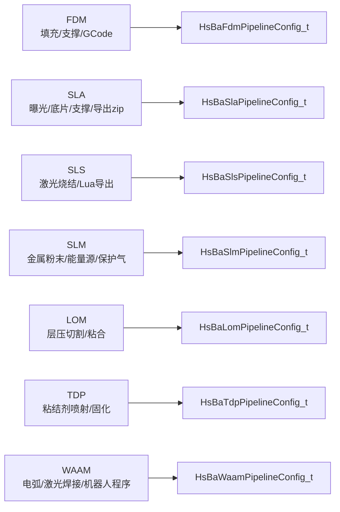
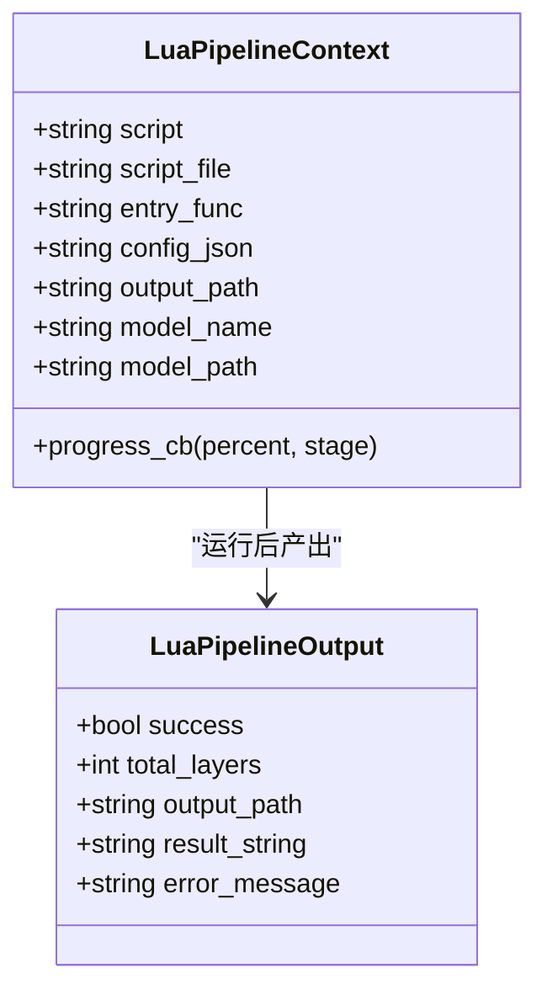
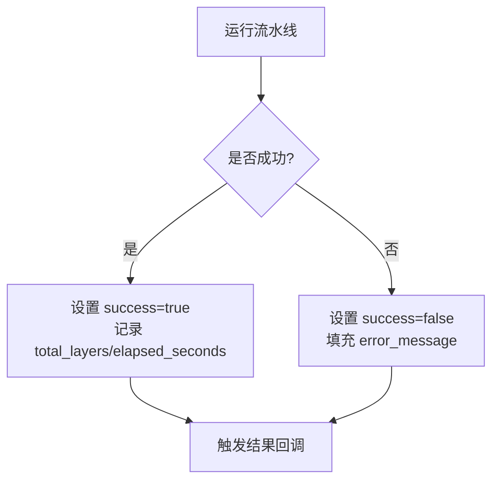
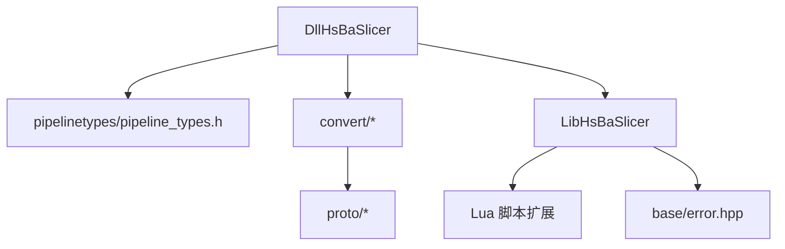

# 流水线架构设计

<cite>
**本文引用的文件**   
- [README.md](file://README.md)
- [pipeline_types.h](file://pipelinetypes/pipeline_types.h)
- [dllexport.h](file://DllHsBaSlicer/dllexport.h)
- [fdm_pipeline.h](file://DllHsBaSlicer/fdm_pipeline.h)
- [sla_pipeline.h](file://DllHsBaSlicer/sla_pipeline.h)
- [pipeline_convert.cpp](file://DllHsBaSlicer/pipeline_convert.cpp)
- [PipelineConfig2Msg.cpp](file://convert/PipelineConfig2Msg.cpp)
- [Msg2PipelineConfig.cpp](file://convert/Msg2PipelineConfig.cpp)
- [base_config.proto](file://proto/base_config.proto)
- [custom_pipeline.proto](file://proto/custom_pipeline.proto)
- [lua_pipeline.hpp](file://LibHsBaSlicer/Extends/lua_pipeline.hpp)
- [error.hpp](file://base/error.hpp)
</cite>

## 目录
1. [引言](#引言)
2. [项目结构](#项目结构)
3. [核心组件](#核心组件)
4. [架构总览](#架构总览)
5. [详细组件分析](#详细组件分析)
6. [依赖关系分析](#依赖关系分析)
7. [性能与内存管理](#性能与内存管理)
8. [故障排除指南](#故障排除指南)
9. [结论](#结论)
10. [附录](#附录)

## 引言
本文件面向 HsBaSlicer 的“切片流水线”架构，聚焦三层分层：C ABI 接口层、C++ 核心实现层与 Lua 脚本扩展层。文档重点说明：
- C ABI 如何暴露统一配置与结果类型；
- Protobuf 消息如何承载 PipelineConfig 的配置序列化与反序列化；
- FDM、SLA、SLS、SLM、LOM、TDP、WAAM 等工艺的技术抽象与差异；
- 流水线执行状态、错误处理与跨语言内存管理策略；
- 架构图表展示组件依赖和数据流向。

## 项目结构
HsBaSlicer 将对外能力拆分为多个静态库与动态库：
- DllHsBaSlicer：导出 C ABI 的运行时流水线接口，供外部语言调用；
- LibHsBaSlicer：封装全流程切片能力（预处理、切片、支撑、填充、路径输出、打包等）；
- base/utils/fileoperator/meshmodel/cadmodel/support/paths 等模块提供基础能力；
- proto 定义跨语言协议；
- convert 提供 C 结构与 Protobuf 消息之间的双向转换。

**图示来源**
- [README.md:104-124](file://README.md#L104-L124)
- [pipeline_types.h:1-12](file://pipelinetypes/pipeline_types.h#L1-L12)
- [base_config.proto:1-15](file://proto/base_config.proto#L1-L15)

**章节来源**
- [README.md:104-124](file://README.md#L104-L124)

## 核心组件
- C ABI 类型系统：所有流水线配置与结果以 C 兼容结构体暴露，便于跨语言调用。
- Protobuf 消息系统：用于配置与结果的序列化、传输与版本化。
- 技术栈抽象：FDM/SLA/SLS/SLM/LOM/TDP/WAAM 各自拥有独立配置与结果结构体，但共享统一的 C ABI 模式。
- Lua 扩展：支持完全由 Lua 驱动的自定义流水线，或为特定阶段注入脚本逻辑。

关键要点：
- 所有对外字符串字段在 C 结构中为 const char*，需要调用方释放或由框架提供的 Free 函数释放；
- 每个流水线均提供同步与异步运行接口；
- 配置默认值通过内联初始化器提供，避免 DLL 依赖。

**章节来源**
- [pipeline_types.h:19-113](file://pipelinetypes/pipeline_types.h#L19-L113)
- [pipeline_types.h:142-232](file://pipelinetypes/pipeline_types.h#L142-L232)
- [pipeline_types.h:247-310](file://pipelinetypes/pipeline_types.h#L247-L310)
- [pipeline_types.h:312-401](file://pipelinetypes/pipeline_types.h#L312-L401)
- [pipeline_types.h:403-461](file://pipelinetypes/pipeline_types.h#L403-L461)
- [pipeline_types.h:463-521](file://pipelinetypes/pipeline_types.h#L463-L521)
- [pipeline_types.h:523-625](file://pipelinetypes/pipeline_types.h#L523-L625)
- [pipeline_types.h:627-732](file://pipelinetypes/pipeline_types.h#L627-L732)

## 架构总览
HsBaSlicer 的流水线架构采用“三层分离 + 多技术抽象”的设计：
- C ABI 接口层：定义稳定的跨语言契约，包含配置结构体、回调函数、结果结构体与 Free 函数；
- C++ 核心实现层：实现各工艺的流水线步骤（模型加载、切片、支撑、填充、路径生成、导出/打包）；
- Lua 脚本扩展层：允许用户通过脚本定制流水线顺序与内容，或通过脚本替换特定算法（如支撑、填充、导出）。

**图示来源**
- [fdm_pipeline.h:17-61](file://DllHsBaSlicer/fdm_pipeline.h#L17-L61)
- [sla_pipeline.h:17-56](file://DllHsBaSlicer/sla_pipeline.h#L17-L56)
- [pipeline_convert.cpp:27-70](file://DllHsBaSlicer/pipeline_convert.cpp#L27-L70)
- [lua_pipeline.hpp:19-83](file://LibHsBaSlicer/Extends/lua_pipeline.hpp#L19-L83)

## 详细组件分析

### C ABI 接口层
C ABI 层通过 dllexport.h 控制符号导出，并在 pipelinetypes/pipeline_types.h 中定义所有 C 兼容的结构体与枚举。对外 API 包括：
- 创建默认配置；
- 同步运行流水线；
- 异步运行流水线；
- 释放结果内存。

**图示来源**
- [pipeline_types.h:19-113](file://pipelinetypes/pipeline_types.h#L19-L113)
- [pipeline_types.h:142-232](file://pipelinetypes/pipeline_types.h#L142-L232)
- [pipeline_types.h:247-310](file://pipelinetypes/pipeline_types.h#L247-L310)
- [pipeline_types.h:312-401](file://pipelinetypes/pipeline_types.h#L312-L401)
- [pipeline_types.h:403-461](file://pipelinetypes/pipeline_types.h#L403-L461)
- [pipeline_types.h:463-521](file://pipelinetypes/pipeline_types.h#L463-L521)
- [pipeline_types.h:523-625](file://pipelinetypes/pipeline_types.h#L523-L625)
- [pipeline_types.h:627-732](file://pipelinetypes/pipeline_types.h#L627-L732)

**章节来源**
- [dllexport.h:1-23](file://DllHsBaSlicer/dllexport.h#L1-L23)
- [fdm_pipeline.h:17-61](file://DllHsBaSlicer/fdm_pipeline.h#L17-L61)
- [sla_pipeline.h:17-56](file://DllHsBaSlicer/sla_pipeline.h#L17-L56)
- [pipeline_types.h:19-113](file://pipelinetypes/pipeline_types.h#L19-L113)

### Protobuf 配置序列化与反序列化
PipelineConfig 通过 Protobuf 消息进行跨语言序列化与反序列化。convert 模块提供双向转换函数：
- PipelineConfig2Msg：C 结构体 -> Protobuf 消息；
- Msg2PipelineConfig：Protobuf 消息 -> C 结构体；
- pipeline_convert.cpp：在 C ABI 层暴露 FromProtoBytes/ToProtoBytes 函数。

**图示来源**
- [pipeline_convert.cpp:27-70](file://DllHsBaSlicer/pipeline_convert.cpp#L27-L70)
- [PipelineConfig2Msg.cpp:10-77](file://convert/PipelineConfig2Msg.cpp#L10-L77)
- [Msg2PipelineConfig.cpp:35-83](file://convert/Msg2PipelineConfig.cpp#L35-L83)

**章节来源**
- [pipeline_convert.cpp:27-70](file://DllHsBaSlicer/pipeline_convert.cpp#L27-L70)
- [PipelineConfig2Msg.cpp:10-77](file://convert/PipelineConfig2Msg.cpp#L10-L77)
- [Msg2PipelineConfig.cpp:35-83](file://convert/Msg2PipelineConfig.cpp#L35-L83)

### 技术栈抽象接口设计
不同工艺在 C ABI 层具有独立的配置与结果结构体，但遵循相同模式：
- 模型配置：model_name、model_path；
- 切片参数：layer_height、first_layer_height；
- 工艺特有参数：如 FDM 的填充模式、SLA 的曝光时间、SLM/WAAM 的材料与保护气体等；
- Lua 扩展点：support_lua_script/export_lua_script/path_lua_script 等；
- 输出配置：output_path、图像格式、机器人控制器类型等。

**图示来源**
- [pipeline_types.h:19-113](file://pipelinetypes/pipeline_types.h#L19-L113)
- [pipeline_types.h:142-232](file://pipelinetypes/pipeline_types.h#L142-L232)
- [pipeline_types.h:247-310](file://pipelinetypes/pipeline_types.h#L247-L310)
- [pipeline_types.h:312-401](file://pipelinetypes/pipeline_types.h#L312-L401)
- [pipeline_types.h:403-461](file://pipelinetypes/pipeline_types.h#L403-L461)
- [pipeline_types.h:463-521](file://pipelinetypes/pipeline_types.h#L463-L521)
- [pipeline_types.h:523-625](file://pipelinetypes/pipeline_types.h#L523-L625)

**章节来源**
- [pipeline_types.h:19-113](file://pipelinetypes/pipeline_types.h#L19-L113)
- [pipeline_types.h:142-232](file://pipelinetypes/pipeline_types.h#L142-L232)
- [pipeline_types.h:247-310](file://pipelinetypes/pipeline_types.h#L247-L310)
- [pipeline_types.h:312-401](file://pipelinetypes/pipeline_types.h#L312-L401)
- [pipeline_types.h:403-461](file://pipelinetypes/pipeline_types.h#L403-L461)
- [pipeline_types.h:463-521](file://pipelinetypes/pipeline_types.h#L463-L521)
- [pipeline_types.h:523-625](file://pipelinetypes/pipeline_types.h#L523-L625)

### Lua 脚本扩展层
Lua 扩展层支持两种模式：
- 阶段级脚本：为支撑、填充、导出等阶段注入 Lua 脚本；
- 完全自定义流水线：通过 Lua 入口函数决定整个工作流顺序与内容。

**图示来源**
- [lua_pipeline.hpp:19-83](file://LibHsBaSlicer/Extends/lua_pipeline.hpp#L19-L83)

**章节来源**
- [lua_pipeline.hpp:19-83](file://LibHsBaSlicer/Extends/lua_pipeline.hpp#L19-L83)

### 流水线执行状态管理与错误处理
- 执行状态：每个结果结构体包含 success、total_layers、elapsed_seconds 等字段；
- 错误信息：error_message 字段携带 UTF-8 错误描述；
- 异常体系：C++ 核心使用 RuntimeError 及其子类表达各类错误；
- 回调机制：进度回调与结果回调用于异步执行与状态上报。

**图示来源**
- [pipeline_types.h:120-127](file://pipelinetypes/pipeline_types.h#L120-L127)
- [pipeline_types.h:225-232](file://pipelinetypes/pipeline_types.h#L225-L232)
- [pipeline_types.h:290-297](file://pipelinetypes/pipeline_types.h#L290-L297)
- [pipeline_types.h:381-388](file://pipelinetypes/pipeline_types.h#L381-L388)
- [pipeline_types.h:441-448](file://pipelinetypes/pipeline_types.h#L441-L448)
- [pipeline_types.h:501-508](file://pipelinetypes/pipeline_types.h#L501-L508)
- [pipeline_types.h:605-612](file://pipelinetypes/pipeline_types.h#L605-L612)
- [error.hpp:17-144](file://base/error.hpp#L17-L144)

**章节来源**
- [pipeline_types.h:120-127](file://pipelinetypes/pipeline_types.h#L120-L127)
- [pipeline_types.h:225-232](file://pipelinetypes/pipeline_types.h#L225-L232)
- [pipeline_types.h:290-297](file://pipelinetypes/pipeline_types.h#L290-L297)
- [pipeline_types.h:381-388](file://pipelinetypes/pipeline_types.h#L381-L388)
- [pipeline_types.h:441-448](file://pipelinetypes/pipeline_types.h#L441-L448)
- [pipeline_types.h:501-508](file://pipelinetypes/pipeline_types.h#L501-L508)
- [pipeline_types.h:605-612](file://pipelinetypes/pipeline_types.h#L605-L612)
- [error.hpp:17-144](file://base/error.hpp#L17-L144)

## 依赖关系分析
- DllHsBaSlicer 依赖 pipelinetypes 中的 C 结构体定义；
- DllHsBaSlicer 依赖 convert 模块进行 Protobuf 消息转换；
- convert 模块依赖 proto 定义的消息类型；
- LibHsBaSlicer 提供核心切片能力，并可被 Lua 脚本扩展；
- base/error.hpp 提供 C++ 层的异常类型。

**图示来源**
- [README.md:104-124](file://README.md#L104-L124)
- [pipeline_types.h:1-12](file://pipelinetypes/pipeline_types.h#L1-L12)
- [base_config.proto:1-15](file://proto/base_config.proto#L1-L15)
- [error.hpp:17-144](file://base/error.hpp#L17-L144)

**章节来源**
- [README.md:104-124](file://README.md#L104-L124)
- [pipeline_types.h:1-12](file://pipelinetypes/pipeline_types.h#L1-L12)
- [base_config.proto:1-15](file://proto/base_config.proto#L1-L15)
- [error.hpp:17-144](file://base/error.hpp#L17-L144)

## 性能与内存管理
- 内存分配：C ABI 结果中的字符串字段（如 gcode_content、export_path、error_message）由框架分配，调用方需调用对应的 Free 函数释放；
- 序列化开销：Protobuf 序列化/反序列化在每次调用时发生，建议复用配置对象以减少重复分配；
- 异步执行：通过回调机制避免阻塞主线程，适合 UI 或高并发场景；
- 优化建议：
  - 批量处理多个模型时，复用连接池与资源；
  - 对大模型启用并行切片与路径优化；
  - 合理设置图像分辨率与压缩格式以降低 IO 压力。

**章节来源**
- [fdm_pipeline.h:53-61](file://DllHsBaSlicer/fdm_pipeline.h#L53-L61)
- [sla_pipeline.h:49-56](file://DllHsBaSlicer/sla_pipeline.h#L49-L56)
- [pipeline_convert.cpp:18-23](file://DllHsBaSlicer/pipeline_convert.cpp#L18-L23)

## 故障排除指南
常见问题与排查步骤：
- 配置解析失败：检查 Protobuf 消息是否完整，确认字段类型与枚举值匹配；
- 内存泄漏：确保调用 HsBaFreePipelineResult/HsBaFreeSlaPipelineResult 等释放函数；
- Lua 脚本错误：检查脚本路径、函数名与全局 HsBa 表是否正确注册；
- 异步回调未触发：确认结果回调非空且线程安全；
- 错误信息为空：检查 error_message 字段是否在失败时被填充。

**章节来源**
- [pipeline_convert.cpp:27-70](file://DllHsBaSlicer/pipeline_convert.cpp#L27-L70)
- [pipeline_types.h:120-127](file://pipelinetypes/pipeline_types.h#L120-L127)
- [lua_pipeline.hpp:19-83](file://LibHsBaSlicer/Extends/lua_pipeline.hpp#L19-L83)

## 结论
HsBaSlicer 的流水线架构通过 C ABI 层、C++ 核心层与 Lua 扩展层的清晰分层，实现了跨语言、跨平台、可扩展的切片能力。Protobuf 消息确保了配置的标准化与可移植性，而多技术栈抽象使得同一套接口能够覆盖从 FDM 到 WAAM 的广泛工艺。通过完善的错误处理与内存管理机制，系统在稳定性与性能之间取得了良好平衡。

## 附录
- 参考文档：README.md 提供了构建、安装与模块概览；
- 协议定义：proto/base_config.proto 定义了通用技术与输出类型；
- 自定义流水线：proto/custom_pipeline.proto 定义了完全由 Lua 驱动的流水线配置与结果。

**章节来源**
- [README.md:104-124](file://README.md#L104-L124)
- [base_config.proto:107-132](file://proto/base_config.proto#L107-L132)
- [custom_pipeline.proto:1-31](file://proto/custom_pipeline.proto#L1-L31)