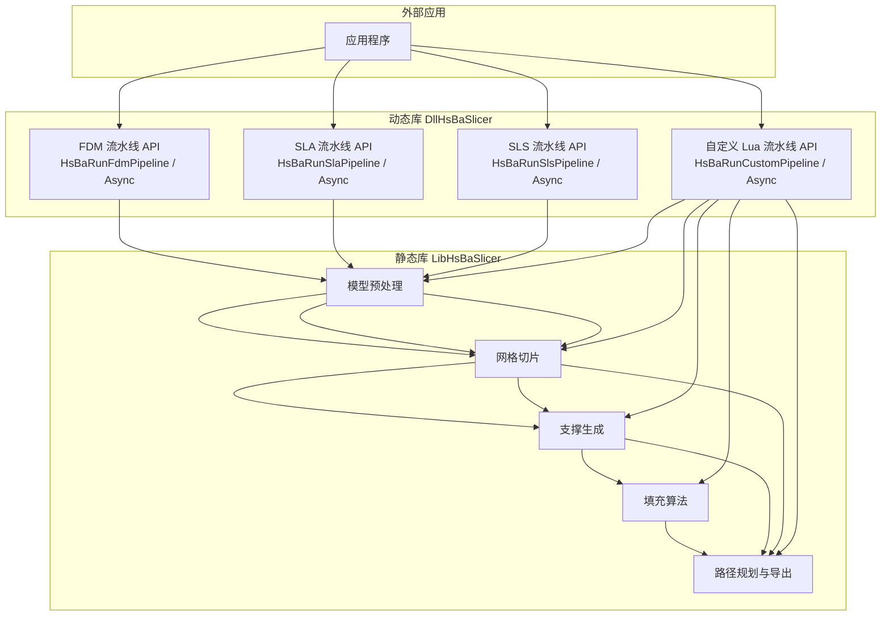
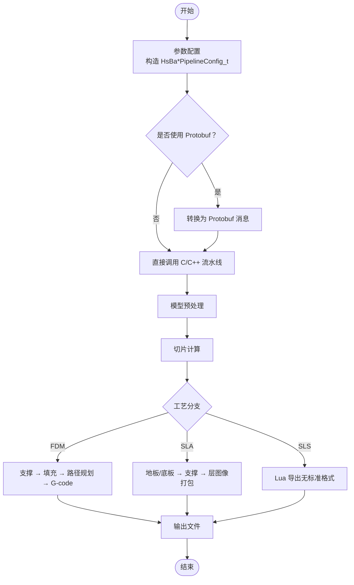
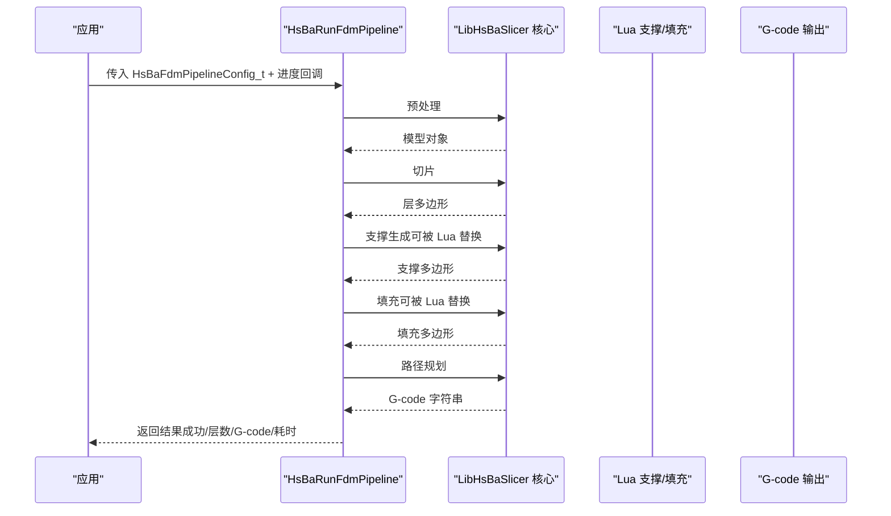
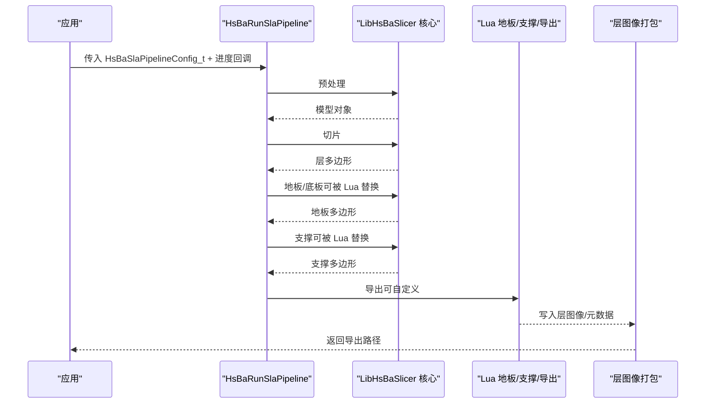
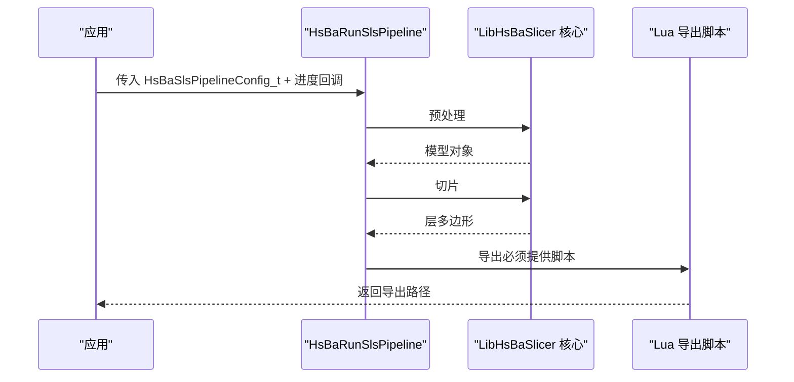
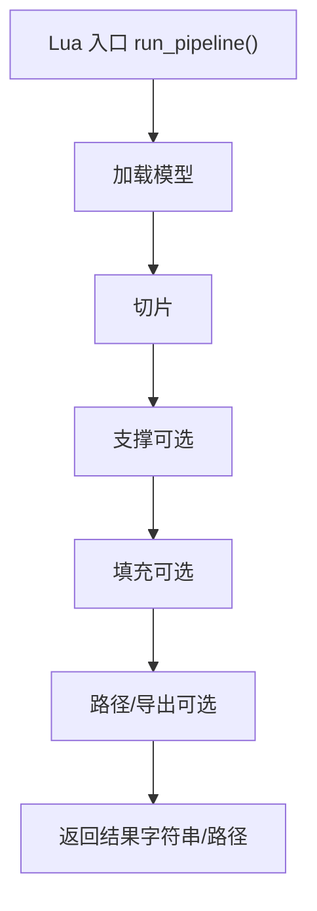
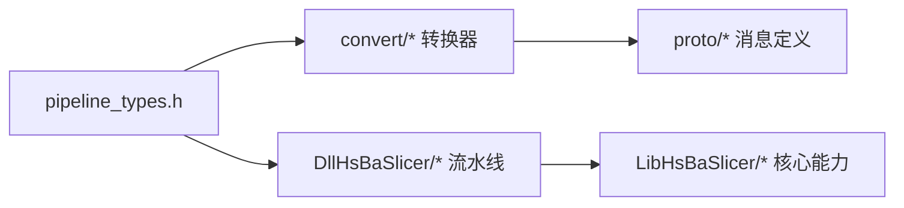
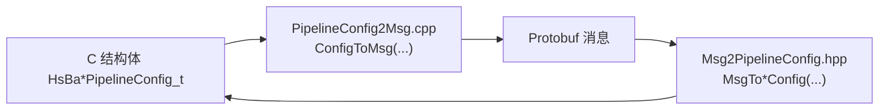

# 流水线概念

<cite>
**本文引用的文件**   
- [README.md](file://README.md)
- [pipeline_types.h](file://pipelinetypes/pipeline_types.h)
- [fdm_pipeline.h](file://DllHsBaSlicer/fdm_pipeline.h)
- [sla_pipeline.h](file://DllHsBaSlicer/sla_pipeline.h)
- [sls_pipeline.h](file://DllHsBaSlicer/sls_pipeline.h)
- [custom_pipeline.h](file://DllHsBaSlicer/custom_pipeline.h)
- [fdm_pipeline.cpp](file://DllHsBaSlicer/fdm_pipeline.cpp)
- [Msg2PipelineConfig.hpp](file://convert/Msg2PipelineConfig.hpp)
- [PipelineConfig2Msg.cpp](file://convert/PipelineConfig2Msg.cpp)
- [fdm_pipeline.proto](file://proto/fdm_pipeline.proto)
- [sla_pipeline.proto](file://proto/sla_pipeline.proto)
- [sls_pipeline.proto](file://proto/sls_pipeline.proto)
- [hsba_slicer.cppm](file://ModuleHsBaSlicer/hsba_slicer.cppm)
- [my_fdm_pipeline.lua](file://samples/Custom/scripts/my_fdm_pipeline.lua)
</cite>

## 目录
1. [引言](#引言)
2. [项目结构](#项目结构)
3. [核心组件](#核心组件)
4. [架构总览](#架构总览)
5. [详细组件分析](#详细组件分析)
6. [依赖关系分析](#依赖关系分析)
7. [性能与并发](#性能与并发)
8. [故障排除指南](#故障排除指南)
9. [结论](#结论)
10. [附录：Lua 扩展与调用示例](#附录lua-扩展与调用示例)

## 引言
本文件面向 HsBaSlicer 的“切片流水线”概念，系统性解释 FDM、SLA、SLS 等工艺的技术差异、统一执行流程、配置系统（C 结构体与 Protobuf 消息）、Lua 脚本扩展机制，以及同步/异步调用与进度回调。读者可据此理解从参数配置到输出文件的完整数据流，并在应用中集成自定义步骤或并行任务。

## 项目结构
HsBaSlicer 提供两条主要入口：
- C ABI 动态库 DllHsBaSlicer：对外暴露统一的流水线接口，支持同步与异步调用。
- C++ 静态库 LibHsBaSlicer：封装模型预处理、切片、支撑、填充、路径生成等核心能力。

**图示来源**
- [fdm_pipeline.h:23-35](file://DllHsBaSlicer/fdm_pipeline.h#L23-L35)
- [sla_pipeline.h:23-34](file://DllHsBaSlicer/sla_pipeline.h#L23-L34)
- [sls_pipeline.h:23-34](file://DllHsBaSlicer/sls_pipeline.h#L23-L34)
- [custom_pipeline.h:23-40](file://DllHsBaSlicer/custom_pipeline.h#L23-L40)

**章节来源**
- [README.md:25-39](file://README.md#L25-L39)

## 核心组件
- 配置类型与默认值：所有工艺的配置结构体定义在统一头文件中，并提供默认初始化函数，确保字段语义与默认值一致。
- 流水线 API：每个工艺提供创建默认配置、同步运行、异步运行与结果释放的 C ABI。
- 协议转换：C 结构体与 Protobuf 消息之间提供双向转换器，用于跨语言序列化与远程调用。
- Lua 扩展：内置流水线允许替换支撑/填充/地板/导出阶段；完全由 Lua 驱动的自定义流水线可编排任意阶段顺序。

关键要点：
- FDM：Preprocess → Slice → Support → Fill → Path（G-code）。
- SLA：Preprocess → Slice → Floor/Raft → Support → Export（层图像 zip）。
- SLS：Preprocess → Slice → Lua Export（无标准格式，完全由导出脚本决定）。
- 自定义流水线：整个工作流由 Lua 入口函数编排，C++ 仅提供构建块。

**章节来源**
- [pipeline_types.h:53-113](file://pipelinetypes/pipeline_types.h#L53-L113)
- [pipeline_types.h:165-218](file://pipelinetypes/pipeline_types.h#L165-L218)
- [pipeline_types.h:251-283](file://pipelinetypes/pipeline_types.h#L251-L283)
- [pipeline_types.h:680-704](file://pipelinetypes/pipeline_types.h#L680-L704)
- [fdm_pipeline.h:23-35](file://DllHsBaSlicer/fdm_pipeline.h#L23-L35)
- [sla_pipeline.h:23-34](file://DllHsBaSlicer/sla_pipeline.h#L23-L34)
- [sls_pipeline.h:23-34](file://DllHsBaSlicer/sls_pipeline.h#L23-L34)
- [custom_pipeline.h:23-40](file://DllHsBaSlicer/custom_pipeline.h#L23-L40)

## 架构总览
下图展示从配置到输出的端到端流程，并标注各阶段的职责与可选扩展点。

**图示来源**
- [fdm_pipeline.h:23-35](file://DllHsBaSlicer/fdm_pipeline.h#L23-L35)
- [sla_pipeline.h:23-34](file://DllHsBaSlicer/sla_pipeline.h#L23-L34)
- [sls_pipeline.h:23-34](file://DllHsBaSlicer/sls_pipeline.h#L23-L34)
- [PipelineConfig2Msg.cpp:10-77](file://convert/PipelineConfig2Msg.cpp#L10-L77)

## 详细组件分析

### FDM 流水线
- 输入：模型名称/路径、层高、填充间距/模式/角度、壁厚、顶层/底层数、支撑开关/悬垂角/间隙/直径/密度/图案、打印速度/挤出倍率、固件目标、喷嘴/耗材直径、温度、回抽、首层速度、螺旋模式、Lua 支撑/填充脚本、输出路径。
- 处理链：预处理 → 切片 → 支撑 → 填充 → 路径生成（G-code）。
- 输出：G-code 内容、总层数、耗时、错误信息。
- 回调：进度回调（百分比+阶段描述），异步结果回调。

**图示来源**
- [fdm_pipeline.h:23-35](file://DllHsBaSlicer/fdm_pipeline.h#L23-L35)
- [fdm_pipeline.cpp:1-26](file://DllHsBaSlicer/fdm_pipeline.cpp#L1-L26)

**章节来源**
- [pipeline_types.h:53-113](file://pipelinetypes/pipeline_types.h#L53-L113)
- [pipeline_types.h:738-783](file://pipelinetypes/pipeline_types.h#L738-L783)
- [fdm_pipeline.h:23-61](file://DllHsBaSlicer/fdm_pipeline.h#L23-L61)
- [fdm_pipeline.cpp:1-26](file://DllHsBaSlicer/fdm_pipeline.cpp#L1-L26)

### SLA 流水线
- 输入：模型、层高、曝光参数、提升/回抽参数、地板/底板参数、支撑参数、Lua 支撑/地板/导出脚本、图像格式/尺寸、输出路径。
- 处理链：预处理 → 切片 → 地板/底板 → 支撑 → 导出（层图像 zip）。
- 输出：导出路径、总层数、耗时、错误信息。

**图示来源**
- [sla_pipeline.h:23-34](file://DllHsBaSlicer/sla_pipeline.h#L23-L34)

**章节来源**
- [pipeline_types.h:165-218](file://pipelinetypes/pipeline_types.h#L165-L218)
- [pipeline_types.h:785-825](file://pipelinetypes/pipeline_types.h#L785-L825)
- [sla_pipeline.h:23-56](file://DllHsBaSlicer/sla_pipeline.h#L23-L56)

### SLS 流水线
- 输入：模型、层高、激光功率/扫描速度/栅格间距/旋转、床温、Lua 导出脚本/函数、输出路径。
- 处理链：预处理 → 切片 → Lua 导出（无标准输出格式）。
- 输出：导出路径、总层数、耗时、错误信息。

**图示来源**
- [sls_pipeline.h:23-34](file://DllHsBaSlicer/sls_pipeline.h#L23-L34)

**章节来源**
- [pipeline_types.h:251-283](file://pipelinetypes/pipeline_types.h#L251-L283)
- [pipeline_types.h:827-847](file://pipelinetypes/pipeline_types.h#L827-L847)
- [sls_pipeline.h:23-56](file://DllHsBaSlicer/sls_pipeline.h#L23-L56)

### 自定义 Lua 流水线
- 特点：整个工作流由 Lua 入口函数编排，C++ 仅暴露模型加载、切片、支撑、填充、地板、路径输出、打包等构建块。
- 适用场景：需要完全自定义阶段顺序、中间产物格式或与其他系统集成。

**图示来源**
- [custom_pipeline.h:23-40](file://DllHsBaSlicer/custom_pipeline.h#L23-L40)
- [my_fdm_pipeline.lua:1-22](file://samples/Custom/scripts/my_fdm_pipeline.lua#L1-L22)

**章节来源**
- [pipeline_types.h:680-704](file://pipelinetypes/pipeline_types.h#L680-L704)
- [custom_pipeline.h:23-62](file://DllHsBaSlicer/custom_pipeline.h#L23-L62)
- [my_fdm_pipeline.lua:1-22](file://samples/Custom/scripts/my_fdm_pipeline.lua#L1-L22)

## 依赖关系分析
- 配置类型与默认值集中在 pipeline_types.h，供 convert 模块与 DllHsBaSlicer 共同使用。
- convert 模块提供 C 结构体与 Protobuf 消息的双向转换，便于跨语言/远程调用。
- DllHsBaSlicer 的流水线实现依赖 LibHsBaSlicer 的核心能力（预处理、切片、支撑、填充、路径）。

**图示来源**
- [Msg2PipelineConfig.hpp:24-99](file://convert/Msg2PipelineConfig.hpp#L24-L99)
- [PipelineConfig2Msg.cpp:10-77](file://convert/PipelineConfig2Msg.cpp#L10-L77)
- [fdm_pipeline.cpp:17-26](file://DllHsBaSlicer/fdm_pipeline.cpp#L17-L26)

**章节来源**
- [Msg2PipelineConfig.hpp:24-99](file://convert/Msg2PipelineConfig.hpp#L24-L99)
- [PipelineConfig2Msg.cpp:10-77](file://convert/PipelineConfig2Msg.cpp#L10-L77)
- [fdm_pipeline.cpp:17-26](file://DllHsBaSlicer/fdm_pipeline.cpp#L17-L26)

## 性能与并发
- 内部使用 C++20 协程实现异步流水线，避免阻塞调用线程。
- 可通过线程池/任务队列在应用层并行调度多个流水线实例。
- 建议将 I/O（写 G-code/zip）放在独立线程或后台任务中，减少主线程阻塞。

[本节为通用指导，不直接分析具体文件]

## 故障排除指南
- 内存释放：所有流水线结果中的字符串字段需调用对应释放函数（如 HsBaFreePipelineResult/HsBaFreeSlaPipelineResult/HsBaFreeSlsPipelineResult/HsBaFreeCustomPipelineResult）。
- 空指针检查：Lua 脚本路径/函数名可为 NULL，表示使用内置算法；SLS 的 export_lua_script 必须非空。
- 进度回调：若未设置回调，进度不会上报；异步模式下务必设置结果回调以获取最终状态。
- 错误信息：失败时 error_message 非空，应优先读取该字段进行诊断。

**章节来源**
- [fdm_pipeline.h:53-61](file://DllHsBaSlicer/fdm_pipeline.h#L53-L61)
- [sla_pipeline.h:49-56](file://DllHsBaSlicer/sla_pipeline.h#L49-L56)
- [sls_pipeline.h:49-56](file://DllHsBaSlicer/sls_pipeline.h#L49-L56)
- [custom_pipeline.h:57-62](file://DllHsBaSlicer/custom_pipeline.h#L57-L62)

## 结论
HsBaSlicer 通过统一的配置结构与 C ABI 流水线接口，将 FDM/SLA/SLS 等不同工艺抽象为一致的“预处理→切片→支撑/地板→填充→路径/导出”流程。Protobuf 转换层支持跨语言序列化，Lua 扩展机制允许深度定制。开发者可在同步/异步两种模式下集成，并通过进度回调与结果回调实现完整的监控与错误处理。

[本节为总结性内容，不直接分析具体文件]

## 附录：Lua 扩展与调用示例

### Lua 扩展机制说明
- 内置流水线允许替换支撑/填充/地板/导出阶段，Lua 脚本通过约定入口函数参与流水线。
- 自定义流水线可由 Lua 完全编排阶段顺序，C++ 侧提供全局 HsBa 表暴露构建块。

参考：
- FDM 支撑/填充 Lua 替换：见 FDM 配置中的 support_lua_* 与 infill_lua_* 字段。
- SLA 地板/支撑/导出 Lua 替换：见 SLA 配置中的 floor_lua_*、support_lua_*、export_lua_* 字段。
- 自定义流水线：见 custom_pipeline.h 与 samples/Custom/scripts/my_fdm_pipeline.lua。

**章节来源**
- [pipeline_types.h:104-108](file://pipelinetypes/pipeline_types.h#L104-L108)
- [pipeline_types.h:204-210](file://pipelinetypes/pipeline_types.h#L204-L210)
- [custom_pipeline.h:23-40](file://DllHsBaSlicer/custom_pipeline.h#L23-L40)
- [my_fdm_pipeline.lua:1-22](file://samples/Custom/scripts/my_fdm_pipeline.lua#L1-L22)

### 简单命令行调用示例（概念流程）
- 构造默认配置（例如 FDM/SLA/SLS）。
- 设置必要字段（模型路径、输出路径、工艺参数）。
- 调用同步运行函数，等待结果。
- 检查 success 与 error_message，必要时释放结果内存。

参考：
- FDM：HsBaCreateDefaultConfig / HsBaRunFdmPipeline / HsBaFreePipelineResult。
- SLA：HsBaCreateDefaultSlaConfig / HsBaRunSlaPipeline / HsBaFreeSlaPipelineResult。
- SLS：HsBaCreateDefaultSlsConfig / HsBaRunSlsPipeline / HsBaFreeSlsPipelineResult。

**章节来源**
- [fdm_pipeline.h:17-61](file://DllHsBaSlicer/fdm_pipeline.h#L17-L61)
- [sla_pipeline.h:17-56](file://DllHsBaSlicer/sla_pipeline.h#L17-L56)
- [sls_pipeline.h:17-56](file://DllHsBaSlicer/sls_pipeline.h#L17-L56)

### 复杂异步并行处理示例（概念流程）
- 为每个流水线实例注册进度回调与结果回调。
- 在应用层使用线程池/任务队列并发调度多个异步流水线。
- 汇总各任务结果，统计总耗时与成功率。

参考：
- 异步 API：HsBaRunFdmPipelineAsync / HsBaRunSlaPipelineAsync / HsBaRunSlsPipelineAsync / HsBaRunCustomPipelineAsync。

**章节来源**
- [fdm_pipeline.h:37-51](file://DllHsBaSlicer/fdm_pipeline.h#L37-L51)
- [sla_pipeline.h:36-47](file://DllHsBaSlicer/sla_pipeline.h#L36-L47)
- [sls_pipeline.h:36-47](file://DllHsBaSlicer/sls_pipeline.h#L36-L47)
- [custom_pipeline.h:42-55](file://DllHsBaSlicer/custom_pipeline.h#L42-L55)

### Protobuf 配置序列化
- 配置结构体与 Protobuf 消息之间存在双向转换，便于跨语言/远程调用。
- 常用转换函数：
  - FDM：FdmConfigToMsg / MsgToFdmConfig
  - SLA：SlaConfigToMsg / MsgToSlaConfig
  - SLS：SlsConfigToMsg / MsgToSlsConfig

**图示来源**
- [PipelineConfig2Msg.cpp:10-77](file://convert/PipelineConfig2Msg.cpp#L10-L77)
- [Msg2PipelineConfig.hpp:24-99](file://convert/Msg2PipelineConfig.hpp#L24-L99)

**章节来源**
- [PipelineConfig2Msg.cpp:10-77](file://convert/PipelineConfig2Msg.cpp#L10-L77)
- [Msg2PipelineConfig.hpp:24-99](file://convert/Msg2PipelineConfig.hpp#L24-L99)
- [fdm_pipeline.proto:26-72](file://proto/fdm_pipeline.proto#L26-L72)
- [sla_pipeline.proto:18-58](file://proto/sla_pipeline.proto#L18-L58)
- [sls_pipeline.proto:5-23](file://proto/sls_pipeline.proto#L5-L23)