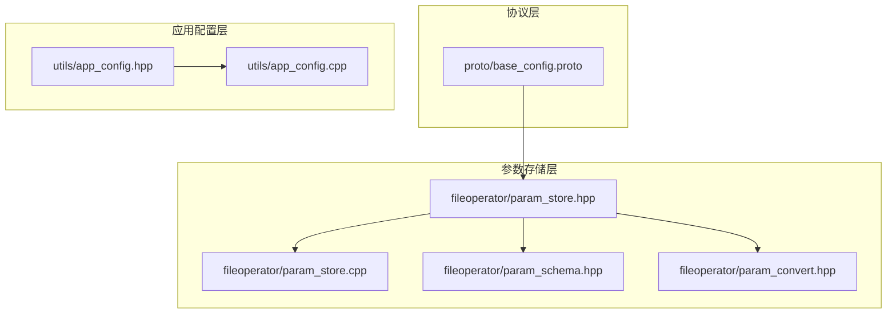
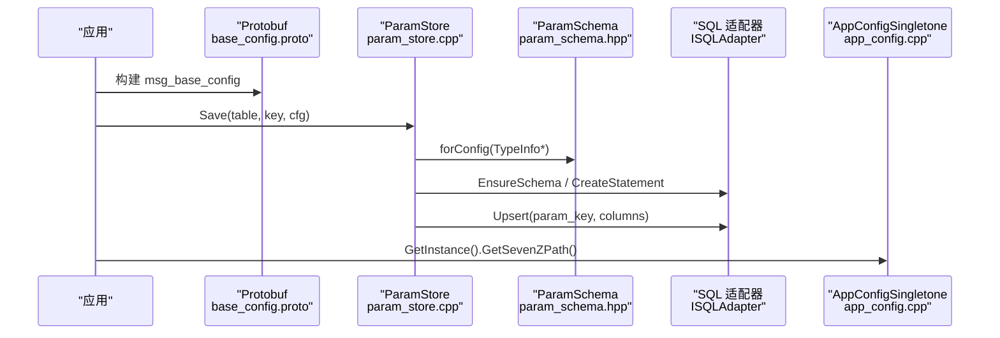
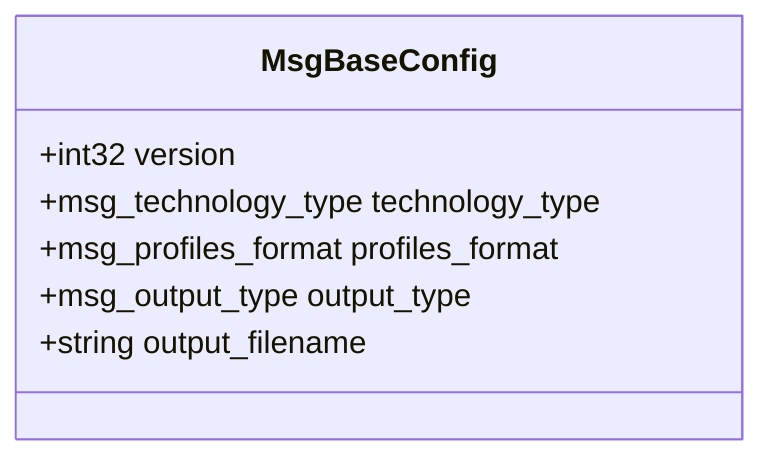
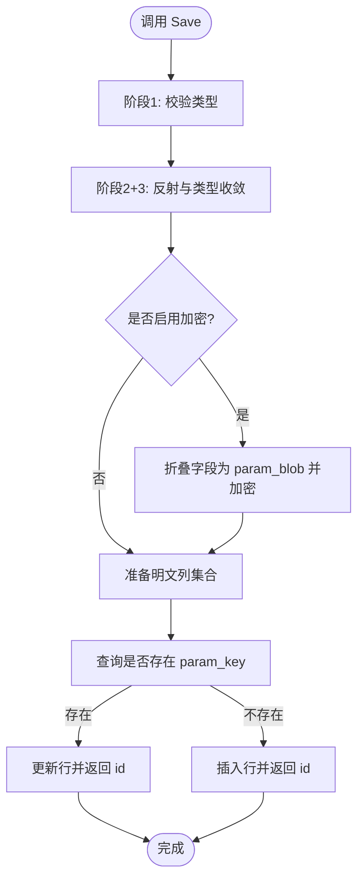
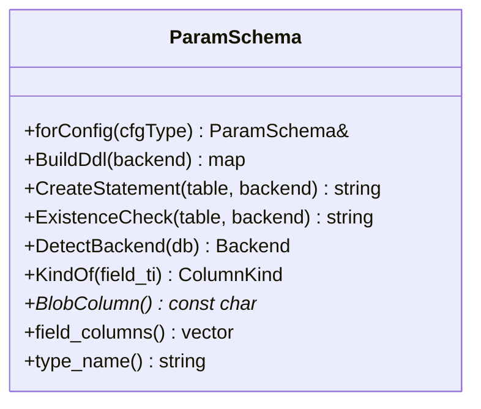
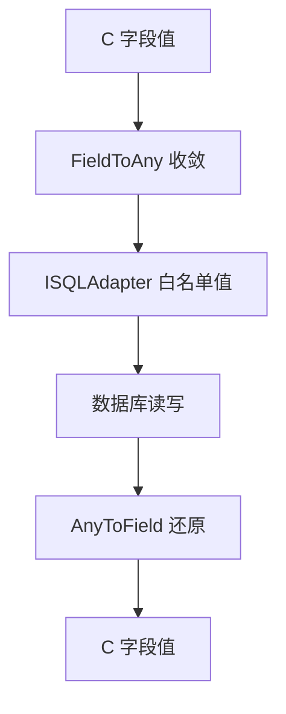
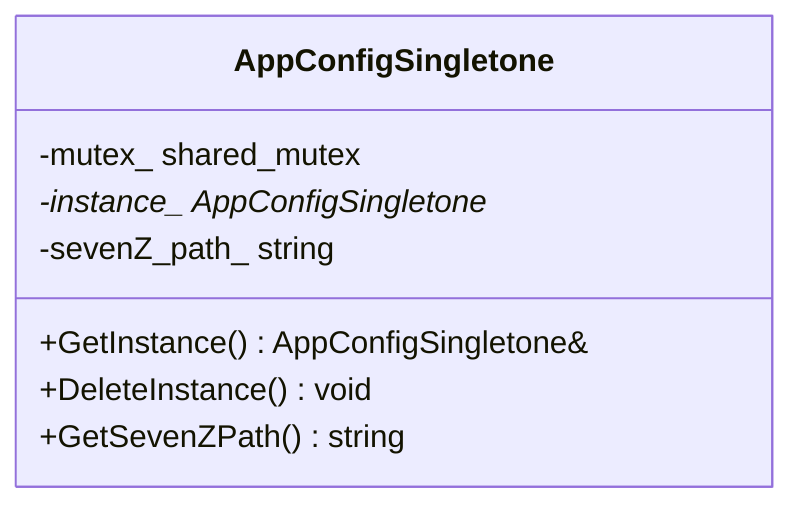
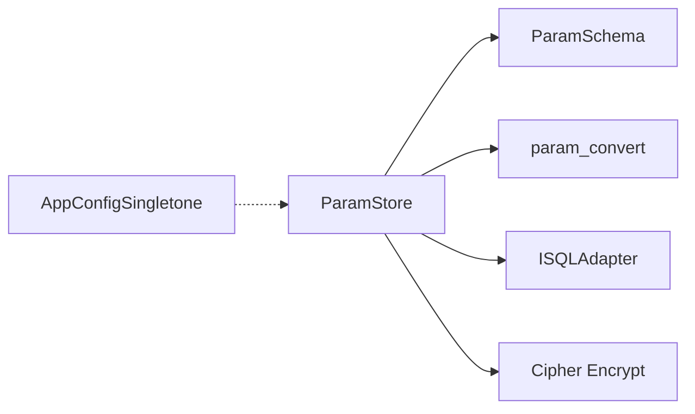

# 配置系统

<cite>
**本文引用的文件**   
- [base_config.proto](file://proto/base_config.proto)
- [param_store.hpp](file://fileoperator\param_store.hpp)
- [param_store.cpp](file://fileoperator\param_store.cpp)
- [param_schema.hpp](file://fileoperator\param_schema.hpp)
- [param_convert.hpp](file://fileoperator\param_convert.hpp)
- [app_config.hpp](file://utils\app_config.hpp)
- [app_config.cpp](file://utils\app_config.cpp)
</cite>

## 目录
1. [简介](#简介)
2. [项目结构](#项目结构)
3. [核心组件](#核心组件)
4. [架构总览](#架构总览)
5. [详细组件分析](#详细组件分析)
6. [依赖关系分析](#依赖关系分析)
7. [性能与扩展性](#性能与扩展性)
8. [故障排除指南](#故障排除指南)
9. [结论](#结论)
10. [附录：使用示例与最佳实践](#附录使用示例与最佳实践)

## 简介
本文件面向 HsBaSlicer 的配置系统，围绕以下目标展开：
- 基于 Protobuf 的 base_config.proto 配置结构定义、序列化/反序列化与跨语言传输。
- param_store 模块的参数存储机制：持久化、版本管理、迁移钩子、加密列与事务批处理。
- app_config 应用配置单例：线程安全访问、外部工具路径等共享设置。
- 配置验证、默认值处理与错误恢复策略。
- 提供可操作的代码片段路径，展示如何读取和修改配置参数。
- 给出扩展方法与最佳实践，兼顾初学者与高级用户。

## 项目结构
HsBaSlicer 中与“配置系统”直接相关的源码分布在三个区域：
- proto/base_config.proto：Protobuf 协议定义，描述基础配置消息与枚举类型，用于跨语言传输。
- fileoperator/*：参数存储与数据库层，包含 ParamStore、Schema、转换与反射桥接。
- utils/app_config.*：应用级配置单例，提供线程安全的共享设置访问。

**图示来源** 
- [base_config.proto:1-132](file://proto/base_config.proto#L1-L132)
- [param_store.hpp:1-125](file://fileoperator\param_store.hpp#L1-L125)
- [param_store.cpp:1-544](file://fileoperator\param_store.cpp#L1-L544)
- [param_schema.hpp:1-104](file://fileoperator\param_schema.hpp#L1-L104)
- [param_convert.hpp:1-70](file://fileoperator\param_convert.hpp#L1-L70)
- [app_config.hpp:1-50](file://utils\app_config.hpp#L1-L50)
- [app_config.cpp:1-43](file://utils\app_config.cpp#L1-L43)

**章节来源**
- [base_config.proto:1-132](file://proto/base_config.proto#L1-L132)
- [param_store.hpp:1-125](file://fileoperator\param_store.hpp#L1-L125)
- [param_schema.hpp:1-104](file://fileoperator\param_schema.hpp#L1-L104)
- [param_convert.hpp:1-70](file://fileoperator\param_convert.hpp#L1-L70)
- [app_config.hpp:1-50](file://utils\app_config.hpp#L1-L50)
- [app_config.cpp:1-43](file://utils\app_config.cpp#L1-L43)

## 核心组件
- Protobuf 基础配置：msg_base_config 及其相关枚举，作为跨语言传输的基础数据结构。
- 参数存储 ParamStore：封装 CRUD、批量事务、进度回调、迁移钩子、字段反射与类型收敛、可选的 AES-256-CBC 列加密。
- 参数模式 ParamSchema：根据 Config 结构的 TypeInfo 推导宽表列定义，生成 DDL，支持 SQLite/MySQL/PostgreSQL。
- 类型转换 Bridge：FieldToAny/AnyToField 在 C 字段与 ISQLAdapter 白名单类型之间进行收敛与还原。
- 应用配置 AppConfigSingletone：线程安全的单例，暴露如 7-Zip 路径等共享设置。

**章节来源**
- [base_config.proto:125-132](file://proto/base_config.proto#L125-L132)
- [param_store.hpp:30-121](file://fileoperator\param_store.hpp#L30-L121)
- [param_schema.hpp:30-100](file://fileoperator\param_schema.hpp#L30-L100)
- [param_convert.hpp:23-66](file://fileoperator\param_convert.hpp#L23-L66)
- [app_config.hpp:14-46](file://utils\app_config.hpp#L14-L46)

## 架构总览
下图展示了从 Protobuf 配置到参数持久化的整体流程，以及应用配置单例的访问方式。

**图示来源** 
- [base_config.proto:125-132](file://proto/base_config.proto#L125-L132)
- [param_store.cpp:187-278](file://fileoperator\param_store.cpp#L187-L278)
- [param_schema.hpp:60-89](file://fileoperator\param_schema.hpp#L60-L89)
- [app_config.cpp:14-26](file://utils\app_config.cpp#L14-L26)

## 详细组件分析

### Protobuf 基础配置（base_config.proto）
- 目的：定义跨语言传输的基础配置消息与枚举，包括技术类型、材料、支撑、光源、输出类型、配置文件格式等。
- 关键结构：
  - msg_base_config：包含 version、technology_type、profiles_format、output_type、output_filename。
- 设计要点：
  - 使用 proto3 语法，便于多语言生成代码。
  - 通过枚举统一技术栈与材料/支撑/光源等语义，避免硬编码字符串。
  - 作为流水线间或进程间传输的轻量级元数据载体。

**图示来源** 
- [base_config.proto:125-132](file://proto/base_config.proto#L125-L132)

**章节来源**
- [base_config.proto:5-123](file://proto/base_config.proto#L5-L123)
- [base_config.proto:125-132](file://proto/base_config.proto#L125-L132)

### 参数存储（ParamStore）
ParamStore 是参数持久化的核心类，提供：
- 确保 Schema：EnsureSchema/EnsureTable 自动创建所需表。
- 保存与更新：Save/Update 支持 Validate -> Reflect -> Coerce -> Upsert 的分阶段流程。
- 加载与列表：Load/List 支持按条件查询并映射回目标结构。
- 删除：Delete 返回是否命中行。
- 批处理：SaveBatch 包裹为单一事务，失败时回滚。
- 进度回调：SetProgressCallback 上报百分比与阶段描述。
- 迁移钩子：SetMigrationHook 用于后端/表/版本级别的迁移逻辑。
- 列加密：SetCryptoKey 启用 AES-256-CBC 列加密，将字段列折叠进 param_blob；未启用时保持明文宽表。
- 错误处理：Guard 包装所有方法，记录 last_error 并重新抛出异常，不吞错。

**图示来源** 
- [param_store.cpp:187-278](file://fileoperator\param_store.cpp#L187-L278)

#### 保存流程细节
- 校验：注册 PipelineConfig 类型，检查传入 AnyObject 的类型是否已注册。
- 反射与收敛：遍历字段，转换为 ISQLAdapter 白名单类型（double/int64_t/string/nullptr）。
- FileTransfer 特殊处理：额外将 file_paths 序列化为 JSON TEXT 列。
- 元数据填充：param_key、schema_version、updated_at/created_at。
- 加密：若启用，过滤非元数据列，编码后 AES-256-CBC 加密写入 param_blob。
- Upsert：先查后写，更新或插入并返回 param_id。

**章节来源**
- [param_store.cpp:187-278](file://fileoperator\param_store.cpp#L187-L278)
- [param_store.cpp:281-326](file://fileoperator\param_store.cpp#L281-L326)
- [param_store.cpp:328-395](file://fileoperator\param_store.cpp#L328-L395)
- [param_store.cpp:397-434](file://fileoperator\param_store.cpp#L397-L434)
- [param_store.cpp:436-519](file://fileoperator\param_store.cpp#L436-L519)
- [param_store.cpp:522-541](file://fileoperator\param_store.cpp#L522-L541)

#### 加载与解密
- 校验：检查 outCfg 类型是否已注册。
- 解析表名：ResolveTable 优先使用显式 table，否则由 TypeInfo 推导。
- 检测加密：若存在非空的 param_blob 且启用了加密，则解密并解码字段列。
- 字段映射：ForeachField 将列值映射回目标结构字段，缺失列保留原值。
- 明文兼容：若无 blob，直接从明文宽表列映射。

**章节来源**
- [param_store.cpp:328-395](file://fileoperator\param_store.cpp#L328-L395)

#### 更新与加密列
- 部分更新：仅更新 changedFields 指定的字段。
- 加密场景：读旧行 -> 解密 -> 合并变更 -> 重新编码并加密 -> 只更新 param_blob 与 updated_at。
- 明文场景：直接更新指定字段列。

**章节来源**
- [param_store.cpp:436-519](file://fileoperator\param_store.cpp#L436-L519)

#### 批处理事务
- 开启事务：BEGIN/BEGIN TRANSACTION，提交 COMMIT/COMMIT TRANSACTION，失败时 ROLLBACK/ROLLBACK TRANSACTION。
- 异常保护：捕获 SQL 异常，尝试回滚但不吞掉原始异常。

**章节来源**
- [param_store.cpp:281-326](file://fileoperator\param_store.cpp#L281-L326)

### 参数模式（ParamSchema）
- 作用：根据 Config 结构的 TypeInfo 推导每列的 ColumnKind（Double/Int64/Text），生成各后端 DDL。
- 固定元数据列：param_id、param_key、schema_version、created_at、updated_at。
- 加密列：当启用 at-rest 加密时，字段列被折叠到 param_blob 二进制列。
- 后端支持：SQLite、MySQL、PostgreSQL，DetectBackend 通过动态类型识别。
- 表存在性检查：ExistenceCheck 返回至少一行以判断表是否存在。

**图示来源** 
- [param_schema.hpp:60-100](file://fileoperator\param_schema.hpp#L60-L100)

**章节来源**
- [param_schema.hpp:30-100](file://fileoperator\param_schema.hpp#L30-L100)

### 类型转换桥（param_convert）
- FieldToAny：将 C 字段（float/double/int/int64/enum/const char*/std::string）收敛为 ISQLAdapter 白名单类型（nullptr_t/int64_t/double/string/vector<unsigned char>）。
- AnyToField：将数据库返回的值还原到 C 字段，必要时分配内存并由 StringArena 管理。
- 枚举支持：IsEnumFieldType 判断是否为枚举类型（映射为 int64_t）。
- 字符串所有权：ConfigStringsToOwning 将 const char* 字段替换为 malloc 副本，FreeConfigStrings 释放这些字符串。

**图示来源** 
- [param_convert.hpp:23-66](file://fileoperator\param_convert.hpp#L23-L66)

**章节来源**
- [param_convert.hpp:23-66](file://fileoperator\param_convert.hpp#L23-L66)

### 应用配置（AppConfigSingletone）
- 单例模式：GetInstance/DeleteInstance 保证全局唯一实例。
- 线程安全：使用 shared_mutex 保护读写。
- 共享设置：例如 GetSevenZPath 返回 7-Zip 可执行文件路径。

**图示来源** 
- [app_config.hpp:14-46](file://utils\app_config.hpp#L14-L46)
- [app_config.cpp:14-42](file://utils\app_config.cpp#L14-L42)

**章节来源**
- [app_config.hpp:14-46](file://utils\app_config.hpp#L14-L46)
- [app_config.cpp:14-42](file://utils\app_config.cpp#L14-L42)

## 依赖关系分析
- ParamStore 依赖：
  - ParamSchema：生成 DDL、检测后端、获取字段列名。
  - param_convert：字段类型收敛与还原。
  - sql_adapter：统一的数据库操作接口。
  - cipher：AES-256-CBC 加密/解密。
- AppConfigSingletone 独立于 ParamStore，仅提供应用级共享设置。

**图示来源** 
- [param_store.hpp:22-26](file://fileoperator\param_store.hpp#L22-L26)
- [param_schema.hpp:24-25](file://fileoperator\param_schema.hpp#L24-L25)
- [param_convert.hpp:19-19](file://fileoperator\param_convert.hpp#L19-L19)
- [param_store.cpp:16-17](file://fileoperator\param_store.cpp#L16-L17)

**章节来源**
- [param_store.hpp:22-26](file://fileoperator\param_store.hpp#L22-L26)
- [param_schema.hpp:24-25](file://fileoperator\param_schema.hpp#L24-L25)
- [param_convert.hpp:19-19](file://fileoperator\param_convert.hpp#L19-L19)
- [param_store.cpp:16-17](file://fileoperator\param_store.cpp#L16-L17)

## 性能与扩展性
- 批处理事务：SaveBatch 使用单一事务减少 I/O 开销，提升批量写入性能。
- 加密列：启用加密会增加编解码与加解密开销，但保障敏感数据静态安全；建议仅在需要时启用。
- 反射与收敛：FieldToAny/AnyToField 对每个字段进行类型判断与转换，建议在高频路径中避免不必要的反射。
- 扩展点：
  - MigrationFn：可在 SetMigrationHook 中实现表结构演进、数据迁移与兼容性修复。
  - ProgressFn：可在长时间操作中提供进度反馈。
  - ParamSchema.BuildDdl：新增后端只需扩展 DDL 生成逻辑。
  - FieldToAny/AnyToField：新增字段类型需在此桥接处添加支持。

[本节为通用指导，不直接分析具体文件]

## 故障排除指南
- 常见错误与定位：
  - 类型未注册：Save/Load/Update 会抛出 SQLAdapterInvalidArgumentError，提示 config type not registered。
  - 表名缺失：List/Delete 要求显式 table 名称。
  - 解密失败：Load/Update 在解密时抛出 SQLAdapterQueryError，提示 decryption failed。
  - 加密失败：Save/Update 在加密时抛出 SQLAdapterQueryError，提示 encryption failed。
  - 行消失：Insert 后立即 Select 未找到行，抛出 SQLAdapterQueryError。
- 调试建议：
  - 使用 GetLastError 获取最近一次失败的错误信息。
  - 安装 ProgressFn 观察 Save/Load/Update 的阶段进度。
  - 检查 schema_version 与后端类型是否匹配预期。
  - 确认 crypto_key 是否与写入时一致。

**章节来源**
- [param_store.cpp:102-122](file://fileoperator\param_store.cpp#L102-L122)
- [param_store.cpp:187-278](file://fileoperator\param_store.cpp#L187-L278)
- [param_store.cpp:328-395](file://fileoperator\param_store.cpp#L328-L395)
- [param_store.cpp:397-434](file://fileoperator\param_store.cpp#L397-L434)
- [param_store.cpp:436-519](file://fileoperator\param_store.cpp#L436-L519)
- [param_store.cpp:522-541](file://fileoperator\param_store.cpp#L522-L541)

## 结论
HsBaSlicer 的配置系统以 Protobuf 为基础传输格式，结合 ParamStore 的强类型反射、类型收敛与可选列加密，提供了稳定可靠的参数持久化能力；ParamSchema 屏蔽了多后端差异；AppConfigSingletone 提供线程安全的共享设置访问。通过迁移钩子与进度回调，系统在可扩展性与可观测性方面具备良好基础。

[本节为总结性内容，不直接分析具体文件]

## 附录：使用示例与最佳实践

### 读取与修改配置参数的步骤
- 读取配置：
  - 调用 ParamStore::Load(table, key, outCfg, arena)，outCfg 必须为已注册的 PipelineConfig 类型。
  - 若启用加密，需先设置 crypto_key。
  - 参考路径：[param_store.cpp:328-395](file://fileoperator\param_store.cpp#L328-L395)
- 修改配置：
  - 使用 ParamStore::Update(table, key, partial, changedFields) 仅更新指定字段。
  - 若启用加密，内部会自动解密-合并-重加密。
  - 参考路径：[param_store.cpp:436-519](file://fileoperator\param_store.cpp#L436-L519)
- 批量保存：
  - 使用 ParamStore::SaveBatch(table, items) 在事务中保存多条配置。
  - 参考路径：[param_store.cpp:281-326](file://fileoperator\param_store.cpp#L281-L326)

### 配置验证与默认值处理
- 验证：
  - Save 阶段会校验类型是否已注册，未注册则抛异常。
  - 参考路径：[param_store.cpp:187-199](file://fileoperator\param_store.cpp#L187-L199)
- 默认值：
  - Load 时若某列缺失，目标结构对应字段保持原值（即调用方提供的默认值）。
  - 参考路径：[param_store.cpp:368-377](file://fileoperator\param_store.cpp#L368-L377)

### 错误恢复策略
- 所有方法通过 Guard 包装，last_error_ 记录最近错误，异常继续向上抛出。
- 批处理在失败时尝试回滚，但不吞原始异常。
- 参考路径：
  - [param_store.cpp:102-122](file://fileoperator\param_store.cpp#L102-L122)
  - [param_store.cpp:281-326](file://fileoperator\param_store.cpp#L281-L326)

### 配置系统的扩展方法
- 新增后端：
  - 扩展 ParamSchema::BuildDdl/CreateStatement 以支持新方言。
  - 参考路径：[param_schema.hpp:66-73](file://fileoperator\param_schema.hpp#L66-L73)
- 新增字段类型：
  - 在 FieldToAny/AnyToField 中添加类型支持与映射。
  - 参考路径：[param_convert.hpp:27-45](file://fileoperator\param_convert.hpp#L27-L45)
- 迁移策略：
  - 通过 SetMigrationHook 实现 schema_version 升级与数据迁移。
  - 参考路径：[param_store.hpp:39-40](file://fileoperator\param_store.hpp#L39-L40)

### 最佳实践
- 始终在启动时调用 EnsureSchema，确保表结构就绪。
- 对敏感数据启用 SetCryptoKey，并确保密钥安全保管。
- 使用 SaveBatch 进行批量写入以提升性能。
- 使用 ProgressFn 监控长时间操作。
- 在 Update 中明确传递 changedFields，避免不必要的全量更新。
- 在 Load 前准备好 StringArena，并在合适时机释放字符串所有权。

**章节来源**
- [param_store.cpp:173-185](file://fileoperator\param_store.cpp#L173-L185)
- [param_store.cpp:187-278](file://fileoperator\param_store.cpp#L187-L278)
- [param_store.cpp:281-326](file://fileoperator\param_store.cpp#L281-L326)
- [param_store.cpp:328-395](file://fileoperator\param_store.cpp#L328-L395)
- [param_store.cpp:436-519](file://fileoperator\param_store.cpp#L436-L519)
- [param_schema.hpp:66-73](file://fileoperator\param_schema.hpp#L66-L73)
- [param_convert.hpp:27-45](file://fileoperator\param_convert.hpp#L27-L45)
- [param_store.hpp:39-40](file://fileoperator\param_store.hpp#L39-L40)