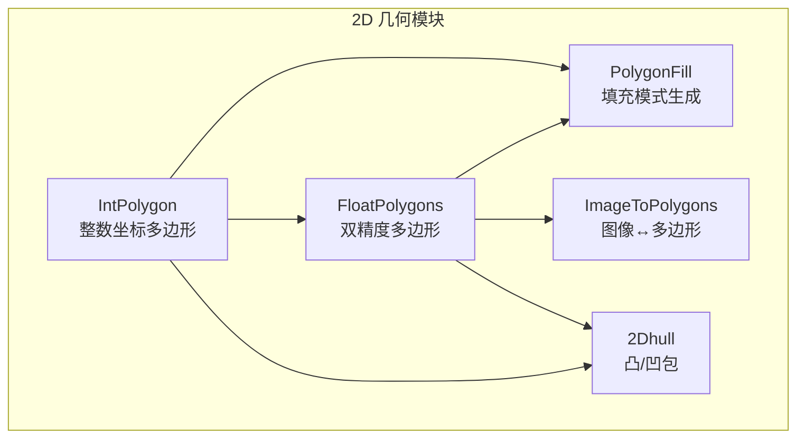
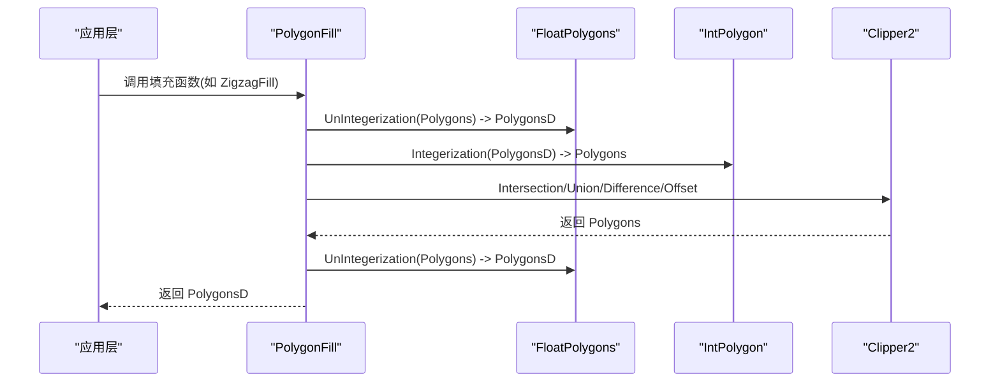
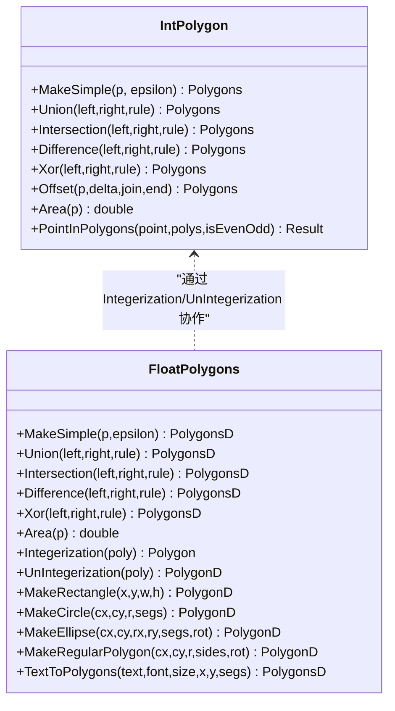
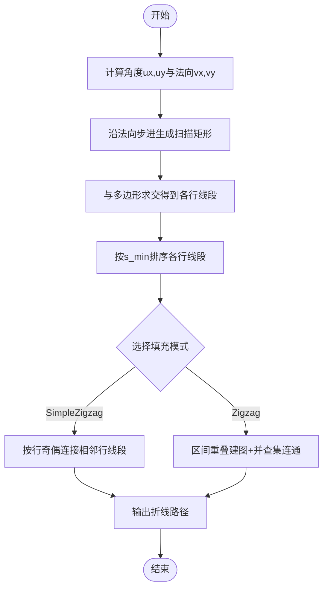
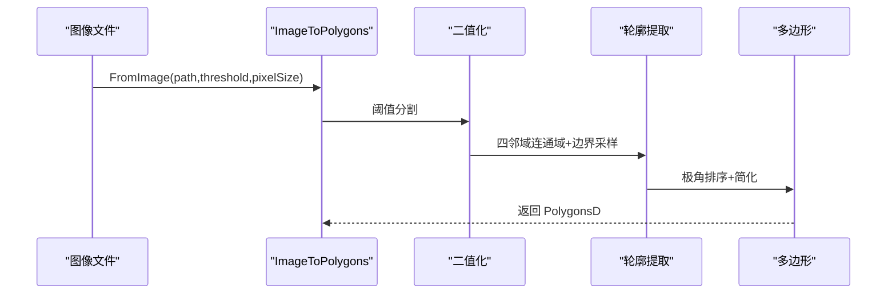
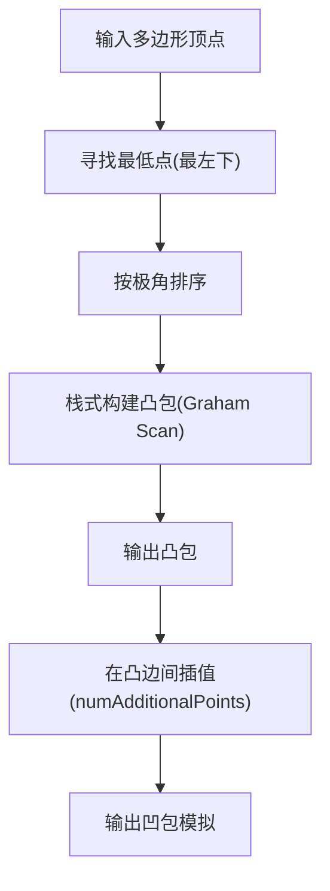
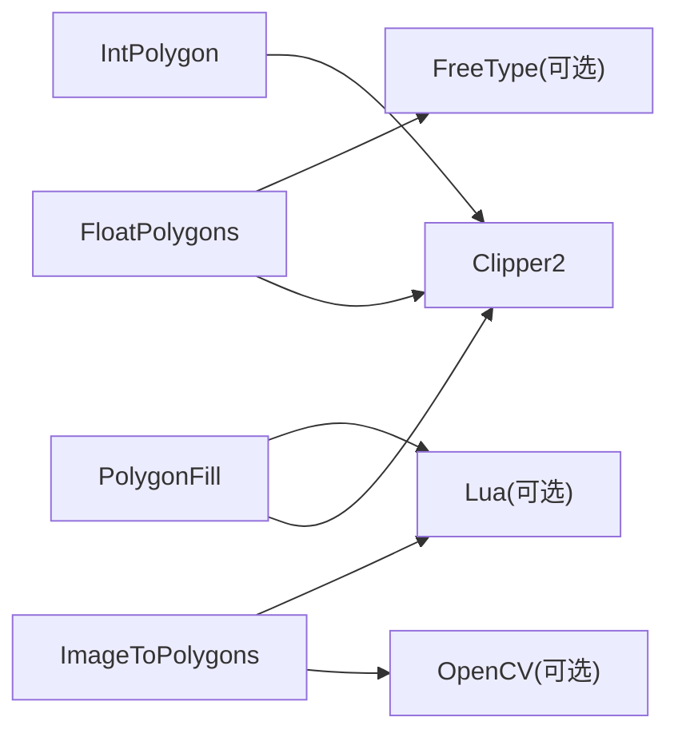

# 2D 几何算法

<cite>
**本文引用的文件**   
- [IntPolygon.hpp](file://2D/IntPolygon.hpp)
- [IntPolygon.cpp](file://2D/IntPolygon.cpp)
- [FloatPolygons.hpp](file://2D/FloatPolygons.hpp)
- [FloatPolygons.cpp](file://2D/FloatPolygons.cpp)
- [PolygonFill.hpp](file://2D/PolygonFill.hpp)
- [PolygonFill.cpp](file://2D/PolygonFill.cpp)
- [ImageToPolygons.hpp](file://2D/ImageToPolygons.hpp)
- [ImageToPolygons.cpp](file://2D/ImageToPolygons.cpp)
- [2Dhull.hpp](file://2D/2Dhull.hpp)
- [2Dhull.cpp](file://2D/2Dhull.cpp)
</cite>

## 目录
1. [引言](#引言)
2. [项目结构](#项目结构)
3. [核心组件](#核心组件)
4. [架构总览](#架构总览)
5. [详细组件分析](#详细组件分析)
6. [依赖关系分析](#依赖关系分析)
7. [性能与复杂度](#性能与复杂度)
8. [使用示例与参数配置](#使用示例与参数配置)
9. [故障排查指南](#故障排查指南)
10. [结论](#结论)

## 引言
本技术文档聚焦 HsBaSlicer 的 2D 几何算法模块，系统性解析多边形数据结构（整数坐标 Polygon/Polygons 与双精度 PolygonD/PolygonsD）的设计与实现，深入说明填充算法（直线、锯齿形、复合偏移、混合填充等）、图像到多边形的转换、多边形偏移、布尔运算、凸/凹包计算等核心几何操作。同时给出 Clipper2 库集成方式、Lua 扩展点、性能优化策略、算法复杂度分析与内存管理建议，面向几何算法开发者与图形学工程师提供可落地的工程实践参考。

## 项目结构
2D 几何算法模块位于 2D 目录下，主要包含：
- 基础几何类型与布尔/偏移/面积工具：IntPolygon、FloatPolygons
- 填充模式生成器：PolygonFill
- 图像与多边形互转：ImageToPolygons
- 凸/凹包计算：2Dhull

**图表来源**
- [IntPolygon.hpp:1-241](file://2D/IntPolygon.hpp#L1-L241)
- [FloatPolygons.hpp:1-271](file://2D/FloatPolygons.hpp#L1-L271)
- [PolygonFill.hpp:1-141](file://2D/PolygonFill.hpp#L1-L141)
- [ImageToPolygons.hpp:1-83](file://2D/ImageToPolygons.hpp#L1-L83)
- [2Dhull.hpp:1-75](file://2D/2Dhull.hpp#L1-L75)

**章节来源**
- [IntPolygon.hpp:1-241](file://2D/IntPolygon.hpp#L1-L241)
- [FloatPolygons.hpp:1-271](file://2D/FloatPolygons.hpp#L1-L271)
- [PolygonFill.hpp:1-141](file://2D/PolygonFill.hpp#L1-L141)
- [ImageToPolygons.hpp:1-83](file://2D/ImageToPolygons.hpp#L1-L83)
- [2Dhull.hpp:1-75](file://2D/2Dhull.hpp#L1-L75)

## 核心组件
- IntPolygon：基于 Clipper2 的整数坐标多边形封装，提供简化、布尔运算、偏移、点在内测试、面积计算、SVG 导出与哈希特化。
- FloatPolygons：双精度多边形封装，提供简化、布尔运算、面积、形状构造（矩形、圆、椭圆、正多边形）、文本转多边形（FreeType）、整数↔双精度转换与 SVG 导出。
- PolygonFill：多种填充模式（OffsetFill、LineFill、SimpleZigzagFill、ZigzagFill、CompositeOffsetFill、HybridFill），以及 Lua 自定义填充接口。
- ImageToPolygons：图像阈值分割提取轮廓为多边形，多边形栅格化为图像（PNG/JPG/SVG），支持 Lua 驱动渲染。
- 2Dhull：凸包（Graham Scan）与“凹包”模拟（在凸包边上插值）。

**章节来源**
- [IntPolygon.cpp:1-439](file://2D/IntPolygon.cpp#L1-L439)
- [FloatPolygons.cpp:1-431](file://2D/FloatPolygons.cpp#L1-L431)
- [PolygonFill.cpp:1-800](file://2D/PolygonFill.cpp#L1-L800)
- [ImageToPolygons.cpp:1-549](file://2D/ImageToPolygons.cpp#L1-L549)
- [2Dhull.cpp:1-212](file://2D/2Dhull.cpp#L1-L212)

## 架构总览
整体数据流从高层 API 进入具体几何引擎，关键路径如下：
- 输入多为 PolygonsD（双精度），内部通过 Integerization 转为 Polygons（整数）以调用 Clipper2 的高效布尔/偏移；结果再 UnIntegerization 回双精度。
- 填充算法依赖 LineFilling 扫描线裁剪，结合 Offset 与 Intersection 构建线段或折线。
- 图像到多边形通过二值化+连通域边界提取，多边形到图像通过点在内测试或 OpenCV 填充。

**图表来源**
- [PolygonFill.cpp:39-137](file://2D/PolygonFill.cpp#L39-L137)
- [FloatPolygons.cpp:176-213](file://2D/FloatPolygons.cpp#L176-L213)
- [IntPolygon.cpp:28-77](file://2D/IntPolygon.cpp#L28-L77)

**章节来源**
- [PolygonFill.cpp:39-137](file://2D/PolygonFill.cpp#L39-L137)
- [FloatPolygons.cpp:176-213](file://2D/FloatPolygons.cpp#L176-L213)
- [IntPolygon.cpp:28-77](file://2D/IntPolygon.cpp#L28-L77)

## 详细组件分析

### 多边形数据结构设计（IntPolygon / FloatPolygons）
- 数据类型
  - 整数坐标：Point2=Clipper2Lib::Point64，Polygon=Path64，Polygons=Paths64
  - 双精度：Point2D=Clipper2Lib::PointD，PolygonD=PathD，PolygonsD=PathsD
- 缩放因子 integerization = 1e6，用于将双精度坐标转换为整数坐标以利用 Clipper2 的高精度与稳定性。
- 常用操作
  - MakeSimple：去除共线点，简化多边形
  - Union/Intersection/Difference/Xor：布尔运算
  - Offset：膨胀/收缩，支持 JoinType 与 EndType
  - Area：有向面积
  - PointInPolygons：点在内测试（支持 EvenOdd 与非 EvenOdd）
  - DumpPolygon/DumpPolygons：调试用 SVG 输出
  - Hash 特化：便于容器存储与去重

**图表来源**
- [IntPolygon.hpp:16-192](file://2D/IntPolygon.hpp#L16-L192)
- [FloatPolygons.hpp:18-221](file://2D/FloatPolygons.hpp#L18-L221)

**章节来源**
- [IntPolygon.hpp:16-192](file://2D/IntPolygon.hpp#L16-L192)
- [IntPolygon.cpp:19-130](file://2D/IntPolygon.cpp#L19-L130)
- [FloatPolygons.hpp:18-221](file://2D/FloatPolygons.hpp#L18-L221)
- [FloatPolygons.cpp:25-75](file://2D/FloatPolygons.cpp#L25-L75)

### 填充算法（PolygonFill）
- 支持的填充模式
  - OffsetFill：向内偏移生成同心轮廓线
  - LineFill：平行直线填充（每行裁剪出若干线段）
  - SimpleZigzagFill：简单锯齿形填充（按行交替方向连接段）
  - ZigzagFill：改进型锯齿形填充（跨行区间重叠连通性，并集连通分量）
  - CompositeOffsetFill：先偏移边框，再对内部区域进行指定模式的填充
  - HybridFill：先偏移，再对最后一层偏移多边形进行填充
  - LuaCustomFill/LuaCustomFillString：通过 Lua 脚本自定义填充
- 核心流程
  - LineFilling：将多边形投影到角度方向，沿法向步进生成扫描矩形，与多边形求交得到各行的线段集合
  - 锯齿形填充：根据行奇偶决定遍历方向，使用二分查找确定线段有效内部分段，连接相邻行形成连续折线
  - 高级锯齿形：将所有行线段展平，按 s_min/s_max 区间判断相邻行是否重叠，使用并查集合并连通分量，再重建路径

**图表来源**
- [PolygonFill.cpp:39-137](file://2D/PolygonFill.cpp#L39-L137)
- [PolygonFill.cpp:477-674](file://2D/PolygonFill.cpp#L477-L674)
- [PolygonFill.cpp:676-800](file://2D/PolygonFill.cpp#L676-L800)

**章节来源**
- [PolygonFill.hpp:20-137](file://2D/PolygonFill.hpp#L20-L137)
- [PolygonFill.cpp:39-137](file://2D/PolygonFill.cpp#L39-L137)
- [PolygonFill.cpp:422-451](file://2D/PolygonFill.cpp#L422-L451)
- [PolygonFill.cpp:477-674](file://2D/PolygonFill.cpp#L477-L674)
- [PolygonFill.cpp:676-800](file://2D/PolygonFill.cpp#L676-L800)

### 图像到多边形转换（ImageToPolygons）
- FromImage/FromImageMulti：读取灰度图，阈值分割为二值图，提取连通域边界并按极角排序生成多边形，随后简化
- ToImage：将多边形栅格化为图像（OpenCV 优先，否则手动点在内测试），支持 PNG/JPG/SVG 输出
- LuaToImage/LuaToImageString：通过 Lua 脚本自定义图像生成流程

**图表来源**
- [ImageToPolygons.cpp:34-65](file://2D/ImageToPolygons.cpp#L34-L65)
- [ImageToPolygons.cpp:87-174](file://2D/ImageToPolygons.cpp#L87-L174)
- [ImageToPolygons.cpp:282-288](file://2D/ImageToPolygons.cpp#L282-L288)
- [ImageToPolygons.cpp:395-415](file://2D/ImageToPolygons.cpp#L395-L415)

**章节来源**
- [ImageToPolygons.hpp:22-79](file://2D/ImageToPolygons.hpp#L22-L79)
- [ImageToPolygons.cpp:87-174](file://2D/ImageToPolygons.cpp#L87-L174)
- [ImageToPolygons.cpp:282-288](file://2D/ImageToPolygons.cpp#L282-L288)
- [ImageToPolygons.cpp:395-415](file://2D/ImageToPolygons.cpp#L395-L415)

### 凸/凹包计算（2Dhull）
- ConvexHull：Graham Scan，O(n log n)
- ConcaveHullSimulation：在凸包每条边上插入 numAdditionalPoints 个等距点，模拟“凹包”效果

**图表来源**
- [2Dhull.cpp:74-109](file://2D/2Dhull.cpp#L74-L109)
- [2Dhull.cpp:43-73](file://2D/2Dhull.cpp#L43-L73)

**章节来源**
- [2Dhull.hpp:14-72](file://2D/2Dhull.hpp#L14-L72)
- [2Dhull.cpp:43-109](file://2D/2Dhull.cpp#L43-L109)
- [2Dhull.cpp:130-192](file://2D/2Dhull.cpp#L130-L192)

## 依赖关系分析
- Clipper2：所有布尔运算、偏移、简化、面积、点在内测试均委托给 Clipper2 库，保证数值稳定性与高性能。
- FreeType：可选（HSBA_HAVE_FREETYPE），用于 TextToPolygons 将字体轮廓分解为多边形。
- OpenCV：可选（HAS_OPENCV），用于图像 IO 与快速填充。
- Lua：用于扩展填充与图像生成逻辑，避免在 C++ 中硬编码复杂行为。

**图表来源**
- [IntPolygon.cpp:15-16](file://2D/IntPolygon.cpp#L15-L16)
- [FloatPolygons.cpp:17-21](file://2D/FloatPolygons.cpp#L17-L21)
- [ImageToPolygons.cpp:16-21](file://2D/ImageToPolygons.cpp#L16-L21)
- [PolygonFill.cpp:9-17](file://2D/PolygonFill.cpp#L9-L17)

**章节来源**
- [IntPolygon.cpp:15-16](file://2D/IntPolygon.cpp#L15-L16)
- [FloatPolygons.cpp:17-21](file://2D/FloatPolygons.cpp#L17-L21)
- [ImageToPolygons.cpp:16-21](file://2D/ImageToPolygons.cpp#L16-L21)
- [PolygonFill.cpp:9-17](file://2D/PolygonFill.cpp#L9-L17)

## 性能与复杂度
- 布尔运算与偏移：由 Clipper2 实现，典型复杂度接近 O(n log n)，n 为顶点数；大量重复调用时注意复用对象与减少中间分配。
- MakeSimple：去除共线点，降低后续布尔运算成本。
- LineFilling：对每个扫描步进行一次 Intersection，时间复杂度近似 O(k·m)，k 为扫描步数，m 为多边形顶点规模；可通过增大 spacing 减少 k。
- ZigzagFill：并查集连通性构建近似 O(N log N) 或 O(N α(N))，N 为线段总数；合理设置 spacing 控制 N。
- 图像到多边形：二值化 O(w·h)，连通域与边界提取 O(w·h)，极角排序 O(b log b)，b 为边界点数。
- 内存管理
  - 使用 std::vector 与 reserve 预分配减少扩容开销
  - 通过 Integerization/UnIntegerization 在双精度与整数之间切换，避免浮点误差累积
  - 调试 SVG 导出仅在 HSBA_POLYGON_DUMP 宏开启时编译，避免生产环境开销

[本节为通用性能讨论，不直接分析具体代码行]

## 使用示例与参数配置
以下为常见 API 的使用要点与参数说明（不展示代码内容，仅给出调用路径与参数含义）：

- 多边形简化
  - 调用：MakeSimple(Polygon/Polygons, epsilon)
  - 作用：移除共线点，提升后续布尔运算效率
  - 参考路径：[IntPolygon.cpp:19-26](file://2D/IntPolygon.cpp#L19-L26), [FloatPolygons.cpp:25-32](file://2D/FloatPolygons.cpp#L25-L32)

- 布尔运算
  - 调用：Union/Intersection/Difference/Xor(Polygon/Polygons, ...)
  - 作用：集合运算，支持 EvenOdd/NonZero 填充规则
  - 参考路径：[IntPolygon.cpp:28-60](file://2D/IntPolygon.cpp#L28-L60), [FloatPolygons.cpp:34-66](file://2D/FloatPolygons.cpp#L34-L66)

- 多边形偏移
  - 调用：Offset(Polygon/Polygons, delta, join_type, end_type)
  - 作用：膨胀/收缩，生成偏移轮廓
  - 参考路径：[IntPolygon.cpp:62-77](file://2D/IntPolygon.cpp#L62-L77)

- 填充模式
  - OffsetFill：OffsetFill(Polygons, spacing, join_type)
  - LineFill：LineFill(Polygons, spacing, angle_deg, lineThickness)
  - SimpleZigzagFill：SimpleZigzagFill(Polygons, spacing, angle_deg, lineThickness)
  - ZigzagFill：ZigzagFill(Polygons, spacing, angle_deg, lineThickness)
  - CompositeOffsetFill/HybridFill：组合偏移与内部填充
  - 参考路径：[PolygonFill.cpp:422-451](file://2D/PolygonFill.cpp#L422-L451), [PolygonFill.cpp:477-674](file://2D/PolygonFill.cpp#L477-L674), [PolygonFill.cpp:676-800](file://2D/PolygonFill.cpp#L676-L800)

- 图像到多边形
  - FromImage：FromImage(path, threshold=128, pixelSize=1.0)
  - FromImageMulti：FromImageMulti(path, thresholds[], pixelSize=1.0)
  - 参考路径：[ImageToPolygons.cpp:282-288](file://2D/ImageToPolygons.cpp#L282-L288), [ImageToPolygons.cpp:395-415](file://2D/ImageToPolygons.cpp#L395-L415)

- 多边形到图像
  - ToImage：ToImage(polys, width, height, pixelSize, outPath, foreground, background)
  - 参考路径：[ImageToPolygons.cpp:291-393](file://2D/ImageToPolygons.cpp#L291-L393)

- 文本转多边形
  - TextToPolygons：TextToPolygons(utf8_text, font_file, font_size, x=0, y=0, curve_segments=8)
  - 参考路径：[FloatPolygons.cpp:346-407](file://2D/FloatPolygons.cpp#L346-L407)

- 凸/凹包
  - ConvexHull：ConvexHull(Polygon/Polygons/PolygonD/PolygonsD)
  - ConcaveHullSimulation：ConcaveHullSimulation(..., numAdditionalPoints)
  - 参考路径：[2Dhull.cpp:74-109](file://2D/2Dhull.cpp#L74-L109), [2Dhull.cpp:43-73](file://2D/2Dhull.cpp#L43-L73)

**章节来源**
- [PolygonFill.hpp:20-137](file://2D/PolygonFill.hpp#L20-L137)
- [ImageToPolygons.hpp:22-79](file://2D/ImageToPolygons.hpp#L22-L79)
- [FloatPolygons.hpp:137-221](file://2D/FloatPolygons.hpp#L137-L221)
- [2Dhull.hpp:14-72](file://2D/2Dhull.hpp#L14-L72)

## 故障排查指南
- 填充结果为空
  - 检查 spacing 是否为正数；过小可能导致过多扫描步，过大可能跳过区域
  - 确认多边形已简化（MakeSimple）且无退化（面积为零）
  - 参考路径：[PolygonFill.cpp:422-451](file://2D/PolygonFill.cpp#L422-L451)

- 锯齿形填充断裂
  - 调整 spacing 与 angle_deg，确保扫描线与多边形相交
  - 对于 ZigzagFill，检查相邻行区间重叠条件；必要时减小 spacing
  - 参考路径：[PolygonFill.cpp:676-800](file://2D/PolygonFill.cpp#L676-L800)

- 图像转多边形失败
  - 确认图像可读（OpenCV 或 libpng/turbojpeg 可用）
  - 阈值范围合理（0~255），像素尺寸 pixelSize 非零
  - 参考路径：[ImageToPolygons.cpp:34-65](file://2D/ImageToPolygons.cpp#L34-L65), [ImageToPolygons.cpp:395-415](file://2D/ImageToPolygons.cpp#L395-L415)

- 文本转多边形报错
  - 未启用 FreeType 会抛出 NotSupportedError
  - 字体文件路径正确，字符编码为 UTF-8
  - 参考路径：[FloatPolygons.cpp:346-407](file://2D/FloatPolygons.cpp#L346-L407)

- 布尔运算异常
  - 检查填充规则（EvenOdd/NonZero）是否符合预期
  - 多边形方向与孔洞处理：可使用 NormalizeToSimplePolygons 规范化
  - 参考路径：[IntPolygon.cpp:329-416](file://2D/IntPolygon.cpp#L329-L416)

**章节来源**
- [PolygonFill.cpp:422-451](file://2D/PolygonFill.cpp#L422-L451)
- [PolygonFill.cpp:676-800](file://2D/PolygonFill.cpp#L676-L800)
- [ImageToPolygons.cpp:34-65](file://2D/ImageToPolygons.cpp#L34-L65)
- [FloatPolygons.cpp:346-407](file://2D/FloatPolygons.cpp#L346-L407)
- [IntPolygon.cpp:329-416](file://2D/IntPolygon.cpp#L329-L416)

## 结论
HsBaSlicer 的 2D 几何算法模块以 Clipper2 为核心，提供了稳健的整数坐标多边形操作与双精度多边形封装，并通过 Integerization/UnIntegerization 桥接两者。填充算法覆盖直线、锯齿形、复合偏移与混合填充等多种模式，配合 Lua 扩展满足定制化需求。图像到多边形与多边形到图像的转换流程完整，支持多种后端（OpenCV、libpng/turbojpeg）。凸/凹包计算为上层几何处理提供基础能力。建议在工程中优先使用 MakeSimple 简化多边形，合理设置 spacing 与 angle_deg，充分利用 Clipper2 的性能优势，并结合 Lua 脚本扩展复杂业务逻辑。