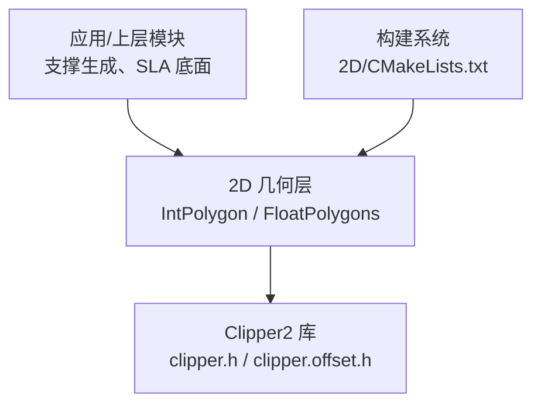
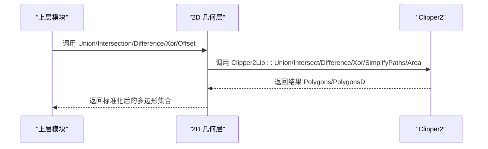
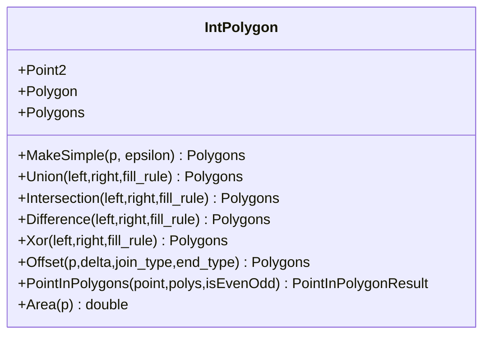
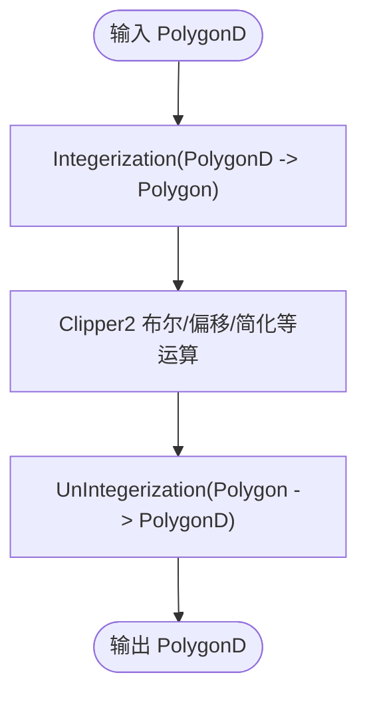
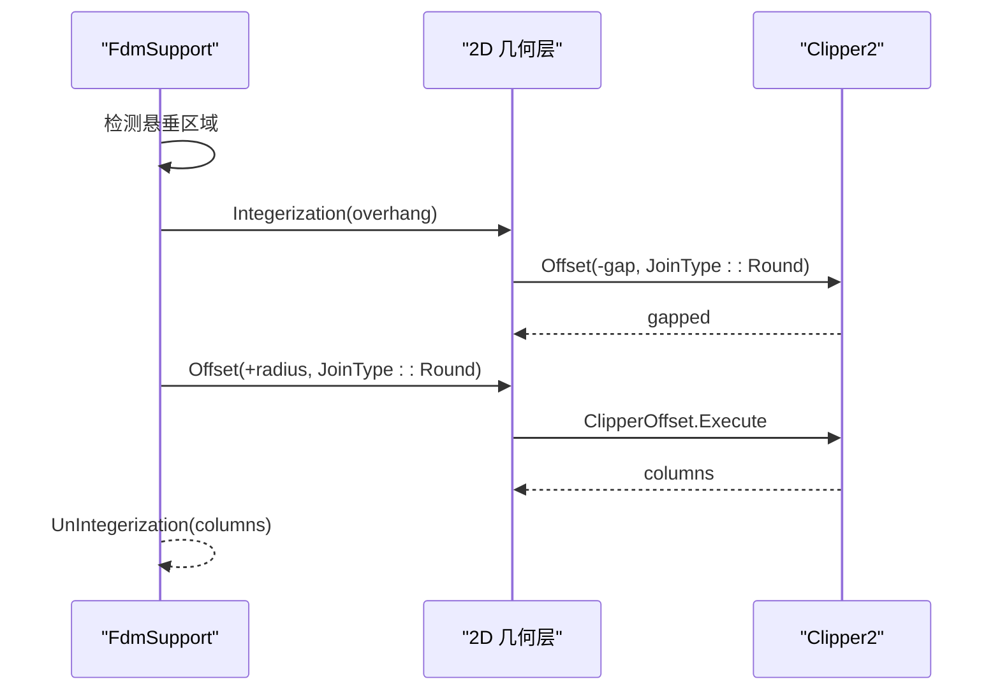
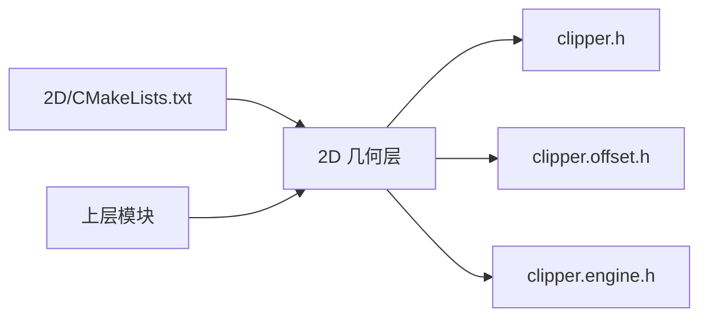

# Clipper2 库集成

<cite>
**本文引用的文件**   
- [IntPolygon.hpp](file://2D/IntPolygon.hpp)
- [IntPolygon.cpp](file://2D/IntPolygon.cpp)
- [FloatPolygons.hpp](file://2D/FloatPolygons.hpp)
- [FloatPolygons.cpp](file://2D/FloatPolygons.cpp)
- [FdmSupport.cpp](file://support/FdmSupport.cpp)
- [sla_floor.cpp](file://LibHsBaSlicer/Floor/sla_floor.cpp)
- [PolygonFill.cpp](file://2D/PolygonFill.cpp)
- [CMakeLists.txt](file://2D/CMakeLists.txt)
</cite>

## 目录
1. [引言](#引言)
2. [项目结构](#项目结构)
3. [核心组件](#核心组件)
4. [架构总览](#架构总览)
5. [详细组件分析](#详细组件分析)
6. [依赖关系分析](#依赖关系分析)
7. [性能与内存优化](#性能与内存优化)
8. [常见问题与排错](#常见问题与排错)
9. [结论](#结论)
10. [附录：常用操作速查](#附录常用操作速查)

## 引言
本文件面向几何算法开发者与图形学工程师，系统性梳理 HsBaSlicer 中 Clipper2 几何库的集成方式、API 使用模式、JoinType 枚举语义、对象生命周期与内存优化策略，并给出常见几何运算（并集、交集、差集、对称差）、偏移、路径连接与角度处理的具体实践。文档同时说明与支撑生成、填充等模块的数据转换流程，并提供性能调优建议与常见问题解决方案。

## 项目结构
Clipper2 在 HsBaSlicer 中的集成主要位于 2D 几何层与上层工艺模块：
- 2D 几何层提供整数坐标与双精度坐标两套多边形类型与统一 API，封装 Clipper2 布尔运算、偏移、简化、面积计算等能力。
- 支撑生成与 SLA 底面生成等上层模块通过 2D 几何层提供的接口进行几何运算，完成间隙收缩、圆角过渡、区域求交等操作。
- CMake 配置引入 PkgConfig::Clipper2，确保编译期链接 Clipper2。

图表来源
- [CMakeLists.txt:36-49](file://2D/CMakeLists.txt#L36-L49)
- [IntPolygon.hpp:9-10](file://2D/IntPolygon.hpp#L9-L10)
- [FloatPolygons.hpp:9-12](file://2D/FloatPolygons.hpp#L9-L12)

章节来源
- [CMakeLists.txt:36-49](file://2D/CMakeLists.txt#L36-L49)
- [IntPolygon.hpp:9-10](file://2D/IntPolygon.hpp#L9-L10)
- [FloatPolygons.hpp:9-12](file://2D/FloatPolygons.hpp#L9-L12)

## 核心组件
- 整数坐标多边形类型与 API：Point2、Polygon、Polygons，以及 MakeSimple、Union、Intersection、Difference、Xor、Offset、Area、PointInPolygons 等。
- 双精度坐标多边形类型与 API：Point2D、PolygonD、PolygonsD，以及对应的布尔运算、面积、形状构造（矩形、圆、椭圆、正多边形）、文本转轮廓、整型与浮点互转等。
- 上层模块对 2D 几何层的调用：支撑生成（平面、树形、蜂窝）与 SLA 底面生成中使用 Offset、Union、Intersect 等。

章节来源
- [IntPolygon.hpp:16-26](file://2D/IntPolygon.hpp#L16-L26)
- [IntPolygon.hpp:68-168](file://2D/IntPolygon.hpp#L68-L168)
- [FloatPolygons.hpp:18-25](file://2D/FloatPolygons.hpp#L18-L25)
- [FloatPolygons.hpp:43-135](file://2D/FloatPolygons.hpp#L43-L135)
- [FloatPolygons.hpp:137-221](file://2D/FloatPolygons.hpp#L137-L221)

## 架构总览
下图展示从上层模块到 Clipper2 的调用链与数据流向。

图表来源
- [IntPolygon.cpp:28-60](file://2D/IntPolygon.cpp#L28-L60)
- [FloatPolygons.cpp:34-66](file://2D/FloatPolygons.cpp#L34-L66)

## 详细组件分析

### 整数坐标多边形（IntPolygon）
- 类型定义：Point2=Clipper2Lib::Point64，Polygon=Path64，Polygons=Paths64。
- 布尔运算：对单条路径与路径集合分别提供 Union、Intersection、Difference、Xor，内部直接委托 Clipper2Lib 对应函数。
- 偏移：基于 Clipper2Lib::ClipperOffset，支持 JoinType 与 EndType 参数；提供单路径与路径集合两种重载。
- 简化与规范化：MakeSimple 去除共线点；MakeSimpleAndSplit 将自交或复杂路径拆分为简单多边形；NormalizeToSimplePolygons 进一步整理内外环关系。
- 点包含测试：PointInPolygons 支持 EvenOdd 与非 EvenOdd 规则，必要时先执行一次并集以统一为 EvenOdd。
- 面积：Area 直接调用 Clipper2Lib::Area。

图表来源
- [IntPolygon.hpp:16-26](file://2D/IntPolygon.hpp#L16-L26)
- [IntPolygon.hpp:68-168](file://2D/IntPolygon.hpp#L68-L168)
- [IntPolygon.cpp:28-77](file://2D/IntPolygon.cpp#L28-L77)

章节来源
- [IntPolygon.hpp:16-26](file://2D/IntPolygon.hpp#L16-L26)
- [IntPolygon.hpp:68-168](file://2D/IntPolygon.hpp#L68-L168)
- [IntPolygon.cpp:28-77](file://2D/IntPolygon.cpp#L28-L77)
- [IntPolygon.cpp:79-130](file://2D/IntPolygon.cpp#L79-L130)
- [IntPolygon.cpp:265-416](file://2D/IntPolygon.cpp#L265-L416)

### 双精度多边形（FloatPolygons）
- 类型定义：Point2D=Clipper2Lib::PointD，PolygonD=PathD，PolygonsD=PathsD。
- 布尔运算与面积：与 IntPolygon 类似，直接委托 Clipper2Lib。
- 形状构造：提供矩形、圆、椭圆、正多边形的构造方法。
- 文本转轮廓：可选 FreeType 后端，将字形轮廓采样为多边形。
- 整型与浮点互转：Integerization/UnIntegerization 使用固定缩放因子 integerization=1e6。

图表来源
- [FloatPolygons.cpp:176-213](file://2D/FloatPolygons.cpp#L176-L213)
- [FloatPolygons.hpp:196-221](file://2D/FloatPolygons.hpp#L196-L221)

章节来源
- [FloatPolygons.hpp:18-25](file://2D/FloatPolygons.hpp#L18-L25)
- [FloatPolygons.hpp:43-135](file://2D/FloatPolygons.hpp#L43-L135)
- [FloatPolygons.hpp:137-221](file://2D/FloatPolygons.hpp#L137-L221)
- [FloatPolygons.cpp:34-75](file://2D/FloatPolygons.cpp#L34-L75)
- [FloatPolygons.cpp:176-213](file://2D/FloatPolygons.cpp#L176-L213)

### 上层模块集成示例

#### FDM 支撑生成（平面、树形、蜂窝）
- 平面支撑：检测悬垂区域后，先按间隙收缩（负偏移），再按支撑直径膨胀（正偏移），均使用 Round 连接。
- 树形支撑：在悬垂区域内采样点生成圆形分支尖，最后用并集合并重叠圆。
- 蜂窝支撑：生成六边形网格，与悬垂区域做交集。

图表来源
- [FdmSupport.cpp:48-72](file://support/FdmSupport.cpp#L48-L72)
- [IntPolygon.cpp:62-77](file://2D/IntPolygon.cpp#L62-L77)

章节来源
- [FdmSupport.cpp:48-72](file://support/FdmSupport.cpp#L48-L72)
- [FdmSupport.cpp:131-149](file://support/FdmSupport.cpp#L131-L149)
- [FdmSupport.cpp:155-213](file://support/FdmSupport.cpp#L155-L213)

#### SLA 底面生成
- 使用 Round 连接进行外扩与内缩，形成边界与填充区域。

章节来源
- [sla_floor.cpp:50-70](file://LibHsBaSlicer/Floor/sla_floor.cpp#L50-L70)

#### 填充与复合偏移
- 填充模块在多种填充模式下，结合 Offset 与 FillMode 生成复合图案，并通过 Lua 暴露 join_type 参数（Square/Round/Miter）。

章节来源
- [PolygonFill.cpp:198-209](file://2D/PolygonFill.cpp#L198-L209)
- [PolygonFill.cpp:291-307](file://2D/PolygonFill.cpp#L291-L307)
- [PolygonFill.cpp:335-350](file://2D/PolygonFill.cpp#L335-L350)
- [PolygonFill.cpp:367-378](file://2D/PolygonFill.cpp#L367-L378)
- [PolygonFill.cpp:1179-1225](file://2D/PolygonFill.cpp#L1179-L1225)

## 依赖关系分析
- 2D 几何层直接依赖 Clipper2 头文件：clipper.h、clipper.offset.h、clipper.engine.h。
- 构建系统通过 PkgConfig::Clipper2 引入第三方库。
- 上层模块依赖 2D 几何层提供的稳定 API，避免直接耦合 Clipper2 细节。

图表来源
- [CMakeLists.txt:36-49](file://2D/CMakeLists.txt#L36-L49)
- [IntPolygon.hpp:9-10](file://2D/IntPolygon.hpp#L9-L10)
- [IntPolygon.cpp:15](file://2D/IntPolygon.cpp#L15)

章节来源
- [CMakeLists.txt:36-49](file://2D/CMakeLists.txt#L36-L49)
- [IntPolygon.hpp:9-10](file://2D/IntPolygon.hpp#L9-L10)
- [IntPolygon.cpp:15](file://2D/IntPolygon.cpp#L15)

## 性能与内存优化
- 优先使用整数坐标进行布尔与偏移运算：Clipper2 内部对整数坐标更高效且数值稳定性更好。项目中通过 integerization=1e6 将浮点坐标转换为整数坐标后再运算，最后再转回浮点。
- 批量操作：尽量对 Polygons 而非单个 Polygon 调用 Union/Intersect/Difference/Xor，减少重复分配与开销。
- 合理选择 JoinType：
  - Square：默认值，拐角处直角连接，适合快速计算与常规路径。
  - Round：圆角连接，常用于需要平滑过渡的场景（如支撑柱截面、底面边界）。
  - Miter：斜接连接，适合锐利外观但可能产生长尖刺，需配合 miter_limit 控制（由 Clipper2 内部处理）。
- 简化路径：在复杂模型上先调用 MakeSimple 去除共线点，可降低后续布尔运算复杂度。
- 复用对象：ClipperOffset 每次 Execute 前 AddPath/AddPaths，注意不要重复添加相同路径；对于多次偏移，可考虑缓存中间结果。
- 面积与方向：Area 的正负表示方向，用于判断内外环与点包含逻辑，避免不必要的反向处理。

章节来源
- [IntPolygon.hpp:16-17](file://2D/IntPolygon.hpp#L16-L17)
- [IntPolygon.cpp:19-26](file://2D/IntPolygon.cpp#L19-L26)
- [IntPolygon.cpp:62-77](file://2D/IntPolygon.cpp#L62-L77)
- [FloatPolygons.cpp:176-213](file://2D/FloatPolygons.cpp#L176-L213)

## 常见问题与排错
- 浮点精度问题：直接使用浮点多边形进行布尔运算可能出现微小误差。建议在关键步骤使用 Integerization 转为整数坐标后再运算。
- 非 EvenOdd 规则下的点包含：PointInPolygons 在非 EvenOdd 模式下会先执行一次并集转换为 EvenOdd，以避免方向歧义导致的误判。
- 偏移结果为空：当负偏移距离过大导致路径自交或退化时，Offset 可能返回空结果。应检查 gap 与半径参数，或分步偏移。
- JoinType 选择不当：Miter 在锐角处可能产生异常尖刺，Round 更稳健；Square 速度最快但拐角不光滑。根据场景选择合适的连接类型。
- 文本转轮廓失败：若未启用 FreeType 宏 HSBA_HAVE_FREETYPE，TextToPolygons 会抛出异常。请确保编译选项正确。

章节来源
- [IntPolygon.cpp:79-121](file://2D/IntPolygon.cpp#L79-L121)
- [FloatPolygons.cpp:346-407](file://2D/FloatPolygons.cpp#L346-L407)
- [FdmSupport.cpp:57-71](file://support/FdmSupport.cpp#L57-L71)

## 结论
HsBaSlicer 通过 2D 几何层对 Clipper2 进行了清晰封装，提供整数与浮点两套多边形 API，并在上层工艺模块中广泛使用布尔运算、偏移与连接类型控制。实践中推荐优先使用整数坐标进行几何运算，合理选择 JoinType，并结合 MakeSimple 与批量操作提升性能。支撑生成与 SLA 底面生成展示了典型的数据转换与几何处理流程，可作为其他模块集成的参考范式。

## 附录：常用操作速查
- 布尔运算（单路径）：
  - 并集：Union(left, right, fill_rule)
  - 交集：Intersection(left, right, fill_rule)
  - 差集：Difference(left, right, fill_rule)
  - 对称差：Xor(left, right, fill_rule)
- 布尔运算（路径集合）：
  - Union(left, right, fill_rule)
  - Intersection(left, right, fill_rule)
  - Difference(left, right, fill_rule)
  - Xor(left, right, fill_rule)
- 偏移：
  - Offset(p, delta, join_type=Square, end_type=Polygon)
  - Offset(ps, delta, join_type=Square, end_type=Polygon)
- 简化与规范化：
  - MakeSimple(p, epsilon)
  - MakeSimpleAndSplit(p, epsilon)
  - NormalizeToSimplePolygons(p, epsilon)
- 点包含与面积：
  - PointInPolygons(point, polys, isEvenOdd=true)
  - Area(p) / Area(polys)
- 形状构造（浮点）：
  - MakeRectangle(x, y, width, height)
  - MakeCircle(cx, cy, radius, segments=64)
  - MakeEllipse(cx, cy, rx, ry, segments=64, rotation=0)
  - MakeRegularPolygon(cx, cy, radius, sides, rotation=0)
- 文本转轮廓（可选 FreeType）：
  - TextToPolygons(utf8_text, font_file, font_size, x=0, y=0, curve_segments=8)
- 整型与浮点互转：
  - Integerization(PolygonD) / Integerization(PolygonsD)
  - UnIntegerization(Polygon) / UnIntegerization(Polygons)

章节来源
- [IntPolygon.hpp:68-168](file://2D/IntPolygon.hpp#L68-L168)
- [FloatPolygons.hpp:43-135](file://2D/FloatPolygons.hpp#L43-L135)
- [FloatPolygons.hpp:137-221](file://2D/FloatPolygons.hpp#L137-L221)
- [IntPolygon.cpp:28-77](file://2D/IntPolygon.cpp#L28-L77)
- [FloatPolygons.cpp:34-75](file://2D/FloatPolygons.cpp#L34-L75)
- [FloatPolygons.cpp:176-213](file://2D/FloatPolygons.cpp#L176-L213)