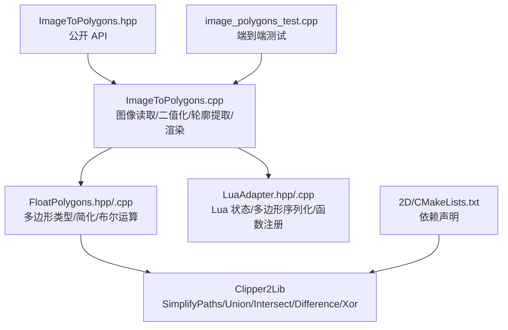
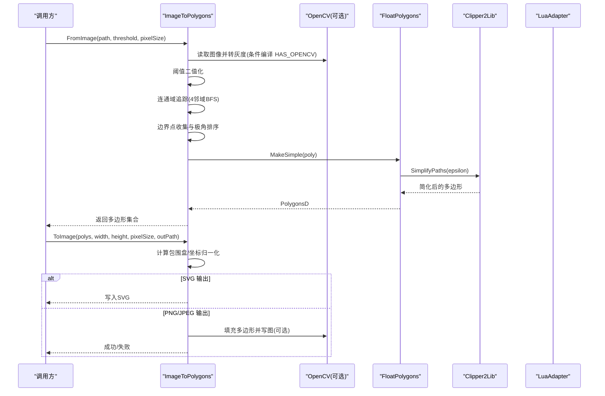
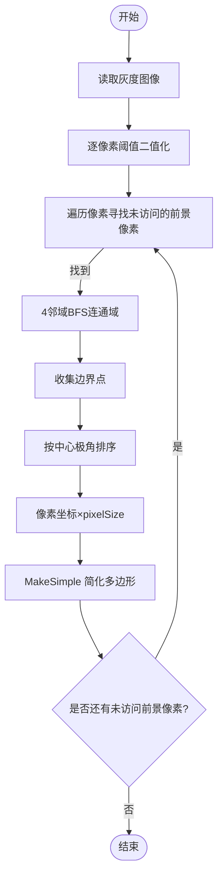
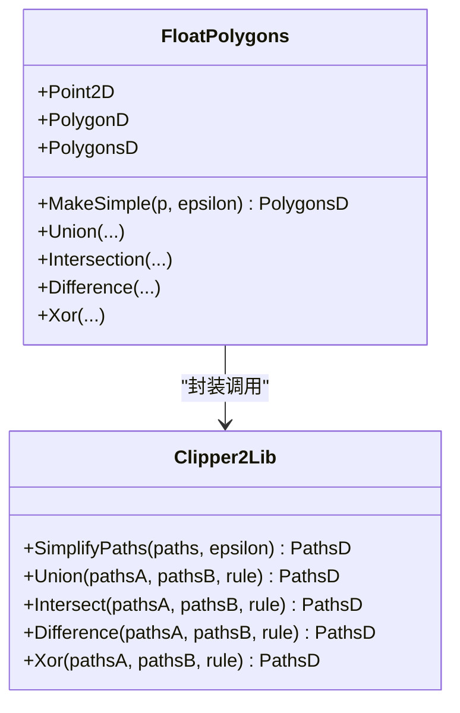
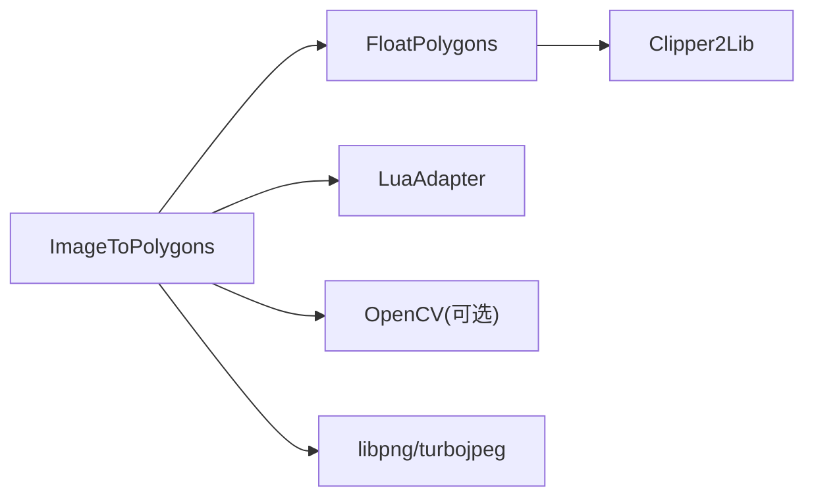

# 图像到多边形转换

<cite>
**本文引用的文件**   
- [ImageToPolygons.hpp](file://2D/ImageToPolygons.hpp)
- [ImageToPolygons.cpp](file://2D/ImageToPolygons.cpp)
- [FloatPolygons.hpp](file://2D/FloatPolygons.hpp)
- [FloatPolygons.cpp](file://2D/FloatPolygons.cpp)
- [LuaAdapter.hpp](file://2D/LuaAdapter.hpp)
- [LuaAdapter.cpp](file://2D/LuaAdapter.cpp)
- [image_polygons_test.cpp](file://tests/PolygonFill/image_polygons_test.cpp)
- [CMakeLists.txt（2D）](file://2D/CMakeLists.txt)
</cite>

## 目录
1. [简介](#简介)
2. [项目结构](#项目结构)
3. [核心组件](#核心组件)
4. [架构总览](#架构总览)
5. [详细组件分析](#详细组件分析)
6. [依赖关系分析](#依赖关系分析)
7. [性能与优化](#性能与优化)
8. [参数配置与调优指南](#参数配置与调优指南)
9. [质量控制与验证](#质量控制与验证)
10. [错误处理与异常](#错误处理与异常)
11. [使用示例](#使用示例)
12. [结论](#结论)

## 简介
本技术文档聚焦 HsBaSlicer 的“图像到多边形”转换能力，系统阐述从栅格图像提取轮廓、二值化、连通域追踪、边界排序、多边形简化，以及将多边形渲染回图像的完整流程。文档同时说明输入图像格式支持、颜色空间处理策略、阈值与像素尺寸等关键参数，以及与 Clipper2 库的集成方式、Lua 扩展机制和错误处理策略，面向图像处理开发者与计算机视觉工程师提供可落地的工程指导。

## 项目结构
与图像到多边形转换直接相关的代码位于 2D 模块：
- 接口与实现：ImageToPolygons.hpp/.cpp
- 多边形类型与布尔运算、简化：FloatPolygons.hpp/.cpp
- Lua 适配器与多边形操作注册：LuaAdapter.hpp/.cpp
- 单元测试覆盖主要用例：tests/PolygonFill/image_polygons_test.cpp
- 构建配置中声明 Clipper2 依赖：2D/CMakeLists.txt

图表来源
- [ImageToPolygons.hpp:1-83](file://2D/ImageToPolygons.hpp#L1-L83)
- [ImageToPolygons.cpp:1-549](file://2D/ImageToPolygons.cpp#L1-L549)
- [FloatPolygons.hpp:1-271](file://2D/FloatPolygons.hpp#L1-L271)
- [FloatPolygons.cpp:1-431](file://2D/FloatPolygons.cpp#L1-L431)
- [LuaAdapter.hpp:48-84](file://2D/LuaAdapter.hpp#L48-L84)
- [LuaAdapter.cpp:272-421](file://2D/LuaAdapter.cpp#L272-L421)
- [image_polygons_test.cpp:1-292](file://tests/PolygonFill/image_polygons_test.cpp#L1-L292)
- [CMakeLists.txt（2D）](file://2D/CMakeLists.txt)

章节来源
- [ImageToPolygons.hpp:1-83](file://2D/ImageToPolygons.hpp#L1-L83)
- [ImageToPolygons.cpp:1-549](file://2D/ImageToPolygons.cpp#L1-L549)
- [FloatPolygons.hpp:1-271](file://2D/FloatPolygons.hpp#L1-L271)
- [FloatPolygons.cpp:1-431](file://2D/FloatPolygons.cpp#L1-L431)
- [LuaAdapter.hpp:48-84](file://2D/LuaAdapter.hpp#L48-L84)
- [LuaAdapter.cpp:272-421](file://2D/LuaAdapter.cpp#L272-L421)
- [image_polygons_test.cpp:1-292](file://tests/PolygonFill/image_polygons_test.cpp#L1-L292)
- [CMakeLists.txt（2D）](file://2D/CMakeLists.txt)

## 核心组件
- 图像到多边形接口
  - FromImage：单阈值图像转多边形
  - FromImageMulti：多阈值批量转多边形
  - ToImage：多边形转 PNG/SVG/JPEG（可选 OpenCV 路径）
  - LuaToImage / LuaToImageString：通过 Lua 脚本生成灰度图并保存
- 多边形基础与简化
  - Point2D/PolygonD/PolygonsD：基于 Clipper2 的双精度类型别名
  - MakeSimple：调用 Clipper2Lib::SimplifyPaths 进行共线点移除与拓扑清理
- Lua 适配
  - PushPolygonsDToLua / RegisterLuaPolygonOperations：多边形数据在 C++ 与 Lua 间传递，并提供布尔运算等函数

章节来源
- [ImageToPolygons.hpp:22-79](file://2D/ImageToPolygons.hpp#L22-L79)
- [FloatPolygons.hpp:18-41](file://2D/FloatPolygons.hpp#L18-L41)
- [FloatPolygons.cpp:25-31](file://2D/FloatPolygons.cpp#L25-L31)
- [LuaAdapter.cpp:272-296](file://2D/LuaAdapter.cpp#L272-L296)
- [LuaAdapter.cpp:415-419](file://2D/LuaAdapter.cpp#L415-L419)

## 架构总览
下图展示从图像输入到多边形输出，再到图像输出的整体数据流与关键依赖。

图表来源
- [ImageToPolygons.cpp:34-65](file://2D/ImageToPolygons.cpp#L34-L65)
- [ImageToPolygons.cpp:87-174](file://2D/ImageToPolygons.cpp#L87-L174)
- [ImageToPolygons.cpp:291-393](file://2D/ImageToPolygons.cpp#L291-L393)
- [FloatPolygons.cpp:25-31](file://2D/FloatPolygons.cpp#L25-L31)

## 详细组件分析

### 图像读取与颜色空间处理
- 若启用 OpenCV（HAS_OPENCV），则使用 cv::imread 读取图像；若为多通道，则转换为灰度图（BGR→GRAY）。
- 未启用 OpenCV 时，LoadImageGray 返回失败，上层调用者应做空结果处理。
- 灰度图以行优先顺序拷贝到 std::vector<uint8_t>，便于后续二值化与连通域遍历。

章节来源
- [ImageToPolygons.cpp:34-65](file://2D/ImageToPolygons.cpp#L34-L65)

### 二值化与阈值策略
- FromImage 内部委托 FromImageMulti，传入单元素阈值向量。
- FromImageMulti 对每个阈值执行：
  - 按像素比较 img[i] > threshold，得到二值图像（前景=MAX_GRAY_VALUE，背景=0）。
  - 调用 ExtractContoursFromBinary 提取轮廓。
- 支持多阈值分层提取，适合灰度图像的多层次结构分离。

章节来源
- [ImageToPolygons.cpp:282-288](file://2D/ImageToPolygons.cpp#L282-L288)
- [ImageToPolygons.cpp:395-415](file://2D/ImageToPolygons.cpp#L395-L415)

### 轮廓追踪与边界排序
- 连通域追踪：
  - 使用队列 BFS 与 4-邻域规则扫描像素，标记已访问 seen[]。
  - 对每个连通域收集其边界点（至少一个相邻像素为背景或越界）。
- 边界排序：
  - 计算边界点的几何中心，按 atan2 角度排序，形成闭合环。
- 坐标缩放：
  - 将像素坐标乘以 pixelSize 映射到输出坐标系。
- 多边形简化：
  - 调用 MakeSimple 去除共线点并保证简单多边形。

图表来源
- [ImageToPolygons.cpp:87-174](file://2D/ImageToPolygons.cpp#L87-L174)
- [FloatPolygons.cpp:25-31](file://2D/FloatPolygons.cpp#L25-L31)

章节来源
- [ImageToPolygons.cpp:87-174](file://2D/ImageToPolygons.cpp#L87-L174)

### 多边形简化与 Clipper2 集成
- FloatPolygons 将 Point2D/PolygonD/PolygonsD 定义为 Clipper2Lib 的类型别名。
- MakeSimple 直接调用 Clipper2Lib::SimplifyPaths，默认 epsilon 较小，用于移除近似共线的顶点并修复自交等拓扑问题。
- 其他布尔运算（Union/Intersection/Difference/Xor）也通过 Clipper2Lib 暴露。

图表来源
- [FloatPolygons.hpp:18-41](file://2D/FloatPolygons.hpp#L18-L41)
- [FloatPolygons.cpp:25-66](file://2D/FloatPolygons.cpp#L25-L66)

章节来源
- [FloatPolygons.hpp:18-41](file://2D/FloatPolygons.hpp#L18-L41)
- [FloatPolygons.cpp:25-66](file://2D/FloatPolygons.cpp#L25-L66)

### 多边形渲染回图像
- ToImage 首先计算所有多边形的包围盒，并将坐标归一化到像素网格。
- 输出格式判断：
  - .svg：直接写入矢量 SVG，包含背景矩形与多边形 points。
  - 有 OpenCV：使用 cv::fillPoly 填充后 imwrite 保存 PNG。
  - 无 OpenCV：手动光栅化 pointInPolygon 判定，再根据后缀选择 PNG 或 JPEG 保存。
- 空多边形会被跳过，非正宽高或无有效边界会返回失败。

章节来源
- [ImageToPolygons.cpp:291-393](file://2D/ImageToPolygons.cpp#L291-L393)

### Lua 驱动图像生成
- LuaToImage / LuaToImageString：
  - 创建独立 Lua 状态，加载标准库，注册 PolygonOperations。
  - 支持外部脚本文件或内联脚本字符串。
  - 将 PolygonsD 序列化为 Lua 表，调用用户函数，期望返回灰度图像字节表。
  - 校验返回值类型与元素类型，写出到文件系统。
- 错误处理：
  - 脚本加载失败、函数不存在、函数调用异常、返回非表或非整数元素均抛出 RuntimeError。
  - 空输出路径短路返回 false，不抛异常。

章节来源
- [ImageToPolygons.cpp:417-478](file://2D/ImageToPolygons.cpp#L417-L478)
- [ImageToPolygons.cpp:480-546](file://2D/ImageToPolygons.cpp#L480-L546)
- [LuaAdapter.cpp:272-296](file://2D/LuaAdapter.cpp#L272-L296)
- [LuaAdapter.cpp:415-419](file://2D/LuaAdapter.cpp#L415-L419)

## 依赖关系分析
- 外部库
  - Clipper2：多边形简化与布尔运算（由 FloatPolygons 封装）。
  - OpenCV（可选）：图像 IO、灰度转换、多边形填充。
  - libpng/turbojpeg：在无 OpenCV 时的 PNG/JPEG 编码。
  - Lua：脚本引擎与回调注册。
- 构建配置
  - 2D/CMakeLists.txt 引入 PkgConfig::Clipper2，确保链接 Clipper2。

图表来源
- [FloatPolygons.cpp:25-66](file://2D/FloatPolygons.cpp#L25-L66)
- [ImageToPolygons.cpp:15-26](file://2D/ImageToPolygons.cpp#L15-L26)
- [CMakeLists.txt（2D）](file://2D/CMakeLists.txt)

章节来源
- [FloatPolygons.cpp:25-66](file://2D/FloatPolygons.cpp#L25-L66)
- [ImageToPolygons.cpp:15-26](file://2D/ImageToPolygons.cpp#L15-L26)
- [CMakeLists.txt（2D）](file://2D/CMakeLists.txt)

## 性能与优化
- 图像读取与灰度转换
  - 使用 OpenCV 的 imread/cvtColor 在大多数平台上更高效且稳定。
- 二值化
  - 向量化或 SIMD 可加速逐像素比较，但当前实现已足够轻量。
- 连通域追踪
  - 4-邻域 BFS 时间复杂度约 O(WH)，内存占用 O(WH)。对于大图建议分块或降低分辨率。
- 边界排序
  - 每连通域排序复杂度 O(B log B)，B 为边界点数。可通过增量排序或更简单的链式跟踪进一步优化，但当前实现简洁可靠。
- 多边形简化
  - Clipper2::SimplifyPaths 内部高效，合理设置 epsilon 可在保形与简化之间权衡。
- 渲染回图像
  - 有 OpenCV 时使用 cv::fillPoly 比手工 pointInPolygon 更快。
  - SVG 输出避免光栅化开销，适合矢量场景。

[本节为通用性能讨论，不直接分析具体文件]

## 参数配置与调优指南
- 阈值 threshold
  - 控制二值化的亮度分界。较低阈值保留更多暗部细节，较高阈值仅保留亮部。
  - 多阈值场景下，可分别提取不同灰度层级对应的多边形层。
- 像素尺寸 pixelSize
  - 将像素坐标缩放到输出坐标系。例如 1.0 表示 1 像素 = 1 单位长度。
  - 影响最终多边形尺寸与后续路径生成的物理尺度。
- 简化精度 epsilon（MakeSimple）
  - 默认值较小，移除近似共线点并修复轻微自交。增大 epsilon 可显著减少顶点数，但可能损失细节。
- 渲染参数
  - width/height：输出图像尺寸。
  - foreground/background：前景/背景灰度值。
  - 输出格式：.svg 矢量输出；.png/.jpg 光栅输出。

章节来源
- [ImageToPolygons.hpp:22-79](file://2D/ImageToPolygons.hpp#L22-L79)
- [FloatPolygons.hpp:27-41](file://2D/FloatPolygons.hpp#L27-L41)
- [ImageToPolygons.cpp:291-393](file://2D/ImageToPolygons.cpp#L291-L393)

## 质量控制与验证
- 单元测试覆盖
  - 单阈值与多阈值提取正确性。
  - ToImage 输出 PNG/SVG 存在性与坐标归一化。
  - 缺失输入路径返回空结果而非异常。
  - 非法输入（零/负宽高、空多边形、不可写目录）返回失败。
  - Lua 渲染的错误分支与回调注册行为。
- 建议的质量检查
  - 面积一致性：简化前后面积变化应在允许误差范围内。
  - 边界完整性：渲染回图与原图对比，评估阈值与像素尺寸选择的合理性。
  - 顶点数量统计：监控简化效果，避免过度简化导致形状失真。

章节来源
- [image_polygons_test.cpp:24-80](file://tests/PolygonFill/image_polygons_test.cpp#L24-L80)
- [image_polygons_test.cpp:82-103](file://tests/PolygonFill/image_polygons_test.cpp#L82-L103)
- [image_polygons_test.cpp:170-190](file://tests/PolygonFill/image_polygons_test.cpp#L170-L190)
- [image_polygons_test.cpp:212-230](file://tests/PolygonFill/image_polygons_test.cpp#L212-L230)
- [image_polygons_test.cpp:232-292](file://tests/PolygonFill/image_polygons_test.cpp#L232-L292)

## 错误处理与异常
- 图像读取失败
  - LoadImageGray 返回 false，FromImage/FromImageMulti 返回空结果。
- 渲染失败
  - ToImage 在非正宽高、无有效边界、无法打开输出文件时返回 false。
- Lua 渲染异常
  - 脚本加载失败、函数不存在、函数调用异常、返回非表或非整数元素均抛出 RuntimeError。
  - 空输出路径短路返回 false，不抛异常。
- 资源释放
  - 使用 RAII 管理 Lua 状态与文件句柄，确保异常路径也能正确释放。

章节来源
- [ImageToPolygons.cpp:34-65](file://2D/ImageToPolygons.cpp#L34-L65)
- [ImageToPolygons.cpp:291-393](file://2D/ImageToPolygons.cpp#L291-L393)
- [ImageToPolygons.cpp:417-546](file://2D/ImageToPolygons.cpp#L417-L546)

## 使用示例
以下示例描述典型用法与参数调优思路，不包含具体代码内容。

- 单阈值提取
  - 步骤：指定图像路径、阈值、像素尺寸，调用 FromImage。
  - 适用：单一灰度对象或清晰前景。
- 多阈值分层提取
  - 步骤：构造阈值数组，调用 FromImageMulti，得到多层多边形集合。
  - 适用：灰度图像中包含多个强度层级，需要分层建模。
- 渲染回图像
  - 步骤：准备 PolygonsD，设置输出宽高与像素尺寸，调用 ToImage。
  - 输出：.svg 矢量图；.png/.jpg 光栅图。
- Lua 自定义渲染
  - 步骤：编写 generate_image 函数，接收 PolygonsD，返回灰度字节表。
  - 调用：LuaToImage 或 LuaToImageString，指定脚本路径或脚本字符串。
- 参数调优建议
  - 阈值：先观察直方图，选取明显谷值作为初始阈值；多阈值时逐步细化。
  - pixelSize：根据目标物理尺寸与分辨率设定，保持与下游路径生成一致。
  - epsilon：从默认值开始，逐步增大直至顶点数满足需求且形状不失真。

章节来源
- [image_polygons_test.cpp:24-80](file://tests/PolygonFill/image_polygons_test.cpp#L24-L80)
- [image_polygons_test.cpp:105-153](file://tests/PolygonFill/image_polygons_test.cpp#L105-L153)

## 结论
HsBaSlicer 的图像到多边形转换模块提供了从图像读取、灰度转换、阈值二值化、连通域追踪、边界排序到多边形简化的完整链路，并通过 Clipper2 保障拓扑质量与布尔运算能力。该模块同时支持多阈值分层提取、多种输出格式与 Lua 驱动的自定义渲染，具备完善的错误处理与单元测试覆盖。在实际工程中，建议结合图像直方图与目标物理尺度选择合适的阈值与 pixelSize，并通过 epsilon 平衡简化程度与形状保真度，以获得高质量的多边形结果。