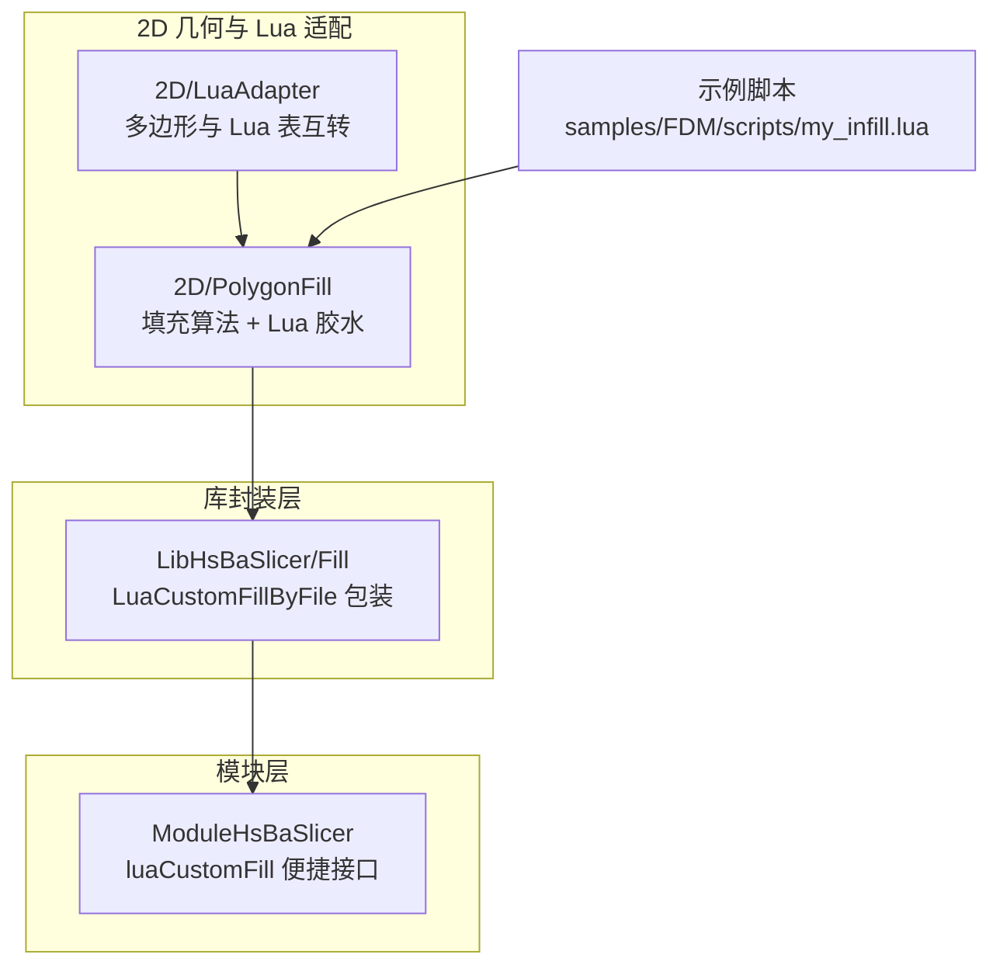
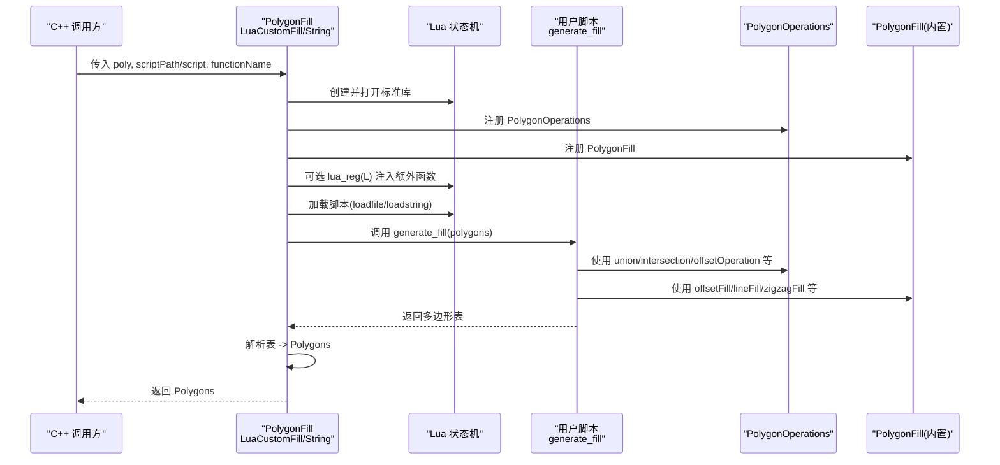
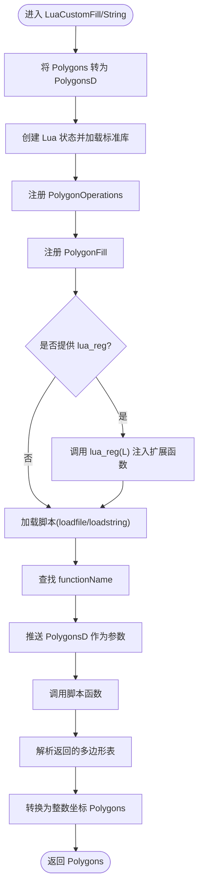
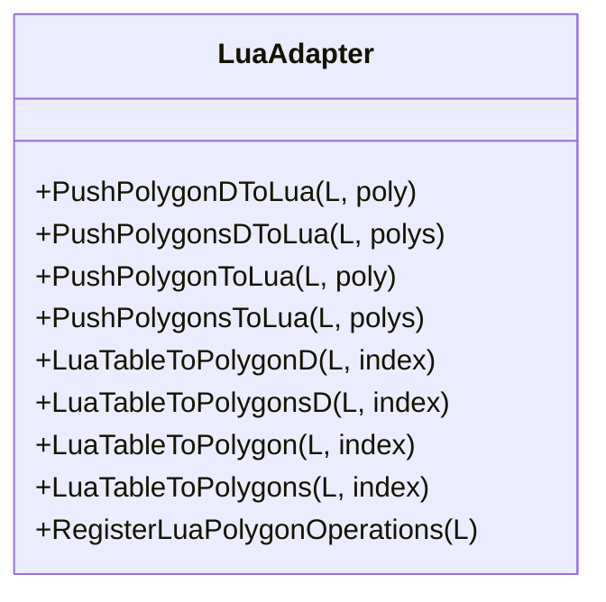
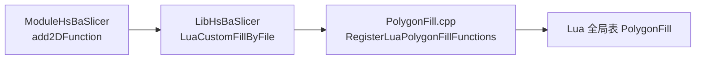
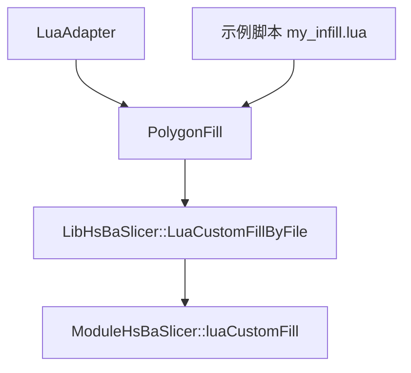

# Lua自定义填充

<cite>
**本文引用的文件**   
- [PolygonFill.hpp](file://2D/PolygonFill.hpp)
- [PolygonFill.cpp](file://2D/PolygonFill.cpp)
- [LuaAdapter.hpp](file://2D/LuaAdapter.hpp)
- [LuaAdapter.cpp](file://2D/LuaAdapter.cpp)
- [polygon_fill.hpp](file://LibHsBaSlicer/Fill/polygon_fill.hpp)
- [polygon_fill.cpp](file://LibHsBaSlicer/Fill/polygon_fill.cpp)
- [hsba_slicer.cppm](file://ModuleHsBaSlicer/hsba_slicer.cppm)
- [my_infill.lua](file://samples/FDM/scripts/my_infill.lua)
</cite>

## 目录
1. [引言](#引言)
2. [项目结构](#项目结构)
3. [核心组件](#核心组件)
4. [架构总览](#架构总览)
5. [详细组件分析](#详细组件分析)
6. [依赖关系分析](#依赖关系分析)
7. [性能与优化建议](#性能与优化建议)
8. [调试与排错指南](#调试与排错指南)
9. [安全与沙箱说明](#安全与沙箱说明)
10. [结论](#结论)
11. [附录：脚本编写规范与示例](#附录脚本编写规范与示例)

## 引言
本文面向 HsBaSlicer 的 Lua 自定义填充系统，系统性解释以下能力：
- 通过 C++ 暴露给 Lua 的填充函数（如 offsetFill、lineFill、zigzagFill 等）如何被注册并调用。
- LuaCustomFill 与 LuaCustomFillString 的实现机制：Lua 环境初始化、C++ 与 Lua 的数据绑定、函数调用接口。
- 脚本编写规范：generate_fill 函数的签名要求、输入输出数据结构、可用的内置函数和工具类。
- RegisterLuaPolygonFillFunctions 的作用与扩展机制。
- 脚本调试技巧、性能优化建议和错误处理方法。
- 安全考虑与沙箱机制说明。

本指南既适合脚本开发者快速上手，也适合算法扩展开发者深入理解实现细节。

## 项目结构
与 Lua 自定义填充直接相关的代码主要分布在以下模块：
- 2D 几何与 Lua 适配器：提供多边形类型、坐标转换、布尔运算、偏移、凸包、文本转多边形等能力，并通过 Lua 表进行数据交换。
- PolygonFill：实现多种填充算法，并提供 Lua 胶水函数与脚本执行入口。
- LibHsBaSlicer 封装层：对外暴露更高层 API，并在默认环境中注入路径优化相关函数。
- ModuleHsBaSlicer 模块层：为上层模块提供便捷内联函数与外部函数注册通道。
- 示例脚本：展示 generate_fill 的标准写法与常用工具用法。

图表来源
- [LuaAdapter.cpp:251-419](file://2D/LuaAdapter.cpp#L251-L419)
- [PolygonFill.cpp:406-420](file://2D/PolygonFill.cpp#L406-L420)
- [polygon_fill.cpp:36-48](file://LibHsBaSlicer/Fill/polygon_fill.cpp#L36-L48)
- [hsba_slicer.cppm:1183-1188](file://ModuleHsBaSlicer/hsba_slicer.cppm#L1183-L1188)
- [my_infill.lua:1-89](file://samples/FDM/scripts/my_infill.lua#L1-L89)

章节来源
- [PolygonFill.hpp:106-136](file://2D/PolygonFill.hpp#L106-L136)
- [LuaAdapter.hpp:16-81](file://2D/LuaAdapter.hpp#L16-L81)
- [polygon_fill.hpp:41-53](file://LibHsBaSlicer/Fill/polygon_fill.hpp#L41-L53)

## 核心组件
本节聚焦与“Lua 自定义填充”最密切的核心组件及其职责：
- PolygonFill.hpp/.cpp：定义并实现多种填充算法；将 C++ 填充函数注册到 Lua 全局表 PolygonFill；提供 LuaCustomFill 与 LuaCustomFillString 两个入口。
- LuaAdapter.hpp/.cpp：负责 C++ 多边形与 Lua 表之间的双向转换；将布尔运算、偏移、凸包、面积、图形构造、文本转多边形等能力注册到 Lua 全局表 PolygonOperations。
- LibHsBaSlicer/Fill/polygon_fill.*：在更高一层封装 LuaCustomFillByFile，自动注入 2D 函数与路径优化函数。
- ModuleHsBaSlicer/hsba_slicer.cppm：提供 luaCustomFill 等便捷内联函数，以及 add2DFunction 等外部函数注册通道。

章节来源
- [PolygonFill.hpp:106-136](file://2D/PolygonFill.hpp#L106-L136)
- [LuaAdapter.hpp:16-81](file://2D/LuaAdapter.hpp#L16-L81)
- [polygon_fill.hpp:41-53](file://LibHsBaSlicer/Fill/polygon_fill.hpp#L41-L53)
- [hsba_slicer.cppm:485-498](file://ModuleHsBaSlicer/hsba_slicer.cppm#L485-L498)

## 架构总览
下图展示了从 C++ 调用到 Lua 脚本执行的完整流程，包括环境初始化、函数注册、参数传递与结果解析。

图表来源
- [PolygonFill.cpp:1283-1369](file://2D/PolygonFill.cpp#L1283-L1369)
- [PolygonFill.cpp:1371-1446](file://2D/PolygonFill.cpp#L1371-L1446)
- [LuaAdapter.cpp:251-419](file://2D/LuaAdapter.cpp#L251-L419)
- [PolygonFill.cpp:406-420](file://2D/PolygonFill.cpp#L406-L420)

## 详细组件分析

### 1) LuaCustomFill 与 LuaCustomFillString 实现机制
这两个函数是 C++ 与 Lua 脚本之间的桥梁，核心步骤如下：
- 将整数坐标多边形转换为浮点坐标多边形，便于 Lua 侧处理。
- 创建独立的 Lua 状态，并加载标准库。
- 注册 PolygonOperations（布尔运算、偏移、凸包、面积、图形构造、文本转多边形）。
- 注册 PolygonFill（offsetFill、lineFill、simpleZigzagFill、zigzagFill、compositeOffsetFill、hybridFill、offsetOnly）。
- 若提供 lua_reg 回调，则允许外部扩展向当前 Lua 状态注入更多函数。
- 加载脚本（文件或字符串），查找并调用 functionName（默认 generate_fill）。
- 将 PolygonsD 作为唯一参数传入脚本函数，期望返回一个多边形表。
- 解析返回表，将每个子表视为一个多边形，转换为整数坐标 Polygons 后返回。

图表来源
- [PolygonFill.cpp:1283-1369](file://2D/PolygonFill.cpp#L1283-L1369)
- [PolygonFill.cpp:1371-1446](file://2D/PolygonFill.cpp#L1371-L1446)

章节来源
- [PolygonFill.cpp:1283-1369](file://2D/PolygonFill.cpp#L1283-L1369)
- [PolygonFill.cpp:1371-1446](file://2D/PolygonFill.cpp#L1371-L1446)

### 2) C++ 与 Lua 的数据绑定
数据绑定由 LuaAdapter 提供，关键能力包括：
- 将 C++ 多边形（Point2/Point2D）序列化为 Lua 表：每个点是 {x=..., y=...} 的表，多边形是点的数组，多个多边形是多边形的数组。
- 将 Lua 表反序列化为 C++ 多边形：支持浮点与整数两种精度。
- 将几何操作函数注册到 Lua 全局表 PolygonOperations，供脚本调用。

图表来源
- [LuaAdapter.hpp:16-81](file://2D/LuaAdapter.hpp#L16-L81)
- [LuaAdapter.cpp:251-419](file://2D/LuaAdapter.cpp#L251-L419)

章节来源
- [LuaAdapter.hpp:16-81](file://2D/LuaAdapter.hpp#L16-L81)
- [LuaAdapter.cpp:251-419](file://2D/LuaAdapter.cpp#L251-L419)

### 3) 函数调用接口与脚本约定
- 入口函数名：默认 generate_fill，可通过 functionName 参数指定。
- 输入参数：polygons，类型为多边形表（数组的多边形，每个多边形是点的数组，点为 {x,y}）。
- 返回值：多边形表，表示填充路径或区域。
- 可用内置函数：
  - PolygonOperations：booleanOperation、union、intersection、difference、xor、offsetOperation、convexHullOperation、concaveHullOperation、area、makeRectangle、makeCircle、makeEllipse、makeRegularPolygon、textToPolygons。
  - PolygonFill：offsetFill、lineFill、simpleZigzagFill、zigzagFill、compositeOffsetFill、hybridFill、offsetOnly。

章节来源
- [PolygonFill.cpp:185-420](file://2D/PolygonFill.cpp#L185-L420)
- [LuaAdapter.cpp:251-419](file://2D/LuaAdapter.cpp#L251-L419)

### 4) RegisterLuaPolygonFillFunctions 的作用与扩展机制
- 作用：将 PolygonFill 内置函数注册到 Lua 全局表 PolygonFill，使脚本可直接调用这些填充算法。
- 扩展机制：
  - 通过 LuaCustomFill/String 的 lua_reg 回调，可以在脚本加载前注入额外的函数或模块。
  - LibHsBaSlicer 层的 LuaCustomFillByFile 会组合外部 2D 函数与路径优化函数，再传给底层 LuaCustomFill。
  - ModuleHsBaSlicer 提供 add2DFunction 等接口，用于统一注册跨阶段（Support、Fill、SLA 输出）的 2D 函数。

图表来源
- [PolygonFill.cpp:406-420](file://2D/PolygonFill.cpp#L406-L420)
- [polygon_fill.cpp:36-48](file://LibHsBaSlicer/Fill/polygon_fill.cpp#L36-L48)
- [hsba_slicer.cppm:1208-1214](file://ModuleHsBaSlicer/hsba_slicer.cppm#L1208-L1214)

章节来源
- [PolygonFill.cpp:406-420](file://2D/PolygonFill.cpp#L406-L420)
- [polygon_fill.cpp:36-48](file://LibHsBaSlicer/Fill/polygon_fill.cpp#L36-L48)
- [hsba_slicer.cppm:1208-1214](file://ModuleHsBaSlicer/hsba_slicer.cppm#L1208-L1214)

### 5) 脚本编写规范与示例
- 脚本必须导出一个名为 generate_fill 的函数（或通过 functionName 指定其他名称）。
- 该函数接收一个多边形表，返回一个多边形表。
- 推荐使用 PolygonOperations 进行几何计算，使用 PolygonFill 进行填充生成。
- 示例脚本 my_infill.lua 展示了：
  - 读取 current_layer 边界框。
  - 根据间距与角度生成平行线矩形。
  - 使用 intersection 裁剪到有效区域。

章节来源
- [my_infill.lua:1-89](file://samples/FDM/scripts/my_infill.lua#L1-L89)

## 依赖关系分析
- PolygonFill 依赖 LuaAdapter 提供的多边形与 Lua 表互转能力。
- LibHsBaSlicer 的 LuaCustomFillByFile 依赖底层 LuaCustomFill，并自动注入路径优化函数。
- ModuleHsBaSlicer 的 luaCustomFill 是对 LibHsBaSlicer 的薄封装。
- 示例脚本依赖 PolygonOperations 与 PolygonFill 提供的函数。

图表来源
- [LuaAdapter.cpp:251-419](file://2D/LuaAdapter.cpp#L251-L419)
- [PolygonFill.cpp:1283-1446](file://2D/PolygonFill.cpp#L1283-L1446)
- [polygon_fill.cpp:36-48](file://LibHsBaSlicer/Fill/polygon_fill.cpp#L36-L48)
- [hsba_slicer.cppm:1183-1188](file://ModuleHsBaSlicer/hsba_slicer.cppm#L1183-L1188)
- [my_infill.lua:1-89](file://samples/FDM/scripts/my_infill.lua#L1-L89)

章节来源
- [LuaAdapter.cpp:251-419](file://2D/LuaAdapter.cpp#L251-L419)
- [PolygonFill.cpp:1283-1446](file://2D/PolygonFill.cpp#L1283-L1446)
- [polygon_fill.cpp:36-48](file://LibHsBaSlicer/Fill/polygon_fill.cpp#L36-L48)
- [hsba_slicer.cppm:1183-1188](file://ModuleHsBaSlicer/hsba_slicer.cppm#L1183-L1188)
- [my_infill.lua:1-89](file://samples/FDM/scripts/my_infill.lua#L1-L89)

## 性能与优化建议
- 避免在脚本中进行不必要的重复计算：例如多次求边界框、重复构造相同矩形。
- 合理使用 PolygonOperations 的布尔运算与偏移，减少中间结果规模。
- 控制循环次数与线段数量，避免生成过多微小多边形。
- 优先使用 PolygonFill 内置函数（如 lineFill、zigzagFill）而非在脚本中手工扫描线。
- 利用 LibHsBaSlicer 的路径优化函数（通过 lua_reg 注入）在输出前对区域进行优化。

[本节为通用指导，不直接分析具体文件]

## 调试与排错指南
常见错误与定位方法：
- 脚本加载失败：检查脚本路径或字符串是否正确，确保语法无误。
- 函数未找到：确认 functionName 是否存在于脚本中。
- 参数类型错误：确保传递给脚本的参数是多边形表，且每个点包含 x、y 字段。
- 返回值非表：脚本必须返回多边形表，否则会被拒绝。
- 运行时异常：Lua 侧抛出的错误信息会通过 RuntimeError 抛出，包含详细消息。

建议调试手段：
- 在脚本中使用 print 输出中间变量（注意 Lua 标准库已加载）。
- 使用 PolygonOperations.area 验证多边形面积是否符合预期。
- 使用 makeRectangle/makeCircle 等构造简单形状测试布尔运算。
- 借助 dumpPolygon/dumpPolygons（若启用 HSBA_POLYGON_DUMP）导出几何结果。

章节来源
- [PolygonFill.cpp:1283-1369](file://2D/PolygonFill.cpp#L1283-L1369)
- [PolygonFill.cpp:1371-1446](file://2D/PolygonFill.cpp#L1371-L1446)
- [LuaAdapter.cpp:251-419](file://2D/LuaAdapter.cpp#L251-L419)

## 安全与沙箱说明
- 当前实现会为脚本创建独立的 Lua 状态，并仅加载标准库与必要的几何函数。
- 未显式禁用 Lua 标准库中的危险函数（如 io、os、debug），因此不应执行不受信任的脚本。
- 建议在应用层对用户脚本进行白名单校验、资源访问限制与超时控制。
- 如需更强隔离，可在 lua_reg 中进一步裁剪可用函数集，或替换标准库实现。

[本节为通用安全建议，不直接分析具体文件]

## 结论
HsBaSlicer 的 Lua 自定义填充系统通过清晰的 C++ 与 Lua 数据绑定、完善的内置函数注册机制，以及灵活的脚本接口，为用户提供了强大的填充算法扩展能力。掌握 generate_fill 的编写规范、PolygonOperations 与 PolygonFill 的使用方式，并结合调试与安全最佳实践，可以高效构建稳定、高性能的自定义填充方案。

[本节为总结性内容，不直接分析具体文件]

## 附录：脚本编写规范与示例

### 脚本函数签名
- 函数名：generate_fill（可通过 functionName 指定）。
- 参数：polygons（多边形表）。
- 返回值：多边形表。

### 输入输出数据结构
- 输入：数组的多边形，每个多边形是点的数组，点为 {x=number, y=number}。
- 输出：数组的多边形，结构与输入一致。

### 可用内置函数与工具类
- PolygonOperations：
  - booleanOperation(left, right, op)
  - union(left, right)
  - intersection(left, right)
  - difference(left, right)
  - xor(left, right)
  - offsetOperation(polys, delta)
  - convexHullOperation(polys)
  - concaveHullOperation(polys, additional_points)
  - area(poly)
  - makeRectangle(x, y, width, height)
  - makeCircle(cx, cy, radius, segments)
  - makeEllipse(cx, cy, rx, ry, segments, rotation)
  - makeRegularPolygon(cx, cy, radius, sides, rotation)
  - textToPolygons(text, font_file, font_size, x, y, curve_segments)
- PolygonFill：
  - offsetFill(polygons, spacing, options)
  - lineFill(polygons, spacing, angle_deg, lineThickness)
  - simpleZigzagFill(polygons, spacing, angle_deg, lineThickness)
  - zigzagFill(polygons, spacing, angle_deg, lineThickness)
  - compositeOffsetFill(...)
  - hybridFill(...)
  - offsetOnly(...)

### 示例脚本要点
- 读取 current_layer 并计算边界框。
- 根据间距与角度生成平行线矩形。
- 使用 intersection 裁剪到有效区域。
- 返回裁剪后的多边形表。

章节来源
- [my_infill.lua:1-89](file://samples/FDM/scripts/my_infill.lua#L1-L89)
- [LuaAdapter.cpp:251-419](file://2D/LuaAdapter.cpp#L251-L419)
- [PolygonFill.cpp:185-420](file://2D/PolygonFill.cpp#L185-L420)