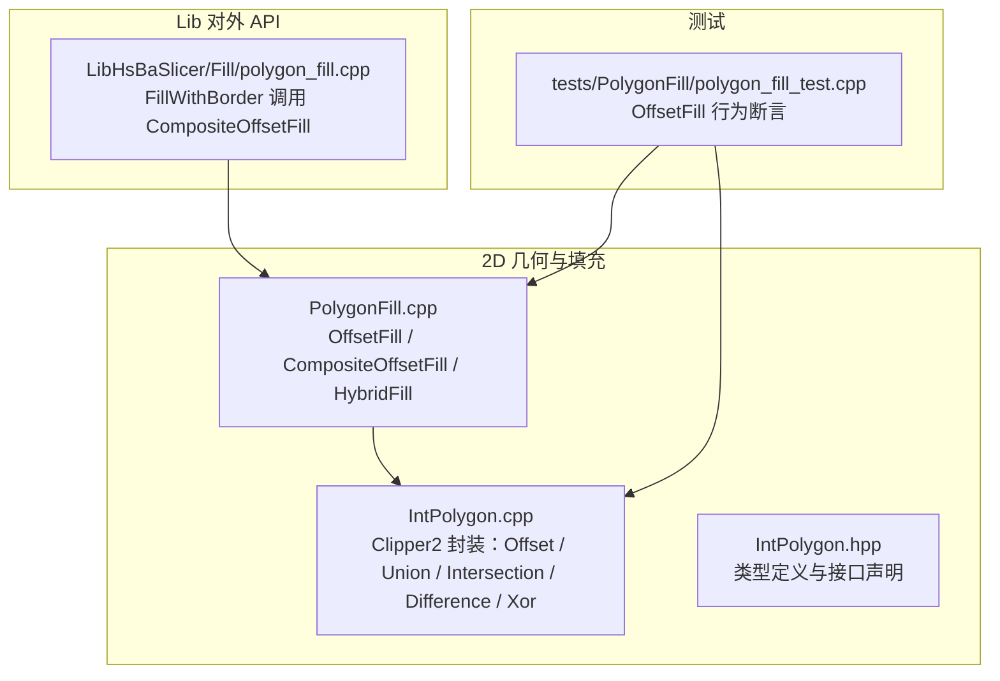
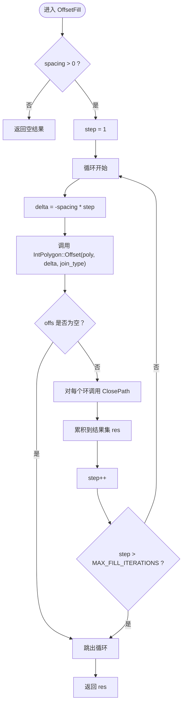
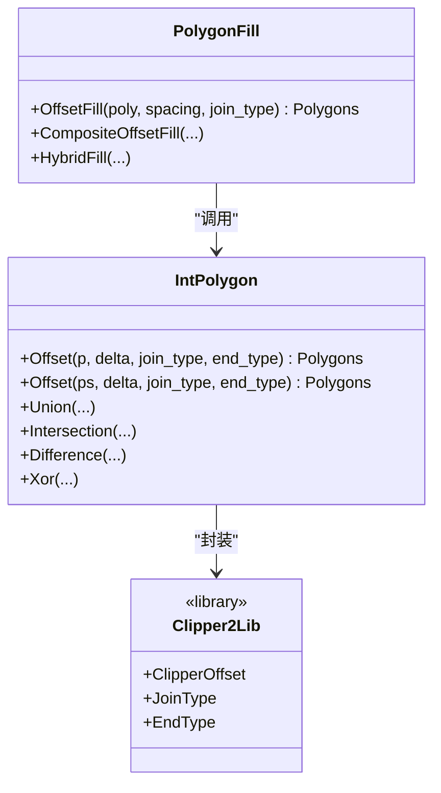
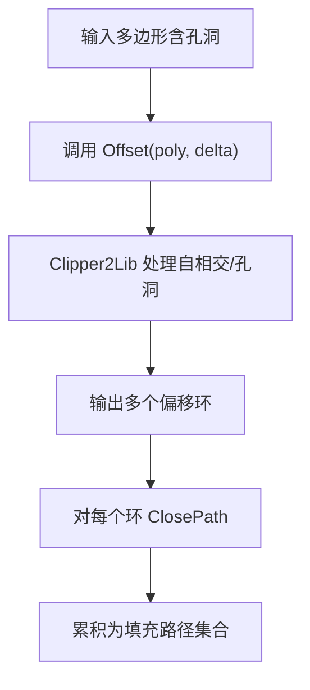

# 偏移填充算法

<cite>
**本文引用的文件**   
- [PolygonFill.cpp](file://2D/PolygonFill.cpp)
- [PolygonFill.hpp](file://2D/PolygonFill.hpp)
- [IntPolygon.cpp](file://2D/IntPolygon.cpp)
- [IntPolygon.hpp](file://2D/IntPolygon.hpp)
- [polygon_fill_test.cpp](file://tests/PolygonFill/polygon_fill_test.cpp)
- [polygon_fill.cpp](file://LibHsBaSlicer/Fill/polygon_fill.cpp)
</cite>

## 目录
1. [引言](#引言)
2. [项目结构](#项目结构)
3. [核心组件](#核心组件)
4. [架构总览](#架构总览)
5. [详细组件分析](#详细组件分析)
6. [依赖关系分析](#依赖关系分析)
7. [性能与内存优化](#性能与内存优化)
8. [故障排查指南](#故障排查指南)
9. [结论](#结论)
10. [附录：参数调优与实践建议](#附录参数调优与实践建议)

## 引言
本文面向几何算法开发者与3D打印工程师，系统性解析 HsBaSlicer 中的偏移填充算法，重点围绕 OffsetFill 函数及其底层基于 Clipper2Lib 的多边形偏移机制。文档从数学基础（等距曲线、边界收缩/扩张、自相交处理）到工程实现（参数配置、复杂多边形与孔洞策略、嵌套拓扑变化），再到性能分析与实践调优，提供完整的技术参考。

OffsetFill 的核心思想是：以固定间距 spacing 对输入多边形进行连续向内偏移，将每一层偏移轮廓作为填充路径输出；当偏移结果为空时停止迭代。该过程通过 Clipper2Lib 的 ClipperOffset 完成等距偏移，并通过整数化坐标保证数值稳定性。

## 项目结构
与偏移填充直接相关的代码主要位于以下模块：
- 2D 几何与填充引擎：2D/PolygonFill.*、2D/IntPolygon.*
- Lib 侧对外 C++ API：LibHsBaSlicer/Fill/polygon_fill.cpp
- 单元测试：tests/PolygonFill/polygon_fill_test.cpp



**图表来源**
- [PolygonFill.cpp:422-450](file://2D/PolygonFill.cpp#L422-L450)
- [IntPolygon.cpp:62-77](file://2D/IntPolygon.cpp#L62-L77)
- [polygon_fill.cpp:28-34](file://LibHsBaSlicer/Fill/polygon_fill.cpp#L28-L34)
- [polygon_fill_test.cpp:177-200](file://tests/PolygonFill/polygon_fill_test.cpp#L177-L200)

**章节来源**
- [PolygonFill.cpp:1-450](file://2D/PolygonFill.cpp#L1-L450)
- [IntPolygon.cpp:1-130](file://2D/IntPolygon.cpp#L1-L130)
- [polygon_fill.cpp:1-36](file://LibHsBaSlicer/Fill/polygon_fill.cpp#L1-L36)
- [polygon_fill_test.cpp:177-200](file://tests/PolygonFill/polygon_fill_test.cpp#L177-L200)

## 核心组件
- OffsetFill：基于间距 spacing 的向内偏移填充生成器。
- IntPolygon::Offset：对单条或多条多边形执行偏移（扩张/收缩），封装 Clipper2Lib::ClipperOffset。
- PolygonFill 其他填充模式：LineFill、SimpleZigzagFill、ZigzagFill、CompositeOffsetFill、HybridFill。
- Lib 侧 FillWithBorder：使用 CompositeOffsetFill 生成边框与内部填充。

关键职责划分：
- 几何计算与布尔运算由 IntPolygon 层统一封装 Clipper2。
- 填充模式逻辑在 PolygonFill 层组合与编排。
- Lib 层暴露稳定 API 给上层流程（如 SLA 地板生成）。

**章节来源**
- [PolygonFill.hpp:20-102](file://2D/PolygonFill.hpp#L20-L102)
- [IntPolygon.hpp:148-168](file://2D/IntPolygon.hpp#L148-L168)
- [polygon_fill.cpp:28-34](file://LibHsBaSlicer/Fill/polygon_fill.cpp#L28-L34)

## 架构总览
下图展示 OffsetFill 的调用链与数据流：Lua/C++ 调用 → OffsetFill → IntPolygon::Offset → Clipper2Lib::ClipperOffset → 返回偏移轮廓 → 闭合路径并累积为填充结果。

```mermaid
sequenceDiagram
participant Caller as "调用方"
participant PF as "PolygonFill.OffsetFill"
participant IP as "IntPolygon.Offset"
participant C2 as "Clipper2Lib.ClipperOffset"
Caller->>PF : "OffsetFill(poly, spacing, join_type)"
PF->>PF : "step=1; delta=-spacing*step"
loop 直到偏移结果为空或达到最大迭代次数
PF->>IP : "Offset(poly, delta, join_type, EndType : : Polygon)"
IP->>C2 : "AddPaths/AddPath + Execute(delta)"
C2-->>IP : "偏移后的 Polygons"
IP-->>PF : "offs"
alt offs 非空
PF->>PF : "ClosePath(每个环)"
PF->>PF : "累积到 res"
PF->>PF : "step++"
else offs 为空
PF->>PF : "break"
end
end
PF-->>Caller : "res填充路径集合"
```

**图表来源**
- [PolygonFill.cpp:422-450](file://2D/PolygonFill.cpp#L422-L450)
- [IntPolygon.cpp:62-77](file://2D/IntPolygon.cpp#L62-L77)

## 详细组件分析

### OffsetFill 实现原理
OffsetFill 按以下步骤工作：
1. 若 spacing ≤ 0，直接返回空结果。
2. 初始化 step = 1，循环计算 delta = -spacing * step（负值表示向内收缩）。
3. 调用 IntPolygon::Offset 对输入多边形执行偏移。
4. 若偏移结果为空，终止循环。
5. 对每个偏移环调用 ClosePath，确保首尾点重合，形成闭合路径。
6. 将闭合后的偏移环加入结果集，step 递增，直至达到 MAX_FILL_ITERATIONS 或偏移结果为空。



**图表来源**
- [PolygonFill.cpp:422-450](file://2D/PolygonFill.cpp#L422-L450)

**章节来源**
- [PolygonFill.cpp:422-450](file://2D/PolygonFill.cpp#L422-L450)

### 偏移算法的数学基础与 Clipper2Lib 集成
- 等距曲线计算：Clipper2Lib::ClipperOffset 根据 JoinType 和 EndType 计算每条边的法向偏移，并在顶点处按连接规则（Square、Bevel、Round、Miter）构造角部过渡。
- 边界收缩/扩张：delta < 0 表示向内收缩（用于填充），delta > 0 表示向外扩张（用于外扩边框）。
- 自相交处理：Clipper2Lib 内部会处理偏移后产生的自相交轮廓，可能产生多个子环或退化环；OffsetFill 通过“偏移结果为空”判断终止，避免无限迭代。



**图表来源**
- [PolygonFill.cpp:422-450](file://2D/PolygonFill.cpp#L422-L450)
- [IntPolygon.cpp:62-77](file://2D/IntPolygon.cpp#L62-L77)

**章节来源**
- [IntPolygon.cpp:62-77](file://2D/IntPolygon.cpp#L62-L77)
- [IntPolygon.hpp:148-168](file://2D/IntPolygon.hpp#L148-L168)

### 参数配置与影响
- spacing（偏移间距）：控制相邻偏移环之间的距离。spacing 越大，填充环越少但覆盖更稀疏；spacing 越小，填充环越多但计算成本更高。
- join_type（连接类型）：
  - Square：直角连接，适合快速、保守的偏移。
  - Bevel：斜接连接，减少尖角突出。
  - Round：圆角连接，平滑转角，适合需要平滑边界的场景。
  - Miter：尖角连接，可能产生长尖刺，需配合 miter_limit 使用（Clipper2Lib 内部处理）。
- 其他相关参数（在 CompositeOffsetFill/HybridFill 中）：
  - offsetStep：偏移步长，控制外扩/内缩层级之间的间距。
  - outwardCount/inwardCount：外扩层数与内缩层数，用于生成边框与内部填充的组合。
  - mode：内部填充模式（Line/SimpleZigzag/Zigzag）。
  - angle_deg：填充线角度。
  - lineThickness：填充线厚度。

**章节来源**
- [PolygonFill.cpp:193-220](file://2D/PolygonFill.cpp#L193-L220)
- [PolygonFill.cpp:273-315](file://2D/PolygonFill.cpp#L273-L315)
- [PolygonFill.cpp:317-358](file://2D/PolygonFill.cpp#L317-L358)
- [PolygonFill.hpp:70-102](file://2D/PolygonFill.hpp#L70-L102)

### 复杂多边形与孔洞处理策略
- 支持一个外轮廓与多个孔洞的拓扑结构。OffsetFill 对整体多边形集合执行偏移，Clipper2Lib 会维护内外环的包含关系。
- 对于自相交多边形，IntPolygon 提供 NormalizeToSimplePolygons 等工具将其拆分为简单多边形集合，便于后续处理。
- 嵌套多边形与拓扑变化：当偏移导致孔洞合并或外轮廓分裂时，Clipper2Lib 的输出可能包含多个独立环；OffsetFill 将所有有效环视为填充路径，不区分内外环方向。



**图表来源**
- [IntPolygon.cpp:329-404](file://2D/IntPolygon.cpp#L329-L404)
- [PolygonFill.cpp:422-450](file://2D/PolygonFill.cpp#L422-L450)

**章节来源**
- [IntPolygon.cpp:329-404](file://2D/IntPolygon.cpp#L329-L404)
- [PolygonFill.cpp:422-450](file://2D/PolygonFill.cpp#L422-L450)

### 实际应用示例
- 正方形模型偏移填充：测试用例验证 OffsetFill 对 10000×10000 正方形的偏移结果，确保每个环闭合且间距正确。
- 组合填充：CompositeOffsetFill 结合外扩边框与内部 Line 填充，适用于 SLA 地板生成。
- 混合填充：HybridFill 先应用偏移，再对最后一层偏移多边形进行 Zigzag 填充，适用于复杂区域的高效填充。

**章节来源**
- [polygon_fill_test.cpp:177-200](file://tests/PolygonFill/polygon_fill_test.cpp#L177-L200)
- [polygon_fill_test.cpp:108-138](file://tests/PolygonFill/polygon_fill_test.cpp#L108-L138)
- [polygon_fill.cpp:28-34](file://LibHsBaSlicer/Fill/polygon_fill.cpp#L28-L34)

## 依赖关系分析
OffsetFill 的依赖链如下：
- PolygonFill 层依赖 IntPolygon 提供的几何操作。
- IntPolygon 层依赖 Clipper2Lib 库进行布尔运算与偏移。
- Lib 层通过 FillWithBorder 调用 CompositeOffsetFill，间接依赖 OffsetFill 的偏移能力。


**图表来源**
- [PolygonFill.cpp:422-450](file://2D/PolygonFill.cpp#L422-L450)
- [IntPolygon.cpp:62-77](file://2D/IntPolygon.cpp#L62-L77)
- [polygon_fill.cpp:28-34](file://LibHsBaSlicer/Fill/polygon_fill.cpp#L28-L34)

**章节来源**
- [PolygonFill.cpp:422-450](file://2D/PolygonFill.cpp#L422-L450)
- [IntPolygon.cpp:62-77](file://2D/IntPolygon.cpp#L62-L77)
- [polygon_fill.cpp:28-34](file://LibHsBaSlicer/Fill/polygon_fill.cpp#L28-L34)

## 性能与内存优化
- 迭代上限保护：MAX_FILL_ITERATIONS 防止极端情况下无限循环。
- 整数化坐标：integerization = 1e6 提高数值精度，减少浮点误差导致的偏移异常。
- 批量偏移：IntPolygon::Offset 支持对多条多边形一次性偏移，减少重复开销。
- 内存管理：结果集 res 在每次偏移后追加，建议使用 reserve 预分配以提升性能（当前实现未显式预留）。
- 建议优化：
  - 对大型多边形集合，可分块处理偏移结果，降低峰值内存。
  - 根据模型复杂度动态调整 spacing，平衡填充密度与计算时间。
  - 对 join_type 选择 Round 会增加角部计算成本，建议在不需要平滑边角时使用 Square 或 Bevel。

[本节为通用性能指导，不直接分析具体文件]

## 故障排查指南
常见问题与定位方法：
- 偏移结果为空：检查 spacing 是否 ≤ 0，或输入多边形是否无效（面积过小、顶点不足）。
- 偏移环未闭合：确认 ClosePath 是否被调用，测试用例断言 r.front() == r.back()。
- 自相交多边形处理异常：使用 NormalizeToSimplePolygons 预处理，确保输入为简单多边形。
- 性能瓶颈：监控 MAX_FILL_ITERATIONS 是否触发，考虑增大 spacing 或减少 inwardCount。

**章节来源**
- [polygon_fill_test.cpp:177-200](file://tests/PolygonFill/polygon_fill_test.cpp#L177-L200)
- [IntPolygon.cpp:329-404](file://2D/IntPolygon.cpp#L329-L404)

## 结论
OffsetFill 通过基于 Clipper2Lib 的等距偏移机制，实现了稳健的多边形向内填充。其设计简洁、可扩展性强，支持多种连接类型与复杂拓扑结构。在实际应用中，合理配置 spacing 与 join_type，并结合 CompositeOffsetFill/HybridFill，可满足从 FDM 到 SLA 等多种3D打印场景的填充需求。

[本节为总结性内容，不直接分析具体文件]

## 附录：参数调优与实践建议
- 推荐起始参数：
  - spacing：根据模型尺寸与打印精度设定，通常取 0.2–1.0 mm。
  - join_type：默认 Square，如需平滑边角可选 Round。
  - outwardCount/inwardCount：边框层数与内部填充层数，根据壁厚与强度需求调整。
- 调试技巧：
  - 使用 SVG 导出功能（IntPolygon.cpp 中的 DumpPolygon/DumpPolygons）可视化偏移结果。
  - 通过单元测试模板（polygon_fill_test.cpp）快速验证参数效果。
- 高级用法：
  - 结合 ZigzagFill 生成连续路径，减少打印机启停次数。
  - 使用 Lua 自定义填充脚本，实现特定区域的差异化填充策略。

[本节为通用实践指导，不直接分析具体文件]