# 填充算法

<cite>
**本文引用的文件**   
- [PolygonFill.hpp](file://2D/PolygonFill.hpp)
- [PolygonFill.cpp](file://2D/PolygonFill.cpp)
- [polygon_fill.hpp](file://LibHsBaSlicer/Fill/polygon_fill.hpp)
- [polygon_fill.cpp](file://LibHsBaSlicer/Fill/polygon_fill.cpp)
- [pipeline_types.h](file://pipelinetypes/pipeline_types.h)
- [hsba_slicer.cppm](file://ModuleHsBaSlicer/hsba_slicer.cppm)
- [lua_pipeline.cpp](file://LibHsBaSlicer/Extends/lua_pipeline.cpp)
- [fdm_pipeline.cpp](file://DllHsBaSlicer/fdm_pipeline.cpp)
- [main_header.cpp](file://samples/LibHsBaSlicer/main_header.cpp)
- [polygon_fill_test.cpp](file://tests/PolygonFill/polygon_fill_test.cpp)
</cite>

## 目录
1. [引言](#引言)
2. [项目结构](#项目结构)
3. [核心组件](#核心组件)
4. [架构总览](#架构总览)
5. [详细组件分析](#详细组件分析)
6. [依赖关系分析](#依赖关系分析)
7. [性能与复杂度](#性能与复杂度)
8. [Lua 扩展机制](#lua-扩展机制)
9. [故障排查](#故障排查)
10. [结论](#结论)

## 引言
本文面向切片算法开发者与 3D 打印工程师，系统性梳理 HsBaSlicer 的填充算法体系。重点覆盖以下填充模式：
- 直线填充 LineFill
- 锯齿形填充 SimpleZigzagFill、ZigzagFill
- 偏移填充 OffsetFill
- 复合填充 CompositeOffsetFill
- 混合填充 HybridFill

文档将解释各算法的数学原理、参数含义、适用场景、FillMode 枚举用法、Lua 自定义填充扩展机制，以及复杂度、性能优化与内存管理建议。

## 项目结构
填充相关代码主要分布在两个层次：
- 2D 几何层：实现具体填充算法与 Lua 绑定
  - 头文件：[PolygonFill.hpp](file://2D/PolygonFill.hpp)
  - 实现文件：[PolygonFill.cpp](file://2D/PolygonFill.cpp)
- LibHsBaSlicer 封装层：对外暴露简洁 C++ API，并组合路径优化能力
  - 头文件：[polygon_fill.hpp](file://LibHsBaSlicer/Fill/polygon_fill.hpp)
  - 实现文件：[polygon_fill.cpp](file://LibHsBaSlicer/Fill/polygon_fill.cpp)

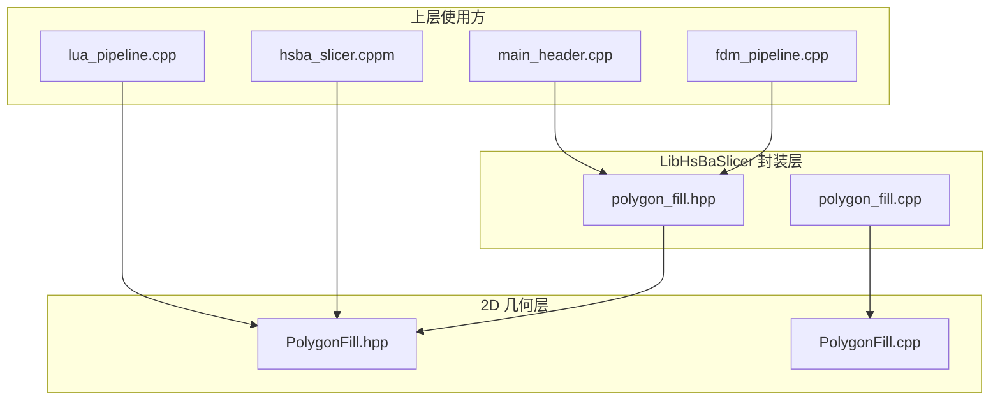

**图表来源**
- [PolygonFill.hpp:1-141](file://2D/PolygonFill.hpp#L1-L141)
- [PolygonFill.cpp:1-1449](file://2D/PolygonFill.cpp#L1-L1449)
- [polygon_fill.hpp:1-58](file://LibHsBaSlicer/Fill/polygon_fill.hpp#L1-L58)
- [polygon_fill.cpp:1-51](file://LibHsBaSlicer/Fill/polygon_fill.cpp#L1-L51)

**章节来源**
- [PolygonFill.hpp:1-141](file://2D/PolygonFill.hpp#L1-L141)
- [polygon_fill.hpp:1-58](file://LibHsBaSlicer/Fill/polygon_fill.hpp#L1-L58)

## 核心组件
- FillMode 枚举：定义支持的填充模式（Line、SimpleZigzag、Zigzag）
- 基础填充函数：
  - OffsetFill：向内等距偏移生成轮廓环
  - LineFill：按角度扫描线裁剪生成独立线段
  - SimpleZigzagFill：相邻行段中心连接形成蛇形折线
  - ZigzagFill：基于连通分量与桥接策略的改进型锯齿填充
  - CompositeOffsetFill：外扩 + 内缩 + 内部填充的组合
  - HybridFill：先输出若干偏移轮廓，再对最内层区域进行填充
- Lua 自定义填充：LuaCustomFill / LuaCustomFillString，支持脚本动态生成路径

**章节来源**
- [PolygonFill.hpp:20-136](file://2D/PolygonFill.hpp#L20-L136)
- [polygon_fill.hpp:17-53](file://LibHsBaSlicer/Fill/polygon_fill.hpp#L17-L53)

## 架构总览
从调用链看，上层管线通过 LibHsBaSlicer 封装层选择填充模式，最终由 2D 层执行具体算法；同时提供 Lua 扩展点，允许用户脚本参与路径生成与优化。

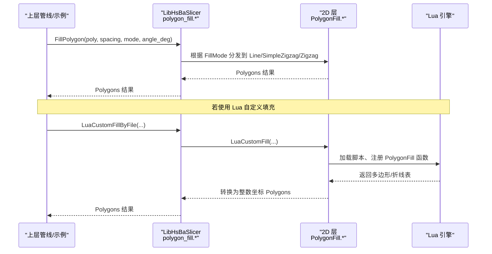

**图表来源**
- [polygon_fill.cpp:13-47](file://LibHsBaSlicer/Fill/polygon_fill.cpp#L13-L47)
- [PolygonFill.cpp:1283-1446](file://2D/PolygonFill.cpp#L1283-L1446)

## 详细组件分析

### 直线填充 LineFill
- 数学原理
  - 计算填充方向单位向量 u=(cosθ, sinθ)，与其垂直的法向 v=(-sinθ, cosθ)。
  - 沿法向以间距 spacing 步进，构造长条矩形带，与输入多边形求交得到若干片段。
  - 对每个片段投影到 u 方向，取最小/最大投影值作为线段端点，排序后输出为独立线段集合。
- 关键参数
  - spacing：平行线间距
  - angle_deg：填充角度（度）
  - lineThickness：用于锯齿类算法控制桥接采样步长（在 LineFill 中主要用于内部辅助）
- 适用场景
  - 需要简单、快速、可预测的直线路径
  - 对拐角过渡要求不高，或后续路径优化会处理连接性
- 复杂度
  - 设扫描行数 R，每行片段数 K，则时间复杂度约 O(R·K log K)（排序），空间复杂度 O(R·K)

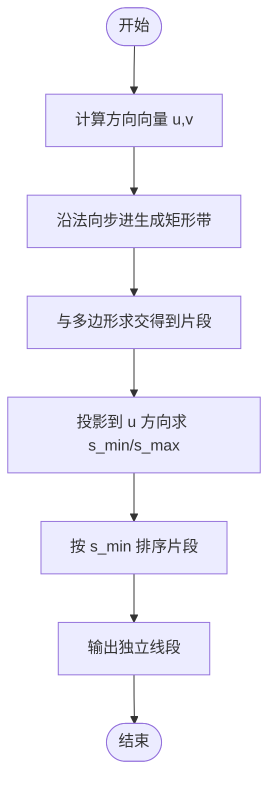

**图表来源**
- [PolygonFill.cpp:39-137](file://2D/PolygonFill.cpp#L39-L137)
- [PolygonFill.cpp:454-473](file://2D/PolygonFill.cpp#L454-L473)

**章节来源**
- [PolygonFill.cpp:39-137](file://2D/PolygonFill.cpp#L39-L137)
- [PolygonFill.cpp:454-473](file://2D/PolygonFill.cpp#L454-L473)

### 简单锯齿填充 SimpleZigzagFill
- 数学原理
  - 复用 LineFilling 的行片段数据。
  - 对偶数行从左到右遍历，奇数行从右到左遍历，将相邻行的有效片段中心点连接，形成连续蛇形折线。
  - 使用二分查找确定片段与多边形边界的精确进入/离开点，避免越界。
- 关键参数
  - spacing、angle_deg、lineThickness
- 适用场景
  - 需要单条连续路径以减少抬刀次数
  - 形状相对规则，连通性较好
- 复杂度
  - 构建行片段 O(R·K)，连接过程 O(R·K)，整体近似线性于片段数量

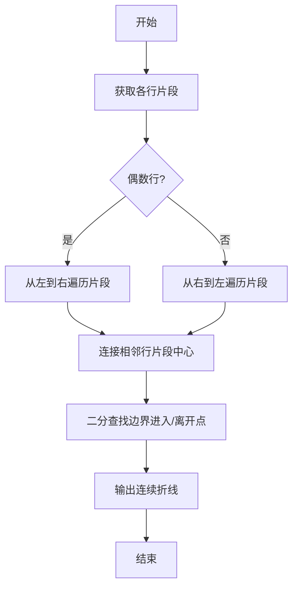

**图表来源**
- [PolygonFill.cpp:477-674](file://2D/PolygonFill.cpp#L477-L674)

**章节来源**
- [PolygonFill.cpp:477-674](file://2D/PolygonFill.cpp#L477-L674)

### 高级锯齿填充 ZigzagFill
- 数学原理
  - 同样基于行片段，但引入“连通分量”思想：
    - 将相邻行的片段区间做重叠判断，使用并查集合并属于同一连通分量的片段。
    - 对每个连通分量构建一条或多条折线，必要时沿外轮廓走最短弧进行桥接，避免穿越空洞。
  - 当桥接失败时，回退到仅连接中点在多边形内的情况，否则将未连接的片段作为额外直线输出。
- 关键参数
  - spacing、angle_deg、lineThickness
- 适用场景
  - 复杂凹多边形、存在多个岛屿或孔洞
  - 需要更稳健的连接与绕障桥接
- 复杂度
  - 并查集操作近似 O(N α(N))，N 为片段总数；区间重叠比较在最坏情况下 O(R^2·K^2)，实际可通过索引优化降低

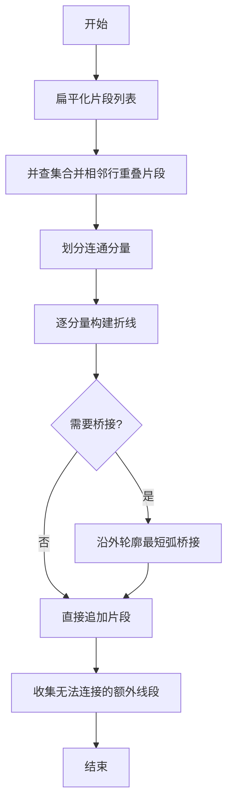

**图表来源**
- [PolygonFill.cpp:676-1175](file://2D/PolygonFill.cpp#L676-L1175)

**章节来源**
- [PolygonFill.cpp:676-1175](file://2D/PolygonFill.cpp#L676-L1175)

### 偏移填充 OffsetFill
- 数学原理
  - 反复对输入多边形执行向内偏移（负 delta），直到结果为空。
  - 每次偏移结果闭合为首尾重合的多边形环，作为填充路径输出。
- 关键参数
  - spacing：偏移步长
  - join_type：拐角连接类型（Square/Bevel/Round/Miter）
- 适用场景
  - 需要多层同心轮廓填充，常用于边框或薄壁增强
- 复杂度
  - 迭代次数受 MAX_FILL_ITERATIONS 限制；每次偏移复杂度取决于底层几何库

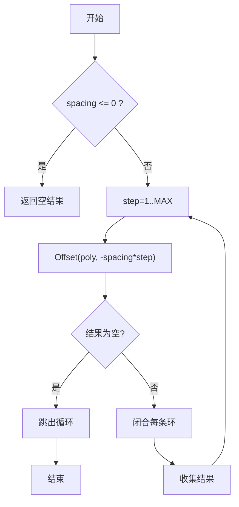

**图表来源**
- [PolygonFill.cpp:422-451](file://2D/PolygonFill.cpp#L422-L451)

**章节来源**
- [PolygonFill.cpp:422-451](file://2D/PolygonFill.cpp#L422-L451)

### 复合填充 CompositeOffsetFill
- 数学原理
  - 对原始多边形分别进行外扩（outwardCount 层）和内缩（inwardCount 层）。
  - 对每一层偏移后的多边形应用内部填充（Line/SimpleZigzag/Zigzag）。
  - 将所有层的填充结果合并输出。
- 关键参数
  - spacing：内部填充间距
  - offsetStep：偏移步长
  - outwardCount/inwardCount：外扩/内缩层数
  - mode：内部填充模式
  - angle_deg：填充角度
  - join_type：偏移拐角类型
- 适用场景
  - 需要“边框 + 内部填充”的组合效果，例如外壁强化与内部支撑结合

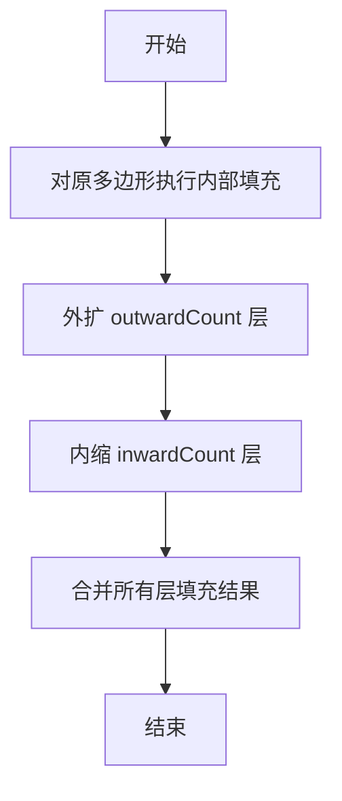

**图表来源**
- [PolygonFill.cpp:1177-1228](file://2D/PolygonFill.cpp#L1177-L1228)

**章节来源**
- [PolygonFill.cpp:1177-1228](file://2D/PolygonFill.cpp#L1177-L1228)

### 混合填充 HybridFill
- 数学原理
  - 先输出若干外扩偏移轮廓（不填充），然后逐步内缩，直到面积小于阈值或顶点数不足，停止继续内缩。
  - 对最后一步的内缩结果（可能为空）执行内部填充，并将之前输出的偏移轮廓与填充结果合并。
- 关键参数
  - spacing、offsetStep、outwardCount、inwardCount、mode、angle_deg、lineThickness、join_type
- 适用场景
  - 需要“外部轮廓 + 局部内部填充”的效果，适合薄壁与内部强度平衡

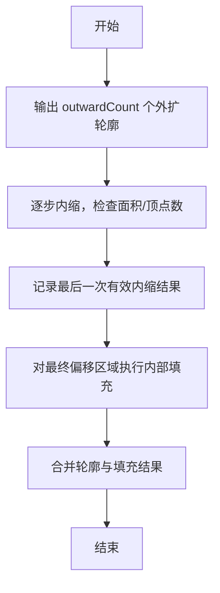

**图表来源**
- [PolygonFill.cpp:1230-1281](file://2D/PolygonFill.cpp#L1230-L1281)

**章节来源**
- [PolygonFill.cpp:1230-1281](file://2D/PolygonFill.cpp#L1230-L1281)

### FillMode 枚举与分发
- 定义位置与取值
  - Line：平行线填充
  - SimpleZigzag：简单锯齿填充
  - Zigzag：高级锯齿填充
- 分发逻辑
  - LibHsBaSlicer 层 FillPolygon 根据 FillMode 调用对应算法
  - 2D 层 CompositeOffsetFill/HybridFill 内部也按 FillMode 选择内部填充算法

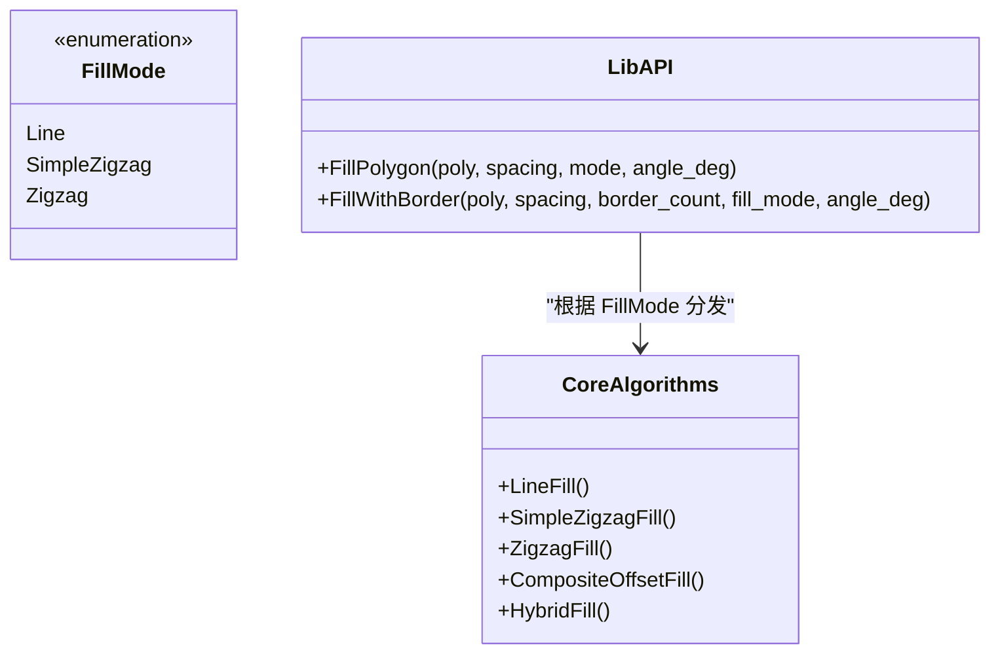

**图表来源**
- [PolygonFill.hpp:60-68](file://2D/PolygonFill.hpp#L60-L68)
- [polygon_fill.cpp:13-33](file://LibHsBaSlicer/Fill/polygon_fill.cpp#L13-L33)
- [PolygonFill.cpp:1177-1281](file://2D/PolygonFill.cpp#L1177-L1281)

**章节来源**
- [PolygonFill.hpp:60-68](file://2D/PolygonFill.hpp#L60-L68)
- [polygon_fill.cpp:13-33](file://LibHsBaSlicer/Fill/polygon_fill.cpp#L13-L33)

## 依赖关系分析
- 2D 层依赖 Clipper2Lib 进行多边形布尔运算与偏移
- LibHsBaSlicer 层依赖 2D 层并提供路径优化函数的 Lua 注册
- 上层管线（如 FDM）通过 LibHsBaSlicer 或直接使用 2D 层接口

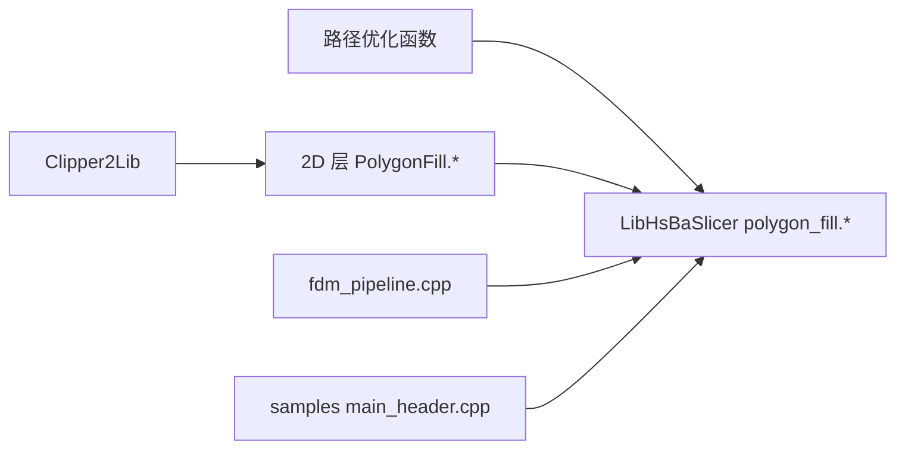

**图表来源**
- [polygon_fill.cpp:36-47](file://LibHsBaSlicer/Fill/polygon_fill.cpp#L36-L47)
- [PolygonFill.cpp:1283-1446](file://2D/PolygonFill.cpp#L1283-L1446)

**章节来源**
- [polygon_fill.cpp:36-47](file://LibHsBaSlicer/Fill/polygon_fill.cpp#L36-L47)
- [PolygonFill.cpp:1283-1446](file://2D/PolygonFill.cpp#L1283-L1446)

## 性能与复杂度
- 通用优化建议
  - 合理设置 spacing：过密会增加片段数量与几何运算量
  - 控制 outwardCount/inwardCount：层数越多，偏移与填充次数越多
  - 选择合适的 join_type：Round/Miter 可能增加几何复杂度
- 算法特性
  - LineFill：O(R·K log K)，适合快速直线路径
  - SimpleZigzagFill：近似 O(R·K)，连接开销低
  - ZigzagFill：并查集与桥接带来额外开销，但在复杂形状下更稳健
  - OffsetFill/CompositeOffsetFill/HybridFill：受偏移次数与内部填充模式影响
- 内存管理
  - 大量片段与中间多边形应尽量避免重复拷贝
  - 使用 reserve 预分配容器减少重分配
  - Lua 自定义填充返回的表需及时释放，避免长时间持有大对象

[本节为通用指导，不直接分析具体文件]

## Lua 扩展机制
- 注册函数
  - RegisterLuaPolygonFillFunctions：注册 PolygonFill.offsetFill/lineFill/simpleZigzagFill/zigzagFill/compositeOffsetFill/hybridFill/offsetOnly
  - RegisterLuaPolygonOperations：提供多边形几何操作函数
- 调用流程
  - LibHsBaSlicer 的 LuaCustomFillByFile 会组合 2D 函数与路径优化函数，供脚本调用
  - 脚本需实现 generate_fill(poly_table) 并返回多边形/折线表
- 数据类型
  - 输入：浮点多边形表（Point2D.x/y）
  - 输出：包含 Point2D 表的数组

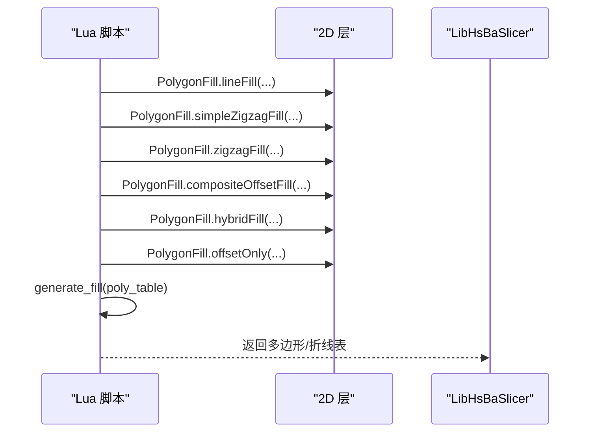

**图表来源**
- [PolygonFill.cpp:193-413](file://2D/PolygonFill.cpp#L193-L413)
- [polygon_fill.cpp:36-47](file://LibHsBaSlicer/Fill/polygon_fill.cpp#L36-L47)

**章节来源**
- [PolygonFill.cpp:193-413](file://2D/PolygonFill.cpp#L193-L413)
- [polygon_fill.cpp:36-47](file://LibHsBaSlicer/Fill/polygon_fill.cpp#L36-L47)

## 故障排查
- 常见问题
  - spacing <= 0：OffsetFill 直接返回空结果
  - 非相邻行连接：SimpleZigzag/Zigzag 仅允许同层或相邻层连接，避免环路
  - 桥接失败：ZigzagFill 回退到中线检测或输出额外直线
  - Lua 脚本错误：加载或调用失败会抛出运行时异常
- 定位方法
  - 检查输入多边形是否有效（顶点数、面积符号）
  - 调整 join_type 与 lineThickness
  - 在 Lua 脚本中打印中间结果或使用测试用例对比

**章节来源**
- [PolygonFill.cpp:422-451](file://2D/PolygonFill.cpp#L422-L451)
- [PolygonFill.cpp:676-1175](file://2D/PolygonFill.cpp#L676-L1175)
- [PolygonFill.cpp:1283-1446](file://2D/PolygonFill.cpp#L1283-L1446)

## 结论
HsBaSlicer 的填充系统以 2D 几何层为核心，提供多种填充模式与灵活的 Lua 扩展机制。开发者可根据模型特征与打印需求选择合适的算法与参数，并通过 Lua 脚本定制路径生成与优化流程。理解各算法的数学原理与复杂度有助于在实际工程中取得更好的性能与质量平衡。