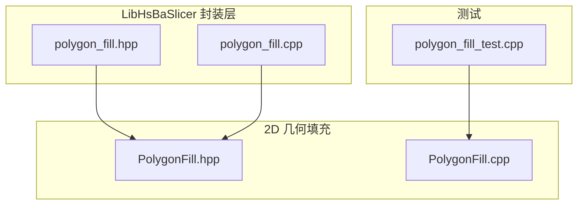
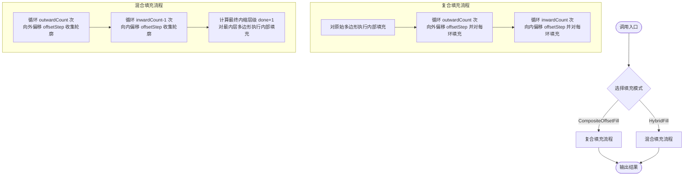
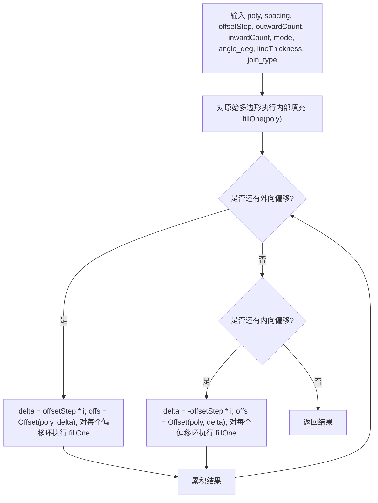
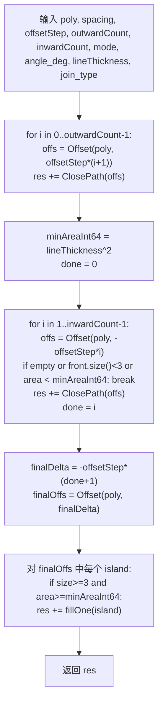
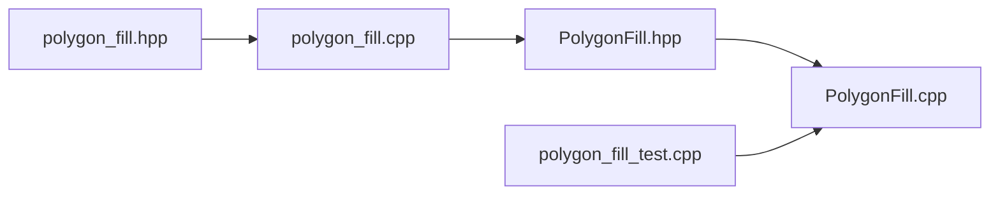

# 复合与混合填充

<cite>
**本文引用的文件**   
- [PolygonFill.hpp](file://2D/PolygonFill.hpp)
- [PolygonFill.cpp](file://2D/PolygonFill.cpp)
- [polygon_fill.hpp](file://LibHsBaSlicer/Fill/polygon_fill.hpp)
- [polygon_fill.cpp](file://LibHsBaSlicer/Fill/polygon_fill.cpp)
- [polygon_fill_test.cpp](file://tests/PolygonFill/polygon_fill_test.cpp)
</cite>

## 目录
1. [引言](#引言)
2. [项目结构](#项目结构)
3. [核心组件](#核心组件)
4. [架构总览](#架构总览)
5. [详细组件分析](#详细组件分析)
6. [依赖关系分析](#依赖关系分析)
7. [性能与复杂度](#性能与复杂度)
8. [故障排查指南](#故障排查指南)
9. [结论](#结论)
10. [附录：参数与使用建议](#附录参数与使用建议)

## 引言
本文面向高级用户与算法开发者，系统性解析 HsBaSlicer 中的两种高级填充模式：复合填充 CompositeOffsetFill 与混合填充 HybridFill。文档重点说明：
- 复合填充的工作流程：外层偏移边框 + 内部填充的组合策略；
- 混合填充的特点：先应用偏移操作，再对最内层多边形进行填充；
- FillMode 枚举的使用方法与不同填充模式的选择策略；
- 关键参数 spacing、offsetStep、outwardCount、inwardCount 的含义与调参建议；
- 算法复杂度分析与性能优化技巧；
- 实际应用案例与常见问题排查。

## 项目结构
与复合/混合填充直接相关的代码位于 2D 几何填充模块与 LibHsBaSlicer 的封装层：
- 2D 层提供核心算法实现与 Lua 绑定；
- LibHsBaSlicer 层对外暴露简洁 API，并复用 2D 层的复合填充能力构建“带边框”的填充。



图表来源
- [PolygonFill.hpp:60-102](file://2D/PolygonFill.hpp#L60-L102)
- [polygon_fill.hpp:17-37](file://LibHsBaSlicer/Fill/polygon_fill.hpp#L17-L37)

章节来源
- [PolygonFill.hpp:60-102](file://2D/PolygonFill.hpp#L60-L102)
- [polygon_fill.hpp:17-37](file://LibHsBaSlicer/Fill/polygon_fill.hpp#L17-L37)

## 核心组件
本节聚焦以下接口与类型：
- FillMode 枚举：Line、SimpleZigzag、Zigzag；
- CompositeOffsetFill：复合填充（外扩/内缩偏移 + 内部填充）；
- HybridFill：混合填充（偏移轮廓 + 仅对最内层填充）；
- LibHsBaSlicer 的 FillWithBorder：基于 CompositeOffsetFill 的“边框+内部填充”便捷 API。

章节来源
- [PolygonFill.hpp:60-102](file://2D/PolygonFill.hpp#L60-L102)
- [polygon_fill.hpp:17-37](file://LibHsBaSlicer/Fill/polygon_fill.hpp#L17-L37)

## 架构总览
CompositeOffsetFill 与 HybridFill 均依赖统一的底层能力：
- Offset：多边形等距偏移（向外或向内），用于生成边框环或缩小区域；
- LineFill/SimpleZigzagFill/ZigzagFill：三种基础填充模式；
- ClosePath：确保路径闭合；
- Area/PointInPolygons：用于面积判断与点包含检测（在 Zigzag 中尤为关键）。



图表来源
- [PolygonFill.cpp:1177-1281](file://2D/PolygonFill.cpp#L1177-L1281)

## 详细组件分析

### FillMode 枚举与填充模式选择
FillMode 定义了三种基础填充模式：
- Line：平行线填充；
- SimpleZigzag：简单之字形填充；
- Zigzag：改进角点处理的之字形填充。

在不同函数中，FillMode 决定内部填充的具体实现：
- CompositeOffsetFill 支持全部三种模式；
- HybridFill 当前分支中默认回退到 Zigzag（当 mode 非 Line/SimpleZigzag 时）。

选择策略建议：
- 需要均匀密度且路径独立：优先 Line；
- 需要连续路径减少抬刀：SimpleZigzag；
- 需要更好的拐角处理与连通性：Zigzag。

章节来源
- [PolygonFill.hpp:60-68](file://2D/PolygonFill.hpp#L60-L68)
- [PolygonFill.cpp:1181-1194](file://2D/PolygonFill.cpp#L1181-L1194)
- [PolygonFill.cpp:1260-1271](file://2D/PolygonFill.cpp#L1260-L1271)

### 复合填充 CompositeOffsetFill
工作流概述：
- 首先对原始多边形执行内部填充；
- 然后按 outwardCount 次数，每次向外偏移 offsetStep，并对每个偏移环单独执行内部填充；
- 最后按 inwardCount 次数，每次向内偏移 offsetStep，并对每个偏移环单独执行内部填充；
- 所有结果合并为最终 Polygons。

关键参数：
- spacing：内部填充线的间距；
- offsetStep：偏移步长；
- outwardCount：向外偏移层数；
- inwardCount：向内偏移层数；
- angle_deg：填充角度；
- lineThickness：填充线厚度；
- join_type：偏移拐角连接方式。

适用场景：
- 需要同时具备外部加固边框与内部填充的结构件；
- 希望内外层均可定制填充样式（通过同一 FillMode）。

复杂度与行为：
- 时间复杂度近似 O((1 + outwardCount + inwardCount) × F)，其中 F 是单次内部填充的成本；
- 空间复杂度取决于中间偏移环与填充结果的数量。



图表来源
- [PolygonFill.cpp:1177-1228](file://2D/PolygonFill.cpp#L1177-L1228)

章节来源
- [PolygonFill.cpp:1177-1228](file://2D/PolygonFill.cpp#L1177-L1228)

### 混合填充 HybridFill
工作流概述：
- 先对外部偏移：循环 outwardCount 次，每次向外偏移 offsetStep，并将偏移轮廓加入结果（不填充）；
- 再对内偏移：循环 inwardCount-1 次，每次向内偏移 offsetStep，将有效偏移轮廓加入结果；
- 计算最终内缩层级 done+1，对该层执行内部填充（仅对最内层多边形填充）；
- 若偏移结果为空或多边形过小（顶点数不足或面积小于阈值），提前终止。

关键参数：
- spacing：内部填充线的间距；
- offsetStep：偏移步长；
- outwardCount：向外偏移层数；
- inwardCount：向内偏移层数；
- angle_deg：填充角度；
- lineThickness：填充线厚度；
- join_type：偏移拐角连接方式。

适用场景：
- 需要外部轮廓强化但内部仅做局部填充；
- 对最小可填充区域有控制需求（通过 lineThickness 平方作为面积阈值）。

复杂度与行为：
- 时间复杂度近似 O(outwardCount + inwardCount + F_final)，F_final 是最内层填充成本；
- 空间复杂度主要受偏移环数量与最终填充结果影响。



图表来源
- [PolygonFill.cpp:1230-1281](file://2D/PolygonFill.cpp#L1230-L1281)

章节来源
- [PolygonFill.cpp:1230-1281](file://2D/PolygonFill.cpp#L1230-L1281)

### LibHsBaSlicer 封装：FillWithBorder
该 API 以 CompositeOffsetFill 为基础，提供“边框 + 内部填充”的一键式调用：
- outwardCount=0：不进行外扩偏移；
- inwardCount=border_count：向内偏移 border_count 层形成边框；
- 内部填充使用传入的 fill_mode 与 angle_deg。

```mermaid
sequenceDiagram
participant Caller as "调用方"
participant Lib as "FillWithBorder"
participant Core as "CompositeOffsetFill"
participant Off as "Offset"
participant Fill as "fillOne(mode)"
Caller->>Lib : FillWithBorder(poly, spacing, border_count, fill_mode, angle_deg)
Lib->>Core : CompositeOffsetFill(..., outwardCount=0, inwardCount=border_count, ...)
loop inwardCount 次
Core->>Off : Offset(poly, -offsetStep*i)
Off-->>Core : offs
Core->>Fill : fillOne(offs)
Fill-->>Core : filled rings
end
Core-->>Lib : result
Lib-->>Caller : result
```

图表来源
- [polygon_fill.cpp:28-34](file://LibHsBaSlicer/Fill/polygon_fill.cpp#L28-L34)
- [PolygonFill.cpp:1177-1228](file://2D/PolygonFill.cpp#L1177-L1228)

章节来源
- [polygon_fill.cpp:28-34](file://LibHsBaSlicer/Fill/polygon_fill.cpp#L28-L34)

## 依赖关系分析
- PolygonFill.hpp 定义 FillMode 与公共接口；
- PolygonFill.cpp 实现具体算法与 Lua 绑定；
- LibHsBaSlicer 的 polygon_fill.* 封装 2D 层能力，对外暴露简洁 API；
- 测试用例验证边界条件与 Lua 绑定。



图表来源
- [PolygonFill.hpp:60-102](file://2D/PolygonFill.hpp#L60-L102)
- [polygon_fill.hpp:17-37](file://LibHsBaSlicer/Fill/polygon_fill.hpp#L17-L37)

章节来源
- [PolygonFill.hpp:60-102](file://2D/PolygonFill.hpp#L60-L102)
- [polygon_fill.hpp:17-37](file://LibHsBaSlicer/Fill/polygon_fill.hpp#L17-L37)

## 性能与复杂度
- 复合填充：
  - 时间复杂度近似 O((1 + outwardCount + inwardCount) × F)，F 为单次内部填充成本；
  - 空间复杂度随偏移环与填充结果线性增长；
  - 优化建议：合理设置 outwardCount/inwardCount，避免过多偏移层；增大 spacing 可减少内部填充量。
- 混合填充：
  - 时间复杂度近似 O(outwardCount + inwardCount + F_final)，F_final 为最内层填充成本；
  - 通过 lineThickness 控制最小可填充面积，避免对小区域进行昂贵填充；
  - 优化建议：根据模型尺寸调整 offsetStep，使 done 尽快收敛，减少无效偏移。

通用优化技巧：
- 选择合适的 join_type（Square/Bevel/Round/Miter）以平衡拐角质量与计算开销；
- 对于大面积模型，优先使用 Zigzag 以获得更优连通性与拐角处理；
- 对高频调用场景，缓存常用参数组合的结果以减少重复计算。

[本节为通用指导，不直接分析具体文件]

## 故障排查指南
常见问题与定位方法：
- 偏移结果为空：
  - 检查 inwardCount 是否过大导致偏移后为空；
  - 确认 spacing/offsetStep 为正数；
  - 参考测试用例中对 OffsetFill 的非正 spacing 短路行为。
- 填充结果异常小或为空：
  - 在 HybridFill 中，若偏移环顶点数不足 3 或面积小于 lineThickness^2，会被跳过；
  - 适当增大 lineThickness 或减小 inwardCount。
- Lua 绑定错误：
  - 检查脚本函数名与返回值是否为表；
  - 确认 join_type 字符串匹配 Square/Bevel/Round/Miter。

章节来源
- [polygon_fill_test.cpp:175-210](file://tests/PolygonFill/polygon_fill_test.cpp#L175-L210)
- [PolygonFill.cpp:1283-1369](file://2D/PolygonFill.cpp#L1283-L1369)

## 结论
CompositeOffsetFill 与 HybridFill 提供了灵活而强大的填充策略：
- 复合填充适合“边框+内部填充”的统一建模；
- 混合填充适合“外部轮廓强化+内部局部填充”的场景；
- 通过 FillMode 与参数调节，可在密度、连通性、拐角质量之间取得平衡；
- 结合 LibHsBaSlicer 的 FillWithBorder，可快速获得工程可用的填充结果。

[本节为总结性内容，不直接分析具体文件]

## 附录：参数与使用建议
- spacing：内部填充线间距，越大填充越稀疏；
- offsetStep：偏移步长，控制边框层间距；
- outwardCount：外扩偏移层数，常用于加强边缘；
- inwardCount：内缩偏移层数，常用于形成内部边框或缩小填充区域；
- mode：Line/SimpleZigzag/Zigzag，依据路径连续性与拐角需求选择；
- angle_deg：填充角度，影响扫描方向；
- lineThickness：填充线厚度，影响最小可填充面积与视觉密度；
- join_type：偏移拐角连接方式，Square/Bevel/Round/Miter。

章节来源
- [PolygonFill.hpp:70-102](file://2D/PolygonFill.hpp#L70-L102)
- [polygon_fill.hpp:27-37](file://LibHsBaSlicer/Fill/polygon_fill.hpp#L27-L37)