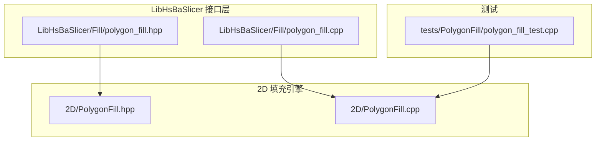
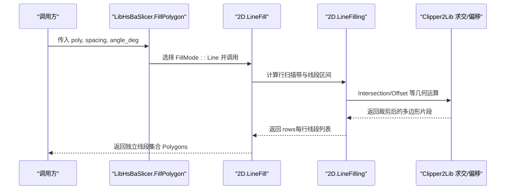
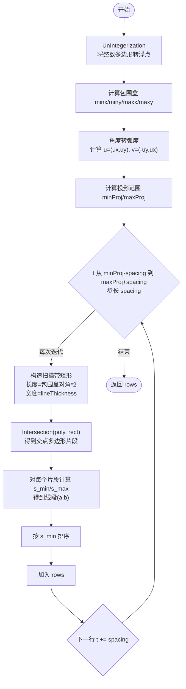
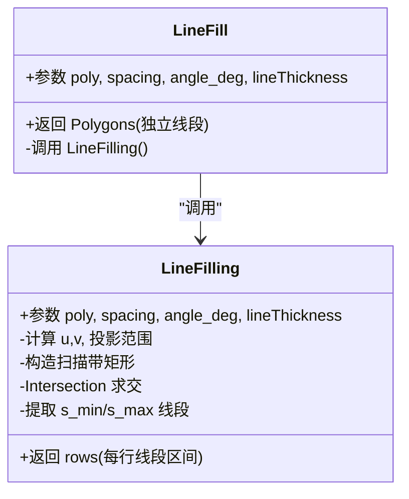
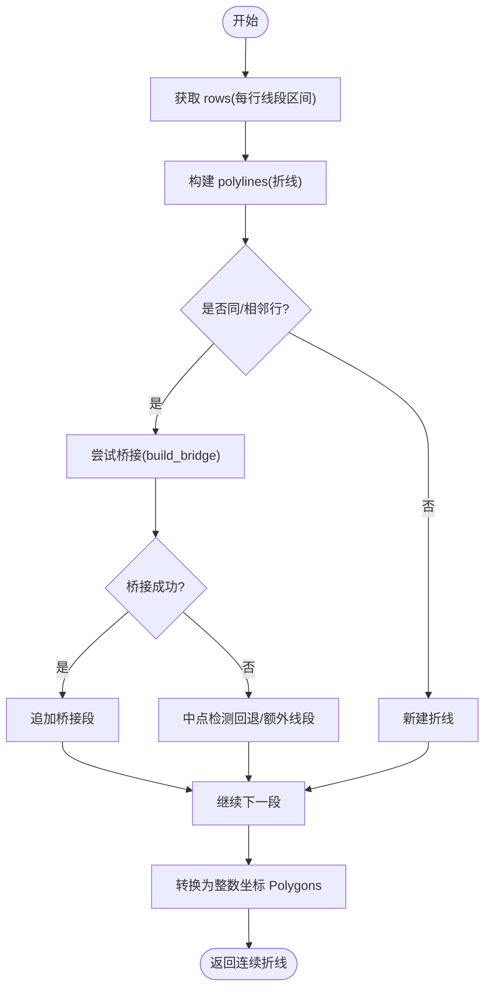
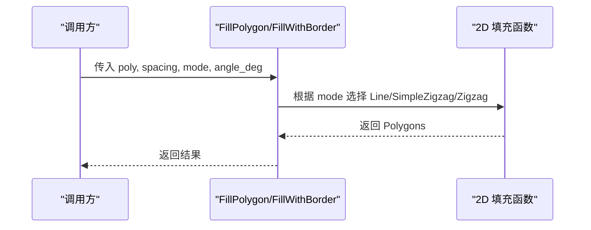
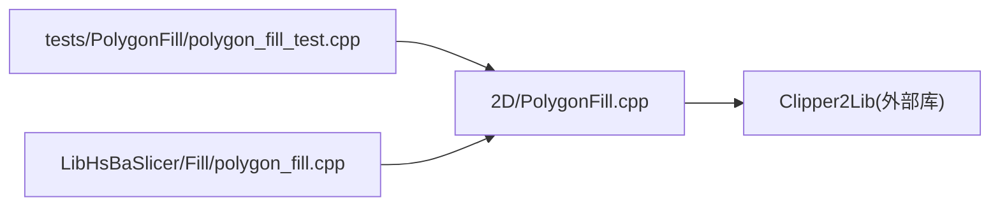
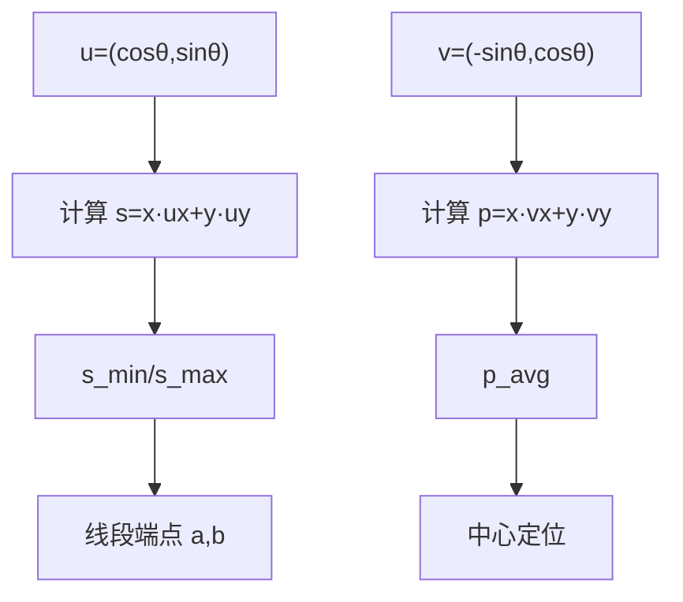
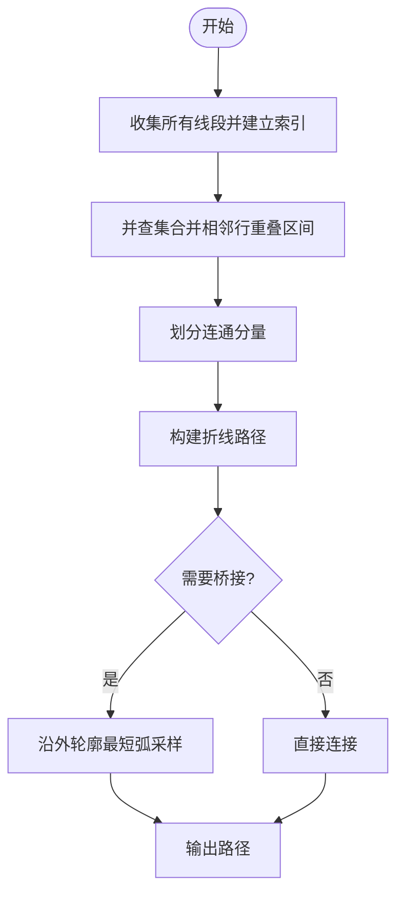

# 直线填充算法

<cite>
**本文引用的文件**   
- [PolygonFill.hpp](file://2D/PolygonFill.hpp)
- [PolygonFill.cpp](file://2D/PolygonFill.cpp)
- [polygon_fill.hpp](file://LibHsBaSlicer/Fill/polygon_fill.hpp)
- [polygon_fill.cpp](file://LibHsBaSlicer/Fill/polygon_fill.cpp)
- [polygon_fill_test.cpp](file://tests/PolygonFill/polygon_fill_test.cpp)
</cite>

## 目录
1. [引言](#引言)
2. [项目结构](#项目结构)
3. [核心组件](#核心组件)
4. [架构总览](#架构总览)
5. [详细组件分析](#详细组件分析)
6. [依赖关系分析](#依赖关系分析)
7. [性能与复杂度](#性能与复杂度)
8. [参数配置指南](#参数配置指南)
9. [数学原理与交点计算](#数学原理与交点计算)
10. [复杂多边形处理](#复杂多边形处理)
11. [代码示例与用法](#代码示例与用法)
12. [故障排查](#故障排查)
13. [结论](#结论)

## 引言
本文面向3D打印工程师与算法开发者，系统性解析 HsBaSlicer 中的直线填充（Line Fill）算法。重点围绕 LineFill 函数及其内部实现 LineFilling，解释平行线生成、角度计算、间距控制、线段与多边形边界求交、以及复杂多边形路径处理的完整流程，并给出时间复杂度分析与优化建议。

## 项目结构
直线填充相关代码主要位于以下模块：
- 2D 几何与填充引擎：2D/PolygonFill.hpp、2D/PolygonFill.cpp
- LibHsBaSlicer 对外 C++ API：LibHsBaSlicer/Fill/polygon_fill.hpp、LibHsBaSlicer/Fill/polygon_fill.cpp
- 单元测试：tests/PolygonFill/polygon_fill_test.cpp

**图表来源**
- [PolygonFill.hpp:1-141](file://2D/PolygonFill.hpp#L1-L141)
- [PolygonFill.cpp:1-1449](file://2D/PolygonFill.cpp#L1-L1449)
- [polygon_fill.hpp:1-58](file://LibHsBaSlicer/Fill/polygon_fill.hpp#L1-L58)
- [polygon_fill.cpp:1-51](file://LibHsBaSlicer/Fill/polygon_fill.cpp#L1-L51)

**章节来源**
- [PolygonFill.hpp:1-141](file://2D/PolygonFill.hpp#L1-L141)
- [polygon_fill.hpp:1-58](file://LibHsBaSlicer/Fill/polygon_fill.hpp#L1-L58)

## 核心组件
- LineFill：对外暴露的直线填充入口，返回独立线段集合（每个 Path 为两点线段）。
- LineFilling：核心并行扫描线生成器，按给定角度和间距生成行扫描带，并与多边形求交得到每行的若干线段区间。
- SimpleZigzagFill / ZigzagFill：基于 LineFilling 的结果构建连续折线路径（蛇形/之字形），用于需要单条连续路径的场景。
- CompositeOffsetFill / HybridFill：组合偏移与内部填充，支持外扩/内缩轮廓后再进行直线或之字填充。
- LibHsBaSlicer 封装：提供 FillPolygon、FillWithBorder 等高层 API，将模式选择与角度、间距参数传递给底层 2D 填充引擎。

**章节来源**
- [PolygonFill.hpp:30-85](file://2D/PolygonFill.hpp#L30-L85)
- [PolygonFill.cpp:453-473](file://2D/PolygonFill.cpp#L453-L473)
- [polygon_fill.cpp:13-34](file://LibHsBaSlicer/Fill/polygon_fill.cpp#L13-L34)

## 架构总览
从调用链看，用户通过 LibHsBaSlicer 的 FillPolygon 或直接调用 2D 层的 LineFill，最终进入 LineFilling 完成平行线扫描与求交，再由上层根据需求转换为独立线段或连续折线。

**图表来源**
- [polygon_fill.cpp:13-26](file://LibHsBaSlicer/Fill/polygon_fill.cpp#L13-L26)
- [PolygonFill.cpp:453-473](file://2D/PolygonFill.cpp#L453-L473)
- [PolygonFill.cpp:39-137](file://2D/PolygonFill.cpp#L39-L137)

## 详细组件分析

### LineFilling：平行线生成与交点计算
LineFilling 是直线填充的核心，负责：
- 将输入整数坐标多边形转为浮点坐标，便于精确几何计算。
- 计算包围盒与投影范围，确定扫描方向 u 与法向 v。
- 沿法向以 spacing 步进生成“扫描带”矩形，与原始多边形求交得到该行的有效区间。
- 对每个交得多边形片段，计算其在 u 方向的 s_min/s_max，得到该行的一组线段区间。
- 输出 rows：每行包含若干 (a,b) 线段对，表示在该扫描带上与多边形相交的有效区间。

关键步骤说明：
- 角度转换：angle_deg 转换为弧度后计算单位向量 u=(ux,uy)，v=(-uy,ux)。
- 投影范围：对包围盒四角在 v 上投影，得到 minProj/maxProj，确保扫描带覆盖整个多边形。
- 扫描带构造：每条扫描带是一个长矩形，宽度为 lineThickness，中心沿 v 方向步进 spacing。
- 求交与区间提取：使用 Intersection 得到扫描带与多边形的交集；对每个交得多边形片段，计算顶点在 u 上的投影 s，取最小/最大 s 作为线段端点，并在 v 方向用平均 p 值定位中心。
- 排序：按 s_min 排序，保证同一行内的线段顺序一致。

**图表来源**
- [PolygonFill.cpp:39-137](file://2D/PolygonFill.cpp#L39-L137)

**章节来源**
- [PolygonFill.cpp:39-137](file://2D/PolygonFill.cpp#L39-L137)

### LineFill：独立线段输出
LineFill 调用 LineFilling，并将每行的线段区间转换为独立的两点线段（Path），最终返回 Polygons。lineThickness 在此函数中未影响输出（仅用于内部扫描带宽度，不影响最终线段端点）。

**图表来源**
- [PolygonFill.cpp:453-473](file://2D/PolygonFill.cpp#L453-L473)
- [PolygonFill.cpp:39-137](file://2D/PolygonFill.cpp#L39-L137)

**章节来源**
- [PolygonFill.cpp:453-473](file://2D/PolygonFill.cpp#L453-L473)

### SimpleZigzagFill / ZigzagFill：连续折线路径
SimpleZigzagFill 与 ZigzagFill 均基于 LineFilling 的行结果构建连续路径：
- SimpleZigzagFill：按行交替方向遍历，连接相邻行的线段中心，形成蛇形路径；若跨行连接失败，回退为独立线段。
- ZigzagFill：更复杂的连通性处理，使用并查集合并相邻行有重叠区间的线段，再构建桥接路径（沿外轮廓最短弧）以保证路径连续性。

**图表来源**
- [PolygonFill.cpp:477-674](file://2D/PolygonFill.cpp#L477-L674)
- [PolygonFill.cpp:676-1175](file://2D/PolygonFill.cpp#L676-L1175)

**章节来源**
- [PolygonFill.cpp:477-674](file://2D/PolygonFill.cpp#L477-L674)
- [PolygonFill.cpp:676-1175](file://2D/PolygonFill.cpp#L676-L1175)

### LibHsBaSlicer 封装层
- FillPolygon：根据 FillMode 分派到 Line/SimpleZigzag/Zigzag。
- FillWithBorder：使用 CompositeOffsetFill 生成边框（向内偏移）与内部填充。

**图表来源**
- [polygon_fill.cpp:13-34](file://LibHsBaSlicer/Fill/polygon_fill.cpp#L13-L34)

**章节来源**
- [polygon_fill.cpp:13-34](file://LibHsBaSlicer/Fill/polygon_fill.cpp#L13-L34)

## 依赖关系分析
- 2D 层依赖 Clipper2Lib 进行几何求交与偏移。
- LibHsBaSlicer 层依赖 2D 层提供的 LineFill/SimpleZigzagFill/ZigzagFill。
- 测试用例验证了 LineFill 的基本行为与边界条件。

**图表来源**
- [polygon_fill_test.cpp:39-40](file://tests/PolygonFill/polygon_fill_test.cpp#L39-L40)
- [polygon_fill.cpp:13-34](file://LibHsBaSlicer/Fill/polygon_fill.cpp#L13-L34)
- [PolygonFill.cpp:39-137](file://2D/PolygonFill.cpp#L39-L137)

**章节来源**
- [polygon_fill_test.cpp:39-40](file://tests/PolygonFill/polygon_fill_test.cpp#L39-L40)
- [polygon_fill.cpp:13-34](file://LibHsBaSlicer/Fill/polygon_fill.cpp#L13-L34)

## 性能与复杂度
- 时间复杂度：
  - LineFilling：对每条扫描带执行一次 Intersection，设扫描带数量为 O(R)，多边形总边数为 E，单次求交近似 O(E log E) 或 O(E + K)（K 为交点数量）。总体近似 O(R·E log E) 或 O(R·(E + K))。
  - 行内排序：每行线段排序 O(S log S)，S 为该行线段数。
  - SimpleZigzagFill/ZigzagFill：构建折线与连通性处理，最坏情况 O(N^2)（N 为所有线段总数），但实际受限于相邻行连接，通常接近线性。
- 空间复杂度：
  - 存储 rows 与中间多边形片段，O(R·S) 或 O(N)。
- 优化建议：
  - 合理设置 spacing：过小的 spacing 会显著增加扫描带数量 R，导致性能下降。
  - 避免极端角度：当角度接近 0° 或 90° 时，扫描带可能更长，需结合模型尺寸调整。
  - 使用 ZigzagFill 替代 LineFill 可减少提刀次数，提升打印效率。
  - 对大型模型可考虑分层并行化或增量更新策略。

[本节为通用性能讨论，不直接分析具体文件]

## 参数配置指南
- spacing（线间距）
  - 作用：控制平行线之间的间距，直接影响填充密度与打印时间。
  - 影响：spacing 越小，填充越密，打印时间越长；spacing 过大可能导致强度不足。
  - 建议：根据材料特性与强度要求调整，常见值 0.5–2.0 mm。
- angle_deg（填充角度）
  - 作用：控制平行线的方向，改变应力分布与表面纹理。
  - 影响：不同角度会影响与边界的交点数量与线段长度；0°/90° 时扫描带较长。
  - 建议：交替角度（如 45°/-45°）可提升各向同性强度。
- lineThickness（线条厚度）
  - 作用：在 LineFilling 中用于构造扫描带宽度，影响求交精度与 Zigzag 桥接采样步长。
  - 影响：对 LineFill 的最终线段端点无直接影响；对 Zigzag 路径的桥接与采样有影响。
  - 建议：与喷嘴直径匹配，常见 0.4–0.6 mm。

**章节来源**
- [PolygonFill.hpp:30-38](file://2D/PolygonFill.hpp#L30-L38)
- [PolygonFill.cpp:39-137](file://2D/PolygonFill.cpp#L39-L137)
- [PolygonFill.cpp:477-674](file://2D/PolygonFill.cpp#L477-L674)

## 数学原理与交点计算
- 坐标系与方向向量：
  - u = (cosθ, sinθ) 为填充方向单位向量。
  - v = (-sinθ, cosθ) 为法向单位向量。
- 投影范围：
  - 对包围盒四角在 v 上投影，得到 minProj/maxProj，确保扫描带覆盖整个多边形。
- 扫描带构造：
  - 每条扫描带为长矩形，中心沿 v 方向步进 spacing，长度为包围盒对角的两倍，宽度为 lineThickness。
- 交点计算：
  - 使用 Intersection 求扫描带与多边形的交集，得到若干多边形片段。
  - 对每个片段，计算顶点在 u 上的投影 s = x·ux + y·uy，取 s_min/s_max 作为线段端点在 u 方向的坐标。
  - 在 v 方向使用平均 p = (Σ(x·vx + y·vy))/n 定位线段中心。
- 线段排序：
  - 按 s_min 排序，保证同一行内的线段顺序一致。

**图表来源**
- [PolygonFill.cpp:60-137](file://2D/PolygonFill.cpp#L60-L137)

**章节来源**
- [PolygonFill.cpp:60-137](file://2D/PolygonFill.cpp#L60-L137)

## 复杂多边形处理
- 孔洞与多轮廓：
  - LineFilling 对每个交得多边形片段分别处理，因此天然支持孔洞与多轮廓。
- 岛屿与间隙：
  - ZigzagFill 使用并查集合并相邻行有重叠区间的线段，形成连通分量；若无法桥接，则回退为独立线段或额外直线。
- 桥接策略：
  - build_bridge 沿外轮廓寻找最短弧，采样点以 lineThickness 为步长，确保路径平滑且贴合边界。

**图表来源**
- [PolygonFill.cpp:698-772](file://2D/PolygonFill.cpp#L698-L772)
- [PolygonFill.cpp:839-942](file://2D/PolygonFill.cpp#L839-L942)

**章节来源**
- [PolygonFill.cpp:698-772](file://2D/PolygonFill.cpp#L698-L772)
- [PolygonFill.cpp:839-942](file://2D/PolygonFill.cpp#L839-L942)

## 代码示例与用法
以下为典型用法示例（以伪代码形式描述，具体实现请参考源码路径）：
- 基本直线填充：
  - 调用 FillPolygon(poly, spacing=1.0, mode=Line, angle_deg=0.0)
  - 或使用 2D 层 LineFill(poly, spacing=1.0, angle_deg=0.0, lineThickness=0.5)
- 之字填充：
  - 调用 FillPolygon(poly, spacing=1.0, mode=Zigzag, angle_deg=45.0)
- 带边框填充：
  - 调用 FillWithBorder(poly, spacing=1.0, border_count=2, fill_mode=Line, angle_deg=0.0)

参考测试用例：
- tests/PolygonFill/polygon_fill_test.cpp 中对 LineFill 的行为进行了断言，包括正方形模型、间距与角度参数等。

**章节来源**
- [polygon_fill_test.cpp:39-40](file://tests/PolygonFill/polygon_fill_test.cpp#L39-L40)
- [polygon_fill.cpp:13-34](file://LibHsBaSlicer/Fill/polygon_fill.cpp#L13-L34)

## 故障排查
- 结果为空：
  - 检查 spacing 是否为正数；负数或零会导致 OffsetFill 等快速返回空结果。
- 线段超出边界：
  - 确认 LineFilling 的 Intersection 是否正确；检查角度与投影范围计算。
- 路径不连续：
  - ZigzagFill 的桥接失败时会回退为独立线段；检查 build_bridge 与中点检测逻辑。
- 性能问题：
  - 减小扫描带数量（增大 spacing）或减少多边形复杂度。

**章节来源**
- [PolygonFill.cpp:422-451](file://2D/PolygonFill.cpp#L422-L451)
- [PolygonFill.cpp:976-992](file://2D/PolygonFill.cpp#L976-L992)

## 结论
HsBaSlicer 的直线填充算法通过 LineFilling 实现了高效的平行线扫描与求交，LineFill 提供独立线段输出，而 SimpleZigzagFill/ZigzagFill 在此基础上构建连续路径以适应打印需求。参数 spacing、angle_deg、lineThickness 共同决定了填充密度、方向与路径质量。对于复杂多边形，算法通过并查集与桥接策略保证路径连通性。在实际应用中，建议根据模型尺寸与打印目标合理配置参数，并结合 Zigzag 模式提升打印效率与强度。

[本节为总结性内容，不直接分析具体文件]