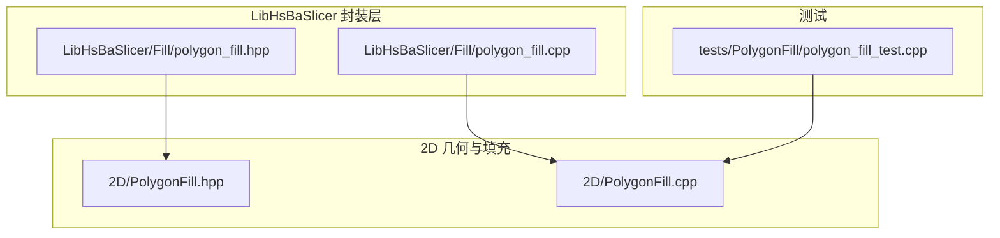
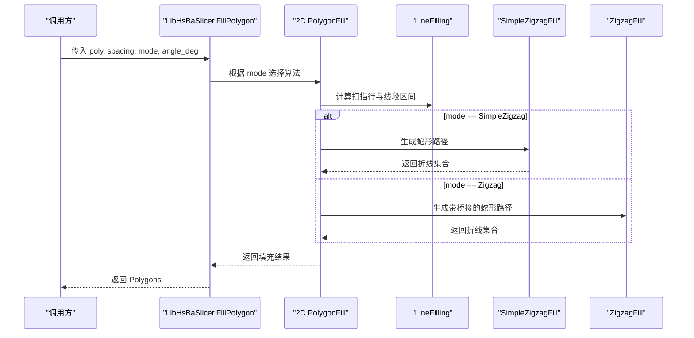
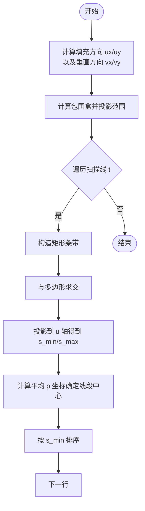
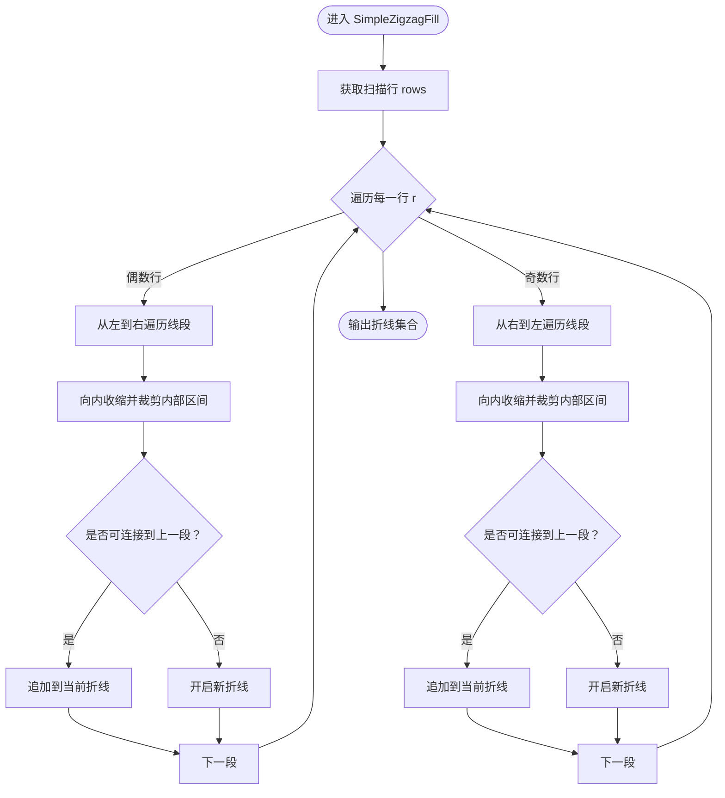
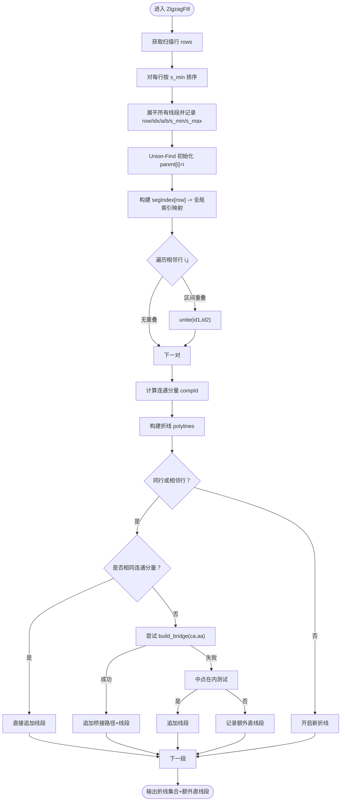
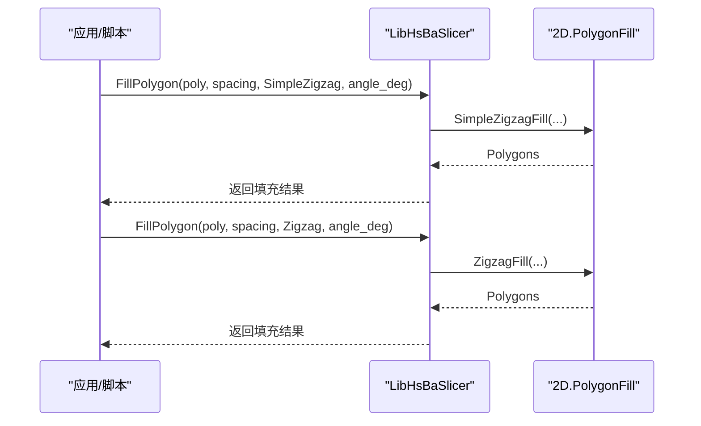
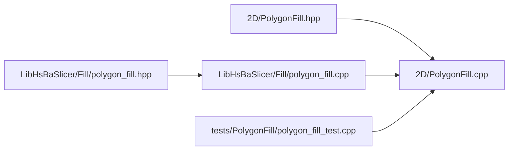

# 锯齿形填充算法

<cite>
**本文引用的文件**   
- [PolygonFill.hpp](file://2D/PolygonFill.hpp)
- [PolygonFill.cpp](file://2D/PolygonFill.cpp)
- [polygon_fill.hpp](file://LibHsBaSlicer/Fill/polygon_fill.hpp)
- [polygon_fill.cpp](file://LibHsBaSlicer/Fill/polygon_fill.cpp)
- [polygon_fill_test.cpp](file://tests/PolygonFill/polygon_fill_test.cpp)
</cite>

## 目录
1. [引言](#引言)
2. [项目结构](#项目结构)
3. [核心组件](#核心组件)
4. [架构总览](#架构总览)
5. [详细组件分析](#详细组件分析)
6. [依赖关系分析](#依赖关系分析)
7. [性能与复杂度分析](#性能与复杂度分析)
8. [参数配置与调优建议](#参数配置与调优建议)
9. [故障排查指南](#故障排查指南)
10. [结论](#结论)

## 引言
本文面向切片算法开发者与3D打印工程师，系统性梳理 HsBaSlicer 中的两种锯齿形填充算法：SimpleZigzagFill 与 ZigzagFill。文档重点对比两者在路径生成、拐角处理、方向交替机制上的差异，解释 spacing（线间距）、angle_deg（填充角度）、lineThickness（线条厚度）对填充效果的影响，并给出复杂度分析与性能对比，说明为什么 ZigzagFill 在复杂轮廓和凹多边形场景下具有更好的角落处理能力。文末提供实际使用示例与参数调优建议。

## 项目结构
锯齿形填充相关代码主要位于以下位置：
- 2D 几何与填充实现：2D/PolygonFill.hpp、2D/PolygonFill.cpp
- LibHsBaSlicer 对外 C++ API：LibHsBaSlicer/Fill/polygon_fill.hpp、LibHsBaSlicer/Fill/polygon_fill.cpp
- 单元测试与行为验证：tests/PolygonFill/polygon_fill_test.cpp

**图表来源** 
- [PolygonFill.hpp:1-141](file://2D/PolygonFill.hpp#L1-L141)
- [PolygonFill.cpp:1-1449](file://2D/PolygonFill.cpp#L1-L1449)
- [polygon_fill.hpp:1-58](file://LibHsBaSlicer/Fill/polygon_fill.hpp#L1-L58)
- [polygon_fill.cpp:1-51](file://LibHsBaSlicer/Fill/polygon_fill.cpp#L1-L51)
- [polygon_fill_test.cpp:175-652](file://tests/PolygonFill/polygon_fill_test.cpp#L175-L652)

**章节来源**
- [PolygonFill.hpp:1-141](file://2D/PolygonFill.hpp#L1-L141)
- [polygon_fill.hpp:1-58](file://LibHsBaSlicer/Fill/polygon_fill.hpp#L1-L58)

## 核心组件
- SimpleZigzagFill：基于扫描行线段中心连接生成蛇形折线，仅允许同层或相邻层连接，未显式处理不同连通分量之间的桥接。
- ZigzagFill：在 SimpleZigzagFill 基础上引入“连通分量”识别与“桥接路径”构建，能够处理凹多边形导致的相邻行段属于不同连通分量的情况，避免直接穿越空洞或外部区域。
- LineFilling：公共的扫描行计算模块，将多边形按给定角度切分为若干扫描行，每行包含若干有效线段区间。
- FillMode 枚举与 CompositeOffsetFill/HybridFill：组合填充模式，支持在外扩/内缩边界后应用 Line/SimpleZigzag/Zigzag 内部填充。

**章节来源**
- [PolygonFill.hpp:30-102](file://2D/PolygonFill.hpp#L30-L102)
- [PolygonFill.cpp:39-137](file://2D/PolygonFill.cpp#L39-L137)
- [PolygonFill.cpp:477-674](file://2D/PolygonFill.cpp#L477-L674)
- [PolygonFill.cpp:676-1175](file://2D/PolygonFill.cpp#L676-L1175)

## 架构总览
锯齿形填充的整体流程如下：
1. 输入多边形与参数（spacing、angle_deg、lineThickness）。
2. 通过 LineFilling 计算扫描行与每行的有效线段区间。
3. SimpleZigzagFill 直接按行顺序连接线段中心形成蛇形路径。
4. ZigzagFill 先计算各线段所属连通分量，再在相邻行间尝试桥接，最后输出连续折线。
5. LibHsBaSlicer 层提供统一入口 FillPolygon，根据 FillMode 分发到具体算法。

**图表来源**
- [polygon_fill.cpp:13-26](file://LibHsBaSlicer/Fill/polygon_fill.cpp#L13-L26)
- [PolygonFill.cpp:39-137](file://2D/PolygonFill.cpp#L39-L137)
- [PolygonFill.cpp:477-674](file://2D/PolygonFill.cpp#L477-L674)
- [PolygonFill.cpp:676-1175](file://2D/PolygonFill.cpp#L676-L1175)

## 详细组件分析

### 扫描行与线段区间（LineFilling）
- 作用：将多边形沿指定角度切分为若干扫描行，每行包含多个有效线段区间。
- 关键点：
  - 计算填充方向向量 ux/uy 与其垂直向量 vx/vy。
  - 对每个扫描线构造矩形条带并与多边形求交，得到截得的子多边形。
  - 对每个子多边形投影到 u 轴，得到 s_min/s_max，同时计算平均 p 坐标以定位线段中心。
  - 排序并按 u 方向组织为有序线段区间列表。

**图表来源**
- [PolygonFill.cpp:39-137](file://2D/PolygonFill.cpp#L39-L137)

**章节来源**
- [PolygonFill.cpp:39-137](file://2D/PolygonFill.cpp#L39-L137)

### SimpleZigzagFill：基础蛇形路径
- 核心思路：
  - 复用 LineFilling 的结果，逐行处理。
  - 偶数行从左到右，奇数行从右到左，形成蛇形方向交替。
  - 对每条线段进行“向内收缩”与“点在内测试”，裁剪出真正位于多边形内部的区间。
  - 仅在“同一行或相邻行”之间连接线段端点，避免跨行跳连导致环路。
- 局限：
  - 当相邻行线段属于不同连通分量时（例如凹多边形 U 型缺口），SimpleZigzagFill 无法自动建立桥接，可能产生断开的折线或无效连接。

**图表来源**
- [PolygonFill.cpp:477-674](file://2D/PolygonFill.cpp#L477-L674)

**章节来源**
- [PolygonFill.cpp:477-674](file://2D/PolygonFill.cpp#L477-L674)

### ZigzagFill：改进的连通分量与桥接策略
- 改进点：
  - 对扫描行线段建立“连通分量”（Union-Find），依据相邻行线段在 u 轴上的区间重叠关系合并。
  - 在相邻行且不同连通分量时，尝试构建“桥接路径”：
    - 若两端点均在多边形内部，则直接连接。
    - 否则，采样直线 ca-cb 找到进入/离开多边形的点 p1/p2，然后沿外轮廓选择较短弧段，并在弧上按步长采样点，最终拼接成桥接路径。
    - 若桥接失败，回退到“中点在内测试”的简单连接；仍失败则记录额外直线段作为补充。
  - 保证只在“同一行或相邻行”连接，避免环路。
- 优势：
  - 能正确处理凹多边形导致的连通分量变化，避免直接穿越空洞或外部区域。
  - 桥接路径沿外轮廓走更短弧，减少不必要的穿越，提升角落处理能力。

**图表来源**
- [PolygonFill.cpp:676-1175](file://2D/PolygonFill.cpp#L676-L1175)

**章节来源**
- [PolygonFill.cpp:676-1175](file://2D/PolygonFill.cpp#L676-L1175)

### 参数配置与影响
- spacing（线间距）：
  - 控制扫描行之间的距离。过小会增加行数与计算量；过大可能导致填充密度不足。
  - 当 spacing <= 0 时，两种算法均短路返回空结果。
- angle_deg（填充角度）：
  - 决定填充方向向量 ux/uy，影响扫描行方向与线段投影。
  - 角度变化会改变线段在 u 轴上的投影区间，从而影响连通分量判定与桥接路径选择。
- lineThickness（线条厚度）：
  - 用于构造扫描条带的宽度，影响 Intersection 得到的截线段长度。
  - 在桥接路径采样步长中也会参与控制采样密度。

**章节来源**
- [PolygonFill.hpp:30-58](file://2D/PolygonFill.hpp#L30-L58)
- [PolygonFill.cpp:477-674](file://2D/PolygonFill.cpp#L477-L674)
- [PolygonFill.cpp:676-1175](file://2D/PolygonFill.cpp#L676-L1175)

### 使用示例与入口
- LibHsBaSlicer 提供的统一入口：
  - FillPolygon(poly, spacing, mode, angle_deg)：根据 FillMode 选择 Line/SimpleZigzag/Zigzag。
  - FillWithBorder(poly, spacing, border_count, fill_mode, angle_deg)：先做外扩/内缩边界，再对内部区域应用填充。
- Lua 绑定：
  - PolygonFill.simpleZigzagFill / PolygonFill.zigzagFill：通过 Lua 脚本调用，参数包括 poly、spacing、angle_deg、lineThickness。

**图表来源**
- [polygon_fill.cpp:13-26](file://LibHsBaSlicer/Fill/polygon_fill.cpp#L13-L26)
- [PolygonFill.cpp:239-271](file://2D/PolygonFill.cpp#L239-L271)

**章节来源**
- [polygon_fill.cpp:13-34](file://LibHsBaSlicer/Fill/polygon_fill.cpp#L13-L34)
- [PolygonFill.cpp:239-271](file://2D/PolygonFill.cpp#L239-L271)

## 依赖关系分析
- 2D/PolygonFill.hpp 声明了 OffsetFill、LineFill、SimpleZigzagFill、ZigzagFill、CompositeOffsetFill、HybridFill 等接口。
- 2D/PolygonFill.cpp 实现了上述接口，并包含 Lua 绑定函数 l_simpleZigzagFill、l_zigzagFill 等。
- LibHsBaSlicer/Fill/polygon_fill.hpp/.cpp 对外暴露 FillPolygon、FillWithBorder、LuaCustomFillByFile，内部调用 2D 层实现。
- tests/PolygonFill/polygon_fill_test.cpp 覆盖了多种边界条件与凹多边形场景，验证 ZigzagFill 的桥接逻辑。

**图表来源**
- [PolygonFill.hpp:1-141](file://2D/PolygonFill.hpp#L1-L141)
- [PolygonFill.cpp:1-1449](file://2D/PolygonFill.cpp#L1-L1449)
- [polygon_fill.hpp:1-58](file://LibHsBaSlicer/Fill/polygon_fill.hpp#L1-L58)
- [polygon_fill.cpp:1-51](file://LibHsBaSlicer/Fill/polygon_fill.cpp#L1-L51)
- [polygon_fill_test.cpp:175-652](file://tests/PolygonFill/polygon_fill_test.cpp#L175-L652)

**章节来源**
- [PolygonFill.hpp:1-141](file://2D/PolygonFill.hpp#L1-L141)
- [polygon_fill.hpp:1-58](file://LibHsBaSlicer/Fill/polygon_fill.hpp#L1-L58)

## 性能与复杂度分析
- 扫描行生成（LineFilling）：
  - 时间复杂度近似 O(R * (C + K))，其中 R 为扫描行数（与 spacing 成反比），C 为多边形顶点数，K 为每次求交产生的子多边形顶点总数。
- SimpleZigzagFill：
  - 主要开销在于逐行遍历与线段裁剪，时间复杂度近似 O(N)，N 为所有扫描行线段数量。
  - 空间复杂度 O(N) 用于存储 polylines。
- ZigzagFill：
  - Union-Find 操作接近常数时间，但需要构建 segIndex 与遍历相邻行线段对，时间复杂度近似 O(N + R^2 * M^2) 在最坏情况下（R 为行数，M 为每行线段数），实际中通常远小于该上界。
  - 桥接路径构建涉及外轮廓采样与距离比较，额外开销与轮廓周长及采样步长相关。
- 性能对比：
  - ZigzagFill 相比 SimpleZigzagFill 增加了连通分量识别与桥接逻辑，计算成本更高，但在凹多边形与复杂角落场景下显著减少断线与无效穿越，整体路径质量更好。
  - 对于凸多边形或规则形状，SimpleZigzagFill 可能更快；但对于真实模型常见的凹面、孔洞与窄颈，ZigzagFill 更稳健。

[本节为通用性能讨论，不直接分析具体代码行]

## 参数配置与调优建议
- spacing：
  - 小值提高填充密度但增加计算时间与路径点数；大值降低密度但可能漏填。
  - 建议根据打印层高与喷嘴直径设定，一般取 1~2mm 级别（单位取决于模型坐标系）。
- angle_deg：
  - 调整填充方向可改善层间咬合与强度分布；常见角度为 45°/90° 交替。
  - 注意角度极端值可能导致扫描行投影退化，需避免与多边形边平行造成数值不稳定。
- lineThickness：
  - 影响扫描条带宽度与桥接采样步长；过大会导致过度填充，过小可能无法覆盖边缘。
  - 建议与 spacing 协调，保持合理的填充覆盖率。

实际使用建议：
- 优先使用 ZigzagFill 以获得更好的角落与凹面处理能力。
- 对大规模模型，可适当增大 spacing 以降低计算压力。
- 结合 CompositeOffsetFill/HybridFill 生成外扩/内缩边界后再填充，提升表面质量与支撑效果。

**章节来源**
- [PolygonFill.hpp:30-102](file://2D/PolygonFill.hpp#L30-L102)
- [polygon_fill.cpp:28-34](file://LibHsBaSlicer/Fill/polygon_fill.cpp#L28-L34)

## 故障排查指南
常见问题与定位方法：
- 结果为空：
  - 检查 spacing 是否为正数；当 spacing <= 0 时算法直接返回空。
- 路径断裂或出现多余直线段：
  - 观察是否为凹多边形导致连通分量变化；ZigzagFill 会在桥接失败时记录 extraLines。
  - 检查 angle_deg 是否导致扫描行投影异常，必要时调整角度。
- 角落处路径穿越空洞或外部区域：
  - 确认是否使用了 ZigzagFill；SimpleZigzagFill 缺乏桥接逻辑，可能出现此类问题。
- Lua 脚本调用失败：
  - 检查 PolygonFill.simpleZigzagFill/zigzagFill 的参数顺序与类型是否正确。

参考测试用例：
- 凹多边形 U 型缺口驱动桥接逻辑的测试，确保 ZigzagFill 能绕过缺口而非直穿。
- 双岛非重叠 x 区间场景，验证 clamp_segment 回退分支不再输出未初始化伪顶点。

**章节来源**
- [polygon_fill_test.cpp:542-652](file://tests/PolygonFill/polygon_fill_test.cpp#L542-L652)
- [PolygonFill.cpp:976-992](file://2D/PolygonFill.cpp#L976-L992)
- [PolygonFill.cpp:1007-1013](file://2D/PolygonFill.cpp#L1007-L1013)

## 结论
- SimpleZigzagFill 提供了基础的蛇形填充，实现简洁、性能较好，适合规则形状与快速填充。
- ZigzagFill 在 SimpleZigzagFill 基础上引入连通分量识别与桥接路径构建，显著提升了对凹多边形与复杂角落的处理能力，尽管计算成本更高，但路径质量与鲁棒性更佳。
- 合理配置 spacing、angle_deg、lineThickness 可在填充密度、打印质量与计算效率之间取得平衡。
- 推荐在真实模型与复杂轮廓场景优先使用 ZigzagFill，并结合边界偏移（CompositeOffsetFill/HybridFill）获得更佳的表面与结构表现。

[本节为总结性内容，不直接分析具体代码行]