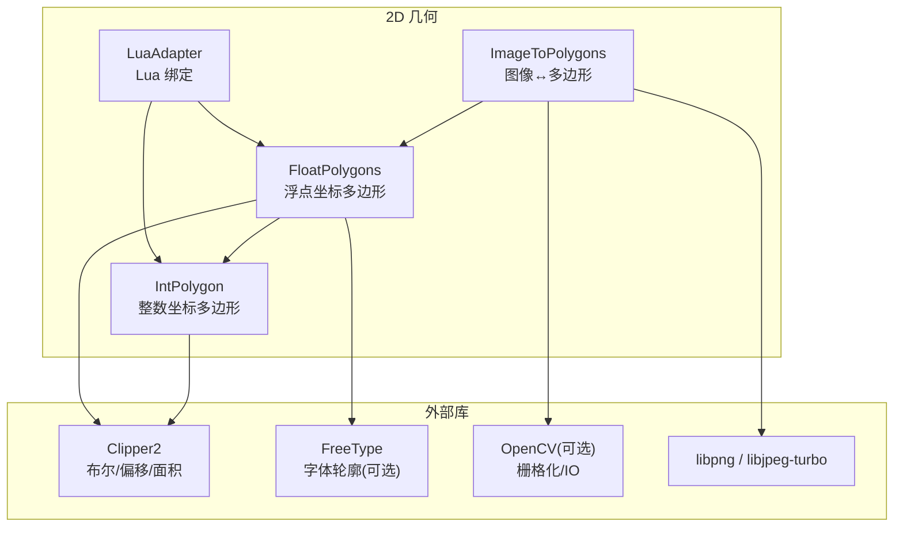
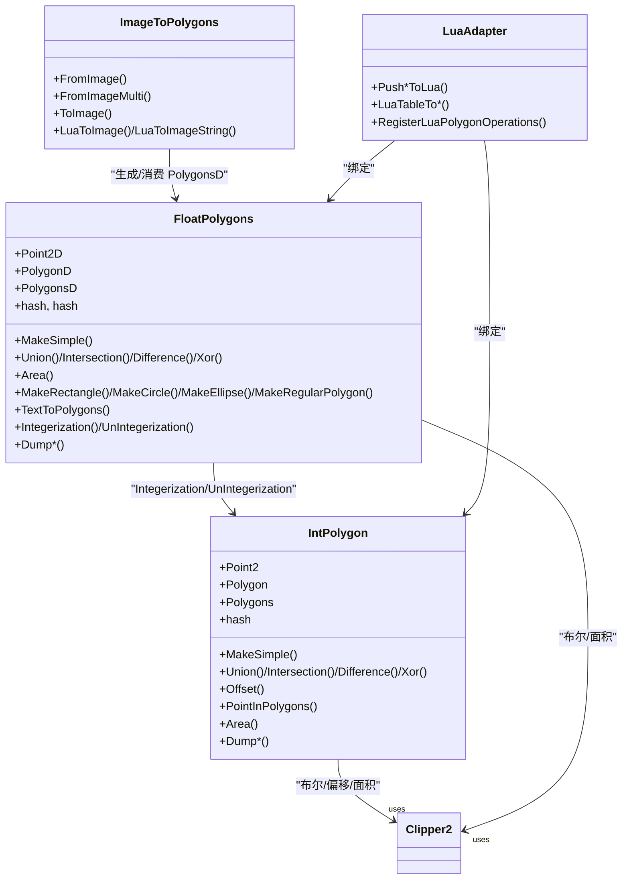
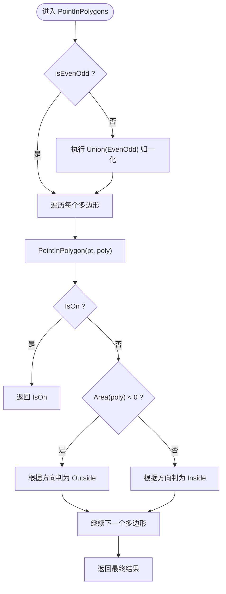
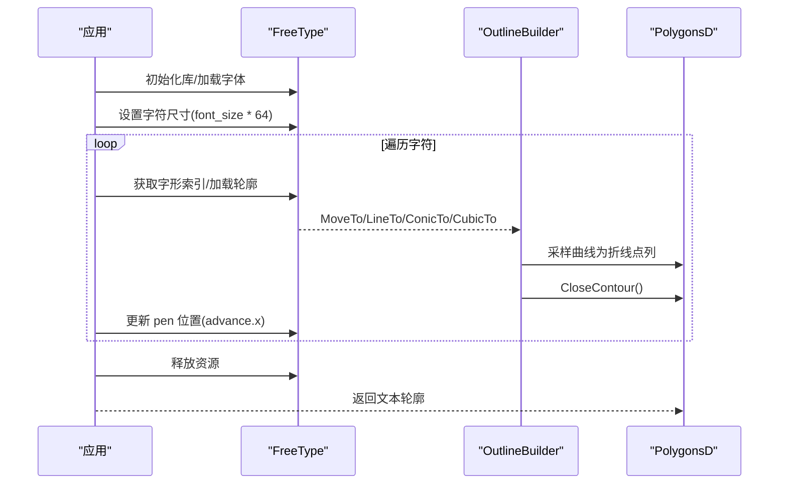
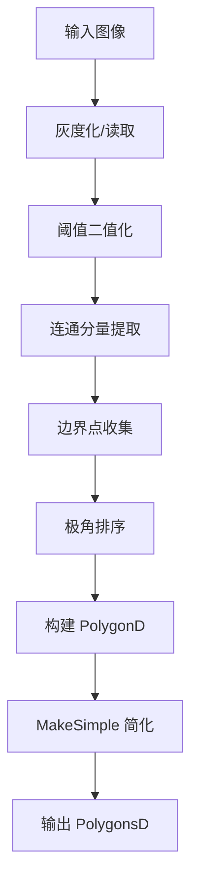
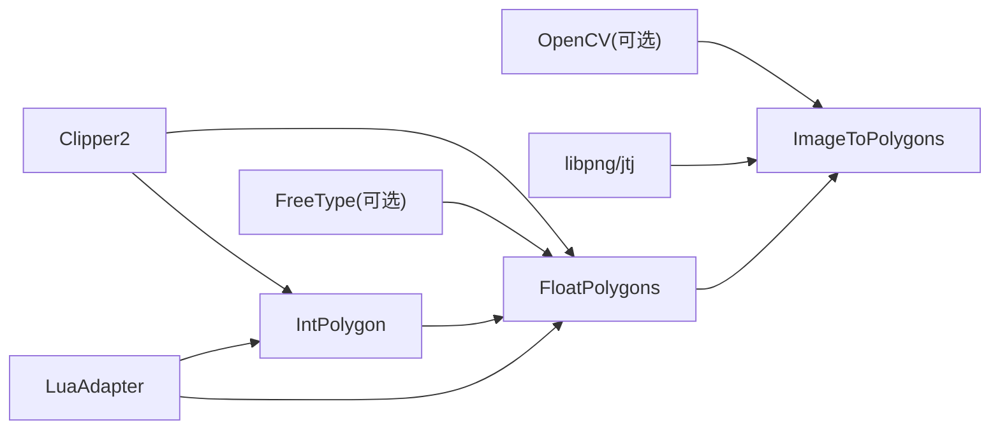

# 多边形数据结构

<cite>
**本文引用的文件**   
- [IntPolygon.hpp](file://2D/IntPolygon.hpp)
- [IntPolygon.cpp](file://2D/IntPolygon.cpp)
- [FloatPolygons.hpp](file://2D/FloatPolygons.hpp)
- [FloatPolygons.cpp](file://2D/FloatPolygons.cpp)
- [ImageToPolygons.hpp](file://2D/ImageToPolygons.hpp)
- [ImageToPolygons.cpp](file://2D/ImageToPolygons.cpp)
- [LuaAdapter.hpp](file://2D/LuaAdapter.hpp)
- [LuaAdapter.cpp](file://2D/LuaAdapter.cpp)
- [hsba_slicer.cppm](file://ModuleHsBaSlicer/hsba_slicer.cppm)
</cite>

## 目录
1. [引言](#引言)
2. [项目结构](#项目结构)
3. [核心组件](#核心组件)
4. [架构总览](#架构总览)
5. [详细组件分析](#详细组件分析)
6. [依赖关系分析](#依赖关系分析)
7. [性能与内存布局](#性能与内存布局)
8. [使用示例与最佳实践](#使用示例与最佳实践)
9. [故障排查指南](#故障排查指南)
10. [结论](#结论)

## 引言
本技术文档聚焦 HsBaSlicer 的二维多边形数据结构，深入解析整数坐标多边形 IntPolygon（基于 Clipper2 的 64 位整型路径）与浮点坐标多边形 FloatPolygons（基于 Clipper2 的双精度路径）的设计理念、API 能力、适用场景与性能特征。文档同时覆盖基本操作（简化、布尔运算、偏移、面积、点包含）、拓扑处理（自相交拆分、洞与岛关系重建），以及从图像到多边形、文本轮廓生成等周边能力。面向图形学开发者与算法工程师，提供可落地的实现洞察与优化建议。

## 项目结构
围绕多边形数据的核心代码位于 2D 模块：
- 整数多边形：IntPolygon.hpp/.cpp
- 浮点多边形：FloatPolygons.hpp/.cpp
- 图像与多边形互转：ImageToPolygons.hpp/.cpp
- Lua 适配与注册：LuaAdapter.hpp/.cpp
- 对外模块封装：ModuleHsBaSlicer/hsba_slicer.cppm

图表来源
- [IntPolygon.hpp:1-27](file://2D/IntPolygon.hpp#L1-L27)
- [FloatPolygons.hpp:1-25](file://2D/FloatPolygons.hpp#L1-L25)
- [ImageToPolygons.hpp:1-83](file://2D/ImageToPolygons.hpp#L1-L83)
- [LuaAdapter.hpp:1-82](file://2D/LuaAdapter.hpp#L1-L82)

章节来源
- [IntPolygon.hpp:1-27](file://2D/IntPolygon.hpp#L1-L27)
- [FloatPolygons.hpp:1-25](file://2D/FloatPolygons.hpp#L1-L25)
- [ImageToPolygons.hpp:1-83](file://2D/ImageToPolygons.hpp#L1-L83)
- [LuaAdapter.hpp:1-82](file://2D/LuaAdapter.hpp#L1-L82)

## 核心组件
- 整数多边形（IntPolygon）
  - 类型别名：Point2、Polygon、Polygons，对应 Clipper2Lib::Point64/Path64/Paths64
  - 常量：integerization = 1e6，用于双精度与整型坐标之间的缩放转换
  - 功能：简化、布尔运算（并/交/差/XOR）、偏移（膨胀/收缩）、点包含判断、面积计算、SVG 调试导出、哈希特化
- 浮点多边形（FloatPolygons）
  - 类型别名：Point2D、PolygonD、PolygonsD，对应 Clipper2Lib::PointD/PathD/PathsD
  - 功能：简化、布尔运算、面积计算、形状构造（矩形/圆/椭圆/正多边形）、文本转多边形（FreeType）、整型/浮点互转、SVG 调试导出、哈希特化
- 图像与多边形互转（ImageToPolygons）
  - 图像阈值提取轮廓为 PolygonsD
  - 多边形栅格化为图像（PNG/JPG/SVG）
  - 支持 Lua 脚本驱动渲染
- Lua 适配器（LuaAdapter）
  - 在 Lua 栈上推送/读取 Polygon/Polygons 与 PolygonD/PolygonsD
  - 注册 PolygonOperations 命名空间供脚本调用

章节来源
- [IntPolygon.hpp:16-26](file://2D/IntPolygon.hpp#L16-L26)
- [FloatPolygons.hpp:18-25](file://2D/FloatPolygons.hpp#L18-L25)
- [ImageToPolygons.hpp:22-79](file://2D/ImageToPolygons.hpp#L22-L79)
- [LuaAdapter.hpp:16-81](file://2D/LuaAdapter.hpp#L16-L81)

## 架构总览
下图展示两类多边形及其与 Clipper2、FreeType、OpenCV 的关系，以及 Lua 桥接层。

图表来源
- [IntPolygon.hpp:16-26](file://2D/IntPolygon.hpp#L16-L26)
- [FloatPolygons.hpp:18-25](file://2D/FloatPolygons.hpp#L18-L25)
- [FloatPolygons.cpp:176-213](file://2D/FloatPolygons.cpp#L176-L213)
- [ImageToPolygons.hpp:22-79](file://2D/ImageToPolygons.hpp#L22-L79)
- [LuaAdapter.hpp:16-81](file://2D/LuaAdapter.hpp#L16-L81)

## 详细组件分析

### 整数多边形 IntPolygon
- 设计要点
  - 以 Clipper2 的 64 位整型路径为核心，保证布尔运算与偏移的数值稳定性
  - 通过 integerization 常量统一与浮点坐标的换算比例
  - 提供 MakeSimpleAndSplit 与 NormalizeToSimplePolygons 对自相交多边形进行拆分与规范化
- 关键 API
  - 简化：MakeSimple(Polygon/Polygons)
  - 布尔：Union/Intersection/Difference/Xor（单多边形与多集合重载）
  - 偏移：Offset（支持 JoinType/EndType）
  - 点包含：PointInPolygons（支持 EvenOdd/非零绕数规则）
  - 面积：Area（单/多）
  - 调试导出：DumpPolygon/DumpPolygons（条件编译 HSBA_POLYGON_DUMP）
  - 哈希：std::hash 特化
- 内部流程（点包含）
  - 当 isEvenOdd=false 时，先执行一次 Union(EvenOdd) 将任意填充规则转换为 EvenOdd，再逐多边形判定
  - 结合 Area 符号判断孔洞方向，修正 IsInside/IsOutside 结果

图表来源
- [IntPolygon.cpp:79-121](file://2D/IntPolygon.cpp#L79-L121)

章节来源
- [IntPolygon.hpp:28-192](file://2D/IntPolygon.hpp#L28-L192)
- [IntPolygon.cpp:19-130](file://2D/IntPolygon.cpp#L19-L130)
- [IntPolygon.cpp:265-416](file://2D/IntPolygon.cpp#L265-L416)

### 浮点多边形 FloatPolygons
- 设计要点
  - 以 Clipper2 的双精度路径为核心，便于几何建模、文本轮廓与图像坐标对齐
  - 提供丰富的形状构造器（矩形、圆、椭圆、正多边形）
  - 提供 TextToPolygons（FreeType）将文字转为轮廓多边形
  - 提供 Integerization/UnIntegerization 与 IntPolygon 双向转换
- 关键 API
  - 简化：MakeSimple(PolygonD/PolygonsD)
  - 布尔：Union/Intersection/Difference/Xor（单多边形与多集合重载）
  - 面积：Area（单/多）
  - 形状构造：MakeRectangle/MakeCircle/MakeEllipse/MakeRegularPolygon
  - 文本转多边形：TextToPolygons（HSBA_HAVE_FREETYPE）
  - 坐标转换：Integerization/UnIntegerization
  - 调试导出：DumpPolygon/DumpPolygons（条件编译 HSBA_POLYGON_DUMP）
  - 哈希：std::hash 特化
- 文本转多边形流程（FreeType）
  - 初始化 FreeType 库与字体面
  - 设置字符尺寸（F26Dot6 单位）
  - 遍历 UTF-8 字符串，逐个加载字形轮廓
  - 使用 OutlineBuilder 回调将 MoveTo/LineTo/ConicTo/CubicTo 采样为折线点列
  - 平移 pen 位置，累积所有字形轮廓为 PolygonsD

图表来源
- [FloatPolygons.cpp:346-406](file://2D/FloatPolygons.cpp#L346-L406)

章节来源
- [FloatPolygons.hpp:27-221](file://2D/FloatPolygons.hpp#L27-L221)
- [FloatPolygons.cpp:25-75](file://2D/FloatPolygons.cpp#L25-L75)
- [FloatPolygons.cpp:176-213](file://2D/FloatPolygons.cpp#L176-L213)
- [FloatPolygons.cpp:314-344](file://2D/FloatPolygons.cpp#L314-L344)
- [FloatPolygons.cpp:346-406](file://2D/FloatPolygons.cpp#L346-L406)

### 图像与多边形互转 ImageToPolygons
- 图像→多边形
  - 灰度图二值化后，按四邻域连通分量提取边界点
  - 按中心角排序得到有序轮廓，调用 MakeSimple 清理共线点
- 多边形→图像
  - 计算包围盒，映射像素坐标
  - 支持 SVG 矢量输出或栅格化（OpenCV 优先，否则手动光栅化）
  - 支持 PNG/JPG 保存
- Lua 驱动渲染
  - 创建 Lua 状态，注册 PolygonOperations
  - 加载脚本/内联代码，调用指定函数，接收灰度图像表并写出文件

图表来源
- [ImageToPolygons.cpp:87-174](file://2D/ImageToPolygons.cpp#L87-L174)

章节来源
- [ImageToPolygons.hpp:22-79](file://2D/ImageToPolygons.hpp#L22-L79)
- [ImageToPolygons.cpp:87-174](file://2D/ImageToPolygons.cpp#L87-L174)
- [ImageToPolygons.cpp:282-415](file://2D/ImageToPolygons.cpp#L282-L415)
- [ImageToPolygons.cpp:417-546](file://2D/ImageToPolygons.cpp#L417-L546)

### Lua 适配器 LuaAdapter
- 负责在 Lua 栈与 C++ 多边形类型之间进行双向转换
- 注册 PolygonOperations 命名空间，供 Lua 脚本调用多边形操作

章节来源
- [LuaAdapter.hpp:16-81](file://2D/LuaAdapter.hpp#L16-L81)
- [LuaAdapter.cpp:401-421](file://2D/LuaAdapter.cpp#L401-L421)

## 依赖关系分析
- 外部依赖
  - Clipper2：提供稳定高效的布尔运算、偏移、面积与点包含
  - FreeType（可选）：文本轮廓生成
  - OpenCV（可选）：图像 IO 与栅格化加速
  - libpng/libjpeg-turbo：图像写入
- 内部耦合
  - FloatPolygons 依赖 IntPolygon 进行坐标缩放转换
  - ImageToPolygons 依赖 FloatPolygons 生成/消费 PolygonsD
  - LuaAdapter 同时依赖两类多边形类型进行绑定

图表来源
- [IntPolygon.hpp:9-10](file://2D/IntPolygon.hpp#L9-L10)
- [FloatPolygons.hpp:9-12](file://2D/FloatPolygons.hpp#L9-L12)
- [ImageToPolygons.cpp:15-21](file://2D/ImageToPolygons.cpp#L15-L21)
- [FloatPolygons.cpp:17-21](file://2D/FloatPolygons.cpp#L17-L21)

章节来源
- [IntPolygon.hpp:9-10](file://2D/IntPolygon.hpp#L9-L10)
- [FloatPolygons.hpp:9-12](file://2D/FloatPolygons.hpp#L9-L12)
- [ImageToPolygons.cpp:15-21](file://2D/ImageToPolygons.cpp#L15-L21)
- [FloatPolygons.cpp:17-21](file://2D/FloatPolygons.cpp#L17-L21)

## 性能与内存布局
- 数据类型选择
  - 整数多边形（64 位整型）：避免浮点误差累积，适合大规模布尔运算与偏移；默认 epsilon 较大（1e-3）
  - 浮点多边形（double）：适合建模、文本轮廓与图像坐标对齐；默认 epsilon 较小（1e-6）
- 内存布局
  - 底层均为 std::vector<Point*> 形式的 Path/Paths，连续存储提升缓存友好性
  - 批量操作（如 Union/Intersect/Difference/Xor）直接传入 Paths，减少中间拷贝
- 简化与拆分
  - MakeSimple 去除共线点，降低后续布尔运算复杂度
  - MakeSimpleAndSplit 通过 PolyTree 拆分自相交区域，NormalizeToSimplePolygons 重建洞/岛层级
- 点包含优化
  - 非 EvenOdd 规则时，先做一次 Union(EvenOdd) 归一化，再逐多边形判定，避免复杂绕数逻辑
- 文本轮廓采样
  - ConicTo/CubicTo 按 curveSegments 均匀采样，控制曲线近似精度与点数权衡
- 图像栅格化
  - 优先使用 OpenCV 的 fillPoly 加速；无 OpenCV 时回退到逐像素点包含测试

章节来源
- [IntPolygon.cpp:19-26](file://2D/IntPolygon.cpp#L19-L26)
- [IntPolygon.cpp:79-121](file://2D/IntPolygon.cpp#L79-L121)
- [IntPolygon.cpp:265-416](file://2D/IntPolygon.cpp#L265-L416)
- [FloatPolygons.cpp:25-32](file://2D/FloatPolygons.cpp#L25-L32)
- [FloatPolygons.cpp:346-406](file://2D/FloatPolygons.cpp#L346-L406)
- [ImageToPolygons.cpp:260-279](file://2D/ImageToPolygons.cpp#L260-L279)

## 使用示例与最佳实践

- 基本操作
  - 简化：对输入多边形调用 MakeSimple，epsilon 根据坐标尺度调整
  - 布尔运算：Union/Intersection/Difference/Xor，注意 FillRule（默认 EvenOdd）
  - 偏移：Offset(delta, join_type, end_type)，正值膨胀、负值收缩
  - 面积：Area 可用于判断方向（正/负）与空洞识别
  - 点包含：PointInPolygons，必要时关闭 isEvenOdd 以启用非零绕数规则
- 几何变换
  - 当前 2D 多边形未提供直接的平移/旋转/缩放 API
  - 推荐做法：在调用前对 PolygonsD 顶点进行仿射变换，再调用 Integerization 转为整数多边形参与布尔/偏移
  - 若需保留浮点精度，可在 FloatPolygons 中自行实现变换后再做后续处理
- 拓扑关系
  - 自相交多边形：先用 MakeSimpleAndSplit 拆分，再用 NormalizeToSimplePolygons 重建洞/岛关系
  - 孔洞方向：利用 Area 符号与 NormalizeOrientation 确保外环顺时针、内环逆时针（或反之，取决于约定）
- 图像与文本
  - 图像→多边形：FromImage/FromImageMulti，合理设置 threshold 与 pixelSize
  - 多边形→图像：ToImage，SVG 矢量输出或栅格化 PNG/JPG
  - 文本→多边形：TextToPolygons，选择合适的 font_size 与 curve_segments
- Lua 集成
  - 使用 RegisterLuaPolygonOperations 暴露 PolygonOperations
  - 通过 Push*ToLua/LuaTableTo* 在脚本中传递多边形数据

章节来源
- [IntPolygon.hpp:28-192](file://2D/IntPolygon.hpp#L28-L192)
- [FloatPolygons.hpp:27-221](file://2D/FloatPolygons.hpp#L27-L221)
- [ImageToPolygons.hpp:22-79](file://2D/ImageToPolygons.hpp#L22-L79)
- [LuaAdapter.hpp:16-81](file://2D/LuaAdapter.hpp#L16-L81)

## 故障排查指南
- 文本转多边形失败
  - 现象：抛出“需要 FreeType 支持”或字体加载错误
  - 原因：未启用 HSBA_HAVE_FREETYPE 或字体文件不可用
  - 解决：启用 FreeType 编译选项，检查字体路径与编码
- 图像读写失败
  - 现象：ToImage 返回 false 或抛出运行时错误
  - 原因：OpenCV 不可用且 PNG/JPEG 写入失败；或 Lua 脚本返回非整数灰度表
  - 解决：安装 OpenCV 或回退到纯 C++ 路径；校验 Lua 脚本返回值
- 点包含结果异常
  - 现象：点在边界附近被误判
  - 原因：非 EvenOdd 规则下存在复杂绕数；或 Area 接近 0 的多边形
  - 解决：尝试 isEvenOdd=true；过滤面积为 0 的多边形；适当增大 MakeSimple 的 epsilon
- 自相交多边形处理
  - 现象：布尔运算结果不符合预期
  - 原因：输入多边形自相交或未规范化
  - 解决：先调用 MakeSimpleAndSplit 与 NormalizeToSimplePolygons

章节来源
- [FloatPolygons.cpp:346-406](file://2D/FloatPolygons.cpp#L346-L406)
- [ImageToPolygons.cpp:417-546](file://2D/ImageToPolygons.cpp#L417-L546)
- [IntPolygon.cpp:79-121](file://2D/IntPolygon.cpp#L79-L121)
- [IntPolygon.cpp:329-416](file://2D/IntPolygon.cpp#L329-L416)

## 结论
HsBaSlicer 的多边形体系以 Clipper2 为核心，通过整数与浮点两套类型兼顾数值稳定性与建模灵活性。整数多边形适用于大规模布尔与偏移运算，浮点多边形则更贴近建模与文本/图像坐标。配合图像与文本工具链、Lua 脚本扩展，形成完整的 2D 几何处理管线。对于几何变换，建议在应用层完成仿射变换后再进入多边形管线；对于拓扑问题，优先使用拆分与规范化流程。整体设计强调缓存友好的连续内存布局与批量操作，满足高性能图形学与切片算法的需求。