# CAD 模型支持（CAD Model Support）

<cite>
**本文引用的文件**   
- [OcctModel.hpp](file://cadmodel/OcctModel.hpp)
- [OcctModel.cpp](file://cadmodel/OcctModel.cpp)
- [OcctTypeAliases.hpp](file://cadmodel/OcctTypeAliases.hpp)
- [UserCustomCADModel.hpp](file://cadmodel/UserCustomCADModel.hpp)
- [UserCustomCADModel.cpp](file://cadmodel/UserCustomCADModel.cpp)
- [IModel.hpp](file://base/IModel.hpp)
- [CMakeLists.txt](file://CMakeLists.txt)
- [user_custom_cad_model_test.cpp](file://tests/CADModel/user_custom_cad_model_test.cpp)
</cite>

## 目录
1. [项目概述与快速开始](#项目概述与快速开始)
2. [架构总览](#架构总览)
3. [核心概念](#核心概念)
4. [核心模块详解](#核心模块详解)
5. [高级主题](#高级主题)
6. [API 参考文档](#api-参考文档)
7. [集成指南](#集成指南)
8. [开发测试与贡献](#开发测试与贡献)
9. [扩展开发指南](#扩展开发指南)
10. [示例与教程](#示例与教程)
11. [部署故障排除与 FAQ](#部署故障排除与-faq)
12. [附录](#附录)

## 项目概述与快速开始
本章节面向初次接触 HsBaSlicer CAD 模型支持模块的读者，说明 cadmodel 模块的职责、适用场景以及两种主要使用方式：
- 直接使用内置 OpenCascade B-Rep 建模实现 `OcctModel`。
- 通过动态加载外部 CAD 库，使用 `UserCustomCADModel` 接入第三方 CAD 系统。

典型用途包括：
- 从 STEP、IGES、VRML、BRep 等格式加载或保存 CAD 模型。
- 对模型执行平移、旋转、缩放和仿射变换。
- 执行布尔运算、实体加厚、基础几何体创建和多边形拉伸。
- 将 B-Rep 模型转换为三角网格，用于切片、可视化或导出为 PLY/STL/OFF 等网格格式。
- 在保持统一 `IModel` 接口的前提下，替换底层 CAD 内核。

快速开始建议：
- 如果不需要自定义 CAD 内核，优先使用 `OcctModel`。
- 如果需要对接 SolidWorks、CATIA 或其他私有 CAD 系统，编写符合 `IUserCustomCAD` 契约的动态库，并通过 `UserCustomCADModel::LoadDll` 加载。

本节不直接分析具体源码文件，因此不包含“章节来源”。

## 架构总览
cadmodel 模块围绕统一的 `IModel` 抽象展开，提供两类实现：
- `OcctModel`：基于 OpenCascade 的 B-Rep 建模实现。
- `UserCustomCADModel`：对外部 CAD 动态库的适配层，暴露统一的 C ABI 函数约定。

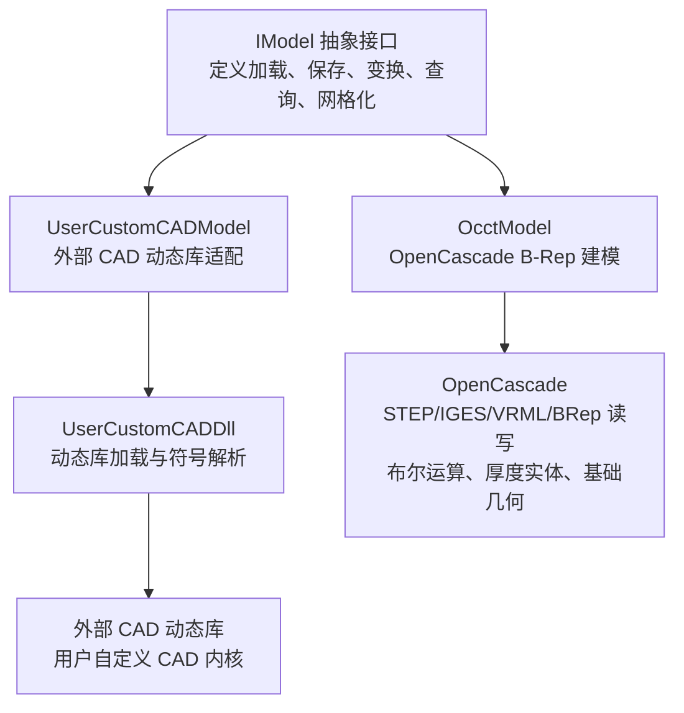

**图表来源**
- [IModel.hpp:111-139](file://base/IModel.hpp#L111-L139)
- [OcctModel.hpp:22-124](file://cadmodel/OcctModel.hpp#L22-L124)
- [UserCustomCADModel.hpp:20-121](file://cadmodel/UserCustomCADModel.hpp#L20-L121)

### 构建与依赖关系
- 当启用 copyleft 内核且非 Android/iOS/游戏控制台时，构建系统会查找 OpenCASCADE 并启用 `USE_OCCT` 与 `USE_CAD_KERNEL`。
- 布尔运算在 Debug 模式下可能较慢且内存占用较高；模型对象池大小会根据是否启用 copyleft 内核调整。

**章节来源**
- [CMakeLists.txt:297-318](file://CMakeLists.txt#L297-L318)

## 核心概念
### IModel 抽象接口
`IModel` 是 HsBaSlicer 中所有 3D 模型的统一抽象，定义了：
- 文件加载与保存。
- 平移、旋转、缩放、仿射变换。
- 包围盒查询、体积计算。
- 三角网格导出。

该接口还定义了跨语言使用的 C ABI 数据结构，例如二维向量、三维向量、四元数、4x4 矩阵、二维多边形及多边形集合。这些类型被外部 CAD 动态库用于传递几何数据。

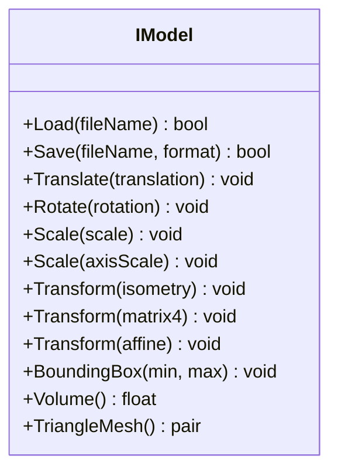

**图表来源**
- [IModel.hpp:111-139](file://base/IModel.hpp#L111-L139)

**章节来源**
- [IModel.hpp:19-61](file://base/IModel.hpp#L19-L61)
- [IModel.hpp:65-109](file://base/IModel.hpp#L65-L109)
- [IModel.hpp:111-139](file://base/IModel.hpp#L111-L139)

### OcctModel：OpenCascade B-Rep 建模
`OcctModel` 封装 `TopoDS_Shape`，提供：
- 加载 STEP、IGES、VRML、BRep。
- 保存对应格式，或将 B-Rep 转为网格后导出为 PLY/STL/OFF。
- 平移、旋转、均匀与非均匀缩放、仿射变换。
- 包围盒、体积、三角网格。
- 布尔运算：并集、交集、差集、异或。
- 实体加厚：整体加厚或指定面集合加厚。
- 基础几何体工厂：立方体、球体、圆柱、圆锥、圆环。
- 多边形拉伸：单闭合多边形或多轮廓（外轮廓加孔洞）拉伸成实体。

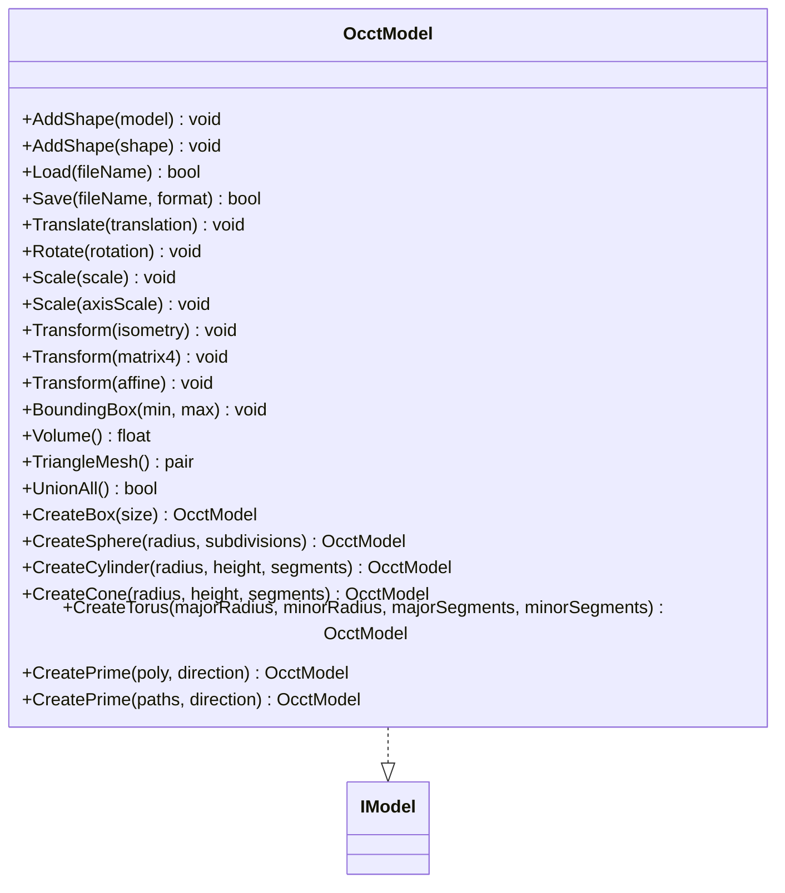

**图表来源**
- [OcctModel.hpp:22-124](file://cadmodel/OcctModel.hpp#L22-L124)

**章节来源**
- [OcctModel.hpp:22-124](file://cadmodel/OcctModel.hpp#L22-L124)
- [OcctModel.cpp:76-190](file://cadmodel/OcctModel.cpp#L76-L190)
- [OcctModel.cpp:213-271](file://cadmodel/OcctModel.cpp#L213-L271)
- [OcctModel.cpp:272-329](file://cadmodel/OcctModel.cpp#L272-L329)
- [OcctModel.cpp:331-407](file://cadmodel/OcctModel.cpp#L331-L407)
- [OcctModel.cpp:409-469](file://cadmodel/OcctModel.cpp#L409-L469)
- [OcctModel.cpp:471-540](file://cadmodel/OcctModel.cpp#L471-L540)
- [OcctModel.cpp:542-663](file://cadmodel/OcctModel.cpp#L542-L663)

### UserCustomCADModel：用户自定义 CAD 模型接口
`UserCustomCADModel` 是一个适配器，负责：
- 加载外部 CAD 动态库。
- 调用动态库导出的工厂函数创建模型。
- 将 Load、Save、变换、布尔运算、查询等操作转发给底层模型。
- 管理动态库生命周期与模型销毁。

外部 CAD 库需要实现 `IUserCustomCAD` 约定的函数指针，例如：
- 创建模型、销毁模型。
- 布尔运算。
- 创建基础几何体。
- 设置实体厚度。
- 多边形拉伸。

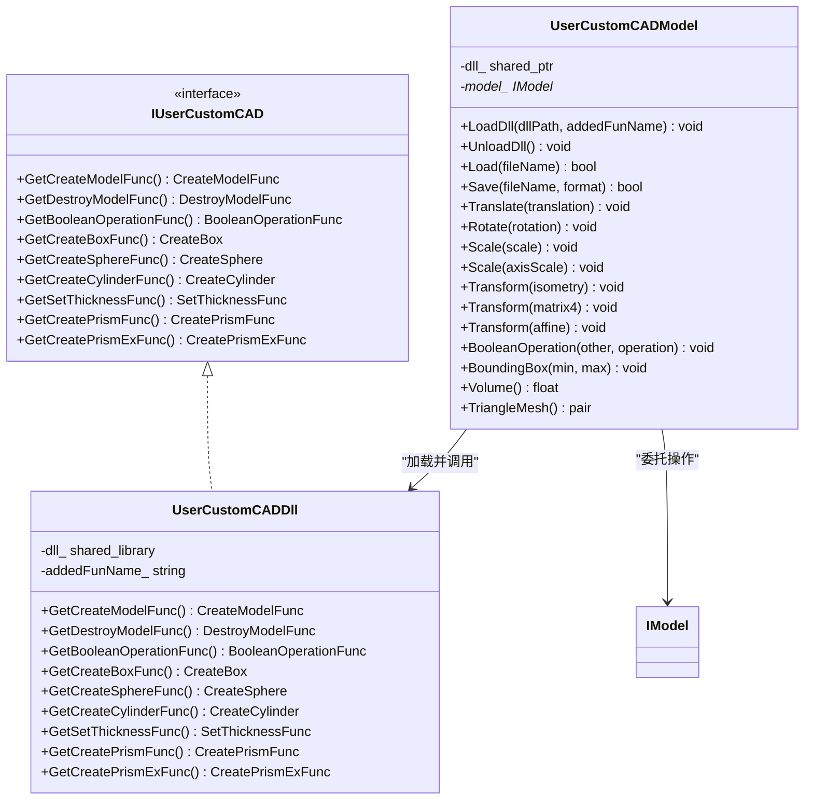

**图表来源**
- [UserCustomCADModel.hpp:20-73](file://cadmodel/UserCustomCADModel.hpp#L20-L73)
- [UserCustomCADModel.hpp:75-121](file://cadmodel/UserCustomCADModel.hpp#L75-L121)

**章节来源**
- [UserCustomCADModel.hpp:20-121](file://cadmodel/UserCustomCADModel.hpp#L20-L121)
- [UserCustomCADModel.cpp:24-115](file://cadmodel/UserCustomCADModel.cpp#L24-L115)
- [UserCustomCADModel.cpp:123-182](file://cadmodel/UserCustomCADModel.cpp#L123-L182)
- [UserCustomCADModel.cpp:184-325](file://cadmodel/UserCustomCADModel.cpp#L184-L325)

## 详细组件分析

### OcctModel 数据流与处理逻辑
OcctModel 的核心流程包括：
- 根据文件扩展名选择读取器。
- 将多个子形状合并到复合形状。
- 将变换应用到 OCCT 变换对象。
- 遍历面进行三角剖分。
- 使用几何属性工具计算体积。
- 使用布尔运算 API 执行集合运算。
- 使用厚度实体 API 生成壳体。
- 使用基础几何 API 创建原始实体。
- 使用多边形构造线框、面、棱柱。

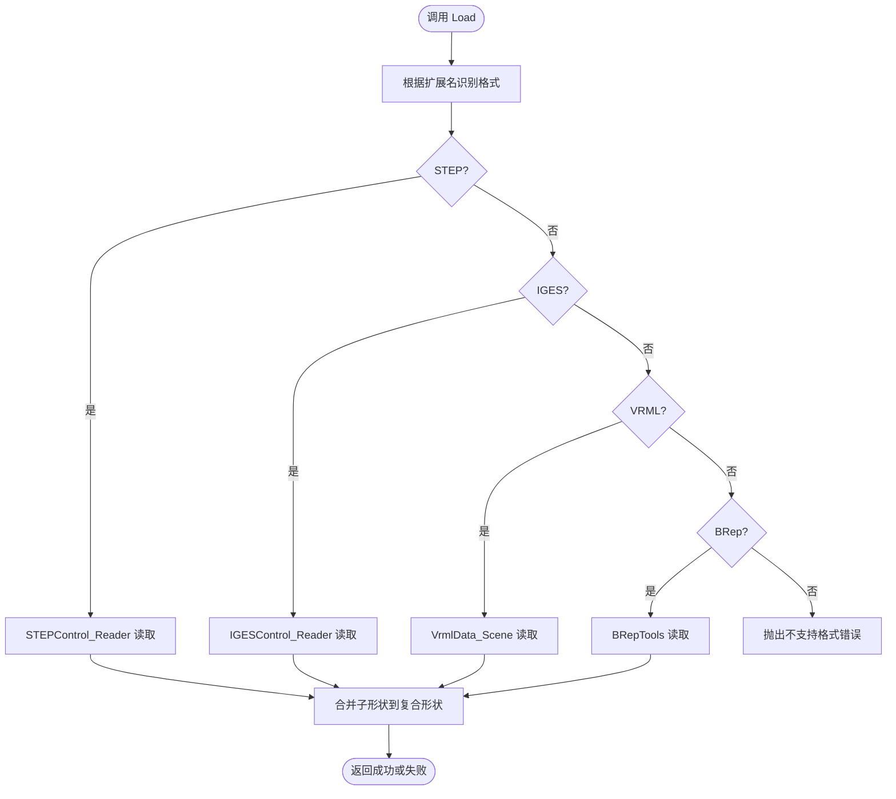

**图表来源**
- [OcctModel.cpp:76-147](file://cadmodel/OcctModel.cpp#L76-L147)
- [OcctModel.cpp:213-237](file://cadmodel/OcctModel.cpp#L213-L237)

**章节来源**
- [OcctModel.cpp:76-147](file://cadmodel/OcctModel.cpp#L76-L147)
- [OcctModel.cpp:213-237](file://cadmodel/OcctModel.cpp#L213-L237)

### OcctModel 变换与布尔运算序列
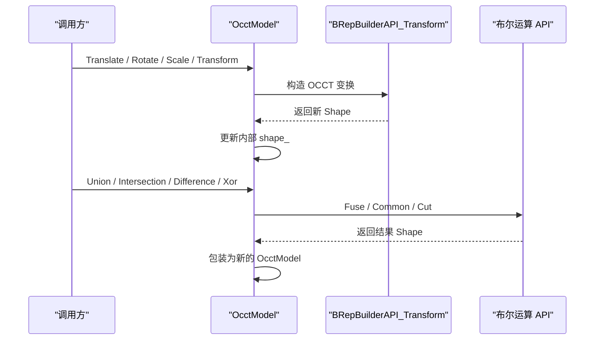

**图表来源**
- [OcctModel.cpp:272-329](file://cadmodel/OcctModel.cpp#L272-L329)
- [OcctModel.cpp:451-469](file://cadmodel/OcctModel.cpp#L451-L469)

**章节来源**
- [OcctModel.cpp:272-329](file://cadmodel/OcctModel.cpp#L272-L329)
- [OcctModel.cpp:451-469](file://cadmodel/OcctModel.cpp#L451-L469)

### UserCustomCADModel 动态库加载与布尔运算流程
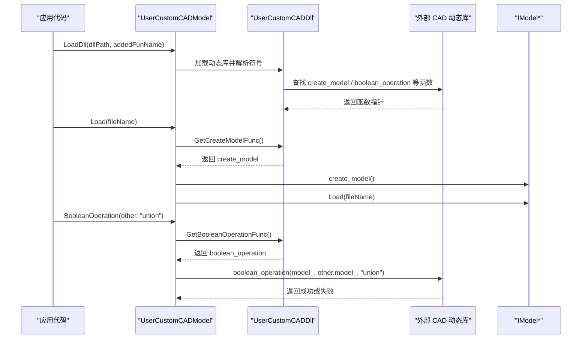

**图表来源**
- [UserCustomCADModel.cpp:31-115](file://cadmodel/UserCustomCADModel.cpp#L31-L115)
- [UserCustomCADModel.cpp:134-173](file://cadmodel/UserCustomCADModel.cpp#L134-L173)
- [UserCustomCADModel.cpp:268-289](file://cadmodel/UserCustomCADModel.cpp#L268-L289)

**章节来源**
- [UserCustomCADModel.cpp:31-115](file://cadmodel/UserCustomCADModel.cpp#L31-L115)
- [UserCustomCADModel.cpp:134-173](file://cadmodel/UserCustomCADModel.cpp#L134-L173)
- [UserCustomCADModel.cpp:268-289](file://cadmodel/UserCustomCADModel.cpp#L268-L289)

### OcctTypeAliases：OCCT 版本兼容
`OcctTypeAliases.hpp` 根据 OCCT 版本宏定义，将整数、布尔、实数、字节、字符等类型映射为标准 C++ 类型或 OCCT 旧版类型，从而兼容 OCCT 8.0 前后差异。

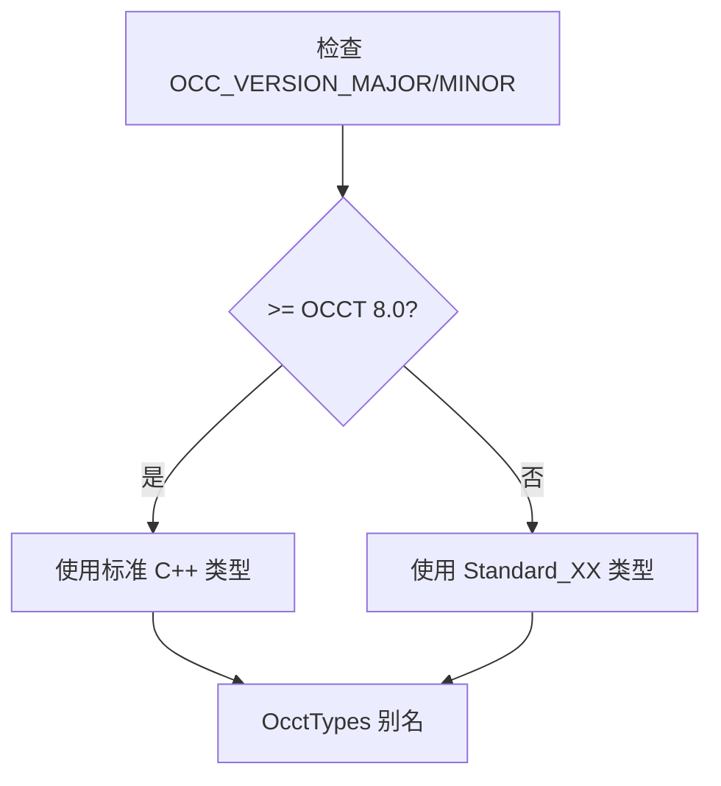

**图表来源**
- [OcctTypeAliases.hpp:14-41](file://cadmodel/OcctTypeAliases.hpp#L14-L41)

**章节来源**
- [OcctTypeAliases.hpp:14-41](file://cadmodel/OcctTypeAliases.hpp#L14-L41)

## 高级主题

### 布尔运算性能与内存特征
- 布尔运算可能较慢，Debug 模式下尤其明显。
- 当启用 copyleft 内核时，模型对象池大小设置为 10，以支持布尔运算期间持有多个模型。
- 未启用 copyleft 内核时，对象池大小为 1，布尔运算能力受限。

**章节来源**
- [CMakeLists.txt:297-306](file://CMakeLists.txt#L297-L306)

### 实体加厚与面匹配策略
`ThickSolid` 提供两种模式：
- 对整个实体进行简单加厚。
- 根据传入的面集合，跳过匹配面后进行连接加厚。

匹配逻辑包含距离容差与变换矩阵迹比较，用于判断两个面是否相同。

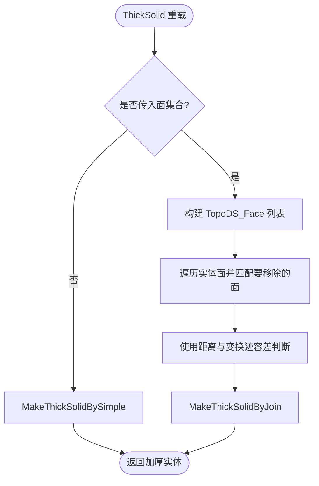

**图表来源**
- [OcctModel.cpp:471-540](file://cadmodel/OcctModel.cpp#L471-L540)

**章节来源**
- [OcctModel.cpp:471-540](file://cadmodel/OcctModel.cpp#L471-L540)

### 多边形拉伸与孔洞支持
`CreatePrime` 支持：
- 单个闭合多边形拉伸。
- 多轮廓拉伸：第一个轮廓作为外边界，后续轮廓作为孔洞。

输入校验包括至少三个顶点、外轮廓有效、孔洞跳过无效情况。

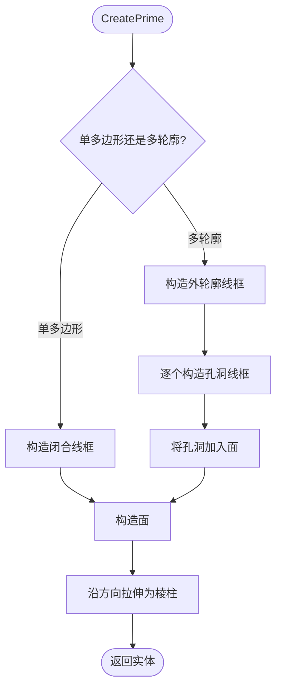

**图表来源**
- [OcctModel.cpp:542-663](file://cadmodel/OcctModel.cpp#L542-L663)

**章节来源**
- [OcctModel.cpp:542-663](file://cadmodel/OcctModel.cpp#L542-L663)

## API 参考文档

### IModel 接口摘要
- 加载模型：`Load(fileName)`
- 保存模型：`Save(fileName, format)`
- 平移：`Translate(translation)`
- 旋转：`Rotate(rotation)`
- 缩放：`Scale(scale)`、`Scale(axisScale)`
- 变换：`Transform(isometry)`、`Transform(matrix4)`、`Transform(affine)`
- 包围盒：`BoundingBox(min, max)`
- 体积：`Volume()`
- 三角网格：`TriangleMesh()`

**章节来源**
- [IModel.hpp:111-139](file://base/IModel.hpp#L111-L139)

### OcctModel 公开 API
- 添加形状：`AddShape(OcctModel)`、`AddShape(TopoDS_Shape)`
- 加载：`Load(fileName)`
- 保存：`Save(fileName, format)`
- 变换：`Translate`、`Rotate`、`Scale`、`Transform`
- 查询：`BoundingBox`、`Volume`、`TriangleMesh`
- 布尔运算：`UnionAll`、`Union`、`Intersection`、`Difference`、`Xor`
- 实体加厚：`ThickSolid(model, thickness)`、`ThickSolid(model, faces, thickness)`
- 基础几何：`CreateBox`、`CreateSphere`、`CreateCylinder`、`CreateCone`、`CreateTorus`
- 多边形拉伸：`CreatePrime(poly, direction)`、`CreatePrime(paths, direction)`

**章节来源**
- [OcctModel.hpp:45-109](file://cadmodel/OcctModel.hpp#L45-L109)
- [OcctModel.cpp:192-211](file://cadmodel/OcctModel.cpp#L192-L211)
- [OcctModel.cpp:213-271](file://cadmodel/OcctModel.cpp#L213-L271)
- [OcctModel.cpp:272-329](file://cadmodel/OcctModel.cpp#L272-L329)
- [OcctModel.cpp:331-407](file://cadmodel/OcctModel.cpp#L331-L407)
- [OcctModel.cpp:409-469](file://cadmodel/OcctModel.cpp#L409-L469)
- [OcctModel.cpp:471-540](file://cadmodel/OcctModel.cpp#L471-L540)
- [OcctModel.cpp:542-663](file://cadmodel/OcctModel.cpp#L542-L663)

### UserCustomCADModel 公开 API
- 动态库管理：`LoadDll(dllPath, addedFunName)`、`UnloadDll()`
- 加载与保存：`Load(fileName)`、`Save(fileName, format)`
- 变换：`Translate`、`Rotate`、`Scale`、`Transform`
- 布尔运算：`BooleanOperation(other, operation)`
- 查询：`BoundingBox`、`Volume`、`TriangleMesh`

外部 CAD 动态库需实现：
- 创建模型：`create_model`
- 销毁模型：`destroy_model`
- 布尔运算：`boolean_operation`
- 基础几何：`create_box`、`create_sphere`、`create_cylinder`
- 厚度设置：`set_thickness`
- 多边形拉伸：`create_prism`、`create_prism_ex`

**章节来源**
- [UserCustomCADModel.hpp:79-121](file://cadmodel/UserCustomCADModel.hpp#L79-L121)
- [UserCustomCADModel.cpp:134-182](file://cadmodel/UserCustomCADModel.cpp#L134-L182)
- [UserCustomCADModel.cpp:184-325](file://cadmodel/UserCustomCADModel.cpp#L184-L325)

## 集成指南

### 使用 OcctModel 的典型流程
1. 确保构建系统已启用 OpenCASCADE。
2. 创建 `OcctModel` 实例。
3. 调用 `Load` 加载 STEP/IGES/VRML/BRep。
4. 根据需要执行变换、布尔运算、实体加厚或基础几何创建。
5. 调用 `Save` 保存为 CAD 格式，或通过 `TriangleMesh` 导出为网格格式。

注意事项：
- 保存网格格式时，`OcctModel` 会将 B-Rep 转换为三角网格，再委托给网格模型实现保存。
- 布尔运算可能产生复杂拓扑，建议在 Release 模式下运行以获得更好性能。

**章节来源**
- [CMakeLists.txt:313-318](file://CMakeLists.txt#L313-L318)
- [OcctModel.cpp:238-271](file://cadmodel/OcctModel.cpp#L238-L271)

### 集成外部 CAD 系统的步骤
1. 编写符合 `IUserCustomCAD` 契约的动态库，导出所需函数。
2. 在应用中创建 `UserCustomCADModel`。
3. 调用 `LoadDll` 加载动态库。
4. 调用 `Load` 加载模型文件。
5. 执行变换、布尔运算、查询等操作。
6. 使用 `UnloadDll` 释放动态库。

关键约束：
- 布尔运算要求两个模型来自同一个动态库。
- 若动态库未导出布尔运算函数，调用会抛出运行时错误。
- 若模型未加载或动态库不兼容，也会抛出运行时错误。

**章节来源**
- [UserCustomCADModel.cpp:268-289](file://cadmodel/UserCustomCADModel.cpp#L268-L289)
- [user_custom_cad_model_test.cpp:178-188](file://tests/CADModel/user_custom_cad_model_test.cpp#L178-L188)

### CAD 数据转换与兼容性建议
- 文件格式：
  - 原生 CAD 格式：STEP、IGES、VRML、BRep。
  - 网格格式：PLY、STL、OFF。
- 转换路径：
  - B-Rep 到网格：通过 `TriangleMesh` 获取顶点和面索引。
  - 网格到 CAD：通常由 CAD 系统导入网格重建曲面，HsBaSlicer 侧主要通过网格模型处理。
- 坐标与单位：
  - Eigen 使用浮点向量与矩阵，OCCT 使用 `gp_Pnt`、`gp_Trsf` 等类型，注意精度与单位一致性。
- 版本兼容：
  - OCCT 8.0+ 使用标准 C++ 类型，旧版本使用 `Standard_XX` 类型，通过 `OcctTypeAliases` 屏蔽差异。

**章节来源**
- [OcctModel.cpp:353-407](file://cadmodel/OcctModel.cpp#L353-L407)
- [OcctTypeAliases.hpp:14-41](file://cadmodel/OcctTypeAliases.hpp#L14-L41)

## 开发测试与贡献

### 单元测试覆盖要点
- 外部 CAD 动态库加载失败。
- 布尔运算函数缺失。
- 不同动态库之间的模型不能进行布尔运算。
- 未加载模型时调用变换或查询方法应抛出异常。

测试用例展示了以下行为：
- 对未加载模型执行布尔运算抛出异常。
- 同一动态库但其中一个模型未创建时抛出异常。
- 卸载动态库后继续加载模型抛出异常。

**章节来源**
- [user_custom_cad_model_test.cpp:178-188](file://tests/CADModel/user_custom_cad_model_test.cpp#L178-L188)

### 调试建议
- 若布尔运算失败，优先检查两个模型是否来自同一动态库。
- 若动态库符号解析失败，检查导出函数名称是否符合约定。
- 若 VRML 或 BRep 读写失败，检查文件路径编码与 OCCT 异常信息。

**章节来源**
- [UserCustomCADModel.cpp:151-173](file://cadmodel/UserCustomCADModel.cpp#L151-L173)
- [OcctModel.cpp:110-147](file://cadmodel/OcctModel.cpp#L110-L147)

## 扩展开发指南

### 实现自定义 CAD 动态库
你需要提供一个动态库，导出以下函数：
- `create_model`：返回 `IModel*`。
- `destroy_model`：销毁 `IModel*`。
- `boolean_operation`：对两个 `IModel*` 执行命名布尔运算。
- `create_box`、`create_sphere`、`create_cylinder`：创建基础几何。
- `set_thickness`：设置实体厚度。
- `create_prism`、`create_prism_ex`：从二维多边形拉伸实体。

约定：
- 函数名前缀由 `addedFunName` 决定，例如 `my_cad_create_model`。
- 多边形参数使用 `HsBaPoly2D_t` 与 `HsBaPolys2D_t`。
- 返回值所有权归调用方，必须通过 `destroy_model` 释放。

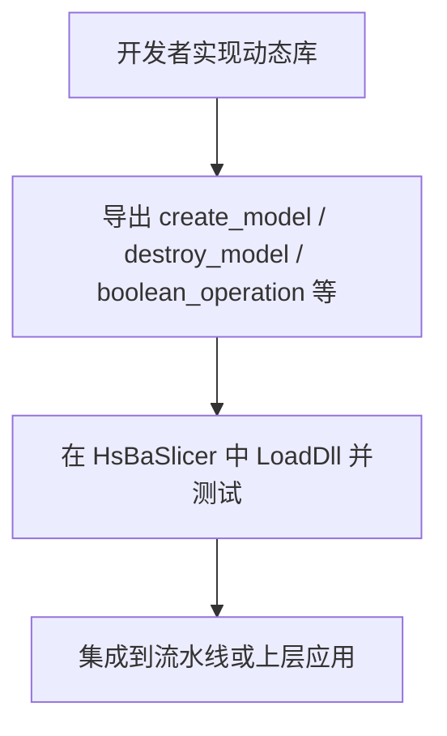

**图表来源**
- [UserCustomCADModel.hpp:20-73](file://cadmodel/UserCustomCADModel.hpp#L20-L73)
- [UserCustomCADModel.cpp:35-115](file://cadmodel/UserCustomCADModel.cpp#L35-L115)

**章节来源**
- [UserCustomCADModel.hpp:20-73](file://cadmodel/UserCustomCADModel.hpp#L20-L73)
- [UserCustomCADModel.cpp:35-115](file://cadmodel/UserCustomCADModel.cpp#L35-L115)

## 示例与教程

### 使用 OcctModel 创建基础几何并执行布尔运算
推荐流程：
1. 使用 `CreateBox`、`CreateSphere`、`CreateCylinder` 创建基础几何。
2. 使用 `Union`、`Intersection`、`Difference`、`Xor` 组合模型。
3. 使用 `Translate`、`Rotate`、`Scale`、`Transform` 调整位置与姿态。
4. 使用 `Volume`、`BoundingBox`、`TriangleMesh` 查询结果。

参考实现位置：
- 基础几何创建：[OcctModel.cpp:422-449](file://cadmodel/OcctModel.cpp#L422-L449)
- 布尔运算：[OcctModel.cpp:451-469](file://cadmodel/OcctModel.cpp#L451-L469)
- 变换：[OcctModel.cpp:272-329](file://cadmodel/OcctModel.cpp#L272-L329)
- 查询：[OcctModel.cpp:331-407](file://cadmodel/OcctModel.cpp#L331-L407)

**章节来源**
- [OcctModel.cpp:422-469](file://cadmodel/OcctModel.cpp#L422-L469)
- [OcctModel.cpp:272-407](file://cadmodel/OcctModel.cpp#L272-L407)

### 使用 UserCustomCADModel 加载外部 CAD 库
推荐流程：
1. 准备动态库路径与导出函数名前缀。
2. 调用 `LoadDll`。
3. 调用 `Load` 加载模型。
4. 调用 `BooleanOperation` 执行布尔运算。
5. 调用 `UnloadDll` 释放资源。

参考实现位置：
- 动态库加载与符号解析：[UserCustomCADModel.cpp:31-115](file://cadmodel/UserCustomCADModel.cpp#L31-L115)
- 模型加载与销毁：[UserCustomCADModel.cpp:123-173](file://cadmodel/UserCustomCADModel.cpp#L123-L173)
- 布尔运算调用：[UserCustomCADModel.cpp:268-289](file://cadmodel/UserCustomCADModel.cpp#L268-L289)

**章节来源**
- [UserCustomCADModel.cpp:31-115](file://cadmodel/UserCustomCADModel.cpp#L31-L115)
- [UserCustomCADModel.cpp:123-173](file://cadmodel/UserCustomCADModel.cpp#L123-L173)
- [UserCustomCADModel.cpp:268-289](file://cadmodel/UserCustomCADModel.cpp#L268-L289)

## 部署故障排除与 FAQ

### 常见问题
- **问：为什么布尔运算很慢？**  
  答：布尔运算涉及复杂拓扑计算，Debug 模式下更慢。建议 Release 构建，并确保启用 copyleft 内核以获得更大模型对象池。

- **问：为什么 `BooleanOperation` 抛出“模型未加载或不兼容动态库”？**  
  答：两个模型必须来自同一个动态库，且都已成功加载。若任一模型为空或动态库不同，会抛出异常。

- **问：为什么 VRML 或 BRep 读写失败？**  
  答：可能是文件路径编码问题或 OCCT 解析失败。实现中会捕获 OCCT 异常并转换为 IO 错误。

- **问：如何导出为 STL 或 PLY？**  
  答：调用 `Save` 并传入网格格式，`OcctModel` 会先转换为三角网格，再委托网格模型保存。

**章节来源**
- [CMakeLists.txt:297-306](file://CMakeLists.txt#L297-L306)
- [UserCustomCADModel.cpp:268-289](file://cadmodel/UserCustomCADModel.cpp#L268-L289)
- [OcctModel.cpp:110-147](file://cadmodel/OcctModel.cpp#L110-L147)
- [OcctModel.cpp:238-271](file://cadmodel/OcctModel.cpp#L238-L271)

## 附录

### 支持的模型格式
- 网格格式：UnknownPLY、ASCIIPLY、BinaryPLY、OBJ、UnknownSTL、BinarySTL、ASCIISTL、OFF。
- B-Rep 格式：VRML、STEP、IGES、BREP。
- 其他：SLDPRT、CATPART、XYZ、VDB、Unknown。

**章节来源**
- [IModel.hpp:65-109](file://base/IModel.hpp#L65-L109)

### 关键实现位置索引
- IModel 接口定义：[IModel.hpp:111-139](file://base/IModel.hpp#L111-L139)
- OcctModel 头文件：[OcctModel.hpp:22-124](file://cadmodel/OcctModel.hpp#L22-L124)
- OcctModel 实现：[OcctModel.cpp:76-669](file://cadmodel/OcctModel.cpp#L76-L669)
- OCCT 类型别名：[OcctTypeAliases.hpp:14-41](file://cadmodel/OcctTypeAliases.hpp#L14-L41)
- UserCustomCADModel 头文件：[UserCustomCADModel.hpp:20-121](file://cadmodel/UserCustomCADModel.hpp#L20-L121)
- UserCustomCADModel 实现：[UserCustomCADModel.cpp:24-330](file://cadmodel/UserCustomCADModel.cpp#L24-L330)
- 构建配置：[CMakeLists.txt:297-318](file://CMakeLists.txt#L297-L318)
- 单元测试：[user_custom_cad_model_test.cpp:178-188](file://tests/CADModel/user_custom_cad_model_test.cpp#L178-L188)