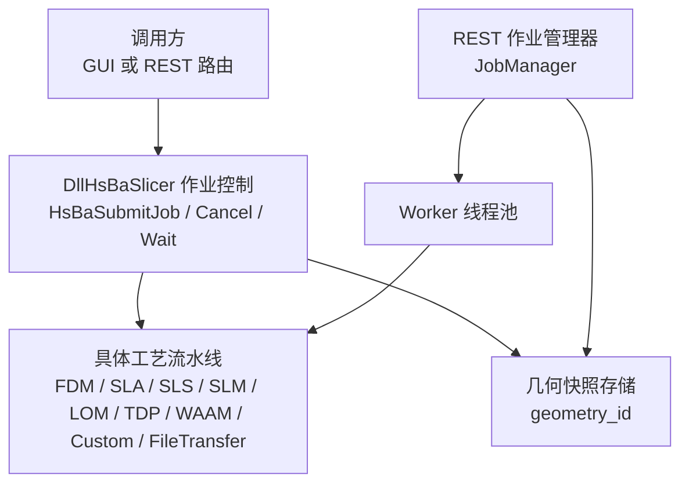
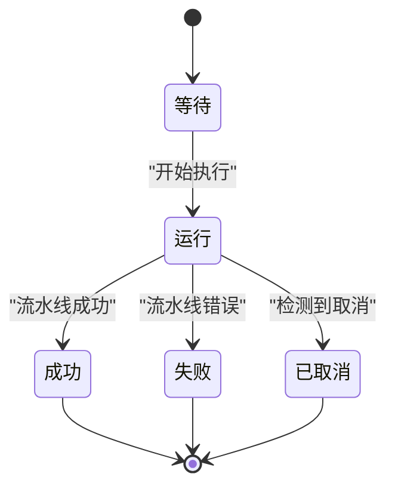
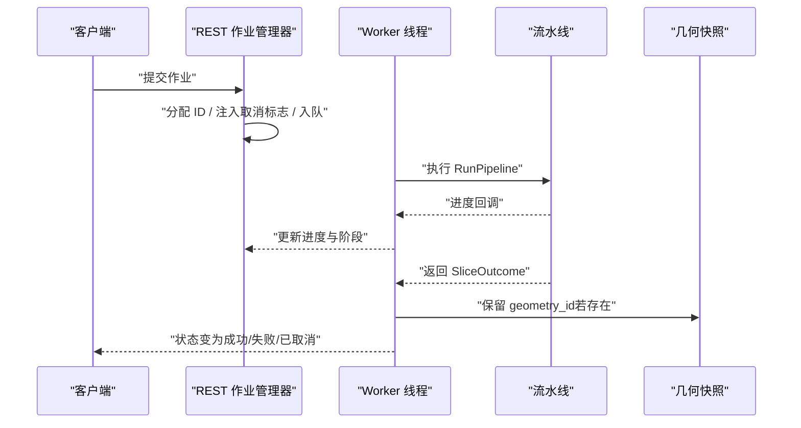
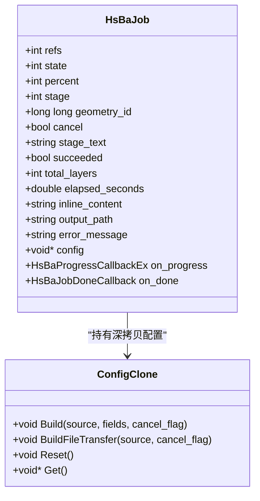
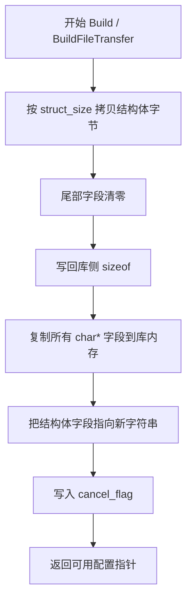
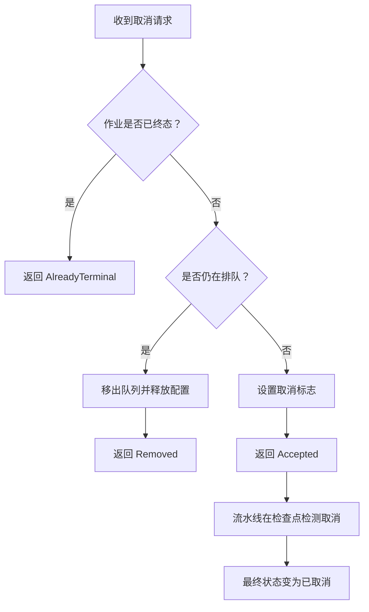
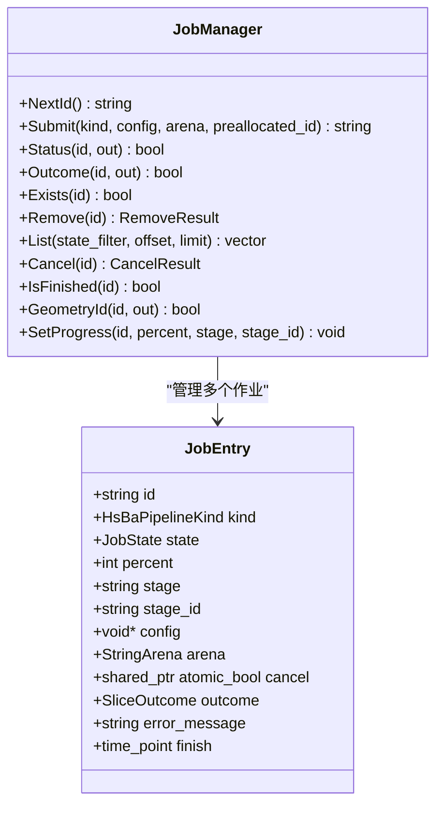
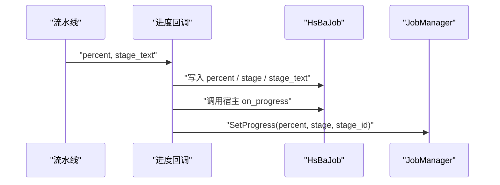
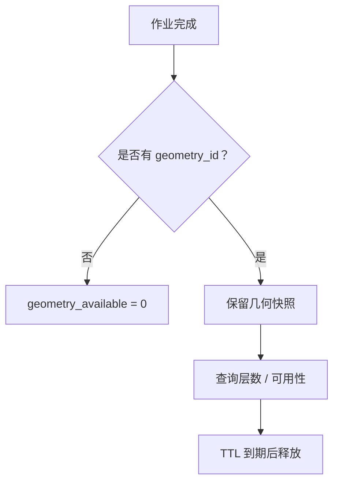
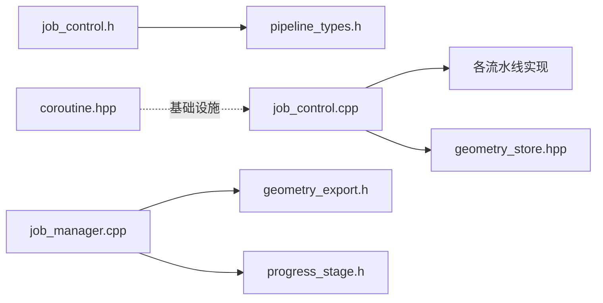

# 作业控制与取消系统

<cite>
**本文引用的文件**   
- [job_control.h](file://DllHsBaSlicer/job_control.h)
- [job_control.cpp](file://DllHsBaSlicer/job_control.cpp)
- [progress_stage.h](file://DllHsBaSlicer/progress_stage.h)
- [pipeline_types.h](file://pipelinetypes/pipeline_types.h)
- [geometry_store.hpp](file://DllHsBaSlicer/geometry_store.hpp)
- [job_manager.hpp](file://restapi/job_manager.hpp)
- [job_manager.cpp](file://restapi/job_manager.cpp)
- [coroutine.hpp](file://base/coroutine.hpp)
</cite>

## 目录
1. [引言](#引言)
2. [项目结构定位](#项目结构定位)
3. [核心概念](#核心概念)
4. [架构总览](#架构总览)
5. [关键组件详解](#关键组件详解)
6. [依赖关系分析](#依赖关系分析)
7. [性能与并发特性](#性能与并发特性)
8. [故障排除与常见问题](#故障排除与常见问题)
9. [结论](#结论)
10. [附录：状态与字段对照](#附录状态与字段对照)

## 引言
本文件聚焦 HsBaSlicer 的“作业控制与取消系统”，即从 C ABI 提交、线程化执行、结构化进度、协作式取消，到 REST 层作业队列、状态快照与几何快照生命周期的一体化设计。该系统同时支撑两类调用者：
- 桌面 GUI 或 DLL 宿主：通过 `HsBaSubmitJob` / `HsBaCancelJob` / `HsBaWaitJob` 等句柄 API 直接驱动流水线。
- REST 服务：通过 `JobManager` 维护进程内作业队列，把请求转发给底层流水线并暴露 `/api/jobs` 相关端点。

文档不讨论 WebUI 前端渲染细节，而是解释后端如何产生、传播和回收作业状态、进度、取消信号以及层几何快照。

## 项目结构定位
作业控制与取消能力横跨三个层次：
- DllHsBaSlicer 层：提供稳定的 C ABI 作业句柄、进度回调、取消标志、结果视图与几何快照 ID。
- restapi 层：提供可配置的 worker 池、作业队列、TTL 清理、状态列表与取消语义。
- base 层：提供协程工具（Task/Generator），但当前作业执行路径主要使用显式线程；协程库为异步编程基础设施，并非本次作业控制主路径。

**图示来源**
- [job_control.h:34-146](file://DllHsBaSlicer/job_control.h#L34-L146)
- [job_manager.hpp:28-92](file://restapi/job_manager.hpp#L28-L92)
- [job_manager.cpp:100-115](file://restapi/job_manager.cpp#L100-L115)

**章节来源**
- [job_control.h:1-181](file://DllHsBaSlicer/job_control.h#L1-L181)
- [job_manager.hpp:1-223](file://restapi/job_manager.hpp#L1-L223)

## 核心概念
- 作业句柄：`HsBaJobHandle` 是对外 opaque 指针，内部由 `HsBaJob` 表示，持有配置深拷贝、进度、阶段、取消标志、结果视图与几何快照 ID。
- 生命周期状态：
  - 作业状态：等待、运行、成功、失败、已取消。
  - REST 作业状态：排队、运行、成功、失败、已取消。
- 结构化进度：每个阶段有百分比、分类枚举、原始文本描述与稳定阶段 ID。
- 协作式取消：取消不是强制中断线程，而是设置原子标志；流水线在阶段边界、逐层循环和导出循环中检查该标志。
- 几何快照：作业完成后可能附带 `geometry_id`，用于后续查询层几何；快照由几何存储管理，随作业记录 TTL 过期被释放。

**图示来源**
- [job_control.h:37-45](file://DllHsBaSlicer/job_control.h#L37-L45)
- [job_manager.hpp:28-36](file://restapi/job_manager.hpp#L28-L36)

**章节来源**
- [job_control.h:34-146](file://DllHsBaSlicer/job_control.h#L34-L146)
- [job_manager.hpp:28-92](file://restapi/job_manager.hpp#L28-L92)

## 架构总览
作业控制体系分为两条主线：

1. **DLL 作业控制主线**
   - 调用方提交配置，`HsBaSubmitJob` 深拷贝配置、创建 `HsBaJob`、启动独立线程。
   - 工作线程执行对应 `HsBaRun*Pipeline`，统一收集结果、进度、几何快照 ID。
   - 完成时写入最终状态，触发完成回调，并释放库侧引用。

2. **REST 作业管理主线**
   - `JobManager` 维护固定大小 worker 池与就绪队列。
   - 提交时分配作业 ID、注入协作取消标志、入队。
   - Worker 调用 runner（默认 `RunPipeline`），捕获异常并映射到状态。
   - 完成后可通过 `Status` / `List` / `Outcome` / `GeometryId` 查询。

**图示来源**
- [job_manager.cpp:148-193](file://restapi/job_manager.cpp#L148-L193)
- [job_manager.cpp:374-468](file://restapi/job_manager.cpp#L374-L468)
- [job_control.cpp:218-384](file://DllHsBaSlicer/job_control.cpp#L218-L384)

**章节来源**
- [job_control.cpp:1-800](file://DllHsBaSlicer/job_control.cpp#L1-L800)
- [job_manager.cpp:1-493](file://restapi/job_manager.cpp#L1-L493)

## 关键组件详解

### DllHsBaSlicer 作业控制：句柄、线程与结果
`HsBaJob` 是作业的内部状态容器，包含：
- 引用计数：一个供运行中的工作持有，一个交给调用方；最后一个引用销毁作业。
- 原子状态：状态、百分比、阶段、几何快照 ID、取消标志。
- 互斥保护的结果区：成功标志、总层数、耗时、输出路径、内联内容、错误消息。
- 配置深拷贝：`ConfigClone` 负责复制结构体并把字符串指针重定向到作业自有内存。
- 进度桥接：`OnJobProgress` 统一接收各工艺的进度，写入 job 并调用宿主回调。
- 执行分发：`ExecuteKind` 根据流水线类型调用对应 `HsBaRun*Pipeline`，并归一化结果。
- 完成流程：`RunJob` 决定最终状态，通知等待者，触发完成回调，释放库引用。

**图示来源**
- [job_control.cpp:89-135](file://DllHsBaSlicer/job_control.cpp#L89-L135)
- [job_control.cpp:48-79](file://DllHsBaSlicer/job_control.cpp#L48-L79)
- [job_control.cpp:457-570](file://DllHsBaSlicer/job_control.cpp#L457-L570)

**章节来源**
- [job_control.cpp:89-135](file://DllHsBaSlicer/job_control.cpp#L89-L135)
- [job_control.cpp:187-212](file://DllHsBaSlicer/job_control.cpp#L187-L212)
- [job_control.cpp:218-384](file://DllHsBaSlicer/job_control.cpp#L218-L384)
- [job_control.cpp:396-449](file://DllHsBaSlicer/job_control.cpp#L396-L449)
- [job_control.cpp:457-570](file://DllHsBaSlicer/job_control.cpp#L457-L570)

### 配置深拷贝与 ABI 安全
`ConfigClone` 解决非阻塞提交的核心问题：宿主可能在 `HsBaSubmitJob` 返回后立即释放配置缓冲区，因此库必须拥有配置及其字符串的生命周期。

关键点：
- 按 `struct_size` 做 ABI 防护：如果宿主传较小结构体，尾部字段用零填充，避免越界读取。
- 字符串重定向：所有 char* 字段复制到库内 `strings` 向量，并把结构体字段指向新内存。
- 文件传输特殊处理：`BuildFileTransfer` 额外复制 `host`、`port` 与 `file_paths` 数组。
- 追加字段：`cancel_flag` 与 `capture_geometry` 作为结构体尾部字段写入。

**图示来源**
- [job_control.cpp:457-494](file://DllHsBaSlicer/job_control.cpp#L457-L494)
- [job_control.cpp:496-538](file://DllHsBaSlicer/job_control.cpp#L496-L538)

**章节来源**
- [job_control.cpp:48-79](file://DllHsBaSlicer/job_control.cpp#L48-L79)
- [job_control.cpp:457-570](file://DllHsBaSlicer/job_control.cpp#L457-L570)

### 协作式取消机制
取消是协作式的，不是强制终止线程。其语义如下：
- `HsBaCancelJob` 设置作业的原子取消标志。
- `HsBaJob` 的 `cancel` 会被流水线在阶段边界、逐层循环和导出循环中检查。
- 如果流水线报告错误消息以“Cancelled”开头，或作业本身标记取消，最终状态设为“已取消”。
- REST 层对已终态作业返回“AlreadyTerminal”，对未知作业返回“NotFound”，对排队作业直接丢弃，对运行作业仅设置标志。

**图示来源**
- [job_control.h:78-87](file://DllHsBaSlicer/job_control.h#L78-L87)
- [job_control.cpp:401-423](file://DllHsBaSlicer/job_control.cpp#L401-L423)
- [job_manager.cpp:327-359](file://restapi/job_manager.cpp#L327-L359)

**章节来源**
- [job_control.h:78-87](file://DllHsBaSlicer/job_control.h#L78-L87)
- [job_control.cpp:157-164](file://DllHsBaSlicer/job_control.cpp#L157-L164)
- [job_control.cpp:401-423](file://DllHsBaSlicer/job_control.cpp#L401-L423)
- [job_manager.cpp:327-359](file://restapi/job_manager.cpp#L327-L359)

### REST 作业管理器：队列、Worker 与状态快照
`JobManager` 是 REST 层的作业中枢：
- 构造时创建固定数量 worker 线程。
- `Submit` 分配 ID、注入取消标志、入队。
- `WorkerLoop` 从就绪队列取作业，切换到 Running，调用 `Execute`。
- `Execute` 调用 runner，捕获异常，释放配置与 arena，计算最终状态。
- `FillView` 生成 `JobStatusView`，包括进度、阶段、成功标志、层数、耗时、输出路径、错误消息、几何层数与几何可用性。
- `ReapLocked` 按 TTL 清理终态作业，并在清理前释放几何快照。

**图示来源**
- [job_manager.hpp:77-92](file://restapi/job_manager.hpp#L77-L92)
- [job_manager.hpp:104-218](file://restapi/job_manager.hpp#L104-L218)
- [job_manager.cpp:100-115](file://restapi/job_manager.cpp#L100-L115)
- [job_manager.cpp:148-193](file://restapi/job_manager.cpp#L148-L193)
- [job_manager.cpp:374-468](file://restapi/job_manager.cpp#L374-L468)
- [job_manager.cpp:470-490](file://restapi/job_manager.cpp#L470-L490)

**章节来源**
- [job_manager.hpp:28-218](file://restapi/job_manager.hpp#L28-L218)
- [job_manager.cpp:100-193](file://restapi/job_manager.cpp#L100-L193)
- [job_manager.cpp:374-490](file://restapi/job_manager.cpp#L374-L490)

### 进度与阶段：结构化进度
进度不仅是一个百分比，还包含：
- 分类阶段枚举：来自 `HsBaStage_t`。
- 原始阶段文本：UTF-8 描述。
- 稳定阶段 ID：例如 “slicing.layer”，便于 UI 做时间线。

DLL 层通过 `OnJobProgress` 统一写入 `HsBaJob`；REST 层通过 `ProgressCtx::Trampoline` 调用 `SetProgress`，并把阶段文本转换为稳定阶段 ID。

**图示来源**
- [job_control.cpp:187-212](file://DllHsBaSlicer/job_control.cpp#L187-L212)
- [job_manager.cpp:54-68](file://restapi/job_manager.cpp#L54-L68)
- [job_manager.cpp:361-372](file://restapi/job_manager.cpp#L361-L372)

**章节来源**
- [job_control.cpp:187-212](file://DllHsBaSlicer/job_control.cpp#L187-L212)
- [job_manager.cpp:54-68](file://restapi/job_manager.cpp#L54-L68)
- [job_manager.cpp:361-372](file://restapi/job_manager.cpp#L361-L372)

### 几何快照与几何可用性
几何快照是作业完成后附加的只读数据：
- DLL 层：`HsBaJob.geometry_id` 由流水线结果填充，可通过 `HsBaJobGeometryId` 查询。
- REST 层：`JobManager::GeometryId` 只在作业终态且 geometry_id 非零时返回。
- 生命周期：`ReleaseSnapshot` 在作业记录清理时调用 `HsBaReleaseGeometrySnapshot`。
- 可用性判断：`geometry_available` 基于 `geometry_layers > 0`。

**图示来源**
- [job_control.cpp:218-384](file://DllHsBaSlicer/job_control.cpp#L218-L384)
- [job_manager.cpp:44-52](file://restapi/job_manager.cpp#L44-L52)
- [job_manager.cpp:70-97](file://restapi/job_manager.cpp#L70-L97)
- [job_manager.cpp:226-236](file://restapi/job_manager.cpp#L226-L236)
- [job_manager.cpp:470-490](file://restapi/job_manager.cpp#L470-L490)

**章节来源**
- [job_control.cpp:218-384](file://DllHsBaSlicer/job_control.cpp#L218-L384)
- [job_manager.cpp:44-52](file://restapi/job_manager.cpp#L44-L52)
- [job_manager.cpp:70-97](file://restapi/job_manager.cpp#L70-L97)
- [job_manager.cpp:226-236](file://restapi/job_manager.cpp#L226-L236)
- [job_manager.cpp:470-490](file://restapi/job_manager.cpp#L470-L490)

## 依赖关系分析
- `job_control.h` 依赖 `pipelinetypes/pipeline_types.h`，因为作业状态、流水线种类、阶段枚举都定义在那里。
- `job_control.cpp` 依赖所有具体流水线头文件，以便 `ExecuteKind` 分派到 `HsBaRun*Pipeline`。
- `job_control.cpp` 依赖 `geometry_store.hpp`，因为作业结果携带 `geometry_id`。
- `job_manager.cpp` 依赖 `DllHsBaSlicer/geometry_export.h` 与 `DllHsBaSlicer/progress_stage.h`，用于释放几何快照与阶段名称转换。
- `coroutine.hpp` 提供通用协程工具，但当前作业控制主路径使用显式线程；它更适合作为异步编程基础设施参考。

**图示来源**
- [job_control.h:26-27](file://DllHsBaSlicer/job_control.h#L26-L27)
- [job_control.cpp:22-33](file://DllHsBaSlicer/job_control.cpp#L22-L33)
- [job_manager.cpp:15-17](file://restapi/job_manager.cpp#L15-L17)
- [coroutine.hpp:1-16](file://base/coroutine.hpp#L1-L16)

**章节来源**
- [job_control.h:26-27](file://DllHsBaSlicer/job_control.h#L26-L27)
- [job_control.cpp:22-33](file://DllHsBaSlicer/job_control.cpp#L22-L33)
- [job_manager.cpp:15-17](file://restapi/job_manager.cpp#L15-L17)
- [coroutine.hpp:1-16](file://base/coroutine.hpp#L1-L16)

## 性能与并发特性
- 线程模型：
  - DLL 层：每个作业一个独立线程，避免阻塞提交线程。
  - REST 层：固定 worker 池，worker 数量可配置；队列满时拒绝提交。
- 同步原语：
  - `std::atomic` 用于状态、百分比、阶段、几何快照 ID、取消标志。
  - `std::mutex` 与 `std::condition_variable` 用于 wait、notify 与结果区保护。
- 取消延迟：取消是协作式的，长步骤（如网格加载、Lua 回调）仍会完成；取消只在检查点生效。
- 资源回收：
  - 配置深拷贝由 `ConfigClone` 管理。
  - REST 层在析构、移除、TTL 清理时释放配置、arena 与几何快照。
- 协程库：`coroutine.hpp` 提供 Task/Generator，适合未来将某些 I/O 或计算任务接入协程调度器，但不改变当前作业控制主路径。

[本节为通用性能说明，不直接分析具体代码片段]

## 故障排除与常见问题
- 作业一直等待：
  - 检查 `HsBaWaitJob` 超时参数是否为负值或足够大。
  - 确认作业是否已进入终态；终态包括成功、失败、已取消。
- 取消无效：
  - 确认作业仍处于运行或排队状态；终态作业无法取消。
  - 检查流水线是否在阶段或层边界检查取消标志。
- 几何快照不可用：
  - 确认作业已完成且 `geometry_id` 非零。
  - 检查 REST 层 `geometry_available` 与 `geometry_layers`。
  - 注意 TTL 过期后快照可能被释放。
- 配置字符串丢失：
  - 确保通过 `HsBaSubmitJob` 提交，而不是直接调用同步入口；DLL 层会深拷贝配置。
  - 检查 `struct_size` 是否正确，避免 ABI 截断导致尾部字段未初始化。

**章节来源**
- [job_control.h:78-121](file://DllHsBaSlicer/job_control.h#L78-L121)
- [job_control.cpp:151-164](file://DllHsBaSlicer/job_control.cpp#L151-L164)
- [job_control.cpp:401-423](file://DllHsBaSlicer/job_control.cpp#L401-L423)
- [job_manager.cpp:327-359](file://restapi/job_manager.cpp#L327-L359)
- [job_manager.cpp:470-490](file://restapi/job_manager.cpp#L470-L490)

## 结论
HsBaSlicer 的作业控制与取消系统以“句柄 + 线程 + 协作取消 + 结构化进度 + 几何快照”为核心，既满足 GUI 宿主的实时交互需求，也满足 REST 服务的异步队列与状态查询需求。其设计强调：
- ABI 安全：配置深拷贝与 struct_size 防护。
- 可观测性：百分比、阶段枚举、阶段文本、稳定阶段 ID。
- 可控性：协作式取消、终态判定、TTL 清理。
- 可扩展性：新增流水线只需对接 `HsBaRun*Pipeline` 与进度回调，无需改动作业控制主逻辑。

[本节为总结性内容，不直接分析具体代码片段]

## 附录：状态与字段对照

### 作业状态对照
| 领域 | 状态值 | 含义 |
|---|---|---|
| DLL 作业状态 | 等待 | 已排队，工作线程尚未开始流水线 |
| DLL 作业状态 | 运行 | 流水线正在执行 |
| DLL 作业状态 | 成功 | 流水线无错误结束 |
| DLL 作业状态 | 失败 | 流水线因错误停止 |
| DLL 作业状态 | 已取消 | 流水线因取消请求停止 |
| REST 作业状态 | 排队 | 已接受，等待 worker |
| REST 作业状态 | 运行 | 正被 worker 线程执行 |
| REST 作业状态 | 成功 | 完成且有可用结果 |
| REST 作业状态 | 失败 | 完成但有错误 |
| REST 作业状态 | 已取消 | 因客户端取消请求提前停止 |

**章节来源**
- [job_control.h:37-45](file://DllHsBaSlicer/job_control.h#L37-L45)
- [job_manager.hpp:28-36](file://restapi/job_manager.hpp#L28-L36)

### REST 作业状态视图关键字段
| 字段 | 类型 | 含义 |
|---|---|---|
| id | 字符串 | 作业标识 |
| kind | 字符串 | 流水线种类名称 |
| state | 字符串 | 小写状态名 |
| progress_percent | 整数 | 最后报告的进度百分比 |
| progress_stage | 字符串 | 最后报告的阶段描述 |
| success | 整数 | 流水线成功标志 |
| total_layers | 整数 | 结果层数 |
| elapsed_seconds | 双精度 | 耗时秒数 |
| output_path | 字符串 | 输出或导出路径 |
| error_message | 字符串 | 失败文本 |
| files_transferred | 整数 | 文件传输完成数 |
| total_files | 整数 | 文件传输总数 |
| progress_stage_id | 字符串 | 稳定阶段键 |
| geometry_layers | 整数 | 捕获几何层数 |
| geometry_available | 整数 | 几何端点是否可用 |

**章节来源**
- [job_manager.hpp:49-66](file://restapi/job_manager.hpp#L49-L66)
- [job_manager.cpp:70-97](file://restapi/job_manager.cpp#L70-L97)