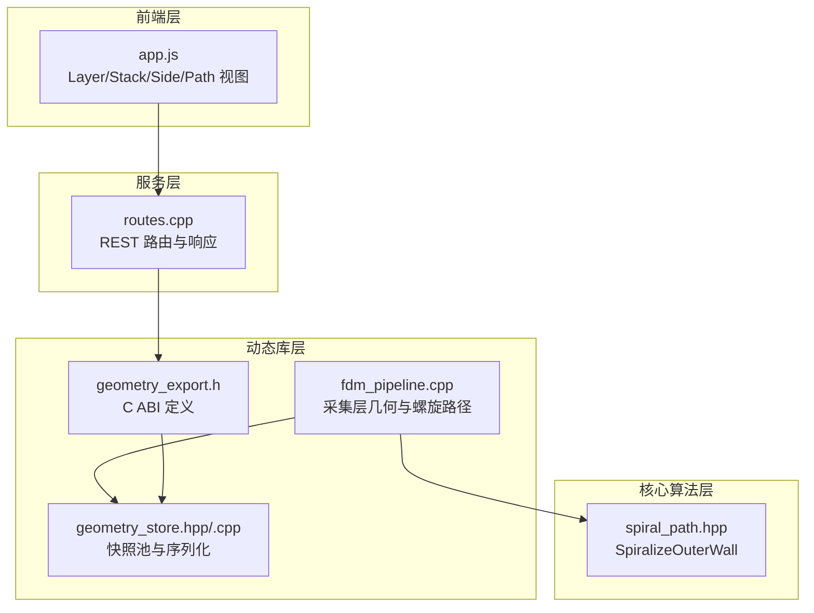
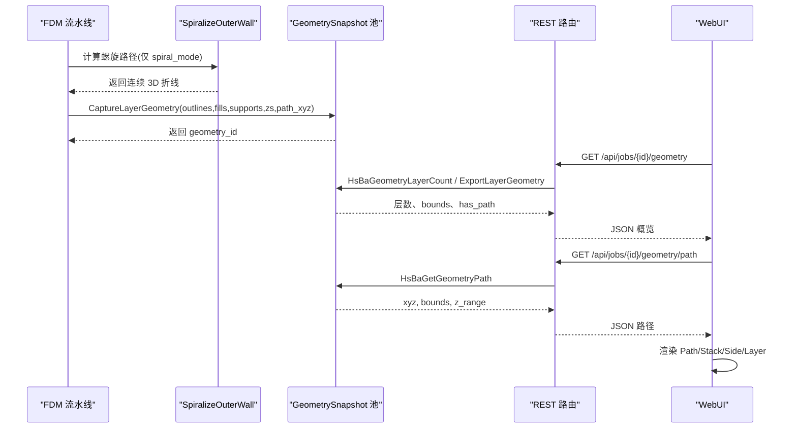
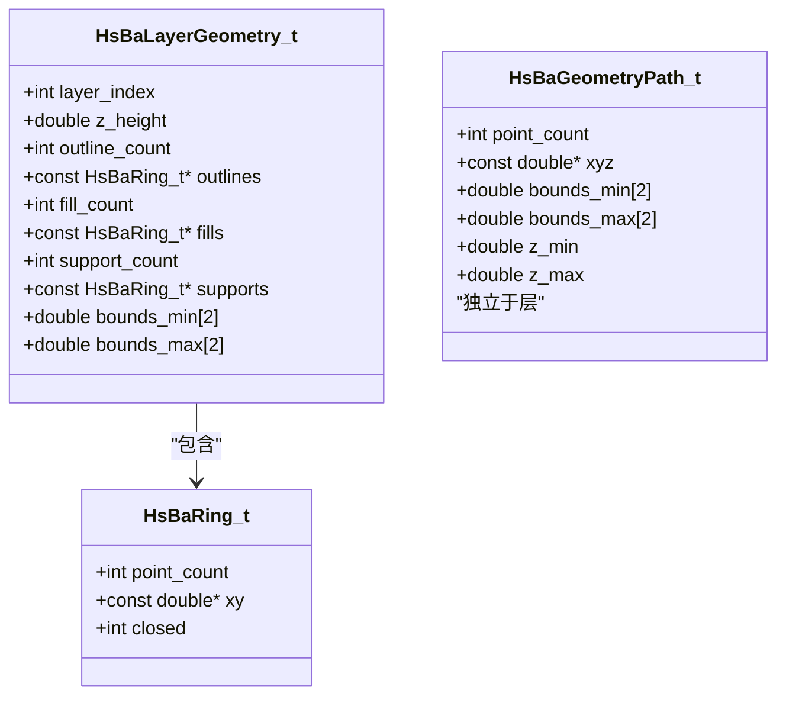
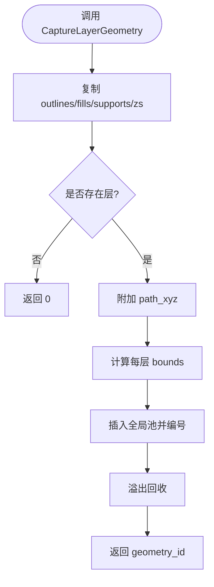
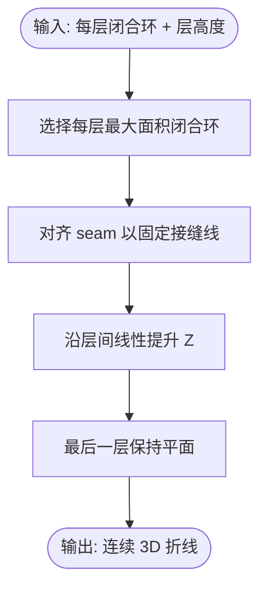
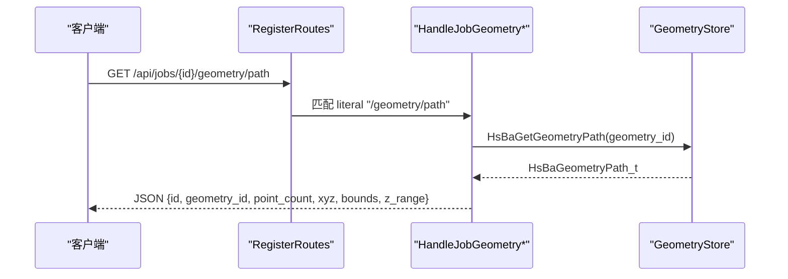
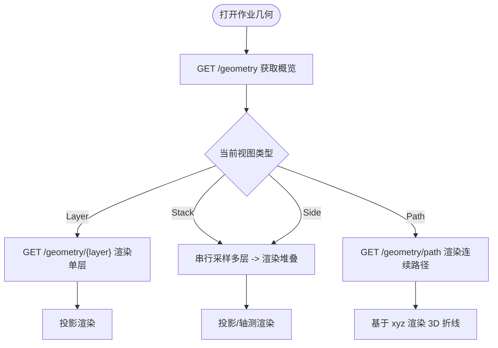
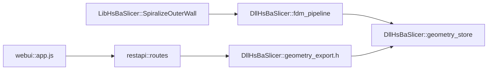

# 几何导出与预览系统

<cite>
**本文引用的文件**   
- [geometry_export.h](file://DllHsBaSlicer/geometry_export.h)
- [geometry_store.hpp](file://DllHsBaSlicer/geometry_store.hpp)
- [geometry_store.cpp](file://DllHsBaSlicer/geometry_store.cpp)
- [spiral_path.hpp](file://LibHsBaSlicer/Path/spiral_path.hpp)
- [fdm_pipeline.cpp](file://DllHsBaSlicer/fdm_pipeline.cpp)
- [routes.cpp](file://restapi/routes.cpp)
- [app.js](file://webui/public/app.js)
</cite>

## 目录
1. [引言](#引言)
2. [项目结构](#项目结构)
3. [核心组件](#核心组件)
4. [架构总览](#架构总览)
5. [详细组件分析](#详细组件分析)
6. [依赖关系分析](#依赖关系分析)
7. [性能考量](#性能考量)
8. [故障排除指南](#故障排除指南)
9. [结论](#结论)

## 引言
本文件聚焦“几何导出与预览系统”，即把切片流水线产生的逐层轮廓、填充、支撑以及螺旋连续路径，通过 C ABI 暴露给宿主 GUI，再由 REST API 和 WebUI 提供几何概览、逐层查看、堆叠轴测、侧视投影与顺序路径可视化。该能力覆盖 SLA/SLS/SLM/LOM/TDP/WAAM 的轮廓型工艺，以及 FDM/TDP/WAAM 的 spiral_mode 连续沉积路径。

## 项目结构
围绕几何导出与预览的关键代码分布在三层：
- DllHsBaSlicer：C ABI 与进程内快照池（geometry_export.h / geometry_store.*），并在 FDM 等流水线中采集几何与螺旋路径。
- LibHsBaSlicer：纯函数螺旋算法 SpiralizeOuterWall。
- restapi：注册 /api/jobs/{id}/geometry/path 等端点，将快照数据序列化为 JSON。
- webui：前端根据 has_path 与层几何数据渲染 Layer/Stack/Side/Path 四视图。

**图示来源**
- [geometry_export.h:1-23](file://DllHsBaSlicer/geometry_export.h#L1-L23)
- [geometry_store.hpp:33-67](file://DllHsBaSlicer/geometry_store.hpp#L33-L67)
- [geometry_store.cpp:177-207](file://DllHsBaSlicer/geometry_store.cpp#L177-L207)
- [spiral_path.hpp:16-58](file://LibHsBaSlicer/Path/spiral_path.hpp#L16-L58)
- [fdm_pipeline.cpp:656-684](file://DllHsBaSlicer/fdm_pipeline.cpp#L656-L684)
- [routes.cpp:1185-1203](file://restapi/routes.cpp#L1185-L1203)
- [app.js:382-449](file://webui/public/app.js#L382-L449)

**章节来源**
- [geometry_export.h:1-23](file://DllHsBaSlicer/geometry_export.h#L1-L23)
- [geometry_store.hpp:33-67](file://DllHsBaSlicer/geometry_store.hpp#L33-L67)
- [routes.cpp:1185-1203](file://restapi/routes.cpp#L1185-L1203)
- [app.js:382-449](file://webui/public/app.js#L382-L449)

## 核心组件
- C ABI 几何导出接口：定义层环、层几何、连续路径、快照生命周期管理函数。
- 进程级快照池：按作业保存 outlines/fills/supports/z/bounds/path_xyz，并提供只读访问、保留/释放与溢出回收。
- 螺旋路径生成：对每层最大面积闭合环进行 seam 对齐与 Z 线性爬升，输出确定性连续 3D 折线。
- REST 几何端点：/geometry 概览、/geometry/{layer} 单层、/geometry/path 连续路径；概览含 has_path。
- WebUI 四视图：Layer（单层）、Stack（采样堆叠轴测）、Side（侧视投影）、Path（顺序路径）。

**章节来源**
- [geometry_export.h:37-143](file://DllHsBaSlicer/geometry_export.h#L37-L143)
- [geometry_store.hpp:33-91](file://DllHsBaSlicer/geometry_store.hpp#L33-L91)
- [spiral_path.hpp:16-58](file://LibHsBaSlicer/Path/spiral_path.hpp#L16-L58)
- [routes.cpp:87-128](file://restapi/routes.cpp#L87-L128)
- [app.js:382-449](file://webui/public/app.js#L382-L449)

## 架构总览
从流水线到前端的数据流如下：

**图示来源**
- [fdm_pipeline.cpp:656-684](file://DllHsBaSlicer/fdm_pipeline.cpp#L656-L684)
- [geometry_store.cpp:177-207](file://DllHsBaSlicer/geometry_store.cpp#L177-L207)
- [geometry_store.cpp:497-508](file://DllHsBaSlicer/geometry_store.cpp#L497-L508)
- [routes.cpp:1192-1197](file://restapi/routes.cpp#L1192-L1197)
- [app.js:522-545](file://webui/public/app.js#L522-L545)

## 详细组件分析

### C ABI 几何导出接口
- 层环：point_count、xy（x,y 交替扁平数组）、closed（轮廓为 1，填充线为 0）。
- 层几何：包含 outlines/fills/supports 三个环数组、z_height、bounds_min/max。
- 连续路径：point_count、xyz（x,y,z 交替扁平数组）、bounds_min/max、z_min/max。
- 生命周期：HsBaRetainGeometrySnapshot/HsBaReleaseGeometrySnapshot 控制快照引用计数；HsBaFreeLayerGeometry/HsBaFreeGeometryPath 释放一次性分配块。

**图示来源**
- [geometry_export.h:37-82](file://DllHsBaSlicer/geometry_export.h#L37-L82)

**章节来源**
- [geometry_export.h:37-143](file://DllHsBaSlicer/geometry_export.h#L37-L143)

### 进程级快照池
- GeometrySnapshot：kind、outlines/fills/supports（每层多边形）、zs（平台高度）、bounds（每层边界）、path_xyz（连续路径）。
- CaptureLayerGeometry：复制输入并计算 bounds，存入全局池，返回递增 id；若无层则返回 0。
- 导出层几何：将一层三槽环与坐标打包进单一 malloc 块，保证空槽仍返回有效指针。
- 导出路径：校验完整 xyz 三元组，计算 bounds 与 z 范围，返回一次性分配块。
- 生命周期：Retain/Release 控制引用；池满时驱逐最老未保留快照。

**图示来源**
- [geometry_store.cpp:177-207](file://DllHsBaSlicer/geometry_store.cpp#L177-L207)

**章节来源**
- [geometry_store.hpp:33-91](file://DllHsBaSlicer/geometry_store.hpp#L33-L91)
- [geometry_store.cpp:177-207](file://DllHsBaSlicer/geometry_store.cpp#L177-L207)
- [geometry_store.cpp:224-314](file://DllHsBaSlicer/geometry_store.cpp#L224-L314)
- [geometry_store.cpp:331-369](file://DllHsBaSlicer/geometry_store.cpp#L331-L369)
- [geometry_store.cpp:497-546](file://DllHsBaSlicer/geometry_store.cpp#L497-L546)

### 螺旋路径生成
- SpiralizeOuterWall：对每层取最大面积闭合环，seam 对齐相邻层，Z 线性爬升；最后一层平走。
- 确定性：相同输入产生相同路径，因此快照中的 path_xyz 与 G-code 实际沉积一致。
- 调用方：FDM 在 capture_geometry 分支先计算螺旋路径再写入快照；其他工艺若启用 spiral_mode 也可复用。

**图示来源**
- [spiral_path.hpp:16-58](file://LibHsBaSlicer/Path/spiral_path.hpp#L16-L58)
- [fdm_pipeline.cpp:671-684](file://DllHsBaSlicer/fdm_pipeline.cpp#L671-L684)

**章节来源**
- [spiral_path.hpp:16-58](file://LibHsBaSlicer/Path/spiral_path.hpp#L16-L58)
- [fdm_pipeline.cpp:656-684](file://DllHsBaSlicer/fdm_pipeline.cpp#L656-L684)

### REST 几何端点
- /api/jobs/{id}/geometry：返回 job id、geometry_id、layer_count、bounds、可选 full=1 的 z_heights/layer_bounds，以及 has_path。
- /api/jobs/{id}/geometry/{layer}：返回单层 outlines/fills/supports 环与 bounds。
- /api/jobs/{id}/geometry/path：返回连续路径 xyz、bounds、z_range。
- 路由顺序：path 必须优先于通用 geometry/([^/]+)，避免被吞掉。

**图示来源**
- [routes.cpp:1185-1203](file://restapi/routes.cpp#L1185-L1203)
- [geometry_store.cpp:497-508](file://DllHsBaSlicer/geometry_store.cpp#L497-L508)

**章节来源**
- [routes.cpp:87-128](file://restapi/routes.cpp#L87-L128)
- [routes.cpp:1185-1203](file://restapi/routes.cpp#L1185-L1203)

### WebUI 几何面板
- 视图切换：Layer | Stack | Side | Path；当 has_path 为假时拒绝进入 Path 视图。
- 数据加载：概览后缓存 base/mirror；Path 视图加载一次并缓存；Stack 视图串行采样少量层并缓存。
- 相机重置：不同视图使用不同初始角度与缩放；Path 视图基于真实 3D 数据绘制。

**图示来源**
- [app.js:382-449](file://webui/public/app.js#L382-L449)
- [app.js:522-545](file://webui/public/app.js#L522-L545)
- [app.js:548-569](file://webui/public/app.js#L548-L569)

**章节来源**
- [app.js:382-449](file://webui/public/app.js#L382-L449)
- [app.js:522-569](file://webui/public/app.js#L522-L569)

## 依赖关系分析
- DllHsBaSlicer 依赖 LibHsBaSlicer 的 SpiralizeOuterWall 生成连续路径。
- DllHsBaSlicer 内部 geometry_store 负责快照池与序列化，供 geometry_export.h 暴露给外部。
- restapi 通过 C ABI 读取快照，不直接持有几何数据。
- webui 仅消费 REST JSON，不感知 C++ 实现细节。

**图示来源**
- [spiral_path.hpp:16-58](file://LibHsBaSlicer/Path/spiral_path.hpp#L16-L58)
- [fdm_pipeline.cpp:656-684](file://DllHsBaSlicer/fdm_pipeline.cpp#L656-L684)
- [geometry_store.hpp:33-91](file://DllHsBaSlicer/geometry_store.hpp#L33-L91)
- [geometry_export.h:37-143](file://DllHsBaSlicer/geometry_export.h#L37-L143)
- [routes.cpp:1185-1203](file://restapi/routes.cpp#L1185-L1203)
- [app.js:382-449](file://webui/public/app.js#L382-L449)

**章节来源**
- [fdm_pipeline.cpp:656-684](file://DllHsBaSlicer/fdm_pipeline.cpp#L656-L684)
- [geometry_store.hpp:33-91](file://DllHsBaSlicer/geometry_store.hpp#L33-L91)
- [routes.cpp:1185-1203](file://restapi/routes.cpp#L1185-L1203)

## 性能考量
- 快照内存：每层 outlines/fills/supports 均复制为 double 坐标，层数较多时快照体积可能大于 G-code；应仅在预览控件存活期间 Retain，关闭后 Release。
- 池容量：HSBA_GEOMETRY_POOL_MAX 限制快照数量，超限时驱逐最老未保留快照；宿主可调整常量或禁用 capture_geometry。
- 路径重复计算：快照阶段与导出阶段各调用一次螺旋算法，但 SpiralizeOuterWall 是纯函数，结果一致；这是为了稳定公共签名而有意为之。
- 前端缓存：Path 视图加载一次后缓存；Stack 视图串行采样少量层并缓存索引，避免频繁重绘。

**章节来源**
- [geometry_export.h:1-23](file://DllHsBaSlicer/geometry_export.h#L1-L23)
- [geometry_store.hpp:1-14](file://DllHsBaSlicer/geometry_store.hpp#L1-L14)
- [fdm_pipeline.cpp:668-684](file://DllHsBaSlicer/fdm_pipeline.cpp#L668-L684)
- [app.js:522-545](file://webui/public/app.js#L522-L545)
- [app.js:548-569](file://webui/public/app.js#L548-L569)

## 故障排除指南
- 无层几何：作业未开启 capture_geometry 或快照已被回收；WebUI 会显示“该作业没有层几何”提示。
- 无连续路径：非 spiral_mode 的作业不支持 Path 视图；WebUI 会在尝试进入 Path 时拒绝并给出说明。
- 层索引越界：请求的层号超出 layer_count；服务器返回相应错误信息。
- 未知作业：job not found；检查作业 ID 与状态。
- 取消终态作业：POST /cancel 对已完成作业返回 409 “job already finished”。

**章节来源**
- [app.js:423-449](file://webui/public/app.js#L423-L449)
- [app.js:487-513](file://webui/public/app.js#L487-L513)
- [routes.cpp:1185-1203](file://restapi/routes.cpp#L1185-L1203)

## 结论
几何导出与预览系统通过“快照池 + C ABI + REST + WebUI”四层协作，既保留了现有螺旋路径 C ABI 与 /geometry/path 通道，又为所有工艺提供了统一的几何概览与多视图预览能力。其设计强调确定性、只读快照与清晰的内存契约，使 GUI 可在不侵入核心算法的前提下获得稳定的几何数据源。后续阶段可在不改动快照通道的前提下扩展结果包条目端点与 STL 投影图像展示。