# 切片引擎

<cite>
**本文引用的文件**   
- [mesh_slice.hpp](file://LibHsBaSlicer/Slice/mesh_slice.hpp)
- [mesh_slice.cpp](file://LibHsBaSlicer/Slice/mesh_slice.cpp)
- [FullTopoModel.hpp](file://meshmodel/FullTopoModel.hpp)
- [FullTopoModel.cpp](file://meshmodel/FullTopoModel.cpp)
- [pipeline_parallel.hpp](file://DllHsBaSlicer/pipeline_parallel.hpp)
- [thread_pool.hpp](file://base/thread_pool.hpp)
- [sla_pipeline.cpp](file://DllHsBaSlicer/sla_pipeline.cpp)
- [slm_pipeline.cpp](file://DllHsBaSlicer/slm_pipeline.cpp)
- [sls_pipeline.cpp](file://DllHsBaSlicer/sls_pipeline.cpp)
- [slice_config.proto](file://proto/slice_config.proto)
</cite>

## 目录
1. [引言](#引言)
2. [项目结构](#项目结构)
3. [核心组件](#核心组件)
4. [架构总览](#架构总览)
5. [详细组件分析](#详细组件分析)
6. [依赖关系分析](#依赖关系分析)
7. [性能与并行优化](#性能与并行优化)
8. [精度、容差与自相交处理](#精度容差与自相交处理)
9. [错误检测与修复策略](#错误检测与修复策略)
10. [使用示例与参数调优指南](#使用示例与参数调优指南)
11. [故障排查](#故障排查)
12. [结论](#结论)

## 引言
本技术文档面向切片算法开发者与 3D 打印工程师，系统性解析 HsBaSlicer 的切片引擎。重点覆盖：
- 层平面与三角网格的相交计算
- 拓扑结构构建（顶点、边、面）
- FullTopoModel 的数据结构与层次关系
- 切片精度控制、容差处理、自相交检测
- 多层并行切片与流水线集成
- 错误检测与修复策略
- 使用示例与参数调优建议

## 项目结构
切片相关代码主要分布在以下模块：
- LibHsBaSlicer/Slice：对外暴露的切片 C++ API，封装安全/不安全切片、Lua 驱动切片、可复用拓扑切片
- meshmodel：FullTopoModel 实现，负责从 IModel 提取三角形网格并重建完整拓扑
- DllHsBaSlicer：各工艺流水线（SLA/SLM/SLS 等）在“切片阶段”调用切片 API，并使用并行工具按层并行执行
- base：线程池等基础并发设施
- proto：切片配置消息定义（用于跨语言/跨进程传递）

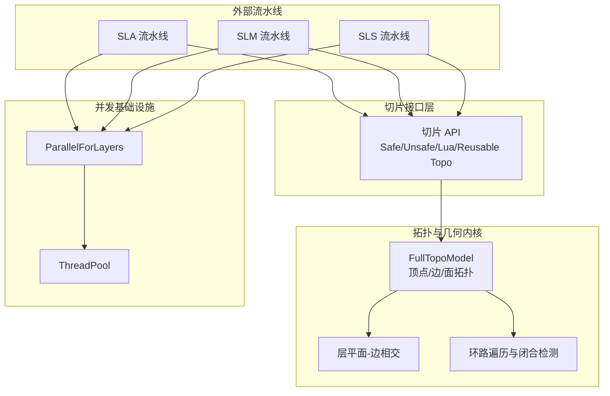

**图表来源**
- [sla_pipeline.cpp:321-338](file://DllHsBaSlicer/sla_pipeline.cpp#L321-L338)
- [slm_pipeline.cpp:272-284](file://DllHsBaSlicer/slm_pipeline.cpp#L272-L284)
- [sls_pipeline.cpp:219-231](file://DllHsBaSlicer/sls_pipeline.cpp#L219-L231)
- [mesh_slice.hpp:22-103](file://LibHsBaSlicer/Slice/mesh_slice.hpp#L22-L103)
- [FullTopoModel.hpp:53-146](file://meshmodel/FullTopoModel.hpp#L53-L146)
- [pipeline_parallel.hpp:22-41](file://DllHsBaSlicer/pipeline_parallel.hpp#L22-L41)
- [thread_pool.hpp:29-39](file://base/thread_pool.hpp#L29-L39)

**章节来源**
- [README.md:25-39](file://README.md#L25-L39)
- [mesh_slice.hpp:22-103](file://LibHsBaSlicer/Slice/mesh_slice.hpp#L22-L103)
- [FullTopoModel.hpp:53-146](file://meshmodel/FullTopoModel.hpp#L53-L146)

## 核心组件
- 切片 API（Safe/Unsafe/Lua/Reusable Topo）
  - SafeSlice：返回闭合多边形，丢弃开放轮廓
  - UnSafeSlice：保留开放轮廓，便于材料填充类工艺或调试
  - SliceLua/UnSafeSliceLua：通过 Lua 脚本自定义切片逻辑
  - BuildSliceTopology + SliceLayer：一次性构建拓扑，重复切片单层，避免每层重建拓扑
- FullTopoModel
  - 顶点/边/面三元组拓扑结构
  - 层平面与边的相交计算
  - 邻接图构建、点合并、环路遍历与闭合检测
  - 快速切片 SliceFast（要求拓扑完整性检查通过）
- 并行切片
  - ParallelForLayers：按层并行调度，块状提交任务，进度回调串行化
  - ThreadPool：底层线程池，支持协程执行器

**章节来源**
- [mesh_slice.hpp:22-103](file://LibHsBaSlicer/Slice/mesh_slice.hpp#L22-L103)
- [FullTopoModel.hpp:53-146](file://meshmodel/FullTopoModel.hpp#L53-L146)
- [pipeline_parallel.hpp:22-41](file://DllHsBaSlicer/pipeline_parallel.hpp#L22-L41)
- [thread_pool.hpp:29-39](file://base/thread_pool.hpp#L29-L39)

## 架构总览
切片引擎的整体数据流如下：
1. 外部流水线（SLA/SLM/SLS）加载模型并计算层数
2. 构建可复用拓扑 BuildSliceTopology
3. 对每一层调用 SliceLayer（内部等价于 NormalizeUnSafePolygons(UnSafeSlice(z))）
4. 将结果 PolygonsD 交给后续填充/路径生成阶段
5. 并行调度由 ParallelForLayers 管理，确保每层写入独立输出槽位

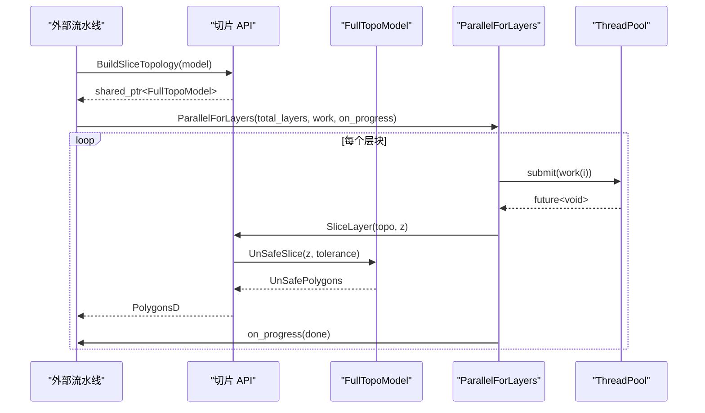

**图表来源**
- [sla_pipeline.cpp:321-338](file://DllHsBaSlicer/sla_pipeline.cpp#L321-L338)
- [slm_pipeline.cpp:272-284](file://DllHsBaSlicer/slm_pipeline.cpp#L272-L284)
- [sls_pipeline.cpp:219-231](file://DllHsBaSlicer/sls_pipeline.cpp#L219-L231)
- [mesh_slice.cpp:105-115](file://LibHsBaSlicer/Slice/mesh_slice.cpp#L105-L115)
- [FullTopoModel.cpp:604-873](file://meshmodel/FullTopoModel.cpp#L604-L873)
- [pipeline_parallel.hpp:41-117](file://DllHsBaSlicer/pipeline_parallel.hpp#L41-L117)

## 详细组件分析

### FullTopoModel 拓扑数据结构与层次关系
FullTopoModel 是切片专用的全拓扑重建网格模型，提供：
- Face：包含三角形顶点索引、三条边索引、法向量（可选）
- Vertex：包含三维坐标、关联的面和边列表
- Edge：包含两个顶点索引、相邻的两个面索引

构造过程：
- 从 IModel 提取三角形网格（顶点矩阵与面索引矩阵）
- 构建顶点表、边表、面表，并通过哈希映射建立边到面的邻接关系
- 可选计算逐面法向量

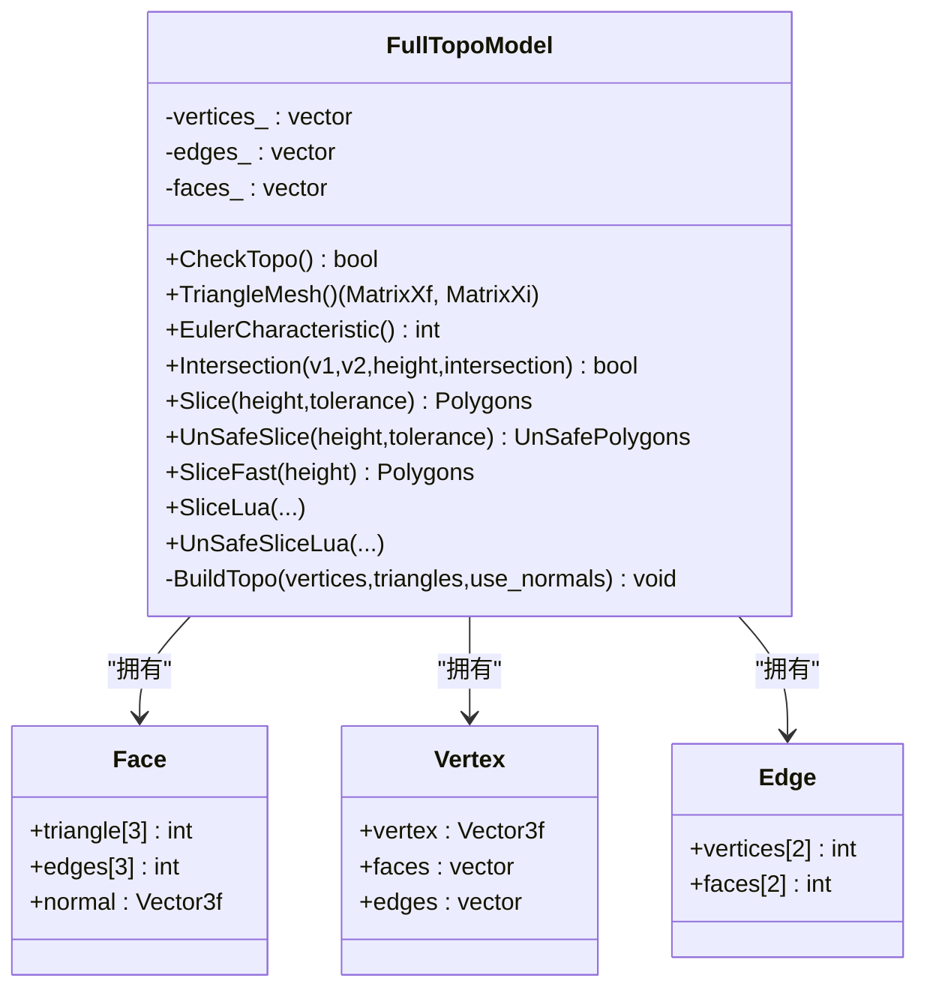

**图表来源**
- [FullTopoModel.hpp:53-146](file://meshmodel/FullTopoModel.hpp#L53-L146)
- [FullTopoModel.cpp:27-48](file://meshmodel/FullTopoModel.cpp#L27-L48)
- [FullTopoModel.cpp:50-158](file://meshmodel/FullTopoModel.cpp#L50-L158)

**章节来源**
- [FullTopoModel.hpp:53-146](file://meshmodel/FullTopoModel.hpp#L53-L146)
- [FullTopoModel.cpp:27-48](file://meshmodel/FullTopoModel.cpp#L27-L48)
- [FullTopoModel.cpp:50-158](file://meshmodel/FullTopoModel.cpp#L50-L158)

### 层平面与网格相交计算
- 层平面为 Z=height 的水平面
- 对每条边进行相交判断：若两端点分别在 plane 两侧或恰好在平面上，则计算交点
- 对于每个三角面，最多产生两个交点；当恰好两个交点时，在邻接图中添加一条边连接这两个交点键值

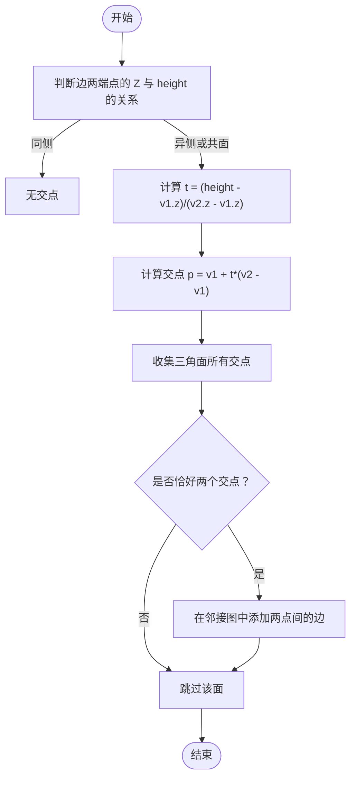

**图表来源**
- [FullTopoModel.cpp:246-272](file://meshmodel/FullTopoModel.cpp#L246-L272)
- [FullTopoModel.cpp:354-381](file://meshmodel/FullTopoModel.cpp#L354-L381)
- [FullTopoModel.cpp:628-655](file://meshmodel/FullTopoModel.cpp#L628-L655)

**章节来源**
- [FullTopoModel.cpp:246-272](file://meshmodel/FullTopoModel.cpp#L246-L272)
- [FullTopoModel.cpp:354-381](file://meshmodel/FullTopoModel.cpp#L354-L381)
- [FullTopoModel.cpp:628-655](file://meshmodel/FullTopoModel.cpp#L628-L655)

### 拓扑结构构建与邻接图
- 构建原始邻接图 raw_adj：以整数化的二维 Key（x,y）作为节点，记录交点之间的邻接关系
- 去重与排序：对每个节点的邻居进行排序并去重
- 点合并：基于容差 coord_eps 使用网格分桶 + 并查集（Union-Find）合并相近点
- 构建合并后的邻接图 adj：将代表元相同的点视为同一节点，去除自环

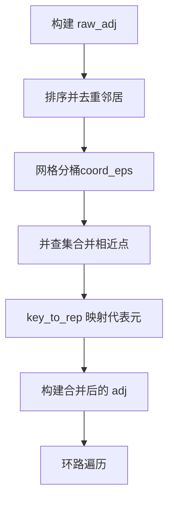

**图表来源**
- [FullTopoModel.cpp:351-388](file://meshmodel/FullTopoModel.cpp#L351-L388)
- [FullTopoModel.cpp:417-485](file://meshmodel/FullTopoModel.cpp#L417-L485)
- [FullTopoModel.cpp:624-755](file://meshmodel/FullTopoModel.cpp#L624-L755)

**章节来源**
- [FullTopoModel.cpp:351-388](file://meshmodel/FullTopoModel.cpp#L351-L388)
- [FullTopoModel.cpp:417-485](file://meshmodel/FullTopoModel.cpp#L417-L485)
- [FullTopoModel.cpp:624-755](file://meshmodel/FullTopoModel.cpp#L624-L755)

### 环路遍历与闭合检测
- 选择下一个邻居的策略：根据入边方向与出边方向的夹角最小原则选择 next
- 闭合条件：next 回到起点或已访问节点，且路径长度满足最小多边形要求（≥3 个点）
- 自相交处理：若 next 已在当前路径中，则切分出子环并标记 closed

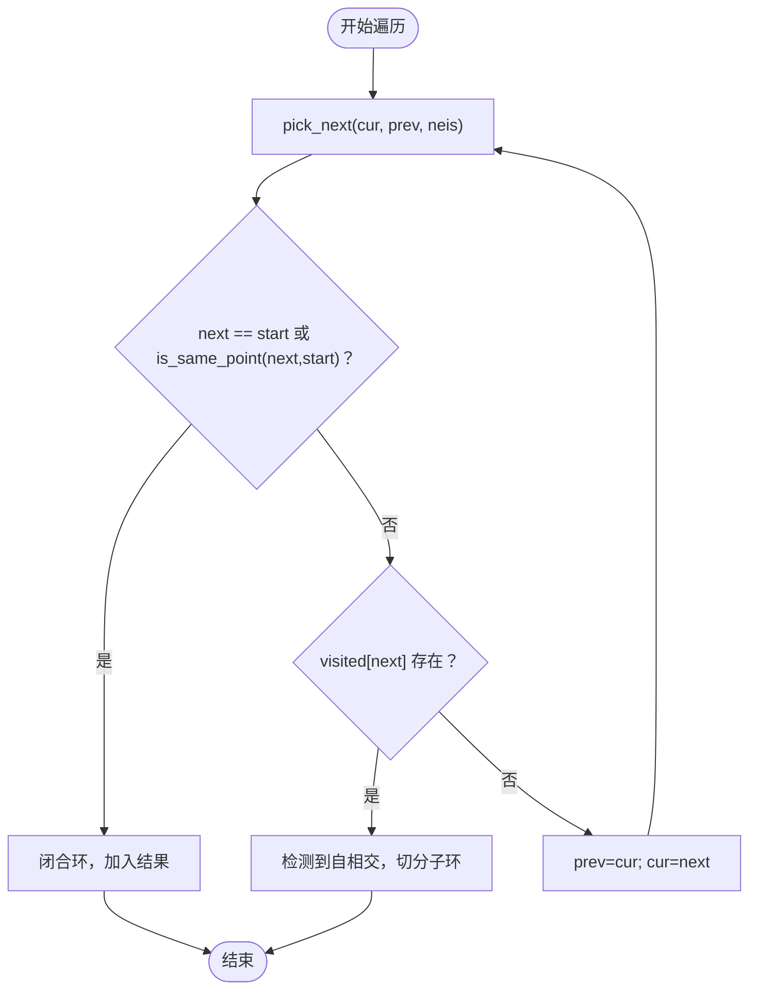

**图表来源**
- [FullTopoModel.cpp:490-519](file://meshmodel/FullTopoModel.cpp#L490-L519)
- [FullTopoModel.cpp:521-597](file://meshmodel/FullTopoModel.cpp#L521-L597)
- [FullTopoModel.cpp:758-787](file://meshmodel/FullTopoModel.cpp#L758-L787)
- [FullTopoModel.cpp:789-873](file://meshmodel/FullTopoModel.cpp#L789-L873)

**章节来源**
- [FullTopoModel.cpp:490-519](file://meshmodel/FullTopoModel.cpp#L490-L519)
- [FullTopoModel.cpp:521-597](file://meshmodel/FullTopoModel.cpp#L521-L597)
- [FullTopoModel.cpp:758-787](file://meshmodel/FullTopoModel.cpp#L758-L787)
- [FullTopoModel.cpp:789-873](file://meshmodel/FullTopoModel.cpp#L789-L873)

### 快速切片 SliceFast
- 先进行拓扑完整性检查 CheckTopo，失败则抛出异常
- 直接基于边表 edges_ 计算与层的交点，构建邻接图并遍历闭环
- 适用于拓扑完整且需要高性能的场景

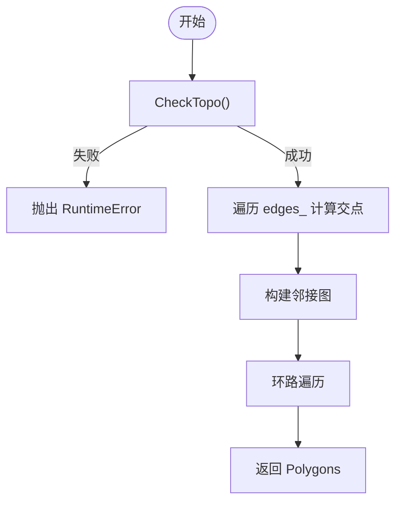

**图表来源**
- [FullTopoModel.cpp:875-1025](file://meshmodel/FullTopoModel.cpp#L875-L1025)

**章节来源**
- [FullTopoModel.cpp:875-1025](file://meshmodel/FullTopoModel.cpp#L875-L1025)

### Lua 驱动切片
- 将 V/E/F 与 height 推送到 Lua 全局变量
- 支持内联脚本或外部脚本文件
- 支持注册扩展函数（Get3DFunctions），供脚本调用
- 返回的多边形通过 LuaAdapter 转换为 Polygons/UnSafePolygons

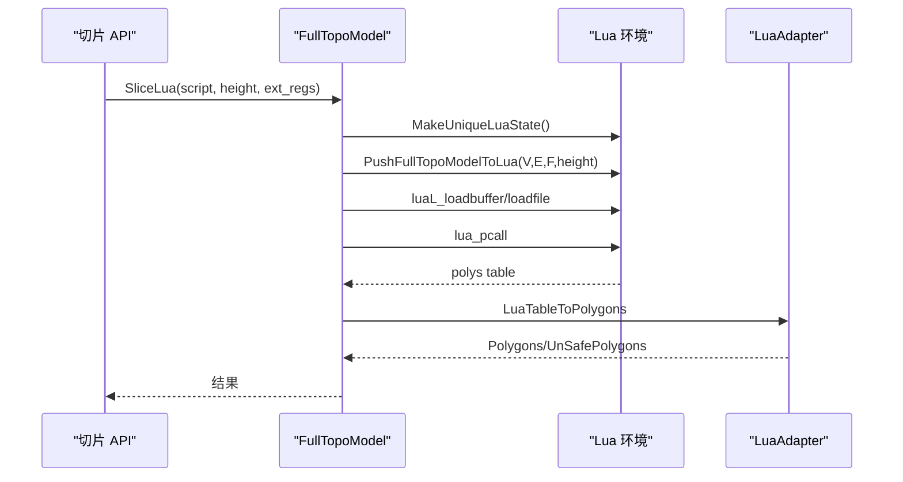

**图表来源**
- [FullTopoModel.cpp:1027-1073](file://meshmodel/FullTopoModel.cpp#L1027-L1073)
- [FullTopoModel.cpp:1075-1130](file://meshmodel/FullTopoModel.cpp#L1075-L1130)
- [FullTopoModel.cpp:1132-1241](file://meshmodel/FullTopoModel.cpp#L1132-L1241)

**章节来源**
- [FullTopoModel.cpp:1027-1073](file://meshmodel/FullTopoModel.cpp#L1027-L1073)
- [FullTopoModel.cpp:1075-1130](file://meshmodel/FullTopoModel.cpp#L1075-L1130)
- [FullTopoModel.cpp:1132-1241](file://meshmodel/FullTopoModel.cpp#L1132-L1241)

## 依赖关系分析
- 切片 API 依赖 FullTopoModel 进行几何与拓扑操作
- 外部流水线依赖切片 API 与并行工具
- 并行工具依赖线程池
- 配置消息通过 Protobuf 定义，便于跨语言传递

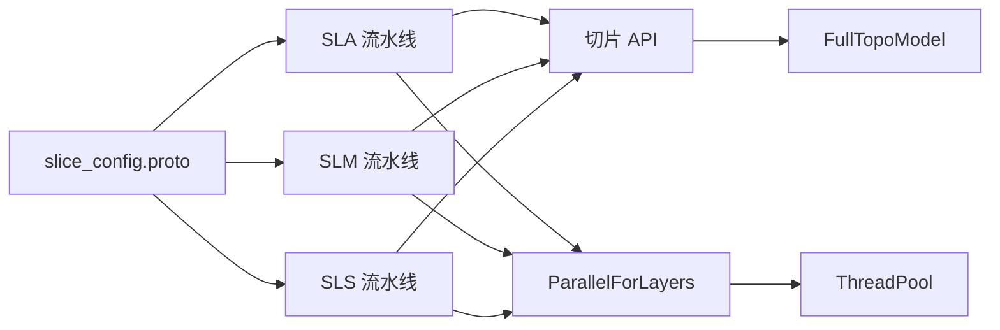

**图表来源**
- [mesh_slice.hpp:22-103](file://LibHsBaSlicer/Slice/mesh_slice.hpp#L22-L103)
- [FullTopoModel.hpp:53-146](file://meshmodel/FullTopoModel.hpp#L53-L146)
- [pipeline_parallel.hpp:22-41](file://DllHsBaSlicer/pipeline_parallel.hpp#L22-L41)
- [thread_pool.hpp:29-39](file://base/thread_pool.hpp#L29-L39)
- [slice_config.proto:1-27](file://proto/slice_config.proto#L1-L27)

**章节来源**
- [mesh_slice.hpp:22-103](file://LibHsBaSlicer/Slice/mesh_slice.hpp#L22-L103)
- [FullTopoModel.hpp:53-146](file://meshmodel/FullTopoModel.hpp#L53-L146)
- [pipeline_parallel.hpp:22-41](file://DllHsBaSlicer/pipeline_parallel.hpp#L22-L41)
- [thread_pool.hpp:29-39](file://base/thread_pool.hpp#L29-L39)
- [slice_config.proto:1-27](file://proto/slice_config.proto#L1-L27)

## 性能与并行优化
- 拓扑复用：BuildSliceTopology 仅构建一次，SliceLayer 多次调用，避免每层 O(总面数) 的重建开销
- 并行切片：ParallelForLayers 将层索引分配到线程池，块状提交任务，减少进度回调频率
- 线程池规模：默认硬件并发数，可通过环境变量 HSBA_PIPELINE_THREADS 强制设置（例如设为 1 进行串行对比）
- 单核/单层回退：当线程数为 1 或层数为 1 时自动回退串行路径，保证行为一致

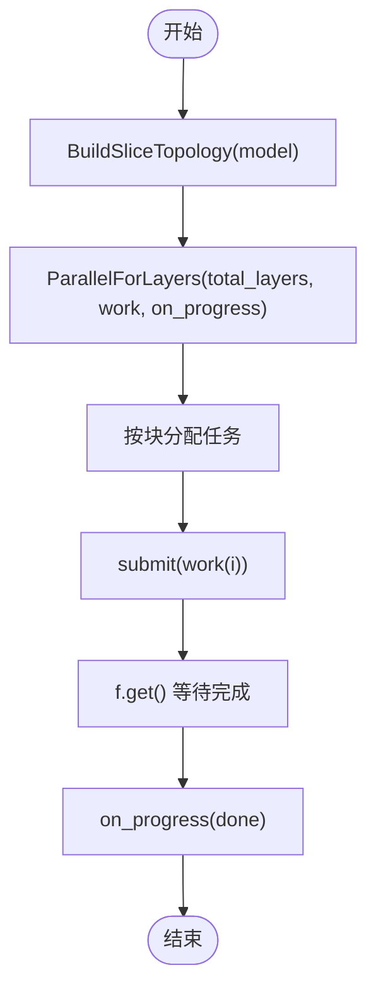

**图表来源**
- [mesh_slice.cpp:105-115](file://LibHsBaSlicer/Slice/mesh_slice.cpp#L105-L115)
- [pipeline_parallel.hpp:41-117](file://DllHsBaSlicer/pipeline_parallel.hpp#L41-L117)
- [thread_pool.hpp:29-39](file://base/thread_pool.hpp#L29-L39)

**章节来源**
- [mesh_slice.cpp:105-115](file://LibHsBaSlicer/Slice/mesh_slice.cpp#L105-L115)
- [pipeline_parallel.hpp:41-117](file://DllHsBaSlicer/pipeline_parallel.hpp#L41-L117)
- [thread_pool.hpp:29-39](file://base/thread_pool.hpp#L29-L39)

## 精度、容差与自相交处理
- 坐标整数化：使用 integerization 将浮点坐标转为整型 Key，提升哈希与比较效率
- 容差处理：coord_eps = max(1, round(tolerance * integerization))，用于判定两点是否相同
- 点合并：网格分桶 + 并查集，合并 coord_eps 范围内的相近点，避免微小误差导致拓扑断裂
- 自相交检测：在环路遍历过程中，若 next 已在当前路径中，则切分出子环，并标记 closed=false（Open polyline）
- 闭合检测：当 next 回到起点或已访问节点，且路径长度满足最小多边形要求，则闭合环

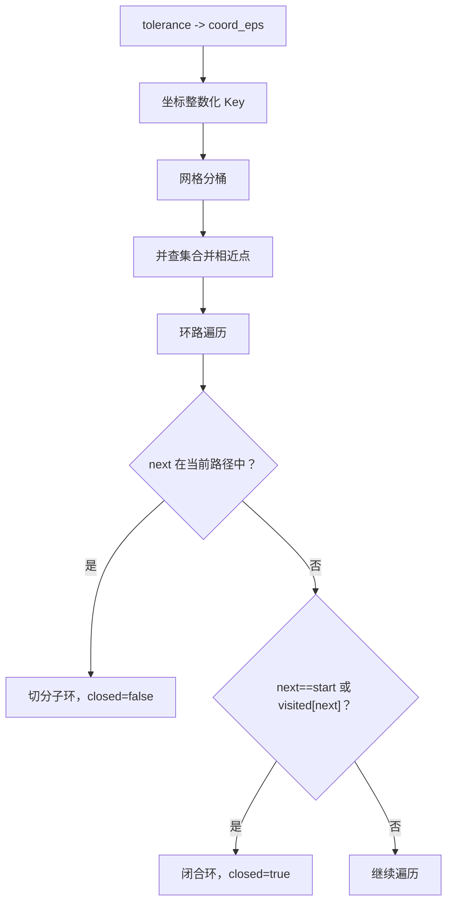

**图表来源**
- [FullTopoModel.cpp:332-346](file://meshmodel/FullTopoModel.cpp#L332-L346)
- [FullTopoModel.cpp:417-485](file://meshmodel/FullTopoModel.cpp#L417-L485)
- [FullTopoModel.cpp:521-597](file://meshmodel/FullTopoModel.cpp#L521-L597)
- [FullTopoModel.cpp:789-873](file://meshmodel/FullTopoModel.cpp#L789-L873)

**章节来源**
- [FullTopoModel.cpp:332-346](file://meshmodel/FullTopoModel.cpp#L332-L346)
- [FullTopoModel.cpp:417-485](file://meshmodel/FullTopoModel.cpp#L417-L485)
- [FullTopoModel.cpp:521-597](file://meshmodel/FullTopoModel.cpp#L521-L597)
- [FullTopoModel.cpp:789-873](file://meshmodel/FullTopoModel.cpp#L789-L873)

## 错误检测与修复策略
- 拓扑完整性检查：CheckTopo 验证顶点/边/面引用一致性；SliceFast 在拓扑无效时抛出异常
- 外部异常转换：GuardSlice 将 CGAL/OCCT 等第三方库异常统一转换为 IOError，避免跨边界传播
- Lua 错误处理：Lua 初始化、加载、运行错误均抛出 RuntimeError，并提供错误信息
- 开放轮廓过滤：NormalizeUnSafePolygons 过滤掉非闭合或非简单多边形，确保下游处理稳定

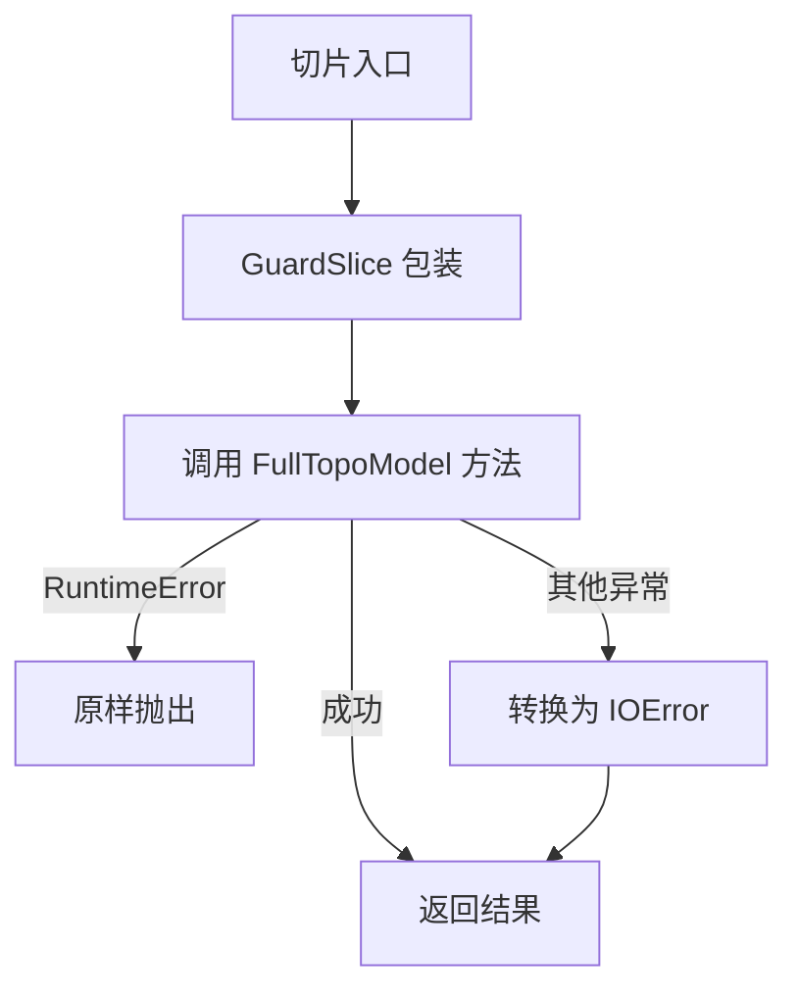

**图表来源**
- [mesh_slice.cpp:27-43](file://LibHsBaSlicer/Slice/mesh_slice.cpp#L27-L43)
- [FullTopoModel.cpp:875-880](file://meshmodel/FullTopoModel.cpp#L875-L880)
- [FullTopoModel.cpp:1027-1073](file://meshmodel/FullTopoModel.cpp#L1027-L1073)
- [mesh_slice.cpp:85-103](file://LibHsBaSlicer/Slice/mesh_slice.cpp#L85-L103)

**章节来源**
- [mesh_slice.cpp:27-43](file://LibHsBaSlicer/Slice/mesh_slice.cpp#L27-L43)
- [FullTopoModel.cpp:875-880](file://meshmodel/FullTopoModel.cpp#L875-L880)
- [FullTopoModel.cpp:1027-1073](file://meshmodel/FullTopoModel.cpp#L1027-L1073)
- [mesh_slice.cpp:85-103](file://LibHsBaSlicer/Slice/mesh_slice.cpp#L85-L103)

## 使用示例与参数调优指南
- 基本用法
  - 安全切片：调用 Slice(model, height, tolerance)，返回闭合多边形
  - 不安全切片：调用 UnSafeSlice(model, height, tolerance)，返回可能开放的轮廓
  - Lua 切片：调用 SliceLua(model, script, height)，通过脚本自定义切片逻辑
  - 可复用拓扑：先 BuildSliceTopology(model)，再多次调用 SliceLayer(topo, z, tolerance)
- 参数调优
  - layer_height / first_layer_height：影响层数与首层质量
  - tolerance：控制点合并容差，过小可能导致拓扑断裂，过大可能合并不同特征点
  - HSBA_PIPELINE_THREADS：控制并行线程数，设为 1 可进行串行对比测试
- 流水线集成
  - SLA/SLM/SLS 流水线在“切片阶段”调用 BuildSliceTopology 与 SliceLayer，并使用 ParallelForLayers 并行执行

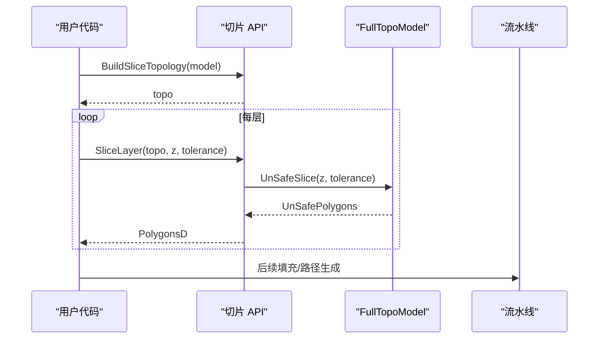

**图表来源**
- [mesh_slice.hpp:80-103](file://LibHsBaSlicer/Slice/mesh_slice.hpp#L80-L103)
- [mesh_slice.cpp:105-115](file://LibHsBaSlicer/Slice/mesh_slice.cpp#L105-L115)
- [sla_pipeline.cpp:321-338](file://DllHsBaSlicer/sla_pipeline.cpp#L321-L338)
- [slm_pipeline.cpp:272-284](file://DllHsBaSlicer/slm_pipeline.cpp#L272-L284)
- [sls_pipeline.cpp:219-231](file://DllHsBaSlicer/sls_pipeline.cpp#L219-L231)

**章节来源**
- [mesh_slice.hpp:80-103](file://LibHsBaSlicer/Slice/mesh_slice.hpp#L80-L103)
- [mesh_slice.cpp:105-115](file://LibHsBaSlicer/Slice/mesh_slice.cpp#L105-L115)
- [sla_pipeline.cpp:321-338](file://DllHsBaSlicer/sla_pipeline.cpp#L321-L338)
- [slm_pipeline.cpp:272-284](file://DllHsBaSlicer/slm_pipeline.cpp#L272-L284)
- [sls_pipeline.cpp:219-231](file://DllHsBaSlicer/sls_pipeline.cpp#L219-L231)

## 故障排查
- 拓扑无效
  - 现象：SliceFast 抛出异常
  - 排查：检查 CheckTopo 返回值，确认顶点/边/面引用一致性
- 切片结果为空或异常
  - 现象：Polygons 为空或出现开放轮廓
  - 排查：调整 tolerance，检查 NormalizeUnSafePolygons 的过滤逻辑
- 并行性能不佳
  - 现象：多线程下速度不如串行
  - 排查：设置 HSBA_PIPELINE_THREADS=1 进行对比，检查任务粒度与线程池规模
- Lua 脚本错误
  - 现象：运行时抛出 RuntimeError
  - 排查：检查脚本语法与返回表结构，确认 V/E/F 与 height 是否正确推送

**章节来源**
- [FullTopoModel.cpp:875-880](file://meshmodel/FullTopoModel.cpp#L875-L880)
- [mesh_slice.cpp:85-103](file://LibHsBaSlicer/Slice/mesh_slice.cpp#L85-L103)
- [pipeline_parallel.hpp:49-72](file://DllHsBaSlicer/pipeline_parallel.hpp#L49-L72)
- [FullTopoModel.cpp:1027-1073](file://meshmodel/FullTopoModel.cpp#L1027-L1073)

## 结论
HsBaSlicer 的切片引擎以 FullTopoModel 为核心，实现了稳健的层平面与网格相交计算、完整的拓扑重建、精确的点合并与自相交检测，并通过 BuildSliceTopology + SliceLayer 实现高效的拓扑复用。配合 ParallelForLayers 与 ThreadPool，切片流水线在多核环境下具备良好扩展性。针对精度与容差，系统提供了灵活的参数控制；针对错误与异常，提供了统一的转换与检测机制。开发者可根据具体工艺需求，选择合适的切片模式与安全级别，并结合 Lua 脚本进行定制化扩展。