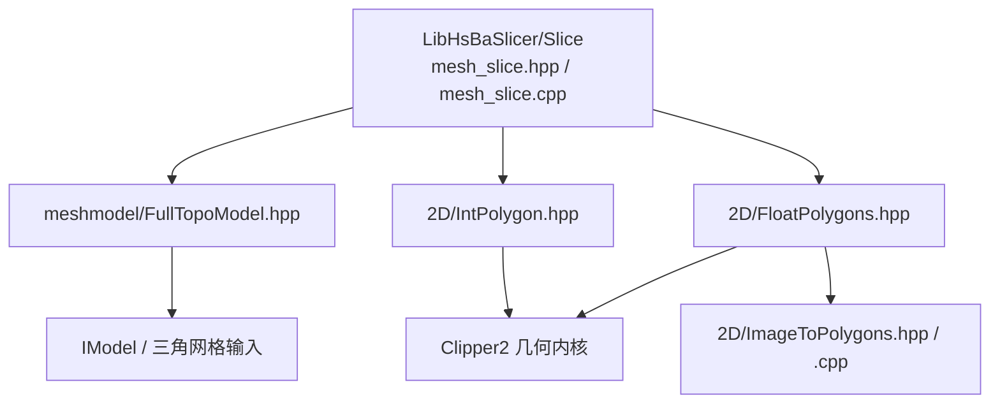
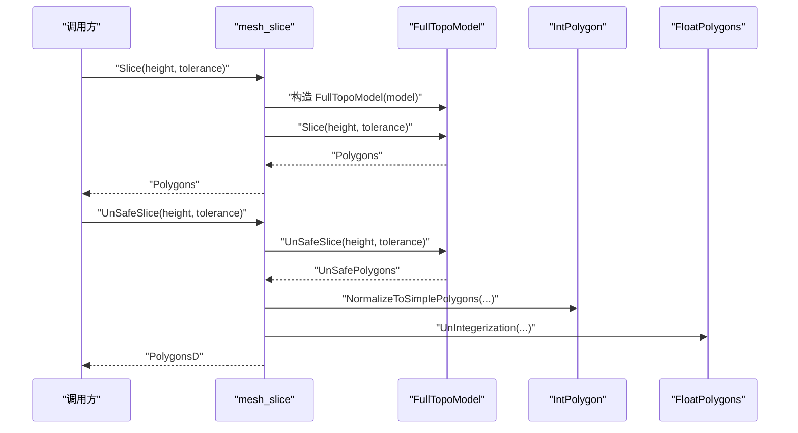
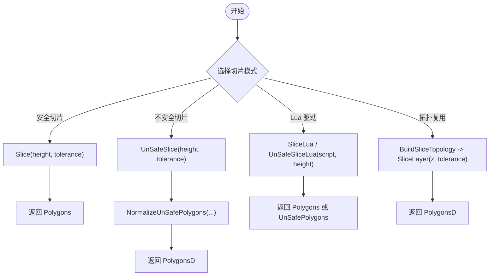
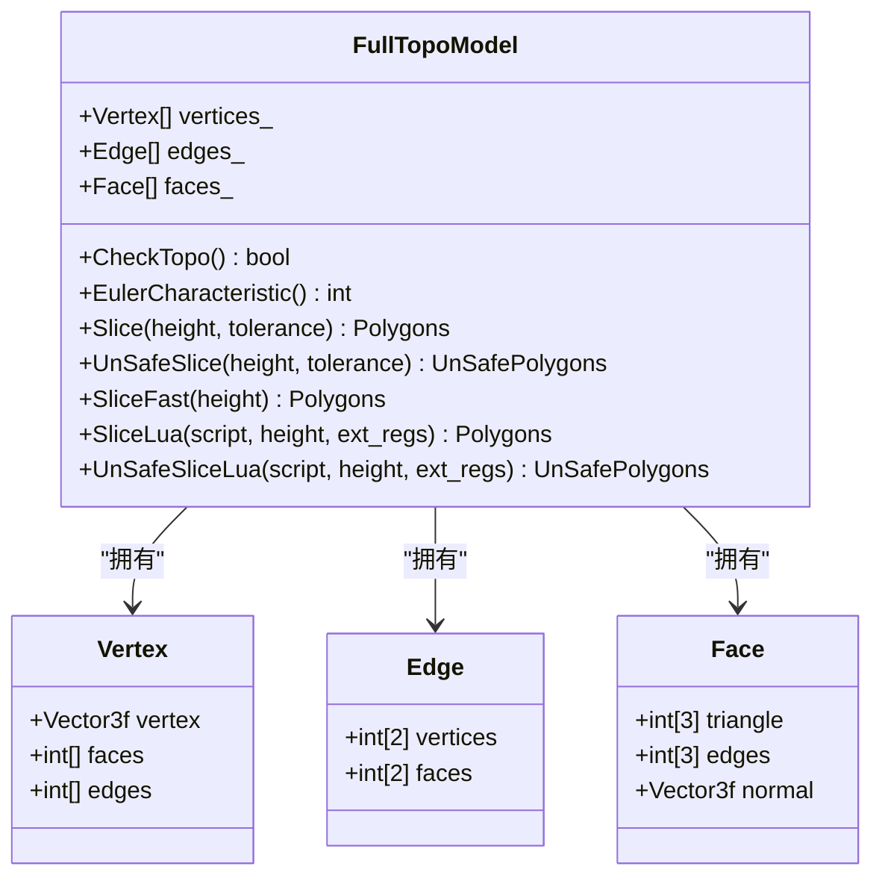
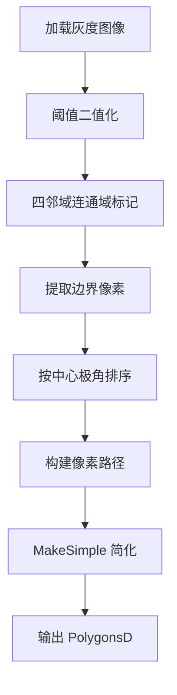
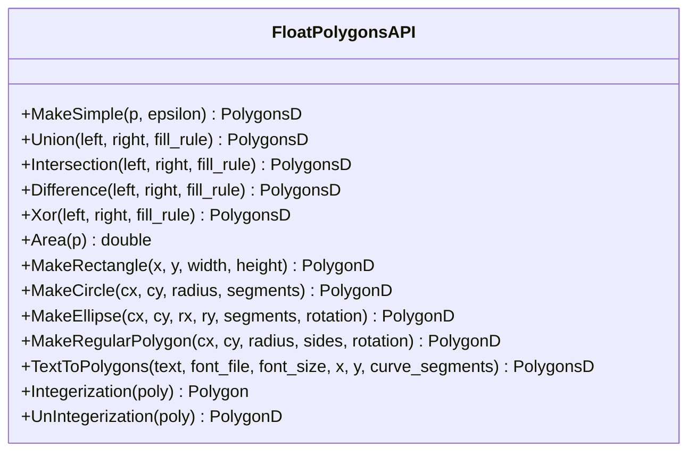
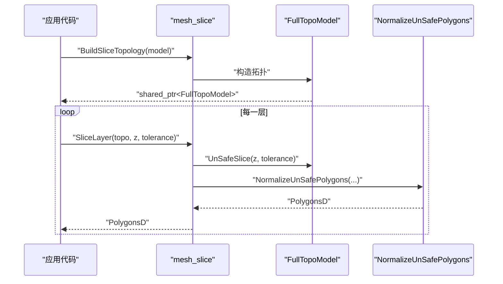
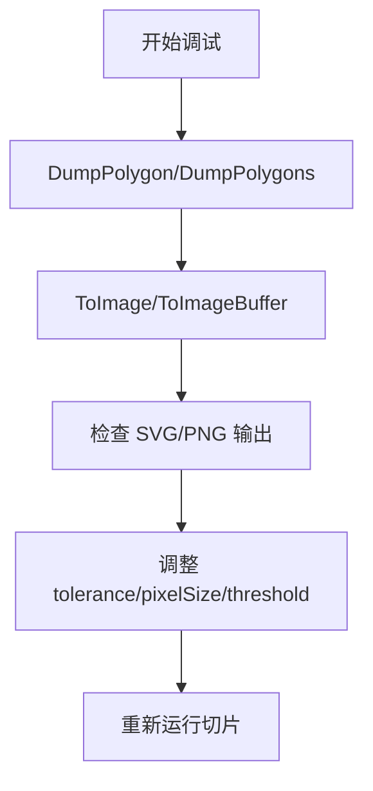
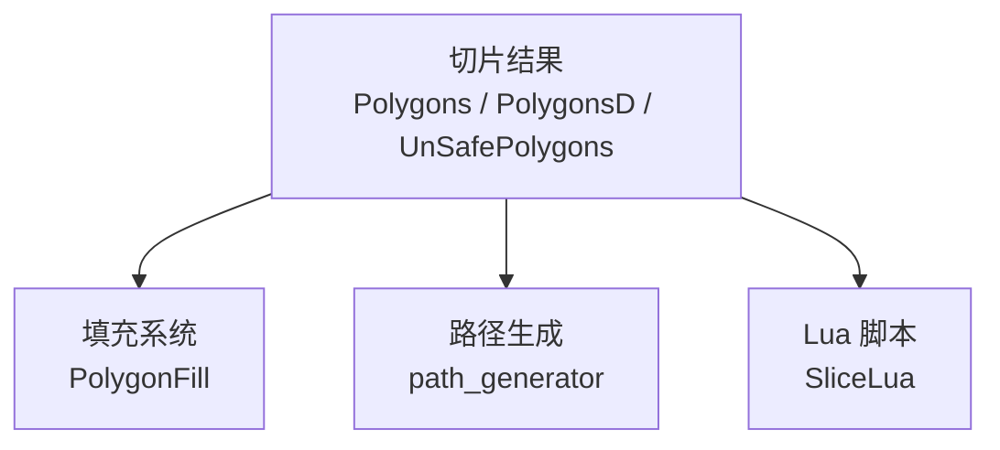

# 切片引擎模块

<cite>
**本文引用的文件**   
- [mesh_slice.hpp](file://LibHsBaSlicer/Slice/mesh_slice.hpp)
- [mesh_slice.cpp](file://LibHsBaSlicer/Slice/mesh_slice.cpp)
- [FullTopoModel.hpp](file://meshmodel/FullTopoModel.hpp)
- [FloatPolygons.hpp](file://2D/FloatPolygons.hpp)
- [FloatPolygons.cpp](file://2D/FloatPolygons.cpp)
- [IntPolygon.hpp](file://2D/IntPolygon.hpp)
- [ImageToPolygons.hpp](file://2D/ImageToPolygons.hpp)
- [ImageToPolygons.cpp](file://2D/ImageToPolygons.cpp)
</cite>

## 目录
1. [引言](#引言)
2. [项目结构定位](#项目结构定位)
3. [核心组件总览](#核心组件总览)
4. [架构与数据流](#架构与数据流)
5. [切片接口与拓扑复用](#切片接口与拓扑复用)
6. [层切片生成、轮廓提取与拓扑分析](#层切片生成轮廓提取与拓扑分析)
7. [图像转多边形算法](#图像转多边形算法)
8. [浮点数多边形数据结构与操作](#浮点数多边形数据结构与操作)
9. [切片参数配置与精度控制](#切片参数配置与精度控制)
10. [性能优化指南](#性能优化指南)
11. [切片流程示例与错误处理](#切片流程示例与错误处理)
12. [调试技巧与可视化](#调试技巧与可视化)
13. [后续处理接口与结果层次](#后续处理接口与结果层次)
14. [结论](#结论)

## 引言
本文件聚焦 HsBaSlicer 的切片引擎模块，目标是帮助读者理解从三维网格模型到二维层切片的多边形结果这一完整链路。文档围绕以下关键点展开：
- `mesh_slice` 提供的安全切片、不安全切片、Lua 驱动切片以及可复用拓扑切片接口。
- 层切片生成、轮廓提取、拓扑分析的实现思路与调用关系。
- `ImageToPolygons` 的栅格图像转多边形算法，包括阈值分割、连通域边界提取、渲染回图像。
- `FloatPolygons` 浮点数多边形类型、布尔运算、面积计算、整数化转换等基础几何能力。
- 切片参数、容差、精度缩放、性能优化策略、错误处理与调试方法。
- 切片结果的数据结构、层次关系，以及与填充、路径生成等下游模块的衔接方式。

## 项目结构定位
切片引擎位于 LibHsBaSlicer 的 Slice 子模块中，对外暴露 C++ API；其内部依赖 meshmodel 中的全拓扑网格模型，以及 2D 几何库中的整数多边形和浮点多边形工具。



**图示来源**
- [mesh_slice.hpp:1-108](file://LibHsBaSlicer/Slice/mesh_slice.hpp#L1-L108)
- [mesh_slice.cpp:1-119](file://LibHsBaSlicer/Slice/mesh_slice.cpp#L1-L119)
- [FullTopoModel.hpp:1-150](file://meshmodel/FullTopoModel.hpp#L1-L150)
- [FloatPolygons.hpp:1-271](file://2D/FloatPolygons.hpp#L1-L271)
- [ImageToPolygons.hpp:1-103](file://2D/ImageToPolygons.hpp#L1-L103)

**章节来源**
- [mesh_slice.hpp:1-108](file://LibHsBaSlicer/Slice/mesh_slice.hpp#L1-L108)
- [mesh_slice.cpp:1-119](file://LibHsBaSlicer/Slice/mesh_slice.cpp#L1-L119)
- [FullTopoModel.hpp:1-150](file://meshmodel/FullTopoModel.hpp#L1-L150)
- [FloatPolygons.hpp:1-271](file://2D/FloatPolygons.hpp#L1-L271)
- [ImageToPolygons.hpp:1-103](file://2D/ImageToPolygons.hpp#L1-L103)

## 核心组件总览
切片引擎的核心由三类组件构成：
1. **切片入口与异常保护**：`Slice`、`UnSafeSlice`、`SliceLua`、`UnSafeSliceLua`、`BuildSliceTopology`、`SliceLayer`、`NormalizeUnSafePolygons`。
2. **全拓扑网格模型**：`FullTopoModel`，负责顶点、边、面的拓扑重建，并提供按 Z 轴切片的接口。
3. **2D 几何与图像工具**：`IntPolygon`（整数坐标）、`FloatPolygons`（双精度坐标）、`ImageToPolygons`（图像转多边形）。

| 组件 | 主要职责 | 关键输出 |
|---|---|---|
| `mesh_slice` | 提供安全/不安全切片、Lua 驱动切片、拓扑复用切片 | `Polygons`、`UnSafePolygons`、`PolygonsD` |
| `FullTopoModel` | 构建并维护顶点/边/面拓扑，执行平面切片 | 闭合或开放轮廓集合 |
| `IntPolygon` | 整数坐标多边形布尔运算、简化、偏移、点包含判断 | 整数多边形集合 |
| `FloatPolygons` | 双精度多边形布尔运算、面积、形状生成、整数化转换 | 双精度多边形集合 |
| `ImageToPolygons` | 图像阈值分割、轮廓提取、多边形渲染为图像 | 多边形集合或图像缓冲区 |

**章节来源**
- [mesh_slice.hpp:22-103](file://LibHsBaSlicer/Slice/mesh_slice.hpp#L22-L103)
- [FullTopoModel.hpp:23-146](file://meshmodel/FullTopoModel.hpp#L23-L146)
- [IntPolygon.hpp:16-192](file://2D/IntPolygon.hpp#L16-L192)
- [FloatPolygons.hpp:18-239](file://2D/FloatPolygons.hpp#L18-L239)
- [ImageToPolygons.hpp:23-99](file://2D/ImageToPolygons.hpp#L23-L99)

## 架构与数据流
切片引擎的整体数据流如下：
- 输入：任意 `IModel` 抽象模型，通常来自 CAD、三角网格或点云模型。
- 中间：`FullTopoModel` 将模型转换为顶点、边、面拓扑结构，并按高度进行平面切片。
- 输出：
  - 安全切片返回仅含闭合轮廓的 `Polygons`。
  - 不安全切片返回可能开放的 `UnSafePolygons`，可通过 `NormalizeUnSafePolygons` 转为 `PolygonsD`。
  - Lua 驱动切片允许用户脚本自定义切片逻辑。



**图示来源**
- [mesh_slice.cpp:46-116](file://LibHsBaSlicer/Slice/mesh_slice.cpp#L46-L116)
- [FullTopoModel.hpp:100-124](file://meshmodel/FullTopoModel.hpp#L100-L124)
- [IntPolygon.hpp:50-66](file://2D/IntPolygon.hpp#L50-L66)
- [FloatPolygons.hpp:196-221](file://2D/FloatPolygons.hpp#L196-L221)

**章节来源**
- [mesh_slice.cpp:46-116](file://LibHsBaSlicer/Slice/mesh_slice.cpp#L46-L116)
- [FullTopoModel.hpp:100-124](file://meshmodel/FullTopoModel.hpp#L100-L124)

## 切片接口与拓扑复用
`mesh_slice` 提供了多种切片入口，适用于不同场景：
- `Slice`：安全切片，忽略开放轮廓，适合表面成型工艺。
- `UnSafeSlice`：不安全切片，保留开放轮廓，适合材料沉积工艺。
- `SliceLua` / `UnSafeSliceLua`：通过 Lua 脚本驱动切片，便于扩展。
- `BuildSliceTopology` + `SliceLayer`：先构建一次拓扑，再对多层重复切片，避免每层重建拓扑的高开销。
- `NormalizeUnSafePolygons`：将不安全切片结果标准化为双精度多边形集合，过滤无效轮廓并做拓扑归一化。



**图示来源**
- [mesh_slice.hpp:22-103](file://LibHsBaSlicer/Slice/mesh_slice.hpp#L22-L103)
- [mesh_slice.cpp:46-116](file://LibHsBaSlicer/Slice/mesh_slice.cpp#L46-L116)

**章节来源**
- [mesh_slice.hpp:22-103](file://LibHsBaSlicer/Slice/mesh_slice.hpp#L22-L103)
- [mesh_slice.cpp:46-116](file://LibHsBaSlicer/Slice/mesh_slice.cpp#L46-L116)

## 层切片生成、轮廓提取与拓扑分析
### 层切片生成
`FullTopoModel` 在构造函数中重建拓扑关系，随后通过 `Slice`、`UnSafeSlice`、`SliceFast` 等方法按 Z 轴高度进行切片。切片过程本质上是三角形与水平平面的求交，得到二维轮廓线段，再组合成多边形。

### 轮廓提取
不安全切片返回的可能是开放或多段轮廓，因此需要：
- 过滤非闭合或点数不足的路径。
- 使用 `NormalizeToSimplePolygons` 将复杂多边形简化并拆分为简单多边形。
- 使用 `UnIntegerization` 将整数坐标还原为双精度坐标。

### 拓扑分析
`FullTopoModel` 提供拓扑完整性检查、欧拉特征值计算、顶点/边/面查询接口，可用于检测孔洞、非流形结构等问题。这些能力有助于在切片前发现模型质量问题。



**图示来源**
- [FullTopoModel.hpp:23-146](file://meshmodel/FullTopoModel.hpp#L23-L146)

**章节来源**
- [FullTopoModel.hpp:23-146](file://meshmodel/FullTopoModel.hpp#L23-L146)
- [mesh_slice.cpp:86-116](file://LibHsBaSlicer/Slice/mesh_slice.cpp#L86-L116)

## 图像转多边形算法
`ImageToPolygons` 提供从栅格图像到多边形集合的转换，以及反向渲染功能。其核心步骤包括：
1. 加载灰度图像。
2. 按阈值二值化。
3. 四邻域连通域标记。
4. 提取连通域边界点。
5. 按极角排序形成闭合轮廓。
6. 简化并输出多边形。



**图示来源**
- [ImageToPolygons.cpp:37-76](file://2D/ImageToPolygons.cpp#L37-L76)
- [ImageToPolygons.cpp:98-200](file://2D/ImageToPolygons.cpp#L98-L200)
- [FloatPolygons.cpp:25-32](file://2D/FloatPolygons.cpp#L25-L32)

**章节来源**
- [ImageToPolygons.hpp:23-99](file://2D/ImageToPolygons.hpp#L23-L99)
- [ImageToPolygons.cpp:37-76](file://2D/ImageToPolygons.cpp#L37-L76)
- [ImageToPolygons.cpp:98-200](file://2D/ImageToPolygons.cpp#L98-L200)
- [FloatPolygons.cpp:25-32](file://2D/FloatPolygons.cpp#L25-L32)

## 浮点数多边形数据结构与操作
`FloatPolygons` 基于 Clipper2 的双精度类型，提供：
- 多边形简化、布尔运算（并、交、差、异或）。
- 面积计算。
- 矩形、圆、椭圆、正多边形生成。
- 文本转多边形（需 FreeType）。
- 双精度与整数坐标之间的相互转换。



**图示来源**
- [FloatPolygons.hpp:18-239](file://2D/FloatPolygons.hpp#L18-L239)
- [FloatPolygons.cpp:25-221](file://2D/FloatPolygons.cpp#L25-L221)

**章节来源**
- [FloatPolygons.hpp:18-239](file://2D/FloatPolygons.hpp#L18-L239)
- [FloatPolygons.cpp:25-221](file://2D/FloatPolygons.cpp#L25-L221)

## 切片参数配置与精度控制
切片相关的关键参数包括：
- `height`：切片高度（Z 轴），决定当前层的切割位置。
- `tolerance`：坐标容差，用于合并相近点，影响轮廓稳定性。
- `integerization`：整数化缩放因子，默认值为 `1e6`，用于将双精度坐标映射到 64 位整数空间，提高布尔运算稳定性。
- `pixelSize`：图像转多边形时的像素尺寸，控制栅格到几何的比例。
- `threshold`：图像阈值，控制二值化效果。
- `curve_segments`：曲线分段数，影响文本和多边形生成的平滑度。

```mermaid
table
| 参数 | 类型 | 默认值 | 作用 |
|---|---|---|---|
| height | float | 无 | 切片高度 |
| tolerance | double | 0.001 | 坐标容差 |
| integerization | double | 1e6 | 整数化缩放因子 |
| pixelSize | double | 1.0 | 图像像素尺寸 |
| threshold | int | 128 | 图像阈值 |
| curve_segments | int | 8 | 曲线分段数 |
```

**章节来源**
- [mesh_slice.hpp:22-103](file://LibHsBaSlicer/Slice/mesh_slice.hpp#L22-L103)
- [IntPolygon.hpp:16-17](file://2D/IntPolygon.hpp#L16-L17)
- [ImageToPolygons.hpp:18-30](file://2D/ImageToPolygons.hpp#L18-L30)
- [FloatPolygons.hpp:28-191](file://2D/FloatPolygons.hpp#L28-L191)

## 性能优化指南
针对切片引擎的性能优化，可从以下方面入手：
1. **拓扑复用**：对多层切片，优先使用 `BuildSliceTopology` + `SliceLayer`，避免每层重建拓扑。
2. **容差调优**：适当增大 `tolerance` 可减少噪声轮廓，但过大可能导致轮廓失真。
3. **整数化精度**：`integerization = 1e6` 提供足够精度，若模型尺度极大或极小，需评估是否调整缩放。
4. **图像分辨率**：降低 `pixelSize` 或图像尺寸可减少栅格处理时间，但会损失细节。
5. **布尔运算优化**：使用 `MakeSimple` 提前简化多边形，减少 Clipper2 的计算负担。
6. **并发切片**：共享只读拓扑对象时，可对不同层并行调用 `SliceLayer`，每个线程写入独立输出。

**章节来源**
- [mesh_slice.cpp:106-116](file://LibHsBaSlicer/Slice/mesh_slice.cpp#L106-L116)
- [FloatPolygons.cpp:25-32](file://2D/FloatPolygons.cpp#L25-L32)
- [ImageToPolygons.cpp:416-543](file://2D/ImageToPolygons.cpp#L416-L543)

## 切片流程示例与错误处理
### 典型切片流程
1. 加载模型并构建拓扑。
2. 对目标高度调用 `Slice` 或 `UnSafeSlice`。
3. 如需双精度结果，调用 `NormalizeUnSafePolygons`。
4. 将结果传递给填充或路径生成模块。



**图示来源**
- [mesh_slice.cpp:106-116](file://LibHsBaSlicer/Slice/mesh_slice.cpp#L106-L116)
- [mesh_slice.cpp:86-104](file://LibHsBaSlicer/Slice/mesh_slice.cpp#L86-L104)

### 错误处理
切片子系统通过 `GuardSlice` 包装所有入口函数，将外部异常（如 CGAL、OCCT 异常）统一转换为项目的 `IOError`，而项目自身的 `RuntimeError` 直接抛出。这确保跨边界异常不会泄露底层实现细节。

常见错误场景：
- 模型拓扑不完整：可通过 `CheckTopo()` 和 `EulerCharacteristic()` 检测。
- 图像加载失败：`FromImage` 返回空多边形集合。
- Lua 脚本错误：抛出 `RuntimeError`，包含脚本加载或执行信息。
- 文件格式不支持：如 FreeType 未启用时调用 `TextToPolygons`。

**章节来源**
- [mesh_slice.cpp:17-43](file://LibHsBaSlicer/Slice/mesh_slice.cpp#L17-L43)
- [FullTopoModel.hpp:80-98](file://meshmodel/FullTopoModel.hpp#L80-L98)
- [ImageToPolygons.cpp:545-682](file://2D/ImageToPolygons.cpp#L545-L682)
- [FloatPolygons.cpp:364-429](file://2D/FloatPolygons.cpp#L364-L429)

## 调试技巧与可视化
调试切片结果时，可使用以下方法：
- 启用 `HSBA_POLYGON_DUMP` 编译选项，调用 `DumpPolygon` / `DumpPolygons` 输出 SVG 可视化。
- 使用 `ImageToPolygons::ToImage` 或 `ToImageBuffer` 将多边形渲染为 PNG/JPEG/SVG。
- 打印 `FullTopoModel` 的顶点、边、面数量，检查拓扑规模。
- 逐步调整 `tolerance`、`pixelSize`、`threshold`，观察轮廓变化。



**图示来源**
- [FloatPolygons.cpp:77-180](file://2D/FloatPolygons.cpp#L77-L180)
- [ImageToPolygons.cpp:427-514](file://2D/ImageToPolygons.cpp#L427-L514)

**章节来源**
- [FloatPolygons.cpp:77-180](file://2D/FloatPolygons.cpp#L77-L180)
- [ImageToPolygons.cpp:427-514](file://2D/ImageToPolygons.cpp#L427-L514)

## 后续处理接口与结果层次
切片结果通常进入填充系统或路径生成系统：
- `Polygons`：整数坐标多边形集合，常用于布尔运算、偏移、填充。
- `PolygonsD`：双精度多边形集合，常用于高精度渲染、Lua 脚本交互。
- `UnSafePolygons`：可能开放的轮廓集合，需进一步清理。

下游接口参考：
- 填充系统：`PolygonFill` 模块接收 `Polygons` 或 `PolygonsD` 进行区域填充。
- 路径生成：`path_generator` 模块将多边形转换为打印路径。
- Lua 脚本：`SliceLua` 暴露 V/E/F 全局变量，允许用户自定义切片逻辑。



**图示来源**
- [mesh_slice.hpp:22-103](file://LibHsBaSlicer/Slice/mesh_slice.hpp#L22-L103)
- [FullTopoModel.hpp:116-132](file://meshmodel/FullTopoModel.hpp#L116-L132)

**章节来源**
- [mesh_slice.hpp:22-103](file://LibHsBaSlicer/Slice/mesh_slice.hpp#L22-L103)
- [FullTopoModel.hpp:116-132](file://meshmodel/FullTopoModel.hpp#L116-L132)

## 结论
HsBaSlicer 的切片引擎模块以 `mesh_slice` 为入口，结合 `FullTopoModel` 的全拓扑能力和 2D 几何工具，实现了从三维网格到二维层切片的完整流程。通过安全/不安全切片、Lua 驱动、拓扑复用等机制，既满足初学者理解切片原理的需求，也为高级开发者提供了参数调优、性能优化和错误处理的详细指导。配合 `ImageToPolygons` 和 `FloatPolygons`，该模块还能灵活处理图像输入和双精度几何操作，是 HsBaSlicer 多工艺切片管线的重要基石。