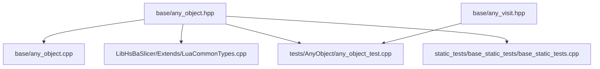
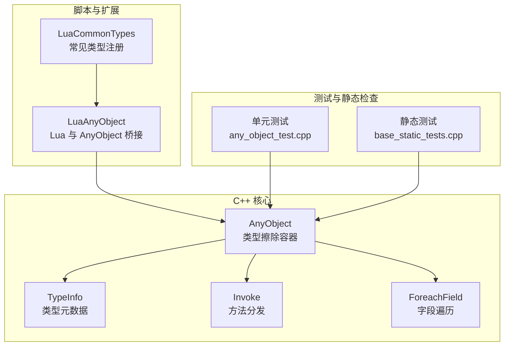
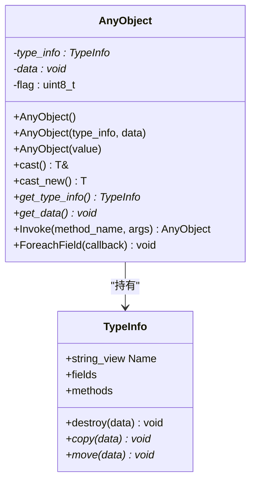
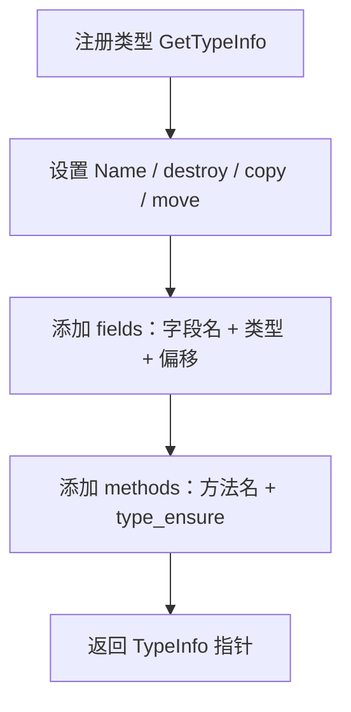
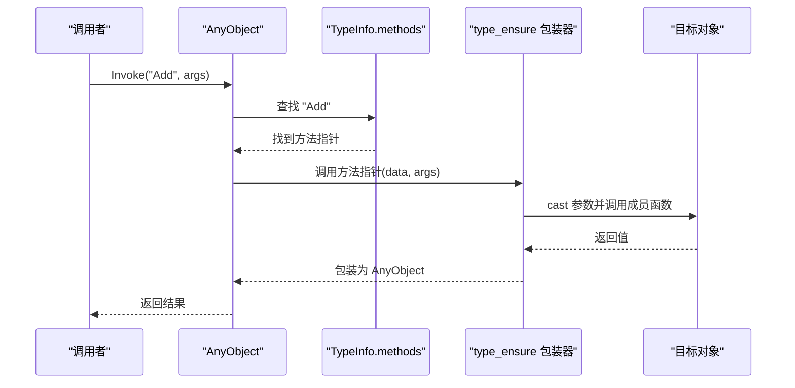
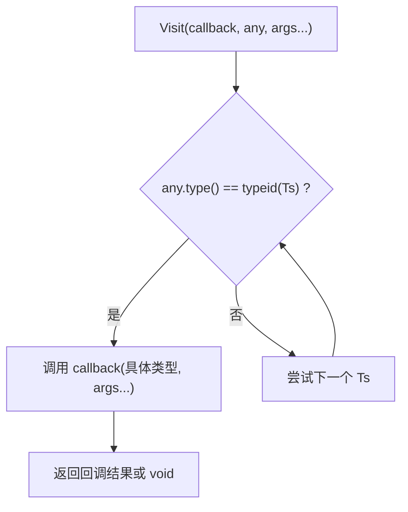
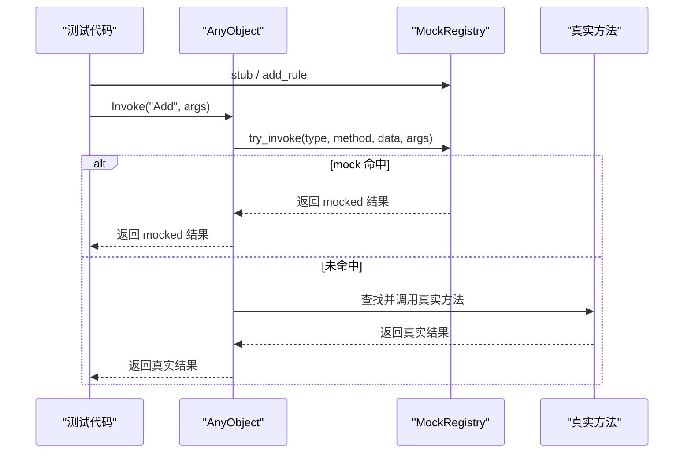
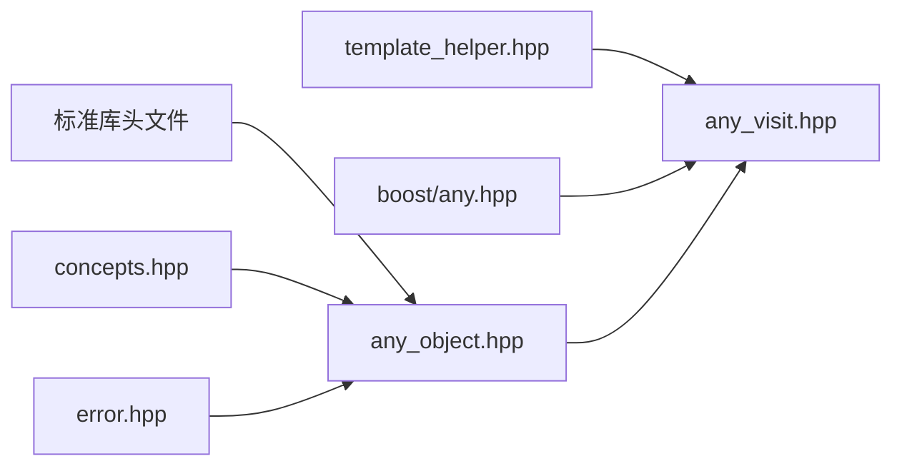
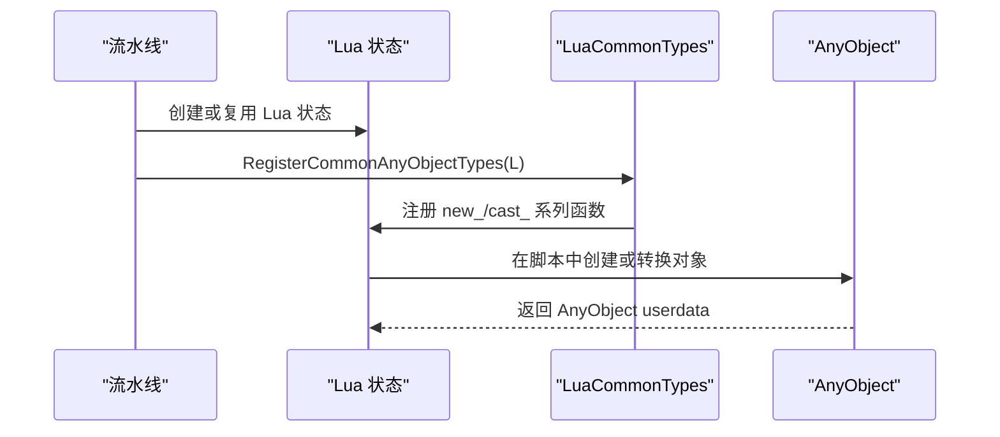

# AnyObject 泛型对象容器

<cite>
**本文引用的文件**   
- [any_object.hpp](file://base/any_object.hpp)
- [any_object.cpp](file://base/any_object.cpp)
- [any_visit.hpp](file://base/any_visit.hpp)
- [LuaCommonTypes.cpp](file://LibHsBaSlicer/Extends/LuaCommonTypes.cpp)
- [luaanyobject.md](file://docs/en/utils/luaanyobject.md)
- [luaanyobject.md（中文）](file://docs/zh/utils/luaanyobject.md)
- [any_object_test.cpp](file://tests/AnyObject/any_object_test.cpp)
- [base_static_tests.cpp](file://static_tests/base_static_tests/base_static_tests.cpp)
</cite>

## 目录
1. [引言](#引言)
2. [项目结构定位](#项目结构定位)
3. [核心概念](#核心概念)
4. [架构总览](#架构总览)
5. [详细组件分析](#详细组件分析)
6. [依赖关系分析](#依赖关系分析)
7. [性能与内存模型](#性能与内存模型)
8. [使用示例与最佳实践](#使用示例与最佳实践)
9. [与其他泛型容器的对比](#与其他泛型容器的对比)
10. [在 HsBaSlicer 中的应用场景](#在-hsbaslicer-中的应用场景)
11. [故障排除与错误处理](#故障排除与错误处理)
12. [结论](#结论)

## 引言

`AnyObject` 是 HsBaSlicer 基础库中的一个类型擦除对象容器。它允许以统一接口存储、复制、移动、反射遍历字段和按名称调用方法，同时保持 C++ 侧的类型安全访问能力。其设计目标包括：

- **类型擦除**：对外暴露统一的 `AnyObject` 类型，内部通过 `TypeInfo` 指针持有具体类型的元数据。
- **动态类型存储**：任意可构造、可拷贝、可移动的对象都可以被包装进 `AnyObject`。
- **类型安全访问**：通过模板化的 `cast<T>()` 和 `cast_new<T>()` 进行编译期类型约束的读取。
- **反射式字段遍历**：通过 `ForeachField` 遍历已注册的字段名与偏移信息。
- **运行时方法分发**：通过 `Invoke(method_name, args)` 实现字符串驱动的方法调用。
- **测试友好**：在启用 Mock 宏时提供类 Mockit 的打桩、规则匹配、调用记录能力。
- **脚本桥接**：与 LuaAnyObject、LuaCommonTypes 配合，把 C++ 类型暴露给 Lua 脚本，并在流水线中作为通用参数载体。

该文档聚焦于 `AnyObject` 的设计原理、实现机制、`any_visit` 遍历辅助、错误处理、性能特征以及在 HsBaSlicer 中的实际用途。

## 项目结构定位

`AnyObject` 位于基础工具层，属于 HsBaSlicer 的底层基础设施，而不是某个特定切片算法或导出格式的实现细节。其关键位置如下：

| 文件 | 职责 |
|---|---|
| `base/any_object.hpp` | 定义 `TypeInfo`、`AnyObject`、`GetTypeInfo<T>`、`type_ensure`、Mock 支持等核心声明 |
| `base/any_object.cpp` | 实现拷贝、移动、析构、`ForeachField`、`Invoke` 等运行时逻辑 |
| `base/any_visit.hpp` | 为 `std::any` 和 `boost::any` 提供安全的 `Visit` 遍历工具 |
| `LibHsBaSlicer/Extends/LuaCommonTypes.cpp` | 注册常见自定义类型到 AnyObject/Lua 转换系统 |
| `tests/AnyObject/any_object_test.cpp` | 覆盖基本操作、反射、虚函数、位域、Lua 集成和 Mock |
| `static_tests/base_static_tests/base_static_tests.cpp` | 静态断言验证 `ForeachField` 回调签名 |

**图表来源**
- [any_object.hpp:43-115](file://base/any_object.hpp#L43-L115)
- [any_object.cpp:7-113](file://base/any_object.cpp#L7-L113)
- [any_visit.hpp:20-115](file://base/any_visit.hpp#L20-L115)
- [LuaCommonTypes.cpp:1-9](file://LibHsBaSlicer/Extends/LuaCommonTypes.cpp#L1-L9)
- [any_object_test.cpp:1-15](file://tests/AnyObject/any_object_test.cpp#L1-L15)
- [base_static_tests.cpp:227-245](file://static_tests/base_static_tests/base_static_tests.cpp#L227-L245)

**章节来源**
- [any_object.hpp:1-24](file://base/any_object.hpp#L1-L24)
- [any_object.cpp:1-8](file://base/any_object.cpp#L1-L8)
- [any_visit.hpp:1-19](file://base/any_visit.hpp#L1-L19)

## 核心概念

### 类型擦除与 TypeInfo

`AnyObject` 的核心思想是“值 + 元数据”分离：

- `data` 指向堆上分配的具体对象。
- `type_info` 指向该类型的 `TypeInfo`。
- `flag` 表示是否由 `AnyObject` 拥有该内存；当 flag 包含 `0b1` 时，析构和赋值会调用 `type_info->destroy`。

`TypeInfo` 至少包含：

| 字段 | 含义 |
|---|---|
| `Name` | 类型名称，用于调试和简单比较 |
| `destroy` | 销毁底层对象的函数指针 |
| `copy` | 拷贝底层对象的函数指针 |
| `move` | 移动底层对象的函数指针 |
| `fields` | 字段名到 `(TypeInfo*, offset)` 的映射 |
| `methods` | 方法名到 `AnyObject (*)(void*, std::span<AnyObject>)` 的映射 |

这种设计让 `AnyObject` 可以承载任意满足要求的类型，而不需要继承自某个基类。

### 类型注册与 GetTypeInfo

对于大多数类型，`GetTypeInfo<T>()` 返回一个每类型唯一的静态 `TypeInfo`。默认实现会设置：

- 类型名称来自 `typeid(T).name()`。
- `destroy` 使用 `delete static_cast<T*>(data)`。
- `copy` 使用 `new T(*static_cast<const T*>(data))`。
- `move` 使用 `new T(std::move(*static_cast<T*>(data)))`。

对于需要暴露字段和方法的类型，用户需要特化 `GetTypeInfo<T>()`，并填充 `fields` 和 `methods`。

### 类型安全访问

`AnyObject` 提供两种主要访问方式：

| API | 行为 |
|---|---|
| `cast<T>()` | 返回对底层对象的引用；类型不匹配抛出 `RuntimeError` |
| `cast_new<T>()` | 返回底层对象的拷贝；类型不匹配抛出 `RuntimeError` |
| `get_type_info()` | 获取类型信息指针 |
| `get_data()` | 获取只读原始指针，便于反射消费方直接访问子对象地址 |

### 反射字段遍历

`ForeachField` 会遍历 `type_info->fields`，并为每个字段构造一个新的 `AnyObject`，其 `data` 指向原对象内存加上字段偏移。这样可以在不知道具体类型的情况下遍历字段。

### 运行时方法调用

`Invoke` 根据方法名查找 `type_info->methods`，然后调用对应函数指针。该方法还支持 Mock 拦截：如果启用了 Mock 且存在匹配的 stub 或 rule，则直接返回 mock 结果，否则走真实方法。

**章节来源**
- [any_object.hpp:46-115](file://base/any_object.hpp#L46-L115)
- [any_object.hpp:721-739](file://base/any_object.hpp#L721-L739)
- [any_object.cpp:76-111](file://base/any_object.cpp#L76-L111)

## 架构总览

下图展示 `AnyObject` 在 HsBaSlicer 中的整体角色：C++ 代码通过 `AnyObject` 传递任意对象；Lua 侧通过 LuaAnyObject 和 LuaCommonTypes 将常见类型转换为 `AnyObject`；测试通过 Mock 机制验证方法调用路径。

**图表来源**
- [any_object.hpp:43-115](file://base/any_object.hpp#L43-L115)
- [any_object.cpp:76-111](file://base/any_object.cpp#L76-L111)
- [LuaCommonTypes.cpp:1-9](file://LibHsBaSlicer/Extends/LuaCommonTypes.cpp#L1-L9)
- [any_object_test.cpp:10-31](file://tests/AnyObject/any_object_test.cpp#L10-L31)
- [base_static_tests.cpp:227-245](file://static_tests/base_static_tests/base_static_tests.cpp#L227-L245)

## 详细组件分析

### AnyObject 类设计

`AnyObject` 是一个轻量级句柄，内部维护三个成员：

| 成员 | 类型 | 作用 |
|---|---|---|
| `type_info` | `TypeInfo*` | 指向类型元数据 |
| `data` | `void*` | 指向堆上对象或裸指针 |
| `flag` | `uint8_t` | 标记所有权语义，例如 `0b1` 表示由 `AnyObject` 管理内存 |

构造函数支持：

- 默认构造空对象。
- 从 `TypeInfo*` 和裸指针构造。
- 拷贝构造：若 flag 表示拥有内存，则调用 `type_info->copy`。
- 移动构造：转移所有成员。
- 从任意类型 `T` 构造：通过 `GetTypeInfo<std::remove_cvref_t<T>>()` 注册类型信息并堆分配对象。

**图表来源**
- [any_object.hpp:46-115](file://base/any_object.hpp#L46-L115)
- [any_object.hpp:721-739](file://base/any_object.hpp#L721-L739)

**章节来源**
- [any_object.hpp:71-115](file://base/any_object.hpp#L71-L115)
- [any_object.cpp:9-74](file://base/any_object.cpp#L9-L74)

### 类型注册机制

`GetTypeInfo<T>()` 是类型注册入口。默认模板会为普通类型生成 destroy/copy/move 函数。对于需要反射能力的类型，用户需要特化该函数。

典型流程：

1. 定义类型，例如 `Standard`、`BaseVirtual`、`DerivedVirtual`、`BitfieldClass`。
2. 特化 `GetTypeInfo<T>()`。
3. 设置 `Name`、`destroy`、`copy`、`move`。
4. 向 `fields` 添加字段名、字段类型信息和偏移。
5. 向 `methods` 添加方法名和 `type_ensure` 生成的分派函数。

**图表来源**
- [any_object.hpp:721-739](file://base/any_object.hpp#L721-L739)
- [any_object_test.cpp:16-31](file://tests/AnyObject/any_object_test.cpp#L16-L31)
- [base_static_tests.cpp:227-245](file://static_tests/base_static_tests/base_static_tests.cpp#L227-L245)

**章节来源**
- [any_object.hpp:673-739](file://base/any_object.hpp#L673-L739)
- [any_object_test.cpp:16-31](file://tests/AnyObject/any_object_test.cpp#L16-L31)
- [base_static_tests.cpp:227-245](file://static_tests/base_static_tests/base_static_tests.cpp#L227-L245)

### 方法分发与 type_ensure

`type_ensure<&Class::Method>()` 会根据成员函数签名生成一个 `AnyObject (*)(void*, std::span<AnyObject>)` 函数。它会：

1. 将 `void*` 转回 `Class*`。
2. 将 `AnyObject` 参数数组按模板推导出的参数类型依次 `cast`。
3. 调用成员函数。
4. 如果返回值非 void，则包装成 `AnyObject`；否则返回空 `AnyObject`。

这使 `Invoke("Add", args)` 能够以字符串形式调用 C++ 成员函数，同时保持参数类型安全。

**图表来源**
- [any_object.hpp:690-714](file://base/any_object.hpp#L690-L714)
- [any_object.cpp:88-111](file://base/any_object.cpp#L88-L111)

**章节来源**
- [any_object.hpp:673-714](file://base/any_object.hpp#L673-L714)
- [any_object.cpp:88-111](file://base/any_object.cpp#L88-L111)

### any_visit 遍历机制

`any_visit.hpp` 提供针对 `std::any` 和 `boost::any` 的 `Visit` 函数。它不是 `AnyObject` 的直接实现，而是为其他泛型 any 容器提供统一访问模式。

`Visit` 的行为：

- 接收一个可变参模板类型列表 `Ts...`。
- 检查传入的 any 的实际类型是否与某个 `Ts` 相同。
- 如果匹配，则调用回调函数。
- 如果回调返回 void，则不产生返回值。
- 如果回调返回非 void，则要求所有分支返回类型一致，并通过 `AllTheSame` 推导统一返回类型。

**图表来源**
- [any_visit.hpp:36-69](file://base/any_visit.hpp#L36-L69)
- [any_visit.hpp:81-114](file://base/any_visit.hpp#L81-L114)

**章节来源**
- [any_visit.hpp:20-115](file://base/any_visit.hpp#L20-L115)

### Mock 支持

当编译单元检测到常用测试框架宏或显式定义 `HSBA_ANY_OBJECT_ENABLE_MOCK` 时，`AnyObject` 会启用 Mock 功能。核心组件包括：

| 组件 | 作用 |
|---|---|
| `MockRegistry` | 全局单例，保存 stub、rule、call 记录 |
| `Rule` | 条件规则：`(ArgPredicate, Action)` |
| `Action` | 模拟方法体，接收 `self` 和参数列表 |
| `ArgPredicate` | 基于参数列表的条件判断 |
| `ScopedEnable` | RAII 控制 mock 开关 |
| `ScopedStubs` | RAII 控制 mock 开关并清理 stub |

`AnyObject::Invoke` 在执行真实方法前会先尝试 `MockRegistry::try_invoke`。如果 mock 命中，则直接返回 mock 结果；否则继续真实分发。

**图表来源**
- [any_object.hpp:117-671](file://base/any_object.hpp#L117-L671)
- [any_object.cpp:88-111](file://base/any_object.cpp#L88-L111)
- [any_object_test.cpp:190-372](file://tests/AnyObject/any_object_test.cpp#L190-L372)

**章节来源**
- [any_object.hpp:117-671](file://base/any_object.hpp#L117-L671)
- [any_object.cpp:94-104](file://base/any_object.cpp#L94-L104)
- [any_object_test.cpp:190-372](file://tests/AnyObject/any_object_test.cpp#L190-L372)

## 依赖关系分析

`AnyObject` 的依赖关系可以分为三类：

1. **标准库依赖**：`<string>`、``、`<tuple>`、`<unordered_map>`、`<mutex>`、`<optional>`、`<exception>` 等。
2. **基础工具依赖**：`concepts.hpp`、`error.hpp`、`template_helper.hpp`。
3. **扩展依赖**：Lua 相关类型、Boost.Any、测试框架宏。

**图表来源**
- [any_object.hpp:9-23](file://base/any_object.hpp#L9-L23)
- [any_visit.hpp:12-18](file://base/any_visit.hpp#L12-L18)

**章节来源**
- [any_object.hpp:9-23](file://base/any_object.hpp#L9-L23)
- [any_visit.hpp:12-18](file://base/any_visit.hpp#L12-L18)

## 性能与内存模型

### 内存布局

`AnyObject` 本身很小，通常只包含两个指针和一个字节标志。真正的大对象存储在堆上，由 `GetTypeInfo<T>()` 提供的 `copy`/`move`/`destroy` 管理。

| 操作 | 复杂度 | 说明 |
|---|---:|---|
| 构造任意类型 | O(1) 分配 + O(1) 初始化 | 堆分配一次对象 |
| 拷贝构造 | O(1) 指针 + O(N) 拷贝 | N 取决于具体类型拷贝成本 |
| 移动构造 | O(1) | 仅转移指针和 flag |
| 析构 | O(1) | 若拥有内存则调用 destroy |
| `cast<T>()` | O(1) | 类型检查 + 指针转换 |
| `ForeachField` | O(F) | F 为字段数量 |
| `Invoke` | O(M) | M 为方法表查找开销，通常为哈希表查找 |

### 所有权语义

`flag` 的低比特位用于区分“由 `AnyObject` 拥有”和“外部裸指针”。拷贝构造时：

- 若 flag 表示拥有内存，则调用 `type_info->copy`。
- 否则直接复制裸指针。

赋值运算符会在释放旧对象后，再根据 source 的 flag 决定拷贝还是借用。

### 性能优化建议

1. **避免频繁 `Invoke`**：如果同一方法被高频调用，可在 C++ 层保留类型信息并直接调用，减少字符串查找。
2. **复用 `AnyObject` 参数数组**：在批量调用时尽量复用参数容器，减少临时对象分配。
3. **谨慎使用 `cast_new<T>()`**：它会产生拷贝；如果只需要读取，优先用 `cast<T>()`。
4. **合理使用 Mock**：Mock 会增加额外分支和锁竞争；生产构建应确保未启用 Mock。
5. **字段遍历只在调试或反射场景使用**：`ForeachField` 适合序列化、调试、Lua 绑定等场景，不适合热路径。

**章节来源**
- [any_object.cpp:9-74](file://base/any_object.cpp#L9-L74)
- [any_object.cpp:76-111](file://base/any_object.cpp#L76-L111)
- [any_object.hpp:732-739](file://base/any_object.hpp#L732-L739)

## 使用示例与最佳实践

### 基本用法

典型流程：

1. 定义一个可被 `AnyObject` 管理的类型。
2. 特化 `GetTypeInfo<T>()`。
3. 创建 `AnyObject` 实例。
4. 使用 `cast<T>()` 或 `cast_new<T>()` 读取数据。
5. 使用 `ForeachField` 遍历字段。
6. 使用 `Invoke` 调用方法。

参考测试用例中的 `Standard` 类型和 `default_anyobject_operations`、`non_bitfield_non_virtual_standard_type`。

**章节来源**
- [any_object_test.cpp:10-31](file://tests/AnyObject/any_object_test.cpp#L10-L31)
- [any_object_test.cpp:105-140](file://tests/AnyObject/any_object_test.cpp#L105-L140)

### 类型转换

- 从 C++ 原生类型构造 `AnyObject`：`AnyObject obj = value;`
- 从 `AnyObject` 取回值：`auto v = obj.cast<int>();`
- 从 `AnyObject` 取回拷贝：`auto v = obj.cast_new<int>();`
- 类型不匹配时抛出 `RuntimeError`。

**章节来源**
- [any_object.hpp:81-100](file://base/any_object.hpp#L81-L100)
- [any_object_test.cpp:105-116](file://tests/AnyObject/any_object_test.cpp#L105-L116)

### 错误处理

`AnyObject` 的错误主要来自：

| 场景 | 异常类型 | 触发条件 |
|---|---|---|
| `cast<T>()` 类型不匹配 | `RuntimeError` | `type_info` 与目标类型不一致 |
| `cast_new<T>()` 类型不匹配 | `RuntimeError` | 同上 |
| `Invoke` 空对象 | `RuntimeError` | `type_info` 为空 |
| `Invoke` 方法不存在 | `RuntimeError` | `type_info->methods` 中找不到方法名 |
| `std::string::at` 越界 | `RuntimeError` | 索引超出字符串长度 |
| `std::string_view::at` 越界 | `RuntimeError` | 索引超出 view 长度 |

**章节来源**
- [any_object.hpp:83-100](file://base/any_object.hpp#L83-L100)
- [any_object.cpp:88-111](file://base/any_object.cpp#L88-L111)
- [any_object.hpp:759-773](file://base/any_object.hpp#L759-L773)
- [any_object.hpp:796-809](file://base/any_object.hpp#L796-L809)

### 性能优化技巧

1. 在 Lua 调用链中，尽量减少不必要的 `AnyObject` 包装和拆包。
2. 使用 `cast<T>()` 而非 `cast_new<T>()`，除非确实需要拷贝。
3. 在热点路径避免字符串方法名查找，必要时缓存 `TypeInfo*`。
4. 使用 `get_data()` 进行零拷贝子对象访问，但要注意生命周期。
5. 在测试中使用 `MockRegistry::ScopedStubs` 隔离 stub，避免跨测试污染。

**章节来源**
- [any_object.hpp:101-108](file://base/any_object.hpp#L101-L108)
- [any_object_test.cpp:231-252](file://tests/AnyObject/any_object_test.cpp#L231-L252)

## 与其他泛型容器的对比

| 特性 | `AnyObject` | `std::any` | `boost::any` | `std::variant` |
|---|---|---|---|---|
| 类型擦除 | 是 | 是 | 是 | 否，编译期已知类型集合 |
| 运行时方法调用 | 支持，通过 `Invoke` | 不支持 | 不支持 | 不支持 |
| 字段反射 | 支持，通过 `ForeachField` | 不支持 | 不支持 | 不支持 |
| 自定义类型注册 | 通过 `GetTypeInfo<T>()` | 无 | 无 | 无 |
| 内置 Mock 支持 | 可选，通过 `HSBA_ANY_OBJECT_ENABLE_MOCK` | 无 | 无 | 无 |
| 与 Lua 集成 | 通过 LuaAnyObject/LuaCommonTypes | 需自行适配 | 需自行适配 | 需自行适配 |
| 适用场景 | 反射、脚本桥接、通用参数容器 | 通用类型擦除 | 通用类型擦除 | 有限类型集合的联合类型 |

`any_visit.hpp` 为 `std::any` 和 `boost::any` 提供了统一的 `Visit` 接口，但它不提供 `AnyObject` 的反射和方法分发能力。因此：

- 如果只是需要在多种类型之间做分支处理，`std::any` + `Visit` 更轻量。
- 如果需要反射字段、运行时方法调用、Lua 绑定，`AnyObject` 更适合。

**章节来源**
- [any_visit.hpp:26-69](file://base/any_visit.hpp#L26-L69)
- [any_visit.hpp:71-114](file://base/any_visit.hpp#L71-L114)
- [any_object.hpp:46-115](file://base/any_object.hpp#L46-L115)

## 在 HsBaSlicer 中的应用场景

### Lua 与 AnyObject 的桥接

`LuaCommonTypes.cpp` 实现了常见自定义类型在 Lua 和 `AnyObject` 之间的转换。每个注册类型提供：

- `new_<Name>`：将 Lua table 转为 `AnyObject` 包裹的 C++ 对象。
- `cast_<Name>`：将 `AnyObject` 转回 Lua table。

`RegisterCommonAnyObjectTypes` 负责在每个 Lua state 上注册这些类型，并通过 idempotency guard 防止重复注册。

**图表来源**
- [LuaCommonTypes.cpp:1-9](file://LibHsBaSlicer/Extends/LuaCommonTypes.cpp#L1-L9)
- [LuaCommonTypes.cpp:469-500](file://LibHsBaSlicer/Extends/LuaCommonTypes.cpp#L469-L500)

**章节来源**
- [LuaCommonTypes.cpp:1-9](file://LibHsBaSlicer/Extends/LuaCommonTypes.cpp#L1-L9)
- [LuaCommonTypes.cpp:469-500](file://LibHsBaSlicer/Extends/LuaCommonTypes.cpp#L469-L500)
- [luaanyobject.md:85-127](file://docs/en/utils/luaanyobject.md#L85-L127)
- [luaanyobject.md（中文）:85-127](file://docs/zh/utils/luaanyobject.md#L85-L127)

### 流水线中的通用参数载体

在 HsBaSlicer 的多个 pipeline 中，`InstallCommonAnyObjectTypes` 被调用以加载常见自定义类型的 AnyObject/Lua 注册函数。这使得不同阶段可以使用统一的参数传递方式，而不必为每种类型编写专用转换逻辑。

**章节来源**
- [LuaCommonTypes.cpp:514-526](file://LibHsBaSlicer/Extends/LuaCommonTypes.cpp#L514-L526)

### 测试中的类型安全验证

`any_object_test.cpp` 覆盖了：

- 基本构造、拷贝、移动。
- 非虚函数、虚函数、位域字段的反射。
- Lua 创建对象、调用方法、`invoke`、`foreach_field`。
- Mock 开关、stub、throw、argument-dependent rules。
- Lua 参数转换、空结果、错误传播。

**章节来源**
- [any_object_test.cpp:105-188](file://tests/AnyObject/any_object_test.cpp#L105-L188)
- [any_object_test.cpp:423-501](file://tests/AnyObject/any_object_test.cpp#L423-L501)
- [any_object_test.cpp:503-659](file://tests/AnyObject/any_object_test.cpp#L503-L659)

## 故障排除与错误处理

### 常见问题

| 问题 | 可能原因 | 解决方式 |
|---|---|---|
| `cast<T>()` 抛出异常 | 存储类型与目标类型不一致 | 确认构造时使用的类型，或使用 `get_type_info()->Name` 调试 |
| `Invoke` 抛出 “empty AnyObject” | 调用了默认构造的空对象 | 检查对象是否被正确初始化 |
| `Invoke` 抛出 “Method not found” | 方法名未注册或拼写错误 | 检查 `GetTypeInfo<T>()` 中是否正确注册了 `methods` |
| Lua 调用失败 | Lua 类型与 C++ 类型不匹配 | 检查 `new_*` 和 `cast_*` 的使用，以及参数顺序 |
| Mock 没有生效 | Mock 未启用或规则未匹配 | 使用 `MockRegistry::enable()` 或 `ScopedStubs`，并检查 predicate |
| 字段遍历结果为空 | 未注册 `fields` | 在 `GetTypeInfo<T>()` 中添加字段信息 |

### 推荐调试步骤

1. 打印 `obj.get_type_info()->Name`，确认实际类型。
2. 检查 `GetTypeInfo<T>()` 是否被调用并返回有效指针。
3. 检查 `methods` 中是否包含所需方法名。
4. 检查 `fields` 中是否包含所需字段名。
5. 在 Lua 侧使用 `pcall` 捕获错误消息。
6. 在测试中使用 `MockRegistry::calls` 查看实际调用记录。

**章节来源**
- [any_object.cpp:88-111](file://base/any_object.cpp#L88-L111)
- [any_object_test.cpp:503-519](file://tests/AnyObject/any_object_test.cpp#L503-L519)
- [any_object_test.cpp:554-579](file://tests/AnyObject/any_object_test.cpp#L554-L579)

## 结论

`AnyObject` 是 HsBaSlicer 中连接 C++ 类型系统与脚本系统的核心桥梁。它通过类型擦除、运行时方法分发、字段反射和可选 Mock 支持，为通用参数容器、Lua 绑定、测试隔离提供了统一基础。

在实际项目中，建议：

- 对需要反射或脚本调用的类型，始终注册完整的 `TypeInfo`。
- 对热路径避免过度依赖 `Invoke` 字符串查找。
- 对测试使用 `MockRegistry` 隔离依赖，提高可测性。
- 对 Lua 交互使用 `LuaCommonTypes` 和 `LuaAnyObject`，避免手写大量桥接代码。
- 对简单类型分支处理优先考虑 `std::any` + `any_visit`，对复杂对象行为优先选择 `AnyObject`。