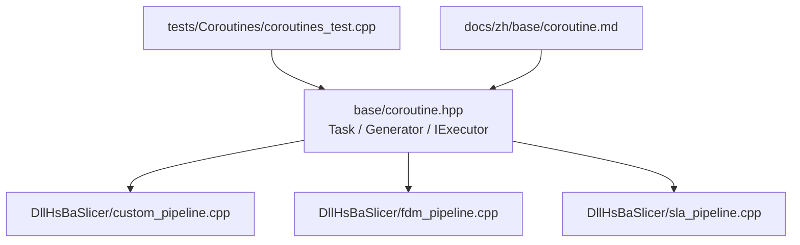
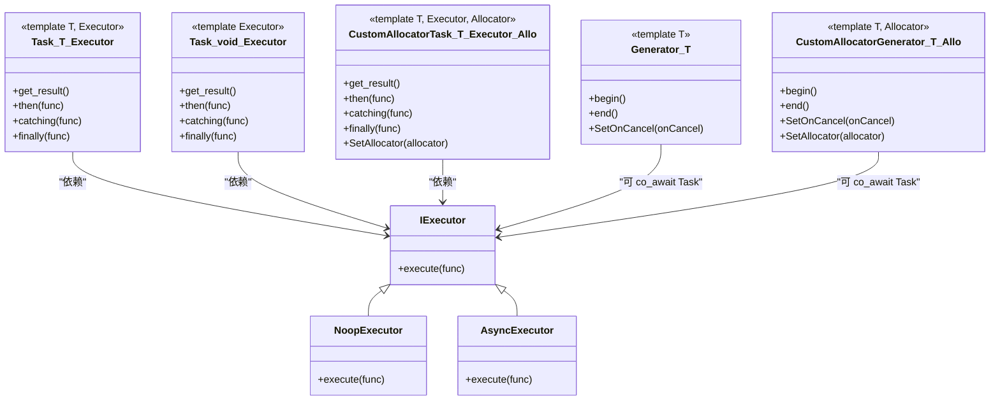
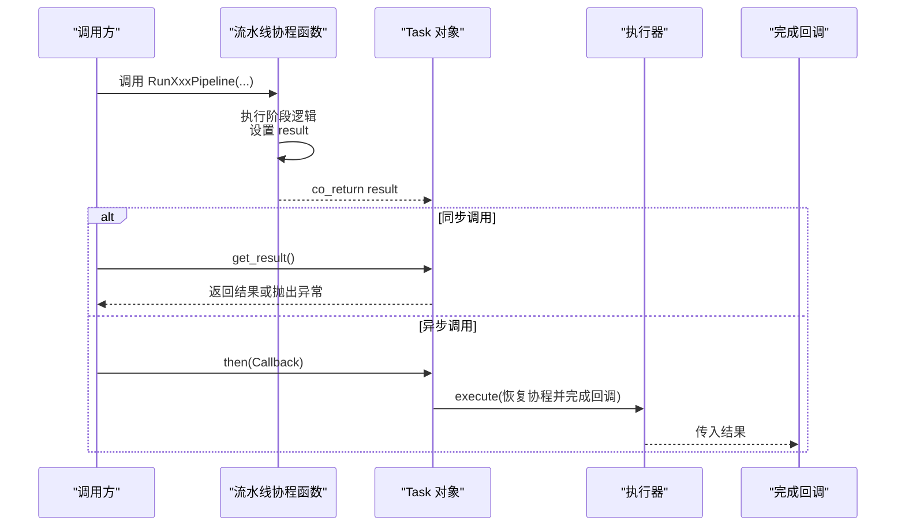
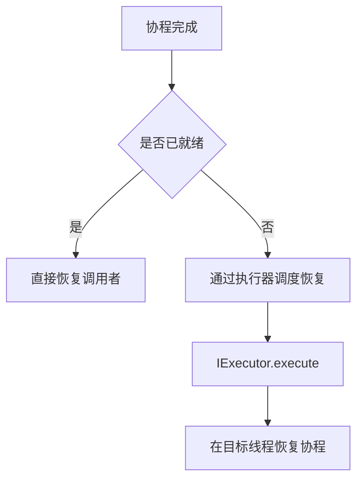
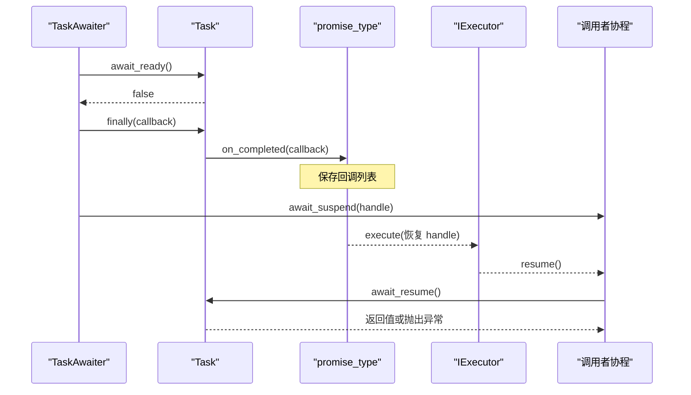
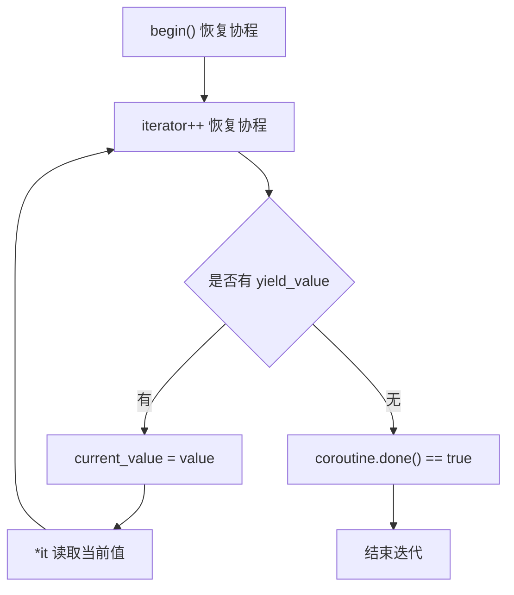
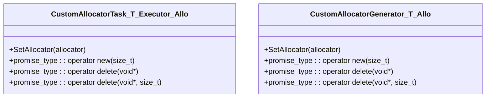
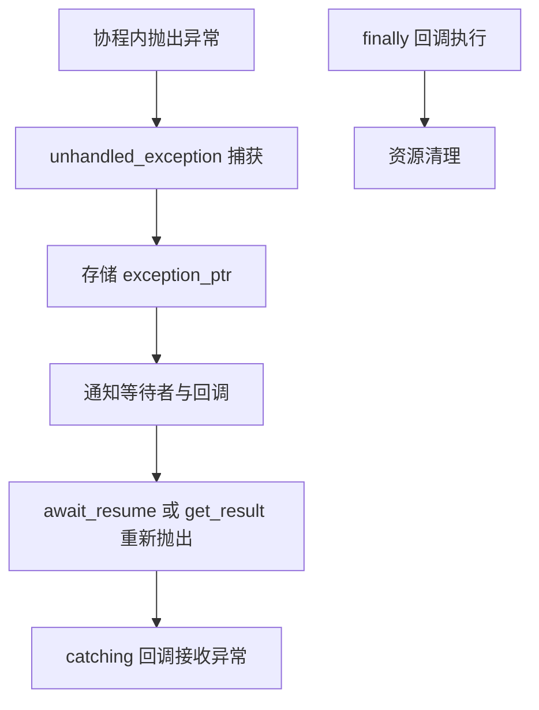
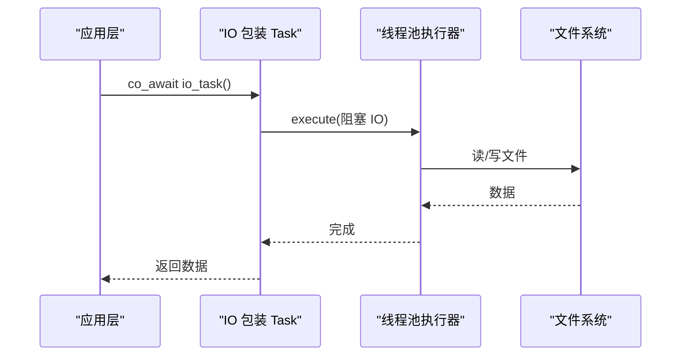

# 协程支持

<cite>
**本文引用的文件**   
- [base/coroutine.hpp](file://base/coroutine.hpp)
- [tests/Coroutines/coroutines_test.cpp](file://tests/Coroutines/coroutines_test.cpp)
- [docs/zh/base/coroutine.md](file://docs/zh/base/coroutine.md)
- [DllHsBaSlicer/custom_pipeline.cpp](file://DllHsBaSlicer/custom_pipeline.cpp)
- [DllHsBaSlicer/fdm_pipeline.cpp](file://DllHsBaSlicer/fdm_pipeline.cpp)
- [DllHsBaSlicer/sla_pipeline.cpp](file://DllHsBaSlicer/sla_pipeline.cpp)
</cite>

## 目录
1. [引言](#引言)
2. [项目结构中的协程位置](#项目结构中的协程位置)
3. [核心概念与类型](#核心概念与类型)
4. [架构总览：协程如何驱动流水线](#架构总览协程如何驱动流水线)
5. [详细组件分析](#详细组件分析)
6. [生命周期、异常处理与资源清理](#生命周期异常处理与资源清理)
7. [与异步 IO 的集成方式](#与异步-io的集成方式)
8. [并发数据处理、网络请求与文件操作示例思路](#并发数据处理网络请求与文件操作示例思路)
9. [性能特点与优化建议](#性能特点与优化建议)
10. [调试技巧与常见问题](#调试技巧与常见问题)
11. [与传统多线程方式的对比和选择原则](#与传统多线程方式的对比和选择原则)
12. [结论](#结论)

## 引言
本技术文档聚焦 HsBaSlicer 中 C++20 协程的支持与使用。仓库在 `base/coroutine.hpp` 中实现了任务型协程 `Task`、生成器 `Generator`、执行器抽象 `IExecutor`，以及自定义分配器的协程变体；在 `DllHsBaSlicer` 下的多个流水线函数中使用 `co_return` 暴露异步能力，并通过 `Task::get_result()` 或链式回调对外提供同步与异步两种调用方式。测试用例位于 `tests/Coroutines/coroutines_test.cpp`，中文使用说明位于 `docs/zh/base/coroutine.md`。

## 项目结构中的协程位置
- 协程基础设施：`base/coroutine.hpp`
- 协程单元测试：`tests/Coroutines/coroutines_test.cpp`
- 协程中文文档：`docs/zh/base/coroutine.md`
- 协程在流水线中的实际使用：`DllHsBaSlicer/custom_pipeline.cpp`、`fdm_pipeline.cpp`、`sla_pipeline.cpp`

**图表来源**
- [base/coroutine.hpp:41-773](file://base/coroutine.hpp#L41-L773)
- [tests/Coroutines/coroutines_test.cpp:1-244](file://tests/Coroutines/coroutines_test.cpp#L1-L244)
- [docs/zh/base/coroutine.md:1-257](file://docs/zh/base/coroutine.md#L1-L257)
- [DllHsBaSlicer/custom_pipeline.cpp:120-213](file://DllHsBaSlicer/custom_pipeline.cpp#L120-L213)
- [DllHsBaSlicer/fdm_pipeline.cpp:230-429](file://DllHsBaSlicer/fdm_pipeline.cpp#L230-L429)
- [DllHsBaSlicer/sla_pipeline.cpp:310-509](file://DllHsBaSlicer/sla_pipeline.cpp#L310-L509)

**章节来源**
- [base/coroutine.hpp:41-773](file://base/coroutine.hpp#L41-L773)
- [tests/Coroutines/coroutines_test.cpp:1-244](file://tests/Coroutines/coroutines_test.cpp#L1-L244)
- [docs/zh/base/coroutine.md:1-257](file://docs/zh/base/coroutine.md#L1-L257)
- [DllHsBaSlicer/custom_pipeline.cpp:120-213](file://DllHsBaSlicer/custom_pipeline.cpp#L120-L213)
- [DllHsBaSlicer/fdm_pipeline.cpp:230-429](file://DllHsBaSlicer/fdm_pipeline.cpp#L230-L429)
- [DllHsBaSlicer/sla_pipeline.cpp:310-509](file://DllHsBaSlicer/sla_pipeline.cpp#L310-L509)

## 核心概念与类型
- 执行器接口与实现
  - `IExecutor`：定义统一的协程任务执行入口。
  - `NoopExecutor`：在当前线程直接执行回调，适合测试或不需要真正并发的场景。
  - `AsyncExecutor`：基于 `std::async` 将回调投递到异步执行环境。
- 任务类型
  - `Task<T, Executor>`：通用返回值类型为 `T` 的任务协程封装。
  - `Task<void, Executor>`：无返回值的任务特化。
  - `CustomAllocatorTask<T, Executor, Allocator>`：允许通过自定义分配器管理协程 promise 内存。
- 等待器
  - `TaskAwaiter`：用于 `co_await Task`。
  - `CustomAllocatorTaskAwaiter`：用于 `co_await CustomAllocatorTask`。
  - `DispatchAwaiter`：用于 `initial_suspend`，让协程首次挂起后由执行器恢复。
- 生成器
  - `Generator<T>`：惰性迭代器风格的协程生成器，支持 `co_yield`。
  - `CustomAllocatorGenerator<T, Allocator>`：带自定义分配器的生成器。
  - `GeneratorInvoke`：对容器进行惰性映射，返回 `Generator`。
- 结果与回调
  - `Task::Result`：封装值或异常指针，提供 `get_or_throw()`。
  - `then` / `catching` / `finally`：链式回调接口。
  - `on_completed`：注册完成回调，内部使用互斥量与条件变量保证线程安全。

**图表来源**
- [base/coroutine.hpp:47-773](file://base/coroutine.hpp#L47-L773)
- [base/coroutine.hpp:784-1042](file://base/coroutine.hpp#L784-L1042)

**章节来源**
- [base/coroutine.hpp:47-773](file://base/coroutine.hpp#L47-L773)
- [base/coroutine.hpp:784-1042](file://base/coroutine.hpp#L784-L1042)

## 架构总览：协程如何驱动流水线
HsBaSlicer 的多个流水线函数被设计为协程函数，内部通过 `co_return` 返回结构化结果，并在 C API 层通过 `Task::get_result()` 阻塞等待结果，或通过 `task.then(...)` 注册异步回调。典型流程如下：

**图表来源**
- [DllHsBaSlicer/custom_pipeline.cpp:176-200](file://DllHsBaSlicer/custom_pipeline.cpp#L176-L200)
- [DllHsBaSlicer/sla_pipeline.cpp:496-509](file://DllHsBaSlicer/sla_pipeline.cpp#L496-L509)
- [base/coroutine.hpp:234-382](file://base/coroutine.hpp#L234-L382)
- [base/coroutine.hpp:414-555](file://base/coroutine.hpp#L414-L555)

**章节来源**
- [DllHsBaSlicer/custom_pipeline.cpp:176-200](file://DllHsBaSlicer/custom_pipeline.cpp#L176-L200)
- [DllHsBaSlicer/sla_pipeline.cpp:496-509](file://DllHsBaSlicer/sla_pipeline.cpp#L496-L509)
- [base/coroutine.hpp:234-382](file://base/coroutine.hpp#L234-L382)
- [base/coroutine.hpp:414-555](file://base/coroutine.hpp#L414-L555)

## 详细组件分析

### 执行器体系
- `IExecutor` 是统一抽象，所有协程任务的最终恢复都通过其 `execute` 方法。
- `NoopExecutor` 直接调用回调，常用于测试或单线程验证。
- `AsyncExecutor` 使用 `std::async` 创建异步任务，适合需要后台执行的场景。

**图表来源**
- [base/coroutine.hpp:47-70](file://base/coroutine.hpp#L47-L70)
- [base/coroutine.hpp:99-105](file://base/coroutine.hpp#L99-L105)
- [base/coroutine.hpp:184-198](file://base/coroutine.hpp#L184-L198)

**章节来源**
- [base/coroutine.hpp:47-70](file://base/coroutine.hpp#L47-L70)
- [base/coroutine.hpp:184-198](file://base/coroutine.hpp#L184-L198)

### Task 与 TaskAwaiter
- `Task<T, Executor>` 的 `promise_type` 定义了协程生命周期钩子：
  - `initial_suspend`：返回 `DispatchAwaiter`，使协程初始挂起并由执行器恢复。
  - `final_suspend`：返回 `std::suspend_always`，确保协程完成后不会立即销毁。
  - `return_value` / `unhandled_exception`：保存结果或异常，通知等待者与回调。
- `TaskAwaiter` 在 `await_suspend` 中注册 `finally` 回调，当任务完成时通过执行器恢复调用者的协程。
- `Task` 提供 `then`、`catching`、`finally` 等链式回调，内部委托给 `promise_type::on_completed`。

**图表来源**
- [base/coroutine.hpp:81-122](file://base/coroutine.hpp#L81-L122)
- [base/coroutine.hpp:234-316](file://base/coroutine.hpp#L234-L316)
- [base/coroutine.hpp:322-359](file://base/coroutine.hpp#L322-L359)

**章节来源**
- [base/coroutine.hpp:81-122](file://base/coroutine.hpp#L81-L122)
- [base/coroutine.hpp:234-316](file://base/coroutine.hpp#L234-L316)
- [base/coroutine.hpp:322-359](file://base/coroutine.hpp#L322-L359)

### Generator 与 GeneratorInvoke
- `Generator<T>` 的 `promise_type` 提供 `yield_value`，每次产生一个值并挂起；`initial_suspend` 与 `final_suspend` 均返回 `std::suspend_always`，使其行为类似惰性序列。
- `Generator` 的迭代器在 `operator++` 中恢复协程，直到 `done()` 为真。
- `GeneratorInvoke` 在协程可用时返回惰性 `Generator`，否则回退为普通容器映射。

**图表来源**
- [base/coroutine.hpp:784-893](file://base/coroutine.hpp#L784-L893)
- [base/coroutine.hpp:1052-1061](file://base/coroutine.hpp#L1052-L1061)

**章节来源**
- [base/coroutine.hpp:784-893](file://base/coroutine.hpp#L784-L893)
- [base/coroutine.hpp:1052-1061](file://base/coroutine.hpp#L1052-L1061)

### 自定义分配器协程
- `CustomAllocatorTask` 与 `CustomAllocatorGenerator` 在 `promise_type` 中重载 `operator new/delete`，使用静态分配器实例分配协程状态。
- 通过 `SetAllocator` 设置全局分配器，便于在特定内存池或追踪环境中运行协程。

**图表来源**
- [base/coroutine.hpp:563-772](file://base/coroutine.hpp#L563-L772)
- [base/coroutine.hpp:901-1042](file://base/coroutine.hpp#L901-L1042)

**章节来源**
- [base/coroutine.hpp:563-772](file://base/coroutine.hpp#L563-L772)
- [base/coroutine.hpp:901-1042](file://base/coroutine.hpp#L901-L1042)

## 生命周期、异常处理与资源清理
- 生命周期
  - `Task` 析构时会销毁持有的协程句柄，避免悬挂。
  - `Generator` 析构时同样销毁协程句柄。
  - `final_suspend` 返回挂起类型，确保协程完成后再销毁。
- 异常处理
  - `promise_type::unhandled_exception` 捕获未处理异常，存入 `Result`，并在 `get_result()` 或 `await_resume()` 时重新抛出。
  - `catching` 回调可在不中断主流程的情况下记录异常。
  - `Generator` 的 `unhandled_exception` 会先调用取消回调，再抛出运行时异常。
- 资源清理
  - `finally` 回调无论成功或失败都会执行，适合释放临时资源。
  - 自定义分配器协程通过重载分配器确保 promise 内存按策略回收。

**图表来源**
- [base/coroutine.hpp:242-255](file://base/coroutine.hpp#L242-L255)
- [base/coroutine.hpp:338-359](file://base/coroutine.hpp#L338-L359)
- [base/coroutine.hpp:422-435](file://base/coroutine.hpp#L422-L435)
- [base/coroutine.hpp:822-827](file://base/coroutine.hpp#L822-L827)

**章节来源**
- [base/coroutine.hpp:242-255](file://base/coroutine.hpp#L242-L255)
- [base/coroutine.hpp:338-359](file://base/coroutine.hpp#L338-L359)
- [base/coroutine.hpp:422-435](file://base/coroutine.hpp#L422-L435)
- [base/coroutine.hpp:822-827](file://base/coroutine.hpp#L822-L827)

## 与异步 IO 的集成方式
当前仓库中的协程主要用于计算密集型流水线（模型加载、切片、支撑、填充、路径生成、导出），IO 多为同步调用（如 Lua 脚本执行、文件读写）。若要与真正的异步 IO 集成，推荐以下模式：
- 将阻塞 IO 包装为 `Task`，并使用 `AsyncExecutor` 或自定义线程池执行器。
- 在协程中使用 `co_await` 等待 IO 任务完成，保持代码线性可读。
- 对于大量并发 IO，建议使用线程池执行器替代 `std::async`，以避免线程爆炸。

[此图为概念性流程图，不直接对应具体源码文件]

## 并发数据处理、网络请求与文件操作示例思路
- 并发数据处理
  - 使用 `GeneratorInvoke` 对输入容器进行惰性映射，结合 `ParallelForLayers` 在流水线中进行并行切片与填充。
  - 参考 `fdm_pipeline.cpp` 中对每层轮廓、填充、支撑的并行处理。
- 网络请求
  - 将 HTTP 客户端调用封装为 `Task<std::string, Executor>`，在协程中 `co_await` 获取响应。
  - 使用 `AsyncExecutor` 或自定义网络执行器，避免阻塞主线程。
- 文件操作
  - 将大文件分块读取封装为 `Generator<std::vector<char>>`，逐块处理以降低内存峰值。
  - 使用 `finally` 确保文件句柄关闭。

[本节为方法论说明，不直接引用具体源码行]

## 性能特点与优化建议
- 优点
  - 协程提供轻量级控制流，避免传统线程上下文切换开销。
  - `Task` 的链式回调简化异步编排，减少回调地狱。
  - 自定义分配器协程可与内存池集成，降低碎片化。
- 注意事项
  - `AsyncExecutor` 默认使用 `std::async`，可能创建较多线程；在高并发 IO 场景中应替换为固定大小线程池。
  - `TaskAwaiter` 在 `await_suspend` 中注册 `finally` 回调，频繁创建小任务会带来额外分配成本。
  - `Generator` 的迭代器在每次 `operator++` 中恢复协程，应避免在热点路径中过度迭代。
- 优化建议
  - 对批量 IO 使用线程池执行器。
  - 复用 `Task` 与 `Generator` 对象，减少临时对象分配。
  - 使用 `CustomAllocatorTask` 与 `CustomAllocatorGenerator` 对接项目内存池。

[本节为通用性能指导，不直接引用具体源码行]

## 调试技巧与常见问题
- 调试技巧
  - 使用 `NoopExecutor` 在单线程下验证协程逻辑，排除执行器相关干扰。
  - 通过 `catching` 回调记录异常信息，配合日志系统定位问题。
  - 在 `finally` 中打印关键资源状态，确认清理逻辑是否执行。
- 常见问题
  - 协程未正确等待：忘记调用 `get_result()` 或未注册 `then` 回调，导致任务未完成即退出。
  - 异常未传播：未在 `get_result()` 处捕获异常，或在 `catching` 中吞掉异常但未记录。
  - 生成器提前终止：迭代过程中抛出异常，触发 `unhandled_exception` 并调用取消回调。
  - 执行器选择错误：误用 `NoopExecutor` 导致阻塞，影响 UI 或主循环。

**章节来源**
- [tests/Coroutines/coroutines_test.cpp:91-242](file://tests/Coroutines/coroutines_test.cpp#L91-L242)
- [base/coroutine.hpp:338-359](file://base/coroutine.hpp#L338-L359)
- [base/coroutine.hpp:822-827](file://base/coroutine.hpp#L822-L827)

## 与传统多线程方式的对比和选择原则
- 协程优势
  - 代码结构更清晰，异步逻辑以同步风格编写。
  - 更适合顺序依赖的异步步骤，如流水线各阶段。
  - 与现有 C++20 标准库特性（`co_await`）结合良好。
- 多线程优势
  - 天然适合独立且无共享状态的并行任务。
  - 成熟度高，生态完善。
- 选择原则
  - 若任务存在强顺序依赖且需逐步推进，优先使用协程。
  - 若任务彼此独立且可完全并行，优先考虑线程池或并行算法。
  - 混合场景：用协程编排高层流程，底层 IO 或计算任务交给线程池执行。

[本节为概念性对比，不直接引用具体源码行]

## 结论
HsBaSlicer 的协程支持以 `Task` 与 `Generator` 为核心，结合执行器抽象与自定义分配器，提供了灵活、可扩展的异步编程基础。流水线函数通过 `co_return` 暴露结果，并在 C API 层提供同步与异步两种调用方式。在实际工程中，建议根据任务特征选择合适的执行器，结合线程池与内存池优化性能，并通过链式回调与异常处理机制提升可维护性与可观测性。