# IModel 接口抽象

<cite>
**本文引用的文件**   
- [IModel.hpp](file://base/IModel.hpp)
- [ModelFormat.hpp](file://base/ModelFormat.hpp)
- [ModelFormat.cpp](file://base/ModelFormat.cpp)
- [IglModel.hpp](file://meshmodel/IglModel.hpp)
- [OcctModel.hpp](file://cadmodel/OcctModel.hpp)
- [OpenVdbModel.hpp](file://pointcloud/OpenVdbModel.hpp)
- [UserCustomPointCloudModel.hpp](file://pointcloud/UserCustomPointCloudModel.hpp)
- [UserCustomCADModel.hpp](file://cadmodel/UserCustomCADModel.hpp)
- [full_topo_model_test.cpp](file://tests/Models/full_topo_model_test.cpp)
</cite>

## 目录
1. [引言](#引言)
2. [项目结构定位](#项目结构定位)
3. [核心概念：IModel 统一模型抽象](#核心概念imodel-统一模型抽象)
4. [架构总览：IModel 与具体模型实现](#架构总览imodel-与具体模型实现)
5. [文件格式与 ModelFormat 枚举](#文件格式与-modelformat-枚举)
6. [C ABI 暴露的数据结构](#c-abi-暴露的数据结构)
7. [API 参考：IModel 接口方法](#api-参考imodel-接口方法)
8. [详细组件分析](#详细组件分析)
9. [自定义模型类型扩展指南](#自定义模型类型扩展指南)
10. [依赖关系分析](#依赖关系分析)
11. [性能考虑](#性能考虑)
12. [线程安全建议](#线程安全建议)
13. [常见问题与排错](#常见问题与排错)
14. [结论](#结论)

## 引言
IModel 是 HsBaSlicer 中 3D 模型的统一抽象接口。它把“加载保存、几何变换、边界框、体积、三角网格提取”等共性能力收敛到一个稳定契约上，使上层切片、布尔运算、路径生成等模块不必关心底层是三角网格、CAD BRep、还是点云体素数据。

从设计角度看，IModel 同时承担两个角色：
- C++ 内部多态基类：所有模型类型都继承 IModel，从而可以用 `std::shared_ptr<IModel>` 统一管理。
- C ABI 数据契约载体：通过 `extern "C"` 暴露的 `HsBaVector2f`、`HsBaVector3f`、`HsBaQuaternionf`、`HsBaMatrix4f`、`HsBaPoly2D` 等结构，为插件、脚本语言或外部二进制接口提供稳定的跨语言数据结构。

## 项目结构定位
IModel 相关代码主要分布在以下位置：
- 抽象接口与格式定义：`base/IModel.hpp`、`base/ModelFormat.hpp`、`base/ModelFormat.cpp`
- 三角网格实现：`meshmodel/IglModel.hpp`
- CAD/BRep 实现：`cadmodel/OcctModel.hpp`
- 点云/体素实现：`pointcloud/OpenVdbModel.hpp`
- 用户自定义点云模型：`pointcloud/UserCustomPointCloudModel.hpp`
- 用户自定义 CAD 模型：`cadmodel/UserCustomCADModel.hpp`
- 测试中的最小 IModel 实现示例：`tests/Models/full_topo_model_test.cpp`

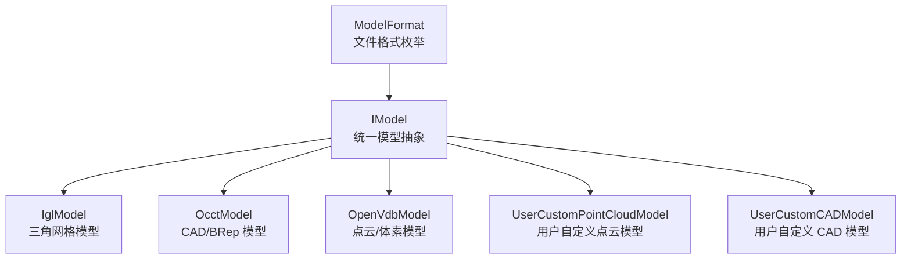

**图表来源**
- [IModel.hpp:111-139](file://base/IModel.hpp#L111-L139)
- [IglModel.hpp:26-121](file://meshmodel/IglModel.hpp#L26-L121)
- [OcctModel.hpp:30-124](file://cadmodel/OcctModel.hpp#L30-L124)
- [OpenVdbModel.hpp:28-116](file://pointcloud/OpenVdbModel.hpp#L28-L116)
- [UserCustomPointCloudModel.hpp:96-171](file://pointcloud/UserCustomPointCloudModel.hpp#L96-L171)
- [UserCustomCADModel.hpp:79-121](file://cadmodel/UserCustomCADModel.hpp#L79-L121)

**章节来源**
- [IModel.hpp:1-151](file://base/IModel.hpp#L1-L151)
- [ModelFormat.hpp:1-116](file://base/ModelFormat.hpp#L1-L116)
- [ModelFormat.cpp:1-176](file://base/ModelFormat.cpp#L1-L176)

## 核心概念：IModel 统一模型抽象
IModel 是一个纯虚接口，定义了所有 3D 模型必须实现的最低能力集合。其核心职责包括：

| 能力类别 | 接口方法 | 语义说明 |
|---|---|---|
| 文件 I/O | `Load(fileName)` | 从文件加载模型；返回是否成功 |
| 文件 I/O | `Save(fileName, format)` | 按指定格式保存模型；返回是否成功 |
| 平移 | `Translate(translation)` | 沿三维向量平移模型 |
| 旋转 | `Rotate(rotation)` | 使用四元数旋转模型 |
| 缩放 | `Scale(scale)` | 均匀缩放 |
| 缩放 | `Scale(scale_vector)` | 按轴非均匀缩放 |
| 变换 | `Transform(isometry)` | 应用刚体变换 |
| 变换 | `Transform(matrix4)` | 应用 4x4 齐次矩阵变换 |
| 变换 | `Transform(affine)` | 应用仿射变换 |
| 边界框 | `BoundingBox(min, max)` | 输出轴对齐包围盒的最小点和最大点 |
| 体积 | `Volume()` | 返回模型体积（对点云可能为近似值） |
| 三角网格 | `TriangleMesh()` | 返回 libigl 风格的顶点矩阵和面片索引矩阵 |

IModel 的设计强调“行为统一、实现多样”。上层系统可以只面向 IModel 编程，而不需要知道当前模型是 STL 三角网格、STEP CAD 实体，还是 VDB 点云。

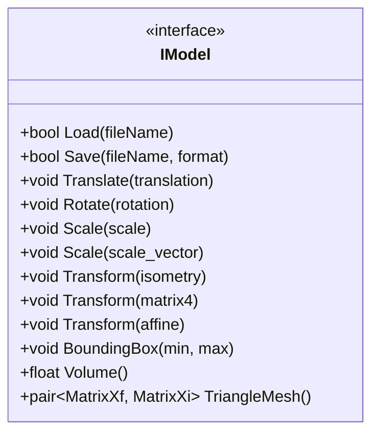

**图表来源**
- [IModel.hpp:111-139](file://base/IModel.hpp#L111-L139)

**章节来源**
- [IModel.hpp:111-139](file://base/IModel.hpp#L111-L139)

## 架构总览：IModel 与具体模型实现
HsBaSlicer 目前提供了多种 IModel 实现，覆盖不同数据形态和下游用途：

| 实现类 | 数据形态 | 典型用途 | 关键特点 |
|---|---|---|---|
| `IglModel` | 三角网格（顶点+三角形面） | 通用网格处理、布尔运算、法线计算、基础几何体创建 | 基于 Eigen 存储，支持 STL/OBJ/PLY/OFF 等网格格式 |
| `OcctModel` | CAD BRep 拓扑形状 | STEP/IGES/VRML/BREP 读取、CAD 布尔操作、壳厚度操作 | 基于 OCCT TopoDS_Shape，可 tessellate 成三角网格 |
| `OpenVdbModel` | 点云/体素网格 | 点云导入导出、KNN/半径查询、体素化、重建三角网格 | 基于 OpenVDB，适合大规模点云和 level set 重建 |
| `UserCustomPointCloudModel` | 用户插件点云内核 | 通过 DLL/SO 扩展点云能力 | 通过 C ABI 函数指针调用外部实现 |
| `UserCustomCADModel` | 用户插件 CAD 内核 | 通过 DLL/SO 扩展 CAD 能力 | 支持布尔操作、变换、体积、三角网格导出 |

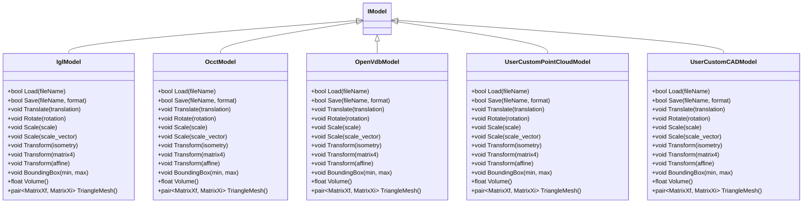

**图表来源**
- [IModel.hpp:111-139](file://base/IModel.hpp#L111-L139)
- [IglModel.hpp:26-121](file://meshmodel/IglModel.hpp#L26-L121)
- [OcctModel.hpp:30-124](file://cadmodel/OcctModel.hpp#L30-L124)
- [OpenVdbModel.hpp:28-116](file://pointcloud/OpenVdbModel.hpp#L28-L116)
- [UserCustomPointCloudModel.hpp:96-171](file://pointcloud/UserCustomPointCloudModel.hpp#L96-L171)
- [UserCustomCADModel.hpp:79-121](file://cadmodel/UserCustomCADModel.hpp#L79-L121)

**章节来源**
- [IglModel.hpp:26-121](file://meshmodel/IglModel.hpp#L26-L121)
- [OcctModel.hpp:30-124](file://cadmodel/OcctModel.hpp#L30-L124)
- [OpenVdbModel.hpp:28-116](file://pointcloud/OpenVdbModel.hpp#L28-L116)
- [UserCustomPointCloudModel.hpp:96-171](file://pointcloud/UserCustomPointCloudModel.hpp#L96-L171)
- [UserCustomCADModel.hpp:79-121](file://cadmodel/UserCustomCADModel.hpp#L79-L121)

## 文件格式与 ModelFormat 枚举
`ModelFormat` 枚举用于标识模型的文件格式，并配合 `ModelFormat.hpp` 与 `ModelFormat.cpp` 提供的工具函数完成字符串转换、扩展名识别和格式分类。

### 支持的格式分组
| 分组 | 枚举值 | 说明 |
|---|---|---|
| 网格格式 | `UnknownPLY`、`ASCIIPLY`、`BinaryPLY` | PLY 未知/ASCII/二进制 |
| 网格格式 | `OBJ` | OBJ 网格 |
| 网格格式 | `UnknownSTL`、`ASCIISTL`、`BinarySTL` | STL 未知/ASCII/二进制 |
| 网格格式 | `OFF` | OFF 网格 |
| BRep/CAD 格式 | `VRML` | VRML/WRL |
| BRep/CAD 格式 | `STEP` | STEP 标准交换格式 |
| BRep/CAD 格式 | `IGES` | IGES 工业图形交换格式 |
| BRep/CAD 格式 | `BREP` | OpenCASCADE 原生 BRep |
| CSG 格式 | `SLDPRT` | SolidWorks 零件 |
| CSG 格式 | `CATPART` | CATIA 零件 |
| 点云格式 | `XYZ` | XYZ 点坐标 |
| 点云格式 | `VDB` | OpenVDB 体素/点云 |
| 未知 | `Unknown` | 不支持或无法识别 |

### 格式判断工具
- `ToString(format)`：将枚举转为可读字符串。
- `GetExtName(file_name)`：从文件名提取扩展名。
- `ModelTypeFromExtName(file_name)`：根据扩展名推断 `ModelFormat`。
- `IsMeshFormat(...)` / `IsBrepFormat(...)` / `IsCSGFormat(...)` / `IsPointCloudFormat(...)`：按格式或文件名判断类型。

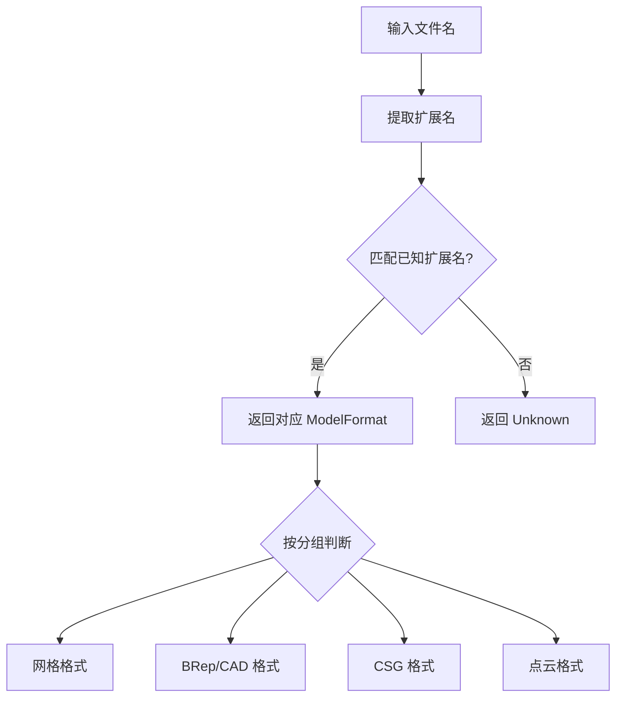

**图表来源**
- [ModelFormat.hpp:23-93](file://base/ModelFormat.hpp#L23-L93)
- [ModelFormat.cpp:14-85](file://base/ModelFormat.cpp#L14-L85)
- [ModelFormat.cpp:101-175](file://base/ModelFormat.cpp#L101-L175)

**章节来源**
- [IModel.hpp:66-109](file://base/IModel.hpp#L66-L109)
- [ModelFormat.hpp:19-114](file://base/ModelFormat.hpp#L19-L114)
- [ModelFormat.cpp:14-175](file://base/ModelFormat.cpp#L14-L175)

## C ABI 暴露的数据结构
在 `extern "C"` 块中，IModel 头文件定义了供 C 语言、脚本绑定或外部插件使用的数据结构。这些结构不依赖 C++ 对象布局，便于跨语言传递。

| 结构名 | 字段 | 用途 |
|---|---|---|
| `HsBaVector2f_t` | `x`, `y` | 二维浮点向量 |
| `HsBaVector3f_t` | `x`, `y`, `z` | 三维浮点向量 |
| `HsBaQuaternionf_t` | `x`, `y`, `z`, `w` | 四维浮点四元数 |
| `HsBaMatrix4f_t` | `m[4][4]` | 4x4 浮点矩阵 |
| `HsBaPoly2D_t` | `vertices`, `vertexCount` | 二维多边形顶点数组及数量 |
| `HsBaPolys2D_t` | `polygons`, `vertexCount` | 多个二维多边形数组及数量 |

这些结构通常用于：
- 向 Lua、Python、C# 或其他语言暴露几何数据。
- 在用户自定义插件中传递点、向量、变换矩阵和多边形。
- 作为 C ABI 层与 C++ 内部 Eigen/EigenGeometry 类型之间的桥接。

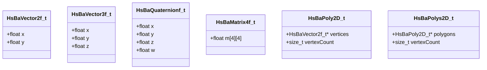

**图表来源**
- [IModel.hpp:19-61](file://base/IModel.hpp#L19-L61)

**章节来源**
- [IModel.hpp:19-61](file://base/IModel.hpp#L19-L61)

## API 参考：IModel 接口方法
以下是对 IModel 核心方法的规范化说明。为避免直接粘贴源码，这里以“方法签名 + 行为说明 + 返回值约定”的方式描述。

### 文件加载与保存
- `bool Load(std::string_view fileName)`
  - 参数：文件路径。
  - 行为：从磁盘加载模型数据；具体解析逻辑由实现类决定。
  - 返回：成功返回 true，失败返回 false。
- `bool Save(std::string_view fileName, const ModelFormat format) const`
  - 参数：目标文件路径、目标格式。
  - 行为：将模型序列化为指定格式。
  - 返回：成功返回 true，失败返回 false。

### 几何变换
- `void Translate(const Eigen::Vector3f& translation)`
  - 行为：沿三维向量平移模型。
- `void Rotate(const Eigen::Quaternionf& rotation)`
  - 行为：使用单位四元数旋转模型。
- `void Scale(const float scale)`
  - 行为：各轴统一缩放。
- `void Scale(const Eigen::Vector3f& scale)`
  - 行为：按 x/y/z 分别缩放。
- `void Transform(const Eigen::Isometry3f& transform)`
  - 行为：应用刚体变换（旋转+平移）。
- `void Transform(const Eigen::Matrix4f& transform)`
  - 行为：应用 4x4 齐次变换矩阵。
- `void Transform(const Eigen::Transform<float, 3, Eigen::Affine>& transform)`
  - 行为：应用仿射变换。

### 几何查询
- `void BoundingBox(Eigen::Vector3f& min, Eigen::Vector3f& max) const`
  - 行为：计算轴对齐包围盒，填充最小点和最大点。
- `float Volume() const`
  - 行为：返回模型体积；对封闭网格通常为精确值，对点云可能是近似值或 0。
- `std::pair<Eigen::MatrixXf, Eigen::MatrixXi> TriangleMesh() const`
  - 行为：返回 libigl 风格三角网格：第一个矩阵为 N×3 顶点，第二个矩阵为 M×3 三角形索引。

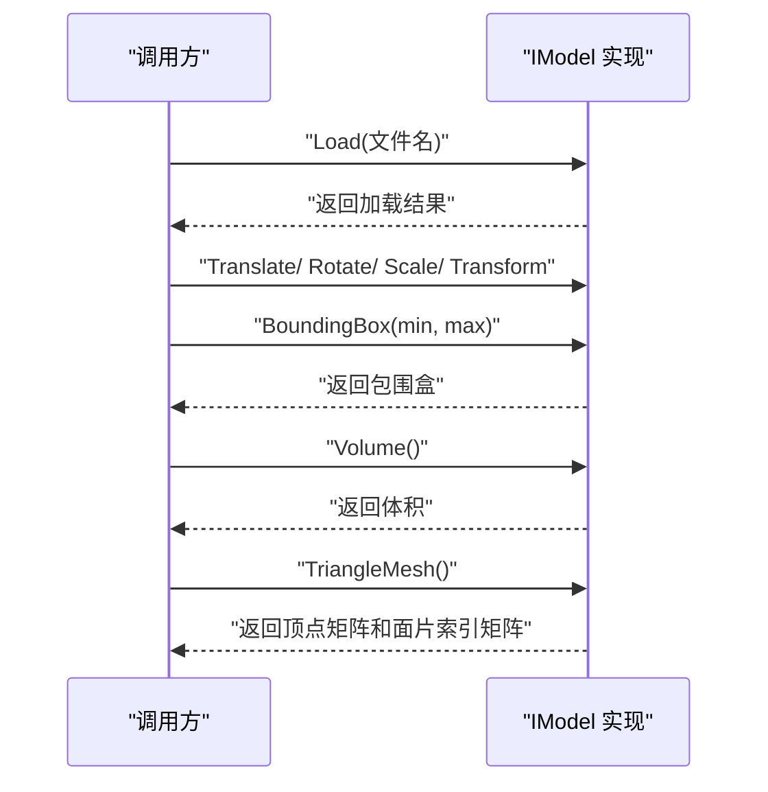

**图表来源**
- [IModel.hpp:111-139](file://base/IModel.hpp#L111-L139)

**章节来源**
- [IModel.hpp:111-139](file://base/IModel.hpp#L111-L139)

## 详细组件分析

### IglModel：三角网格模型
IglModel 是基于 Eigen 存储的三角网格实现，适合大多数网格处理任务。它实现了 IModel 的全部方法，并提供：
- 从顶点/面片构造网格。
- 加载/保存常见网格格式。
- 平移、旋转、缩放、变换。
- 计算法线、体积、包围盒。
- 布尔运算和基础几何体工厂方法。

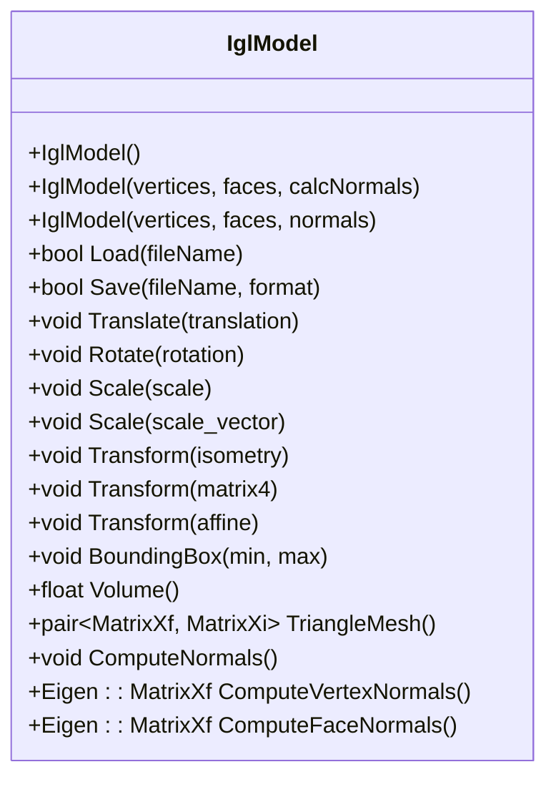

**图表来源**
- [IglModel.hpp:26-121](file://meshmodel/IglModel.hpp#L26-L121)

**章节来源**
- [IglModel.hpp:26-121](file://meshmodel/IglModel.hpp#L26-L121)

### OcctModel：CAD/BRep 模型
OcctModel 封装 OCCT 的 `TopoDS_Shape`，主要用于 STEP、IGES、VRML、BREP 等 CAD 格式。它除了实现 IModel 外，还提供：
- 添加子形状到复合形状。
- CAD 布尔运算。
- 壳厚度操作。
- 将 CAD 形状 tessellate 为三角网格。

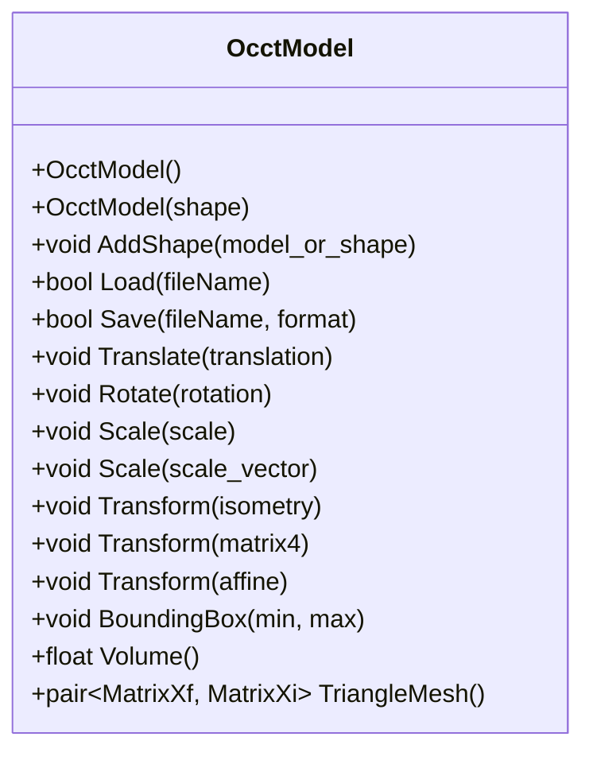

**图表来源**
- [OcctModel.hpp:30-124](file://cadmodel/OcctModel.hpp#L30-L124)

**章节来源**
- [OcctModel.hpp:30-124](file://cadmodel/OcctModel.hpp#L30-L124)

### OpenVdbModel：点云/体素模型
OpenVdbModel 基于 OpenVDB 体素网格，适合大规模点云数据。它实现 IModel 的同时，提供大量点云专用 API：
- 插入点、批量插入点。
- 查询最近邻、KNN、半径搜索。
- 体素化、下采样、统计离群点移除。
- 从点云重建三角网格。

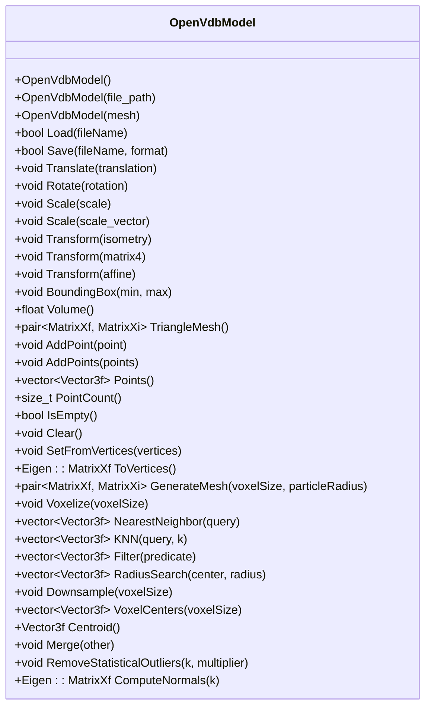

**图表来源**
- [OpenVdbModel.hpp:28-116](file://pointcloud/OpenVdbModel.hpp#L28-L116)

**章节来源**
- [OpenVdbModel.hpp:28-116](file://pointcloud/OpenVdbModel.hpp#L28-L116)

### UserCustomPointCloudModel：用户自定义点云模型
该类允许通过动态库加载用户实现的点云内核，并通过 C ABI 函数指针调用。它对外暴露与 OpenVdbModel 一致的点云 API，但实际计算由外部插件完成。

关键点：
- `LoadDll(dllPath, addedFunName)`：加载插件动态库。
- `UnloadDll()`：卸载插件。
- 所有 IModel 方法委托给底层插件模型。

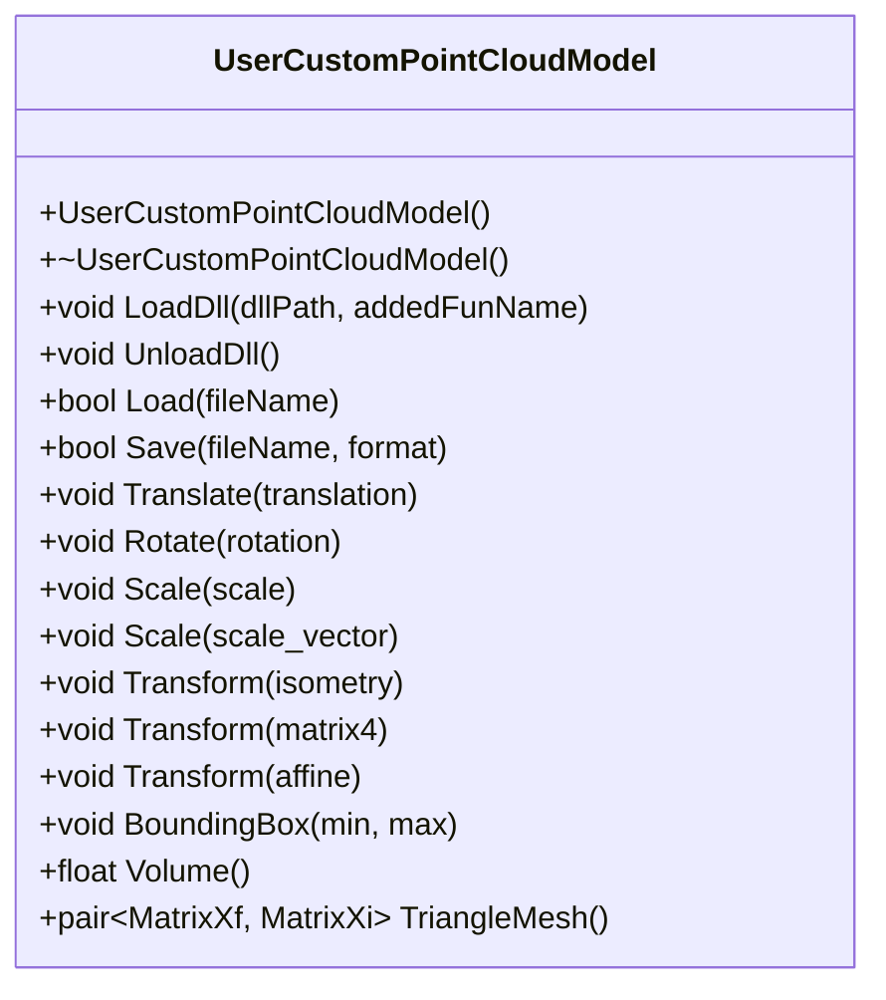

**图表来源**
- [UserCustomPointCloudModel.hpp:96-171](file://pointcloud/UserCustomPointCloudModel.hpp#L96-L171)

**章节来源**
- [UserCustomPointCloudModel.hpp:96-171](file://pointcloud/UserCustomPointCloudModel.hpp#L96-L171)

### UserCustomCADModel：用户自定义 CAD 模型
类似点云模型，用户可通过动态库扩展 CAD 能力。该类支持布尔操作、变换、体积、三角网格导出等。

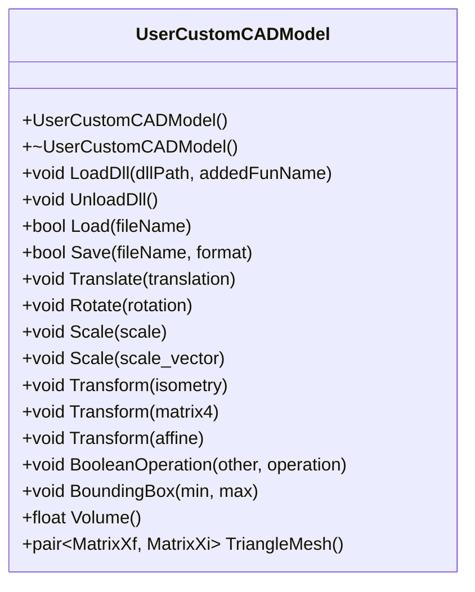

**图表来源**
- [UserCustomCADModel.hpp:79-121](file://cadmodel/UserCustomCADModel.hpp#L79-L121)

**章节来源**
- [UserCustomCADModel.hpp:79-121](file://cadmodel/UserCustomCADModel.hpp#L79-L121)

### 最小 IModel 实现示例
测试文件中提供了一个最小化的 `SimpleCubeModel`，展示了如何继承 IModel 并实现必要方法。虽然它没有完整实现所有业务逻辑，但足以演示：
- 如何声明继承 IModel。
- 如何返回固定立方体的顶点和面片。
- 如何实现 `BoundingBox`、`Volume`、`TriangleMesh`。

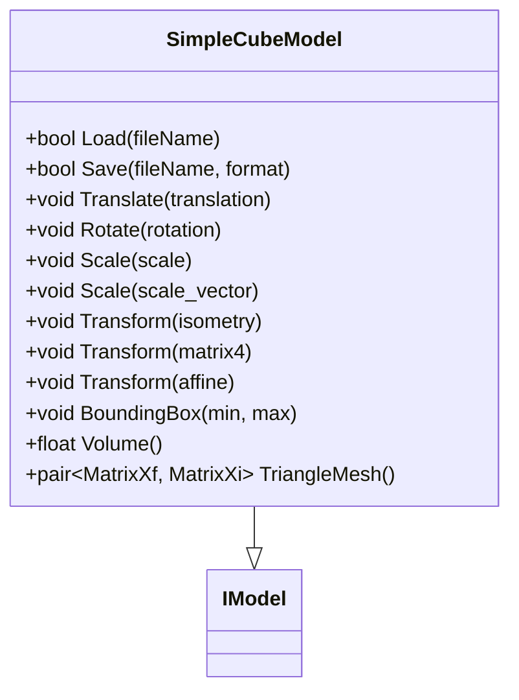

**图表来源**
- [full_topo_model_test.cpp:16-53](file://tests/Models/full_topo_model_test.cpp#L16-L53)
- [IModel.hpp:111-139](file://base/IModel.hpp#L111-L139)

**章节来源**
- [full_topo_model_test.cpp:16-53](file://tests/Models/full_topo_model_test.cpp#L16-L53)

## 自定义模型类型扩展指南
如果你希望支持新的文件格式或新数据形态，推荐遵循以下步骤：

1. **确定数据形态**  
   - 如果是三角网格，优先考虑复用 `IglModel` 或在其基础上扩展。
   - 如果是 CAD/BRep，优先考虑 `OcctModel` 或用户自定义 CAD 插件。
   - 如果是点云/体素，优先考虑 `OpenVdbModel` 或用户自定义点云插件。

2. **继承 IModel**  
   新建一个类继承 `HsBa::Slicer::IModel`，并实现所有纯虚方法。

3. **实现文件加载**  
   - 在 `Load(fileName)` 中解析你的文件格式。
   - 如果已有第三方库支持该格式，优先复用现有解析器。

4. **实现文件保存**  
   - 在 `Save(fileName, format)` 中根据 `ModelFormat` 选择写入策略。
   - 对于未知格式，可返回 false 或抛出异常（取决于上层错误处理约定）。

5. **实现几何变换**  
   - 对顶点、法线、CAD 形状或点云坐标应用平移、旋转、缩放、仿射变换。
   - 注意保持数值稳定性，尤其是多次变换后。

6. **实现边界框与体积**  
   - 对网格：遍历顶点计算 AABB，或使用库提供的体积算法。
   - 对 CAD：使用 OCCT 提供的体积计算。
   - 对点云：可根据需求返回近似体积或 0。

7. **实现三角网格提取**  
   - 对网格：直接返回顶点矩阵和面片索引矩阵。
   - 对 CAD：先 tessellate 再返回。
   - 对点云：可使用 level set 重建或返回空面片。

8. **注册到系统（可选）**  
   - 如果使用插件机制，参考 `UserCustomPointCloudModel` 或 `UserCustomCADModel` 的 C ABI 函数指针模式。
   - 如果使用静态链接，确保构建系统包含新实现。

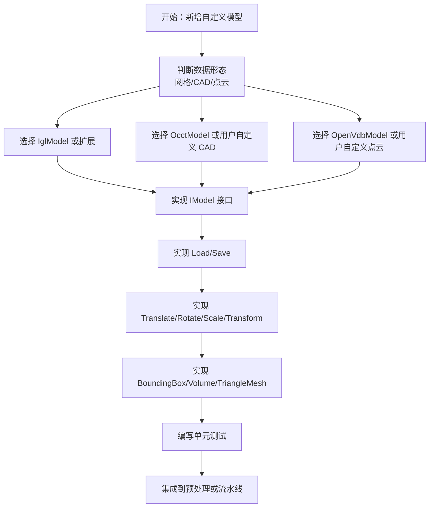

**图表来源**
- [IModel.hpp:111-139](file://base/IModel.hpp#L111-L139)
- [UserCustomPointCloudModel.hpp:96-171](file://pointcloud/UserCustomPointCloudModel.hpp#L96-L171)
- [UserCustomCADModel.hpp:79-121](file://cadmodel/UserCustomCADModel.hpp#L79-L121)

**章节来源**
- [IModel.hpp:111-139](file://base/IModel.hpp#L111-L139)
- [UserCustomPointCloudModel.hpp:96-171](file://pointcloud/UserCustomPointCloudModel.hpp#L96-L171)
- [UserCustomCADModel.hpp:79-121](file://cadmodel/UserCustomCADModel.hpp#L79-L121)

## 依赖关系分析
IModel 及其实现之间存在清晰的依赖层次：

- `IModel` 依赖 Eigen 数学库和 `ModelFormat` 枚举。
- `IglModel` 依赖 Eigen 和 2D 多边形类型，用于布尔运算和拉伸。
- `OcctModel` 依赖 OCCT 拓扑类型和 2D 多边形类型。
- `OpenVdbModel` 依赖 OpenVDB 体素网格。
- 用户自定义模型依赖动态库加载机制和 C ABI 函数指针。

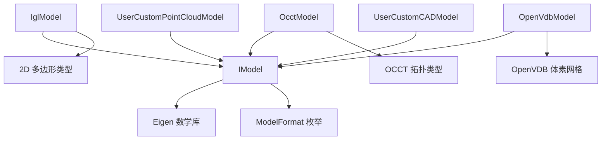

**图表来源**
- [IModel.hpp:13-18](file://base/IModel.hpp#L13-L18)
- [IModel.hpp:66-109](file://base/IModel.hpp#L66-L109)
- [IglModel.hpp:9-14](file://meshmodel/IglModel.hpp#L9-L14)
- [OcctModel.hpp:11-18](file://cadmodel/OcctModel.hpp#L11-L18)
- [OpenVdbModel.hpp:13-16](file://pointcloud/OpenVdbModel.hpp#L13-L16)

**章节来源**
- [IModel.hpp:13-18](file://base/IModel.hpp#L13-L18)
- [IModel.hpp:66-109](file://base/IModel.hpp#L66-L109)
- [IglModel.hpp:9-14](file://meshmodel/IglModel.hpp#L9-L14)
- [OcctModel.hpp:11-18](file://cadmodel/OcctModel.hpp#L11-L18)
- [OpenVdbModel.hpp:13-16](file://pointcloud/OpenVdbModel.hpp#L13-L16)

## 性能考虑
针对 IModel 的不同实现，性能关注点有所不同：

| 组件 | 性能关注点 | 建议 |
|---|---|---|
| `IglModel` | 顶点/面片矩阵拷贝、法线计算、布尔运算 | 避免重复计算法线；大模型慎用频繁布尔运算 |
| `OcctModel` | CAD tessellation、布尔运算、体积计算 | 仅在需要时 tessellate；复杂 CAD 模型先简化 |
| `OpenVdbModel` | 点云规模、体素化、KNN/半径查询 | 合理设置体素大小；使用下采样减少点数 |
| 用户自定义模型 | 插件加载、C ABI 数据拷贝 | 避免频繁跨 ABI 边界复制大数据 |
| 通用 IModel | 多次变换累积误差 | 尽量组合变换一次应用，而非多次连续调用 |

此外：
- `TriangleMesh()` 可能触发 tessellation 或重建，应谨慎调用。
- `Volume()` 对非封闭网格可能无意义，调用前应确认模型有效性。
- `BoundingBox()` 通常比全量几何计算更快，适合快速筛选。

## 线程安全建议
IModel 本身是普通 C++ 接口，未内置锁机制。因此：
- 同一 `IModel` 实例不应被多个线程同时修改。
- 如果多个线程需要读取同一个模型，应确保模型处于不可变状态，或使用共享只读副本。
- 用户自定义插件需自行保证 C ABI 函数的线程安全。
- 若使用线程池并行处理多个模型，每个线程应拥有独立的 `IModel` 实例。

## 常见问题与排错
| 问题 | 可能原因 | 排查建议 |
|---|---|---|
| `Load` 返回 false | 文件不存在、格式不支持、解析失败 | 检查路径、扩展名、`ModelFormat` 推断结果 |
| `Save` 返回 false | 目标格式不支持、权限不足、序列化失败 | 检查 `format` 参数和目标路径 |
| `Volume` 返回 0 | 模型不封闭、点云无体积定义、实现未实现体积计算 | 检查模型类型和实现 |
| `TriangleMesh` 返回空面片 | CAD 未 tessellate、点云未重建、网格为空 | 检查实现逻辑和数据状态 |
| 自定义模型编译失败 | 未实现纯虚方法 | 对照 IModel 接口补全所有方法 |
| 插件崩溃 | C ABI 结构布局不一致、函数指针错误 | 检查 `HsBaVector3f_t` 等结构定义和插件导出符号 |

**章节来源**
- [IModel.hpp:111-139](file://base/IModel.hpp#L111-L139)
- [ModelFormat.hpp:62-93](file://base/ModelFormat.hpp#L62-L93)
- [ModelFormat.cpp:89-99](file://base/ModelFormat.cpp#L89-L99)

## 结论
IModel 是 HsBaSlicer 中 3D 模型能力的统一抽象。它通过稳定接口屏蔽了三角网格、CAD/BRep、点云/体素等不同数据形态的差异，使上层系统可以以一致方式处理模型加载、变换、查询和导出。配合 `ModelFormat` 枚举和 C ABI 数据结构，IModel 既服务于 C++ 内部多态，也支撑跨语言、跨插件的扩展生态。

在实际使用中，建议：
- 优先使用已有实现：`IglModel`、`OcctModel`、`OpenVdbModel`。
- 仅在必要时扩展自定义模型，并严格实现 IModel 全部接口。
- 合理使用 `ModelFormat` 工具函数进行格式判断和字符串转换。
- 注意性能与线程安全，避免不必要的 tessellation、体积计算和并发写访问。