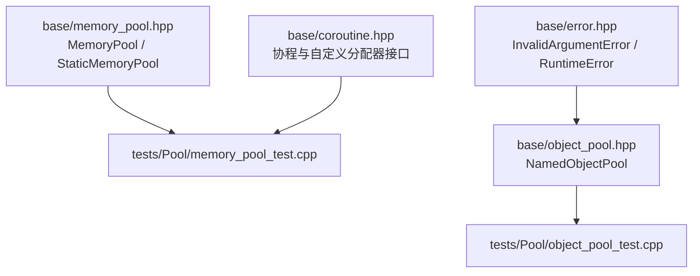
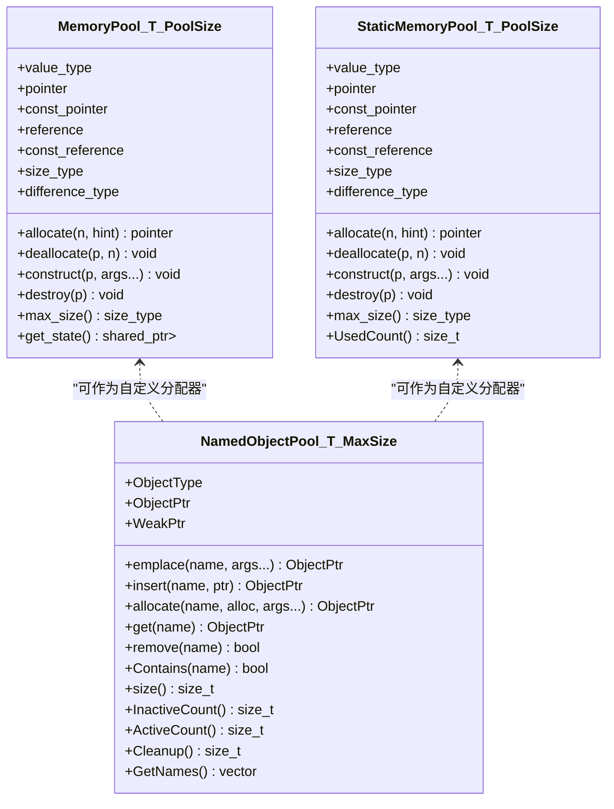
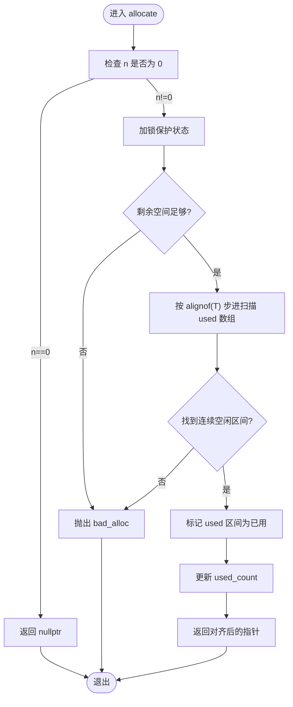
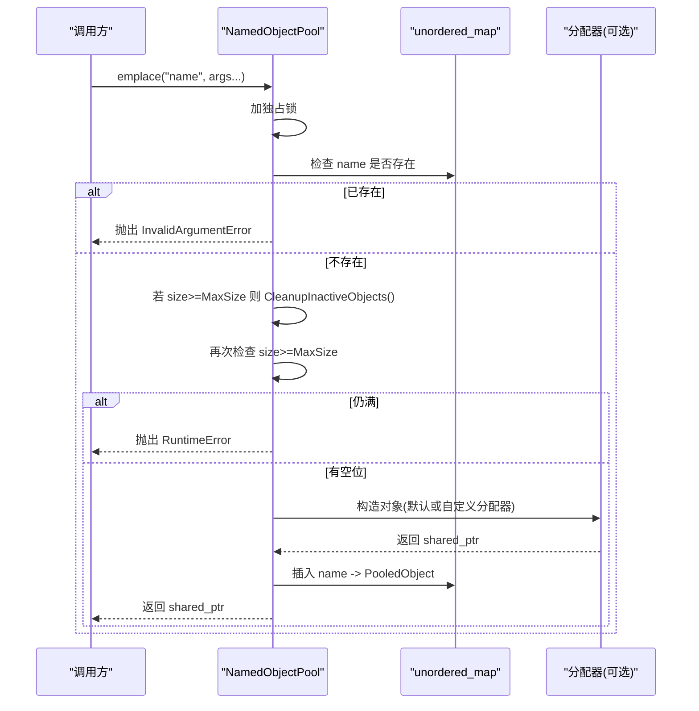
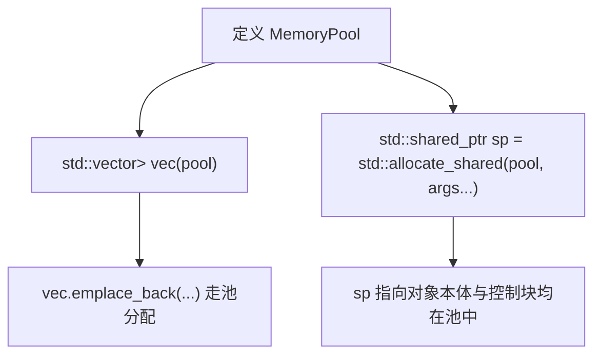
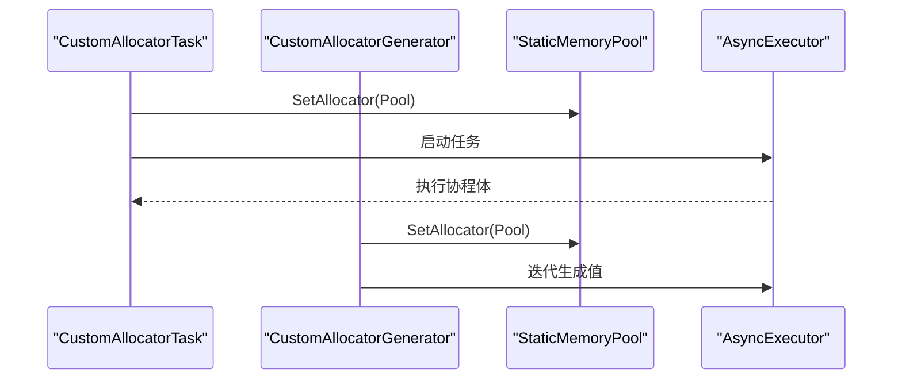
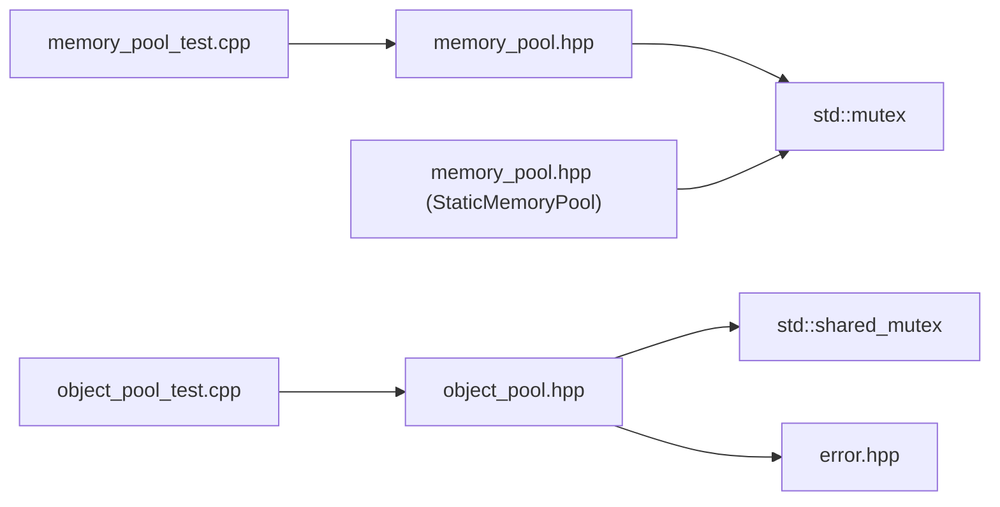

# MemoryPool 与 ObjectPool 内存池

<cite>
**本文引用的文件**   
- [base/memory_pool.hpp](file://base/memory_pool.hpp)
- [base/object_pool.hpp](file://base/object_pool.hpp)
- [tests/Pool/memory_pool_test.cpp](file://tests/Pool/memory_pool_test.cpp)
- [tests/Pool/object_pool_test.cpp](file://tests/Pool/object_pool_test.cpp)
- [base/coroutine.hpp](file://base/coroutine.hpp)
- [base/error.hpp](file://base/error.hpp)
</cite>

## 目录
1. [引言](#引言)
2. [项目结构](#项目结构)
3. [核心概念](#核心概念)
4. [核心组件](#核心组件)
5. [架构总览](#架构总览)
6. [详细组件分析](#详细组件分析)
7. [依赖关系分析](#依赖关系分析)
8. [性能与内存使用分析](#性能与内存使用分析)
9. [大规模几何计算中的最佳实践](#大规模几何计算中的最佳实践)
10. [故障排除指南](#故障排除指南)
11. [结论](#结论)
12. [附录：API 速查表](#附录api-速查表)

## 引言
本文件面向需要在 C++ 中实现高性能、可预测内存行为的工程团队，系统性梳理 HsBaSlicer 仓库中的两种内存池机制：MemoryPool 与 NamedObjectPool。前者提供基于固定大小缓冲区的连续内存分配器，可与标准库容器和智能指针无缝集成；后者提供按名称管理的对象级缓存，支持共享所有权、惰性清理与容量上限控制。文档从设计动机、数据结构、线程安全、错误处理到性能优化与故障排查，给出完整的技术说明与实践建议，并特别强调在大规模几何计算场景下的应用策略。

## 项目结构
MemoryPool 与 NamedObjectPool 位于基础库 base 目录，测试用例位于 tests/Pool 目录，相关协程与错误类型分别由 base/coroutine.hpp 与 base/error.hpp 提供。

**图表来源**
- [base/memory_pool.hpp:1-375](file://base/memory_pool.hpp#L1-L375)
- [base/object_pool.hpp:1-286](file://base/object_pool.hpp#L1-L286)
- [tests/Pool/memory_pool_test.cpp:1-100](file://tests/Pool/memory_pool_test.cpp#L1-L100)
- [tests/Pool/object_pool_test.cpp:1-162](file://tests/Pool/object_pool_test.cpp#L1-L162)
- [base/coroutine.hpp](file://base/coroutine.hpp)
- [base/error.hpp](file://base/error.hpp)

**章节来源**
- [base/memory_pool.hpp:1-375](file://base/memory_pool.hpp#L1-L375)
- [base/object_pool.hpp:1-286](file://base/object_pool.hpp#L1-L286)
- [tests/Pool/memory_pool_test.cpp:1-100](file://tests/Pool/memory_pool_test.cpp#L1-L100)
- [tests/Pool/object_pool_test.cpp:1-162](file://tests/Pool/object_pool_test.cpp#L1-L162)

## 核心概念
- 连续内存分配与对齐：MemoryPool 以字节为单位维护一个固定大小的缓冲区，并在 allocate 时寻找满足目标类型对齐要求的连续空闲区间，避免频繁的系统堆分配。
- 对象生命周期管理：NamedObjectPool 通过 std::shared_ptr 与 std::weak_ptr 组合管理对象的生命周期，依据引用计数判断对象是否仍被外部持有，从而决定“活跃”或“非活跃”。
- 内存碎片避免：MemoryPool 的线性扫描与按字节标记 used 数组的方式，尽量将小块分配合并为连续块，降低碎片化风险；同时通过 alignof(T) 步进保证对齐。
- 容量与回收策略：NamedObjectPool 设置 MaxSize 上限，当达到上限时先尝试清理非活跃对象，若仍无空间则抛出异常；清理是惰性的，仅在需要插入新对象时触发，避免频繁清理带来的性能抖动。
- 线程安全：两类池均使用互斥锁保护内部状态；NamedObjectPool 使用 shared_mutex 区分读多写少的访问模式，提升并发读取性能。

[本节不直接分析具体代码文件]

## 核心组件
- MemoryPool<T, PoolSize>：实例级内存池分配器，内部状态由 shared_ptr 管理，便于多个实例共享同一块底层缓冲区。
- StaticMemoryPool<T, PoolSize>：静态全局内存池分配器，所有实例共享同一块静态缓冲区，适合跨模块或跨线程的全局小对象分配。
- NamedObjectPool<T, MaxSize>：命名对象池，提供 emplace、allocate、insert、get、remove、Cleanup 等 API，支持自定义分配器注入。

**章节来源**
- [base/memory_pool.hpp:43-208](file://base/memory_pool.hpp#L43-L208)
- [base/memory_pool.hpp:215-372](file://base/memory_pool.hpp#L215-L372)
- [base/object_pool.hpp:22-283](file://base/object_pool.hpp#L22-L283)

## 架构总览
MemoryPool 与 StaticMemoryPool 作为 STL 兼容分配器，可被 std::vector、std::list、std::shared_ptr 等直接使用；NamedObjectPool 作为对象级缓存层，可配合任意分配器（包括 MemoryPool）进行对象创建与管理。

**图表来源**
- [base/memory_pool.hpp:43-208](file://base/memory_pool.hpp#L43-L208)
- [base/memory_pool.hpp:215-372](file://base/memory_pool.hpp#L215-L372)
- [base/object_pool.hpp:22-283](file://base/object_pool.hpp#L22-L283)

## 详细组件分析

### MemoryPool 与 StaticMemoryPool 的低级内存管理
- 分配流程：检查请求大小与已用总量，确保不超过 PoolSize；按 alignof(T) 步长扫描 used 位图，找到连续空闲区间后标记并返回指针。
- 释放流程：校验指针偏移是否在池范围内，逐字节清除 used 标记，更新 used_count。
- 构造与析构：提供 construct/destroy 模板方法，允许在已分配内存上原位构造任意类型 U。
- 线程安全：allocate/deallocate 使用 std::mutex 保护；StaticMemoryPool 额外暴露 UsedCount 用于监控。
- 与 STL 集成：实现标准分配器所需 typedef 与 rebind，支持 std::vector、std::list、std::shared_ptr 等容器与智能指针。

**图表来源**
- [base/memory_pool.hpp:111-142](file://base/memory_pool.hpp#L111-L142)
- [base/memory_pool.hpp:266-296](file://base/memory_pool.hpp#L266-L296)

**章节来源**
- [base/memory_pool.hpp:111-142](file://base/memory_pool.hpp#L111-L142)
- [base/memory_pool.hpp:156-175](file://base/memory_pool.hpp#L156-L175)
- [base/memory_pool.hpp:185-198](file://base/memory_pool.hpp#L185-L198)
- [base/memory_pool.hpp:266-296](file://base/memory_pool.hpp#L266-L296)
- [base/memory_pool.hpp:305-324](file://base/memory_pool.hpp#L305-L324)
- [base/memory_pool.hpp:361-365](file://base/memory_pool.hpp#L361-L365)

### NamedObjectPool 的对象级缓存策略
- 对象标识：每个对象通过唯一 name 注册，重复 name 会抛出 InvalidArgumentError。
- 生命周期：内部保存 PooledObject，包含 shared_ref 与 weak_ref；当外部 shared_ptr 引用计数降为 1（仅池自身持有），视为 inactive。
- 容量控制：MaxSize 限制对象数量；插入前若已满，先调用 CleanupInactiveObjects 清理 inactive 对象；若仍满则抛出 RuntimeError。
- 并发模型：读写分离，get/Contains/size 等读操作使用 shared_lock，emplace/allocate/remove/Cleanup 等写操作使用 unique_lock。
- 自定义分配器：allocate(name, alloc, args...) 允许传入任意分配器，例如 MemoryPool，以实现对象内存来自指定池。

**图表来源**
- [base/object_pool.hpp:66-92](file://base/object_pool.hpp#L66-L92)
- [base/object_pool.hpp:135-156](file://base/object_pool.hpp#L135-L156)
- [base/object_pool.hpp:262-279](file://base/object_pool.hpp#L262-L279)

**章节来源**
- [base/object_pool.hpp:66-92](file://base/object_pool.hpp#L66-L92)
- [base/object_pool.hpp:99-115](file://base/object_pool.hpp#L99-L115)
- [base/object_pool.hpp:135-156](file://base/object_pool.hpp#L135-L156)
- [base/object_pool.hpp:162-188](file://base/object_pool.hpp#L162-L188)
- [base/object_pool.hpp:201-236](file://base/object_pool.hpp#L201-L236)
- [base/object_pool.hpp:241-259](file://base/object_pool.hpp#L241-L259)
- [base/object_pool.hpp:262-279](file://base/object_pool.hpp#L262-L279)

### 与 STL 容器及智能指针的集成
- MemoryPool 可直接作为 std::vector、std::list 等的分配器参数，使容器元素分配走池内存。
- 通过 std::allocate_shared 可将 shared_ptr 的控制块与对象本体分配到指定池，减少系统堆分配次数。
- 测试用例展示了在容器与智能指针中使用 MemoryPool 的典型方式。

**图表来源**
- [tests/Pool/memory_pool_test.cpp:30-51](file://tests/Pool/memory_pool_test.cpp#L30-L51)
- [tests/Pool/memory_pool_test.cpp:53-74](file://tests/Pool/memory_pool_test.cpp#L53-L74)

**章节来源**
- [tests/Pool/memory_pool_test.cpp:30-51](file://tests/Pool/memory_pool_test.cpp#L30-L51)
- [tests/Pool/memory_pool_test.cpp:53-74](file://tests/Pool/memory_pool_test.cpp#L53-L74)

### 与协程分配器的结合
- 测试用例展示了将 StaticMemoryPool 设置为协程任务与生成器的全局分配器，使得协程内部产生的中间对象也走池内存，避免临时对象频繁分配。
- 这在高并发几何计算中尤为重要，可减少协程栈外分配的抖动。

**图表来源**
- [tests/Pool/memory_pool_test.cpp:76-98](file://tests/Pool/memory_pool_test.cpp#L76-L98)
- [base/coroutine.hpp](file://base/coroutine.hpp)

**章节来源**
- [tests/Pool/memory_pool_test.cpp:76-98](file://tests/Pool/memory_pool_test.cpp#L76-L98)
- [base/coroutine.hpp](file://base/coroutine.hpp)

## 依赖关系分析
- MemoryPool 与 StaticMemoryPool 依赖 std::mutex 进行线程安全，依赖 std::shared_ptr 管理实例级状态。
- NamedObjectPool 依赖 std::shared_mutex 实现读写分离，依赖 std::unordered_map 存储对象映射，依赖 error.hpp 提供的异常类型。
- 测试用例依赖 boost test 框架与 base 模块头文件。

**图表来源**
- [base/memory_pool.hpp:1-18](file://base/memory_pool.hpp#L1-L18)
- [base/object_pool.hpp:1-14](file://base/object_pool.hpp#L1-L14)
- [tests/Pool/memory_pool_test.cpp:1-10](file://tests/Pool/memory_pool_test.cpp#L1-L10)
- [tests/Pool/object_pool_test.cpp:1-5](file://tests/Pool/object_pool_test.cpp#L1-L5)

**章节来源**
- [base/memory_pool.hpp:1-18](file://base/memory_pool.hpp#L1-L18)
- [base/object_pool.hpp:1-14](file://base/object_pool.hpp#L1-L14)
- [tests/Pool/memory_pool_test.cpp:1-10](file://tests/Pool/memory_pool_test.cpp#L1-L10)
- [tests/Pool/object_pool_test.cpp:1-5](file://tests/Pool/object_pool_test.cpp#L1-L5)

## 性能与内存使用分析
- 分配复杂度：MemoryPool 的 allocate 在最坏情况下需 O(PoolSize/alignof(T)) 次扫描，每次扫描最多比较 n*sizeof(T) 个字节；实际使用中由于连续分配与对齐步进，平均开销较低。
- 释放复杂度：deallocate 为 O(n*sizeof(T))，逐字节清除 used 标记。
- 并发影响：Mutex 竞争可能成为热点，建议在高频路径中批量分配与释放，减少锁粒度。
- 碎片控制：按字节标记 used 能精确追踪占用，但大量小块分配仍可能导致碎片；可通过增大 PoolSize 与合理选择 T 的对齐来缓解。
- NamedObjectPool 的性能关键点：
  - 惰性清理：仅在插入且池满时触发 CleanupInactiveObjects，避免频繁遍历 map。
  - 读写分离：get/Contains/size 等读操作使用 shared_lock，提高并发读取吞吐。
  - 容量上限：MaxSize 应结合业务峰值设定，避免频繁扩容与清理抖动。

[本节为通用性能讨论，不直接分析具体代码文件]

## 大规模几何计算中的最佳实践
- 使用 MemoryPool 管理几何顶点、边、面等小对象，将其作为 std::vector 的分配器，减少系统堆分配与碎片。
- 对需要跨函数传递的几何对象，使用 std::allocate_shared 配合 MemoryPool，确保控制块与对象本体都在池中。
- 对于需要复用的高成本对象（如网格切片结果、支撑结构），使用 NamedObjectPool 按名称缓存，并通过 ActiveCount/InactiveCount 监控生命周期。
- 在协程密集的计算管线中，将 StaticMemoryPool 设为协程任务的默认分配器，避免协程内部临时对象造成分配抖动。
- 容量规划：根据几何数据规模估算 PoolSize 与 MaxSize，预留一定余量以避免 bad_alloc 或 RuntimeError。
- 监控与诊断：
  - 使用 StaticMemoryPool::UsedCount 观察池占用趋势。
  - 使用 NamedObjectPool::GetNames 与 InactiveCount 定位未释放对象。
  - 结合日志与单元测试覆盖边界情况（满池、重复名、越界释放）。

[本节为通用实践建议，不直接分析具体代码文件]

## 故障排除指南
- 常见异常与原因：
  - std::bad_alloc：MemoryPool 请求超出 PoolSize 或无法找到连续空闲区间。
  - std::invalid_argument：deallocate 传入的指针不在池范围内。
  - InvalidArgumentError：NamedObjectPool 插入重复 name。
  - RuntimeError：NamedObjectPool 达到 MaxSize 且无法清理出空间。
- 排查步骤：
  - 确认 PoolSize 与 T 的大小匹配，必要时增大 PoolSize。
  - 检查是否正确成对调用 construct/destroy 与 allocate/deallocate。
  - 检查 NamedObjectPool 的 name 唯一性与生命周期管理，确保外部 shared_ptr 正确释放。
  - 使用 GetNames 与 InactiveCount 定位泄漏对象，必要时手动调用 Cleanup。
- 并发问题：
  - 高频分配路径下考虑批量化以减少锁竞争。
  - 避免在多线程环境下对同一 MemoryPool 实例进行不一致的构造/析构顺序。

**章节来源**
- [base/memory_pool.hpp:111-142](file://base/memory_pool.hpp#L111-L142)
- [base/memory_pool.hpp:156-175](file://base/memory_pool.hpp#L156-L175)
- [base/object_pool.hpp:66-92](file://base/object_pool.hpp#L66-L92)
- [base/object_pool.hpp:135-156](file://base/object_pool.hpp#L135-L156)

## 结论
MemoryPool 与 NamedObjectPool 分别解决了“底层连续内存分配效率”与“对象级生命周期与缓存管理”两大关键问题。前者通过固定缓冲区与对齐扫描实现低开销分配，后者通过共享所有权与惰性清理实现稳定可控的对象复用。在大规模几何计算中，二者协同使用可显著降低系统堆分配压力、减少内存碎片、提升整体吞吐与稳定性。实践中应结合业务峰值合理配置 PoolSize 与 MaxSize，并通过监控与测试保障内存安全与性能表现。

[本节为总结性内容，不直接分析具体代码文件]

## 附录：API 速查表
- MemoryPool<T, PoolSize>
  - allocate(n, hint): 分配 n 个 T 的空间
  - deallocate(p, n): 释放 n 个 T 的空间
  - construct(p, args...): 在 p 处构造 U
  - destroy(p): 销毁 p 处的 U
  - max_size(): 最大可分配元素数
  - get_state(): 获取共享状态指针
- StaticMemoryPool<T, PoolSize>
  - allocate/deallocate/construct/destroy/max_size: 同上
  - UsedCount(): 当前已用字节数
- NamedObjectPool<T, MaxSize>
  - emplace(name, args...): 构造并插入对象
  - insert(name, ptr): 插入已有对象
  - allocate(name, alloc, args...): 使用自定义分配器构造并插入
  - get(name)/operator[]: 获取对象
  - remove(name): 移除对象
  - Contains(name): 判断是否存在
  - size()/InactiveCount()/ActiveCount(): 统计信息
  - Cleanup(): 清理非活跃对象
  - GetNames(): 获取所有名称

**章节来源**
- [base/memory_pool.hpp:111-198](file://base/memory_pool.hpp#L111-L198)
- [base/memory_pool.hpp:266-365](file://base/memory_pool.hpp#L266-L365)
- [base/object_pool.hpp:66-259](file://base/object_pool.hpp#L66-L259)