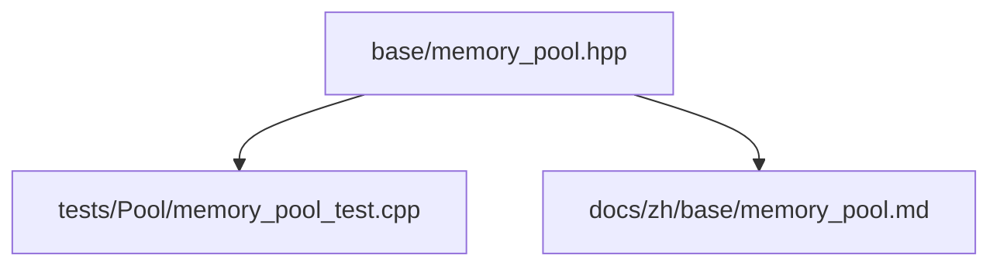
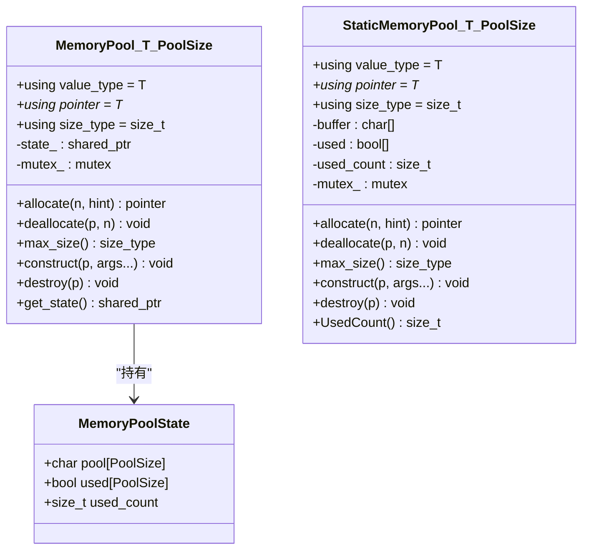
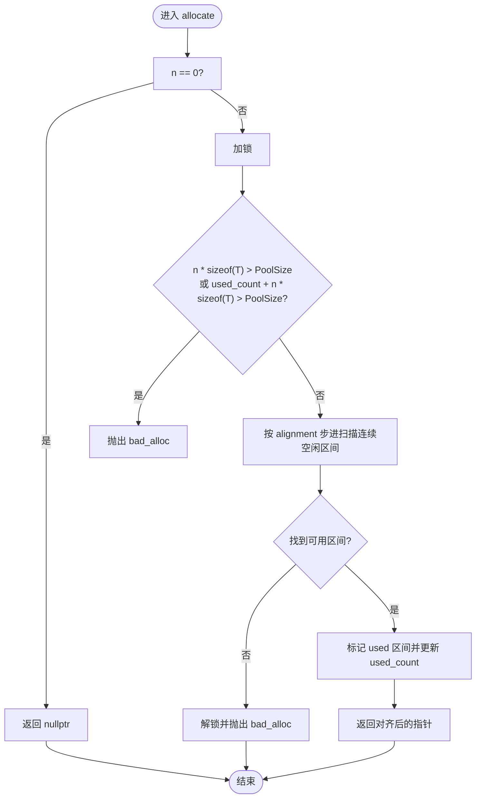
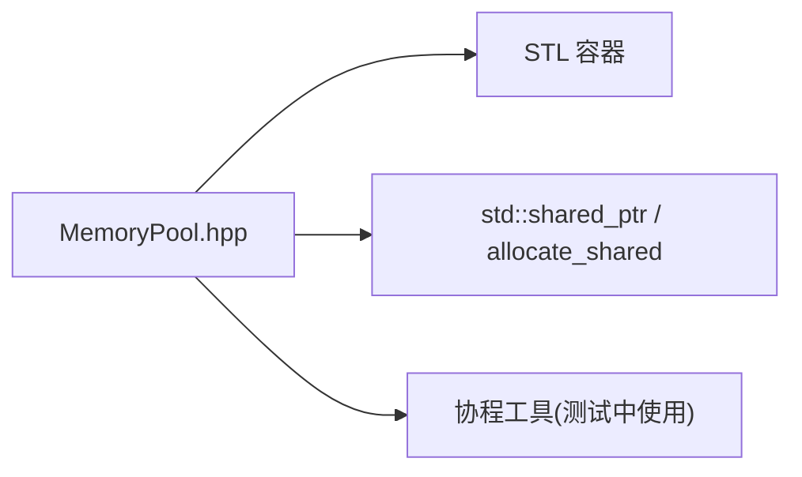

# MemoryPool 内存分配器

<cite>
**本文引用的文件**   
- [memory_pool.hpp](file://base/memory_pool.hpp)
- [memory_pool_test.cpp](file://tests/Pool/memory_pool_test.cpp)
- [memory_pool.md](file://docs/zh/base/memory_pool.md)
</cite>

## 目录
1. [引言](#引言)
2. [项目结构](#项目结构)
3. [核心组件](#核心组件)
4. [架构总览](#架构总览)
5. [详细组件分析](#详细组件分析)
6. [依赖关系分析](#依赖关系分析)
7. [性能与复杂度](#性能与复杂度)
8. [使用示例与集成指南](#使用示例与集成指南)
9. [并发安全与错误处理](#并发安全与错误处理)
10. [调试、泄漏防护与最佳实践](#调试泄漏防护与最佳实践)
11. [结论](#结论)

## 引言
本文件面向 HsBaSlicer 中的自定义内存池分配器，系统性说明基于模板的 MemoryPool 与 StaticMemoryPool 的设计与实现。文档覆盖以下主题：
- 状态管理：MemoryPoolState 的结构与作用
- 线程安全的 allocate/deallocate 机制
- 内存对齐、边界检查与错误处理策略
- 与 STL 容器和智能指针的集成方式
- 在大规模几何计算场景下的性能优势与注意事项
- 内存泄漏防护、并发安全与调试技巧

## 项目结构
MemoryPool 相关代码位于 base 模块，测试用例位于 tests/Pool，中文文档位于 docs/zh/base。

图表来源
- [memory_pool.hpp:1-375](file://base/memory_pool.hpp#L1-L375)
- [memory_pool_test.cpp:1-100](file://tests/Pool/memory_pool_test.cpp#L1-L100)
- [memory_pool.md:1-325](file://docs/zh/base/memory_pool.md#L1-L325)

章节来源
- [memory_pool.hpp:1-375](file://base/memory_pool.hpp#L1-L375)
- [memory_pool_test.cpp:1-100](file://tests/Pool/memory_pool_test.cpp#L1-L100)
- [memory_pool.md:1-325](file://docs/zh/base/memory_pool.md#L1-L325)

## 核心组件
- MemoryPoolState：持有底层缓冲、已用标记与已用字节计数，提供最大对齐保证。
- MemoryPool<T, PoolSize>：实例级共享状态的分配器，支持多实例共享同一块内存区域。
- StaticMemoryPool<T, PoolSize>：全局静态缓冲的分配器，所有实例等价且共享同一块静态内存。

章节来源
- [memory_pool.hpp:21-34](file://base/memory_pool.hpp#L21-L34)
- [memory_pool.hpp:43-208](file://base/memory_pool.hpp#L43-L208)
- [memory_pool.hpp:215-372](file://base/memory_pool.hpp#L215-L372)

## 架构总览
MemoryPool 与 StaticMemoryPool 均遵循 STL Allocator 接口（value_type、pointer、allocate、deallocate、construct、destroy、rebind 等），可无缝用于 std::vector、std::list、std::shared_ptr 等标准库组件。

图表来源
- [memory_pool.hpp:21-34](file://base/memory_pool.hpp#L21-L34)
- [memory_pool.hpp:43-208](file://base/memory_pool.hpp#L43-L208)
- [memory_pool.hpp:215-372](file://base/memory_pool.hpp#L215-L372)

## 详细组件分析

### MemoryPoolState 状态管理
- 字段
  - pool：按 std::max_align_t 对齐的原始缓冲，确保任意类型对象均可正确对齐。
  - used：逐字节占用标记，用于快速判断连续空闲区间。
  - used_count：当前已分配字节数，便于容量与碎片统计。
- 设计要点
  - 通过 alignas(std::max_align_t) 保证最大对齐要求，避免未定义行为。
  - used 数组以字节粒度记录占用，简化首次适配扫描逻辑。

章节来源
- [memory_pool.hpp:21-34](file://base/memory_pool.hpp#L21-L34)

### MemoryPool<T, PoolSize> 分配器
- 关键特性
  - 通过 std::shared_ptr<MemoryPoolState> 共享底层缓冲与状态，复制/移动语义下共享同一块内存。
  - 内部使用 std::mutex 保护 allocate/deallocate，保证多线程安全。
  - 提供 rebind<U> 以适配不同元素类型的容器。
- allocate 流程
  - 校验 n 与所需字节数是否超过 PoolSize，并检查 used_count 上限。
  - 按 alignment 步进扫描，寻找长度为 n*sizeof(T) 的连续空闲区间。
  - 标记 used 区间并更新 used_count，返回对齐后的指针。
  - 失败时抛出 std::bad_alloc。
- deallocate 流程
  - 空指针或无效 state 直接返回。
  - 计算偏移量并进行越界检查，随后清零 used 区间并递减 used_count。
  - 越界或非法指针抛出 std::invalid_argument。
- 构造与销毁
  - construct/destroy 委托 placement new 与显式析构调用，符合 Allocator 规范。
- 比较与访问
  - operator==/!= 比较共享状态指针；get_state 暴露共享状态引用。

图表来源
- [memory_pool.hpp:111-142](file://base/memory_pool.hpp#L111-L142)

章节来源
- [memory_pool.hpp:43-208](file://base/memory_pool.hpp#L43-L208)

### StaticMemoryPool<T, PoolSize> 分配器
- 关键特性
  - 使用 inline static 成员 buffer、used、used_count 与 mutex_，所有实例共享同一块静态内存。
  - is_always_equal 为 true，operator== 恒真，operator!= 恒假，表示所有实例等价。
  - 提供 UsedCount() 查询当前已用字节数。
- allocate/deallocate 流程
  - 与 MemoryPool 类似，但扫描不强制按 alignment 步进，直接使用字节粒度扫描。
  - 同样进行越界检查与 used 区间标记/清零。
- 构造与销毁
  - 默认构造/拷贝/移动均为 default。
  - construct/destroy 与 MemoryPool 一致。

图表来源
- [memory_pool.hpp:266-296](file://base/memory_pool.hpp#L266-L296)

章节来源
- [memory_pool.hpp:215-372](file://base/memory_pool.hpp#L215-L372)

## 依赖关系分析
- 头文件依赖
  - <cstddef>：size_t、ptrdiff_t
  - <memory>：std::shared_ptr
  - <mutex>：std::mutex
  - <new>：placement new
  - <stdexcept>：异常类型
- 外部集成
  - 与 STL 容器：通过 Allocator 接口被 std::vector、std::list 等使用。
  - 与智能指针：通过 std::allocate_shared 配合分配器创建 shared_ptr。
  - 与协程工具：测试中展示了与自定义协程分配器的结合。

图表来源
- [memory_pool.hpp:13-17](file://base/memory_pool.hpp#L13-L17)
- [memory_pool_test.cpp:1-100](file://tests/Pool/memory_pool_test.cpp#L1-L100)

章节来源
- [memory_pool.hpp:13-17](file://base/memory_pool.hpp#L13-L17)
- [memory_pool_test.cpp:1-100](file://tests/Pool/memory_pool_test.cpp#L1-L100)

## 性能与复杂度
- 时间复杂度
  - allocate：最坏 O(PoolSize) 线性扫描；若按 alignment 步进可减少部分检查次数（MemoryPool）。
  - deallocate：O(n*sizeof(T)) 标记清零。
- 空间复杂度
  - 额外开销：used 位图（字节粒度）+ used_count 计数器。
- 缓存局部性
  - 连续分配提升数据局部性，减少缺页与碎片化。
- 对比系统分配器
  - 高频小对象分配场景通常优于通用堆分配器，降低分配/释放开销与碎片。

章节来源
- [memory_pool.hpp:111-142](file://base/memory_pool.hpp#L111-L142)
- [memory_pool.hpp:266-296](file://base/memory_pool.hpp#L266-L296)

## 使用示例与集成指南

### 基本用法
- 使用 MemoryPool 分配单个对象并完成构造与析构。
- 使用 StaticMemoryPool 获取已用字节数。

章节来源
- [memory_pool.md:84-117](file://docs/zh/base/memory_pool.md#L84-L117)
- [memory_pool.md:190-229](file://docs/zh/base/memory_pool.md#L190-L229)

### 与 STL 容器结合
- 将 MemoryPool 作为 std::vector、std::list 的分配器类型参数传入。
- 将 StaticMemoryPool 作为分配器类型参数传入，无需显式构造池实例。

章节来源
- [memory_pool_test.cpp:30-39](file://tests/Pool/memory_pool_test.cpp#L30-L39)
- [memory_pool_test.cpp:53-61](file://tests/Pool/memory_pool_test.cpp#L53-L61)

### 与智能指针结合
- 使用 std::allocate_shared 配合 MemoryPool 或 StaticMemoryPool 创建 shared_ptr。

章节来源
- [memory_pool_test.cpp:41-51](file://tests/Pool/memory_pool_test.cpp#L41-L51)
- [memory_pool_test.cpp:63-74](file://tests/Pool/memory_pool_test.cpp#L63-L74)

### 与协程工具结合
- 通过 SetAllocator 设置全局分配器，使协程任务与生成器内部使用指定池。

章节来源
- [memory_pool_test.cpp:76-98](file://tests/Pool/memory_pool_test.cpp#L76-L98)

### 在大规模几何计算中的性能优势
- 几何算法常产生大量同尺寸小对象（如点、向量、面片索引），使用固定大小池可显著降低分配开销与碎片。
- 建议：
  - 根据典型对象尺寸估算 PoolSize，预留扩容余量。
  - 对热点数据结构优先使用池分配，非热点路径保持默认分配器。
  - 结合批处理与批量释放，减少锁竞争。

章节来源
- [memory_pool.md:305-316](file://docs/zh/base/memory_pool.md#L305-L316)

## 并发安全与错误处理

### 并发安全
- 两个分配器均在 allocate/deallocate 中使用 std::mutex 保护临界区。
- MemoryPool 通过 shared_ptr 共享状态，多个实例可安全共享同一块内存。
- StaticMemoryPool 所有实例等价，适合全局单例式共享。

章节来源
- [memory_pool.hpp:111-142](file://base/memory_pool.hpp#L111-L142)
- [memory_pool.hpp:156-175](file://base/memory_pool.hpp#L156-L175)
- [memory_pool.hpp:266-296](file://base/memory_pool.hpp#L266-L296)
- [memory_pool.hpp:305-324](file://base/memory_pool.hpp#L305-L324)

### 错误处理策略
- 容量不足：抛出 std::bad_alloc。
- 越界或非法指针：抛出 std::invalid_argument。
- 空指针处理：deallocate 对空指针直接返回，避免无意义操作。

章节来源
- [memory_pool.hpp:111-142](file://base/memory_pool.hpp#L111-L142)
- [memory_pool.hpp:156-175](file://base/memory_pool.hpp#L156-L175)
- [memory_pool.hpp:266-296](file://base/memory_pool.hpp#L266-L296)
- [memory_pool.hpp:305-324](file://base/memory_pool.hpp#L305-L324)

## 调试、泄漏防护与最佳实践

### 内存泄漏防护
- 使用 StaticMemoryPool::UsedCount 监控已用字节数，辅助发现未释放内存。
- 在单元测试中验证容器生命周期结束后 used_count 回归预期值。

章节来源
- [memory_pool.hpp:361-365](file://base/memory_pool.hpp#L361-L365)
- [memory_pool.md:315-316](file://docs/zh/base/memory_pool.md#L315-L316)

### 调试技巧
- 打印 used_count 与 max_size 比值，评估池利用率。
- 针对频繁分配路径，开启日志记录分配/释放配对情况。
- 使用 AddressSanitizer/LeakSanitizer 检测潜在问题。

章节来源
- [memory_pool.md:305-316](file://docs/zh/base/memory_pool.md#L305-L316)

### 最佳实践
- 合理选择 PoolSize：过小导致频繁 bad_alloc，过大造成浪费。
- 尽量批量分配与释放，降低锁竞争。
- 对可变长对象集合，考虑分桶池或多尺寸池组合。
- 避免跨线程共享复杂对象生命周期，必要时使用 RAII 包装。

章节来源
- [memory_pool.md:305-316](file://docs/zh/base/memory_pool.md#L305-L316)

## 结论
MemoryPool 与 StaticMemoryPool 提供了两种互补的 STL 兼容分配器实现：前者支持实例间共享状态，后者提供零实例开销的全局池。二者均具备线程安全、严格边界检查与明确的错误处理策略，适用于高频小对象分配与大规模几何计算等场景。通过合理的容量规划与批处理策略，可在保证正确性的同时显著提升性能与内存局部性。