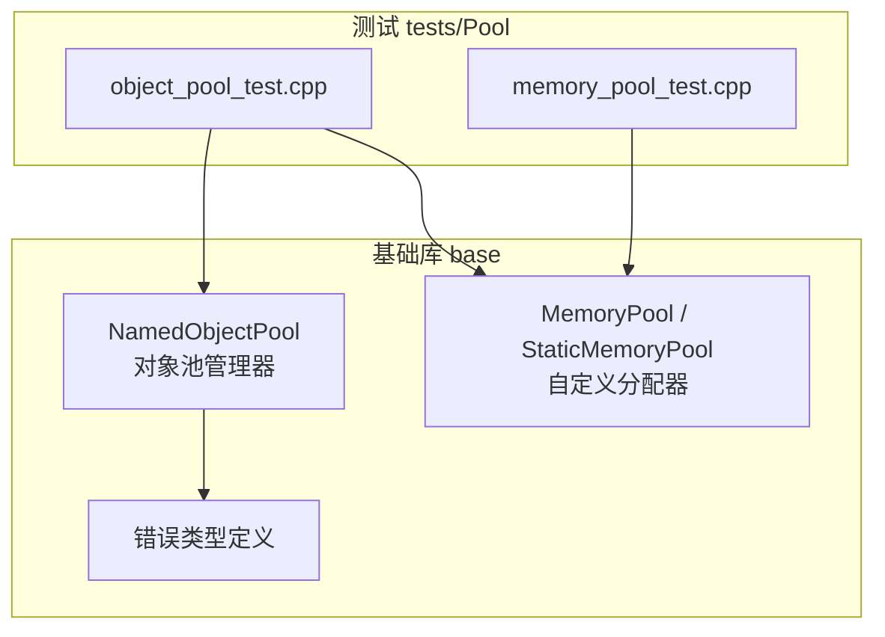
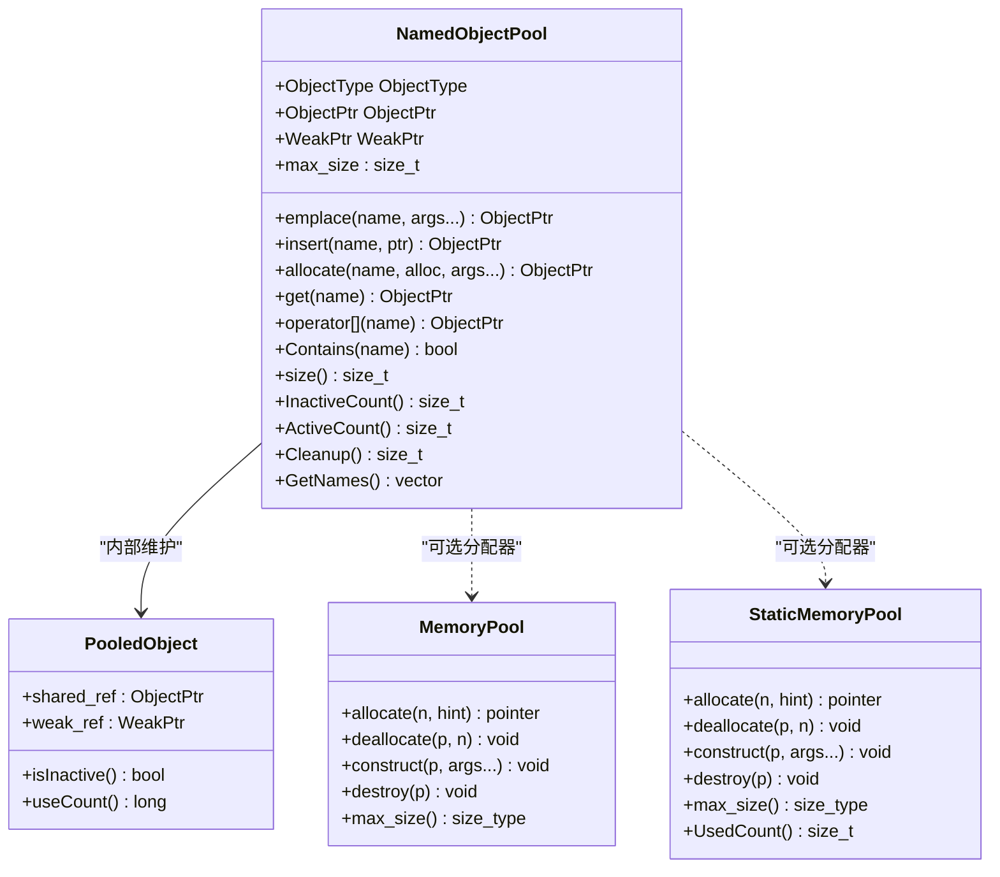
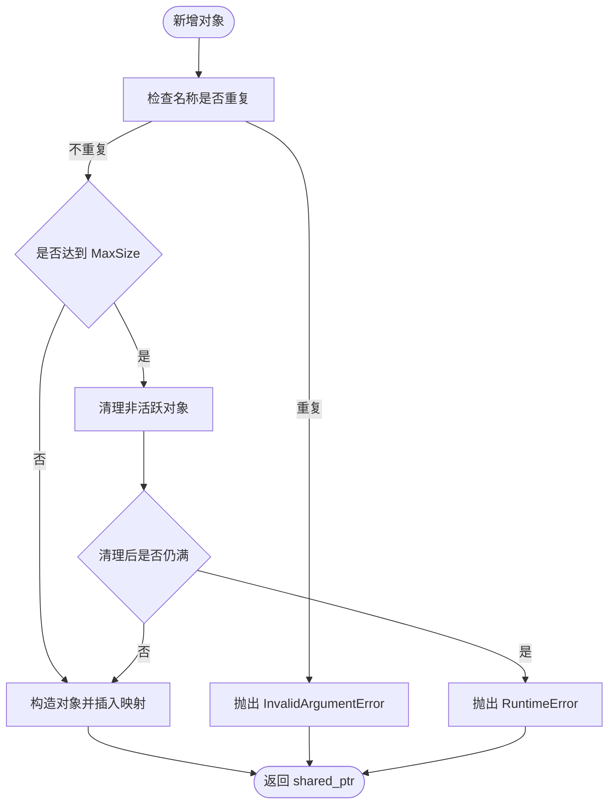
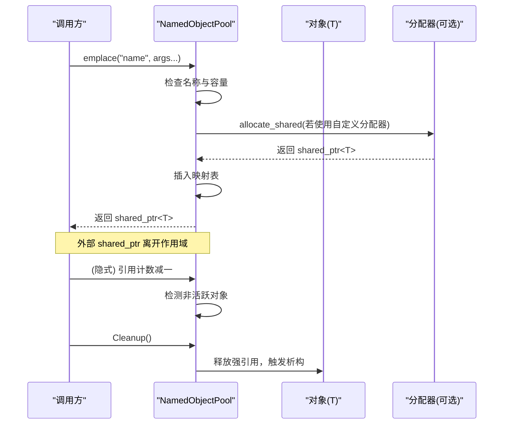
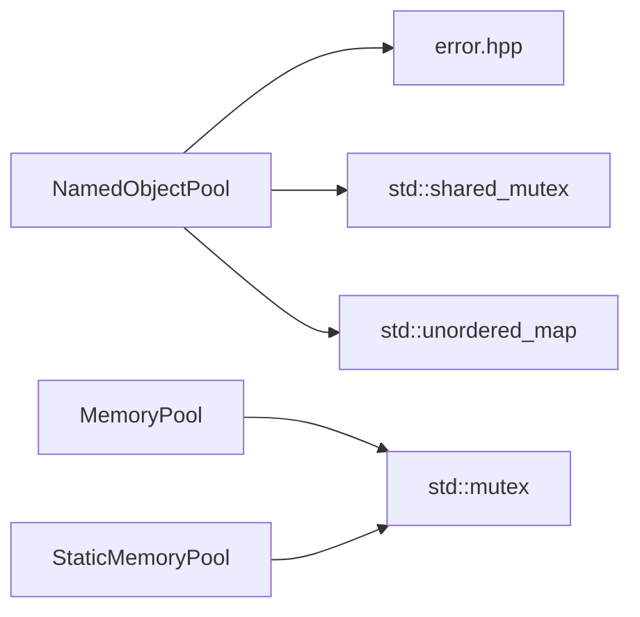

# ObjectPool 对象池管理器

<cite>
**本文引用的文件**   
- [object_pool.hpp](file://base/object_pool.hpp)
- [memory_pool.hpp](file://base/memory_pool.hpp)
- [error.hpp](file://base/error.hpp)
- [object_pool_test.cpp](file://tests/Pool/object_pool_test.cpp)
- [memory_pool_test.cpp](file://tests/Pool/memory_pool_test.cpp)
</cite>

## 目录
1. [引言](#引言)
2. [项目结构定位](#项目结构定位)
3. [核心概念与能力总览](#核心概念与能力总览)
4. [架构总览](#架构总览)
5. [详细组件分析](#详细组件分析)
6. [依赖关系分析](#依赖关系分析)
7. [性能与内存使用分析](#性能与内存使用分析)
8. [配置参数调优指南](#配置参数调优指南)
9. [常见问题与排错](#常见问题与排错)
10. [结论](#结论)
11. [附录：API 速查表](#附录api-速查表)

## 引言
本文件面向需要在面向对象场景中高效管理对象生命周期、复用对象并降低频繁分配销毁开销的开发者，系统性说明 HsBaSlicer 中的 NamedObjectPool 对象池管理器。文档将深入解释对象级内存池管理、对象生命周期管理、复用策略与自动回收机制，明确其与底层 MemoryPool 的关系与区别，并结合 RAII 与智能指针的使用模式给出实践建议。同时提供容量与清理策略调优、内存使用分析与常见问题的解决方案。

## 项目结构定位
NamedObjectPool 位于基础库 base 模块中，作为通用基础设施被上层业务模块复用；MemoryPool 与 StaticMemoryPool 同样位于 base 模块，提供自定义分配器能力。单元测试位于 tests/Pool 下，覆盖对象池与内存池的核心行为。

图表来源
- [object_pool.hpp:16-283](file://base/object_pool.hpp#L16-L283)
- [memory_pool.hpp:19-372](file://base/memory_pool.hpp#L19-L372)
- [object_pool_test.cpp:1-162](file://tests/Pool/object_pool_test.cpp#L1-L162)
- [memory_pool_test.cpp:1-100](file://tests/Pool/memory_pool_test.cpp#L1-L100)

章节来源
- [object_pool.hpp:1-286](file://base/object_pool.hpp#L1-L286)
- [memory_pool.hpp:1-375](file://base/memory_pool.hpp#L1-L375)
- [object_pool_test.cpp:1-162](file://tests/Pool/object_pool_test.cpp#L1-L162)
- [memory_pool_test.cpp:1-100](file://tests/Pool/memory_pool_test.cpp#L1-L100)

## 核心概念与能力总览
- 命名对象池：以字符串名称唯一标识对象，支持按名创建、获取、删除与查询。
- 共享所有权：内部使用 std::shared_ptr 持有对象，外部通过 shared_ptr 共享引用，便于 RAII 与跨作用域复用。
- 活跃性判定：当外部所有 shared_ptr 析构后，仅对象池内部仍持有引用（use_count 为 1），视为非活跃对象。
- 自动回收：在达到容量上限且尝试新增对象时，触发非活跃对象清理；也可手动调用清理接口。
- 线程安全：读写分离锁，读操作共享锁，写操作独占锁。
- 自定义分配器：支持通过 allocate 接口传入任意分配器，包括 MemoryPool 提供的分配器。

章节来源
- [object_pool.hpp:18-46](file://base/object_pool.hpp#L18-L46)
- [object_pool.hpp:60-156](file://base/object_pool.hpp#L60-L156)
- [object_pool.hpp:158-259](file://base/object_pool.hpp#L158-L259)
- [object_pool.hpp:261-283](file://base/object_pool.hpp#L261-L283)

## 架构总览
NamedObjectPool 是“对象级”的管理器，关注对象的创建、查找、共享所有权与生命周期；MemoryPool 与 StaticMemoryPool 是“内存级”的分配器，关注字节块分配与释放。二者职责不同但可协作：对象池可通过 allocate 接口使用自定义分配器进行对象构造。

图表来源
- [object_pool.hpp:22-46](file://base/object_pool.hpp#L22-L46)
- [object_pool.hpp:60-156](file://base/object_pool.hpp#L60-L156)
- [memory_pool.hpp:43-208](file://base/memory_pool.hpp#L43-L208)
- [memory_pool.hpp:215-372](file://base/memory_pool.hpp#L215-L372)

## 详细组件分析

### NamedObjectPool 类设计
- 模板参数：T 为对象类型，MaxSize 为池最大容量。
- 内部结构 PooledObject：保存强引用与弱引用，并提供 isInactive/useCount 辅助判断活跃状态。
- 并发模型：使用 std::shared_mutex 实现读写分离，提升并发读取性能。
- 生命周期：对象由 shared_ptr 管理，外部引用计数归零后进入非活跃状态；清理时移除条目并释放强引用。

图表来源
- [object_pool.hpp:66-92](file://base/object_pool.hpp#L66-L92)
- [object_pool.hpp:135-156](file://base/object_pool.hpp#L135-L156)
- [object_pool.hpp:261-279](file://base/object_pool.hpp#L261-L279)

章节来源
- [object_pool.hpp:22-46](file://base/object_pool.hpp#L22-L46)
- [object_pool.hpp:60-156](file://base/object_pool.hpp#L60-L156)
- [object_pool.hpp:261-283](file://base/object_pool.hpp#L261-L283)

### 与 MemoryPool 的关系与区别
- 职责差异：
  - NamedObjectPool：管理“对象”的生命周期与访问，基于名称索引，提供共享所有权语义。
  - MemoryPool / StaticMemoryPool：管理“内存块”的分配与释放，提供标准分配器接口，可与容器和智能指针集成。
- 协作方式：
  - NamedObjectPool 的 allocate 接口接受任意分配器，可将 MemoryPool 或 StaticMemoryPool 作为 T 的分配器，从而让对象本体驻留在固定大小的内存池中。
- 适用场景：
  - 需要对象级复用、命名访问、共享所有权与自动回收：优先使用 NamedObjectPool。
  - 需要控制底层内存分配位置、减少堆碎片、与 STL 容器/智能指针深度集成：优先使用 MemoryPool / StaticMemoryPool。

章节来源
- [object_pool.hpp:135-156](file://base/object_pool.hpp#L135-L156)
- [memory_pool.hpp:43-208](file://base/memory_pool.hpp#L43-L208)
- [memory_pool.hpp:215-372](file://base/memory_pool.hpp#L215-L372)

### 对象生命周期与 RAII 集成
- 构造：emplace 与 allocate 均通过完美转发构造对象，支持任意构造函数签名。
- 析构：当外部 shared_ptr 全部析构后，对象变为非活跃；Cleanup 会移除条目并释放强引用，触发对象析构。
- RAII 模式：推荐将 emplace/allocate 返回的 shared_ptr 绑定到局部变量或成员变量，利用作用域结束自动释放外部引用，配合池的自动清理机制完成资源回收。
- 智能指针集成：对象池内部使用 shared_ptr 管理对象，外部也应以 shared_ptr 持有，避免裸指针导致生命周期不一致。

图表来源
- [object_pool.hpp:66-92](file://base/object_pool.hpp#L66-L92)
- [object_pool.hpp:135-156](file://base/object_pool.hpp#L135-L156)
- [object_pool.hpp:241-279](file://base/object_pool.hpp#L241-L279)

章节来源
- [object_pool.hpp:60-156](file://base/object_pool.hpp#L60-L156)
- [object_pool.hpp:241-279](file://base/object_pool.hpp#L241-L279)

### 并发与线程安全
- 读操作（get、Contains、size、InactiveCount、GetNames）使用共享锁，允许多读并行。
- 写操作（emplace、insert、allocate、remove、Cleanup）使用独占锁，保证互斥更新。
- 注意：ActiveCount 基于 size 与 InactiveCount 计算，属于派生指标，不应作为严格一致性的同步点。

章节来源
- [object_pool.hpp:158-259](file://base/object_pool.hpp#L158-L259)
- [object_pool.hpp:281-283](file://base/object_pool.hpp#L281-L283)

### 与 MemoryPool 的集成示例路径
- 在对象池中混用默认分配与自定义分配：
  - 参考测试用例中对 emplace 与 allocate 的混合使用，验证两种分配方式均可成功注册到同一对象池。
- 在容器与智能指针中使用 MemoryPool：
  - 参考内存池测试用例中对 std::vector、std::list 与 std::allocate_shared 的使用，展示分配器与标准库的兼容性。

章节来源
- [object_pool_test.cpp:83-113](file://tests/Pool/object_pool_test.cpp#L83-L113)
- [memory_pool_test.cpp:30-51](file://tests/Pool/memory_pool_test.cpp#L30-L51)
- [memory_pool_test.cpp:53-74](file://tests/Pool/memory_pool_test.cpp#L53-L74)

## 依赖关系分析
- NamedObjectPool 依赖：
  - 标准库：memory、mutex、shared_mutex、unordered_map、string、vector。
  - 项目内 error.hpp：用于抛出 InvalidArgumentError 与 RuntimeError。
- MemoryPool / StaticMemoryPool 依赖：
  - 标准库：cstddef、memory、mutex、new、stdexcept。
  - 提供标准分配器接口，可与 STL 容器及智能指针无缝集成。

图表来源
- [object_pool.hpp:9-14](file://base/object_pool.hpp#L9-L14)
- [object_pool.hpp:281-283](file://base/object_pool.hpp#L281-L283)
- [memory_pool.hpp:13-18](file://base/memory_pool.hpp#L13-L18)
- [memory_pool.hpp:205-208](file://base/memory_pool.hpp#L205-L208)
- [memory_pool.hpp:367-372](file://base/memory_pool.hpp#L367-L372)

章节来源
- [object_pool.hpp:9-14](file://base/object_pool.hpp#L9-L14)
- [memory_pool.hpp:13-18](file://base/memory_pool.hpp#L13-L18)

## 性能与内存使用分析
- 分配成本：
  - 使用默认分配器时，对象分配走系统堆分配；使用 MemoryPool/StaticMemoryPool 时，对象分配在固定大小内存池中进行，减少堆分配次数与碎片。
- 查找成本：
  - 基于 unordered_map 的名称查找平均 O(1)，但在高并发写场景下存在锁竞争。
- 清理成本：
  - 自动清理仅在池满且新增对象时触发，避免频繁扫描；InactiveCount 遍历全表，复杂度 O(N)。
- 并发影响：
  - 读多写少场景受益明显；写密集场景需评估锁粒度与业务批处理策略。

优化建议
- 合理设置 MaxSize：根据峰值活跃对象数量估算，避免频繁扩容与清理抖动。
- 批量清理：在高吞吐场景，周期性主动调用 Cleanup，减少突发清理带来的延迟尖峰。
- 结合 MemoryPool：对频繁创建销毁的对象，使用 MemoryPool 作为分配器，降低分配器开销。

章节来源
- [object_pool.hpp:75-85](file://base/object_pool.hpp#L75-L85)
- [object_pool.hpp:219-231](file://base/object_pool.hpp#L219-L231)
- [object_pool.hpp:261-279](file://base/object_pool.hpp#L261-L279)

## 配置参数调优指南
- MaxSize（对象池容量）
  - 过小：频繁触发清理与异常，增加抖动。
  - 过大：常驻内存占用升高，GC/析构压力增大。
  - 建议：依据业务峰值活跃对象数与内存预算设定，并通过 ActiveCount/InactiveCount 监控调整。
- 分配器选择
  - 默认分配器：简单直接，适合一般场景。
  - MemoryPool：实例化对象共享同一内存池状态，适合多容器/多智能指针共享内存池的场景。
  - StaticMemoryPool：全局静态内存池，所有实例等价，适合单进程内统一内存池管理。
- 清理策略
  - 自动清理：仅在池满且新增对象时触发，适合低写频场景。
  - 手动清理：在高写频或长生命周期任务中，定期调用 Cleanup 控制内存水位。

章节来源
- [object_pool.hpp:66-92](file://base/object_pool.hpp#L66-L92)
- [object_pool.hpp:135-156](file://base/object_pool.hpp#L135-L156)
- [object_pool.hpp:241-279](file://base/object_pool.hpp#L241-L279)
- [memory_pool.hpp:43-208](file://base/memory_pool.hpp#L43-L208)
- [memory_pool.hpp:215-372](file://base/memory_pool.hpp#L215-L372)

## 常见问题与排错
- 同名冲突
  - 现象：emplace/insert/allocate 抛出 InvalidArgumentError。
  - 原因：已存在同名对象。
  - 解决：确保名称唯一，或在替换前先 remove。
- 池已满
  - 现象：emplace/allocate 抛出 RuntimeError。
  - 原因：达到 MaxSize 且无可用非活跃对象。
  - 解决：扩大 MaxSize、提前释放外部引用、主动 Cleanup。
- 对象未析构
  - 现象：InactiveCount 不为 0，或 Cleanup 后仍有对象。
  - 原因：外部仍存在 shared_ptr 引用。
  - 解决：检查外部作用域与循环引用，确保引用正确释放。
- 并发异常
  - 现象：多线程并发写入出现竞争或数据不一致。
  - 原因：并发写未串行化或误用只读接口。
  - 解决：使用写接口前加锁或改为批量写；读接口本身线程安全。

章节来源
- [object_pool.hpp:66-92](file://base/object_pool.hpp#L66-L92)
- [object_pool.hpp:135-156](file://base/object_pool.hpp#L135-L156)
- [object_pool.hpp:241-279](file://base/object_pool.hpp#L241-L279)

## 结论
NamedObjectPool 提供了面向对象的对象级池化管理能力，结合智能指针与 RAII 模式，能够显著降低频繁创建销毁对象的分配与析构开销，并通过命名访问与共享所有权简化生命周期管理。与 MemoryPool/StaticMemoryPool 配合使用时，可在对象层与内存层分别优化，兼顾易用性与性能。通过合理的容量规划、清理策略与并发设计，可在复杂系统中稳定发挥对象池的价值。

## 附录：API 速查表
- 创建与插入
  - emplace(name, args...)：按名构造并插入对象。
  - insert(name, ptr)：插入已构造对象。
  - allocate(name, alloc, args...)：使用自定义分配器构造并插入对象。
- 获取与访问
  - get(name)：按名获取 shared_ptr。
  - operator：按名获取 shared_ptr。
- 状态与元信息
  - Contains(name)：是否存在该名称。
  - size()：池中对象总数。
  - InactiveCount()：非活跃对象数。
  - ActiveCount()：活跃对象数。
  - GetNames()：返回所有名称列表。
- 清理与管理
  - Cleanup()：清理非活跃对象，返回清理数量。
  - remove(name)：按名移除对象。

章节来源
- [object_pool.hpp:60-156](file://base/object_pool.hpp#L60-L156)
- [object_pool.hpp:158-259](file://base/object_pool.hpp#L158-L259)
- [object_pool.hpp:241-279](file://base/object_pool.hpp#L241-L279)