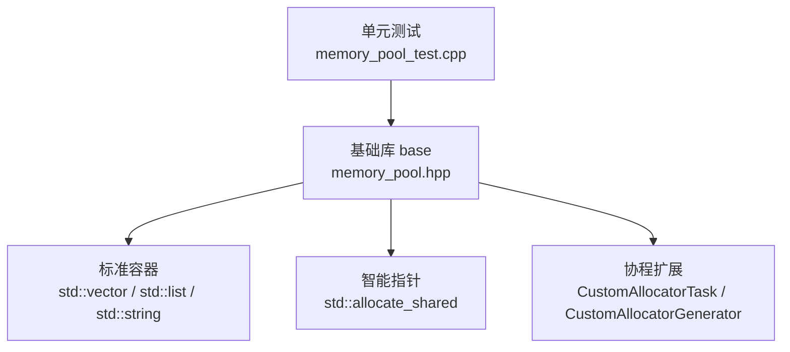
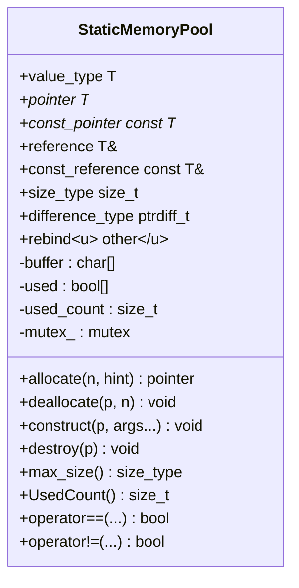
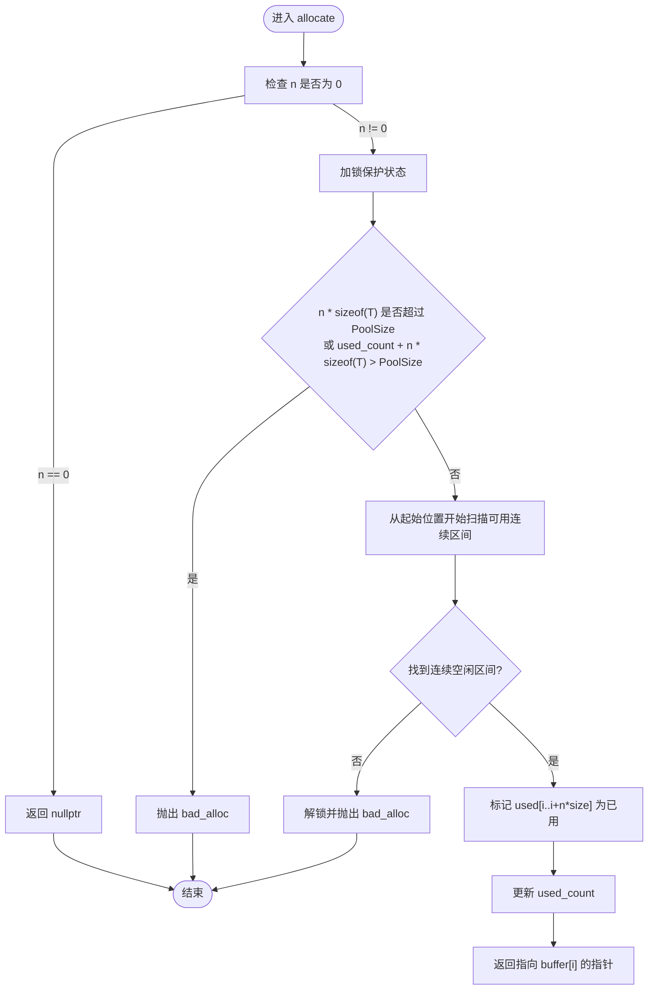
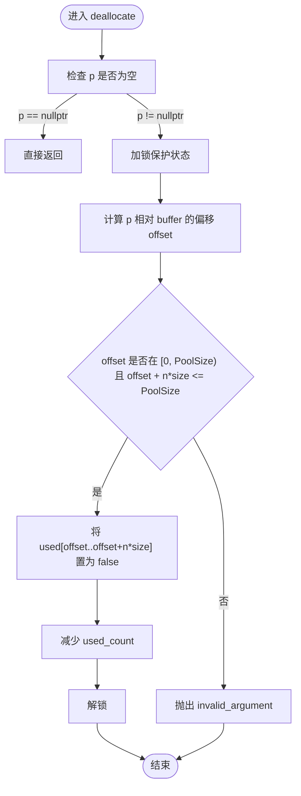
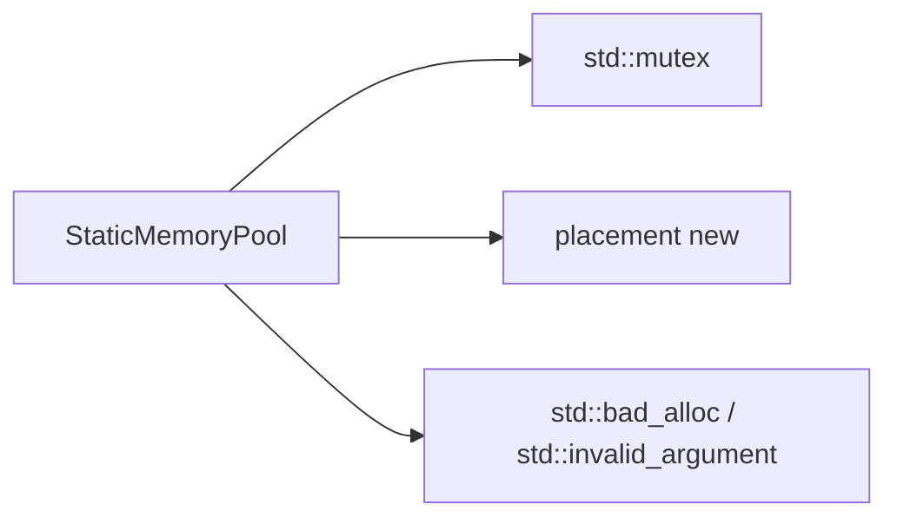

# StaticMemoryPool 静态内存池

<cite>
**本文引用的文件**   
- [memory_pool.hpp](file://base/memory_pool.hpp)
- [memory_pool_test.cpp](file://tests/Pool/memory_pool_test.cpp)
- [coroutine.hpp](file://base/coroutine.hpp)
- [memory_pool.md（中文文档）](file://docs/zh/base/memory_pool.md)
- [memory_pool.md（英文文档）](file://docs/en/base/memory_pool.md)
</cite>

## 目录
1. [引言](#引言)
2. [项目结构定位](#项目结构定位)
3. [核心概念与职责](#核心概念与职责)
4. [架构总览](#架构总览)
5. [详细组件分析](#详细组件分析)
6. [依赖关系分析](#依赖关系分析)
7. [性能与内存使用特性](#性能与内存使用特性)
8. [实际应用场景](#实际应用场景)
9. [初始化顺序、生命周期与资源清理](#初始化顺序生命周期与资源清理)
10. [线程安全与并发模型](#线程安全与并发模型)
11. [监控、诊断与故障排除](#监控诊断与故障排除)
12. [结论](#结论)
13. [附录：API 速查与对比表](#附录api-速查与对比表)

## 引言
StaticMemoryPool 是 HsBaSlicer 基础库中提供的“全局共享静态内存池”分配器实现，面向频繁分配释放小对象、跨模块共享同一块固定大小缓冲区的场景。它遵循 STL Allocator 接口规范，可与 std::vector、std::list、std::shared_ptr 等标准容器和智能指针无缝配合；同时通过“所有实例等价”的单例式语义，避免多实例状态分裂，适合全局配置缓存、日志缓冲区、跨模块共享数据结构等用途。

与 MemoryPool 相比，StaticMemoryPool 的核心差异在于：
- 存储期：StaticMemoryPool 使用静态存储期的全局缓冲区，所有同模板参数实例共享同一块内存。
- 实例语义：所有 StaticMemoryPool 实例被视为相等，不维护独立状态。
- 零实例开销：构造、拷贝、移动均无额外状态管理成本。
- 适用场景：更适合单进程内全局共享、跨模块统一分配的场景。

## 项目结构定位
StaticMemoryPool 位于基础工具层 base 目录，作为通用分配器被上层流水线、模型处理、路径生成、日志系统等多个模块间接复用。测试用例位于 tests/Pool 下，覆盖标准容器、智能指针以及协程分配器的集成用法。

图示来源
- [memory_pool.hpp:216-371](file://base/memory_pool.hpp#L216-L371)
- [memory_pool_test.cpp:13-98](file://tests/Pool/memory_pool_test.cpp#L13-L98)

章节来源
- [memory_pool.hpp:1-375](file://base/memory_pool.hpp#L1-L375)
- [memory_pool_test.cpp:1-100](file://tests/Pool/memory_pool_test.cpp#L1-L100)

## 核心概念与职责
- 固定大小静态缓冲区：按模板参数 PoolSize 在编译期确定缓冲大小，运行时不再增长。
- 字节级占用位图：使用 bool used[PoolSize] 标记每个字节是否已分配，便于快速判断连续空闲区间。
- 原子化互斥保护：通过 std::mutex 保证多线程下的 allocate/deallocate 一致性。
- 对齐保障：缓冲区和内部状态按 std::max_align_t 对齐，确保可分配任意类型对象。
- 统计能力：提供 UsedCount() 查询当前已使用字节数，便于监控。

章节来源
- [memory_pool.hpp:216-371](file://base/memory_pool.hpp#L216-L371)

## 架构总览
StaticMemoryPool 以“全局静态缓冲 + 互斥锁 + 字节位图”的极简架构实现高性能分配。其对外暴露标准的 allocate/deallocate/construct/destroy/max_size 等方法，并定义 is_always_equal=true 的分配器属性，使容器在复制、移动、交换时不会复制底层状态。

图示来源
- [memory_pool.hpp:216-371](file://base/memory_pool.hpp#L216-L371)

## 详细组件分析

### 静态缓冲区与状态管理
- buffer：静态字符数组，作为全局共享的原始内存区。
- used：与 buffer 同大小的布尔数组，用于记录每个字节的占用情况。
- used_count：累计已使用字节数，便于 UsedCount() 快速返回。
- mutex_：保护上述状态的互斥量，确保多线程并发安全。

复杂度说明：
- allocate 最坏情况下需要扫描整个 buffer，时间复杂度 O(PoolSize)，空间复杂度 O(1)。
- deallocate 根据偏移计算后线性清零 used 位，时间复杂度 O(n*sizeof(T))。

章节来源
- [memory_pool.hpp:367-371](file://base/memory_pool.hpp#L367-L371)

### 分配算法流程

图示来源
- [memory_pool.hpp:266-296](file://base/memory_pool.hpp#L266-L296)

章节来源
- [memory_pool.hpp:266-296](file://base/memory_pool.hpp#L266-L296)

### 释放算法流程

图示来源
- [memory_pool.hpp:305-324](file://base/memory_pool.hpp#L305-L324)

章节来源
- [memory_pool.hpp:305-324](file://base/memory_pool.hpp#L305-L324)

### 与 MemoryPool 的区别
- 状态存储：MemoryPool 使用 shared_ptr<MemoryPoolState> 共享状态；StaticMemoryPool 使用 inline static 成员变量。
- 实例语义：MemoryPool 实例可以不等价；StaticMemoryPool 所有实例等价（operator== 恒真）。
- 传播策略：StaticMemoryPool 声明 propagate_on_container_copy_assignment/move_assignment/swap 为 true，is_always_equal 为 true；MemoryPool 对应为 false。
- 典型用途：MemoryPool 适合局部作用域内的共享池；StaticMemoryPool 适合全局共享、跨模块统一分配。

章节来源
- [memory_pool.hpp:43-208](file://base/memory_pool.hpp#L43-L208)
- [memory_pool.hpp:216-371](file://base/memory_pool.hpp#L216-L371)

## 依赖关系分析
StaticMemoryPool 依赖以下标准库组件：
- <cstddef>：size_t、ptrdiff_t 等基础类型。
- <memory>：allocator 相关语义。
- <mutex>：std::mutex 与 std::lock_guard 提供线程安全。
- <new>：placement new 用于 construct。
- <stdexcept>：bad_alloc、invalid_argument 异常。

图示来源
- [memory_pool.hpp:13-17](file://base/memory_pool.hpp#L13-L17)
- [memory_pool.hpp:266-324](file://base/memory_pool.hpp#L266-L324)

章节来源
- [memory_pool.hpp:13-17](file://base/memory_pool.hpp#L13-L17)
- [memory_pool.hpp:266-324](file://base/memory_pool.hpp#L266-L324)

## 性能与内存使用特性
- 分配延迟：由于使用固定大小缓冲与位图扫描，单次 allocate 可能涉及线性扫描，但在热点路径上避免了堆分配的系统调用开销。
- 内存碎片：静态缓冲无外部碎片，但内部存在“空洞”，当大量小块分配与释放交替时可能出现碎片化，导致后续大块分配失败。
- 并发开销：每次分配/释放都需获取互斥锁，高并发下锁竞争可能成为瓶颈。
- 监控指标：可通过 UsedCount() 观察已使用字节数，结合 max_size() 评估剩余容量。

优化建议：
- 合理设置 PoolSize，使其略大于峰值使用量，降低扩容失败概率。
- 批量分配与释放，减少锁竞争次数。
- 对热点路径进行分桶或分段缓冲设计，降低线性扫描成本（属于演进方向，非当前实现）。

章节来源
- [memory_pool.hpp:266-324](file://base/memory_pool.hpp#L266-L324)
- [memory_pool.hpp:358-365](file://base/memory_pool.hpp#L358-L365)

## 实际应用场景
- 全局配置缓存：多个模块读取相同配置数据，使用 StaticMemoryPool 分配配置节点，避免重复分配。
- 日志系统缓冲区：高频写入日志条目，使用静态池减少日志 I/O 前的内存抖动。
- 跨模块共享数据结构：如事件队列、消息总线中的轻量节点，统一由静态池分配，便于集中监控与调试。
- 协程任务与生成器：结合自定义分配器协程封装，在异步任务中使用静态池分配中间对象。

示例参考：
- 标准容器与智能指针：见测试用例中对 vector、list、allocate_shared 的使用。
- 协程集成：见测试用例中对 CustomAllocatorTask 与 CustomAllocatorGenerator 的设置与使用。

章节来源
- [memory_pool_test.cpp:13-98](file://tests/Pool/memory_pool_test.cpp#L13-L98)
- [coroutine.hpp](file://base/coroutine.hpp)

## 初始化顺序、生命周期与资源清理
- 初始化顺序：StaticMemoryPool 的静态成员 buffer、used、used_count、mutex_ 在程序启动阶段完成初始化，顺序由编译器与运行时共同决定。由于它们都是 POD 或简单类型，不存在复杂构造逻辑。
- 生命周期：静态存储期对象在程序结束时销毁；StaticMemoryPool 没有析构逻辑，因此无需担心析构顺序问题。
- 资源清理：静态缓冲在进程退出时自动回收；若需要在运行期重置池状态，应自行实现 reset 方法（当前未提供），或通过容器生命周期控制对象数量。

注意事项：
- 不要在动态加载的模块中假设不同翻译单元的 StaticMemoryPool 实例拥有不同状态；它们始终共享同一全局缓冲。
- 若业务需要“软重置”，可在应用层维护一个计数器或使用带版本号的槽位表（属于扩展设计）。

章节来源
- [memory_pool.hpp:367-371](file://base/memory_pool.hpp#L367-L371)

## 线程安全与并发模型
- 互斥保护：allocate 与 deallocate 均使用 std::lock_guard<std::mutex> 保护共享状态，确保多线程环境下的正确性。
- 可见性与顺序：互斥锁保证了对 used、used_count 的修改在所有线程间有序可见。
- 死锁风险：当前实现仅持有单一互斥量，无嵌套锁，基本无死锁风险。
- 性能权衡：在高并发场景下，锁粒度较粗，可能影响吞吐；可考虑读写分离或分段池（演进方向）。

章节来源
- [memory_pool.hpp:266-324](file://base/memory_pool.hpp#L266-L324)

## 监控、诊断与故障排除
常见问题与排查步骤：
- 分配失败（bad_alloc）
  - 现象：调用 allocate 抛出 std::bad_alloc。
  - 原因：请求的连续内存超过 PoolSize 或剩余空间不足。
  - 排查：使用 UsedCount() 查看已使用字节数，确认是否接近上限；必要时增大 PoolSize。
- 非法指针（invalid_argument）
  - 现象：调用 deallocate 抛出 std::invalid_argument。
  - 原因：传入指针不在 pool 范围内或长度越界。
  - 排查：检查指针来源与生命周期，确保只释放本池分配的地址。
- 性能退化
  - 现象：分配耗时增加。
  - 原因：位图碎片化导致线性扫描变长；或高并发锁竞争。
  - 排查：统计 UsedCount() 变化趋势，评估是否需要调整 PoolSize 或引入分桶策略。

监控建议：
- 定期采样 UsedCount() 与 max_size()，绘制使用率曲线。
- 在关键路径埋点记录 allocate/deallocate 耗时分布。
- 结合日志系统输出分配失败告警，辅助定位热点模块。

章节来源
- [memory_pool.hpp:266-324](file://base/memory_pool.hpp#L266-L324)
- [memory_pool.hpp:358-365](file://base/memory_pool.hpp#L358-L365)

## 结论
StaticMemoryPool 以极简的全局静态缓冲与互斥锁机制，提供了稳定、可预测的高性能分配能力，特别适合单进程内全局共享、跨模块统一分配的场景。它与 MemoryPool 形成互补：前者强调“全局共享、零实例开销”，后者强调“可共享状态、灵活作用域”。在实际工程中，应根据数据规模、并发强度与生命周期选择合适的分配器，并结合 UsedCount() 与日志监控持续优化。

## 附录：API 速查与对比表

### StaticMemoryPool API 速查
- allocate(n, hint)：分配 n 个 T 元素，返回指针；失败抛 bad_alloc。
- deallocate(p, n)：释放 n 个 T 元素；非法指针抛 invalid_argument。
- construct(p, args...)：在 p 处构造 U 对象。
- destroy(p)：析构 p 处的 U 对象。
- max_size()：返回最大可分配元素数。
- UsedCount()：返回已使用字节数。
- operator==/!=：所有实例视为相等。

章节来源
- [memory_pool.hpp:266-365](file://base/memory_pool.hpp#L266-L365)

### StaticMemoryPool vs MemoryPool 对比
- 状态存储：StaticMemoryPool 使用 inline static；MemoryPool 使用 shared_ptr<MemoryPoolState>。
- 实例等价：StaticMemoryPool 恒真；MemoryPool 比较共享状态指针。
- 容器传播：StaticMemoryPool 传播策略为 true，is_always_equal 为 true；MemoryPool 为 false。
- 典型用途：StaticMemoryPool 适合全局共享；MemoryPool 适合局部共享。

章节来源
- [memory_pool.hpp:43-208](file://base/memory_pool.hpp#L43-L208)
- [memory_pool.hpp:216-371](file://base/memory_pool.hpp#L216-L371)