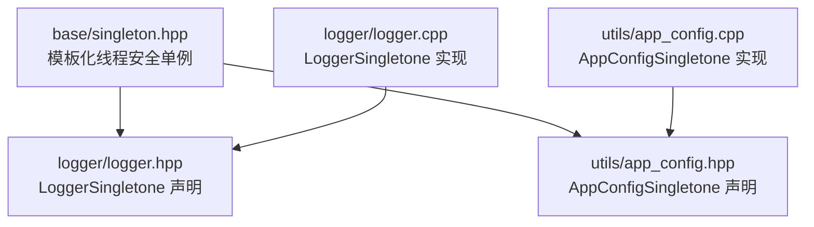
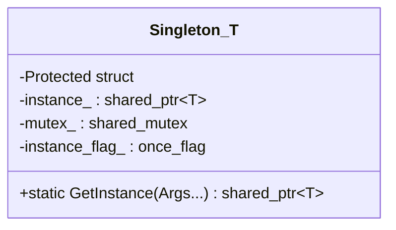
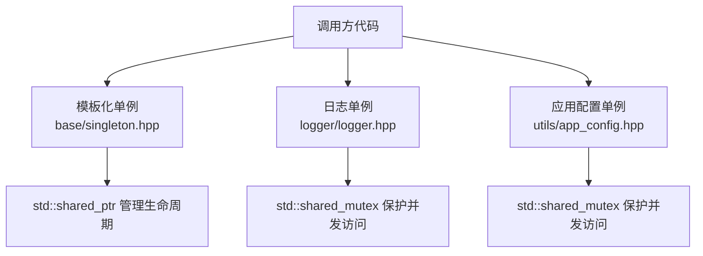
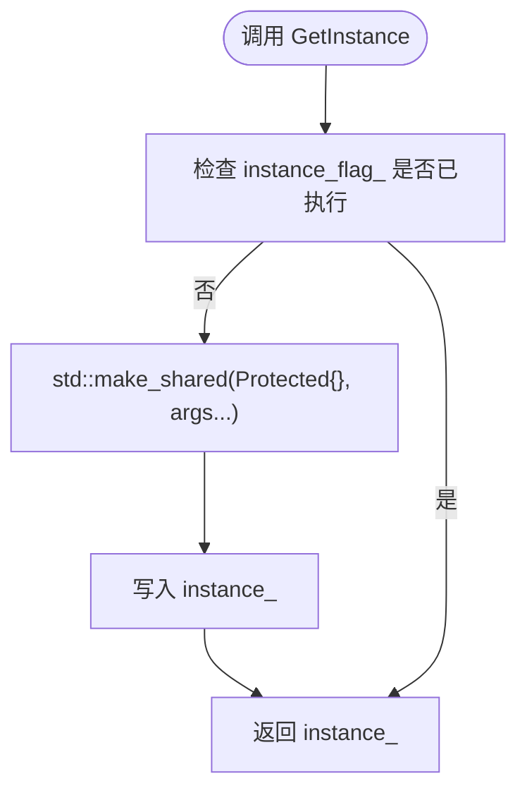
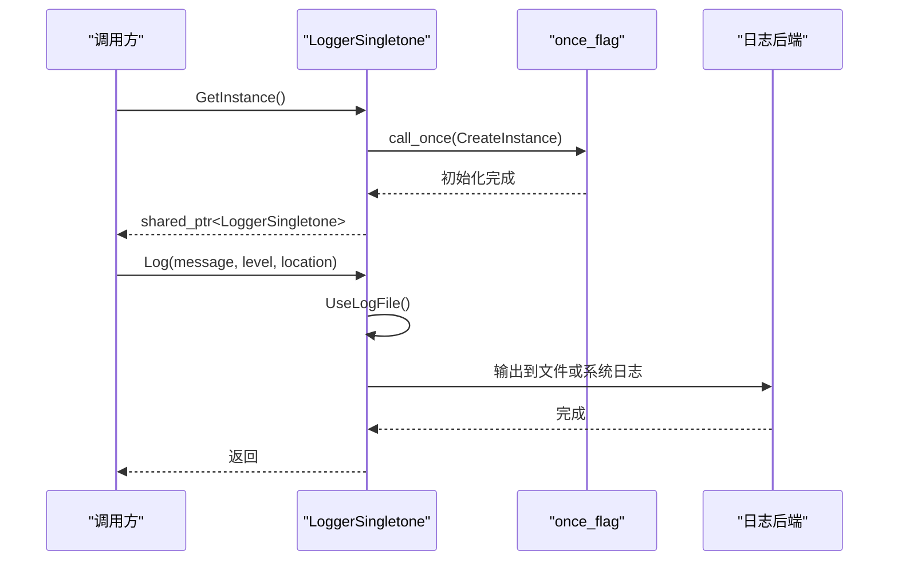
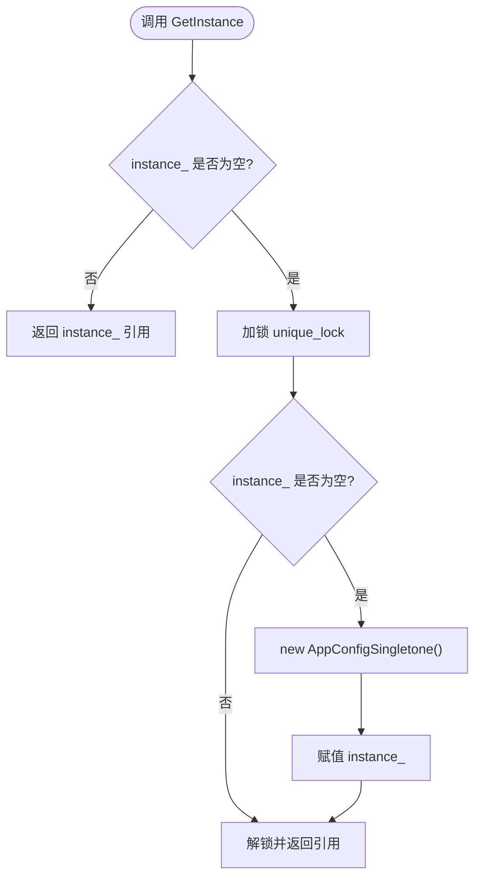
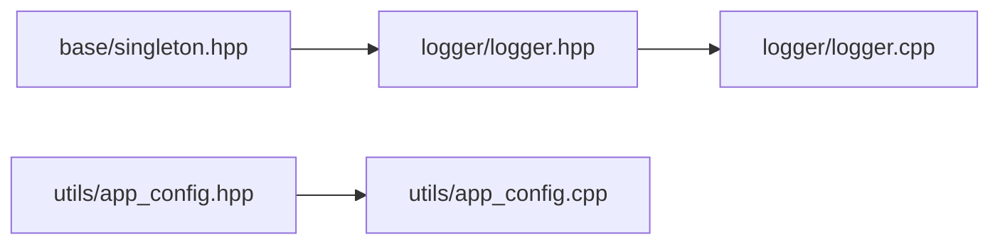
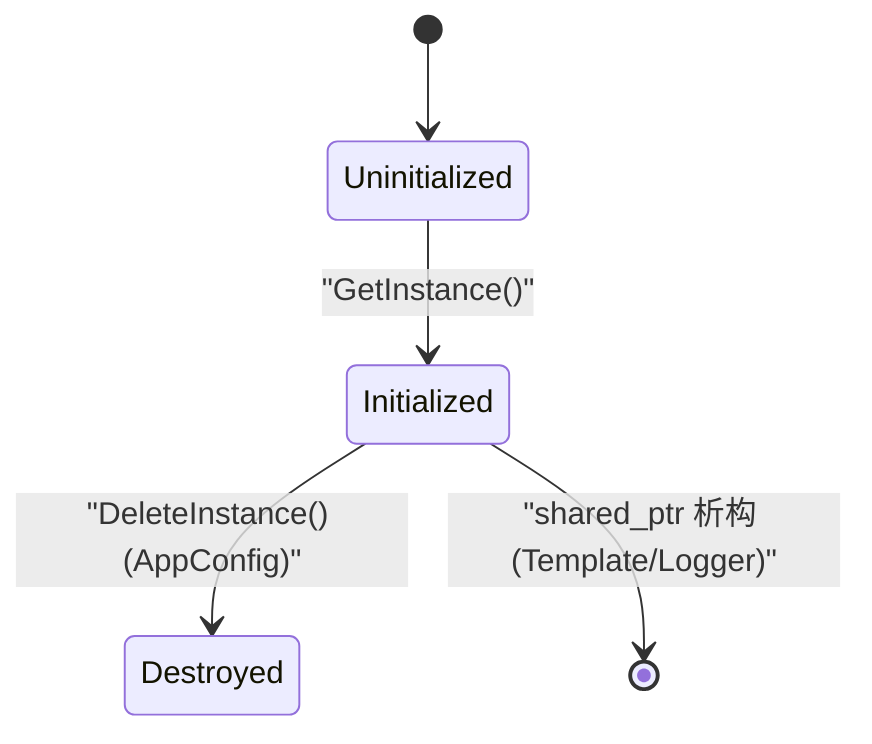

# Singleton 单例模式实现

<cite>
**本文引用的文件**   
- [base/singleton.hpp](file://base/singleton.hpp)
- [logger/logger.hpp](file://logger/logger.hpp)
- [logger/logger.cpp](file://logger/logger.cpp)
- [utils/app_config.hpp](file://utils/app_config.hpp)
- [utils/app_config.cpp](file://utils/app_config.cpp)
- [docs/zh/base/singleton.md](file://docs/zh/base/singleton.md)
- [docs/en/base/singleton.md](file://docs/en/base/singleton.md)
</cite>

## 目录
1. [引言](#引言)
2. [项目结构中的单例位置](#项目结构中的单例位置)
3. [核心组件：模板化线程安全单例](#核心组件模板化线程安全单例)
4. [架构总览：HsBaSlicer 中的单例使用方式](#架构总览hsbaslicer-中的单例使用方式)
5. [详细组件分析](#详细组件分析)
6. [依赖关系与耦合分析](#依赖关系与耦合分析)
7. [性能与并发特性](#性能与并发特性)
8. [生命周期管理与资源清理](#生命周期管理与资源清理)
9. [使用示例与最佳实践](#使用示例与最佳实践)
10. [测试友好性与依赖注入](#测试友好性与依赖注入)
11. [优缺点分析与替代方案](#优缺点分析与替代方案)
12. [故障排除指南](#故障排除指南)
13. [结论](#结论)

## 引言
本技术文档聚焦 HsBaSlicer 中的 Singleton 单例模式实现，围绕以下目标展开：
- 解释单例模式的理论基础及其在 HsBaSlicer 中的应用场景，包括全局配置管理、日志系统、资源管理和状态共享。
- 深入剖析模板化单例的实现机制，包括构造约束、线程安全保障和生命周期管理。
- 提供具体使用示例，展示如何正确声明和使用单例对象，并讨论依赖注入与测试友好性。
- 给出优缺点分析、替代方案比较以及最佳实践建议，帮助开发者在工程实践中做出合理选择。

## 项目结构中的单例位置
HsBaSlicer 中关于单例的核心实现位于 base 模块，同时 logger 与 utils 模块分别提供了业务侧的单例使用示例：
- base/singleton.hpp：定义通用模板化单例类，提供线程安全的实例获取接口。
- logger/logger.hpp 与 logger/logger.cpp：实现跨平台日志单例 LoggerSingletone，包含多级别日志输出与用户自定义字面量辅助。
- utils/app_config.hpp 与 utils/app_config.cpp：实现应用配置单例 AppConfigSingletone，用于暴露外部工具路径等共享设置。

**图表来源**
- [base/singleton.hpp:14-60](file://base/singleton.hpp#L14-L60)
- [logger/logger.hpp:27-122](file://logger/logger.hpp#L27-L122)
- [utils/app_config.hpp:12-46](file://utils/app_config.hpp#L12-L46)

**章节来源**
- [base/singleton.hpp:1-63](file://base/singleton.hpp#L1-L63)
- [logger/logger.hpp:1-196](file://logger/logger.hpp#L1-L196)
- [utils/app_config.hpp:1-50](file://utils/app_config.hpp#L1-L50)

## 核心组件：模板化线程安全单例
HsBaSlicer 的通用单例以模板形式提供，核心要点如下：
- 命名空间：HsBa::Slicer::Utils
- 模板参数 T：被封装为单例的业务类型
- 构造约束：通过 Protected 标记结构与 requires std::constructible_from<T, Protected, Args...> 限制仅允许模板内部构造
- 线程安全：使用 std::call_once 保证实例只创建一次；静态成员包含 shared_ptr、shared_mutex 与 once_flag
- 返回类型：GetInstance 返回 std::shared_ptr<T>，便于共享所有权与自动释放

**图表来源**
- [base/singleton.hpp:21-53](file://base/singleton.hpp#L21-L53)

**章节来源**
- [base/singleton.hpp:14-60](file://base/singleton.hpp#L14-L60)

## 架构总览：HsBaSlicer 中的单例使用方式
HsBaSlicer 中存在两种典型单例形态：
- 基于模板化的通用单例（base/singleton.hpp）：适用于需要统一构造约束与线程安全控制的场景。
- 业务自实现的单例（logger/logger.hpp、utils/app_config.hpp）：针对特定领域需求，自行管理实例与锁。

**图表来源**
- [base/singleton.hpp:35-40](file://base/singleton.hpp#L35-L40)
- [logger/logger.hpp:85-122](file://logger/logger.hpp#L85-L122)
- [utils/app_config.hpp:21-46](file://utils/app_config.hpp#L21-L46)

**章节来源**
- [base/singleton.hpp:1-63](file://base/singleton.hpp#L1-L63)
- [logger/logger.hpp:1-196](file://logger/logger.hpp#L1-L196)
- [utils/app_config.hpp:1-50](file://utils/app_config.hpp#L1-L50)

## 详细组件分析

### 模板化单例 Singleton<T>
- 设计目标：为任意类型 T 提供统一的单例获取入口，强制受控构造，避免外部直接 new。
- 关键接口：
  - GetInstance(Args&&... args)：转发参数构造 T，并通过 call_once 确保唯一性。
- 内部状态：
  - instance_：保存共享指针实例。
  - mutex_：互斥量（当前实现未直接使用，但保留以支持扩展）。
  - instance_flag_：once_flag 控制一次性初始化。
- 复杂度与性能：
  - 首次构造：O(1) 分配与构造，配合 call_once 的轻量同步。
  - 后续访问：O(1) 返回已存在实例。

**图表来源**
- [base/singleton.hpp:35-40](file://base/singleton.hpp#L35-L40)

**章节来源**
- [base/singleton.hpp:21-60](file://base/singleton.hpp#L21-L60)

### 日志单例 LoggerSingletone
- 职责：提供跨平台、多级别的日志输出能力，支持文件输出与系统日志（iOS/Android）。
- 单例形态：
  - 拥有静态 instance_、mutex_、instance_flag_。
  - 提供 GetInstance() 返回 shared_ptr<LoggerSingletone>。
  - 提供 Log、LogDebug、LogInfo、LogWarning、LogError 等便捷接口。
- 线程安全：
  - 使用 std::call_once 进行懒加载初始化。
  - 读写操作使用 shared_lock 或 unique_lock 保护。
- 生命周期：
  - 由 shared_ptr 管理，析构时自动释放。

**图表来源**
- [logger/logger.hpp:85-122](file://logger/logger.hpp#L85-L122)
- [logger/logger.cpp:236-240](file://logger/logger.cpp#L236-L240)
- [logger/logger.cpp:242-379](file://logger/logger.cpp#L242-L379)

**章节来源**
- [logger/logger.hpp:27-122](file://logger/logger.hpp#L27-L122)
- [logger/logger.cpp:210-389](file://logger/logger.cpp#L210-L389)

### 应用配置单例 AppConfigSingletone
- 职责：暴露应用级共享配置，例如外部压缩工具路径。
- 单例形态：
  - 静态 instance_ 与 mutex_。
  - GetInstance() 返回引用，DeleteInstance() 显式销毁。
  - GetSevenZPath() 读取配置值。
- 线程安全：
  - 双重检查锁定模式：先判断 instance_ 非空，再加锁后再次检查并创建。
  - 读操作使用 shared_lock，写操作使用 unique_lock。
- 生命周期：
  - 手动 DeleteInstance() 释放内存，需确保调用时机正确。

**图表来源**
- [utils/app_config.cpp:14-26](file://utils/app_config.cpp#L14-L26)

**章节来源**
- [utils/app_config.hpp:19-46](file://utils/app_config.hpp#L19-L46)
- [utils/app_config.cpp:1-43](file://utils/app_config.cpp#L1-L43)

## 依赖关系与耦合分析
- base/singleton.hpp 作为基础组件，被 logger 模块引入，体现“基础设施层”定位。
- logger/logger.hpp 依赖 base/singleton.hpp，但自身仍采用独立单例实现，说明业务侧对日志系统的强控制需求。
- utils/app_config.hpp 未依赖 base/singleton.hpp，而是自行实现单例，体现配置管理的独立性。

**图表来源**
- [logger/logger.hpp:24-25](file://logger/logger.hpp#L24-L25)
- [logger/logger.cpp:236-240](file://logger/logger.cpp#L236-L240)
- [utils/app_config.cpp:14-26](file://utils/app_config.cpp#L14-L26)

**章节来源**
- [logger/logger.hpp:1-196](file://logger/logger.hpp#L1-L196)
- [logger/logger.cpp:210-389](file://logger/logger.cpp#L210-L389)
- [utils/app_config.hpp:1-50](file://utils/app_config.hpp#L1-L50)
- [utils/app_config.cpp:1-43](file://utils/app_config.cpp#L1-L43)

## 性能与并发特性
- 模板化单例：
  - 首次构造通过 std::call_once 保证原子性，避免重复分配。
  - 返回 shared_ptr，拷贝开销低且具备 RAII 语义。
- 日志单例：
  - 懒加载初始化减少启动开销。
  - 日志输出根据平台选择不同后端，可能带来额外 I/O 成本。
- 应用配置单例：
  - 双重检查锁定降低锁竞争，读路径快速返回。
  - 配置读取通常低频，性能影响较小。

[本节为通用性能讨论，不直接分析具体文件]

## 生命周期管理与资源清理
- 模板化单例：
  - 由 shared_ptr 自动管理，程序退出时按静态变量析构顺序释放。
- 日志单例：
  - 同样由 shared_ptr 管理，析构时关闭日志后端资源。
- 应用配置单例：
  - 需显式调用 DeleteInstance() 释放内存，避免悬垂指针或重复释放。

**图表来源**
- [base/singleton.hpp:50-60](file://base/singleton.hpp#L50-L60)
- [logger/logger.hpp:113-122](file://logger/logger.hpp#L113-L122)
- [utils/app_config.cpp:28-36](file://utils/app_config.cpp#L28-L36)

**章节来源**
- [base/singleton.hpp:47-60](file://base/singleton.hpp#L47-L60)
- [logger/logger.hpp:103-122](file://logger/logger.hpp#L103-L122)
- [utils/app_config.cpp:28-36](file://utils/app_config.cpp#L28-L36)

## 使用示例与最佳实践
- 定义单例类：
  - 若使用模板化单例，需定义 Protected 结构体并将 Singleton<T> 设为友元。
  - 构造函数第一个参数为 Protected，其余参数由 GetInstance 转发。
- 获取单例实例：
  - 通过 Singleton<T>::GetInstance(args...) 获取 shared_ptr。
  - 多次调用返回同一实例，可断言相等。
- 注意事项：
  - 避免在单例构造函数中进行昂贵或易失败的操作。
  - 谨慎使用全局状态，尽量将可变状态最小化。
  - 对于需要显式销毁的资源，优先使用 shared_ptr 或 RAII 包装。

参考文档示例路径：
- [docs/zh/base/singleton.md:14-48](file://docs/zh/base/singleton.md#L14-L48)
- [docs/en/base/singleton.md:14-48](file://docs/en/base/singleton.md#L14-L48)

**章节来源**
- [docs/zh/base/singleton.md:1-92](file://docs/zh/base/singleton.md#L1-L92)
- [docs/en/base/singleton.md:1-92](file://docs/en/base/singleton.md#L1-L92)

## 测试友好性与依赖注入
- 模板化单例的优势：
  - 通过 Protected 构造与友元机制，可在测试中替换或模拟行为（例如通过 friend 注入测试替身）。
- 日志单例的问题：
  - 全局日志输出可能干扰测试用例，建议在测试中禁用文件输出或使用内存收集器。
- 应用配置单例的建议：
  - 在测试前调用 DeleteInstance() 重置状态，避免跨用例污染。
  - 考虑将配置读取逻辑抽象为接口，以便在测试中注入 Mock 实现。

[本节为通用测试策略讨论，不直接分析具体文件]

## 优缺点分析与替代方案
- 优点：
  - 全局访问点简化了跨模块协作。
  - 模板化单例提供一致的构造与生命周期管理。
  - 线程安全保证在多核环境下稳定运行。
- 缺点：
  - 全局状态增加耦合度，不利于单元测试。
  - 隐式依赖可能导致难以追踪的副作用。
  - 析构顺序问题（C++ 静态对象析构顺序不确定）。
- 替代方案：
  - 依赖注入容器：显式传递依赖，提升可测试性。
  - 上下文对象：将共享状态封装为上下文，按需传递。
  - 工厂模式：集中管理对象创建与生命周期。

[本节为通用架构讨论，不直接分析具体文件]

## 故障排除指南
- 常见问题：
  - 重复构造：确保仅通过 GetInstance 获取实例，避免直接 new。
  - 线程冲突：确认所有读写路径均受锁保护（如 LoggerSingletone 与 AppConfigSingletone）。
  - 资源泄漏：检查是否调用 DeleteInstance() 或在合适时机释放 shared_ptr。
- 调试建议：
  - 在日志单例中启用更详细的日志级别，观察初始化与输出流程。
  - 在应用配置单例中打印七zip路径，验证配置是否正确加载。

**章节来源**
- [logger/logger.cpp:236-379](file://logger/logger.cpp#L236-L379)
- [utils/app_config.cpp:14-36](file://utils/app_config.cpp#L14-L36)

## 结论
HsBaSlicer 中的单例模式以模板化实现为基础，结合业务侧的具体单例（日志与应用配置），形成了兼顾通用性与灵活性的架构。模板化单例通过 Protected 构造与 call_once 保障线程安全与唯一性；日志单例提供跨平台日志能力；应用配置单例则负责共享设置的统一管理。在实际工程中，应权衡全局状态的便利性与可测试性，优先考虑依赖注入与上下文传递等替代方案，以降低耦合度并提升系统可维护性。