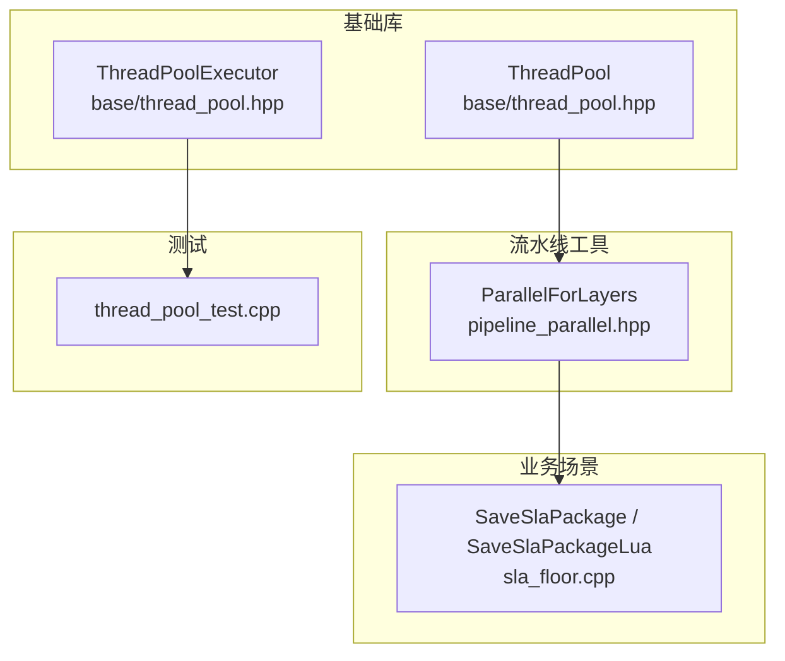
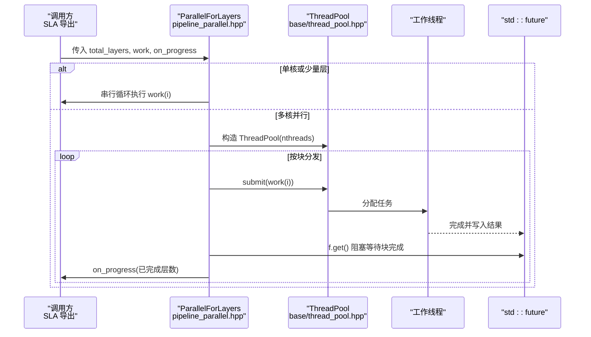
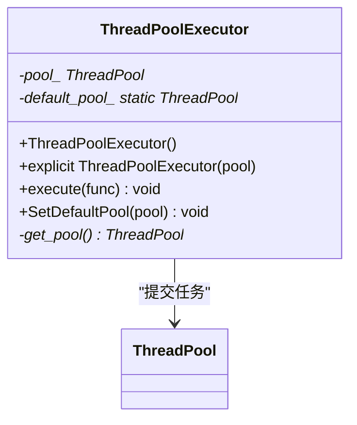
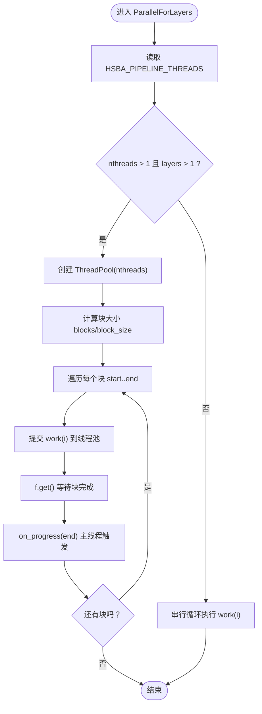
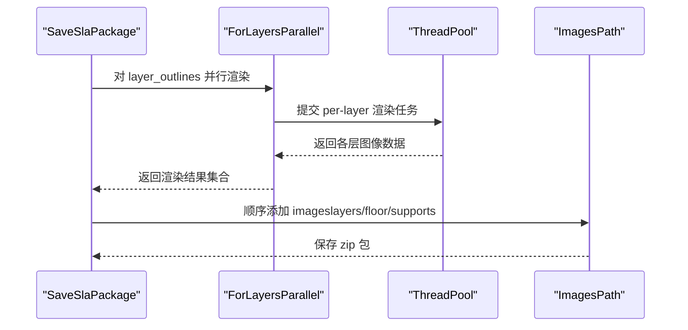
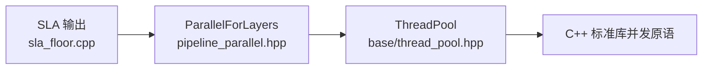

# ThreadPool 多线程任务调度

<cite>
**本文引用的文件**   
- [base/thread_pool.hpp](file://base/thread_pool.hpp)
- [DllHsBaSlicer/pipeline_parallel.hpp](file://DllHsBaSlicer/pipeline_parallel.hpp)
- [LibHsBaSlicer/Floor/sla_floor.cpp](file://LibHsBaSlicer/Floor/sla_floor.cpp)
- [tests/Pool/thread_pool_test.cpp](file://tests/Pool/thread_pool_test.cpp)
- [docs/zh/base/thread_pool.md](file://docs/zh/base/thread_pool.md)
</cite>

## 目录
1. [引言](#引言)
2. [项目结构](#项目结构)
3. [核心组件](#核心组件)
4. [架构总览](#架构总览)
5. [详细组件分析](#详细组件分析)
6. [依赖关系分析](#依赖关系分析)
7. [性能与调优](#性能与调优)
8. [故障排除指南](#故障排除指南)
9. [结论](#结论)
10. [附录：在 3D 切片算法中的应用](#附录在-3d-切片算法中的应用)

## 引言
本技术文档围绕 HsBaSlicer 中的 ThreadPool 多线程任务调度机制，系统阐述其设计模式、实现细节与使用方式。内容覆盖任务队列管理、工作线程生命周期、负载均衡策略、同步机制、配置选项、任务提交与结果获取、异常处理，以及在实际 3D 切片与填充流水线中的并行化应用。同时给出性能调优建议、死锁避免技巧与内存管理注意事项，帮助读者在复杂计算场景中安全高效地使用线程池。

## 项目结构
ThreadPool 的核心定义位于 base 模块，提供线程池基础能力；Pipeline 层在其之上封装了面向“逐层并行”的通用执行器；SLA 输出流程则展示了如何在真实业务中组合使用这些能力。测试用例覆盖了基本功能与协程集成路径。



图表来源
- [base/thread_pool.hpp:29-162](file://base/thread_pool.hpp#L29-L162)
- [base/thread_pool.hpp:164-210](file://base/thread_pool.hpp#L164-L210)
- [DllHsBaSlicer/pipeline_parallel.hpp:19-117](file://DllHsBaSlicer/pipeline_parallel.hpp#L19-L117)
- [LibHsBaSlicer/Floor/sla_floor.cpp:430-466](file://LibHsBaSlicer/Floor/sla_floor.cpp#L430-L466)

章节来源
- [base/thread_pool.hpp:1-214](file://base/thread_pool.hpp#L1-L214)
- [DllHsBaSlicer/pipeline_parallel.hpp:1-122](file://DllHsBaSlicer/pipeline_parallel.hpp#L1-L122)
- [LibHsBaSlicer/Floor/sla_floor.cpp:430-609](file://LibHsBaSlicer/Floor/sla_floor.cpp#L430-L609)
- [tests/Pool/thread_pool_test.cpp:1-87](file://tests/Pool/thread_pool_test.cpp#L1-L87)

## 核心组件
- ThreadPool：线程池核心类，负责创建工作线程、维护任务队列、协调任务执行与生命周期管理，并提供 submit、PendingTasks、ActiveTasks、WaitAll 等接口。
- ThreadPoolExecutor：可选的协程执行器，实现 IExecutor 接口，将协程调度委托给 ThreadPool，支持设置默认线程池。
- ParallelForLayers：面向“逐层并行”的高层辅助函数，基于 ThreadPool 对切片/填充阶段的层索引进行分块或动态调度，保证进度回调在主线程串行触发。
- SLA 输出流程：在保存 SLA 包时，对每层图像渲染、支撑图像渲染等可独立任务进行并行加速。

章节来源
- [base/thread_pool.hpp:29-162](file://base/thread_pool.hpp#L29-L162)
- [base/thread_pool.hpp:164-210](file://base/thread_pool.hpp#L164-L210)
- [DllHsBaSlicer/pipeline_parallel.hpp:19-117](file://DllHsBaSlicer/pipeline_parallel.hpp#L19-L117)
- [LibHsBaSlicer/Floor/sla_floor.cpp:430-466](file://LibHsBaSlicer/Floor/sla_floor.cpp#L430-L466)

## 架构总览
下图展示从高层调用到线程池执行的完整链路：上层业务（如 SLA 导出）通过 ParallelForLayers 或直接创建 ThreadPool，提交逐层任务；工作线程从任务队列拉取任务并执行；结果通过 future 返回，主线程统一收集并触发进度回调。



图表来源
- [DllHsBaSlicer/pipeline_parallel.hpp:41-117](file://DllHsBaSlicer/pipeline_parallel.hpp#L41-L117)
- [base/thread_pool.hpp:67-111](file://base/thread_pool.hpp#L67-L111)

## 详细组件分析

### ThreadPool 设计与实现
- 构造与析构
  - 构造函数根据指定线程数创建工作线程，若为 0 抛出参数错误。
  - 析构时标记停止、唤醒所有等待的工作线程，并 join 所有线程，确保资源释放。
- 任务提交
  - submit 模板方法接受任意可调用对象及其参数，包装为 packaged_task 并通过 future 返回结果。
  - 提交前检查线程池是否已停止，防止向已销毁的池继续提交任务。
- 状态查询
  - PendingTasks 返回队列长度；ActiveTasks 返回当前活跃任务计数。
- 等待全部完成
  - WaitAll 使用条件变量阻塞直到队列为空且无活跃任务。
- 工作线程循环
  - 使用互斥锁保护任务队列，条件变量通知新任务或停止信号。
  - 捕获 std::exception 以避免异常导致工作线程退出，但仍会正确减少活跃任务计数并通知完成。

```mermaid
classDiagram
class ThreadPool {
+explicit ThreadPool(num_threads)
+~ThreadPool()
+submit(f, args...) future
+PendingTasks() size_t
+ActiveTasks() size_t
+WaitAll() void
-WorkerLoop() void
-workers_ vector<thread>
-tasks_ queue<function<void()>>
-queue_mutex_ mutex
-condition_ condition_variable
-finished_condition_ condition_variable
-stop_ atomic<bool>
-active_tasks_ atomic<size_t>
}
```

图表来源
- [base/thread_pool.hpp:29-162](file://base/thread_pool.hpp#L29-L162)

章节来源
- [base/thread_pool.hpp:37-61](file://base/thread_pool.hpp#L37-L61)
- [base/thread_pool.hpp:67-111](file://base/thread_pool.hpp#L67-L111)
- [base/thread_pool.hpp:118-154](file://base/thread_pool.hpp#L118-L154)

### ThreadPoolExecutor 与协程集成
- 作用
  - 作为 IExecutor 的实现，将协程中的异步执行委托给 ThreadPool。
- 默认池
  - 可通过 SetDefaultPool 设置全局默认线程池；未显式指定时，内部懒加载一个默认实例。
- 执行语义
  - execute 将传入的可调用对象提交到线程池，不直接返回值，适合无返回值的协程任务。



图表来源
- [base/thread_pool.hpp:164-210](file://base/thread_pool.hpp#L164-L210)

章节来源
- [base/thread_pool.hpp:164-210](file://base/thread_pool.hpp#L164-L210)
- [tests/Pool/thread_pool_test.cpp:39-84](file://tests/Pool/thread_pool_test.cpp#L39-L84)

### ParallelForLayers 分层并行辅助
- 目标
  - 为切片和填充阶段提供“逐层并行”的执行模型，充分利用 CPU 核心。
- 线程数选择
  - 优先读取环境变量 HSBA_PIPELINE_THREADS，用于性能对比验证；否则使用硬件并发数。
  - 当线程数小于等于 1 或层数小于等于 1 时回退到串行路径，保持行为一致。
- 分块调度
  - 将层索引划分为若干块，每个块内并行提交任务，完成后在主线程触发一次进度回调，降低回调频率。
- 异常传播
  - 通过 future.get() 在块边界重新抛出 worker 中的异常，便于上层统一处理。



图表来源
- [DllHsBaSlicer/pipeline_parallel.hpp:41-117](file://DllHsBaSlicer/pipeline_parallel.hpp#L41-L117)

章节来源
- [DllHsBaSlicer/pipeline_parallel.hpp:41-117](file://DllHsBaSlicer/pipeline_parallel.hpp#L41-L117)

### SLA 输出中的并行渲染
- 场景
  - 保存 SLA 包时，需要对每层轮廓图、地板图、支撑图进行渲染并打包。
- 并行策略
  - 使用 ForLayersParallel（内部基于 ThreadPool）对每层图像渲染进行并行加速。
  - 渲染完成后在主线程顺序插入到压缩包，避免并发写冲突。
- 环境控制
  - 同样支持 HSBA_PIPELINE_THREADS 环境变量以调整并行度。



图表来源
- [LibHsBaSlicer/Floor/sla_floor.cpp:430-466](file://LibHsBaSlicer/Floor/sla_floor.cpp#L430-L466)
- [LibHsBaSlicer/Floor/sla_floor.cpp:469-530](file://LibHsBaSlicer/Floor/sla_floor.cpp#L469-L530)

章节来源
- [LibHsBaSlicer/Floor/sla_floor.cpp:430-609](file://LibHsBaSlicer/Floor/sla_floor.cpp#L430-L609)

## 依赖关系分析
- ThreadPool 依赖标准库原子、条件变量、互斥、队列、线程、future 等并发原语，以及自定义的错误类型与协程接口。
- Pipeline 层的 ParallelForLayers 依赖 ThreadPool 提供底层并发能力，并在上层封装业务友好的分层并行语义。
- SLA 输出流程依赖 ParallelForLayers 与 ThreadPool，形成“业务—工具—基础库”的分层依赖。



图表来源
- [LibHsBaSlicer/Floor/sla_floor.cpp:430-466](file://LibHsBaSlicer/Floor/sla_floor.cpp#L430-L466)
- [DllHsBaSlicer/pipeline_parallel.hpp:17-117](file://DllHsBaSlicer/pipeline_parallel.hpp#L17-L117)
- [base/thread_pool.hpp:13-23](file://base/thread_pool.hpp#L13-L23)

章节来源
- [base/thread_pool.hpp:13-23](file://base/thread_pool.hpp#L13-L23)
- [DllHsBaSlicer/pipeline_parallel.hpp:17-117](file://DllHsBaSlicer/pipeline_parallel.hpp#L17-L117)
- [LibHsBaSlicer/Floor/sla_floor.cpp:430-466](file://LibHsBaSlicer/Floor/sla_floor.cpp#L430-L466)

## 性能与调优
- 线程数量
  - 默认使用硬件并发数；对于 CPU 密集型任务，通常设置为物理核心数最佳。
  - 通过环境变量 HSBA_PIPELINE_THREADS 可在同一二进制中进行串行与并行对比验证。
- 任务粒度
  - 避免提交过多短任务，任务队列本身有开销；尽量聚合为合理粒度的批任务。
- 负载均衡
  - ParallelForLayers 采用分块调度，减少进度回调频率；SLA 渲染路径采用原子计数器动态分配，缓解层间成本不均导致的负载倾斜。
- 内存与缓存
  - 尽量让每个线程操作各自的数据段，减少共享内存竞争；对大对象使用移动语义传递，避免拷贝。
- I/O 与 CPU 混合
  - I/O 密集型可适当增加线程数；CPU 密集型建议不超过核心数，避免上下文切换开销。
- 进度回调
  - 将进度回调放在主线程串行触发，避免 UI 更新或日志写入成为瓶颈。

章节来源
- [DllHsBaSlicer/pipeline_parallel.hpp:49-72](file://DllHsBaSlicer/pipeline_parallel.hpp#L49-L72)
- [LibHsBaSlicer/Floor/sla_floor.cpp:443-461](file://LibHsBaSlicer/Floor/sla_floor.cpp#L443-L461)
- [docs/zh/base/thread_pool.md:293-306](file://docs/zh/base/thread_pool.md#L293-L306)

## 故障排除指南
- 提交到已停止的线程池
  - 现象：提交任务抛出运行时错误。
  - 原因：线程池已析构或标记停止。
  - 解决：确保线程池生命周期覆盖所有任务提交；或在提交前检查状态。
- 任务异常未传播
  - 现象：worker 抛异常但主线程未感知。
  - 原因：未在 future.get() 处捕获或重新抛出。
  - 解决：在块边界或最终汇聚点调用 get() 并处理异常。
- 进度回调卡顿
  - 现象：UI 或日志更新缓慢。
  - 原因：回调过于频繁或包含重逻辑。
  - 解决：合并回调频率（如 ParallelForLayers 的分块策略），或将回调改为轻量级事件。
- 线程泄漏或卡死
  - 现象：程序退出后仍有线程存在。
  - 原因：未正确 join 或提前退出。
  - 解决：依赖 ThreadPool 析构自动 join；避免手动中断线程。

章节来源
- [base/thread_pool.hpp:77-89](file://base/thread_pool.hpp#L77-L89)
- [base/thread_pool.hpp:140-153](file://base/thread_pool.hpp#L140-L153)
- [DllHsBaSlicer/pipeline_parallel.hpp:108-115](file://DllHsBaSlicer/pipeline_parallel.hpp#L108-L115)

## 结论
ThreadPool 提供了稳定、线程安全的并发任务执行基础设施，配合 Pipeline 层的 ParallelForLayers 与 SLA 输出流程，实现了高效的 3D 切片与填充并行化。通过合理的线程数配置、任务粒度划分与负载均衡策略，可以在保证正确性的前提下显著提升吞吐与响应速度。结合协程执行器，还可无缝集成现代 C++ 异步编程范式。

## 附录：在 3D 切片算法中的应用
- 切片阶段
  - 层间相互独立，适合并行处理；ParallelForLayers 将层索引分块提交，提升整体吞吐。
- 填充阶段
  - 每层填充算法可并行执行；注意填充结果写入需按层索引隔离，避免竞争。
- 支撑生成
  - 支撑检测与生成可按层并行；对于成本不均的层，可采用动态分配策略（如 SLA 渲染路径）。
- 图像渲染与打包
  - 渲染过程 CPU 密集，适合并行；打包阶段顺序写入，避免并发写冲突。

章节来源
- [DllHsBaSlicer/pipeline_parallel.hpp:22-34](file://DllHsBaSlicer/pipeline_parallel.hpp#L22-L34)
- [LibHsBaSlicer/Floor/sla_floor.cpp:469-530](file://LibHsBaSlicer/Floor/sla_floor.cpp#L469-L530)