# 基础模块 (Base Module)

<cite>
**本文引用的文件**   
- [IModel.hpp](file://base/IModel.hpp)
- [any_object.hpp](file://base/any_object.hpp)
- [thread_pool.hpp](file://base/thread_pool.hpp)
- [singleton.hpp](file://base/singleton.hpp)
- [coroutine.hpp](file://base/coroutine.hpp)
- [memory_pool.hpp](file://base/memory_pool.hpp)
- [object_pool.hpp](file://base/object_pool.hpp)
- [parallel.hpp](file://base/parallel.hpp)
</cite>

## 更新摘要
**变更内容**   
- 新增并行处理基础设施章节，详细介绍 base/parallel.hpp 中的进程级线程池单例和原子光标调度
- 更新 ThreadPool 相关章节，说明 PipelinePool 进程级单例的使用方式
- 新增 ParallelForLayers、ParallelMapLayers 及其协程变体的详细说明
- 更新性能优化部分，包含 HSBA_PIPELINE_THREADS 环境变量配置
- 扩展依赖关系图，展示并行基础设施与其他组件的关系

## 目录
1. [引言](#引言)
2. [项目结构](#项目结构)
3. [核心组件](#核心组件)
4. [架构总览](#架构总览)
5. [详细组件分析](#详细组件分析)
6. [并行处理基础设施](#并行处理基础设施)
7. [依赖关系分析](#依赖关系分析)
8. [性能与线程安全](#性能与线程安全)
9. [故障排除指南](#故障排除指南)
10. [结论](#结论)
11. [附录：API 参考速查](#附录api-参考速查)

## 引言
本文件面向 HsBaSlicer 的 base 基础模块，系统性梳理并文档化其提供的核心基础类型与工具类。重点覆盖以下能力：
- IModel 接口抽象：统一 3D 模型加载、保存、变换、几何查询与三角网格导出。
- AnyObject 泛型对象容器：运行时类型反射、字段遍历、方法动态调用与测试 Mock 支持。
- ThreadPool 多线程任务调度：可配置线程池、任务提交、等待完成、协程执行器集成。
- **新增** 并行处理基础设施：进程级 ThreadPool 单例、原子光标调度、层间并行执行工具。
- Singleton 单例模式：基于 std::call_once 的线程安全全局实例管理。
- Coroutine 协程支持：Task、Generator、Executor 抽象与自定义分配器支持。
- MemoryPool / StaticMemoryPool 内存池：固定大小块分配器，STL Allocator 兼容。
- NamedObjectPool 命名对象池：按名称管理共享对象生命周期，自动清理非活跃对象。

这些组件共同构成上层切片、路径生成、支撑生成等模块的基础设施，提供跨平台、跨语言（Lua/C++）互操作、并发与内存优化能力。

## 项目结构
base 模块以头文件为主，辅以少量实现文件，组织方式遵循"按能力分文件"的原则：
- 接口与类型定义：IModel.hpp、units.hpp、concepts.hpp、template_helper.hpp
- 反射与动态调用：any_object.hpp、any_visit.hpp、static_reflect.hpp
- 并发与协程：thread_pool.hpp、coroutine.hpp、**parallel.hpp（新增）**
- 内存与对象池：memory_pool.hpp、object_pool.hpp
- 通用工具：error.hpp、string_helper.hpp、delegate.hpp、encoding_convert.hpp、boost_std_convert.hpp、eigen_translator.hpp

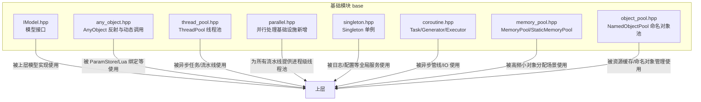

图表来源
- [IModel.hpp:110-139](file://base/IModel.hpp#L110-L139)
- [any_object.hpp:43-115](file://base/any_object.hpp#L43-L115)
- [thread_pool.hpp:25-162](file://base/thread_pool.hpp#L25-L162)
- [parallel.hpp:64-75](file://base/parallel.hpp#L64-L75)
- [singleton.hpp:14-53](file://base/singleton.hpp#L14-L53)
- [coroutine.hpp:41-73](file://base/coroutine.hpp#L41-L73)
- [memory_pool.hpp:19-208](file://base/memory_pool.hpp#L19-L208)
- [object_pool.hpp:16-46](file://base/object_pool.hpp#L16-L46)

章节来源
- [IModel.hpp:1-151](file://base/IModel.hpp#L1-L151)
- [any_object.hpp:1-815](file://base/any_object.hpp#L1-L815)
- [thread_pool.hpp:1-214](file://base/thread_pool.hpp#L1-L214)
- [parallel.hpp:1-263](file://base/parallel.hpp#L1-L263)
- [singleton.hpp:1-63](file://base/singleton.hpp#L1-L63)
- [coroutine.hpp:1-1091](file://base/coroutine.hpp#L1-L1091)
- [memory_pool.hpp:1-375](file://base/memory_pool.hpp#L1-L375)
- [object_pool.hpp:1-286](file://base/object_pool.hpp#L1-L286)

## 核心组件
本节对每个核心组件进行概览式说明，并在后续章节展开详细分析与图示。

- IModel：定义统一的 3D 模型抽象，包括加载/保存、平移/旋转/缩放/仿射变换、包围盒与体积计算、三角网格导出；同时暴露 C ABI 数据结构用于跨语言交互。
- AnyObject：类型擦除的对象容器，封装 TypeInfo，支持 cast/cast_new、Invoke 动态方法调用、ForeachField 字段遍历；内置测试 Mock 注册表（条件编译）。
- ThreadPool：工作线程池，支持 submit 提交任意可调用对象并返回 future，WaitAll 等待全部完成，ActiveTasks/PendingTasks 监控状态；可选 ThreadPoolExecutor 作为协程执行器。
- **新增** 并行处理基础设施：PipelinePool 进程级线程池单例、ResolvePipelineThreads 环境配置、ParallelForLayers/ParallelMapLayers 层间并行工具、原子光标调度机制。
- Singleton：模板化线程安全单例，通过 call_once 保证唯一构造，对外暴露 GetInstance(Args...) 获取 shared_ptr。
- Coroutine：Task<T, Executor>、Task<void, Executor>、CustomAllocatorTask、Generator、CustomAllocatorGenerator，以及 IExecutor/NoopExecutor/AsyncExecutor 执行器抽象；支持 then/catching/finally 回调链。
- MemoryPool/StaticMemoryPool：固定容量内存池分配器，符合 STL Allocator 语义；前者为实例共享状态，后者为全局静态共享。
- NamedObjectPool：按名称管理 shared_ptr 对象的生命周期，支持 emplace/insert/allocate/get/remove/Contains/Cleanup 等，内部维护 weak_ptr 判断非活跃对象。

章节来源
- [IModel.hpp:110-139](file://base/IModel.hpp#L110-L139)
- [any_object.hpp:43-115](file://base/any_object.hpp#L43-L115)
- [thread_pool.hpp:25-162](file://base/thread_pool.hpp#L25-L162)
- [parallel.hpp:37-75](file://base/parallel.hpp#L37-L75)
- [singleton.hpp:14-53](file://base/singleton.hpp#L14-L53)
- [coroutine.hpp:41-73](file://base/coroutine.hpp#L41-L73)
- [memory_pool.hpp:19-208](file://base/memory_pool.hpp#L19-L208)
- [object_pool.hpp:16-46](file://base/object_pool.hpp#L16-L46)

## 架构总览
下图展示基础模块各组件之间的协作关系：IModel 是领域抽象；AnyObject 提供反射与动态调用；ThreadPool 与 Coroutine 提供并发与异步能力；**新增的 parallel.hpp 提供进程级线程池单例和层间并行工具**；Singleton 提供全局服务；MemoryPool/ObjectPool 提供内存与对象级复用。

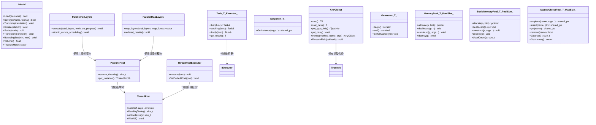

图表来源
- [IModel.hpp:110-139](file://base/IModel.hpp#L110-L139)
- [any_object.hpp:43-115](file://base/any_object.hpp#L43-L115)
- [thread_pool.hpp:25-162](file://base/thread_pool.hpp#L25-L162)
- [thread_pool.hpp:164-210](file://base/thread_pool.hpp#L164-L210)
- [parallel.hpp:64-75](file://base/parallel.hpp#L64-L75)
- [parallel.hpp:192-218](file://base/parallel.hpp#L192-L218)
- [singleton.hpp:14-53](file://base/singleton.hpp#L14-L53)
- [coroutine.hpp:41-73](file://base/coroutine.hpp#L41-L73)
- [coroutine.hpp:205-382](file://base/coroutine.hpp#L205-L382)
- [coroutine.hpp:784-893](file://base/coroutine.hpp#L784-L893)
- [memory_pool.hpp:43-208](file://base/memory_pool.hpp#L43-L208)
- [memory_pool.hpp:215-372](file://base/memory_pool.hpp#L215-L372)
- [object_pool.hpp:22-46](file://base/object_pool.hpp#L22-L46)

## 详细组件分析

### IModel 接口抽象
IModel 定义了 3D 模型的统一抽象，涵盖：
- 文件 IO：Load/Save，支持多种 ModelFormat（PLY/OBJ/STL/OFF/VRML/STEP/IGES/BREP/XYZ/VDB 等）。
- 几何变换：Translate/Rotate/Scale/Transform（支持 Eigen Isometry3f/Matrix4f/Affine）。
- 几何查询：BoundingBox/Volume。
- 网格导出：TriangleMesh 返回 igl 风格的顶点矩阵与面片索引矩阵。
- C ABI 数据结构：HsBaVector2f/HsBaVector3f/HsBaQuaternionf/HsBaMatrix4f/HsBaPoly2D/HsBaPolys2D，便于 Lua/C 侧访问。

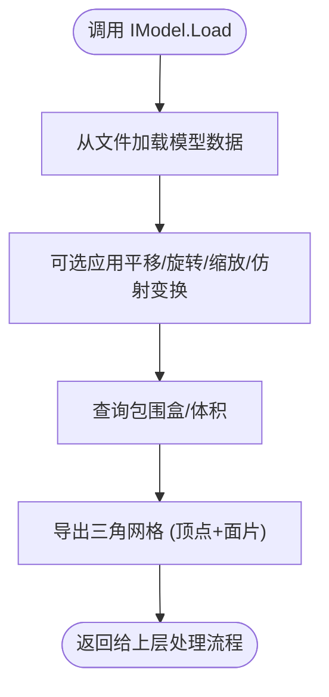

图表来源
- [IModel.hpp:110-139](file://base/IModel.hpp#L110-L139)
- [IModel.hpp:65-109](file://base/IModel.hpp#L65-L109)
- [IModel.hpp:19-61](file://base/IModel.hpp#L19-L61)

最佳实践
- 在切片前对模型进行归一化变换（如 Scale），确保单位一致。
- 使用 BoundingBox 快速剔除不可见或越界区域。
- TriangleMesh 输出应配合下游算法（填充、支撑、路径）的数据结构进行转换。

章节来源
- [IModel.hpp:19-61](file://base/IModel.hpp#L19-L61)
- [IModel.hpp:65-109](file://base/IModel.hpp#L65-L109)
- [IModel.hpp:110-139](file://base/IModel.hpp#L110-L139)

### AnyObject 泛型对象容器
AnyObject 提供类型擦除与反射能力：
- 类型信息：TypeInfo 包含 Name、destroy/copy/move 函数指针、fields/methods 映射。
- 构造与拷贝：支持任意类型 T 构造，copy/move 语义由 TypeInfo 控制。
- 类型转换：cast<T>/cast_new<T> 进行类型安全检查，不匹配抛出异常。
- 动态调用：Invoke(method_name, args) 通过 MethodInfo 分发。
- 字段遍历：ForeachField 回调遍历 fields。
- 测试 Mock：MockRegistry 支持 stub/when_called/stub_return/stub_throw 等，线程安全且可启用/禁用。

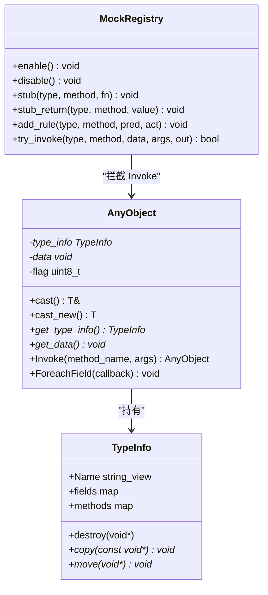

图表来源
- [any_object.hpp:43-115](file://base/any_object.hpp#L43-L115)
- [any_object.hpp:117-670](file://base/any_object.hpp#L117-L670)
- [any_object.hpp:673-815](file://base/any_object.hpp#L673-L815)

使用方法与注意事项
- 将业务对象注册到 GetTypeInfo<T>() 中，填写 destroy/copy/move 与 fields/methods。
- 使用 type_ensure<&T::method>() 自动包装成员函数。
- 自由函数/静态方法需手动 lambda 包装，注意参数校验与异常处理。
- 在测试环境中启用 HSBA_ANY_OBJECT_ENABLE_MOCK，使用 ScopedStubs/ScopedEnable 隔离用例。

章节来源
- [any_object.hpp:43-115](file://base/any_object.hpp#L43-L115)
- [any_object.hpp:673-815](file://base/any_object.hpp#L673-L815)
- [any_object.hpp:117-670](file://base/any_object.hpp#L117-L670)

### ThreadPool 多线程任务调度
ThreadPool 提供：
- 构造：指定 worker 数量，默认 hardware_concurrency。
- 提交任务：submit(F&&, Args&&...) 返回 std::future。
- 状态查询：PendingTasks()/ActiveTasks()。
- 等待完成：WaitAll() 阻塞直到队列空且无活跃任务。
- 析构：停止所有 worker，join 线程。
- 协程集成：ThreadPoolExecutor 实现 IExecutor，支持 SetDefaultPool。

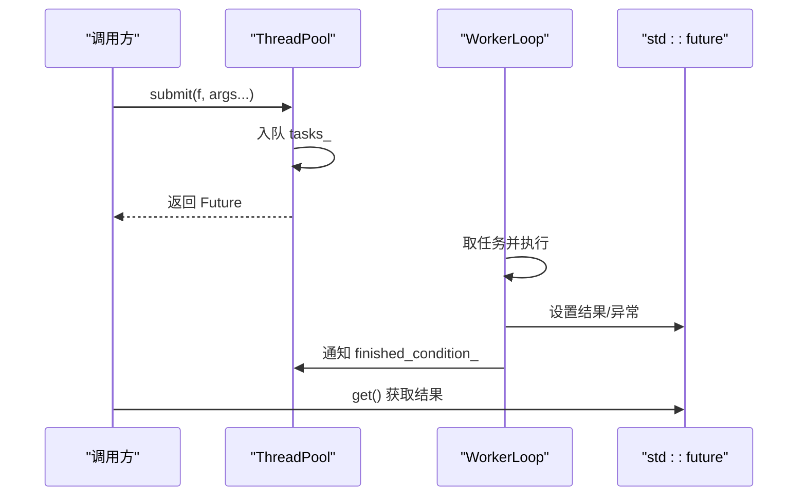

图表来源
- [thread_pool.hpp:25-162](file://base/thread_pool.hpp#L25-L162)
- [thread_pool.hpp:164-210](file://base/thread_pool.hpp#L164-L210)

线程安全与异常
- 提交时若线程池已停止则抛 RuntimeError。
- 任务内异常被捕获但不影响其他任务；异常通过 future.get() 传播。
- WaitAll 使用 condition_variable 等待任务完成。

章节来源
- [thread_pool.hpp:25-162](file://base/thread_pool.hpp#L25-L162)
- [thread_pool.hpp:164-210](file://base/thread_pool.hpp#L164-L210)

### Singleton 单例模式
Singleton<T> 提供：
- GetInstance(Args...): 线程安全构造，返回 shared_ptr<T>。
- 内部使用 call_once 保证仅构造一次。
- 禁止拷贝/移动，外部通过 shared_ptr 管理生命周期。

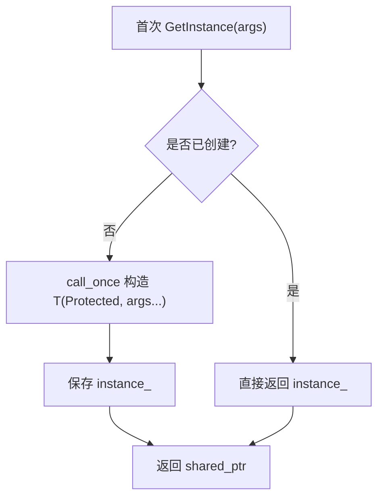

图表来源
- [singleton.hpp:14-53](file://base/singleton.hpp#L14-L53)

章节来源
- [singleton.hpp:14-53](file://base/singleton.hpp#L14-L53)

### Coroutine 协程支持
Coroutine 模块提供：
- IExecutor 接口：execute(std::function<void()>&&)。
- NoopExecutor/AsyncExecutor：同步/异步执行器。
- Task<T, Executor>/Task<void, Executor>：协程任务，支持 then/catching/finally。
- CustomAllocatorTask：支持自定义分配器的协程任务。
- Generator<T>/CustomAllocatorGenerator<T>：惰性迭代器风格协程。
- ThreadPoolExecutor：将协程调度到线程池。

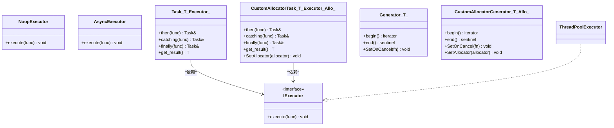

图表来源
- [coroutine.hpp:41-73](file://base/coroutine.hpp#L41-L73)
- [coroutine.hpp:205-382](file://base/coroutine.hpp#L205-L382)
- [coroutine.hpp:563-773](file://base/coroutine.hpp#L563-L773)
- [coroutine.hpp:784-893](file://base/coroutine.hpp#L784-L893)
- [coroutine.hpp:901-1042](file://base/coroutine.hpp#L901-L1042)

章节来源
- [coroutine.hpp:41-73](file://base/coroutine.hpp#L41-L73)
- [coroutine.hpp:205-382](file://base/coroutine.hpp#L205-L382)
- [coroutine.hpp:563-773](file://base/coroutine.hpp#L563-L773)
- [coroutine.hpp:784-893](file://base/coroutine.hpp#L784-L893)
- [coroutine.hpp:901-1042](file://base/coroutine.hpp#L901-L1042)

### MemoryPool / StaticMemoryPool 内存池
MemoryPool<T, PoolSize>：
- 基于 shared_ptr<MemoryPoolState<PoolSize>> 共享状态。
- allocate/deallocate 线程安全，检查对齐与边界。
- 符合 STL Allocator 接口，可与 std::vector 等容器配合。

StaticMemoryPool<T, PoolSize>：
- 全局静态 buffer/used/used_count，所有实例等价。
- 同样实现 STL Allocator 接口。

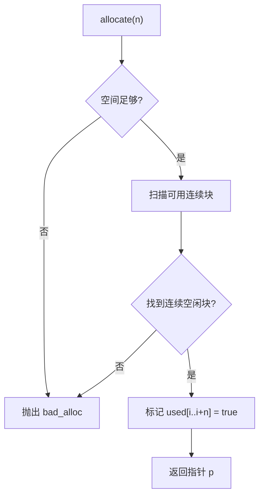

图表来源
- [memory_pool.hpp:43-208](file://base/memory_pool.hpp#L43-L208)
- [memory_pool.hpp:215-372](file://base/memory_pool.hpp#L215-L372)

章节来源
- [memory_pool.hpp:43-208](file://base/memory_pool.hpp#L43-L208)
- [memory_pool.hpp:215-372](file://base/memory_pool.hpp#L215-L372)

### NamedObjectPool 命名对象池
NamedObjectPool<T, MaxSize>：
- 按名称管理 shared_ptr 对象，内部维护 PooledObject{shared_ref, weak_ref}。
- emplace/insert/allocate 插入对象，get/remove 获取/删除。
- CleanupInactiveObjects 清理非活跃对象（use_count==1）。
- 线程安全：读写分离锁（shared_mutex）。

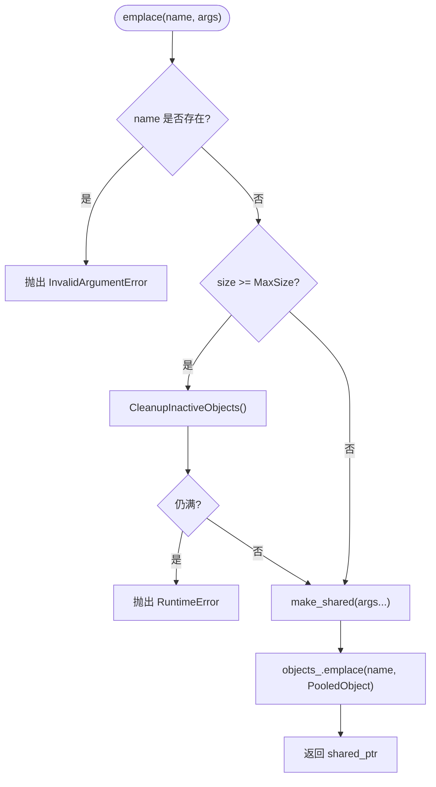

图表来源
- [object_pool.hpp:22-46](file://base/object_pool.hpp#L22-L46)
- [object_pool.hpp:66-92](file://base/object_pool.hpp#L66-L92)
- [object_pool.hpp:261-279](file://base/object_pool.hpp#L261-L279)

章节来源
- [object_pool.hpp:22-46](file://base/object_pool.hpp#L22-L46)
- [object_pool.hpp:66-92](file://base/object_pool.hpp#L66-L92)
- [object_pool.hpp:261-279](file://base/object_pool.hpp#L261-L279)

## 并行处理基础设施

**新增** base/parallel.hpp 提供了进程级的并行处理基础设施，专门为切片流水线的层间并行优化而设计。该模块解决了传统 ThreadPool 每次调用都启停的开销问题，并提供原子光标调度的动态负载均衡机制。

### 进程级线程池单例

PipelinePool() 函数提供进程级 ThreadPool 单例，具有以下特性：
- **懒加载构造**：首次使用时才创建线程池，避免不必要的初始化开销。
- **进程级生命周期**：线程池存活至进程退出，跨所有流水线复用。
- **环境变量配置**：通过 HSBA_PIPELINE_THREADS 环境变量控制线程数，未设置时回退到 hardware_concurrency()。
- **首层调用保护**：首次构造时读取环境变量，后续调用忽略变化。

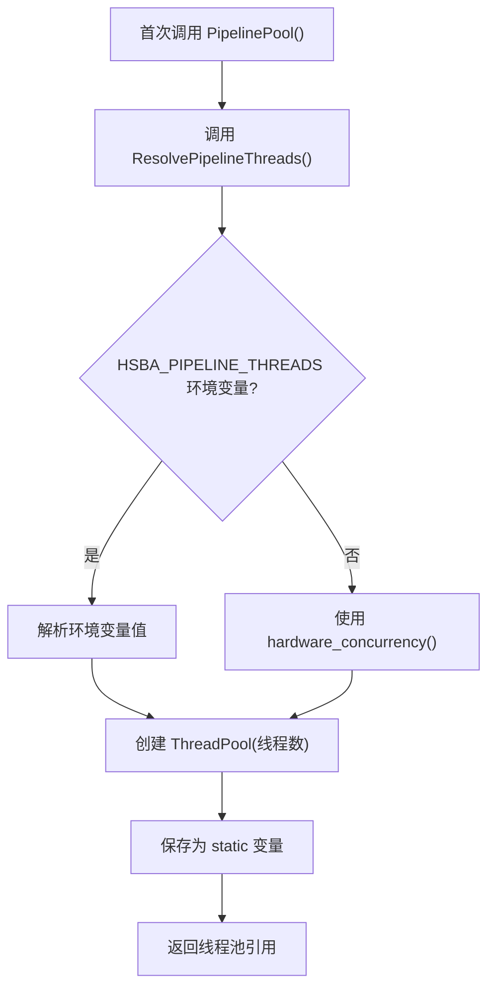

图表来源
- [parallel.hpp:64-68](file://base/parallel.hpp#L64-L68)
- [parallel.hpp:37-54](file://base/parallel.hpp#L37-L54)

### 原子光标调度机制

RunAtomicIndexed 实现了高效的原子光标调度，替代传统的固定分块 + barrier 方案：
- **抢占式取号**：每个 worker 循环执行 `cursor.fetch_add(1)` 获取下一个任务索引。
- **动态负载均衡**：无需预先划分任务块，自动适应不同层的处理时间差异。
- **进度回调优化**：主线程每 32 层回调一次 on_progress，减少回调开销。
- **串行回退**：当 HSBA_PIPELINE_THREADS=1 时，保持精确的顺序执行语义。

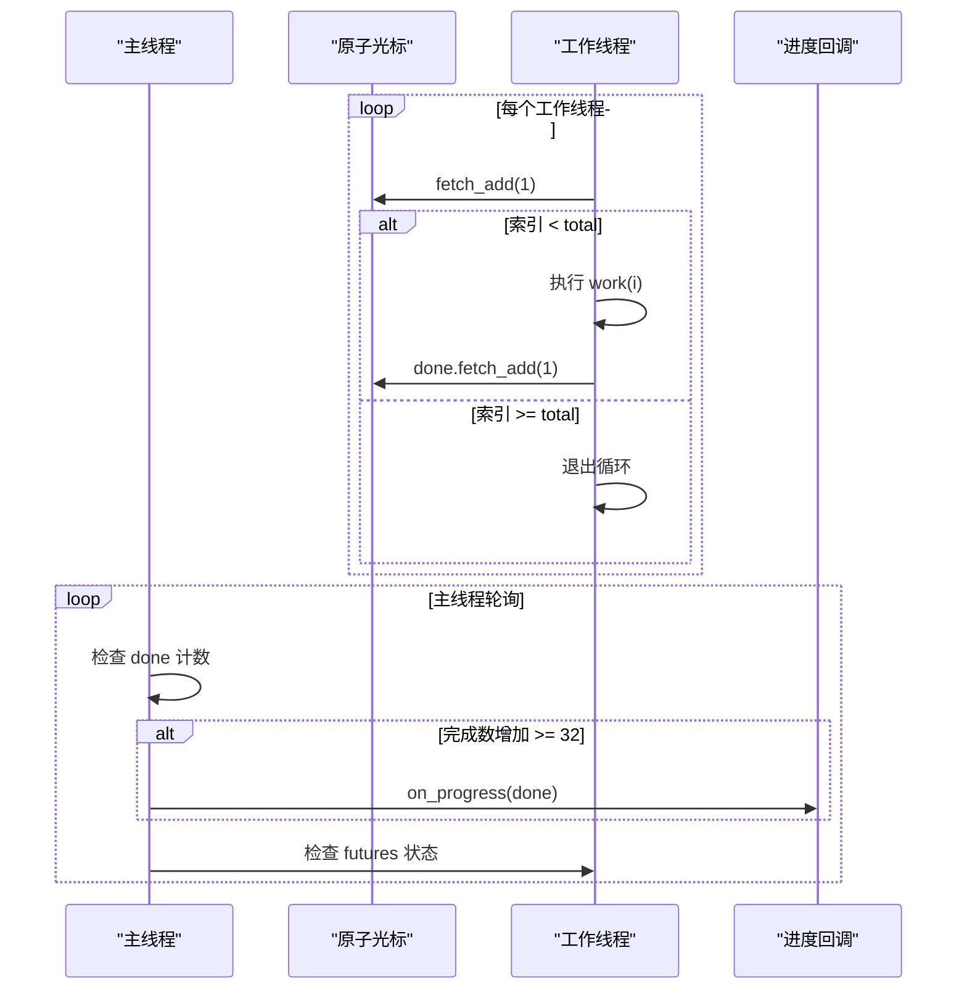

图表来源
- [parallel.hpp:114-174](file://base/parallel.hpp#L114-L174)

### 层间并行工具

#### ParallelForLayers
用于执行每层独立的工作，适用于切片、填充等阶段：
- **线程安全约束**：work() 函数只能写入索引对应的输出槽位。
- **进度回调**：on_progress 仅在调用线程触发，报告完成的层数。
- **异常处理**：worker 异常通过 futures.get() 重新抛出到调用线程。

#### ParallelMapLayers
用于生成每层的结果并返回有序向量：
- **结果排序**：通过预分配向量并按索引写入，保证结果顺序与输入一致。
- **类型要求**：R 必须满足 MoveAssignable 概念。
- **串行一致性**：HSBA_PIPELINE_THREADS=1 时保持与原 for 循环完全一致的位级等价性。

#### 协程变体
提供 ParallelForLayersAsync 和 ParallelMapLayersAsync，支持协程上下文：
- **协程友好**：返回 Utils::Task<void> 或 Utils::Task<std::vector<R>>。
- **语义一致**：行为与同步版本完全相同，但可在协程中使用 co_await。
- **调度优化**：利用 AsyncExecutor 的 execute 阻塞特性，在非协程上下文中等价于直接调用。

### 实际应用场景

支撑生成阶段的并行化：
```cpp
// ISupport.cpp 中的实现
if (IsLayerIndependent()) {
    return HsBa::Slicer::Pipeline::ParallelMapLayers<PolygonsD>(
        total,
        [this, &layers, &config](int i) -> PolygonsD {
            const PolygonsD& prev = (i == 0) ? PolygonsD{} : layers[i - 1];
            return Generate(layers[i], prev, config.layer_height, config);
        });
}
```

G-code 序列化阶段的并行化：
```cpp
// gcodepath.cpp 中的实现
const int total = static_cast<int>(layers_.size());
std::vector<std::string> bodies = HsBa::Slicer::Pipeline::ParallelMapLayers<std::string>(
    total, [this, firmware](int i) { return GenerateLayerGCode(i, firmware); });
```

**章节来源**
- [parallel.hpp:37-75](file://base/parallel.hpp#L37-L75)
- [parallel.hpp:90-174](file://base/parallel.hpp#L90-L174)
- [parallel.hpp:192-218](file://base/parallel.hpp#L192-L218)
- [parallel.hpp:236-257](file://base/parallel.hpp#L236-L257)
- [support/ISupport.cpp:27-35](file://support/ISupport.cpp#L27-L35)
- [paths/gcodepath.cpp:339-341](file://paths/gcodepath.cpp#L339-L341)

## 依赖关系分析
- IModel 依赖 Eigen 数学库与 magic_enum 枚举扩展。
- AnyObject 依赖 concepts.hpp、error.hpp，并提供 MockRegistry（条件编译）。
- ThreadPool 依赖 coroutine.hpp（可选）、error.hpp。
- **新增** parallel.hpp 依赖 thread_pool.hpp 和 coroutine.hpp，为上层提供进程级并行基础设施。
- Coroutine 依赖 template_helper.hpp，并暴露 IExecutor 供 ThreadPoolExecutor 实现。
- MemoryPool/StaticMemoryPool 独立，仅依赖标准库。
- NamedObjectPool 依赖 error.hpp。

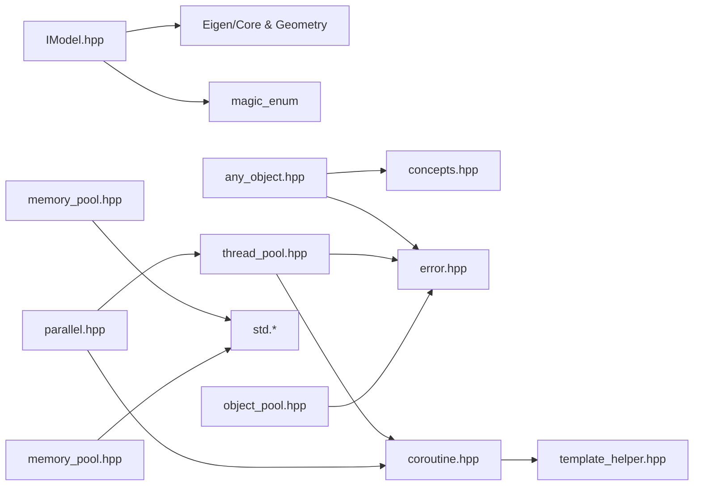

图表来源
- [IModel.hpp:13-18](file://base/IModel.hpp#L13-L18)
- [IModel.hpp:142-149](file://base/IModel.hpp#L142-L149)
- [any_object.hpp:22-23](file://base/any_object.hpp#L22-L23)
- [thread_pool.hpp:22-23](file://base/thread_pool.hpp#L22-L23)
- [parallel.hpp:24-25](file://base/parallel.hpp#L24-L25)
- [coroutine.hpp:25](file://base/coroutine.hpp#L25)

章节来源
- [IModel.hpp:13-18](file://base/IModel.hpp#L13-L18)
- [IModel.hpp:142-149](file://base/IModel.hpp#L142-L149)
- [any_object.hpp:22-23](file://base/any_object.hpp#L22-L23)
- [thread_pool.hpp:22-23](file://base/thread_pool.hpp#L22-L23)
- [parallel.hpp:24-25](file://base/parallel.hpp#L24-L25)
- [coroutine.hpp:25](file://base/coroutine.hpp#L25)

## 性能与线程安全
- ThreadPool
  - 线程数建议设置为硬件并发数或根据任务特性调整。
  - 避免过多短任务导致队列开销；CPU 密集任务适合 core 数线程；I/O 密集可适当增加线程数。
  - 任务异常通过 future.get() 传播，不影响其他任务。
- **新增** 并行处理基础设施
  - **进程级线程池**：消除每次调用 ThreadPool(n) 的启停开销，提升整体性能。
  - **原子光标调度**：相比固定分块方案，更好地处理不均匀的任务负载，减少尾延迟。
  - **HSBA_PIPELINE_THREADS 环境变量**：支持运行时配置并行度，HSBA_PIPELINE_THREADS=1 用于回归测试对比。
  - **进度回调优化**：每 32 层回调一次 on_progress，平衡进度更新频率与回调开销。
- AnyObject
  - 动态调用存在类型检查与方法查找开销；生产环境应避免频繁 Invoke。
  - Mock 功能仅在测试宏检测或显式宏开启时编译，生产零额外开销。
- Coroutine
  - Task/Generator 初始挂起使用 DispatchAwaiter，默认通过 IExecutor 调度；未指定执行器时使用 AsyncExecutor。
  - CustomAllocatorTask/Generator 允许自定义分配器以减少分配开销。
- MemoryPool/StaticMemoryPool
  - 固定大小池减少系统分配开销，但可能产生碎片；达到容量抛出 bad_alloc。
  - 线程安全通过 mutex 保护 allocate/deallocate。
- NamedObjectPool
  - 使用 shared_mutex 读写分离，提升并发读取性能。
  - 仅在插入时尝试清理非活跃对象，避免频繁清理造成抖动。

## 故障排除指南
- IModel
  - 加载失败：检查文件格式与路径编码；确认 ModelFormat 枚举值正确。
  - 变换后网格异常：检查变换矩阵合法性与单位一致性。
- AnyObject
  - cast 类型不匹配：抛出 RuntimeError；确保注册 TypeInfo 与字段/方法签名一致。
  - Invoke 找不到方法：检查 methods 映射键名与方法签名。
  - Mock 未生效：确认 HSBA_ANY_OBJECT_ENABLE_MOCK 已启用，并使用 ScopedStubs/ScopedEnable。
- ThreadPool
  - 提交失败：线程池已停止会抛 RuntimeError；确保在析构前完成所有任务。
  - 任务异常：通过 future.get() 捕获；确保异常类型可序列化到 future。
- **新增** 并行处理基础设施
  - **PipelinePool 未启动**：确认在进程启动前设置 HSBA_PIPELINE_THREADS 环境变量。
  - **并行效果不佳**：检查 HSBA_PIPELINE_THREADS 设置，或使用 HSBA_PIPELINE_THREADS=1 验证串行行为。
  - **进度回调不准确**：确认 on_progress 只在主线程调用，不要在回调中执行耗时操作。
  - **嵌套并行问题**：避免在工作线程回调中再次提交并行任务，会导致线程饥饿。
- Coroutine
  - 协程未恢复：检查 IExecutor 是否正确实现 execute；确认 then/catching/finally 回调链。
  - 自定义分配器：确保满足 TAllocator/NoStateAllocator 约束。
- MemoryPool/StaticMemoryPool
  - bad_alloc：池容量不足；增大 PoolSize 或减少分配量。
  - invalid_argument：释放指针越界；确保 deallocate 对应 allocate 返回值。
- NamedObjectPool
  - 重复 name：抛出 InvalidArgumentError；确保 name 唯一。
  - 池满：抛出 RuntimeError；增加 MaxSize 或调用 Cleanup 清理非活跃对象。

## 结论
base 模块为 HsBaSlicer 提供了稳定、可扩展、高性能的基础设施：
- IModel 统一了 3D 模型抽象，便于多格式支持与跨语言交互。
- AnyObject 提供强大的反射与动态调用能力，结合 Mock 支持简化测试。
- ThreadPool 与 Coroutine 构建了并发与异步编程框架，支持灵活的任务调度。
- **新增的并行处理基础设施** 提供了进程级线程池单例和原子光标调度，显著提升了层间并行处理的性能和效率。
- Singleton 提供线程安全的全局服务管理。
- MemoryPool/StaticMemoryPool 与 NamedObjectPool 分别解决底层内存与对象级复用问题。

这些组件协同工作，为上层切片、路径生成、支撑生成等模块提供了坚实的基础，特别是新增的并行基础设施使得整个流水线能够充分利用多核 CPU 资源，显著提升大规模模型的处理性能。

## 附录：API 参考速查
- IModel
  - Load/Save：文件 IO
  - Translate/Rotate/Scale/Transform：几何变换
  - BoundingBox/Volume：几何查询
  - TriangleMesh：三角网格导出
- AnyObject
  - cast/cast_new：类型转换
  - Invoke：动态方法调用
  - ForeachField：字段遍历
  - MockRegistry：测试打桩
- ThreadPool
  - submit：提交任务
  - PendingTasks/ActiveTasks：状态查询
  - WaitAll：等待完成
  - ThreadPoolExecutor：协程执行器
- **新增** 并行处理基础设施
  - PipelinePool：进程级线程池单例
  - ResolvePipelineThreads：解析线程数配置
  - ParallelForLayers：层间并行执行
  - ParallelMapLayers：层间并行映射
  - ParallelForLayersAsync：协程版并行执行
  - ParallelMapLayersAsync：协程版并行映射
- Singleton
  - GetInstance：获取实例
- Coroutine
  - Task/CustomAllocatorTask：协程任务
  - Generator/CustomAllocatorGenerator：惰性迭代
  - IExecutor/NoopExecutor/AsyncExecutor：执行器
- MemoryPool/StaticMemoryPool
  - allocate/deallocate/construct/destroy：分配与构造
  - UsedCount：统计已用字节（StaticMemoryPool）
- NamedObjectPool
  - emplace/insert/allocate：插入对象
  - get/remove：获取/删除
  - Cleanup：清理非活跃对象
  - GetNames：列出名称