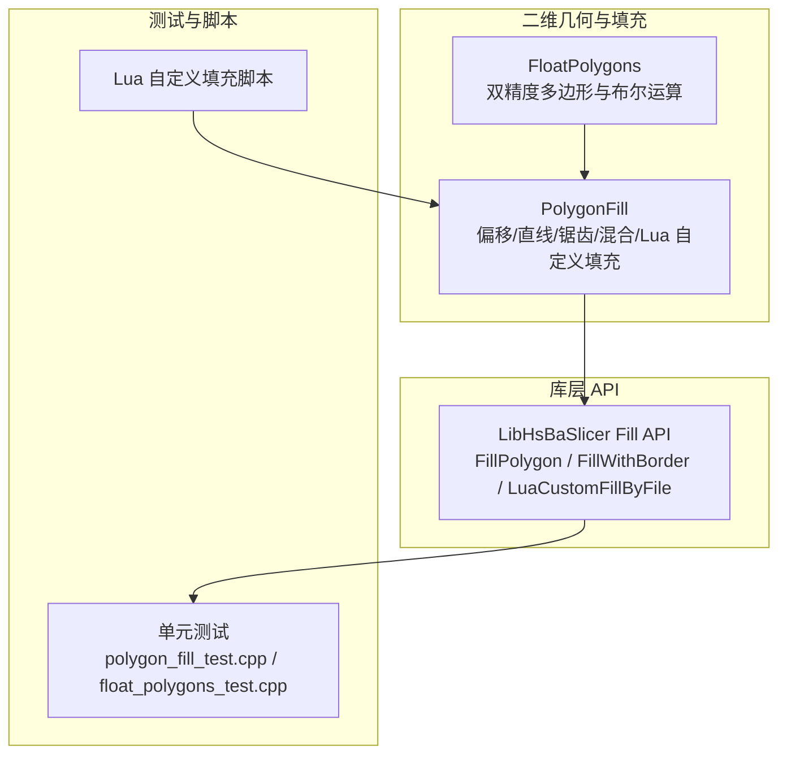
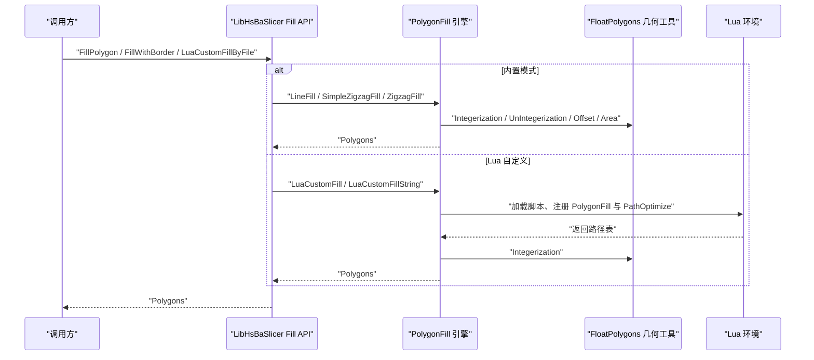
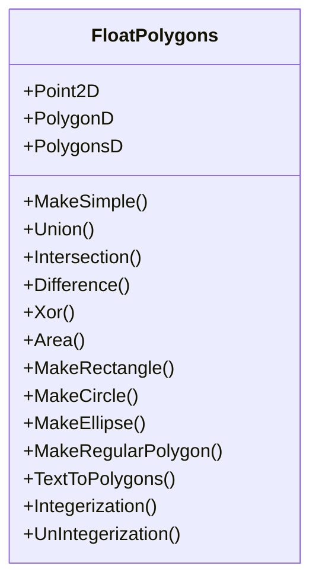
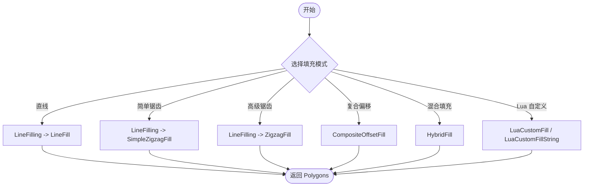
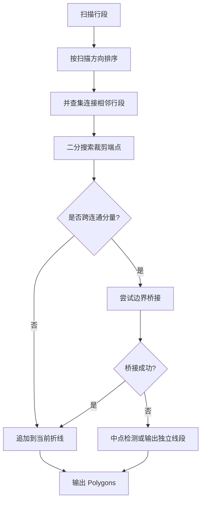
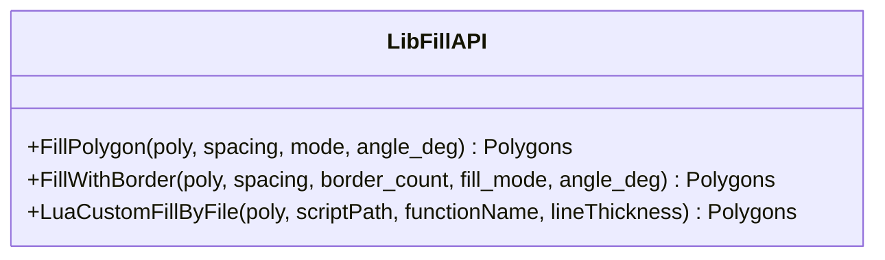
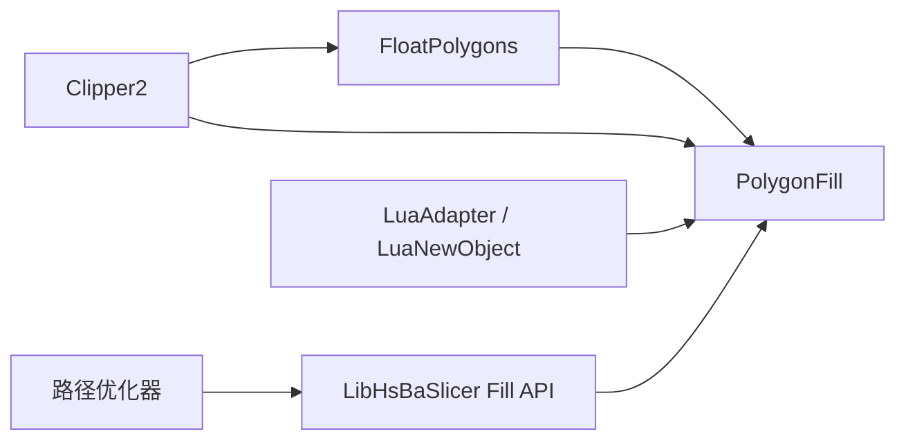

# 填充算法模块

<cite>
**本文引用的文件**   
- [PolygonFill.hpp](file://2D/PolygonFill.hpp)
- [PolygonFill.cpp](file://2D/PolygonFill.cpp)
- [FloatPolygons.hpp](file://2D/FloatPolygons.hpp)
- [FloatPolygons.cpp](file://2D/FloatPolygons.cpp)
- [polygon_fill.hpp](file://LibHsBaSlicer/Fill/polygon_fill.hpp)
- [polygon_fill.cpp](file://LibHsBaSlicer/Fill/polygon_fill.cpp)
- [polygon_fill_test.cpp](file://tests/PolygonFill/polygon_fill_test.cpp)
- [float_polygons_test.cpp](file://tests/PolygonFill/float_polygons_test.cpp)
</cite>

## 目录
1. [引言](#引言)
2. [项目结构](#项目结构)
3. [核心概念](#核心概念)
4. [架构总览](#架构总览)
5. [核心组件详解](#核心组件详解)
6. [依赖关系分析](#依赖关系分析)
7. [性能与质量评估](#性能与质量评估)
8. [故障排除指南](#故障排除指南)
9. [结论](#结论)
10. [附录：参数、调用示例与扩展方法](#附录参数调用示例与扩展方法)

## 引言
本文件面向 HsBaSlicer 的填充算法模块，重点说明 `PolygonFill` 的核心实现、`FloatPolygons` 在填充流程中的作用、关键参数配置方式、自定义填充模式扩展方法，以及与路径生成和质量评估的集成。文档既适合初学者理解直线填充、锯齿形填充、混合填充等基本概念，也为高级开发者提供算法改进和性能优化的详细指导。

## 项目结构
填充算法相关代码主要分布在以下位置：
- 二维几何与填充引擎：`2D/PolygonFill.*`、`2D/FloatPolygons.*`
- LibHsBaSlicer 对外 C++ API：`LibHsBaSlicer/Fill/polygon_fill.*`
- 单元测试与脚本验证：`tests/PolygonFill/*`

**图表来源**
- [PolygonFill.hpp:1-141](file://2D/PolygonFill.hpp#L1-L141)
- [FloatPolygons.hpp:1-271](file://2D/FloatPolygons.hpp#L1-L271)
- [polygon_fill.hpp:1-58](file://LibHsBaSlicer/Fill/polygon_fill.hpp#L1-L58)

**章节来源**
- [PolygonFill.hpp:1-141](file://2D/PolygonFill.hpp#L1-L141)
- [FloatPolygons.hpp:1-271](file://2D/FloatPolygons.hpp#L1-L271)
- [polygon_fill.hpp:1-58](file://LibHsBaSlicer/Fill/polygon_fill.hpp#L1-L58)

## 核心概念
- **输入数据**：填充算法以整数坐标的多边形集合 `Polygons` 为输入，内部常转换为双精度 `PolygonsD` 进行几何计算，再转回整数坐标输出。
- **填充模式**：
  - 直线填充：按间距和角度生成独立线段。
  - 简单锯齿形填充：将扫描行段连接成连续折线，但连接规则较宽松。
  - 高级锯齿形填充：通过连通分量、桥接边界弧等方式保证路径始终位于多边形内部。
  - 复合偏移填充：对原始多边形做内外偏移，并在各偏移轮廓内应用基础填充。
  - 混合填充：先输出若干偏移轮廓作为边框，再对最内层有效区域执行填充。
- **关键参数**：
  - 间距 `spacing`：控制填充线密度。
  - 角度 `angle_deg`：控制填充方向（度）。
  - 线厚 `lineThickness`：影响偏移步长、桥接采样密度和面积阈值判断。
  - 偏移步长 `offsetStep`：控制偏移轮廓之间的间距。
  - 外扩/内缩层数 `outwardCount` / `inwardCount`：控制边框层数和内部填充范围。
  - 角点连接类型 `join_type`：Square / Bevel / Round / Miter。

**章节来源**
- [PolygonFill.hpp:20-102](file://2D/PolygonFill.hpp#L20-L102)
- [polygon_fill.hpp:17-53](file://LibHsBaSlicer/Fill/polygon_fill.hpp#L17-L53)

## 架构总览
填充模块采用分层设计：
- 底层几何工具：`FloatPolygons` 提供双精度多边形、布尔运算、面积、形状构造、整数化转换等。
- 填充引擎：`PolygonFill` 实现具体填充算法，并通过 Lua 绑定暴露给脚本。
- 库层 API：`LibHsBaSlicer/Fill` 封装常用组合，如带边框填充、Lua 自定义填充入口。
- 测试与脚本：单元测试覆盖基本行为、边界情况、Lua 绑定分支；Lua 脚本可自定义填充并调用路径优化器。

**图表来源**
- [polygon_fill.cpp:13-49](file://LibHsBaSlicer/Fill/polygon_fill.cpp#L13-L49)
- [PolygonFill.cpp:1493-1585](file://2D/PolygonFill.cpp#L1493-L1585)
- [FloatPolygons.cpp:184-221](file://2D/FloatPolygons.cpp#L184-L221)

**章节来源**
- [polygon_fill.cpp:13-49](file://LibHsBaSlicer/Fill/polygon_fill.cpp#L13-L49)
- [PolygonFill.cpp:1493-1585](file://2D/PolygonFill.cpp#L1493-L1585)

## 核心组件详解

### FloatPolygons：双精度多边形与几何工具
`FloatPolygons` 定义双精度点、多边形和多边形集合类型，并提供：
- 简化、布尔运算（并、交、差、异或）
- 面积计算
- 矩形、圆、椭圆、正多边形构造
- 文本转多边形（基于 FreeType）
- 整数化与反整数化转换
- SVG 调试导出（可选）

这些能力是填充算法的基础：直线填充需要多边形与扫描矩形的交集；锯齿形填充需要点是否在多边形内的判定；混合/复合填充需要偏移操作；Lua 自定义填充需要双精度数据结构传递。

**图表来源**
- [FloatPolygons.hpp:18-221](file://2D/FloatPolygons.hpp#L18-L221)
- [FloatPolygons.cpp:25-221](file://2D/FloatPolygons.cpp#L25-L221)

**章节来源**
- [FloatPolygons.hpp:18-221](file://2D/FloatPolygons.hpp#L18-L221)
- [FloatPolygons.cpp:25-221](file://2D/FloatPolygons.cpp#L25-L221)

### PolygonFill：填充算法引擎
`PolygonFill` 提供多种填充函数：
- `OffsetFill`：向内嵌套闭合环，直到多边形消失。
- `LineFilling`：内部辅助函数，按角度生成扫描行段。
- `LineFill`：返回独立线段。
- `SimpleZigzagFill`：将扫描行段连接成连续折线，连接规则允许同行或相邻行。
- `ZigzagFill`：更稳健的连接策略，使用连通分量、桥接边界弧、二分搜索裁剪端点，确保路径在多边形内部。
- `CompositeOffsetFill`：基础填充 + 外扩偏移填充 + 内缩偏移填充。
- `HybridFill`：输出若干偏移轮廓作为边框，再对最内层有效区域填充。
- `LuaCustomFill` / `LuaCustomFillString`：从文件或字符串加载 Lua 脚本，执行用户定义的填充逻辑。

**图表来源**
- [PolygonFill.cpp:44-160](file://2D/PolygonFill.cpp#L44-L160)
- [PolygonFill.cpp:544-564](file://2D/PolygonFill.cpp#L544-L564)
- [PolygonFill.cpp:568-800](file://2D/PolygonFill.cpp#L568-L800)
- [PolygonFill.cpp:803-1370](file://2D/PolygonFill.cpp#L803-L1370)
- [PolygonFill.cpp:1372-1428](file://2D/PolygonFill.cpp#L1372-L1428)
- [PolygonFill.cpp:1430-1491](file://2D/PolygonFill.cpp#L1430-L1491)
- [PolygonFill.cpp:1493-1585](file://2D/PolygonFill.cpp#L1493-L1585)

**章节来源**
- [PolygonFill.cpp:44-160](file://2D/PolygonFill.cpp#L44-L160)
- [PolygonFill.cpp:544-564](file://2D/PolygonFill.cpp#L544-L564)
- [PolygonFill.cpp:568-800](file://2D/PolygonFill.cpp#L568-L800)
- [PolygonFill.cpp:803-1370](file://2D/PolygonFill.cpp#L803-L1370)
- [PolygonFill.cpp:1372-1428](file://2D/PolygonFill.cpp#L1372-L1428)
- [PolygonFill.cpp:1430-1491](file://2D/PolygonFill.cpp#L1430-L1491)
- [PolygonFill.cpp:1493-1585](file://2D/PolygonFill.cpp#L1493-L1585)

#### 直线填充与锯齿形填充的关键差异
- 直线填充直接返回扫描行与多边形交集对应的线段集合。
- 简单锯齿形填充尝试连接相邻行的线段，但连接条件较宽松，可能出现断点。
- 高级锯齿形填充通过以下机制提升鲁棒性：
  - 按扫描方向排序每行段。
  - 使用并查集建立相邻行段的连通分量。
  - 使用二分搜索裁剪线段端点到多边形内部。
  - 当跨行段属于不同连通分量时，尝试沿外边界构建桥接路径，避免穿越空洞。
  - 若桥接失败，则回退到中点检测或直接输出独立线段。

**图表来源**
- [PolygonFill.cpp:817-946](file://2D/PolygonFill.cpp#L817-L946)
- [PolygonFill.cpp:948-1122](file://2D/PolygonFill.cpp#L948-L1122)
- [PolygonFill.cpp:1157-1369](file://2D/PolygonFill.cpp#L1157-L1369)

**章节来源**
- [PolygonFill.cpp:817-946](file://2D/PolygonFill.cpp#L817-L946)
- [PolygonFill.cpp:948-1122](file://2D/PolygonFill.cpp#L948-L1122)
- [PolygonFill.cpp:1157-1369](file://2D/PolygonFill.cpp#L1157-L1369)

### LibHsBaSlicer Fill API：对外封装
`LibHsBaSlicer/Fill/polygon_fill.*` 提供简洁的 C++ API：
- `FillPolygon`：根据 `FillMode` 分发到直线、简单锯齿、高级锯齿填充。
- `FillWithBorder`：使用复合偏移填充生成边框 + 内部填充。
- `LuaCustomFillByFile`：加载 Lua 脚本，并自动注册 2D 几何函数与路径优化函数，便于脚本在填充前优化区域顺序。

**图表来源**
- [polygon_fill.hpp:17-53](file://LibHsBaSlicer/Fill/polygon_fill.hpp#L17-L53)
- [polygon_fill.cpp:13-49](file://LibHsBaSlicer/Fill/polygon_fill.cpp#L13-L49)

**章节来源**
- [polygon_fill.hpp:17-53](file://LibHsBaSlicer/Fill/polygon_fill.hpp#L17-L53)
- [polygon_fill.cpp:13-49](file://LibHsBaSlicer/Fill/polygon_fill.cpp#L13-L49)

## 依赖关系分析
- `PolygonFill` 依赖 `FloatPolygons` 提供的双精度几何工具。
- `PolygonFill` 依赖 Clipper2 进行布尔运算、偏移、面积计算。
- `PolygonFill` 通过 Lua 适配器与 `LuaAdapter`、`LuaNewObject` 交互，支持脚本扩展。
- `LibHsBaSlicer/Fill` 依赖 `2D/PolygonFill` 与路径优化器，提供高层 API。
- 单元测试覆盖所有公开接口、Lua 绑定分支、边界情况和回归测试。

**图表来源**
- [FloatPolygons.cpp:34-66](file://2D/FloatPolygons.cpp#L34-L66)
- [PolygonFill.cpp:6-20](file://2D/PolygonFill.cpp#L6-L20)
- [polygon_fill.cpp:7-9](file://LibHsBaSlicer/Fill/polygon_fill.cpp#L7-L9)

**章节来源**
- [FloatPolygons.cpp:34-66](file://2D/FloatPolygons.cpp#L34-L66)
- [PolygonFill.cpp:6-20](file://2D/PolygonFill.cpp#L6-L20)
- [polygon_fill.cpp:7-9](file://LibHsBaSlicer/Fill/polygon_fill.cpp#L7-L9)

## 性能与质量评估

### 性能特性
- 直线填充的时间复杂度主要取决于扫描行数与每行段数量，以及多边形与扫描矩形的交集计算。
- 锯齿形填充额外引入连通分量构建与桥接逻辑，复杂度随扫描行段数量和连通关系增加而上升。
- 复合/混合填充会多次调用偏移与基础填充，复杂度与偏移层数成正比。
- Lua 自定义填充涉及脚本加载与解析，存在额外开销，但灵活性高。

### 质量评估标准
- 顶点合法性：所有输出路径的顶点应位于原始多边形内部或边界上。
- 路径连续性：锯齿形填充应尽量形成连续折线，避免不必要的断点。
- 边界处理：复杂凹形或多岛轮廓下，桥接逻辑应避免穿越空洞。
- 面积一致性：偏移轮廓的面积应与线厚和偏移步长一致，避免过小岛屿产生无效填充。
- 脚本结果确定性：Lua 自定义填充应返回稳定的路径集合，且可通过单元测试验证。

**章节来源**
- [polygon_fill_test.cpp:26-84](file://tests/PolygonFill/polygon_fill_test.cpp#L26-L84)
- [polygon_fill_test.cpp:542-571](file://tests/PolygonFill/polygon_fill_test.cpp#L542-L571)
- [polygon_fill_test.cpp:619-688](file://tests/PolygonFill/polygon_fill_test.cpp#L619-L688)

## 故障排除指南
常见问题与排查建议：
- 间距非正：`OffsetFill` 对非正间距直接返回空结果，检查 `spacing` 参数。
- Lua 脚本错误：脚本加载失败、函数不存在或返回值不是表时会抛出异常，检查脚本路径、函数名和返回值结构。
- 锯齿形填充出现原点伪顶点：已修复，但仍需确保输入多边形不在原点附近，必要时平移模型。
- 字体缺失：`TextToPolygons` 在无 FreeType 或未找到字体时抛出异常，确认系统字体路径或禁用文本功能。
- 路径越界：使用边界框断言验证输出路径顶点是否落在输入多边形范围内。

**章节来源**
- [PolygonFill.cpp:504-541](file://2D/PolygonFill.cpp#L504-L541)
- [PolygonFill.cpp:1493-1585](file://2D/PolygonFill.cpp#L1493-L1585)
- [FloatPolygons.cpp:364-429](file://2D/FloatPolygons.cpp#L364-L429)
- [polygon_fill_test.cpp:202-258](file://tests/PolygonFill/polygon_fill_test.cpp#L202-L258)
- [polygon_fill_test.cpp:619-688](file://tests/PolygonFill/polygon_fill_test.cpp#L619-L688)

## 结论
HsBaSlicer 的填充算法模块以 `FloatPolygons` 为基础，通过 `PolygonFill` 实现多种填充模式，并以 `LibHsBaSlicer/Fill` 提供简洁 API。直线填充适用于快速网格填充，锯齿形填充提供更优的路径连续性，复合与混合填充支持边框与内部填充的组合，Lua 自定义填充则为高级用户提供了灵活扩展空间。测试覆盖确保了算法的正确性与鲁棒性，结合路径优化器可实现高效的打印路径生成。

## 附录：参数、调用示例与扩展方法

### 关键参数对照表
| 参数 | 含义 | 典型取值 | 视觉效果 |
|---|---|---|---|
| `spacing` | 填充线间距 | 大于 0 的数值 | 越小填充越密 |
| `angle_deg` | 填充方向角度 | 0~360 | 改变填充纹理方向 |
| `lineThickness` | 线厚 | 大于 0 的数值 | 影响偏移步长与桥接密度 |
| `offsetStep` | 偏移步长 | 大于 0 的数值 | 控制边框层间距 |
| `outwardCount` | 外扩层数 | 非负整数 | 增加外部边框 |
| `inwardCount` | 内缩层数 | 非负整数 | 减少内部填充区域 |
| `join_type` | 角点连接类型 | Square / Bevel / Round / Miter | 影响偏移轮廓拐角形状 |

**章节来源**
- [PolygonFill.hpp:20-102](file://2D/PolygonFill.hpp#L20-L102)
- [polygon_fill.hpp:17-53](file://LibHsBaSlicer/Fill/polygon_fill.hpp#L17-L53)

### 调用示例
- 直线填充：调用 `LineFill`，传入多边形、间距、角度、线厚。
- 锯齿形填充：调用 `SimpleZigzagFill` 或 `ZigzagFill`，注意后者更适合复杂轮廓。
- 复合偏移填充：调用 `CompositeOffsetFill`，设置内外偏移层数与填充模式。
- 混合填充：调用 `HybridFill`，先输出边框轮廓，再填充最内层区域。
- Lua 自定义填充：调用 `LuaCustomFill` 或 `LuaCustomFillString`，编写 `generate_fill` 函数返回路径表。

**章节来源**
- [polygon_fill_test.cpp:108-175](file://tests/PolygonFill/polygon_fill_test.cpp#L108-L175)
- [polygon_fill_test.cpp:202-258](file://tests/PolygonFill/polygon_fill_test.cpp#L202-L258)

### 自定义填充模式扩展方法
- 编写 Lua 脚本，实现 `generate_fill(poly)` 函数，返回路径表。
- 使用 `LuaCustomFillByFile` 加载脚本，自动注册 2D 几何函数与路径优化器。
- 在脚本中调用 `PolygonFill.offsetFill`、`lineFill`、`zigzagFill` 等内置函数，组合生成自定义填充。
- 使用 `PathOptimize` 优化区域顺序，减少打印头移动距离。

**章节来源**
- [polygon_fill.cpp:35-49](file://LibHsBaSlicer/Fill/polygon_fill.cpp#L35-L49)
- [polygon_fill_test.cpp:516-540](file://tests/PolygonFill/polygon_fill_test.cpp#L516-L540)