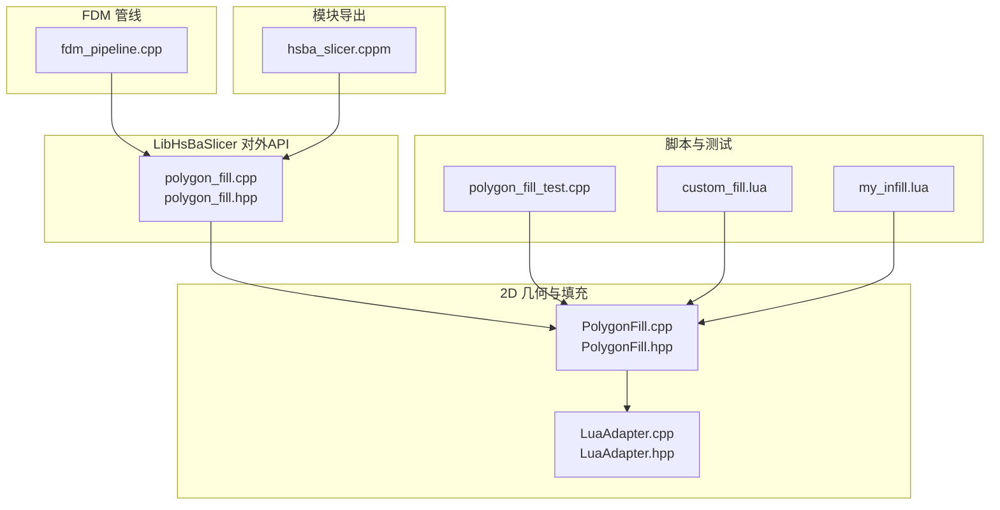
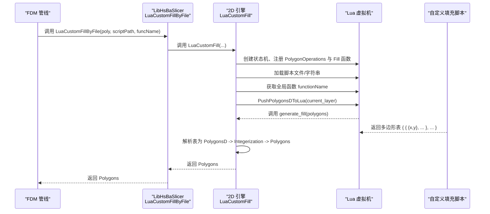
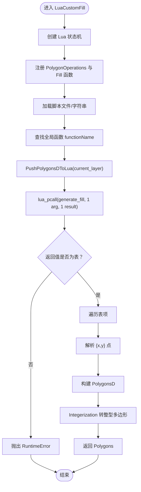
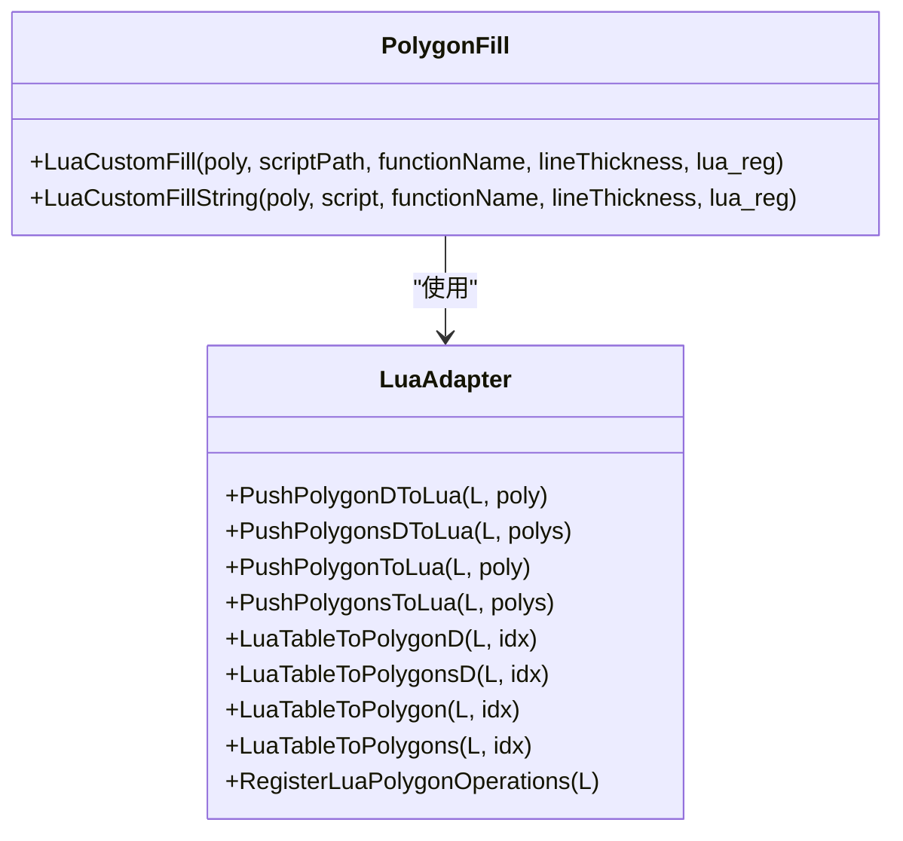
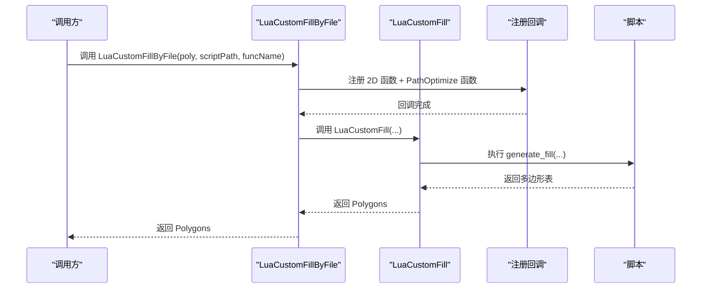
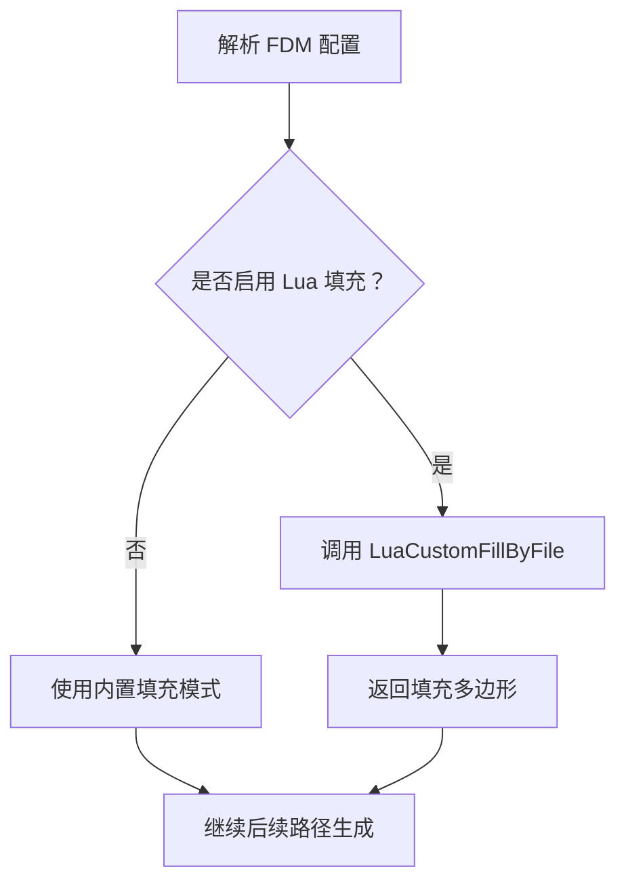
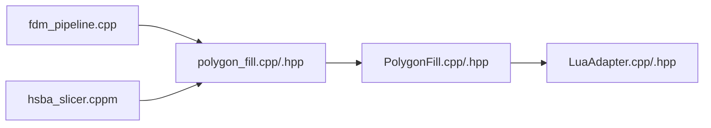
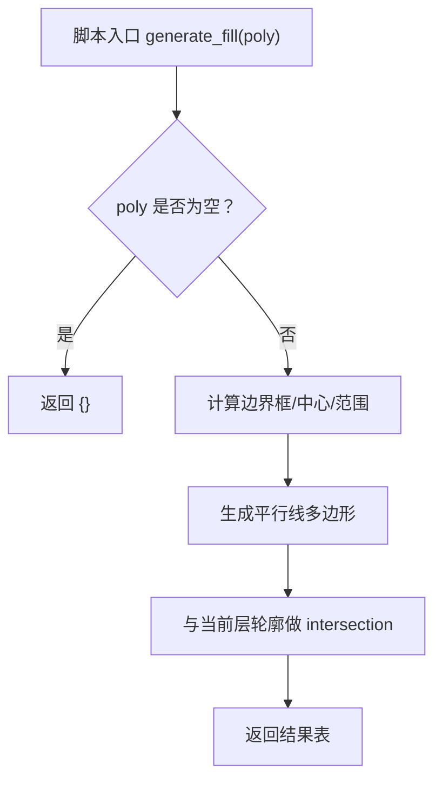

# Lua自定义填充

<cite>
**本文引用的文件**   
- [PolygonFill.cpp](file://2D/PolygonFill.cpp)
- [PolygonFill.hpp](file://2D/PolygonFill.hpp)
- [LuaAdapter.cpp](file://2D/LuaAdapter.cpp)
- [LuaAdapter.hpp](file://2D/LuaAdapter.hpp)
- [polygon_fill.cpp](file://LibHsBaSlicer/Fill/polygon_fill.cpp)
- [polygon_fill.hpp](file://LibHsBaSlicer/Fill/polygon_fill.hpp)
- [hsba_slicer.cppm](file://ModuleHsBaSlicer/hsba_slicer.cppm)
- [fdm_pipeline.cpp](file://DllHsBaSlicer/fdm_pipeline.cpp)
- [custom_fill.lua](file://tests/PolygonFill/custom_fill.lua)
- [my_infill.lua](file://samples/FDM/scripts/my_infill.lua)
- [polygon_fill_test.cpp](file://tests/PolygonFill/polygon_fill_test.cpp)
</cite>

## 目录
1. [引言](#引言)
2. [项目结构](#项目结构)
3. [核心组件](#核心组件)
4. [架构总览](#架构总览)
5. [详细组件分析](#详细组件分析)
6. [依赖关系分析](#依赖关系分析)
7. [性能与内存安全](#性能与内存安全)
8. [调试与排错指南](#调试与排错指南)
9. [结论](#结论)
10. [附录：脚本编写规范与示例](#附录脚本编写规范与示例)

## 引言
本文件面向高级用户与插件开发者，系统性说明 HsBaSlicer 中“Lua自定义填充”的完整技术实现。内容涵盖：
- 如何通过 Lua 脚本实现自定义填充算法
- C++ 与 Lua 之间的数据绑定、类型转换规则
- 脚本生命周期管理、错误处理与内存安全机制
- 常用填充图案生成方法与优化建议
- FDM 管线中的集成点与调用流程

## 项目结构
与 Lua 自定义填充直接相关的代码主要分布在以下模块：
- 2D 几何与填充引擎：`2D/PolygonFill.*`、`2D/LuaAdapter.*`
- LibHsBaSlicer 对外 API：`LibHsBaSlicer/Fill/polygon_fill.*`
- 模块导出层：`ModuleHsBaSlicer/hsba_slicer.cppm`
- FDM 管线集成：`DllHsBaSlicer/fdm_pipeline.cpp`
- 测试与示例脚本：`tests/PolygonFill/*`、`samples/FDM/scripts/my_infill.lua`

**图表来源**
- [PolygonFill.cpp:1283-1449](file://2D/PolygonFill.cpp#L1283-L1449)
- [LuaAdapter.cpp:251-419](file://2D/LuaAdapter.cpp#L251-L419)
- [polygon_fill.cpp:36-48](file://LibHsBaSlicer/Fill/polygon_fill.cpp#L36-L48)
- [hsba_slicer.cppm:1184-1188](file://ModuleHsBaSlicer/hsba_slicer.cppm#L1184-L1188)
- [fdm_pipeline.cpp:311-351](file://DllHsBaSlicer/fdm_pipeline.cpp#L311-L351)
- [custom_fill.lua:1-16](file://tests/PolygonFill/custom_fill.lua#L1-L16)
- [my_infill.lua:1-89](file://samples/FDM/scripts/my_infill.lua#L1-L89)
- [polygon_fill_test.cpp:250-258](file://tests/PolygonFill/polygon_fill_test.cpp#L250-L258)

**章节来源**
- [PolygonFill.cpp:1283-1449](file://2D/PolygonFill.cpp#L1283-L1449)
- [LuaAdapter.cpp:251-419](file://2D/LuaAdapter.cpp#L251-L419)
- [polygon_fill.cpp:36-48](file://LibHsBaSlicer/Fill/polygon_fill.cpp#L36-L48)
- [hsba_slicer.cppm:1184-1188](file://ModuleHsBaSlicer/hsba_slicer.cppm#L1184-L1188)
- [fdm_pipeline.cpp:311-351](file://DllHsBaSlicer/fdm_pipeline.cpp#L311-L351)
- [custom_fill.lua:1-16](file://tests/PolygonFill/custom_fill.lua#L1-L16)
- [my_infill.lua:1-89](file://samples/FDM/scripts/my_infill.lua#L1-L89)
- [polygon_fill_test.cpp:250-258](file://tests/PolygonFill/polygon_fill_test.cpp#L250-L258)

## 核心组件
- `LuaCustomFill` / `LuaCustomFillString`：从文件或字符串加载 Lua 脚本，执行指定函数，将返回的多边形表转换为 C++ 多边形集合。
- `RegisterLuaPolygonOperations`：向 Lua 暴露 `PolygonOperations` 表，提供布尔运算、偏移、凸包、面积、基础图形构造等能力。
- `PushPolygonsDToLua` / `LuaTableToPolygonsD`：C++ 与 Lua 之间多边形数据的序列化与反序列化。
- `LuaCustomFillByFile`（LibHsBaSlicer）：对外封装，注入路径优化函数供脚本在输出前优化区域。
- FDM 管线：解析配置并调用 `LuaCustomFillByFile` 完成每层的自定义填充。

**章节来源**
- [PolygonFill.cpp:1283-1449](file://2D/PolygonFill.cpp#L1283-L1449)
- [LuaAdapter.cpp:251-419](file://2D/LuaAdapter.cpp#L251-L419)
- [polygon_fill.cpp:36-48](file://LibHsBaSlicer/Fill/polygon_fill.cpp#L36-L48)
- [fdm_pipeline.cpp:311-351](file://DllHsBaSlicer/fdm_pipeline.cpp#L311-L351)

## 架构总览
下图展示了从 FDM 管线到 Lua 脚本执行的完整调用链，以及数据在 C++ 与 Lua 之间的流转。

**图表来源**
- [fdm_pipeline.cpp:311-351](file://DllHsBaSlicer/fdm_pipeline.cpp#L311-L351)
- [polygon_fill.cpp:36-48](file://LibHsBaSlicer/Fill/polygon_fill.cpp#L36-L48)
- [PolygonFill.cpp:1283-1449](file://2D/PolygonFill.cpp#L1283-L1449)
- [LuaAdapter.cpp:272-322](file://2D/LuaAdapter.cpp#L272-L322)

## 详细组件分析

### Lua 自定义填充核心流程
- 输入：当前层多边形（已扣除壁厚），以浮点多边形表传入 Lua。
- 脚本约定：定义 `generate_fill(poly)`，返回多边形表；每个元素是一个闭合折线（点表含 `x`、`y`）。
- 输出：C++ 侧将 Lua 返回表解析为 `PolygonsD`，再整数化后返回给上层。

关键步骤：
1. 创建独立 Lua 状态机，避免跨调用污染。
2. 注册 `PolygonOperations` 与可选的路径优化函数。
3. 加载脚本并校验目标函数存在。
4. 将当前层多边形序列化为 Lua 表。
5. 调用脚本函数并校验返回值类型为表。
6. 遍历表，解析每个子表为折线，收集为 `PolygonsD`。
7. 对结果进行整数化，返回 C++ 多边形集合。

**图表来源**
- [PolygonFill.cpp:1283-1449](file://2D/PolygonFill.cpp#L1283-L1449)

**章节来源**
- [PolygonFill.cpp:1283-1449](file://2D/PolygonFill.cpp#L1283-L1449)

### C++ 与 Lua 的数据绑定与类型转换
- 推送多边形到 Lua：
  - `PushPolygonDToLua`：将单个浮点多边形转为 Lua 表，点表包含 `x`、`y`。
  - `PushPolygonsDToLua`：将多个浮点多边形转为数组表。
  - `PushPolygonToLua` / `PushPolygonsToLua`：整数多边形转 Lua 表（用于某些操作函数）。
- 从 Lua 读取多边形：
  - `LuaTableToPolygonD` / `LuaTableToPolygonsD`：读取浮点多边形。
  - `LuaTableToPolygon` / `LuaTableToPolygons`：读取整数多边形（乘以 `integerization` 精度）。
- 坐标精度：
  - 内部使用整型坐标存储，通过 `integerization` 常量进行浮点到整型的缩放与还原。
  - 传给 Lua 的数据为浮点坐标，便于脚本计算；返回结果经 `Integerization` 转回整型。

**图表来源**
- [LuaAdapter.cpp:272-419](file://2D/LuaAdapter.cpp#L272-L419)
- [PolygonFill.cpp:1283-1449](file://2D/PolygonFill.cpp#L1283-L1449)

**章节来源**
- [LuaAdapter.cpp:272-419](file://2D/LuaAdapter.cpp#L272-L419)
- [LuaAdapter.hpp:16-81](file://2D/LuaAdapter.hpp#L16-L81)

### 脚本可用 API：PolygonOperations
Lua 脚本可通过 `PolygonOperations` 访问以下功能：
- 布尔运算：`union`、`intersection`、`difference`、`xor`、`booleanOperation(op, left, right)`
- 几何变换：`offsetOperation(polys, delta)`、`convexHullOperation(polys)`、`concaveHullOperation(polys, k)`
- 度量：`area(poly)`
- 图形构造：`makeRectangle(x, y, w, h)`、`makeCircle(cx, cy, r [, segments])`、`makeEllipse(cx, cy, rx, ry [, segments [, rotation]])`、`makeRegularPolygon(cx, cy, r, sides [, rotation])`
- 文本转多边形：`textToPolygons(text, font_file, font_size [, x [, y [, curve_segments]]])`
- 调试导出（条件编译）：`dumpPolygon`、`dumpPolygons`

这些函数在 `LuaAdapter.cpp` 中以 C 接口注册到 Lua 全局表 `PolygonOperations`。

**章节来源**
- [LuaAdapter.cpp:22-269](file://2D/LuaAdapter.cpp#L22-L269)
- [LuaAdapter.cpp:415-419](file://2D/LuaAdapter.cpp#L415-L419)

### LibHsBaSlicer 对外 API 与路径优化注入
- `LuaCustomFillByFile`：对外暴露的 C++ API，负责：
  - 组合 2D 函数与路径优化函数注册回调。
  - 调用底层 `LuaCustomFill`。
- 路径优化注入：
  - 通过 `RegisterLuaPathOptimizeFunctions` 向脚本暴露 `PathOptimize` 对象，允许脚本在输出前对区域路径进行排序与优化。
  - 该能力在测试中通过内联脚本验证，确保路径按区域连续分块且不交错。

**图表来源**
- [polygon_fill.cpp:36-48](file://LibHsBaSlicer/Fill/polygon_fill.cpp#L36-L48)
- [PolygonFill.cpp:1283-1449](file://2D/PolygonFill.cpp#L1283-L1449)

**章节来源**
- [polygon_fill.cpp:36-48](file://LibHsBaSlicer/Fill/polygon_fill.cpp#L36-L48)
- [polygon_fill.hpp:39-53](file://LibHsBaSlicer/Fill/polygon_fill.hpp#L39-L53)
- [polygon_fill_test.cpp:390-418](file://tests/PolygonFill/polygon_fill_test.cpp#L390-L418)

### FDM 管线中的集成点
- 配置字段：
  - `infill_lua_script`：自定义填充脚本路径。
  - `infill_lua_func`：自定义填充函数名（默认 `generate_fill`）。
- 执行逻辑：
  - 若未启用内置填充且提供了 Lua 脚本，则调用 `LuaCustomFillByFile` 生成填充多边形。
  - 每层切片后，将当前层多边形传入脚本，得到填充结果。

**图表来源**
- [fdm_pipeline.cpp:311-351](file://DllHsBaSlicer/fdm_pipeline.cpp#L311-L351)

**章节来源**
- [fdm_pipeline.cpp:50-68](file://DllHsBaSlicer/fdm_pipeline.cpp#L50-L68)
- [fdm_pipeline.cpp:137-191](file://DllHsBaSlicer/fdm_pipeline.cpp#L137-L191)
- [fdm_pipeline.cpp:311-351](file://DllHsBaSlicer/fdm_pipeline.cpp#L311-L351)

## 依赖关系分析
- `2D/PolygonFill.cpp` 依赖：
  - `2D/LuaAdapter.*`：数据绑定与函数注册。
  - `base/error.hpp`：错误抛出。
  - `utils/LuaNewObject.hpp`：Lua 状态机创建与管理。
- `LibHsBaSlicer/Fill/polygon_fill.*` 依赖：
  - `2D/PolygonFill.hpp`：对外封装。
  - `path_optimizer.hpp`：路径优化函数注册。
- `ModuleHsBaSlicer/hsba_slicer.cppm` 依赖：
  - `LibHsBaSlicer/Fill/polygon_fill.hpp`：模块导出层转发。
- `DllHsBaSlicer/fdm_pipeline.cpp` 依赖：
  - `LibHsBaSlicer/Fill/polygon_fill.hpp`：调用自定义填充。

**图表来源**
- [fdm_pipeline.cpp:311-351](file://DllHsBaSlicer/fdm_pipeline.cpp#L311-L351)
- [polygon_fill.cpp:36-48](file://LibHsBaSlicer/Fill/polygon_fill.cpp#L36-L48)
- [PolygonFill.cpp:1283-1449](file://2D/PolygonFill.cpp#L1283-L1449)
- [LuaAdapter.cpp:251-419](file://2D/LuaAdapter.cpp#L251-L419)
- [hsba_slicer.cppm:1184-1188](file://ModuleHsBaSlicer/hsba_slicer.cppm#L1184-L1188)

**章节来源**
- [fdm_pipeline.cpp:311-351](file://DllHsBaSlicer/fdm_pipeline.cpp#L311-L351)
- [polygon_fill.cpp:36-48](file://LibHsBaSlicer/Fill/polygon_fill.cpp#L36-L48)
- [PolygonFill.cpp:1283-1449](file://2D/PolygonFill.cpp#L1283-L1449)
- [LuaAdapter.cpp:251-419](file://2D/LuaAdapter.cpp#L251-L419)
- [hsba_slicer.cppm:1184-1188](file://ModuleHsBaSlicer/hsba_slicer.cppm#L1184-L1188)

## 性能与内存安全
- 性能考虑：
  - 每层调用都会创建新的 Lua 状态机，避免共享状态带来的副作用，但会带来一定开销。对于高频调用场景，建议在脚本中缓存可复用参数（如角度、间距），减少重复计算。
  - 大量小多边形会增加表遍历与整数化成本，尽量合并相邻线段或减少不必要的细分。
  - 使用 `PolygonOperations.union` 等布尔运算时注意复杂度，优先在脚本中进行裁剪与过滤，减少返回多边形数量。
- 内存安全：
  - Lua 状态机由 RAII 包装（`MakeUniqueLuaState`），异常路径下自动释放。
  - 所有 Lua 栈操作遵循严格的 push/pop 平衡，避免栈溢出。
  - 坐标精度通过 `integerization` 控制，避免浮点误差累积导致的几何不稳定。
- 错误处理：
  - 脚本加载失败、函数不存在、返回值非表等情况均抛出 `RuntimeError`，便于上层捕获与诊断。

**章节来源**
- [PolygonFill.cpp:1283-1449](file://2D/PolygonFill.cpp#L1283-L1449)
- [LuaAdapter.cpp:16-19](file://2D/LuaAdapter.cpp#L16-L19)

## 调试与排错指南
常见问题与解决方案：
- “Lua function not found”：检查脚本是否定义了正确的函数名，或在 FDM 配置中设置 `infill_lua_func`。
- “Lua function did not return a table”：确保 `generate_fill` 返回的是多边形表，而非数字或其他类型。
- 脚本语法错误：检查脚本路径是否正确，或使用内联脚本测试最小可行片段。
- 性能问题：减少脚本中不必要的布尔运算与多边形细分；利用 `PolygonOperations.intersection` 裁剪无效区域。
- 坐标精度问题：确认脚本返回的 `x`、`y` 为数值类型；C++ 侧会进行整数化，过大或过小值可能导致精度损失。

参考测试用例：
- 内联脚本调用与错误抛出的断言位于测试文件中，可用于快速验证脚本契约。

**章节来源**
- [polygon_fill_test.cpp:250-258](file://tests/PolygonFill/polygon_fill_test.cpp#L250-L258)

## 结论
HsBaSlicer 的 Lua 自定义填充机制通过清晰的 C++ 与 Lua 数据绑定、严格的错误处理与内存管理，为高级用户提供了灵活的填充算法扩展能力。结合 `PolygonOperations` 提供的几何工具与路径优化注入，开发者可以高效实现复杂填充图案，并在 FDM 管线中无缝集成。

## 附录：脚本编写规范与示例

### 脚本编写规范
- 函数签名：`function generate_fill(poly)`
- 输入格式：`poly` 为多边形表，每个元素是点表 `{x=.., y=..}`。
- 返回格式：返回多边形表，每个元素是闭合折线（点表含 `x`、`y`）。
- 可用 API：通过 `PolygonOperations` 访问布尔运算、偏移、凸包、面积、图形构造等。
- 注意事项：
  - 不依赖全局变量（胶水阶段不注入层号或配置）。
  - 返回空表表示无填充。
  - 避免返回非表类型，否则触发运行时错误。

### 示例脚本
- 简单对角线填充：`tests/PolygonFill/custom_fill.lua`
- 平行线填充与裁剪：`samples/FDM/scripts/my_infill.lua`

**图表来源**
- [my_infill.lua:20-89](file://samples/FDM/scripts/my_infill.lua#L20-L89)

**章节来源**
- [custom_fill.lua:1-16](file://tests/PolygonFill/custom_fill.lua#L1-L16)
- [my_infill.lua:1-89](file://samples/FDM/scripts/my_infill.lua#L1-L89)