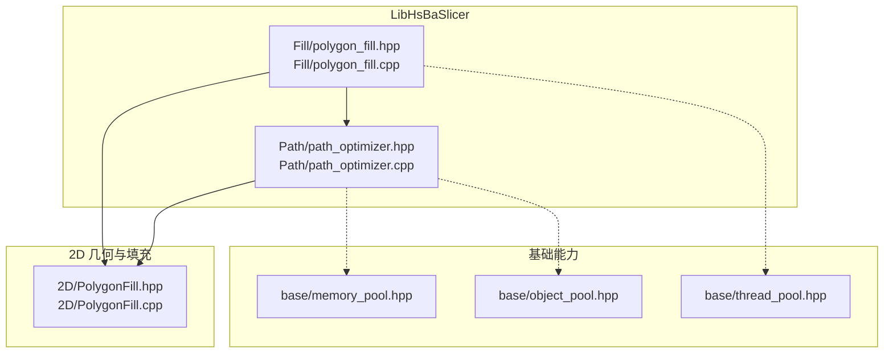
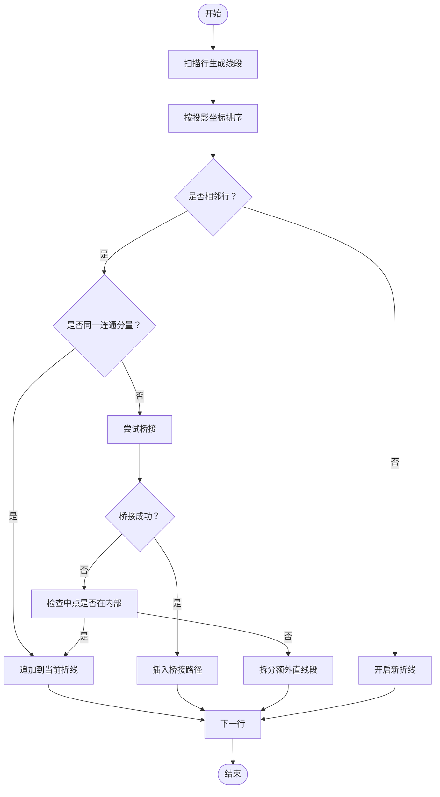
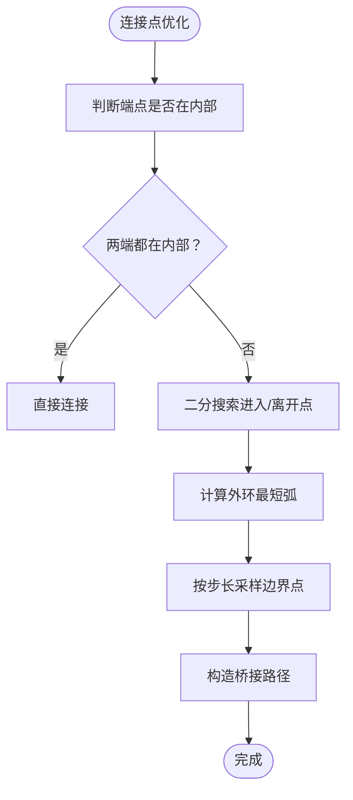
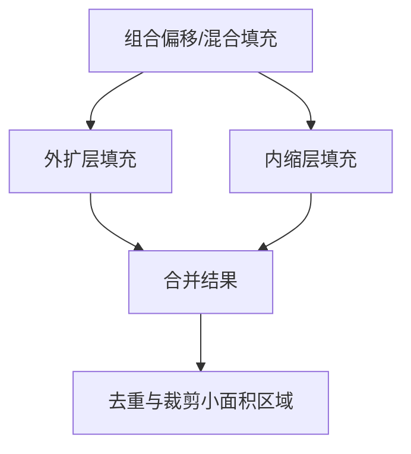
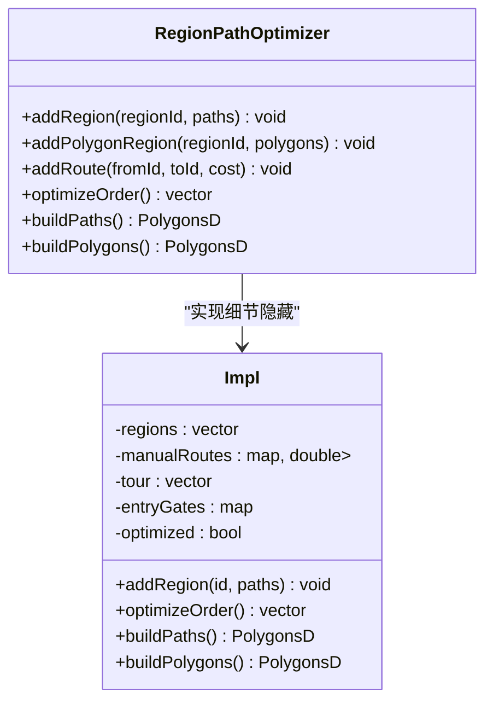
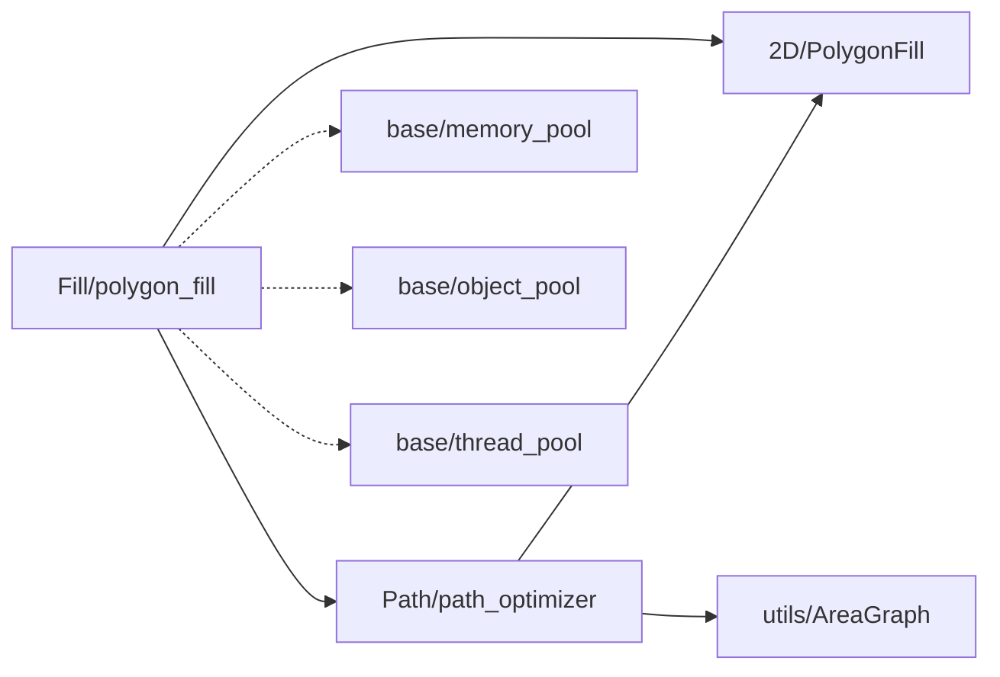
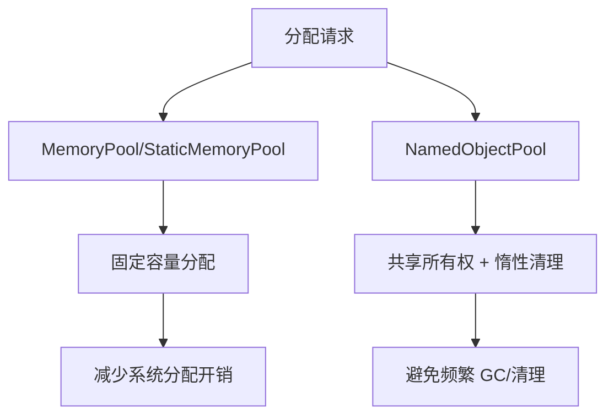
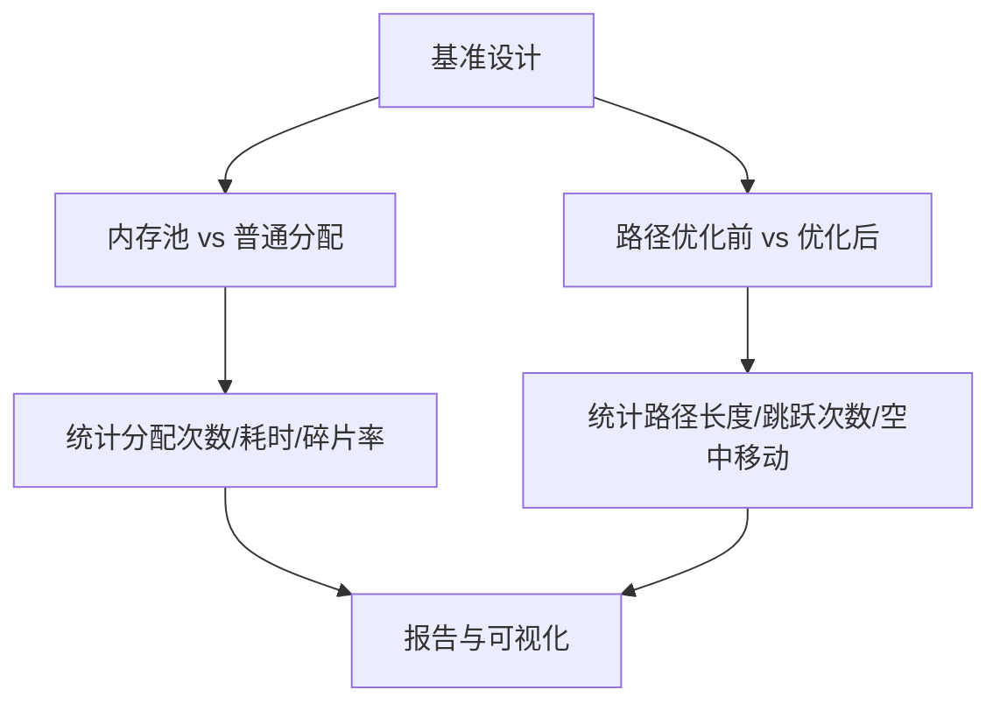

# 填充优化技术

<cite>
**本文引用的文件**   
- [polygon_fill.hpp](file://LibHsBaSlicer/Fill/polygon_fill.hpp)
- [polygon_fill.cpp](file://LibHsBaSlicer/Fill/polygon_fill.cpp)
- [PolygonFill.hpp](file://2D/PolygonFill.hpp)
- [PolygonFill.cpp](file://2D/PolygonFill.cpp)
- [path_optimizer.hpp](file://LibHsBaSlicer/Path/path_optimizer.hpp)
- [path_optimizer.cpp](file://LibHsBaSlicer/Path/path_optimizer.cpp)
- [memory_pool.hpp](file://base/memory_pool.hpp)
- [object_pool.hpp](file://base/object_pool.hpp)
- [thread_pool.hpp](file://base/thread_pool.hpp)
- [README.md（英文文档）](file://docs/en/LibHsBaSlicer/README.md)
- [memory_pool_test.cpp](file://tests/Pool/memory_pool_test.cpp)
- [openvdb_model_test.cpp](file://tests/Models/openvdb_model_test.cpp)
</cite>

## 目录
1. [引言](#引言)
2. [项目结构](#项目结构)
3. [核心组件](#核心组件)
4. [架构总览](#架构总览)
5. [详细组件分析](#详细组件分析)
6. [依赖关系分析](#依赖关系分析)
7. [性能与复杂度](#性能与复杂度)
8. [多线程与并行处理](#多线程与并行处理)
9. [内存管理与垃圾回收优化](#内存管理与垃圾回收优化)
10. [缓存机制与可扩展性](#缓存机制与可扩展性)
11. [基准测试与对比分析](#基准测试与对比分析)
12. [适用场景与权衡](#适用场景与权衡)
13. [故障排查与监控](#故障排查与监控)
14. [结论](#结论)

## 引言
本技术文档聚焦 HsBaSlicer 的“填充优化技术”，围绕以下目标展开：
- 深入解释填充路径优化算法，包括路径连续性保证、连接点优化、冗余路径消除等关键技术。
- 详细说明内存管理策略，如对象池使用、内存复用、垃圾回收优化等性能提升手段。
- 说明多线程并行处理、算法复杂度优化、缓存机制等高级优化技术。
- 提供性能基准测试结果和优化前后的对比分析思路。
- 解释不同优化策略的适用场景和权衡考虑。
- 包含内存泄漏检测、性能监控工具的使用方法。

该文档面向高性能应用开发者和算法优化专家，既给出高层架构视图，也深入到关键实现细节与可操作建议。

## 项目结构
与填充优化直接相关的代码主要分布在以下模块：
- 2D 几何与填充引擎：`2D/PolygonFill.*`
- LibHsBaSlicer 封装层：`LibHsBaSlicer/Fill/polygon_fill.*`
- 路径预优化器：`LibHsBaSlicer/Path/path_optimizer.*`
- 基础内存与并发设施：`base/memory_pool.hpp`、`base/object_pool.hpp`、`base/thread_pool.hpp`
- 文档与测试：`docs/en/LibHsBaSlicer/README.md`、`tests/Pool/memory_pool_test.cpp`、`tests/Models/openvdb_model_test.cpp`



**图表来源**
- [polygon_fill.hpp:1-58](file://LibHsBaSlicer/Fill/polygon_fill.hpp#L1-L58)
- [polygon_fill.cpp:1-51](file://LibHsBaSlicer/Fill/polygon_fill.cpp#L1-L51)
- [PolygonFill.hpp:1-141](file://2D/PolygonFill.hpp#L1-L141)
- [PolygonFill.cpp:1-1449](file://2D/PolygonFill.cpp#L1-L1449)
- [path_optimizer.hpp:1-191](file://LibHsBaSlicer/Path/path_optimizer.hpp#L1-L191)
- [path_optimizer.cpp:1-663](file://LibHsBaSlicer/Path/path_optimizer.cpp#L1-L663)
- [memory_pool.hpp:1-375](file://base/memory_pool.hpp#L1-L375)
- [object_pool.hpp:1-286](file://base/object_pool.hpp#L1-L286)
- [thread_pool.hpp:1-39](file://base/thread_pool.hpp#L1-L39)

**章节来源**
- [polygon_fill.hpp:1-58](file://LibHsBaSlicer/Fill/polygon_fill.hpp#L1-L58)
- [polygon_fill.cpp:1-51](file://LibHsBaSlicer/Fill/polygon_fill.cpp#L1-L51)
- [PolygonFill.hpp:1-141](file://2D/PolygonFill.hpp#L1-L141)
- [path_optimizer.hpp:1-191](file://LibHsBaSlicer/Path/path_optimizer.hpp#L1-L191)

## 核心组件
- 填充 API 封装层：提供 `FillPolygon`、`FillWithBorder`、`LuaCustomFillByFile` 等接口，统一调用底层 2D 填充引擎，并在 Lua 自定义填充时注入路径优化函数。
- 2D 填充引擎：实现偏移填充、直线填充、简单折线填充、改进型折线填充、组合偏移填充、混合填充以及 Lua 自定义填充。
- 区域路径预优化器：将独立多边形区域建模为图节点，通过遗传 TSP 求解区域访问顺序，并通过最近邻贪心安排区域内入口/出口顺序，减少空中移动距离。
- 内存与对象池：提供固定容量内存分配器、静态内存池、命名对象池，支持线程安全、惰性清理、共享所有权等特性。
- 线程池：提供任务队列、工作线程、协程执行器等并发基础设施，便于未来对填充或优化过程进行并行化扩展。

**章节来源**
- [polygon_fill.hpp:17-53](file://LibHsBaSlicer/Fill/polygon_fill.hpp#L17-L53)
- [polygon_fill.cpp:13-48](file://LibHsBaSlicer/Fill/polygon_fill.cpp#L13-L48)
- [PolygonFill.hpp:20-136](file://2D/PolygonFill.hpp#L20-L136)
- [path_optimizer.hpp:23-115](file://LibHsBaSlicer/Path/path_optimizer.hpp#L23-L115)
- [memory_pool.hpp:35-208](file://base/memory_pool.hpp#L35-L208)
- [object_pool.hpp:18-92](file://base/object_pool.hpp#L18-L92)
- [thread_pool.hpp:27-39](file://base/thread_pool.hpp#L27-L39)

## 架构总览
填充优化在 HsBaSlicer 中采用“生成 + 预优化”的两阶段架构：
1. 生成阶段：根据用户选择的模式（直线、简单折线、改进折线、组合偏移、混合填充）生成初始填充路径。
2. 预优化阶段：对独立区域的路径集合进行全局顺序优化，并调整区域内路径方向与连接点，以减少空中移动和跳跃。

```mermaid
sequenceDiagram
participant App as "应用/脚本"
participant FillAPI as "Fill/polygon_fill"
participant Engine as "2D/PolygonFill"
participant Opt as "Path/path_optimizer"
App->>FillAPI : 调用 FillPolygon / FillWithBorder / LuaCustomFillByFile
FillAPI->>Engine : 选择 Line/SimpleZigzag/Zigzag/Composite/Hybrid
Engine-->>FillAPI : 返回初始填充路径
App->>Opt : addRegion/addPolygonRegion/optimizeOrder/buildPaths
Opt-->>App : 返回优化后的完整路径或有序多边形
```

**图表来源**
- [polygon_fill.cpp:13-48](file://LibHsBaSlicer/Fill/polygon_fill.cpp#L13-L48)
- [PolygonFill.cpp:453-1281](file://2D/PolygonFill.cpp#L453-L1281)
- [path_optimizer.cpp:522-554](file://LibHsBaSlicer/Path/path_optimizer.cpp#L522-L554)

**章节来源**
- [polygon_fill.cpp:13-48](file://LibHsBaSlicer/Fill/polygon_fill.cpp#L13-L48)
- [PolygonFill.cpp:453-1281](file://2D/PolygonFill.cpp#L453-L1281)
- [path_optimizer.cpp:522-554](file://LibHsBaSlicer/Path/path_optimizer.cpp#L522-L554)

## 详细组件分析

### 填充路径优化算法
#### 路径连续性保证
- 直线填充按扫描行生成线段，并按投影坐标排序，确保每行内段有序。
- 简单折线填充在相邻行之间允许连接，避免跨行跳跃；当行号不连续时开启新折线，保证路径连通性。
- 改进型折线填充通过并查集构建连通分量，仅在相邻行且属于不同分量时尝试桥接；若桥接失败则回退到中线判断或拆分为额外直线段，从而避免非法穿越边界。



**图表来源**
- [PolygonFill.cpp:475-674](file://2D/PolygonFill.cpp#L475-L674)
- [PolygonFill.cpp:676-1175](file://2D/PolygonFill.cpp#L676-L1175)

**章节来源**
- [PolygonFill.cpp:475-674](file://2D/PolygonFill.cpp#L475-L674)
- [PolygonFill.cpp:676-1175](file://2D/PolygonFill.cpp#L676-L1175)

#### 连接点优化
- 改进型折线填充在相邻行不同连通分量之间尝试沿外环最短弧桥接，采样点间距受线宽控制，以贴近边界并减少越界风险。
- 若桥接失败，则回退到中线判断或直接拆分，确保路径合法且不产生空洞穿越。



**图表来源**
- [PolygonFill.cpp:800-942](file://2D/PolygonFill.cpp#L800-L942)

**章节来源**
- [PolygonFill.cpp:800-942](file://2D/PolygonFill.cpp#L800-L942)

#### 冗余路径消除
- 改进型折线填充在桥接失败时将无法连接的片段作为额外直线段输出，避免无效连接导致的冗余路径。
- 组合偏移与混合填充分别对外扩和内缩区域递归填充，最终合并结果，避免重复填充同一区域。



**图表来源**
- [PolygonFill.cpp:1177-1281](file://2D/PolygonFill.cpp#L1177-L1281)

**章节来源**
- [PolygonFill.cpp:1177-1281](file://2D/PolygonFill.cpp#L1177-L1281)

### 区域路径预优化器
区域路径预优化器将每个独立区域视为 AreaGraph 的一个顶点，候选入口/出口点称为“门”。它支持两种模式：
- 多边形模式（填充前）：所有多边形顶点作为门，输出优化顺序的多边形集合。
- 填充结果模式（填充后）：每条折线的头尾端点作为门，输出完整的填充路径集合。

核心流程：
- 构建区域图，计算区域内门到门的直线距离成本。
- 使用遗传算法求解区域访问顺序（TSP）。
- 区域内路径方向与顺序通过最近邻贪心安排，减少跳跃。
- 支持手动覆盖区域间空中移动成本。



**图表来源**
- [path_optimizer.hpp:44-100](file://LibHsBaSlicer/Path/path_optimizer.hpp#L44-L100)
- [path_optimizer.cpp:43-61](file://LibHsBaSlicer/Path/path_optimizer.cpp#L43-L61)

**章节来源**
- [path_optimizer.hpp:23-115](file://LibHsBaSlicer/Path/path_optimizer.hpp#L23-L115)
- [path_optimizer.cpp:43-61](file://LibHsBaSlicer/Path/path_optimizer.cpp#L43-L61)
- [path_optimizer.cpp:522-554](file://LibHsBaSlicer/Path/path_optimizer.cpp#L522-L554)

### Lua 自定义填充与优化集成
- `LuaCustomFillByFile` 在加载 Lua 脚本前注册 2D 填充函数与路径优化函数，使脚本既能生成填充又能调用 `PathOptimize.optimizeRegions` 或 `PathOptimize.optimizePolygons` 进行优化。
- 优化脚本环境已内置多边形操作、填充函数与路径优化函数，便于快速验证与迭代。

```mermaid
sequenceDiagram
participant App as "应用"
participant FillAPI as "Fill/polygon_fill"
participant Lua as "Lua 状态"
participant Script as "自定义脚本"
participant Opt as "PathOptimize"
App->>FillAPI : LuaCustomFillByFile(poly, scriptPath)
FillAPI->>Lua : 创建状态并注册 PolygonFill 与 PathOptimize
FillAPI->>Script : 加载脚本并调用 generate_fill
Script->>Opt : optimizeRegions/optimizePolygons
Opt-->>Script : 返回优化后的路径或多边形
Script-->>FillAPI : 返回路径表
FillAPI-->>App : 返回 Polygons
```

**图表来源**
- [polygon_fill.cpp:36-48](file://LibHsBaSlicer/Fill/polygon_fill.cpp#L36-L48)
- [path_optimizer.cpp:572-631](file://LibHsBaSlicer/Path/path_optimizer.cpp#L572-L631)

**章节来源**
- [polygon_fill.cpp:36-48](file://LibHsBaSlicer/Fill/polygon_fill.cpp#L36-L48)
- [path_optimizer.cpp:572-631](file://LibHsBaSlicer/Path/path_optimizer.cpp#L572-L631)

## 依赖关系分析
- `LibHsBaSlicer/Fill/polygon_fill.*` 依赖 `2D/PolygonFill.*` 提供基础填充能力，并可选依赖 `LibHsBaSlicer/Path/path_optimizer.hpp` 以注入路径优化函数。
- `LibHsBaSlicer/Path/path_optimizer.*` 依赖 `2D/PolygonFill.hpp` 的数据类型与转换工具，同时依赖 `utils/AreaGraph.hpp` 构建区域图。
- 内存与对象池为通用基础设施，被上层模块间接使用以提升性能与稳定性。
- 线程池为通用并发基础设施，可用于未来对填充或优化过程的并行化扩展。



**图表来源**
- [polygon_fill.cpp:1-10](file://LibHsBaSlicer/Fill/polygon_fill.cpp#L1-L10)
- [path_optimizer.cpp:1-22](file://LibHsBaSlicer/Path/path_optimizer.cpp#L1-L22)
- [memory_pool.hpp:1-375](file://base/memory_pool.hpp#L1-L375)
- [object_pool.hpp:1-286](file://base/object_pool.hpp#L1-L286)
- [thread_pool.hpp:1-39](file://base/thread_pool.hpp#L1-L39)

**章节来源**
- [polygon_fill.cpp:1-10](file://LibHsBaSlicer/Fill/polygon_fill.cpp#L1-L10)
- [path_optimizer.cpp:1-22](file://LibHsBaSlicer/Path/path_optimizer.cpp#L1-L22)

## 性能与复杂度
- 直线填充：按扫描行生成线段，时间复杂度近似 O(N_rows × N_segments_per_row)，空间复杂度与输出路径规模线性相关。
- 简单折线填充：在相邻行之间连接，避免跨行跳跃，复杂度与扫描行数和段数线性相关。
- 改进型折线填充：引入并查集构建连通分量，复杂度近似 O(N_segments × log N_segments) 用于查找与合并；桥接逻辑涉及外环遍历与采样，复杂度与外环顶点数及采样次数相关。
- 组合偏移与混合填充：对多层偏移结果递归填充，复杂度与偏移层数、每层多边形规模及填充模式相关。
- 区域路径预优化：遗传 TSP 求解区域访问顺序，复杂度随区域数量增长较快；区域内最近邻贪心安排复杂度较低。

[本节为一般性讨论，不直接分析具体文件]

## 多线程与并行处理
- 线程池提供任务提交、等待完成、查询待处理/活跃任务数量的能力，适合批量填充任务的并行调度。
- 建议在大规模模型切片或批量填充场景中，将每个区域或层的填充任务分发给线程池，聚合结果后再进行路径优化。
- 注意任务粒度不宜过小，以避免任务队列开销；CPU 密集型任务建议线程数等于硬件并发数。

**章节来源**
- [thread_pool.hpp:27-39](file://base/thread_pool.hpp#L27-L39)
- [docs/en/base/thread_pool.md:248-317](file://docs/en/base/thread_pool.md#L248-L317)

## 内存管理与垃圾回收优化
- 固定容量内存池 `MemoryPool` 与静态内存池 `StaticMemoryPool` 提供 STL 兼容分配器，减少频繁 new/delete 的开销，降低碎片化。
- 命名对象池 `NamedObjectPool` 基于 `shared_ptr` 管理对象生命周期，支持惰性清理 inactive 对象，避免频繁清理影响性能。
- 在调试环境中可通过禁用 CRT 内存泄漏检测来避免第三方库（如 OpenVDB）带来的误报。



**图表来源**
- [memory_pool.hpp:43-208](file://base/memory_pool.hpp#L43-L208)
- [memory_pool.hpp:215-372](file://base/memory_pool.hpp#L215-L372)
- [object_pool.hpp:18-92](file://base/object_pool.hpp#L18-L92)
- [openvdb_model_test.cpp:10-20](file://tests/Models/openvdb_model_test.cpp#L10-L20)

**章节来源**
- [memory_pool.hpp:43-208](file://base/memory_pool.hpp#L43-L208)
- [memory_pool.hpp:215-372](file://base/memory_pool.hpp#L215-L372)
- [object_pool.hpp:18-92](file://base/object_pool.hpp#L18-L92)
- [openvdb_model_test.cpp:10-20](file://tests/Models/openvdb_model_test.cpp#L10-L20)

## 缓存机制与可扩展性
- 路径优化器维护手动路由成本映射，允许用户覆盖自动计算的区间距离，提高特定场景下的优化效果。
- Lua 自定义填充与优化脚本提供可扩展的填充策略与优化策略，便于快速实验与迭代。
- 2D 填充引擎暴露多种模式（Line/SimpleZigzag/Zigzag/Composite/Hybrid），便于根据不同几何特征选择最优策略。

**章节来源**
- [path_optimizer.cpp:58-61](file://LibHsBaSlicer/Path/path_optimizer.cpp#L58-L61)
- [PolygonFill.hpp:20-136](file://2D/PolygonFill.hpp#L20-L136)
- [polygon_fill.cpp:36-48](file://LibHsBaSlicer/Fill/polygon_fill.cpp#L36-L48)

## 基准测试与对比分析
- 内存池基准：通过对比使用内存池与普通 new/delete 的耗时，评估分配开销降低效果。
- 路径优化前后对比：比较优化前的区域访问顺序与空中移动距离，以及优化后的完整路径长度与跳跃次数。
- 测试用例参考：
  - 内存池单元测试展示与 STL 容器、智能指针的兼容性。
  - 路径优化文档示例展示 C++ API 的使用方式与输出语义。



**图表来源**
- [memory_pool_test.cpp:1-45](file://tests/Pool/memory_pool_test.cpp#L1-L45)
- [docs/en/LibHsBaSlicer/README.md:234-266](file://docs/en/LibHsBaSlicer/README.md#L234-L266)

**章节来源**
- [memory_pool_test.cpp:1-45](file://tests/Pool/memory_pool_test.cpp#L1-L45)
- [docs/en/LibHsBaSlicer/README.md:234-266](file://docs/en/LibHsBaSlicer/README.md#L234-L266)

## 适用场景与权衡
- 直线填充：适用于规则网格或需要均匀分布的场景，计算成本低，但路径可能不够连续。
- 简单折线填充：适用于中等复杂度几何，路径连续性较好，计算成本适中。
- 改进型折线填充：适用于复杂凹形或多岛几何，桥接逻辑保证路径合法性，但计算成本较高。
- 组合偏移与混合填充：适用于需要边界强化与内部填充结合的场景，需权衡偏移层数与填充模式。
- 区域路径预优化：适用于多区域独立填充场景，显著减少空中移动，但遗传 TSP 计算开销随区域数量增长。

[本节为一般性讨论，不直接分析具体文件]

## 故障排查与监控
- Lua 脚本错误：加载或调用失败时会抛出运行时异常，需检查脚本路径、函数名与返回值类型。
- 路径桥接失败：改进型折线填充会回退到中线判断或拆分额外直线段，需检查几何输入与线宽参数。
- 内存泄漏检测：在调试构建中可禁用 CRT 内存泄漏检测以避免第三方库误报；通过内存池的 `UsedCount` 或对象池的 `InactiveCount` 监控资源使用情况。
- 性能监控：结合线程池的任务计数与耗时统计，定位瓶颈环节。

**章节来源**
- [PolygonFill.cpp:1283-1446](file://2D/PolygonFill.cpp#L1283-L1446)
- [path_optimizer.cpp:587-617](file://LibHsBaSlicer/Path/path_optimizer.cpp#L587-L617)
- [memory_pool.hpp:358-372](file://base/memory_pool.hpp#L358-L372)
- [object_pool.hpp:216-245](file://base/object_pool.hpp#L216-L245)
- [openvdb_model_test.cpp:10-20](file://tests/Models/openvdb_model_test.cpp#L10-L20)

## 结论
HsBaSlicer 的填充优化技术通过“生成 + 预优化”的两阶段架构，结合多种填充模式与区域路径优化器，实现了路径连续性保证、连接点优化与冗余路径消除。配合内存池、对象池与线程池等基础设施，系统在高性能应用中具备可扩展性与稳定性。针对不同几何特征与应用需求，选择合适的填充模式与优化策略，并结合基准测试与监控工具，可有效提升整体性能与质量。

[本节为总结性内容，不直接分析具体文件]