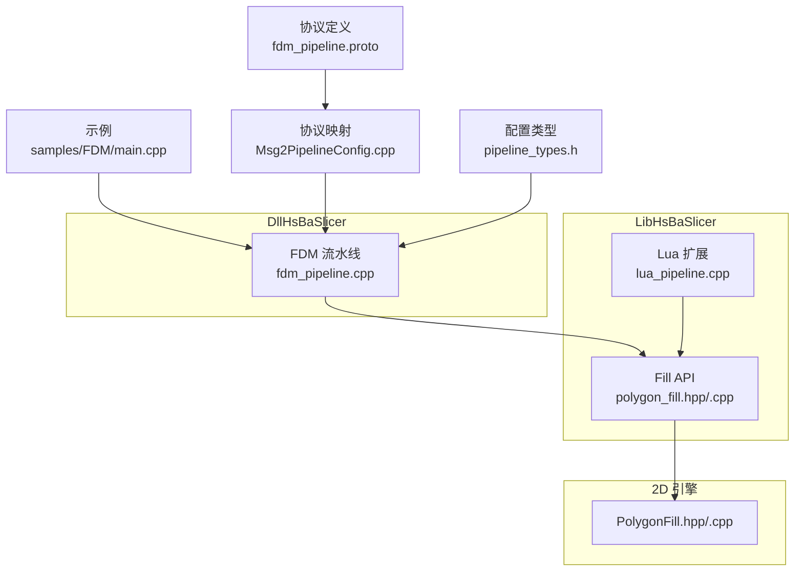
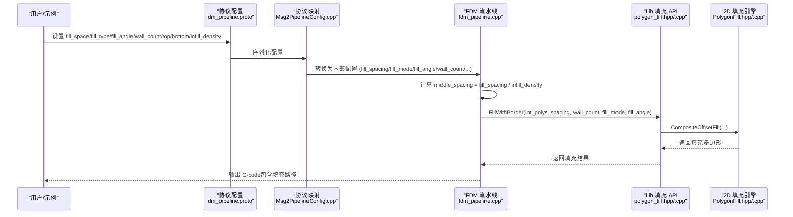
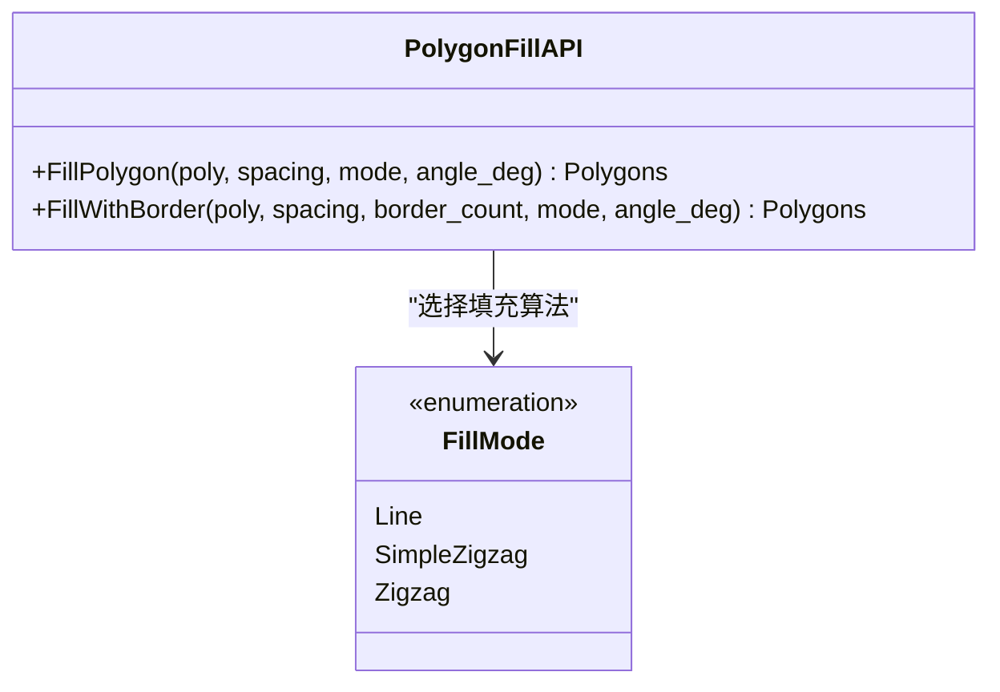
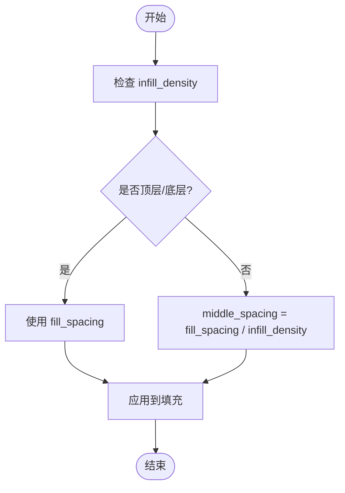

# 填充参数配置

<cite>
**本文引用的文件**   
- [polygon_fill.hpp](file://LibHsBaSlicer/Fill/polygon_fill.hpp)
- [polygon_fill.cpp](file://LibHsBaSlicer/Fill/polygon_fill.cpp)
- [PolygonFill.hpp](file://2D/PolygonFill.hpp)
- [PolygonFill.cpp](file://2D/PolygonFill.cpp)
- [lua_pipeline.cpp](file://LibHsBaSlicer/Extends/lua_pipeline.cpp)
- [fdm_pipeline.cpp](file://DllHsBaSlicer/fdm_pipeline.cpp)
- [pipeline_types.h](file://pipelinetypes/pipeline_types.h)
- [fdm_pipeline.proto](file://proto/fdm_pipeline.proto)
- [Msg2PipelineConfig.cpp](file://convert/Msg2PipelineConfig.cpp)
- [main.cpp](file://samples/FDM/main.cpp)
</cite>

## 目录
1. [简介](#简介)
2. [项目结构](#项目结构)
3. [核心组件](#核心组件)
4. [架构总览](#架构总览)
5. [详细组件分析](#详细组件分析)
6. [依赖关系分析](#依赖关系分析)
7. [性能考虑](#性能考虑)
8. [故障排查指南](#故障排查指南)
9. [结论](#结论)
10. [附录：参数参考与最佳实践](#附录参数参考与最佳实践)

## 简介
本文面向 HsBaSlicer 的填充参数配置系统，系统性说明填充算法的关键配置项及其影响，包括：
- 填充间距 spacing
- 填充角度 angle_deg（或 fill_angle）
- 填充模式 mode（Line/SimpleZigzag/Zigzag）
- 边框数量 border_count（wall_count）
- 中间层密度 infill_density 对间距的影响
- Lua 自定义填充扩展点

文档同时给出参数取值范围、默认值、组合效果分析、调优案例与性能优化建议，并解释参数验证机制与错误处理策略。

## 项目结构
围绕“填充”相关代码主要分布在以下模块：
- LibHsBaSlicer/Fill：对外暴露的 C++ 填充 API（封装 2D 填充引擎）
- 2D：底层多边形填充实现（直线、简单折线、高级折线、复合偏移等）
- DllHsBaSlicer/fdm_pipeline：FDM 流水线中填充阶段的具体调用与并行化
- pipelinetypes/pipeline_types.h：FDM 配置结构体定义（含填充相关字段）
- proto/fdm_pipeline.proto：协议层填充相关字段
- convert/Msg2PipelineConfig.cpp：协议到内部配置的映射
- samples/FDM/main.cpp：示例用法（展示填充参数设置）

**图表来源**
- [polygon_fill.hpp:1-58](file://LibHsBaSlicer/Fill/polygon_fill.hpp#L1-L58)
- [polygon_fill.cpp:1-51](file://LibHsBaSlicer/Fill/polygon_fill.cpp#L1-L51)
- [PolygonFill.hpp:1-141](file://2D/PolygonFill.hpp#L1-L141)
- [PolygonFill.cpp:1179-1225](file://2D/PolygonFill.cpp#L1179-L1225)
- [lua_pipeline.cpp:445-485](file://LibHsBaSlicer/Extends/lua_pipeline.cpp#L445-L485)
- [fdm_pipeline.cpp:300-480](file://DllHsBaSlicer/fdm_pipeline.cpp#L300-L480)
- [pipeline_types.h:73-91](file://pipelinetypes/pipeline_types.h#L73-L91)
- [fdm_pipeline.proto:1-81](file://proto/fdm_pipeline.proto#L1-L81)
- [Msg2PipelineConfig.cpp:43-65](file://convert/Msg2PipelineConfig.cpp#L43-L65)
- [main.cpp:100-165](file://samples/FDM/main.cpp#L100-L165)

**章节来源**
- [polygon_fill.hpp:1-58](file://LibHsBaSlicer/Fill/polygon_fill.hpp#L1-L58)
- [polygon_fill.cpp:1-51](file://LibHsBaSlicer/Fill/polygon_fill.cpp#L1-L51)
- [PolygonFill.hpp:1-141](file://2D/PolygonFill.hpp#L1-L141)
- [lua_pipeline.cpp:445-485](file://LibHsBaSlicer/Extends/lua_pipeline.cpp#L445-L485)
- [fdm_pipeline.cpp:300-480](file://DllHsBaSlicer/fdm_pipeline.cpp#L300-L480)
- [pipeline_types.h:73-91](file://pipelinetypes/pipeline_types.h#L73-L91)
- [fdm_pipeline.proto:1-81](file://proto/fdm_pipeline.proto#L1-L81)
- [Msg2PipelineConfig.cpp:43-65](file://convert/Msg2PipelineConfig.cpp#L43-L65)
- [main.cpp:100-165](file://samples/FDM/main.cpp#L100-L165)

## 核心组件
- 填充 API（LibHsBaSlicer/Fill）
  - FillPolygon：根据 spacing、mode、angle_deg 生成填充路径
  - FillWithBorder：在边界向内偏移 border_count 圈后，再对内部区域进行填充
  - LuaCustomFillByFile：通过 Lua 脚本生成自定义填充图案
- 2D 填充引擎（2D/PolygonFill）
  - LineFill/SimpleZigzagFill/ZigzagFill：三种基础填充模式
  - CompositeOffsetFill/HybridFill：复合偏移+内部填充
  - FillMode 枚举：Line、SimpleZigzag、Zigzag
- FDM 流水线（DllHsBaSlicer/fdm_pipeline）
  - 将 wall_count 作为边框数量传入 FillWithBorder
  - 使用 infill_density 调整中间层 spacing（middle_spacing = fill_spacing / infill_density）
  - 顶层/底层按实心处理（spacing 取 fill_spacing），中间层按密度计算 spacing
- Lua 扩展（LibHsBaSlicer/Extends/lua_pipeline）
  - 提供 HsBa.fill(polygons, {spacing, mode, angle, borderCount}) 接口
  - 解析 mode 字符串为 FillMode 枚举

**章节来源**
- [polygon_fill.hpp:17-53](file://LibHsBaSlicer/Fill/polygon_fill.hpp#L17-L53)
- [polygon_fill.cpp:13-48](file://LibHsBaSlicer/Fill/polygon_fill.cpp#L13-L48)
- [PolygonFill.hpp:20-102](file://2D/PolygonFill.hpp#L20-L102)
- [lua_pipeline.cpp:448-472](file://LibHsBaSlicer/Extends/lua_pipeline.cpp#L448-L472)
- [fdm_pipeline.cpp:300-372](file://DllHsBaSlicer/fdm_pipeline.cpp#L300-L372)

## 架构总览
下图展示了从用户配置到最终填充结果的完整流程，涵盖协议映射、FDM 流水线、Lib 填充 API 与 2D 填充引擎之间的交互。

**图表来源**
- [fdm_pipeline.proto:26-72](file://proto/fdm_pipeline.proto#L26-L72)
- [Msg2PipelineConfig.cpp:43-65](file://convert/Msg2PipelineConfig.cpp#L43-L65)
- [fdm_pipeline.cpp:314-331](file://DllHsBaSlicer/fdm_pipeline.cpp#L314-L331)
- [polygon_fill.cpp:28-34](file://LibHsBaSlicer/Fill/polygon_fill.cpp#L28-L34)
- [PolygonFill.hpp:70-85](file://2D/PolygonFill.hpp#L70-L85)

## 详细组件分析

### 填充模式（mode）
- 支持模式
  - Line：平行线填充
  - SimpleZigzag：简单折线填充
  - Zigzag：高级折线填充（角部处理更优）
- 默认值
  - FDM 流水线默认 Zigzag
  - Lua 扩展默认 Zigzag
- 行为差异
  - Zigzag 在拐角处有更好的连接与过渡，适合复杂轮廓
  - Line 适用于规则形状且追求简洁路径的场景
  - SimpleZigzag 介于两者之间，计算开销较低

**图表来源**
- [PolygonFill.hpp:60-68](file://2D/PolygonFill.hpp#L60-L68)
- [polygon_fill.hpp:17-37](file://LibHsBaSlicer/Fill/polygon_fill.hpp#L17-L37)

**章节来源**
- [PolygonFill.hpp:60-68](file://2D/PolygonFill.hpp#L60-L68)
- [fdm_pipeline.cpp:49-54](file://DllHsBaSlicer/fdm_pipeline.cpp#L49-L54)
- [lua_pipeline.cpp:450-472](file://LibHsBaSlicer/Extends/lua_pipeline.cpp#L450-L472)

### 填充间距（spacing）与密度（infill_density）
- spacing（fill_spacing）
  - 控制相邻填充线之间的距离
  - 越小越密，越大越疏
- infill_density（中间层密度）
  - 当 0 < density < 1 时，中间层实际间距 = fill_spacing / infill_density
  - 密度越低，间距越大，填充越稀疏
- 顶层/底层
  - 视为实心层，直接使用 fill_spacing，不应用密度缩放
- 典型取值
  - 默认 fill_spacing 常为 0.4mm（与线宽相近）
  - 默认 infill_density 常为 0.2（即中间层间距约为 2×fill_spacing）

**图表来源**
- [fdm_pipeline.cpp:314-331](file://DllHsBaSlicer/fdm_pipeline.cpp#L314-L331)

**章节来源**
- [fdm_pipeline.cpp:314-331](file://DllHsBaSlicer/fdm_pipeline.cpp#L314-L331)
- [main.cpp:115-122](file://samples/FDM/main.cpp#L115-L122)

### 填充角度（angle_deg / fill_angle）
- 作用
  - 控制填充线的方向（以度为单位）
  - 不同层的角度变化可改善层间结合强度
- 默认值
  - FDM 流水线默认 45°
  - Lua 扩展默认 45°
- 实践建议
  - 交替层角度（如 45°/-45°）有助于提高各向同性强度
  - 避免与外壁方向完全一致，减少层间滑移风险

**章节来源**
- [fdm_pipeline.cpp:49-54](file://DllHsBaSlicer/fdm_pipeline.cpp#L49-L54)
- [lua_pipeline.cpp:450-472](file://LibHsBaSlicer/Extends/lua_pipeline.cpp#L450-L472)

### 边框数量（border_count / wall_count）
- 作用
  - 控制沿轮廓向内偏移的边框圈数
  - 边框内再进行填充，形成“外壳+填充”的结构
- 默认值
  - FDM 流水线默认 3 圈
- 行为
  - 边框越多，壁厚越厚，模型表面质量越高
  - 过多边框会增加材料用量与打印时间

**章节来源**
- [fdm_pipeline.cpp:49-54](file://DllHsBaSlicer/fdm_pipeline.cpp#L49-L54)
- [polygon_fill.cpp:28-34](file://LibHsBaSlicer/Fill/polygon_fill.cpp#L28-L34)

### Lua 自定义填充
- 接口
  - HsBa.fill(polygons, {spacing, mode, angle, borderCount})
- 特点
  - 可通过 Lua 脚本实现任意填充图案
  - 支持路径优化回调（PathOptimize）
- 适用场景
  - 特殊几何区域的定制化填充
  - 实验性填充算法的快速验证

**章节来源**
- [lua_pipeline.cpp:448-472](file://LibHsBaSlicer/Extends/lua_pipeline.cpp#L448-L472)
- [polygon_fill.cpp:36-48](file://LibHsBaSlicer/Fill/polygon_fill.cpp#L36-L48)

## 依赖关系分析
- 配置来源
  - 协议层（fdm_pipeline.proto）定义 fill_space/fill_type/fill_angle/wall_count/top_layer_count/bottom_layer_count/support_* 等字段
  - 转换层（Msg2PipelineConfig.cpp）将协议字段映射到内部配置结构体（pipeline_types.h）
- 运行时依赖
  - FDM 流水线（fdm_pipeline.cpp）负责：
    - 根据 infill_density 计算中间层 spacing
    - 调用 FillWithBorder 生成带边框的填充
    - 在螺旋模式下跳过填充
  - Lib 填充 API（polygon_fill.hpp/.cpp）封装 2D 填充引擎
  - 2D 填充引擎（PolygonFill.hpp/.cpp）提供具体算法实现

**图表来源**
- [fdm_pipeline.proto:26-72](file://proto/fdm_pipeline.proto#L26-L72)
- [Msg2PipelineConfig.cpp:43-65](file://convert/Msg2PipelineConfig.cpp#L43-L65)
- [pipeline_types.h:73-91](file://pipelinetypes/pipeline_types.h#L73-L91)
- [fdm_pipeline.cpp:300-372](file://DllHsBaSlicer/fdm_pipeline.cpp#L300-L372)
- [polygon_fill.cpp:13-48](file://LibHsBaSlicer/Fill/polygon_fill.cpp#L13-L48)
- [PolygonFill.hpp:20-102](file://2D/PolygonFill.hpp#L20-L102)

**章节来源**
- [fdm_pipeline.proto:26-72](file://proto/fdm_pipeline.proto#L26-L72)
- [Msg2PipelineConfig.cpp:43-65](file://convert/Msg2PipelineConfig.cpp#L43-L65)
- [pipeline_types.h:73-91](file://pipelinetypes/pipeline_types.h#L73-L91)
- [fdm_pipeline.cpp:300-372](file://DllHsBaSlicer/fdm_pipeline.cpp#L300-L372)
- [polygon_fill.cpp:13-48](file://LibHsBaSlicer/Fill/polygon_fill.cpp#L13-L48)
- [PolygonFill.hpp:20-102](file://2D/PolygonFill.hpp#L20-L102)

## 性能考虑
- 并行化
  - FillWithBorder 是纯每层计算，可在 FDM 流水线中并行执行
  - Lua 自定义填充因共享解释器状态，必须串行执行
- 密度与间距
  - 降低 infill_density 会增大 spacing，减少填充路径长度，提升速度但降低强度
  - 增加 wall_count 会显著增加材料与时间，需权衡
- 角度与模式
  - Zigzag 模式在复杂轮廓下路径更优，但计算略高于 SimpleZigzag
  - 合理设置角度可减少回抽与空走，提升打印效率

[本节为通用指导，不直接分析具体文件]

## 故障排查指南
- 常见问题
  - 填充过密或过疏：检查 spacing 与 infill_density 的组合
  - 层间结合弱：尝试交替角度或调整 angle_deg
  - 表面质量差：增加 wall_count 或改用 Zigzag 模式
  - 螺旋模式无填充：确认 spiral_mode 已启用（该模式跳过填充）
- 错误处理
  - FDM 流水线捕获 RuntimeError，并将错误信息写入 result.error_message
  - 异步调用通过回调返回成功/失败状态

**章节来源**
- [fdm_pipeline.cpp:424-433](file://DllHsBaSlicer/fdm_pipeline.cpp#L424-L433)
- [fdm_pipeline.cpp:334-338](file://DllHsBaSlicer/fdm_pipeline.cpp#L334-L338)

## 结论
HsBaSlicer 的填充参数配置系统提供了灵活的 spacing、mode、angle_deg、border_count 以及 infill_density 控制能力。通过协议层、转换层、FDM 流水线与 2D 填充引擎的分层设计，既保证了高性能并行计算，又支持 Lua 自定义扩展。合理调参可在强度、表面质量、打印时间与材料消耗之间取得平衡。

[本节为总结性内容，不直接分析具体文件]

## 附录：参数参考与最佳实践

### 参数对照表
- spacing（fill_spacing）
  - 含义：填充线间距（mm）
  - 默认：约 0.4（与线宽相近）
  - 建议：根据线宽与材料特性调整；过小易堵头，过大强度不足
- mode（fill_mode）
  - 选项：Line、SimpleZigzag、Zigzag
  - 默认：Zigzag
  - 建议：复杂轮廓用 Zigzag，规则形状可用 Line 或 SimpleZigzag
- angle_deg（fill_angle）
  - 含义：填充角度（度）
  - 默认：45°
  - 建议：层间交替角度（如 45°/-45°）以提升各向同性
- border_count（wall_count）
  - 含义：边框圈数
  - 默认：3
  - 建议：根据壁厚需求调整；过多会增加材料与时间
- infill_density
  - 含义：中间层密度（0~1）
  - 默认：0.2
  - 建议：低密度用于轻量化，高密度用于高强度区域

**章节来源**
- [pipeline_types.h:73-91](file://pipelinetypes/pipeline_types.h#L73-L91)
- [fdm_pipeline.cpp:49-54](file://DllHsBaSlicer/fdm_pipeline.cpp#L49-L54)
- [main.cpp:115-122](file://samples/FDM/main.cpp#L115-L122)

### 参数组合影响分析
- 密度与强度
  - infill_density 越高，中间层越密，整体强度越高
  - 但过高密度会增加打印时间与材料消耗
- 角度与层间结合
  - 不同层角度变化可改善层间结合，减少分层开裂风险
  - 与外壁方向一致的填充可能削弱层间剪切强度
- 边框与表面质量
  - 更多边框提升表面平整度与尺寸精度
  - 但过多边框会掩盖填充的作用，造成材料浪费

**章节来源**
- [fdm_pipeline.cpp:314-331](file://DllHsBaSlicer/fdm_pipeline.cpp#L314-L331)
- [PolygonFill.hpp:60-68](file://2D/PolygonFill.hpp#L60-L68)

### 调优案例
- 轻量模型
  - spacing=0.4，infill_density=0.15，mode=Zigzag，angle=45°，wall_count=3
  - 目标：减少材料，保持基本强度
- 高强度部件
  - spacing=0.4，infill_density=0.3，mode=Zigzag，angle=45°/-45°交替，wall_count=4
  - 目标：提升强度与层间结合
- 表面质量优先
  - spacing=0.4，infill_density=0.2，mode=Zigzag，angle=45°，wall_count=5
  - 目标：平滑表面，减少可见填充痕迹

**章节来源**
- [main.cpp:115-122](file://samples/FDM/main.cpp#L115-L122)
- [fdm_pipeline.cpp:314-331](file://DllHsBaSlicer/fdm_pipeline.cpp#L314-L331)