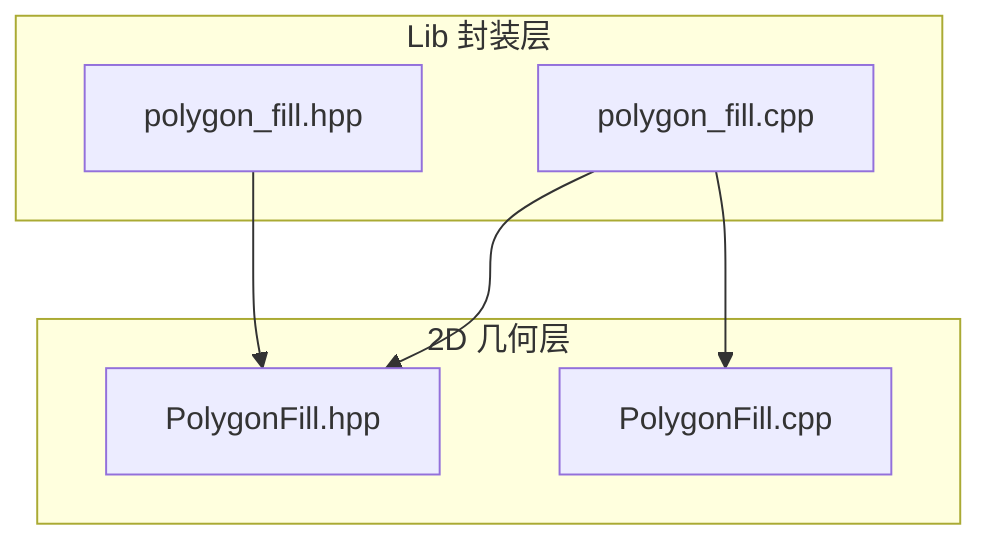
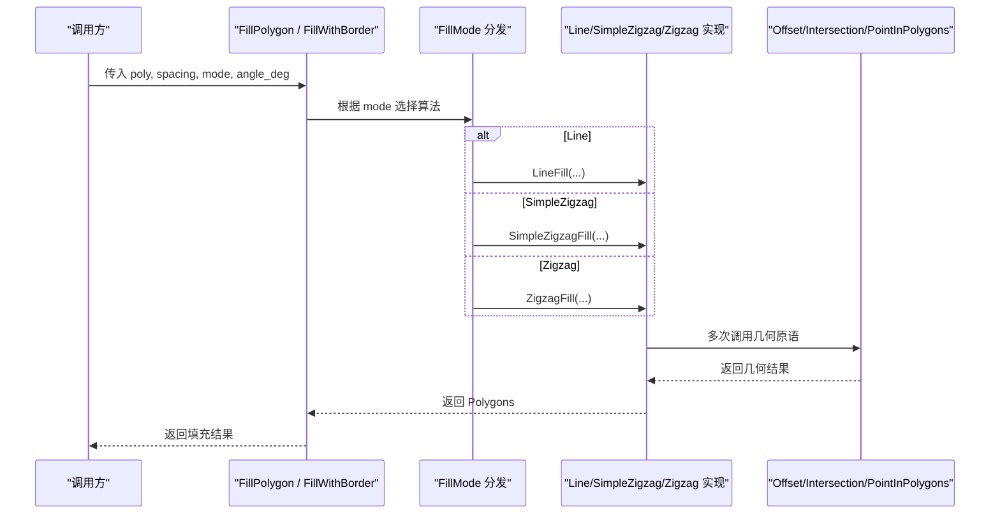
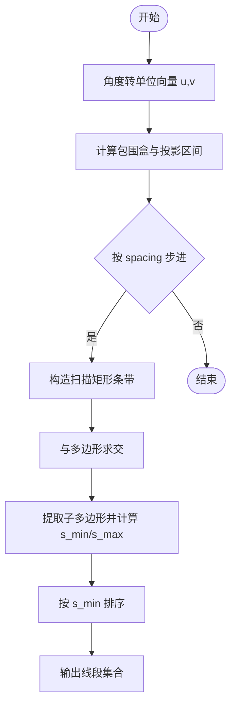
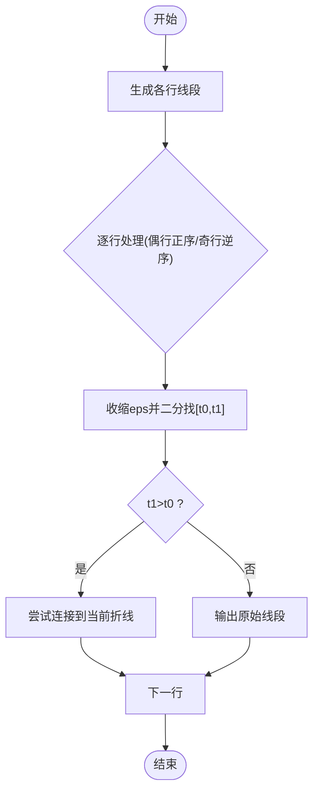
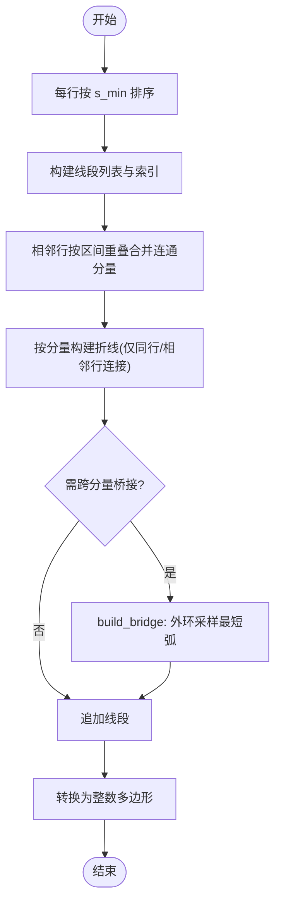
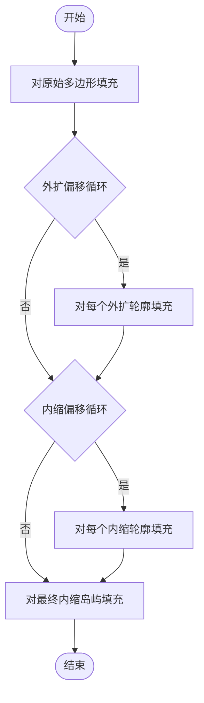
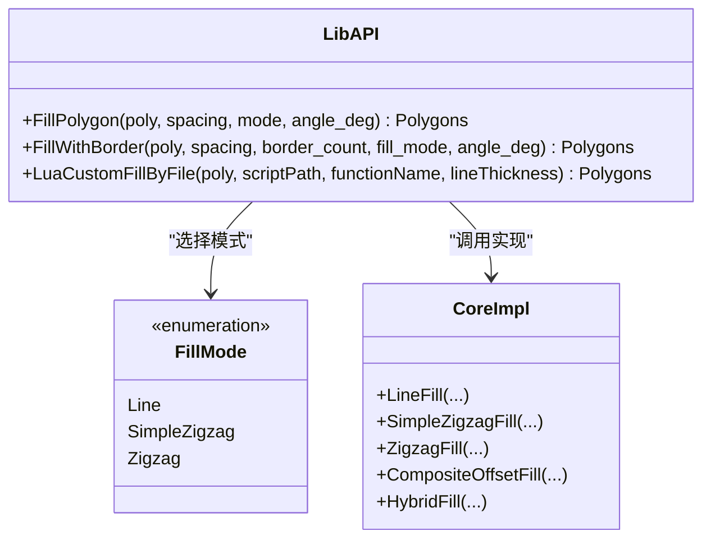
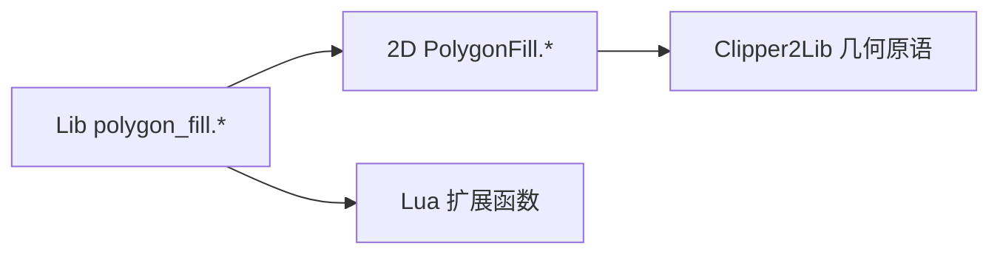

# 填充算法实现

<cite>
**本文引用的文件**   
- [PolygonFill.hpp](file://2D/PolygonFill.hpp)
- [PolygonFill.cpp](file://2D/PolygonFill.cpp)
- [polygon_fill.hpp](file://LibHsBaSlicer/Fill/polygon_fill.hpp)
- [polygon_fill.cpp](file://LibHsBaSlicer/Fill/polygon_fill.cpp)
</cite>

## 目录
1. [引言](#引言)
2. [项目结构](#项目结构)
3. [核心组件](#核心组件)
4. [架构总览](#架构总览)
5. [详细组件分析](#详细组件分析)
6. [依赖关系分析](#依赖关系分析)
7. [性能与复杂度](#性能与复杂度)
8. [参数与数学原理](#参数与数学原理)
9. [使用示例与效果对比](#使用示例与效果对比)
10. [故障排查指南](#故障排查指南)
11. [结论](#结论)

## 引言
本技术文档聚焦 HsBaSlicer 的二维多边形填充算法实现，系统性地解析直线填充（Line）、简单锯齿形填充（SimpleZigzag）和高级锯齿形填充（Zigzag）三种内置模式的几何计算、路径生成策略与边界处理机制。同时说明填充密度控制、角度调节、间距计算的数学基础，并给出面向 3D 打印工艺工程师与算法开发者的实践建议与性能分析。

## 项目结构
填充相关代码主要分布在两个层次：
- 2D 几何层：提供偏移、相交、点包含等几何原语以及具体的填充算法实现。
- Lib 封装层：对外暴露统一的 C++ API，将 2D 填充引擎组合为“纯填充”和“带边框填充”，并提供 Lua 自定义填充入口。

**图表来源**
- [PolygonFill.hpp:1-141](file://2D/PolygonFill.hpp#L1-L141)
- [PolygonFill.cpp:1-1449](file://2D/PolygonFill.cpp#L1-L1449)
- [polygon_fill.hpp:1-58](file://LibHsBaSlicer/Fill/polygon_fill.hpp#L1-L58)
- [polygon_fill.cpp:1-51](file://LibHsBaSlicer/Fill/polygon_fill.cpp#L1-L51)

**章节来源**
- [PolygonFill.hpp:1-141](file://2D/PolygonFill.hpp#L1-L141)
- [polygon_fill.hpp:1-58](file://LibHsBaSlicer/Fill/polygon_fill.hpp#L1-L58)

## 核心组件
- 填充模式枚举 FillMode：定义 Line、SimpleZigzag、Zigzag 三种模式。
- 核心函数族：
  - OffsetFill/OffsetOnly：基于偏移生成轮廓或边框。
  - LineFill：直线扫描线填充，输出独立线段集合。
  - SimpleZigzagFill：按行交替方向连接中心点，形成连续折线。
  - ZigzagFill：在 SimpleZigzag 基础上增加连通性分析与桥接逻辑，提升拐角与孤岛处理能力。
  - CompositeOffsetFill/HybridFill：组合偏移与内部填充，支持外扩/内缩多层边框。
  - LuaCustomFill/LuaCustomFillString：通过 Lua 脚本扩展自定义填充。
- Lib 封装 API：
  - FillPolygon：根据 FillMode 选择具体填充算法。
  - FillWithBorder：先做内偏边框，再对剩余区域进行填充。
  - LuaCustomFillByFile：加载外部脚本并注册 2D 与路径优化函数。

**章节来源**
- [PolygonFill.hpp:20-136](file://2D/PolygonFill.hpp#L20-L136)
- [polygon_fill.hpp:17-53](file://LibHsBaSlicer/Fill/polygon_fill.hpp#L17-L53)

## 架构总览
整体流程从 Lib 层进入，根据模式分发到 2D 层的对应填充实现；所有实现均基于统一的几何原语（偏移、求交、点包含、整数化/浮点化）。

**图表来源**
- [polygon_fill.cpp:13-34](file://LibHsBaSlicer/Fill/polygon_fill.cpp#L13-L34)
- [PolygonFill.cpp:454-1175](file://2D/PolygonFill.cpp#L454-L1175)

## 详细组件分析

### 直线填充（Line）
- 目标：沿指定角度生成平行扫描线，裁剪出与多边形相交的线段集合。
- 关键步骤：
  - 将角度转换为单位向量 u=(ux,uy)，并构造垂直向量 v=(-uy,ux)。
  - 计算包围盒投影区间[minProj, maxProj]，以 spacing 步进生成扫描线。
  - 每条扫描线用矩形条带与输入多边形求交，得到若干子多边形。
  - 对每个子多边形，将其顶点投影到 u 轴，取最小/最大 s 值作为线段端点，并按 s_min 排序。
  - 最终将每段线段编码为两点多边形输出。
- 边界处理：
  - 通过 Intersection 精确裁剪，避免越界。
  - 对空子多边形直接跳过。
- 复杂度：
  - 扫描线数量 O(B/spacing)，B 为包围盒对角线长度。
  - 每次求交与排序开销取决于多边形边数与子多边形规模。

**图表来源**
- [PolygonFill.cpp:39-137](file://2D/PolygonFill.cpp#L39-L137)
- [PolygonFill.cpp:454-473](file://2D/PolygonFill.cpp#L454-L473)

**章节来源**
- [PolygonFill.cpp:39-137](file://2D/PolygonFill.cpp#L39-L137)
- [PolygonFill.cpp:454-473](file://2D/PolygonFill.cpp#L454-L473)

### 简单锯齿形填充（SimpleZigzag）
- 目标：在同一方向上交替连接相邻扫描线的线段中心，形成连续的往返折线路径。
- 关键步骤：
  - 复用 LineFilling 生成各行线段。
  - 对偶数行从左到右遍历，奇数行从右到左遍历，保证往返方向。
  - 对每段线段进行“向内收缩”微小偏移 eps，再用二分查找 find_first_inside/find_last_inside 确定有效内部区间 [t0,t1]。
  - 若 t1<=t0，则整段无效，直接输出原始线段；否则输出有效子段。
  - 仅允许同层或相邻层之间连接，避免跨层跳连导致环路。
  - 将折线点序列转换为整数多边形输出。
- 边界处理：
  - 使用 PointInPolygons 判断点是否在多边形内。
  - 二分查找确保端点落在多边形内部，避免悬空端点。
- 复杂度：
  - 行遍历 O(R)，R 为扫描行数。
  - 每行内线段遍历与二分查找开销线性于线段数与迭代次数。

**图表来源**
- [PolygonFill.cpp:477-674](file://2D/PolygonFill.cpp#L477-L674)

**章节来源**
- [PolygonFill.cpp:477-674](file://2D/PolygonFill.cpp#L477-L674)

### 高级锯齿形填充（Zigzag）
- 目标：在 SimpleZigzag 的基础上增强连通性与拐角处理，减少断链与悬空段。
- 关键步骤：
  - 对每行线段按 s_min 排序，构建全局线段列表 segList 与索引映射 segIndex。
  - 使用并查集（Union-Find）对相邻行的线段按区间重叠关系合并连通分量。
  - 对每个连通分量构建折线，仅在相同行或相邻行之间连接，避免环路。
  - 当不同连通分量需要跨行连接时，尝试 build_bridge：
    - 若两端点均在内部，直接连线。
    - 否则沿外层环寻找最近点 p1,p2，比较顺时针/逆时针弧长，选择较短弧采样点序列，拼接成桥接路径。
  - 无法桥接时回退到中点包含测试，失败则单独输出直线段。
- 边界处理：
  - 使用 point_inside 与二分查找裁剪有效区间。
  - 桥接路径沿外环采样，步长受 integerization 与 lineThickness 控制，保证路径平滑且不过密。
- 复杂度：
  - 排序 O(N log N)，N 为线段总数。
  - 并查集操作近似 O(N α(N))。
  - 桥接路径采样与外环遍历与外环周长成正比。

**图表来源**
- [PolygonFill.cpp:676-1175](file://2D/PolygonFill.cpp#L676-L1175)

**章节来源**
- [PolygonFill.cpp:676-1175](file://2D/PolygonFill.cpp#L676-L1175)

### 组合与混合填充（CompositeOffsetFill / HybridFill）
- CompositeOffsetFill：
  - 对原始多边形执行内部填充。
  - 对 outwardCount 次外扩偏移分别填充。
  - 对 inwardCount 次内缩偏移分别填充。
- HybridFill：
  - 先生成 outwardCount 次外扩偏移轮廓（闭合路径）。
  - 再生成 inwardCount-1 次内缩偏移轮廓（闭合路径），直到面积过小停止。
  - 对最后一次内缩得到的“岛屿”进行内部填充。
- 用途：
  - 生成带边框的多层结构，内部采用指定填充模式。

**图表来源**
- [PolygonFill.cpp:1177-1281](file://2D/PolygonFill.cpp#L1177-L1281)

**章节来源**
- [PolygonFill.cpp:1177-1281](file://2D/PolygonFill.cpp#L1177-L1281)

### Lib 封装 API
- FillPolygon：
  - 根据 FillMode 分派到 LineFill/SimpleZigzagFill/ZigzagFill。
- FillWithBorder：
  - 使用 CompositeOffsetFill，设置 outwardCount=0，inwardCount=border_count，生成边框+内部填充。
- LuaCustomFillByFile：
  - 注册 2D 几何函数与路径优化函数，然后调用底层 LuaCustomFill。

**图表来源**
- [polygon_fill.cpp:13-47](file://LibHsBaSlicer/Fill/polygon_fill.cpp#L13-L47)
- [PolygonFill.hpp:63-68](file://2D/PolygonFill.hpp#L63-L68)

**章节来源**
- [polygon_fill.cpp:13-47](file://LibHsBaSlicer/Fill/polygon_fill.cpp#L13-L47)

## 依赖关系分析
- 2D 层依赖几何库 Clipper2Lib 提供的 Offset、Intersection、PointInPolygonResult 等能力。
- Lib 层依赖 2D 层接口，并通过 Lua 扩展机制注入额外工具函数。
- 常量与精度控制：
  - MAX_FILL_ITERATIONS、MAX_BINARY_SEARCH_ITERATIONS 控制迭代上限。
  - INTEGERIZATION_PRECISION 控制浮点到整数的缩放精度。
  - LARGE_ROW_OFFSET 用于行号隔离，防止误连。

**图表来源**
- [polygon_fill.cpp:1-51](file://LibHsBaSlicer/Fill/polygon_fill.cpp#L1-L51)
- [PolygonFill.cpp:1-29](file://2D/PolygonFill.cpp#L1-L29)

**章节来源**
- [PolygonFill.cpp:21-29](file://2D/PolygonFill.cpp#L21-L29)
- [polygon_fill.cpp:1-51](file://LibHsBaSlicer/Fill/polygon_fill.cpp#L1-L51)

## 性能与复杂度
- 直线填充：
  - 时间复杂度近似 O((B/spacing)·(E + K log K))，其中 B 为包围盒尺寸，E 为多边形边数，K 为每行子多边形顶点数。
  - 空间复杂度与子多边形规模线性相关。
- 简单锯齿形：
  - 时间复杂度近似 O(R·(S + I))，R 为扫描行数，S 为每行线段数，I 为二分查找迭代次数。
  - 空间复杂度与折线点数线性相关。
- 高级锯齿形：
  - 时间复杂度近似 O(N log N + N α(N) + ΣArcLen)，N 为线段总数，ΣArcLen 为桥接路径采样开销。
  - 空间复杂度与线段列表、并查集与折线存储线性相关。
- 组合/混合填充：
  - 时间与偏移次数及内部填充复杂度成正比。
  - 适合生成多层边框与内部填充的组合结构。

[本节为通用性能讨论，不直接分析具体文件]

## 参数与数学原理
- 角度与方向向量：
  - 角度 angle_deg 转换为弧度 ang = angle_deg × π / 180。
  - 方向向量 u=(cos(ang), sin(ang))，垂直向量 v=(-sin(ang), cos(ang))。
- 扫描线与投影：
  - 对包围盒四个角点投影到 v 轴，得到 minProj/maxProj。
  - 以 spacing 步进 t ∈ [minProj-spacing, maxProj+spacing]，构造扫描矩形条带。
- 线段端点计算：
  - 对子多边形顶点投影到 u 轴，得到 s_min/s_max。
  - 线段端点 a=u·s_min + v·p_avg，b=u·s_max + v·p_avg，p_avg 为顶点在 v 方向的平均值。
- 密度与间距：
  - spacing 越小，填充密度越高，但计算量越大。
  - lineThickness 影响桥接路径采样步长与有效区间收缩 eps。
- 边界处理：
  - 使用 Intersection 精确裁剪。
  - 使用 PointInPolygons 与二分查找确定有效内部区间，避免悬空端点。

**章节来源**
- [PolygonFill.cpp:39-137](file://2D/PolygonFill.cpp#L39-L137)
- [PolygonFill.cpp:477-674](file://2D/PolygonFill.cpp#L477-L674)
- [PolygonFill.cpp:676-1175](file://2D/PolygonFill.cpp#L676-L1175)

## 使用示例与效果对比
以下为典型用法示意（不展示具体代码内容，仅提供调用路径与参数说明）：
- 直线填充：
  - 调用 FillPolygon(poly, spacing, FillMode::Line, angle_deg)。
  - 适用场景：均匀网格状支撑、快速填充大面积区域。
- 简单锯齿形填充：
  - 调用 FillPolygon(poly, spacing, FillMode::SimpleZigzag, angle_deg)。
  - 适用场景：需要连续路径以减少起停，中等密度填充。
- 高级锯齿形填充：
  - 调用 FillPolygon(poly, spacing, FillMode::Zigzag, angle_deg)。
  - 适用场景：复杂边界与拐角较多，需要更稳健的连接与桥接。
- 带边框填充：
  - 调用 FillWithBorder(poly, spacing, border_count, fill_mode, angle_deg)。
  - 适用场景：需要外层轮廓加固与内部填充分离的结构。

效果对比要点：
- Line：路径短、起停多，适合快速填充。
- SimpleZigzag：路径连续，减少起停，拐角处可能断开。
- Zigzag：路径连续且拐角处理更强，桥接逻辑提升鲁棒性。
- 边框组合：外层轮廓清晰，内部填充可控。

**章节来源**
- [polygon_fill.cpp:13-34](file://LibHsBaSlicer/Fill/polygon_fill.cpp#L13-L34)
- [PolygonFill.hpp:30-58](file://2D/PolygonFill.hpp#L30-L58)

## 故障排查指南
常见问题与定位方法：
- 填充结果为空：
  - 检查 spacing 是否大于 0。
  - 确认输入多边形非空且有效。
- 路径断裂或悬空：
  - 检查 angle_deg 与 spacing 是否合理。
  - 对于 Zigzag，观察桥接路径是否成功（build_bridge 返回值）。
- Lua 自定义填充报错：
  - 检查脚本路径与函数名是否正确。
  - 确认返回值为表结构，元素为点表。
- 性能问题：
  - 降低填充密度（增大 spacing）。
  - 减少偏移层数（outwardCount/inwardCount）。
  - 调整 integerization 精度与 lineThickness。

错误处理关键点：
- Lua 状态创建失败、脚本加载失败、函数不存在等均有明确异常信息。
- 二分查找与迭代上限防止无限循环。

**章节来源**
- [PolygonFill.cpp:186-191](file://2D/PolygonFill.cpp#L186-L191)
- [PolygonFill.cpp:1284-1446](file://2D/PolygonFill.cpp#L1284-L1446)

## 结论
HsBaSlicer 的填充算法以 2D 几何原语为基础，提供了从直线到锯齿形的多种填充模式，并通过组合与混合填充支持复杂的边框与内部结构。SimpleZigzag 与 Zigzag 在路径连续性方面逐步增强，后者通过并查集与桥接逻辑显著提升鲁棒性。工程实践中应根据模型复杂度、打印工艺要求与性能约束选择合适的模式与参数，必要时结合边框偏移以获得更好的结构强度与表面质量。