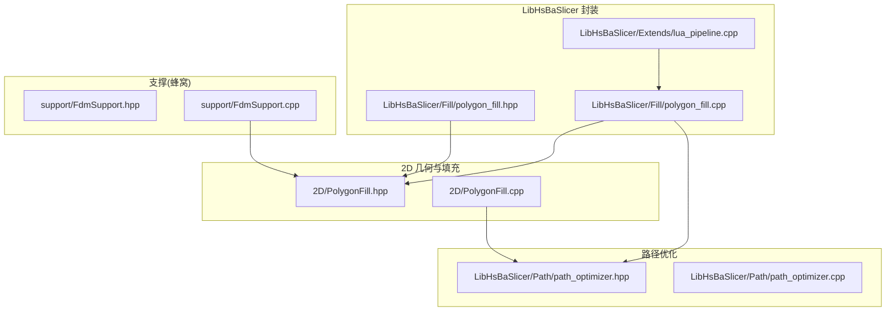
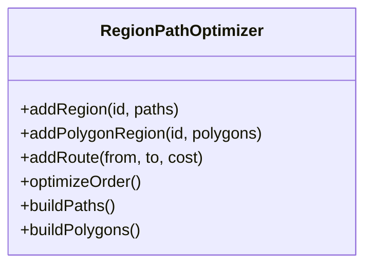
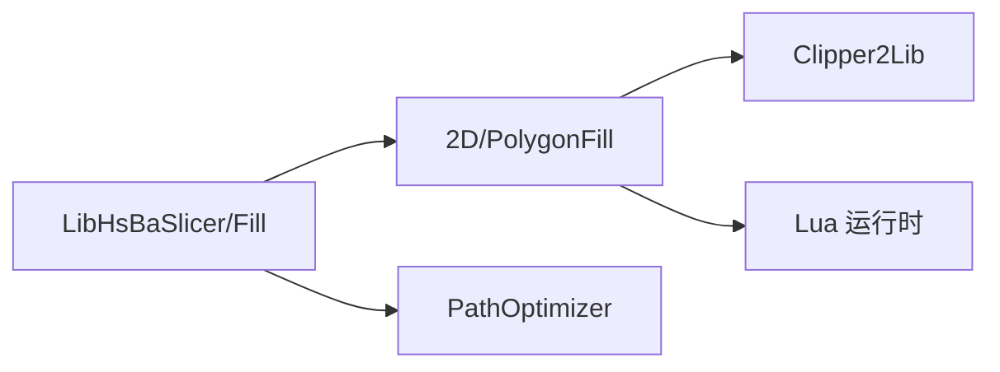

# 填充系统

<cite>
**本文引用的文件**   
- [2D/PolygonFill.hpp](file://2D/PolygonFill.hpp)
- [2D/PolygonFill.cpp](file://2D/PolygonFill.cpp)
- [LibHsBaSlicer/Fill/polygon_fill.hpp](file://LibHsBaSlicer/Fill/polygon_fill.hpp)
- [LibHsBaSlicer/Fill/polygon_fill.cpp](file://LibHsBaSlicer/Fill/polygon_fill.cpp)
- [LibHsBaSlicer/Extends/lua_pipeline.cpp](file://LibHsBaSlicer/Extends/lua_pipeline.cpp)
- [LibHsBaSlicer/Path/path_optimizer.hpp](file://LibHsBaSlicer/Path/path_optimizer.hpp)
- [LibHsBaSlicer/Path/path_optimizer.cpp](file://LibHsBaSlicer/Path/path_optimizer.cpp)
- [support/FdmSupport.hpp](file://support/FdmSupport.hpp)
- [support/FdmSupport.cpp](file://support/FdmSupport.cpp)
- [samples/SLA/scripts/my_sla_floor.lua](file://samples/SLA/scripts/my_sla_floor.lua)
- [tests/PolygonFill/optimize_paths.lua](file://tests/PolygonFill/optimize_paths.lua)
- [tests/PolygonFill/polygon_fill_test.cpp](file://tests/PolygonFill/polygon_fill_test.cpp)
</cite>

## 目录
1. [简介](#简介)
2. [项目结构](#项目结构)
3. [核心组件](#核心组件)
4. [架构总览](#架构总览)
5. [详细组件分析](#详细组件分析)
6. [依赖关系分析](#依赖关系分析)
7. [性能与内存管理](#性能与内存管理)
8. [故障排查指南](#故障排查指南)
9. [结论](#结论)
10. [附录：参数与用法速查](#附录参数与用法速查)

## 简介
本技术文档聚焦 HsBaSlicer 的“填充系统”，系统性梳理并解释以下能力：
- 填充算法族：直线填充、锯齿形填充（简单与高级）、偏移填充、复合偏移填充、混合填充，以及通过 Lua 脚本自定义填充。
- 关键参数：间距、角度、线宽、边框层数、偏移步长等对最终路径的影响。
- 路径优化与连接点处理：区域访问顺序优化、桥接策略、连续性保证。
- 与 2D 几何算法的集成：多边形布尔运算、偏移、点包含测试、整数化/浮点化转换。
- 面向开发者与工艺工程师的实践建议：如何扩展新填充模式、如何调参以获得更好的打印质量与效率。

## 项目结构
填充系统由三层组成：
- 2D 几何与填充算法层：位于 2D 目录，提供 OffsetFill、LineFill、SimpleZigzagFill、ZigzagFill、CompositeOffsetFill、HybridFill 及 Lua 绑定。
- LibHsBaSlicer 封装层：对外暴露 C++ API（如 FillPolygon、FillWithBorder、LuaCustomFillByFile），并在 Lua 管道中统一接入。
- 路径优化与支撑：路径优化器 RegionPathOptimizer 用于减少空走；蜂窝支撑作为“网格/蜂窝”类填充在支撑模块中实现。



图表来源
- [2D/PolygonFill.hpp:1-141](file://2D/PolygonFill.hpp#L1-L141)
- [2D/PolygonFill.cpp:1-1449](file://2D/PolygonFill.cpp#L1-L1449)
- [LibHsBaSlicer/Fill/polygon_fill.hpp:1-58](file://LibHsBaSlicer/Fill/polygon_fill.hpp#L1-L58)
- [LibHsBaSlicer/Fill/polygon_fill.cpp:1-51](file://LibHsBaSlicer/Fill/polygon_fill.cpp#L1-L51)
- [LibHsBaSlicer/Path/path_optimizer.hpp:1-125](file://LibHsBaSlicer/Path/path_optimizer.hpp#L1-L125)
- [support/FdmSupport.hpp:1-66](file://support/FdmSupport.hpp#L1-L66)

章节来源
- [2D/PolygonFill.hpp:1-141](file://2D/PolygonFill.hpp#L1-L141)
- [LibHsBaSlicer/Fill/polygon_fill.hpp:1-58](file://LibHsBaSlicer/Fill/polygon_fill.hpp#L1-L58)

## 核心组件
- 2D 填充接口与枚举
  - 填充模式枚举 FillMode：Line、SimpleZigzag、Zigzag。
  - 核心函数：OffsetFill、LineFill、SimpleZigzagFill、ZigzagFill、CompositeOffsetFill、HybridFill、LuaCustomFill/LuaCustomFillString。
- LibHsBaSlicer 封装
  - FillPolygon：根据 FillMode 分发到具体算法。
  - FillWithBorder：基于 CompositeOffsetFill 生成边框+内部填充。
  - LuaCustomFillByFile：加载 Lua 脚本，注入 PolygonFill 与 PathOptimize 能力。
- 路径优化
  - RegionPathOptimizer：将独立区域建模为图顶点，求解访问顺序（遗传 TSP），支持“多边形模式”和“填充结果模式”。
- 蜂窝支撑（网格/蜂窝）
  - FdmHoneycombSupport：在悬垂区域生成蜂窝状支撑单元，体现“网格/蜂窝”类填充思想。

章节来源
- [2D/PolygonFill.hpp:60-117](file://2D/PolygonFill.hpp#L60-L117)
- [LibHsBaSlicer/Fill/polygon_fill.hpp:17-53](file://LibHsBaSlicer/Fill/polygon_fill.hpp#L17-L53)
- [LibHsBaSlicer/Path/path_optimizer.hpp:23-115](file://LibHsBaSlicer/Path/path_optimizer.hpp#L23-L115)
- [support/FdmSupport.hpp:46-63](file://support/FdmSupport.hpp#L46-L63)

## 架构总览
下图展示从上层调用到 2D 填充与路径优化的完整流程。

```mermaid
sequenceDiagram
participant Caller as "调用方(Lua/C++)"
participant LibFill as "LibHsBaSlicer/Fill"
participant PF as "2D/PolygonFill"
participant Opt as "PathOptimizer"
Caller->>LibFill : FillPolygon / FillWithBorder / LuaCustomFillByFile
alt 内置模式
LibFill->>PF : LineFill / SimpleZigzagFill / ZigzagFill / CompositeOffsetFill
PF-->>LibFill : Polygons
else Lua 自定义
LibFill->>PF : RegisterLuaPolygonFillFunctions
LibFill->>Opt : RegisterLuaPathOptimizeFunctions
LibFill->>Caller : 执行 Lua generate_fill(regions)
Caller-->>LibFill : 返回路径表
end
LibFill-->>Caller : Polygons
```

图表来源
- [LibHsBaSlicer/Fill/polygon_fill.cpp:13-47](file://LibHsBaSlicer/Fill/polygon_fill.cpp#L13-L47)
- [2D/PolygonFill.cpp:416-420](file://2D/PolygonFill.cpp#L416-L420)
- [LibHsBaSlicer/Path/path_optimizer.cpp:486-522](file://LibHsBaSlicer/Path/path_optimizer.cpp#L486-L522)

## 详细组件分析

### 直线填充（LineFill）
- 原理概述
  - 计算扫描方向 u 与法向 v，按 spacing 步进生成扫描带矩形，与输入多边形求交得到若干线段区间。
  - 每行区间排序后输出为独立线段集合（每个 Path 仅含两个端点）。
- 关键步骤
  - 投影边界框，确定扫描范围。
  - 构造宽度为 lineThickness 的扫描条，与多边形求交。
  - 提取每条交线的起点/终点，并按投影坐标排序。
- 复杂度
  - 时间主要取决于扫描行数与多边形求交次数；空间为所有扫描段集合。
- 适用场景
  - 需要简单、可预测的平行线填充，便于后续路径规划。

章节来源
- [2D/PolygonFill.cpp:39-137](file://2D/PolygonFill.cpp#L39-L137)
- [2D/PolygonFill.cpp:453-473](file://2D/PolygonFill.cpp#L453-L473)

### 简单锯齿形填充（SimpleZigzagFill）
- 原理概述
  - 复用 LineFilling 的行段集合，按奇偶行反向遍历，尝试在相邻行之间建立连接，形成连续折线。
  - 使用二分搜索裁剪线段至多边形内部，避免越界。
- 连接策略
  - 仅允许同一行或相邻行之间的连接，防止产生环。
  - 若连接失败，则拆分为多条独立折线。
- 复杂度
  - 行内排序 O(R log R)，跨行连接近似 O(R^2)（R 为扫描行数）。
- 适用场景
  - 希望路径尽量连续以减少抬刀次数，但对复杂凹形的桥接能力有限。

章节来源
- [2D/PolygonFill.cpp:475-674](file://2D/PolygonFill.cpp#L475-L674)

### 高级锯齿形填充（ZigzagFill）
- 原理概述
  - 同样基于扫描行，但引入并查集对相邻行的线段进行连通性合并，识别连通分量。
  - 构建桥接路径：当不同连通分量在相邻行时，优先沿外轮廓最短弧连接，否则回退到中线判断或拆分。
- 桥接与容差
  - 使用 point_inside 判定与二分搜索定位进入/离开点。
  - 对无法桥接的片段，单独输出为额外直线段，保证完整性。
- 复杂度
  - 并查集操作接近线性；跨行区间重叠检查 O(R^2)。
- 适用场景
  - 复杂凹形或多岛区域，需要更强的连通性与桥接鲁棒性。

章节来源
- [2D/PolygonFill.cpp:676-1175](file://2D/PolygonFill.cpp#L676-L1175)

### 偏移填充（OffsetFill）
- 原理概述
  - 以固定间距向内偏移，逐层生成闭合轮廓，直到偏移结果为空。
- 特点
  - 生成的是多层同心轮廓，适合薄壁或特定工艺需求。
- 复杂度
  - 取决于最大偏移层数与每次偏移的计算成本。

章节来源
- [2D/PolygonFill.cpp:422-451](file://2D/PolygonFill.cpp#L422-L451)

### 复合偏移填充（CompositeOffsetFill）
- 原理概述
  - 先对原始多边形进行内部填充，再向外/向内多次偏移，并对每一偏移层应用相同填充模式。
- 用途
  - 生成“边框 + 内部填充”的组合效果，常用于外壳强化与内部强度平衡。
- 参数
  - spacing：内部填充间距；offsetStep：偏移步长；outwardCount/inwardCount：外扩/内缩层数。

章节来源
- [2D/PolygonFill.cpp:1177-1228](file://2D/PolygonFill.cpp#L1177-L1228)
- [LibHsBaSlicer/Fill/polygon_fill.cpp:28-34](file://LibHsBaSlicer/Fill/polygon_fill.cpp#L28-L34)

### 混合填充（HybridFill）
- 原理概述
  - 先生成若干外扩偏移轮廓（闭合），再逐步内缩，直到剩余岛屿面积过小停止；最后对最内层岛屿执行填充。
- 特点
  - 将“轮廓强化”与“内部填充”解耦，控制更灵活。
- 复杂度
  - 与偏移次数和最终岛屿填充成本相关。

章节来源
- [2D/PolygonFill.cpp:1230-1281](file://2D/PolygonFill.cpp#L1230-L1281)

### Lua 自定义填充（LuaCustomFill / LuaCustomFillByFile）
- 原理概述
  - 创建独立 Lua 状态，注册 PolygonFill 与 PathOptimize 函数，加载用户脚本并调用指定函数。
  - 脚本接收浮点多边形表，返回路径表（多点折线/多边形）。
- 扩展点
  - 可在脚本中调用 PolygonFill.* 与 PathOptimize.* 完成预处理/后处理。
- 错误处理
  - 脚本加载、函数查找、返回值校验均有异常抛出。

章节来源
- [2D/PolygonFill.cpp:1283-1446](file://2D/PolygonFill.cpp#L1283-L1446)
- [LibHsBaSlicer/Fill/polygon_fill.cpp:36-47](file://LibHsBaSlicer/Fill/polygon_fill.cpp#L36-L47)

### 路径优化（RegionPathOptimizer）
- 两种模式
  - 多边形模式（填充前）：输入为多边形轮廓，所有顶点作为门控点，输出优化后的多边形序列。
  - 填充结果模式（填充后）：输入为填充路径（支持多点折线），首尾端点作为门控点，输出完整填充路径。
- 核心机制
  - 将每个区域建模为 AreaGraph 的一个顶点，区域间距离为最近门控点欧氏距离。
  - 区域访问顺序采用遗传 TSP 求解；区域内门控点顺序采用贪心最近邻安排。
- Lua 绑定
  - 全局表 PathOptimize，提供 new/optimizeOrder/buildPaths/buildPolygons 等方法。



图表来源
- [LibHsBaSlicer/Path/path_optimizer.hpp:44-100](file://LibHsBaSlicer/Path/path_optimizer.hpp#L44-L100)
- [LibHsBaSlicer/Path/path_optimizer.cpp:43-109](file://LibHsBaSlicer/Path/path_optimizer.cpp#L43-L109)

章节来源
- [LibHsBaSlicer/Path/path_optimizer.hpp:23-115](file://LibHsBaSlicer/Path/path_optimizer.hpp#L23-L115)
- [LibHsBaSlicer/Path/path_optimizer.cpp:1-522](file://LibHsBaSlicer/Path/path_optimizer.cpp#L1-L522)

### 蜂窝形填充（网格/蜂窝）
- 说明
  - 蜂窝填充在支撑模块中实现，用于悬垂区域的轻量高刚支撑结构。
  - 通过平头六边形网格生成，并与悬垂区域求交得到最终形状。
- 适用场景
  - 需要轻量化且具有一定强度的支撑结构，常与 FDM 工艺配合。

章节来源
- [support/FdmSupport.hpp:46-63](file://support/FdmSupport.hpp#L46-L63)
- [support/FdmSupport.cpp:155-213](file://support/FdmSupport.cpp#L155-L213)
- [support/FdmSupport.cpp:215-235](file://support/FdmSupport.cpp#L215-L235)

### 与 2D 几何算法的集成
- 常用算子
  - Offset：多边形偏移（外扩/内缩）。
  - Intersection/Union/IntersectD/UnionD：布尔运算。
  - PointInPolygons：点在多边形内判定。
  - Integerization/UnIntegerization：整型/浮点坐标互转。
- 集成方式
  - 填充算法内部频繁使用上述算子完成裁剪、桥接、连通性判断等。

章节来源
- [2D/PolygonFill.cpp:139-183](file://2D/PolygonFill.cpp#L139-L183)
- [support/FdmSupport.cpp:18-43](file://support/FdmSupport.cpp#L18-L43)

## 依赖关系分析
- 组件耦合
  - LibHsBaSlicer/Fill 依赖 2D/PolygonFill 提供基础算法。
  - 2D/PolygonFill 依赖 Clipper2Lib 进行几何运算，并通过 LuaAdapter 与 Lua 交互。
  - 路径优化器与填充模块解耦，可通过 Lua 环境在填充前后接入。
- 外部依赖
  - Clipper2Lib：二维几何布尔运算与偏移。
  - Lua：脚本扩展与配置。



图表来源
- [LibHsBaSlicer/Fill/polygon_fill.cpp:7-9](file://LibHsBaSlicer/Fill/polygon_fill.cpp#L7-L9)
- [2D/PolygonFill.cpp:1-16](file://2D/PolygonFill.cpp#L1-L16)

章节来源
- [LibHsBaSlicer/Fill/polygon_fill.cpp:1-51](file://LibHsBaSlicer/Fill/polygon_fill.cpp#L1-L51)
- [2D/PolygonFill.cpp:1-16](file://2D/PolygonFill.cpp#L1-L16)

## 性能与内存管理
- 性能要点
  - 扫描行数与 spacing 成反比，spacing 越小，行数越多，计算量越大。
  - ZigzagFill 的跨行连通检查为 O(R^2)，对于大模型需关注 R 的增长。
  - 路径优化中的遗传 TSP 在区域数量较多时开销显著，应合理划分区域。
- 内存管理
  - 大量临时多边形与点集在填充过程中产生，注意避免不必要的拷贝。
  - Lua 自定义填充会创建新的 Lua 状态，应避免频繁创建/销毁。
- 优化建议
  - 适当增大 spacing 以降低行数。
  - 对复杂凹形优先使用 ZigzagFill，减少桥接失败导致的碎片。
  - 使用路径优化器减少空走，尤其在多岛/多区域场景。

[本节为通用指导，不直接分析具体文件]

## 故障排查指南
- 常见问题
  - 路径断裂或不连续：检查 spacing 是否过大导致行段过短；确认 ZigzagFill 的桥接逻辑是否触发。
  - 超出边界：确保点包含测试与二分搜索正确裁剪；检查 integerization 精度设置。
  - Lua 脚本报错：确认脚本函数名、返回值类型与 PathOptimize/PolygonFill 已注册。
- 调试手段
  - 使用单元测试验证边界情况（如 U 形凹面、双岛分离）。
  - 在 Lua 环境中断言 PathOptimize 可用，确保优化器注入成功。

章节来源
- [tests/PolygonFill/polygon_fill_test.cpp:522-540](file://tests/PolygonFill/polygon_fill_test.cpp#L522-L540)
- [tests/PolygonFill/polygon_fill_test.cpp:542-652](file://tests/PolygonFill/polygon_fill_test.cpp#L542-L652)

## 结论
HsBaSlicer 的填充系统以 2D 几何为基础，提供多种填充模式与强大的 Lua 扩展能力，并结合路径优化与蜂窝支撑，满足多样化工艺需求。开发者可通过扩展 FillMode 或编写 Lua 脚本快速定制填充策略；工艺工程师可通过调节 spacing、angle、borderCount 等参数获得理想的打印质量与效率。

[本节为总结性内容，不直接分析具体文件]

## 附录：参数与用法速查
- 填充参数
  - spacing：填充线间距，越小密度越高。
  - angle_deg：填充角度（度），影响扫描方向。
  - lineThickness：填充线宽，影响偏移与桥接采样步长。
  - border_count：边框层数，结合 CompositeOffsetFill 使用。
  - outwardCount/inwardCount：外扩/内缩层数，控制轮廓强化程度。
- 常用入口
  - FillPolygon：选择内置填充模式。
  - FillWithBorder：边框+内部填充。
  - LuaCustomFillByFile：加载脚本自定义填充。
  - RegionPathOptimizer：路径优化（多边形模式/填充结果模式）。
- 示例脚本
  - SLA 地板脚本演示了 offsetOperation、union、zigzagFill 的组合使用。
  - optimize_paths.lua 展示了 PathOptimize.optimizeRegions/optimizePolygons 的使用。

章节来源
- [LibHsBaSlicer/Fill/polygon_fill.hpp:17-53](file://LibHsBaSlicer/Fill/polygon_fill.hpp#L17-L53)
- [samples/SLA/scripts/my_sla_floor.lua:28-63](file://samples/SLA/scripts/my_sla_floor.lua#L28-L63)
- [tests/PolygonFill/optimize_paths.lua:1-33](file://tests/PolygonFill/optimize_paths.lua#L1-L33)